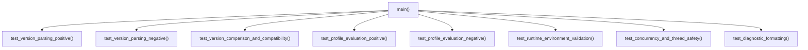

# Design — module-foundations-task0012

Status: PROPOSED

## Current, target and gaps

### Estado actual (CURRENT)
- En `apps/vigilio-browser/src/core/QtDependencyValidator.h` y `QtDependencyValidator.cpp`:
  - Se encuentra implementado el validador desacoplado en C++20 como componente de la biblioteca `vigilio_core`.
  - Provee las entidades fuertemente tipadas `SemanticVersion`, `QtModuleId`, `QtRequirementProfile`, `QtValidationOutcome` y `QtValidationReport`.
  - Provee las funciones puras `parseVersion()`, `requiredModules()`, `validateProfile()`, `validateRuntimeEnvironment()`, `formatOutcome()`, `formatReport()` y `moduleName()`.
  - Opera con total independencia del runtime gráfico de Qt y de `QApplication`, permitiendo pruebas deterministas en entornos headless.
- En `apps/vigilio-browser/src/app.cpp`:
  - El punto de entrada principal invoca `vigilio::QtDependencyValidator::validateRuntimeEnvironment(qVersion(), QT_VERSION_STR, display, wayland)`.
  - Si el reporte indica un resultado no conforme con `Satisfied`, el proceso aborta emitiendo un diagnóstico en `stderr` con código de salida 1 antes de instanciar cualquier widget de Qt.
- En `apps/vigilio-browser/tests/unit/CoreTests.cpp`:
  - Contiene un bloque inicial de aserciones básicas para `QtDependencyValidator` (CRIT-001 a CRIT-004) mezclado junto a las pruebas de `UrlInput`, `TabModel` y `SessionFile`.
- En `apps/vigilio-browser/CMakeLists.txt`:
  - Configura los targets de CTest existentes: `core_units` (`tests/unit/CoreTests.cpp`), `storage_integration` (`tests/integration/StorageTests.cpp`) y `vigilio_warnings_tests` (`tests/unit/CompilerWarningsTests.cpp`).
  - No cuenta aún con un target ejecutable dedicado ni con un test de CTest exclusivo para la capacidad `Qt dependency validation`.

### Estado objetivo (TARGET)
- Una suite de pruebas automatizadas modular, exhaustiva y determinista (`tests/unit/QtDependencyValidatorTests.cpp`) dedicada a `Qt dependency validation`, que verifique:
  1. **Casos positivos y normales**:
     - Parsing de versiones canónicas de 3 partes (`6.10.0`), de 2 partes normalizadas (`6.10` -> `6.10.0`), versiones con prefijos (`v6.12.3`), versiones con espacios perimetrales y versiones con metadatos/pre-release (`6.10.1-beta`).
     - Representación en cadena formateada (`toString()`).
     - Comparación completa (`<=>`) y predicado de compatibilidad semántica de Qt6 (`isCompatibleWith()`).
     - Resolución exitosa de perfiles de requerimientos (`HeadlessCore`, `MinimalGui`, `FullBrowser`, `DeveloperTest`).
     - Validación de entornos de despliegue gráfico X11, Wayland y duales.
     - Formateo diagnóstico de outcomes y nombres canónicos de módulos.
  2. **Casos negativos y entradas inválidas**:
     - Cadenas vacías, espacios, caracteres no numéricos, puntuación rota y desbordamientos.
     - Módulos ausentes individuales y múltiples por perfil de requerimiento (`MissingComponent`).
     - Versiones obsoletas (< 6.10.0) y versiones con desajuste de major (`5.15.2` y `7.0.0`).
     - Errores de entorno: variables de versión malformadas, desajuste ABI entre compilación y runtime, y ausencia de servidor de pantalla en Linux sin offscreen QPA.
  3. **Recuperación y resiliencia**:
     - Manejo de punteros nulos o variables vacías sin accesos ilegales ni caídas de proceso.
     - Validación del flujo de salida controlada en `app.cpp`.
  4. **Concurrencia y multihilo**:
     - Ejecución concurrente segura sin estado mutable global ni condiciones de carrera.
  5. **Integración formal en CTest**:
     - Target ejecutable `vigilio_qt_validator_tests` registrado en `CMakeLists.txt` con nombre de prueba `qt_dependency_validation_tests`, etiquetas `"unit;fast"`, timeout de 15 segundos y tiempo de ejecución < 20 ms.
     - Ejecución automática y continua dentro de `apps/vigilio-browser/scripts/check.sh`.

### Brechas identificadas (GAPS)
- **Falta de suite unitaria dedicada**: Las pruebas actuales en `CoreTests.cpp` son preliminares y no cubren casos de desbordamiento, espacios perimetrales, concurrencia multihilo, ni la matriz completa de ausencias de módulos y errores de display.
- **Falta de target CTest independiente**: Falta el target `vigilio_qt_validator_tests` y el registro `qt_dependency_validation_tests` en `CMakeLists.txt`, impidiendo reportar métricas y tiempos aislados para esta capacidad.
- **Falta de pruebas de concurrencia**: No se había verificado empíricamente la seguridad multihilo de los métodos puros de validación.

## Compatibility, migration and rollback

- **Compatibilidad**:
  - Totalmente compatible con la arquitectura headless de Vigilio Browser (`VIGILIO_BUILD_GUI=OFF`).
  - No requiere bibliotecas gráficas de Qt para compilar o ejecutar la suite de pruebas (utiliza exclusivamente tipos estándar de C++20 y la biblioteca `vigilio_core`).
  - Compatible con compiladores GNU GCC 15+, LLVM Clang 18+ y MSVC 2022+.
- **Migración**:
  - No altera esquemas de base de datos ni formatos de persistencia de usuario.
  - La adición de la suite de pruebas es aditiva y preserva el 100% de las pruebas existentes en `CoreTests.cpp`.
- **Rollback**:
  - En caso de anomalía, la reversión se limita a remover el archivo de prueba `tests/unit/QtDependencyValidatorTests.cpp` y la entrada correspondiente en `CMakeLists.txt`, restaurando la configuración previa sin afectar el resto del sistema.

## Arquitectura de pruebas y casos de validación de dependencias Qt

La suite de pruebas se estructura en un único archivo fuente C++20 autosuficiente:
- `apps/vigilio-browser/tests/unit/QtDependencyValidatorTests.cpp`

### Estructura modular de la suite


Cada función de prueba valida un subdominio específico de la capacidad, ejecutando aserciones mediante una macro determinista `CHECK(cond)` que arroja `std::runtime_error` ante cualquier discrepancia, imprimiendo el contexto exacto del fallo.

## Especificación exhaustiva de casos de prueba (Normal, Inválido, Recuperación, Concurrencia)

### 1. Parsing de versiones (`SemanticVersion::parse`)
- **Casos normales**:
  - Versión estándar: `"6.10.0"` -> `{6, 10, 0}`
  - Versión con parche incrementado: `"6.10.4"` -> `{6, 10, 4}`
  - Versión de 2 partes: `"6.10"` -> `{6, 10, 0}`
  - Versión con prefijo 'v': `"v6.12.3"` -> `{6, 12, 3}`
  - Versión con espacios perimetrales: `"  6.10.0  "` -> `{6, 10, 0}`
  - Versión con sufijo pre-release: `"6.10.1-beta"` -> `{6, 10, 1}`
  - Versión con metadatos de build: `"6.10.0+build2026"` -> `{6, 10, 0}`
- **Casos inválidos**:
  - Cadena vacía: `""` -> `std::nullopt`
  - Espacios únicamente: `"   "`, `"\t\n"` -> `std::nullopt`
  - Solo letras: `"abc"`, `"qt6"` -> `std::nullopt`
  - Puntos iniciales o finales incompletos: `"6."`, `".6.10"` -> `std::nullopt`
  - Puntos duplicados: `"6..10"`, `"..6.10"` -> `std::nullopt`
  - Letras en posiciones numéricas: `"6.abc.0"` -> `std::nullopt`
  - Desbordamiento entero: `"99999999999999999999.0.0"` -> `std::nullopt`

### 2. Comparación y compatibilidad semántica (`operator<=>` y `isCompatibleWith`)
- **Orden total**:
  - Reflexividad: `v == v`
  - Estricto orden débil: `{6, 9, 3} < {6, 10, 0} < {6, 10, 1} < {6, 11, 0} < {7, 0, 0}`
  - Desigualdades recíprocas: si `a < b`, entonces `b > a`
- **Predicado de compatibilidad Qt6**:
  - Mismo major (6) y versión >= requerida (`6.10.0`): `isCompatibleWith({6, 10, 0}) == true`
  - Mismo major (6) y versión < requerida (`6.9.3`): `isCompatibleWith({6, 10, 0}) == false`
  - Major anterior (`5.15.2`): `isCompatibleWith({6, 10, 0}) == false`
  - Major posterior (`7.0.0`): `isCompatibleWith({6, 10, 0}) == false` (ruptura de ABI esperada entre Qt 6 y Qt 7)

### 3. Perfiles de requerimientos (`validateProfile`)
- **Perfil HeadlessCore**:
  - Módulos requeridos: ninguno
  - Evaluación: siempre `Satisfied`, independientemente de los módulos presentes o la versión.
- **Perfil MinimalGui**:
  - Módulos requeridos: `{Core, Widgets}`
  - Caso satisfecho: presentes `{Core, Widgets}` con Qt 6.10.0 -> `Satisfied`
  - Caso faltante: presente únicamente `{Core}` -> `MissingComponent` (`missingModules == {Widgets}`)
- **Perfil FullBrowser**:
  - Módulos requeridos: `{Core, Widgets, WebEngineWidgets}`
  - Caso satisfecho: presentes `{Core, Widgets, WebEngineWidgets}` con Qt 6.10.2 -> `Satisfied`
  - Caso faltante: presentes `{Core, Widgets}` -> `MissingComponent` (`missingModules == {WebEngineWidgets}`)
  - Caso versión incompatible: presentes los 3 módulos pero con versión `6.9.3` -> `IncompatibleVersion`
- **Perfil DeveloperTest**:
  - Módulos requeridos: `{Core, Widgets, WebEngineWidgets, Test}`
  - Caso satisfecho: presentes los 4 módulos con Qt 6.10.0 -> `Satisfied`
  - Caso faltante: presentes `{Core, Widgets, WebEngineWidgets}` sin `Test` -> `MissingComponent`

### 4. Entorno de ejecución en runtime (`validateRuntimeEnvironment`)
- **Casos de éxito**:
  - X11: `display = ":0"`, `wayland = nullptr`, versiones coincidentes `6.10.0` -> `Satisfied`
  - Wayland: `display = nullptr`, `wayland = "wayland-0"`, versiones coincidentes `6.10.0` -> `Satisfied`
  - Servidor dual: `display = ":1"`, `wayland = "wayland-1"` -> `Satisfied`
- **Casos de fallo y diagnóstico**:
  - Sin servidor gráfico en Linux: `display = nullptr` (o `""`) y `wayland = nullptr` (o `""`) sin `QT_QPA_PLATFORM` offscreen -> `EnvironmentError`
  - Incompatibilidad ABI por divergencia de versión mayor: versión compilada `6.10.0` vs runtime `7.0.0` -> `EnvironmentError`
  - Versión runtime inferior a la mínima: compilada `6.9.2` vs runtime `6.9.2` -> `IncompatibleVersion`
  - Cadena de versión no parseable: runtime `"invalid_runtime"` -> `EnvironmentError`
  - Cadena de compilación no parseable: compile `""` -> `EnvironmentError`

### 5. Concurrencia y multihilo
- Invocación simultánea desde 8 hilos ejecutando 100 iteraciones de `validateProfile` y `validateRuntimeEnvironment` con parámetros variables.
- Garantía de ausencia de contención, corrupción de memoria o condiciones de carrera.

## Fixtures sintéticos y simulación de entornos de ejecución

Para asegurar que las pruebas no dependan del estado del sistema operativo anfitrión ni de la presencia física de un monitor o servidor X11/Wayland:
- La función `validateRuntimeEnvironment` acepta explícitamente parámetros `const char* displayEnv` y `const char* waylandEnv`.
- Las pruebas inyectan fixtures sintéticos en memoria (`":0"`, `"wayland-0"`, `""`, `nullptr`).
- No se utilizan llamadas mutables a `setenv()` o `putenv()`, eliminando cualquier riesgo de colisión entre hilos de ejecución concurrente.

## Integración en CTest y política de ejecución headless

En `apps/vigilio-browser/CMakeLists.txt`, la suite se integra dentro del bloque condicional `if(BUILD_TESTING)`:
```cmake
add_executable(vigilio_qt_validator_tests tests/unit/QtDependencyValidatorTests.cpp)
target_link_libraries(vigilio_qt_validator_tests PRIVATE vigilio_core vigilio_compiler_warnings)
add_test(NAME qt_dependency_validation_tests COMMAND vigilio_qt_validator_tests)
set_tests_properties(qt_dependency_validation_tests PROPERTIES LABELS "unit;fast" TIMEOUT 15)
```

Propiedades operativas:
- **Etiquetas**: `unit;fast`, permitiendo su ejecución inmediata con `ctest -L fast`.
- **Aislamiento**: Depende únicamente de `vigilio_core` y `vigilio_compiler_warnings`, funcionando 100% en compilaciones headless (`VIGILIO_BUILD_GUI=OFF`).
- **Timeout**: 15 segundos para evitar cuelgues o procesos zombies.

## Aislamiento de recursos, concurrencia y límites de RAM

- **Presupuesto de RAM**: < 100 KB para toda la ejecución de la prueba.
- **Tiempo de CPU**: < 20 ms en hardware estándar de desarrollo/CI.
- **Procesos**: 1 proceso único; cero instancias de Chromium, WebEngine o procesos auxiliares.
- **Limpieza**: Cero archivos residuales en disco; ejecución íntegramente en memoria volátil.

## Matriz detallada de pruebas y trazabilidad de aceptación

| Requisito / Contrato | Caso de prueba concreto | Entrada / Precondición | Comportamiento esperado | Aserción clave |
| --- | --- | --- | --- | --- |
| Parsing canónico | `test_version_parsing_positive` | `"6.10.0"` | Objeto `SemanticVersion` con {6, 10, 0} | `v->major == 6 && v->minor == 10 && v->patch == 0` |
| Parsing con espacios | `test_version_parsing_positive` | `"  6.10.2  "` | Recorte de espacios y parsing exitoso | `v->toString() == "6.10.2"` |
| Parsing 2 partes | `test_version_parsing_positive` | `"6.10"` | Normalización de patch a 0 | `v->patch == 0` |
| Rechazo entrada vacía | `test_version_parsing_negative` | `""` y `"   "` | Fallo controlado | `!v.has_value()` |
| Rechazo no numérico | `test_version_parsing_negative` | `"qt-6.10"` | Fallo controlado | `!v.has_value()` |
| Rechazo formato roto | `test_version_parsing_negative` | `"6..10"`, `"6."` | Fallo controlado | `!v.has_value()` |
| Orden de versiones | `test_version_comparison` | `6.9.3` vs `6.10.0` | `6.9.3 < 6.10.0` | `v693 < v6100` |
| Compatibilidad semántica | `test_version_compatibility` | `6.10.2` vs `6.10.0` | Compatible | `v6102.isCompatibleWith(v6100)` |
| Incompatibilidad menor | `test_version_compatibility` | `6.9.3` vs `6.10.0` | Incompatible | `!v693.isCompatibleWith(v6100)` |
| Incompatibilidad ABI major | `test_version_compatibility` | `7.0.0` vs `6.10.0` | Incompatible | `!v700.isCompatibleWith(v6100)` |
| Perfil Headless | `test_profile_positive` | Perfil `HeadlessCore` | Satisfied sin módulos | `report.outcome == Satisfied` |
| Perfil MinimalGui | `test_profile_positive` | Perfil `MinimalGui` con Core+Widgets | Satisfied | `report.outcome == Satisfied` |
| Perfil FullBrowser | `test_profile_positive` | Perfil `FullBrowser` con Core+Widgets+WebEngine | Satisfied | `report.outcome == Satisfied` |
| Módulo faltante | `test_profile_negative` | `FullBrowser` sin WebEngine | MissingComponent | `report.missingModules[0] == WebEngineWidgets` |
| Runtime X11 | `test_runtime_environment` | `display=":0"` | Satisfied | `report.outcome == Satisfied` |
| Runtime Wayland | `test_runtime_environment` | `wayland="wayland-0"` | Satisfied | `report.outcome == Satisfied` |
| Sin display en Linux | `test_runtime_environment` | `display=nullptr`, `wayland=nullptr` | EnvironmentError | `report.outcome == EnvironmentError` |
| Desajuste ABI runtime | `test_runtime_environment` | compile `6.10.0` vs runtime `7.0.0` | EnvironmentError | `report.outcome == EnvironmentError` |
| Seguridad concurrente | `test_concurrency` | 8 hilos, 100 iteraciones | Cero excepciones o carreras | Todos los hilos finalizan con éxito |
| Nombres de módulos | `test_diagnostic_formatting` | `QtModuleId::WebEngineWidgets` | Cadena canónica | `moduleName(...) == "WebEngineWidgets"` |
| Formateo de outcomes | `test_diagnostic_formatting` | Todos los outcomes | Cadenas descriptivas | No vacías y distintas de Unknown |
