# Design — module-foundations-task0016

Status: PROPOSED

## Current, target and gaps

### Estado actual (CURRENT)
- En `apps/vigilio-browser/src/core/WebEngineVersionValidator.h` y `WebEngineVersionValidator.cpp`:
  - Se encuentra implementada la biblioteca de dominio para la validación de compatibilidad con WebEngine en C++20 dentro del target estático `vigilio_core`.
  - Provee las estructuras inmutables y fuertemente tipadas `ChromiumVersion` (con `operator<=>`, `milestone()`, `isCompatibleWith()`, `toString()`), `WebEngineFeature`, `WebEngineCompatibilityProfile`, `WebEngineCompatibilityStatus` y `WebEngineCompatibilityReport`.
  - Provee métodos desacoplados puros: `baselineChromiumVersion()`, `minimumChromiumVersionForQt()`, `supportedFeaturesForMilestone()`, `requiredFeaturesForProfile()`, `isHelperExecutable()`, `validateCompatibility()`, `validateStartup()` y formateadores de diagnósticos.
  - El componente está desacoplado al 100% de `Qt6::WebEngineWidgets` y Chromium, permitiendo compilación y ejecución determinista en entornos headless.
- En `apps/vigilio-browser/src/app.cpp`:
  - Se encuentra integrada la pre-validación de WebEngine tras la comprobación de dependencias Qt, finalizando con código de error 1 ante incompatibilidades críticas antes de instanciar la interfaz gráfica de usuario.
- En `apps/vigilio-browser/tests/unit/WebEngineVersionValidatorTests.cpp`:
  - Se cuenta con una suite inicial de pruebas unitarias que cubre parsing básico, ordenamiento de versiones, matriz de capacidades, comprobación de helper sintético, validación de perfiles y concurrencia preliminar.
- En `apps/vigilio-browser/CMakeLists.txt`:
  - Se encuentra configurado el target de prueba ejecutable `vigilio_webengine_validator_tests` y registrado como prueba de CTest `webengine_version_validator_tests` bajo las etiquetas `LABELS "unit;fast"`.
  - La suite se ejecuta en modo headless (`VIGILIO_BUILD_GUI=OFF`) dentro del script de validación continua `apps/vigilio-browser/scripts/check.sh`.

### Estado objetivo (TARGET)
- Una suite de pruebas automatizadas endurecida, exhaustiva, determinista y de alta resiliencia para certificar al 100% la capacidad **WebEngine version compatibility** en su etapa **tests**, verificando:
  1. **Casos positivos y normales**:
     - Parsing de versiones estándar cuatripartitas, con ceros en subcampos, prefijos `'v'` y `'V'`, y cadenas con espacios/tabuladores perimetrales recortados.
     - Ordenamiento total (`operator<=>`) verificando reflexividad, antisimetría y transitividad entre versiones de Chromium en todas sus dimensiones numéricas.
     - Compatibilidad semántica frente al baseline canónico (Chromium >= 128.0.0.0).
     - Resolución determinista del baseline de Chromium según la versión detectada de Qt (Qt >= 6.10.0 -> Chromium 128).
     - Validación de perfiles de ejecución (`FullDesktopBrowser`, `HeadlessInspection`, `RestrictedSecureProfile`, `MinimalCore`) con matrices completas de capacidades soportadas y requeridas.
     - Comprobación de helpers ejecutables válidos mediante permisos de archivo POSIX (`0755`) y resolución de symlinks.
  2. **Casos negativos y entradas inválidas**:
     - Rechazo estricto de entradas malformadas en `ChromiumVersion::parse`: cadenas vacías, espacios, campos faltantes, campos excedentes, caracteres no numéricos, puntos aislados, dobles puntos, números negativos y protección contra desbordamiento numérico entero (`uint32_t`).
     - Rechazo exhaustivo de incompatibilidades: versiones obsoletas de Qt (< 6.10.0) o Chromium (< 128), proceso asistente `QtWebEngineProcess` faltante o sin permisos de ejecución, y entornos sin soporte de sandboxing/aislamiento en perfil desktop.
  3. **Concurrencia multihilo, latencia y thread-safety**:
     - Evaluación masiva multihilo con 16 hilos simultáneos y 1000 iteraciones por hilo ejecutando parsing, validación y formateo en paralelo.
     - Confirmación de pureza funcional: ausencia absoluta de variables mutables globales, cero contención de bloqueos (lock-free en llamadas de validación) y latencia media de validación inferior a 1 ms por llamada.
  4. **Recuperación, degradación y resiliencia**:
     - Simulación de contingencias en `validateStartup`: conmutación a `DegradedHeadless` ante ejecución sin interfaz gráfica o con perfil mínimo, y reporte estructurado con acción de mitigación ante helper faltante.
     - Manejo de excepciones y punteros nulos sin provocar fallos de segmentación ni terminación anormal del proceso.
  5. **Integración formal y ejecución rápida en CTest**:
     - Timeout determinista de 15 segundos y tiempo de ejecución real inferior a 50 milisegundos.
     - Cero dependencias de red externa, cero procesos Chromium reales iniciados (política zero-zombie) y limpieza determinista de fixtures temporales mediante RAII.

### Brechas identificadas (GAPS)
- **Casos límite de parsing no cubiertos exhaustivamente**: Falta verificar explícitamente el comportamiento ante desbordamientos numéricos enteros de 64 bits y cadenas con caracteres de escape o espacios no convencionales.
- **Validación de symlinks y rutas anómalas en helpers ejecutables**: La comprobación actual de `isHelperExecutable` valida archivos planos simples; se requiere verificar formalmente el comportamiento ante enlaces simbólicos válidos y enlaces simbólicos rotos hacia binarios asistentes.
- **Estrés concurrente de alta intensidad**: La prueba de hilos actual utiliza 8 hilos y 500 iteraciones; se proyecta ampliar a 16 hilos y 1000 iteraciones con verificación de latencia determinista (< 1 ms).
- **Formalización de matrices de incompatibilidad combinadas**: Se requiere auditar y documentar la precedencia determinista de errores cuando concurren múltiples fallos de entorno (por ejemplo, Qt incompatible y helper faltante al mismo tiempo).

## Compatibility, migration and rollback

### Compatibilidad
- **Arquitectura headless y desacoplamiento**: La suite de pruebas no depende de servidor gráfico (X11 o Wayland), tarjetas de video ni bibliotecas dinámicas de Chromium; opera exclusivamente con tipos estándar de C++20 y la biblioteca estática `vigilio_core`.
- **Portabilidad multiplataforma**: Compatible de forma nativa con compiladores GCC 15+, Clang 18+ y MSVC 2022+ en Linux x64, Windows x64 y macOS arm64/x64.
- **Compatibilidad con herramientas de calidad**: Totalmente compatible con AddressSanitizer (ASan), UndefinedBehaviorSanitizer (UBSan), ThreadSanitizer (TSan) y formateo estricto con Clang-Format.

### Migración
- No introduce migraciones de esquemas de datos ni altera estructuras en disco.
- El conjunto de pruebas es complementario y fortalece los contratos existentes sin generar impactos colaterales sobre `CoreTests`, `StorageTests` o `QtDependencyValidatorTests`.

### Rollback
- En caso de regresión o fallo inesperado, el rollback es inmediato y seguro: consiste en descartar las modificaciones en `tests/unit/WebEngineVersionValidatorTests.cpp` mediante el control de versiones sin afectar la compilación del núcleo del navegador.

## Arquitectura técnica de pruebas para WebEngine version compatibility

La suite de pruebas automatizadas se estructura de forma modular en `apps/vigilio-browser/tests/unit/WebEngineVersionValidatorTests.cpp`:

### Estructura modular de la suite de pruebas C++20

```mermaid
flowchart TD
    A["main()"] --> B["test_chromium_version_parsing_positive()"]
    A --> C["test_chromium_version_parsing_negative()"]
    A --> D["test_chromium_version_comparison_and_compatibility()"]
    A --> E["test_minimum_chromium_version_for_qt()"]
    A --> F["test_feature_matrix_and_profiles()"]
    A --> G["test_helper_executable_check()"]
    A --> H["test_compatibility_validation()"]
    A --> I["test_startup_validation()"]
    A --> J["test_formatting_and_introspection()"]
    A --> K["test_concurrency_and_thread_safety()"]
```



### Macro de aserción determinista y RAII Guard

La suite implementa una política determinista de aserciones sin frameworks externos pesados:
```cpp
#define CHECK(condition)                                                                                \
    do {                                                                                                \
        if (!(condition)) {                                                                             \
            throw std::runtime_error("CHECK failed at line " + std::to_string(__LINE__) +               \
                                     ": " #condition);                                                  \
        }                                                                                               \
    } while (false)
```

Para la gestión de archivos ejecutables sintéticos temporales, se utiliza la estructura RAII `TempHelperFileGuard`, garantizando la eliminación inmediata del archivo en el sistema de archivos tanto en caso de éxito como ante excepciones:
```cpp
struct TempHelperFileGuard {
    std::filesystem::path path;
    explicit TempHelperFileGuard(std::filesystem::path p) : path(std::move(p)) { cleanup(); }
    ~TempHelperFileGuard() { cleanup(); }
    void cleanup() noexcept {
        std::error_code ec;
        std::filesystem::remove(path, ec);
    }
    TempHelperFileGuard(const TempHelperFileGuard&) = delete;
    TempHelperFileGuard& operator=(const TempHelperFileGuard&) = delete;
};
```

## Especificación exhaustiva de suites y casos de prueba

### 1. Parsing y normalización de versiones Chromium (positivo y negativo)
- **Casos positivos (`test_chromium_version_parsing_positive`)**:
  - Versión estándar: `"128.0.6613.119"` -> `{major: 128, minor: 0, build: 6613, patch: 119}`.
  - Componentes nulos: `"128.0.0.0"` -> `{major: 128, minor: 0, build: 0, patch: 0}`.
  - Prefijo minúscula: `"v130.0.6723.58"` -> `{major: 130, minor: 0, build: 6723, patch: 58}`.
  - Prefijo mayúscula: `"V132.0.6834.15"` -> `{major: 132, minor: 0, build: 6834, patch: 15}`.
  - Espaciado perimetral: `"   129.0.6668.70   \t"` -> `{major: 129, minor: 0, build: 6668, patch: 70}`.
  - Delegación por validador: `WebEngineVersionValidator::parseChromiumVersion("128.0.6613.120")` -> `{major: 128, minor: 0, build: 6613, patch: 120}`.
- **Casos negativos (`test_chromium_version_parsing_negative`)**:
  - Vacío / espacios: `""`, `"   "`, `"\t\n"` -> `std::nullopt`.
  - Componentes incompletos: `"128"`, `"128.0"`, `"128.0.6613"` -> `std::nullopt`.
  - Componentes en exceso: `"128.0.6613.119.1"` -> `std::nullopt`.
  - Sufijos inválidos: `"128.0.6613.119extra"`, `"128.0.6613.119-beta"` -> `std::nullopt`.
  - Caracteres alfabéticos: `"abc"`, `"128.x.6613.119"`, `"128.0.y.119"`, `"128.0.6613.z"` -> `std::nullopt`.
  - Puntuación malformada: `".128.0.6613.119"`, `"128..6613.119"`, `"128.0.6613."` -> `std::nullopt`.
  - Negativos: `"-128.0.6613.119"` -> `std::nullopt`.
  - Desbordamiento entero: `"99999999999999999999.0.0.0"` -> `std::nullopt`.

### 2. Ordenamiento total, comparación y compatibilidad de hitos (invariantes)
- **Comparación (`test_chromium_version_comparison_and_compatibility`)**:
  - Operador `==`: igualdad estricta de los 4 componentes numéricos.
  - Operador `!=`: discrepancia en cualquiera de los campos.
  - Operador `<=>`: orden lexicográfico estricto `major` -> `minor` -> `build` -> `patch`.
  - Validación transitiva: `127.0.6533.134 < 128.0.0.0 < 128.0.6613.119 < 128.0.6613.120 < 129.0.0.0`.
  - Predicado `isCompatibleWith`: `v128_base.isCompatibleWith(v128_base) == true`, `v128_patch.isCompatibleWith(v128_base) == true`, `v129.isCompatibleWith(v128_base) == true`, `v127.isCompatibleWith(v128_base) == false`.
  - Invariante del baseline: `WebEngineVersionValidator::baselineChromiumVersion() == ChromiumVersion{128, 0, 0, 0}`.

### 3. Matriz de capacidades funcionales y perfiles de compatibilidad
- **Capacidades por hito (`test_feature_matrix_and_profiles`)**:
  - Hito 128: 8 capacidades activas (`ManifestV3Extensions`, `PdfViewerInternal`, `WebRTC`, `DevToolsFrontend`, `ProcessSandboxing`, `HardwareAcceleration`, `LocalDevStorage`, `Http3Quic`).
  - Hito 122: 6 capacidades activas (ausencia de `ManifestV3Extensions` y `Http3Quic`).
  - Hito 118: 4 capacidades activas (ausencia de `ProcessSandboxing`).
  - Hito 0: 0 capacidades activas.
- **Requerimientos por perfil**:
  - `FullDesktopBrowser`: requiere `ManifestV3Extensions`, `PdfViewerInternal`, `ProcessSandboxing`, `LocalDevStorage`.
  - `RestrictedSecureProfile`: requiere `ProcessSandboxing`, `LocalDevStorage`.
  - `HeadlessInspection`: requiere `LocalDevStorage`.
  - `MinimalCore`: conjunto vacío de requerimientos.

### 4. Detección, permisos de ejecución y validación de helper binario
- **Evaluación de ejecutable asistente (`test_helper_executable_check`)**:
  - Ruta vacía `""` -> `false`.
  - Ruta inexistente `"/non/existent/path/QtWebEngineProcess"` -> `false`.
  - Directorio existente `"/tmp"` -> `false`.
  - Archivo sintético con permisos `0644` (lectura/escritura) -> `false` en entornos POSIX.
  - Archivo sintético con permisos `0755` (ejecutable) -> `true`.
  - Symlink apuntando a archivo ejecutable válido -> `true`.
  - Symlink roto apuntando a destino inexistente -> `false`.

### 5. Validación integral de compatibilidad de perfiles (FullDesktop, Headless, Restricted, Minimal)
- **Combinaciones de estado (`test_compatibility_validation`)**:
  - Perfil `MinimalCore`: resuelve a `DegradedHeadless` independientemente de si Qt o Chromium están disponibles.
  - Qt incompatible (< 6.10.0 o `nullopt`): resuelve a `IncompatibleQtVersion`.
  - Chromium incompatible (< 128 o `nullopt`): resuelve a `IncompatibleChromiumVersion`.
  - Proceso asistente faltante: resuelve a `ProcessHelperMissing` en perfil desktop.
  - Entorno sin sandboxing: resuelve a `EnvironmentMisconfigured` en perfil desktop.
  - Perfil `FullDesktopBrowser` con requisitos satisfechos: resuelve a `Compatible`.
  - Perfil `HeadlessInspection` sin asistente ejecutable: resuelve a `Compatible`.

### 6. Protocolo de pre-validación de arranque y degradación segura
- **Pre-validación en tiempo de ejecución (`test_startup_validation`)**:
  - Invocación con `isHeadless = true`: resuelve deterministamente a `DegradedHeadless`.
  - Invocación con `isHeadless = false` y ruta sintética de helper ejecutable: resuelve a `Compatible`.
  - Invocación con helper no ejecutable o ausente: resuelve a `ProcessHelperMissing`.

### 7. Formateo diagnóstico, introspección y observabilidad estructurada
- **Introspección y diagnósticos (`test_formatting_and_introspection`)**:
  - Mapeo unívoco de nombres de enumerador (`featureName`, `profileName`, `formatStatus`).
  - Formateo de reporte `formatReport`: genera un diagnóstico estructurado conteniendo el estado, versiones detectadas, ruta del asistente, capacidades ausentes y acción de mitigación recomendada.

### 8. Concurrencia multihilo, latencia, thread-safety y ausencia de estado mutable
- **Estrés concurrente (`test_concurrency_and_thread_safety`)**:
  - 16 hilos de trabajo independientes (`std::thread`).
  - 1000 iteraciones por hilo ejecutando parsing, validación de compatibilidad y formateo.
  - Detección de fallos mediante variable atómica `std::atomic<bool>`.
  - Tiempo de CPU total en concurrencia < 200 ms, verificando que los métodos son libres de contención y data races.

## Fixtures sintéticos y simulación determinista de entornos

- La suite crea archivos sintéticos en `std::filesystem::temp_directory_path()`.
- Los archivos contienen cabeceras mínimas `#!/bin/sh\nexit 0\n` y se marcan con permisos de ejecución específicos mediante `chmod`.
- La eliminación está respaldada por RAII (`TempHelperFileGuard`), garantizando que abortos prematuros de prueba o excepciones no dejen artefactos en disco.

## Integración en CMake y CTest (política headless y etiquetas)

- **Configuración en CMakeLists.txt**:
  ```cmake
  add_executable(vigilio_webengine_validator_tests tests/unit/WebEngineVersionValidatorTests.cpp)
  target_link_libraries(vigilio_webengine_validator_tests PRIVATE vigilio_core vigilio_compiler_warnings)
  add_test(NAME webengine_version_validator_tests COMMAND vigilio_webengine_validator_tests)
  set_tests_properties(webengine_version_validator_tests PROPERTIES LABELS "unit;fast" TIMEOUT 15)
  ```
- **Pipeline de verificación continua**:
  - Integrado de forma obligatoria en `apps/vigilio-browser/scripts/check.sh`.
  - Compilación con `-Werror` bajo C++20 con Ninja.

## Aislamiento de recursos, presupuesto de RAM y política zero-zombie

- **Cero procesos zombis**: No se invoca ningún subproceso de Chromium ni se crean workers en segundo plano.
- **Presupuesto de RAM**: Consumo de memoria de la suite de pruebas inferior a 100 KB RAM.
- **Aislamiento de red**: Ninguna prueba intenta conectarse a sockets externos o servicios DNS.

## Matriz detallada de pruebas y trazabilidad de aceptación

- **Aceptación 1**: Toda versión cuatripartita de Chromium válida o inválida es procesada deterministamente sin excepciones ni desbordamientos -> Cubierto por `test_chromium_version_parsing_positive` y `test_chromium_version_parsing_negative`.
- **Aceptación 2**: Las relaciones de ordenamiento y compatibilidad son consistentes y respetan el baseline Chromium 128 -> Cubierto por `test_chromium_version_comparison_and_compatibility` y `test_minimum_chromium_version_for_qt`.
- **Aceptación 3**: La matriz de capacidades funcionales discrimina con precisión entre hitos -> Cubierto por `test_feature_matrix_and_profiles`.
- **Aceptación 4**: Los permisos del proceso asistente son verificados de forma segura -> Cubierto por `test_helper_executable_check`.
- **Aceptación 5**: La validación de perfiles responde con el estado exacto ante cualquier combinación de entorno -> Cubierto por `test_compatibility_validation` y `test_startup_validation`.
- **Aceptación 6**: El formateo de observabilidad provee diagnósticos legibles y accionables -> Cubierto por `test_formatting_and_introspection`.
- **Aceptación 7**: La ejecución es totalmente segura en entornos concurrentes multihilo -> Cubierto por `test_concurrency_and_thread_safety`.
