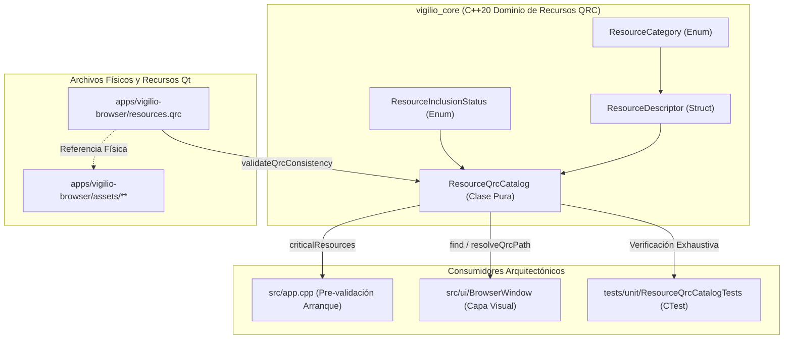

# Design — module-foundations-task0017

Status: PROPOSED

## Current, target and gaps

### Estado actual (CURRENT)
- En `apps/vigilio-browser/resources.qrc`:
  - Existe un archivo de recursos Qt válido con `<qresource prefix="/vigilio">` que lista 35 archivos mapeados bajo `assets/`:
    - 6 temas (`themes/*.json`).
    - 6 fondos de paisaje (`wallpapers/*.jpg`).
    - 1 logotipo oficial vectorizado (`branding/vigilio-logo.svg`).
    - 1 archivo de tokens de diseño (`design-tokens/tokens.json`).
    - 10 iconos de navegación SVG (`icons/navigation/*.svg`).
    - 11 iconos de herramientas SVG (`icons/tools/*.svg`).
- En `apps/vigilio-browser/assets/`:
  - Los 35 archivos existen físicamente y están bien estructurados.
  - Existen además subdirectorios como `reference/` (maquetas y bocetos), `installer/` (textos y referencias para el instalador) y `fonts/` (notas de fuentes), los cuales no deben ser empaquetados en el binario del navegador según `assets/README.md`.
- En `apps/vigilio-browser/CMakeLists.txt`:
  - Se activa `CMAKE_AUTORCC ON` condicionado a la disponibilidad de Qt6 y `VIGILIO_BUILD_GUI=ON`.
  - `resources.qrc` se enlaza directamente a los ejecutables `vigilio-browser`, `vigilio_ui_tests` y `vigilio_e2e_smoke`.
- En `apps/vigilio-browser/src/core/`:
  - Existen módulos de dominio para validación de dependencias Qt (`QtDependencyValidator`) y compatibilidad de WebEngine (`WebEngineVersionValidator`).
  - **No existe** ningún tipo de dominio, catálogo canónico o validador para recursos QRC. La aplicación y los tests asumen implícitamente que los recursos existen sin un contrato fuertemente tipado en el núcleo `vigilio_core`.

### Estado objetivo (TARGET)
- Un modelo de dominio formal, desacoplado y fuertemente tipado en C++20 dentro de `vigilio_core` para la capacidad **resource qrc inclusion** en su etapa **domain**, que provea:
  1. **Tipos de valor fuertemente tipados**:
     - `ResourceCategory`: Clasificación semántica de activos (`Theme`, `Wallpaper`, `Branding`, `DesignTokens`, `NavigationIcon`, `ToolIcon`).
     - `ResourceInclusionStatus`: Taxonomía exhaustiva de resultados de validación y causas de rechazo.
     - `ResourceDescriptor`: Entidad inmutable que encapsula el alias canónico, la ruta virtual QRC (`:/vigilio/...`), la ruta física relativa en desarrollo, el tipo MIME, la categoría y la bandera de criticidad.
  2. **Catálogo canónico inmutable (`ResourceQrcCatalog`)**:
     - Catálogo estático que modela con precisión los **35 recursos aprobados** presentes en `resources.qrc`.
     - Métodos puros para consulta por alias (`contains`, `find`), resolución de rutas virtuales (`resolveQrcPath`), filtrado por categoría (`resourcesByCategory`), lista de recursos críticos (`criticalResources`) y validación de sintaxis de alias (`isValidAlias`).
  3. **Motor de validación y reglas de exclusión**:
     - Validación sintáctica de alias: rechazo estricto de secuencias de salto de directorio (`..`, `../`), barras duplicadas, caracteres prohibidos o extensiones inconsistentes con la categoría.
     - Detección de inclusión de rutas expresamente excluidas (`reference/`, `installer/`, `fonts/`).
     - Verificación estática de correspondencia estructural entre el archivo XML `resources.qrc` y el catálogo de dominio (`validateQrcConsistency`).
  4. **Desacoplamiento arquitectónico absoluto**:
     - Compilación y testeo 100% independiente de Qt Widgets, WebEngine o displays gráficos, operable en entornos de servidor o CI headless con memoria estática < 20 KB.

### Brechas identificadas (GAPS)
- **Falta de modelo de dominio en `vigilio_core`**: En el estado actual, el acceso a recursos QRC se realiza mediante literales de cadena desprotegidos (e.g. `":/vigilio/icons/navigation/search.svg"`), sin validación previa ni garantías de compilación.
- **Ausencia de inventario formal y criticidad**: No existe una definición en código sobre cuáles recursos son obligatorios para que el navegador pueda arrancar su interfaz visual básica frente a recursos opcionales o secundarios.
- **Riesgo de inclusión accidental de maquetas**: No existe una regla de validación programática que impida que futuros cambios en `resources.qrc` incorporen por error archivos pesados de `assets/reference/mockups/` o fuentes no autorizadas de `assets/fonts/`.
- **Falta de trazabilidad y testing unitario en CTest**: No existe una suite de pruebas que valide la integridad y consistencia del catálogo de recursos en tiempo de compilación/ejecución rápida.

## Compatibility, migration and rollback

### Compatibilidad
- **Independencia de GUI y portabilidad C++20**: El modelo de dominio se basa exclusivamente en cabeceras de la biblioteca estándar de C++20 (`<string_view>`, `<array>`, `<optional>`, `<vector>`, `<string>`). No incluye cabeceras de Qt GUI ni requiere inicializar el motor de eventos de Qt.
- **Compatibilidad multiplataforma**: Funciona idénticamente en Linux x64, Windows x64 y macOS arm64/x64, utilizando normalización de separadores de ruta en formato POSIX para las rutas virtuales QRC (`:/vigilio/...`).
- **Garantías de compilación estricta**: Diseñado para compilar bajo `-Wall -Wextra -Wpedantic -Wconversion -Werror` a través del target `vigilio_compiler_warnings`.

### Migración
- No requiere migraciones de esquemas en SQLite ni altera archivos persistentes de sesión.
- El catálogo de dominio formaliza el archivo existente `apps/vigilio-browser/resources.qrc`, garantizando retrocompatibilidad con cualquier uso actual en `BrowserWindow`.

### Rollback
- En caso de anomalías o decisiones de rediseño, el rollback es inmediato y seguro: consiste en revertir la inclusión de los nuevos archivos de cabecera y pruebas en `src/core` y `tests/unit`, sin impactar los componentes preexistentes del navegador.

## Arquitectura técnica de dominio para resource qrc inclusion

### Diagrama de arquitectura del modelo de dominio



### Definición formal de tipos de datos en C++20

#### 1. Categoría de recurso (`ResourceCategory`)
```cpp
enum class ResourceCategory : uint8_t {
    Theme,          // Esquemas JSON de paleta y diseño (light, dark, midnight, forest, aurora, sunset)
    Wallpaper,      // Fondos de paisaje JPG para nueva pestaña (01 a 06)
    Branding,       // Identidad y logotipo oficial SVG
    DesignTokens,   // Tokens JSON de medidas, espaciado, radios y tipografía
    NavigationIcon, // Iconos SVG de barra de direcciones y navegación
    ToolIcon        // Iconos SVG de panel de herramientas, privacidad y utilidades
};
```

#### 2. Estado de validación de inclusión (`ResourceInclusionStatus`)
```cpp
enum class ResourceInclusionStatus : uint8_t {
    Valid,                  // Conforme y verificado
    InvalidAliasFormat,     // Alias malformado (traversal, caracteres ilegales, barras erróneas)
    ResourceNotFound,       // Alias ausente en el catálogo canónico
    CategoryMismatch,       // Discrepancia entre la ruta del alias y la categoría declarada
    PrefixMismatch,         // Archivo QRC utiliza prefijo distinto a /vigilio
    DuplicateAlias,         // Alias duplicado en el archivo de recursos
    MissingCriticalResource,// Recurso crítico para arranque ausente en el bundle
    ExcludedPathIncluded    // Inclusión indebida de rutas prohibidas (reference/, installer/, fonts/)
};
```

#### 3. Descriptor de recurso (`ResourceDescriptor`)
```cpp
struct ResourceDescriptor {
    std::string_view alias;              // e.g. "branding/vigilio-logo.svg"
    std::string_view qrcPath;            // e.g. ":/vigilio/branding/vigilio-logo.svg"
    std::string_view physicalAssetPath;  // e.g. "assets/branding/vigilio-logo.svg"
    ResourceCategory category;           // ResourceCategory::Branding
    std::string_view mimeType;           // "image/svg+xml"
    bool isCritical;                     // true

    constexpr bool operator==(const ResourceDescriptor& other) const noexcept = default;
    constexpr auto operator<=>(const ResourceDescriptor& other) const noexcept {
        return alias <=> other.alias;
    }
};
```

#### 4. Catálogo de dominio (`ResourceQrcCatalog`)
```cpp
class ResourceQrcCatalog {
public:
    static constexpr std::string_view kCanonicalPrefix = ":/vigilio";
    static constexpr size_t kExpectedResourceCount = 35;

    // Métodos de consulta básica
    static constexpr std::string_view canonicalPrefix() noexcept { return kCanonicalPrefix; }
    static constexpr size_t totalResourceCount() noexcept { return kExpectedResourceCount; }
    
    static bool contains(std::string_view alias) noexcept;
    static std::optional<ResourceDescriptor> find(std::string_view alias) noexcept;
    static std::string resolveQrcPath(std::string_view alias);
    
    // Validación sintáctica y de seguridad
    static bool isValidAlias(std::string_view alias) noexcept;
    static bool isExcludedPath(std::string_view path) noexcept;
    
    // Consultas estructuradas
    static std::vector<ResourceDescriptor> allResources();
    static std::vector<ResourceDescriptor> resourcesByCategory(ResourceCategory category);
    static std::vector<ResourceDescriptor> criticalResources();
    
    // Validación estática de archivo QRC XML
    static ResourceInclusionStatus validateQrcConsistency(std::string_view qrcXmlContent);
    
    // Nombres legibles para observabilidad
    static std::string_view categoryName(ResourceCategory category) noexcept;
    static std::string_view statusName(ResourceInclusionStatus status) noexcept;
};
```

## Especificación exhaustiva del inventario canónico de 35 recursos

A continuación se detalla la tabla normativa de los 35 recursos aprobados que conforman el catálogo de dominio `ResourceQrcCatalog`:

| N° | Alias canónico | Ruta virtual QRC | Ruta física de desarrollo | Categoría | Tipo MIME | ¿Crítico? |
| :- | :--- | :--- | :--- | :--- | :--- | :-: |
| 1 | `themes/light.json` | `:/vigilio/themes/light.json` | `assets/themes/light.json` | `Theme` | `application/json` | Sí |
| 2 | `themes/dark.json` | `:/vigilio/themes/dark.json` | `assets/themes/dark.json` | `Theme` | `application/json` | Sí |
| 3 | `themes/midnight.json` | `:/vigilio/themes/midnight.json` | `assets/themes/midnight.json` | `Theme` | `application/json` | No |
| 4 | `themes/forest.json` | `:/vigilio/themes/forest.json` | `assets/themes/forest.json` | `Theme` | `application/json` | No |
| 5 | `themes/aurora.json` | `:/vigilio/themes/aurora.json` | `assets/themes/aurora.json` | `Theme` | `application/json` | No |
| 6 | `themes/sunset.json` | `:/vigilio/themes/sunset.json` | `assets/themes/sunset.json` | `Theme` | `application/json` | No |
| 7 | `wallpapers/vigilio-landscape-01.jpg` | `:/vigilio/wallpapers/vigilio-landscape-01.jpg` | `assets/wallpapers/vigilio-landscape-01.jpg` | `Wallpaper` | `image/jpeg` | No |
| 8 | `wallpapers/vigilio-landscape-02.jpg` | `:/vigilio/wallpapers/vigilio-landscape-02.jpg` | `assets/wallpapers/vigilio-landscape-02.jpg` | `Wallpaper` | `image/jpeg` | No |
| 9 | `wallpapers/vigilio-landscape-03.jpg` | `:/vigilio/wallpapers/vigilio-landscape-03.jpg` | `assets/wallpapers/vigilio-landscape-03.jpg` | `Wallpaper` | `image/jpeg` | No |
| 10 | `wallpapers/vigilio-landscape-04.jpg` | `:/vigilio/wallpapers/vigilio-landscape-04.jpg` | `assets/wallpapers/vigilio-landscape-04.jpg` | `Wallpaper` | `image/jpeg` | No |
| 11 | `wallpapers/vigilio-landscape-05.jpg` | `:/vigilio/wallpapers/vigilio-landscape-05.jpg` | `assets/wallpapers/vigilio-landscape-05.jpg` | `Wallpaper` | `image/jpeg` | No |
| 12 | `wallpapers/vigilio-landscape-06.jpg` | `:/vigilio/wallpapers/vigilio-landscape-06.jpg` | `assets/wallpapers/vigilio-landscape-06.jpg` | `Wallpaper` | `image/jpeg` | No |
| 13 | `branding/vigilio-logo.svg` | `:/vigilio/branding/vigilio-logo.svg` | `assets/branding/vigilio-logo.svg` | `Branding` | `image/svg+xml` | Sí |
| 14 | `design-tokens/tokens.json` | `:/vigilio/design-tokens/tokens.json` | `assets/design-tokens/tokens.json` | `DesignTokens` | `application/json` | Sí |
| 15 | `icons/navigation/search.svg` | `:/vigilio/icons/navigation/search.svg` | `assets/icons/navigation/search.svg` | `NavigationIcon` | `image/svg+xml` | Sí |
| 16 | `icons/navigation/back.svg` | `:/vigilio/icons/navigation/back.svg` | `assets/icons/navigation/back.svg` | `NavigationIcon` | `image/svg+xml` | Sí |
| 17 | `icons/navigation/forward.svg` | `:/vigilio/icons/navigation/forward.svg` | `assets/icons/navigation/forward.svg` | `NavigationIcon` | `image/svg+xml` | Sí |
| 18 | `icons/navigation/reload.svg` | `:/vigilio/icons/navigation/reload.svg` | `assets/icons/navigation/reload.svg` | `NavigationIcon` | `image/svg+xml` | Sí |
| 19 | `icons/navigation/home.svg` | `:/vigilio/icons/navigation/home.svg` | `assets/icons/navigation/home.svg` | `NavigationIcon` | `image/svg+xml` | No |
| 20 | `icons/navigation/bookmarks.svg` | `:/vigilio/icons/navigation/bookmarks.svg` | `assets/icons/navigation/bookmarks.svg` | `NavigationIcon` | `image/svg+xml` | No |
| 21 | `icons/navigation/history.svg` | `:/vigilio/icons/navigation/history.svg` | `assets/icons/navigation/history.svg` | `NavigationIcon` | `image/svg+xml` | No |
| 22 | `icons/navigation/download.svg` | `:/vigilio/icons/navigation/download.svg` | `assets/icons/navigation/download.svg` | `NavigationIcon` | `image/svg+xml` | No |
| 23 | `icons/navigation/settings.svg` | `:/vigilio/icons/navigation/settings.svg` | `assets/icons/navigation/settings.svg` | `NavigationIcon` | `image/svg+xml` | No |
| 24 | `icons/navigation/tabs.svg` | `:/vigilio/icons/navigation/tabs.svg` | `assets/icons/navigation/tabs.svg` | `NavigationIcon` | `image/svg+xml` | No |
| 25 | `icons/tools/note.svg` | `:/vigilio/icons/tools/note.svg` | `assets/icons/tools/note.svg` | `ToolIcon` | `image/svg+xml` | No |
| 26 | `icons/tools/mcp.svg` | `:/vigilio/icons/tools/mcp.svg` | `assets/icons/tools/mcp.svg` | `ToolIcon` | `image/svg+xml` | No |
| 27 | `icons/tools/reader.svg` | `:/vigilio/icons/tools/reader.svg` | `assets/icons/tools/reader.svg` | `ToolIcon` | `image/svg+xml` | No |
| 28 | `icons/tools/camera.svg` | `:/vigilio/icons/tools/camera.svg` | `assets/icons/tools/camera.svg` | `ToolIcon` | `image/svg+xml` | No |
| 29 | `icons/tools/senior.svg` | `:/vigilio/icons/tools/senior.svg` | `assets/icons/tools/senior.svg` | `ToolIcon` | `image/svg+xml` | No |
| 30 | `icons/tools/tools.svg` | `:/vigilio/icons/tools/tools.svg` | `assets/icons/tools/tools.svg` | `ToolIcon` | `image/svg+xml` | No |
| 31 | `icons/tools/memory.svg` | `:/vigilio/icons/tools/memory.svg` | `assets/icons/tools/memory.svg` | `ToolIcon` | `image/svg+xml` | No |
| 32 | `icons/tools/extensions.svg` | `:/vigilio/icons/tools/extensions.svg` | `assets/icons/tools/extensions.svg` | `ToolIcon` | `image/svg+xml` | No |
| 33 | `icons/tools/split.svg` | `:/vigilio/icons/tools/split.svg` | `assets/icons/tools/split.svg` | `ToolIcon` | `image/svg+xml` | No |
| 34 | `icons/tools/qr.svg` | `:/vigilio/icons/tools/qr.svg` | `assets/icons/tools/qr.svg` | `ToolIcon` | `image/svg+xml` | No |
| 35 | `icons/tools/shield.svg` | `:/vigilio/icons/tools/shield.svg` | `assets/icons/tools/shield.svg` | `ToolIcon` | `image/svg+xml` | No |

## Contratos funcionales e interfaces de dominio C++20

### 1. Invocación y lookup de recursos
- **Actor**: Componentes del núcleo de dominio (`vigilio_core`) o adaptadores de presentación (`BrowserWindow`).
- **Precondiciones**: Alias pasado como `std::string_view`.
- **Postcondiciones**:
  - Si el alias existe en el catálogo, `contains` retorna `true` y `find` retorna `std::optional<ResourceDescriptor>` con la estructura inmutable poblada.
  - Si el alias no existe o es inválido, `contains` retorna `false` y `find` retorna `std::nullopt`.
- **Invariante**: Para cualquier alias válido registrado en el catálogo, `resolveQrcPath(alias) == std::string(kCanonicalPrefix) + "/" + std::string(alias)`.

### 2. Validación sintáctica de alias (`isValidAlias`)
- **Reglas**:
  - No vacío (`alias.empty() == false`).
  - No empieza ni termina con `/`.
  - No contiene `//`.
  - No contiene `..`.
  - Solo caracteres `[a-z0-9_./-]`.
  - Termina en una de las extensiones admitidas: `.svg`, `.json`, `.jpg`.

### 3. Exclusión de rutas no permitidas (`isExcludedPath`)
- **Reglas**:
  - Detecta cualquier subcadena que empiece o contenga `reference/`, `installer/` o `fonts/`.
  - Si una ruta física contiene estos prefijos, retorna `true` (ruta excluida).

### 4. Validación de consistencia de archivo QRC (`validateQrcConsistency`)
- **Entrada**: Cadena de texto con el contenido XML del archivo `.qrc`.
- **Comportamiento**:
  - Valida que la etiqueta raíz contenga `<RCC>` y `<qresource prefix="/vigilio">`. Si el prefijo difiere, retorna `PrefixMismatch`.
  - Itera sobre cada elemento `<file alias="...">...</file>`.
  - Valida que ningún alias esté duplicado; de lo contrario retorna `DuplicateAlias`.
  - Valida que ningún archivo referencie una ruta excluida; de lo contrario retorna `ExcludedPathIncluded`.
  - Valida que todos los recursos marcados como `isCritical` estén presentes en el XML; si falta alguno, retorna `MissingCriticalResource`.
  - Si el archivo cumple todas las reglas y coincide con el catálogo canónico, retorna `Valid`.

## Aislamiento de recursos, memoria y política zero-zombie

- **Cero procesos y memoria estática**: El catálogo opera con estructuras `constexpr` y tablas estáticas indexadas. No inicia subprocesos, no crea workers ni realiza lecturas de disco dinámicas no controladas.
- **Huella de memoria**: El catálogo de 35 descriptores ocupa < 5 KB en el segmento de solo lectura (`.rodata`) del binario compilado.
- **Zero-Zombie / Zero-Network**: Ninguna consulta de red se ejecuta para resolver activos. Todos los recursos se compilan localmente dentro del bundle binario mediante `rcc` (AUTORCC en CMake).

## Matriz detallada de pruebas y trazabilidad de aceptación

- **Aceptación 1 (Catálogo cerrado y exhaustivo)**: El catálogo expone exactamente los 35 recursos canónicos aprobados -> Verificado por `TEST-001`.
- **Aceptación 2 (Búsqueda determinista e inmutabilidad)**: Las búsquedas por alias resuelven los descriptores exactos -> Verificado por `TEST-002` y `TEST-003`.
- **Aceptación 3 (Rechazo seguro de alias inválidos)**: Peticiones con alias no existentes o malformados retornan `nullopt` sin lanzar excepciones -> Verificado por `TEST-004` y `TEST-005`.
- **Aceptación 4 (Filtrado por categorías y criticidad)**: El filtrado por categorías agrupa con precisión matemática los recursos y discrimina los esenciales para el arranque -> Verificado por `TEST-006` y `TEST-007`.
- **Aceptación 5 (Consistencia con `resources.qrc` en disco)**: El validador XML confirma que el archivo real en disco es 100% conforme con el catálogo de dominio -> Verificado por `TEST-008`.
- **Aceptación 6 (Seguridad y rechazo de rutas excluidas)**: Rutas con prefijo ajeno o rutas excluidas (`reference/`, `installer/`) son rechazadas explícitamente -> Verificado por `TEST-009` y `TEST-010`.
- **Aceptación 7 (Thread-safety y pureza funcional)**: Consultas masivas concurrentes multihilo se ejecutan sin bloqueos ni condiciones de carrera -> Verificado por `TEST-011`.
