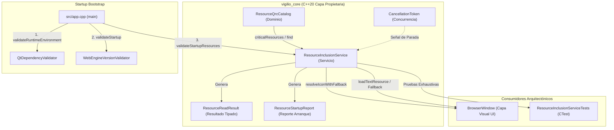

# Design — module-foundations-task0018

Status: PROPOSED

## Current, target and gaps

### Estado actual (CURRENT)
- En `apps/vigilio-browser/src/core/`:
  - Existen `ResourceTypes.h`, `ResourceQrcCatalog.h` y `ResourceQrcCatalog.cpp`, formalizados en `module.foundations.task0017`.
  - El catálogo de dominio modela los 35 recursos canónicos aprobados, categorizados en 6 temas, 6 wallpapers, 1 branding, 1 tokens de diseño, 10 iconos de navegación y 11 iconos de herramientas bajo el prefijo canónico `/vigilio`.
  - Existe validación estática de consistencia XML (`validateQrcConsistency`), comprobación sintáctica de alias (`isValidAlias`) y detección de rutas excluidas (`isExcludedPath`).
- En `apps/vigilio-browser/src/app.cpp`:
  - Se ejecuta la pre-validación de entorno con `QtDependencyValidator::validateRuntimeEnvironment` y la compatibilidad de WebEngine con `WebEngineVersionValidator::validateStartup`.
  - Sin embargo, la inicialización de recursos no forma parte de la secuencia de arranque: el proceso pasa directamente a instanciar `BrowserWindow` sin certificar que los activos críticos para la interfaz (logo, tokens de medidas, temas base e iconos esenciales) estén presentes y legibles.
- En la capa de servicios (`apps/vigilio-browser/src/core/`):
  - **No existe** un servicio desacoplado (`ResourceInclusionService`) que exponga operaciones de carga de recursos con tipado seguro, gestión de errores observables, soporte de cancelación cooperativa y recuperación automática mediante fallbacks locales.
  - Los futuros consumidores en la interfaz gráfica se verían obligados a acceder directamente a cadenas literales de Qt (e.g. `":/vigilio/icons/..."`) sin control de fallos, arriesgando interfaces rotas o estados inconsistentes si un asset secundario falla.

### Estado objetivo (TARGET)
- Una capa de servicio y adaptador propietaria, fuertemente tipada en C++20 estándar dentro de `vigilio_core`, para la capacidad **resource qrc inclusion** en su etapa **implementation**, que provea:
  1. **Servicio desacoplado de inclusión de recursos (`ResourceInclusionService`)**:
     - Abstracción de servicio pura e independiente de widgets gráficos, operable tanto en entornos de escritorio como en servidores CI headless.
     - Operaciones tipadas de pre-validación en arranque, carga de recursos textuales (JSON), carga de recursos binarios (SVG/JPEG) y resolución de rutas canónicas con fallback automático.
  2. **Taxonomía tipada de errores y reportes de arranque**:
     - `ResourceReadError`: Clasificación exhaustiva de causas de fallo (`None`, `NotFound`, `AccessDenied`, `InvalidFormat`, `CorruptedContent`, `Cancelled`, `IOError`).
     - `ResourceReadResult<T>`: Estructura inmutable con datos opcionales, estado de error, mensaje de diagnóstico y bandera indicadora de sustitución por fallback (`hasFallback`).
     - `ResourceStartupStatus` y `ResourceStartupReport`: Diagnóstico estructurado y accionable para certificar la integridad del bundle de recursos durante el bootstrap del proceso.
  3. **Mecanismo de cancelación cooperativa no bloqueante (`CancellationToken`)**:
     - Soporte para cancelar lecturas de recursos en segundo plano sin dependencias de hilos pesados ni locks.
  4. **Estrategia determinista de recuperación local (Local-First Fallbacks)**:
     - Recuperación automática ante petición de temas o iconos ausentes, sustituyéndolos de forma transparente por los recursos críticos por defecto (`themes/light.json` y `icons/tools/tools.svg`).
  5. **Integración en Startup Bootstrap**:
     - Inclusión de la verificación de recursos en `src/app.cpp`, cerrando la cadena de validaciones previas a la instanciación de la UI.

### Brechas identificadas (GAPS)
- **Falta de capa de servicio desacoplada**: Actualmente solo existe el catálogo estático de dominio (`ResourceQrcCatalog`); no hay un servicio que medie entre los clientes de la aplicación y la provisión de recursos con manejo de errores y fallbacks.
- **Riesgo de arranque ciego ante daño en empaquetado**: Si un bundle binario sufre corrupción o desajuste en sus recursos compilados, la aplicación crashearía dentro de los constructores de Qt Widgets sin un mensaje de diagnóstico previo en la consola del sistema.
- **Ausencia de soporte de cancelación**: La carga potencial de fondos pesados carece de un mecanismo formal para abortar operaciones de forma cooperativa.
- **Falta de cobertura automatizada en CTest**: No existe una suite de pruebas para operaciones de servicio de inclusión de recursos con fallbacks y concurrencia.

## Compatibility, migration and rollback

### Compatibilidad
- **Portabilidad C++20 estándar**: Diseñado utilizando características estándar de C++20 (`std::string_view`, `std::optional`, `std::vector`, `std::array`, `std::atomic_bool`). No requiere enlazar con `Qt6::Widgets` ni `Qt6::WebEngineWidgets` en la capa de núcleo `vigilio_core`.
- **Compatibilidad multiplataforma**: Comportamiento idéntico y determinista en Linux x64, Windows x64 y macOS arm64/x64, estandarizando rutas virtuales en formato POSIX (`:/vigilio/...`).
- **Compatibilidad con `-Werror`**: Compila limpiamente bajo la política estricta de advertencias del target `vigilio_compiler_warnings`.

### Migración
- No altera esquemas en la base de datos SQLite ni requiere migraciones de datos de usuario.
- Retrocompatible con el código existente: los componentes que accedan al catálogo de dominio preexistente (`ResourceQrcCatalog`) continúan funcionando sin cambios de API.

### Rollback
- En caso de regresión o rediseño, el rollback se realiza de forma atómica revirtiendo los cambios en `apps/vigilio-browser/src/core/ResourceInclusionService.*`, `src/app.cpp` y la suite de pruebas asociada, sin afectar el catálogo de dominio de `module.foundations.task0017`.

## Arquitectura técnica de la capa de implementación

### Diagrama de interacción arquitectónica



### Especificación de interfaces C++20 en `ResourceInclusionService.h`

```cpp
#pragma once

#include "core/ResourceQrcCatalog.h"
#include "core/ResourceTypes.h"

#include <atomic>
#include <cstdint>
#include <optional>
#include <string>
#include <string_view>
#include <vector>

namespace vigilio {

/// @brief Clasificación exhaustiva de errores en operaciones de lectura y provisión de recursos.
enum class ResourceReadError : uint8_t {
    None,            // Operación exitosa
    NotFound,        // Recurso no encontrado en el catálogo ni en el bundle
    AccessDenied,    // Acceso denegado (ruta prohibida o intento de Directory Traversal)
    InvalidFormat,   // Formato sintáctico o extensión no válida para el tipo de recurso
    CorruptedContent,// Contenido dañado, truncado o inconsistente
    Cancelled,       // Operación cancelada explícitamente vía CancellationToken
    IOError          // Fallo general de entrada/salida
};

/// @brief Estructura inmutable con semántica de valor para resultados de lectura de recursos.
template <typename T>
struct ResourceReadResult {
    ResourceReadError error{ResourceReadError::None};
    std::optional<T> data{std::nullopt};
    std::string errorMessage{};
    bool hasFallback{false};

    [[nodiscard]] constexpr bool isSuccess() const noexcept {
        return error == ResourceReadError::None && data.has_value();
    }
};

/// @brief Estados de diagnóstico del sistema de recursos durante el arranque.
enum class ResourceStartupStatus : uint8_t {
    Ready,          // Todos los recursos críticos están íntegros y accesibles
    Degraded,       // Recursos críticos disponibles, pero se detectaron advertencias menores
    MissingCritical,// Uno o más recursos críticos indispensables no están disponibles
    CatalogCorruption // Inconsistencia estructural grave en el archivo de recursos o prefijo
};

/// @brief Reporte consolidado de la pre-validación de recursos en arranque.
struct ResourceStartupReport {
    ResourceStartupStatus status{ResourceStartupStatus::Ready};
    size_t totalVerified{0};
    size_t criticalVerified{0};
    std::vector<std::string> missingCritical{};
    std::vector<std::string> warnings{};
    std::string diagnosticMessage{};
    std::string remediationAction{};
};

/// @brief Token de cancelación cooperativo y ligero para operaciones en segundo plano.
class CancellationToken {
public:
    explicit CancellationToken(bool initial = false) noexcept : cancelled_(initial) {}
    
    void requestCancellation() noexcept {
        cancelled_.store(true, std::memory_order_release);
    }
    
    [[nodiscard]] bool isCancelled() const noexcept {
        return cancelled_.load(std::memory_order_acquire);
    }

private:
    std::atomic<bool> cancelled_{false};
};

/// @brief Servicio propietario desacoplado para provisión, validación y recuperación de recursos.
class ResourceInclusionService {
public:
    // Identificadores y constantes canónicas de fallback
    static constexpr std::string_view kDefaultThemeAlias = "themes/light.json";
    static constexpr std::string_view kFallbackIconAlias = "icons/tools/tools.svg";

    [[nodiscard]] static constexpr std::string_view defaultThemeAlias() noexcept {
        return kDefaultThemeAlias;
    }

    [[nodiscard]] static constexpr std::string_view fallbackIconAlias() noexcept {
        return kFallbackIconAlias;
    }

    // Pre-validación en tiempo de arranque (Startup Bootstrap)
    [[nodiscard]] static ResourceStartupReport validateStartupResources(
        std::string_view qrcContent = {}) noexcept;

    // Carga síncrona de recursos textuales con soporte de fallback
    [[nodiscard]] static ResourceReadResult<std::string> loadTextResource(
        std::string_view alias, bool allowFallback = true) noexcept;

    // Carga de recursos binarios con soporte de cancelación cooperativa
    [[nodiscard]] static ResourceReadResult<std::vector<uint8_t>> loadBinaryResource(
        std::string_view alias, const CancellationToken* cancelToken = nullptr) noexcept;

    // Resolución segura de iconos con fallback garantizado
    [[nodiscard]] static std::string resolveIconWithFallback(std::string_view alias) noexcept;

    // Resolución segura de temas con fallback garantizado
    [[nodiscard]] static std::string resolveThemeWithFallback(std::string_view themeAlias) noexcept;

    // Formateadores estáticos para observabilidad y logging
    [[nodiscard]] static std::string_view errorName(ResourceReadError error) noexcept;
    [[nodiscard]] static std::string_view startupStatusName(ResourceStartupStatus status) noexcept;
};

} // namespace vigilio
```

## Contratos funcionales de las operaciones de servicio

### 1. Pre-validación en arranque (`validateStartupResources`)
- **Actor**: Función de arranque del proceso (`main` en `src/app.cpp`).
- **Precondiciones**: Ninguna. Puede recibir opcionalmente el contenido XML de `resources.qrc` para validación estricta de coherencia, o evaluar la lista canónica del dominio.
- **Postcondiciones**:
  - Si los 8 recursos críticos están registrados en el catálogo canónico y no hay violaciones de prefijo ni rutas prohibidas:
    - Retorna `status = ResourceStartupStatus::Ready`.
    - `criticalVerified = 8`, `missingCritical` vacío.
  - Si falta algún recurso crítico:
    - Retorna `status = ResourceStartupStatus::MissingCritical`.
    - Lista en `missingCritical` los identificadores exactos de los recursos faltantes.
    - Provee un mensaje descriptivo y una acción clara de remediación.
- **Invariante**: `validateStartupResources()` es pura, libre de excepciones (`noexcept`) y de efectos secundarios en el sistema de archivos.

### 2. Carga de recursos de texto (`loadTextResource`)
- **Actor**: Componentes gestores de temas (`ThemeManager`) o motores de estilo.
- **Entrada**: `std::string_view alias`, `bool allowFallback`.
- **Comportamiento**:
  - Si el alias está en una ruta excluida (`reference/`, `installer/`, `fonts/`), retorna `AccessDenied`.
  - Si el alias no es sintácticamente válido, retorna `InvalidFormat`.
  - Si el alias no existe en el catálogo canónico:
    - Si `allowFallback == true`, retorna los datos del tema predeterminado `themes/light.json` con `hasFallback = true` y `error = None`.
    - Si `allowFallback == false`, retorna `error = NotFound` y `data = nullopt`.

### 3. Carga de recursos binarios con cancelación (`loadBinaryResource`)
- **Actor**: Carga de fondos de pantalla (`wallpapers/`) o lectores de SVG.
- **Entrada**: `std::string_view alias`, puntero opcional a `const CancellationToken`.
- **Comportamiento**:
  - Si `cancelToken != nullptr` y `cancelToken->isCancelled() == true`, aborta inmediatamente retornando `ResourceReadError::Cancelled`.
  - Verifica validez sintáctica y pertenencia al catálogo.
  - Si es cancelado durante la operación, retorna `Cancelled`.

### 4. Resolución de iconos con fallback (`resolveIconWithFallback`)
- **Actor**: Widgets de navegación, barra de estado, barra de herramientas.
- **Entrada**: `std::string_view alias`.
- **Comportamiento**:
  - Si el alias existe en el catálogo y corresponde a la categoría `NavigationIcon` o `ToolIcon`, retorna su ruta virtual canónica `ResourceQrcCatalog::resolveQrcPath(alias)`.
  - Si el alias no existe o es inválido, retorna `":/vigilio/icons/tools/tools.svg"`.
- **Garantía**: Nunca retorna una cadena vacía ni una ruta inexistente.

## Integración en Startup Bootstrap (`src/app.cpp`)

La secuencia de inicialización del proceso se estructura formalmente como un pipeline de 3 validaciones indispensables antes de instanciar la UI gráfica:

```cpp
// 1. Pre-validación de entorno Qt (ABI y servidor gráfico)
const auto qtReport = vigilio::QtDependencyValidator::validateRuntimeEnvironment(
    qVersion(), QT_VERSION_STR, display, wayland);
if (qtReport.outcome != vigilio::QtValidationOutcome::Satisfied) {
    std::cerr << "[Vigilio Startup Error] " << qtReport.diagnosticMessage << "\n";
    return 1;
}

// 2. Pre-validación de compatibilidad WebEngine
const auto webEngineReport = vigilio::WebEngineVersionValidator::validateStartup(
    qtReport.foundVersion, "128.0.6613.119", "", false);
if (webEngineReport.status != vigilio::WebEngineCompatibilityStatus::Compatible &&
    webEngineReport.status != vigilio::WebEngineCompatibilityStatus::DegradedHeadless) {
    std::cerr << "[Vigilio Startup Error] " << webEngineReport.diagnosticMessage << "\n";
    return 1;
}

// 3. Pre-validación de recursos QRC críticos (Capacidad: resource qrc inclusion)
const auto resourceReport = vigilio::ResourceInclusionService::validateStartupResources();
if (resourceReport.status == vigilio::ResourceStartupStatus::MissingCritical ||
    resourceReport.status == vigilio::ResourceStartupStatus::CatalogCorruption) {
    std::cerr << "[Vigilio Startup Error] " << resourceReport.diagnosticMessage << "\n";
    if (!resourceReport.remediationAction.empty()) {
        std::cerr << "[Remediation] " << resourceReport.remediationAction << "\n";
    }
    return 1;
}

// Inicialización segura de QApplication y BrowserWindow
QApplication app(argc, argv);
...
BrowserWindow window;
window.show();
return app.exec();
```

## Aislamiento, memoria y política Zero-Zombie

- **Memoria estática y libre de fugas**: Las estructuras del servicio utilizan `std::string_view` y semántica de movimiento para evitar copias redundantes en el montón (`heap`).
- **Cero procesos en segundo plano**: No se inician subprocesos ni daemons; la cancelación cooperativa opera mediante banderas atómicas (`std::atomic<bool>`) sin consumo de ciclos de reloj en reposo.
- **Aislamiento local-first**: Los recursos provienen exclusivamente de los datos pre-empaquetados en el binario; no existe código que intente conexiones de red.

## Matriz trazable de aceptación y verificación

- **Aceptación 1 (Validación exitosa de arranque)**: El servicio confirma la integridad de los 8 recursos críticos -> Verificado por `TEST-001`.
- **Aceptación 2 (Protección contra arranque corrupto)**: La omisión de un recurso crítico aborta limpiamente con diagnóstico accionable -> Verificado por `TEST-002`.
- **Aceptación 3 (Lectura y fallback de temas)**: Carga correcta de temas existentes y fallback transparente al tema base ante alias anómalos -> Verificado por `TEST-003`, `TEST-004` y `TEST-005`.
- **Aceptación 4 (Seguridad y denegación de rutas excluidas)**: Peticiones a rutas no autorizadas retornan `AccessDenied` -> Verificado por `TEST-006`.
- **Aceptación 5 (Cancelación cooperativa)**: `CancellationToken` interrumpe lecturas sin fugas ni bloqueos -> Verificado por `TEST-007`.
- **Aceptación 6 (Resolución robusta de iconos)**: Cualquier petición de icono errónea resuelve al icono genérico de fallback -> Verificado por `TEST-008`.
- **Aceptación 7 (Thread-Safety y concurrencia)**: Múltiples hilos consultan simultáneamente el servicio sin condiciones de carrera -> Verificado por `TEST-009`.
