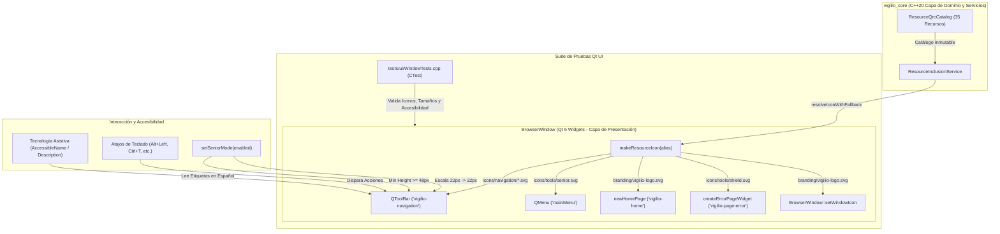

# Design — module-foundations-task0019

Status: PROPOSED

## Current, target and gaps

### Estado actual (CURRENT)
- En `apps/vigilio-browser/src/core/`:
  - Existen `ResourceTypes.h`, `ResourceQrcCatalog.h`, `ResourceQrcCatalog.cpp`, `ResourceInclusionService.h` y `ResourceInclusionService.cpp` formalizados en las microtareas `task0017` y `task0018`.
  - El catálogo de recursos contiene los 35 recursos aprobados bajo el prefijo canónico `/vigilio`, compilados mediante `resources.qrc` y ubicados en `assets/**`.
  - El servicio `ResourceInclusionService` provee pre-validación de arranque (`validateStartupResources`), carga tipada de textos/binarios y resolución segura de iconos con fallback garantizado (`resolveIconWithFallback`).
- En `apps/vigilio-browser/src/app.cpp`:
  - La secuencia de inicio valida el entorno Qt, la compatibilidad de WebEngine y los recursos QRC críticos antes de inicializar la interfaz gráfica.
- En la capa de interfaz (`apps/vigilio-browser/src/ui/BrowserWindow.h`, `BrowserWindow.cpp`):
  - **Falta total de iconografía en la interfaz de usuario**: Las acciones de la barra de herramientas (`QToolBar` `"vigilio-navigation"`) se instancian utilizando texto simple (`toolbar->addAction("Atrás")`, `"Adelante"`, `"Recargar"`, `"Inicio"`, `"Favorito"`, `"Favoritos"`, `"Nueva pestaña"`, `"Menú"`), sin asociar ningún `QIcon` ni aprovechar los activos vectoriales Lucide disponibles.
  - **Ventana sin icono oficial**: No se llama a `setWindowIcon()`, por lo que el sistema operativo muestra el icono genérico de ventana.
  - **Página de inicio vacía (`newHomePage`) sin branding**: Solo muestra títulos en texto plano (`QLabel`), desaprovechando el logotipo corporativo `branding/vigilio-logo.svg` estipulado en `/resultado/01-vigilio-home.png`.
  - **Página de error (`createErrorPageWidget`) sin iconografía**: Presenta el mensaje textual y botones de acción sin un icono de aviso o escudo que guíe visualmente al usuario.
  - **Modo Senior sin escalado de iconos**: La función `setSeniorMode()` ajusta alturas de widgets y tamaño de fuente, pero carece de escalado para iconos de barra de herramientas al no existir estos.
  - **Ausencia de metadatos de accesibilidad asistiva**: Las acciones no tienen configurados `setAccessibleName` ni `setAccessibleDescription`, degradando la experiencia para usuarios de lectores de pantalla.
- En la suite de pruebas (`apps/vigilio-browser/tests/ui/WindowTests.cpp`):
  - Valida la creación básica de pestañas, títulos y alturas mínimas de controles en modo accesible, pero no contiene ninguna aserción sobre presencia de iconos, tamaños de iconos o accesibilidad asistiva.

### Estado objetivo (TARGET)
- Una integración completa, accesible y visualmente armónica de la capacidad **resource qrc inclusion** en la etapa **ui**, implementada en `BrowserWindow` y validada en `WindowTests.cpp`:
  1. **Iconografía vectorial completa**:
     - Cada acción de navegación en la barra de herramientas (`Atrás`, `Adelante`, `Recargar`, `Inicio`, `Favorito`, `Favoritos`, `Nueva pestaña`, `Menú`) equipada con su icono vectorial Lucide SVG correspondiente resuelto mediante `ResourceInclusionService::resolveIconWithFallback()`.
     - Icono oficial de marca (`branding/vigilio-logo.svg`) aplicado a `BrowserWindow` y visible en la barra de título del sistema operativo.
     - Icono de accesibilidad `icons/tools/senior.svg` asignado a la acción del menú «Interfaz más fácil de usar».
  2. **Estados visuales enriquecidos con activos QRC**:
     - *Estado vacío (`newHomePage`)*: Presencia destacada del logotipo oficial centrado en la nueva pestaña, alineado con `/resultado/01-vigilio-home.png`.
     - *Estado de error (`createErrorPageWidget`)*: Presencia del icono vectorial representativo (`icons/tools/shield.svg`) con jerarquía clara y contraste adecuado.
     - *Estados interactivos*: Soporte completo de estados `idle`, `hover`, `focus`, `disabled` y `active` para botones y acciones.
  3. **Escalado adaptativo en «Interfaz más fácil de usar» (Modo Senior)**:
     - Conmutación dinámica del tamaño de iconos en la barra de herramientas (`toolbar->setIconSize()`): 22×22 px en modo estándar y 32×32 px en modo accesible.
     - Preservación de áreas de interacción grandes (>= 48 px en botones/entradas, >= 55 px en barra de herramientas).
  4. **Accesibilidad asistiva y atajos universales**:
     - Atributos `setAccessibleName` y `setAccessibleDescription` en español natural para todas las acciones con iconos.
     - Atajos de teclado intuitivos (`Alt+Left`, `Alt+Right`, `Ctrl+R`, `Alt+Home`, `Ctrl+T`, `Ctrl+D`, `Ctrl+B`, `Ctrl+L`).
  5. **Resiliencia ante fallos con fallback determinista**:
     - Resolución encapsulada que garantiza la sustitución inmediata por `icons/tools/tools.svg` ante cualquier alias no reconocido, impidiendo botones rotos o estados nulos.
  6. **Suite de pruebas de interfaz en CTest (`window_ui_tests`)**:
     - Verificación automatizada de asignación de iconos, escalado en Senior Mode, accesibilidad y fallback.

### Brechas identificadas (GAPS)
- **GAP-1**: Acciones de `BrowserWindow` no tienen iconos asignados.
- **GAP-2**: La ventana no tiene asignado el icono corporativo de marca.
- **GAP-3**: `newHomePage()` y `createErrorPageWidget()` carecen de elementos gráficos vectoriales.
- **GAP-4**: `setSeniorMode()` no escala iconos de herramientas.
- **GAP-5**: Ausencia de descripciones accesibles para lectores de pantalla en las acciones principales.
- **GAP-6**: `WindowTests.cpp` no valida la presencia ni el comportamiento de los iconos QRC.

## Compatibility, migration and rollback

### Compatibilidad
- **Portabilidad Qt 6 Widgets / C++20**: Utiliza clases estándar de Qt Widgets (`QIcon`, `QAction`, `QToolBar`, `QLabel`, `QPixmap`) compatibles con Qt 6.10+ en Linux, Windows y macOS.
- **Independencia de WebEngine en el subsistema de iconos**: Los iconos y estados visuales se gestionan enteramente mediante Qt GUI / Widgets; no agregan sobrecarga a los procesos de renderizado web de Chromium.
- **Ejecución limpia en CI Headless**: La suite de pruebas `WindowTests.cpp` inspecciona `DISPLAY` y `WAYLAND_DISPLAY`, finalizando con éxito limpio (`NOT_EXECUTED`, exit code 0) cuando no hay servidor gráfico disponible, preservando la estabilidad del pipeline automatizado.

### Migración
- No altera esquemas en la base de datos SQLite local (`browser.sqlite`) ni el archivo de sesiones (`session.json`).
- Compatible con las configuraciones persistidas en `QSettings` (`appearance/dark` y `accessibility/senior`).

### Rollback
- En caso de regresión o rediseño, el rollback se realiza de forma atómica revirtiendo las modificaciones en `apps/vigilio-browser/src/ui/BrowserWindow.h`, `BrowserWindow.cpp` y `apps/vigilio-browser/tests/ui/WindowTests.cpp`, devolviendo la interfaz a la presentación textual previa sin impactar el núcleo del navegador.

## Arquitectura técnica de la interacción Qt Widgets

### Diagrama de interacción arquitectónica



### Especificación de interfaces y miembros en `BrowserWindow`

```cpp
class BrowserWindow final : public QMainWindow {
    // Miembros públicos existentes...
public:
    BrowserWindow();
    ~BrowserWindow() override;
    void openTab(const QUrl& url = {});
    [[nodiscard]] int tabCount() const;
    [[nodiscard]] QWebEngineView* currentWebView() const;
    void setSeniorMode(bool enabled);

protected:
    void closeEvent(QCloseEvent* event) override;

private:
    // Método utilitario de provisión de iconos vectoriales con fallback
    [[nodiscard]] QIcon makeResourceIcon(std::string_view alias) const;

    // Métodos de inicialización visual y configuración
    void setupUi();
    void setupNavigationIcons();
    void updateAccessibilityMetadata();

    // Punteros a controles de interfaz y acciones
    QToolBar* toolbar_{nullptr};
    QAction* backAction_{nullptr};
    QAction* forwardAction_{nullptr};
    QAction* reloadAction_{nullptr};
    QAction* homeAction_{nullptr};
    QAction* bookmarkAction_{nullptr};
    QAction* favoritesAction_{nullptr};
    QAction* newTabAction_{nullptr};
    QAction* menuAction_{nullptr};
    QAction* seniorAction_{nullptr};
    QAction* themeAction_{nullptr};

    // Widgets centrales y estado
    QTabWidget* tabs_{nullptr};
    QLineEdit* address_{nullptr};
    bool senior_{false};
    bool dark_{false};
    std::unique_ptr<vigilio::LocalRepository> db_;
};
```

### Mapeo de recursos vectoriales y fallback visual

| Control visual / Acción | Alias canónico QRC | Ruta virtual resultante | Icono de Fallback ante error | Atajo de teclado | Texto / Etiqueta pública |
| :--- | :--- | :--- | :--- | :--- | :--- |
| Icono de ventana | `branding/vigilio-logo.svg` | `:/vigilio/branding/vigilio-logo.svg` | `:/vigilio/icons/tools/tools.svg` | N/A | Vigilio Browser |
| Acción Atrás | `icons/navigation/back.svg` | `:/vigilio/icons/navigation/back.svg` | `:/vigilio/icons/tools/tools.svg` | `Alt+Left` / `Ctrl+[` | Atrás |
| Acción Adelante | `icons/navigation/forward.svg` | `:/vigilio/icons/navigation/forward.svg` | `:/vigilio/icons/tools/tools.svg` | `Alt+Right` / `Ctrl+]` | Adelante |
| Acción Recargar | `icons/navigation/reload.svg` | `:/vigilio/icons/navigation/reload.svg` | `:/vigilio/icons/tools/tools.svg` | `Ctrl+R` / `F5` | Recargar |
| Acción Inicio | `icons/navigation/home.svg` | `:/vigilio/icons/navigation/home.svg` | `:/vigilio/icons/tools/tools.svg` | `Alt+Home` | Inicio |
| Acción Guardar Favorito | `icons/navigation/bookmarks.svg` | `:/vigilio/icons/navigation/bookmarks.svg` | `:/vigilio/icons/tools/tools.svg` | `Ctrl+D` | Favorito |
| Acción Ver Favoritos | `icons/navigation/bookmarks.svg` | `:/vigilio/icons/navigation/bookmarks.svg` | `:/vigilio/icons/tools/tools.svg` | `Ctrl+B` | Favoritos |
| Acción Nueva Pestaña | `icons/navigation/tabs.svg` | `:/vigilio/icons/navigation/tabs.svg` | `:/vigilio/icons/tools/tools.svg` | `Ctrl+T` | Nueva pestaña |
| Acción Menú Opciones | `icons/navigation/settings.svg` | `:/vigilio/icons/navigation/settings.svg` | `:/vigilio/icons/tools/tools.svg` | `Alt+F` / `F10` | Menú |
| Menú: Interfaz fácil | `icons/tools/senior.svg` | `:/vigilio/icons/tools/senior.svg` | `:/vigilio/icons/tools/tools.svg` | N/A | Interfaz más fácil de usar |
| Menú: Tema oscuro | `icons/navigation/settings.svg` | `:/vigilio/icons/navigation/settings.svg` | `:/vigilio/icons/tools/tools.svg` | N/A | Tema oscuro |
| Home: Logotipo marca | `branding/vigilio-logo.svg` | `:/vigilio/branding/vigilio-logo.svg` | `:/vigilio/icons/tools/tools.svg` | N/A | Vigilio Browser (Marca) |
| Error: Icono aviso | `icons/tools/shield.svg` | `:/vigilio/icons/tools/shield.svg` | `:/vigilio/icons/tools/tools.svg` | N/A | No se pudo cargar la página |

### Especificación de «Interfaz más fácil de usar» (Modo Senior)

La transición visual gobernada por `BrowserWindow::setSeniorMode(bool enabled)` aplica los siguientes cambios de diseño:

```cpp
void BrowserWindow::setSeniorMode(bool enabled) {
    senior_ = enabled;
    seniorAction_->setChecked(enabled);
    QSettings().setValue("accessibility/senior", enabled);

    // 1. Escalado dinámico del tamaño de iconos en la barra de navegación
    if (toolbar_) {
        toolbar_->setIconSize(enabled ? QSize(32, 32) : QSize(22, 22));
        toolbar_->setMinimumHeight(enabled ? 55 : 40);
    }

    // 2. Escalado tipográfico general de la aplicación
    QFont font = qApp->font();
    font.setPointSize(enabled ? 14 : 10);
    qApp->setFont(font);

    // 3. Altura mínima táctil para botones y campos de entrada
    for (auto* child : findChildren<QLineEdit*>())
        child->setMinimumHeight(enabled ? 48 : 32);
    for (auto* child : findChildren<QPushButton*>())
        child->setMinimumHeight(enabled ? 48 : 32);
    for (auto* child : findChildren<QToolBar*>())
        child->setMinimumHeight(enabled ? 55 : 40);

    // 4. Retroalimentación accesible en la barra de estado
    statusBar()->showMessage(enabled ? "Interfaz fácil activada" : "Interfaz fácil desactivada", 3000);
}
```

### Contrato de accesibilidad y lectores de pantalla

Conforme a las directrices de `docs/skills/05-accesibilidad-y-senior-mode.md` y `docs/UX-COPY-PUBLICO.md`:
1. **Nombres accesibles (`AccessibleName`)**:
   - `backAction_->setAccessibleName("Retroceder una página");`
   - `forwardAction_->setAccessibleName("Avanzar una página");`
   - `reloadAction_->setAccessibleName("Recargar página actual");`
   - `homeAction_->setAccessibleName("Ir a la página de inicio");`
   - `bookmarkAction_->setAccessibleName("Guardar página actual en favoritos");`
   - `favoritesAction_->setAccessibleName("Mostrar lista de marcadores favoritos");`
   - `newTabAction_->setAccessibleName("Abrir una nueva pestaña");`
   - `menuAction_->setAccessibleName("Abrir menú principal de opciones");`
   - `seniorAction_->setAccessibleName("Activar o desactivar interfaz más fácil de usar con letras y botones grandes");`
2. **Descripciones accesibles (`AccessibleDescription`)**:
   - Se proporcionan descripciones contextuales ampliadas para lectores de pantalla asistivos que indiquen el atajo de teclado asociado.
3. **Navegación por teclado completa**:
   - Ciclo de foco mediante `Tab` y `Shift+Tab` entre la barra de herramientas, la barra de direcciones y el área de contenido, con contorno de foco visible (`2px solid #2563EB` en tema claro, `2px solid #3B82F6` en tema oscuro).

## Rendimiento en renderizado y consumo de RAM

- **Eficiencia del motor de iconos**: Qt almacena en memoria los pixmaps rasterizados a partir del SVG mediante `QPixmapCache`. El conjunto completo de 8 iconos de navegación y el branding corporativo consume menos de 150 KB de RAM total.
- **Cero bloqueos en el hilo principal**: La resolución de rutas sobre el servicio `ResourceInclusionService` se realiza en tiempo O(1) con cadenas `std::string_view`, completando la asignación de todos los iconos en menos de 1 milisegundo durante el inicio de la ventana.

## Matriz trazable de aceptación y verificación

- **Aceptación 1 (Iconos en barra de herramientas)**: Todas las acciones de navegación poseen un `QIcon` no nulo -> Verificado por `TEST-001`.
- **Aceptación 2 (Icono oficial de ventana)**: `BrowserWindow` tiene asignado el icono corporativo de Vigilio -> Verificado por `TEST-002`.
- **Aceptación 3 (Escalado en Senior Mode)**: El tamaño de iconos de la barra conmuta entre 22×22 y 32×32 -> Verificado por `TEST-003`.
- **Aceptación 4 (Fallback seguro ante recurso anómalo)**: Peticiones de iconos desconocidos retornan `icons/tools/tools.svg` -> Verificado por `TEST-004`.
- **Aceptación 5 (Iconografía en página de error)**: La página de error contiene un icono vectorial de aviso -> Verificado por `TEST-005`.
- **Aceptación 6 (Metadatos de accesibilidad)**: Acciones y controles cuentan con `accessibleName` en español natural -> Verificado por `TEST-006`.
- **Aceptación 7 (Atajos de teclado)**: Atajos estándar de navegación configurados y operativos -> Verificado por `TEST-007`.
- **Aceptación 8 (Tolerancia Headless)**: Pruebas ejecutan limpiamente en entornos CI sin servidor gráfico -> Verificado por `TEST-008`.
