# Design — module-foundations-task0020

Status: PROPOSED

## Current, target and gaps

### Estado actual (CURRENT)
- En `apps/vigilio-browser/src/core/ResourceQrcCatalog.h` y `ResourceQrcCatalog.cpp`:
  - Se encuentra implementado el catálogo canónico inmutable de 35 recursos en C++20 dentro del target estático `vigilio_core`.
  - Provee las estructuras inmutables `ResourceCategory`, `ResourceDescriptor` (con `operator==`, `operator<=>`), `ResourceInclusionStatus` y los métodos estáticos puros `totalResourceCount()`, `canonicalPrefix()`, `allResources()`, `find()`, `contains()`, `resolveQrcPath()`, `isValidAlias()`, `isExcludedPath()`, `resourcesByCategory()`, `criticalResources()`, `validateQrcConsistency()` y formateadores.
- En `apps/vigilio-browser/src/core/ResourceInclusionService.h` y `ResourceInclusionService.cpp`:
  - Se encuentra implementado el servicio desacoplado de pre-validación en arranque, lectura de recursos de texto y binarios, resolución resiliente de iconos y temas con fallbacks automáticos, y cancelación cooperativa con `CancellationToken`.
- En `apps/vigilio-browser/src/ui/BrowserWindow.h` y `BrowserWindow.cpp`:
  - Se encuentra integrada la provisión de iconos a través de `makeResourceIcon()`, equipando la ventana, la barra de herramientas, los menús, las páginas de inicio y error, con escalado dinámico en «Interfaz más fácil de usar» (Modo Senior) y accesibilidad universal.
- En `apps/vigilio-browser/tests/`:
  - `tests/unit/ResourceQrcCatalogTests.cpp` cubre lookups básicos, validación sintáctica elemental y parseo de XML.
  - `tests/unit/ResourceInclusionServiceTests.cpp` cubre el flujo de arranque básico, lectura de texto, fallbacks y concurrencia.
  - `tests/ui/WindowTests.cpp` cubre la asignación de iconos en la interfaz gráfica y escalado visual.
- En `apps/vigilio-browser/CMakeLists.txt`:
  - Se encuentran registrados los ejecutables `vigilio_resource_catalog_tests` y `vigilio_resource_inclusion_tests`, ejecutándose limpiamente bajo CTest en modo headless.

### Estado objetivo (TARGET)
- Una suite de pruebas automatizadas focalizada, determinista, de cobertura profunda y alta resiliencia (`ResourceQrcInclusionTests.cpp`) para certificar al 100% la capacidad **resource qrc inclusion** en su etapa **tests**, verificando:
  1. **Casos positivos e integridad física en disco**:
     - Presencia física confirmada en el sistema de archivos de los 35 archivos catalogados en `apps/vigilio-browser/assets/**`.
     - Tamaño estrictamente mayor a cero y permisos de lectura concedidos para cada archivo.
     - Coherencia estructural y de formato:
       - `design-tokens/tokens.json` y los 6 temas JSON (`light`, `dark`, `midnight`, `forest`, `sunset`, `contrast`) parseables como JSON válido con atributos requeridos de diseño.
       - Los 22 archivos SVG (`branding/vigilio-logo.svg`, 10 iconos de navegación, 11 iconos de herramientas) analizados sintácticamente como XML/SVG válido, con atributo `viewBox="0 0 24 24"`, sin elementos `<script>` ni vulnerabilidades de inyección.
       - Los 6 fondos de pantalla JPG verificados con los bytes de número mágico JPEG (`0xFF, 0xD8, 0xFF`).
     - Validación de coincidencia exacta entre el tipo MIME registrado en el catálogo y la extensión del activo físico.
     - Verificación de consistencia del archivo real `apps/vigilio-browser/resources.qrc` frente al catálogo compilado.
  2. **Casos negativos y pruebas de robustez / seguridad**:
     - Fuzzing de sintaxis de alias en `isValidAlias`: secuencias de Directory Traversal (`../`, `..\`, `..//`), prefijos con barra (`/`), barras dobles (`//`), caracteres en mayúscula (`SEARCH.SVG`), signos especiales (`@`, `$`, `#`, `!`), caracteres de control y extensiones ejecutables o de script (`.exe`, `.sh`, `.bin`).
     - Validación estricta de rutas excluidas en `isExcludedPath`: bloqueo de `reference/`, `installer/`, `fonts/` y rutas absolutas de sistema operativo (`/etc/passwd`, `/tmp`, `C:\Windows`).
     - Detección de corrupción estructural en manifiestos sintéticos QRC: prefijos anómalos, omisión de prefijos, etiquetas no balanceadas, alias repetidos y alias no catalogados.
     - Aislamiento de fallos ante la omisión de cualquiera de los 8 recursos críticos, asegurando que `validateStartupResources` reporte `MissingCritical` con identificación precisa y texto de remediación.
  3. **Recuperación determinista y auto-reparación**:
     - Fallback infalible ante alias de iconos inexistentes o malformados: resolución hacia `":/vigilio/icons/tools/tools.svg"`.
     - Fallback infalible ante temas no encontrados: resolución hacia `"themes/light.json"`.
     - Carga de recursos de texto con fallback habilitado: retorna éxito (`error == None`), `hasFallback == true` y carga del tema de reemplazo seguro.
     - Carga de recursos de texto con fallback deshabilitado: retorna error limpio `ResourceReadError::NotFound` y datos nulos.
     - Formateo diagnóstico enriquecido: cadenas diagnósticas claras para cada estado y error.
  4. **Concurrencia multihilo, latencia y cancelación**:
     - Estrés multihilo de alta intensidad con 16 hilos y 2000 iteraciones por hilo ejecutando lecturas y validaciones continuas sin bloqueos ni data races.
     - Pureza funcional: ausencia de estado mutable global, consultas libres de cerrojos (`lock-free`) y latencias medias < 1 ms.
     - Cancelación cooperativa con `CancellationToken`: aborto inmediato de operaciones sin fugas de descriptores de archivo ni memoria huérfana.
  5. **Integración formal y ejecución headless en CTest**:
     - Target ejecutable `vigilio_resource_qrc_inclusion_tests` y test de CTest `resource_qrc_inclusion_tests` con etiquetas `LABELS "unit;fast"` y timeout de 15 segundos.
     - Cero dependencias de servidor gráfico (X11/Wayland), cero procesos de Chromium/WebEngine y ejecución 100% local-first.

### Brechas identificadas (GAPS)
- **Verificación de archivos físicos en disco no automatizada**: Las pruebas existentes operaban sobre tablas estáticas en memoria o el archivo XML `resources.qrc`, pero no validaban la existencia física real ni el contenido interno de cada uno de los 35 archivos en `assets/**`.
- **Inspección de calidad y estructura interna de activos ausente**: No existía una prueba que inspeccionara que los 22 archivos SVG cumplieran las normas de `11-assets-svg-quality.md` (`viewBox="0 0 24 24"`) o que los 6 fondos JPG contaran con encabezados JPEG válidos.
- **Fuzzing negativo exhaustivo de alias**: La suite actual contaba con pruebas puntuales de alias inválidos, requiriendo una batería integral de combinaciones perimetrales (caracteres de control, combinaciones mixtas de traversal y caracteres nulos).
- **Aislamiento sistemático de recursos críticos**: Faltaba una prueba que iterara sobre cada uno de los 8 recursos críticos individualmente para comprobar la capacidad diagnóstica específica ante la falta de cada uno de ellos.
- **Suite unificada de certificación de etapa `tests`**: Se requiere un arnés de prueba integrador y focalizado (`ResourceQrcInclusionTests.cpp`) que certifique formalmente toda la capacidad para dar por concluida la etapa de tests en `module.foundations.task0020`.

## Compatibility, migration and rollback

### Compatibilidad
- **Arquitectura headless y desacoplamiento**: La suite de pruebas no requiere display gráfico, GPU ni bibliotecas de Chromium; opera exclusivamente sobre tipos estándar de C++20 y la biblioteca estática `vigilio_core`.
- **Portabilidad multiplataforma**: Compatible de forma nativa con compiladores GCC 15+, Clang 18+ y MSVC 2022+ en Linux x64, Windows x64 y macOS arm64/x64.
- **Compatibilidad con herramientas de calidad**: Totalmente compatible con AddressSanitizer (ASan), UndefinedBehaviorSanitizer (UBSan), ThreadSanitizer (TSan) y formateo estricto con Clang-Format.

### Migración
- No introduce migraciones de esquemas de datos ni altera estructuras en disco.
- El conjunto de pruebas es complementario y fortalece los contratos existentes sin generar impactos colaterales sobre `CoreTests`, `StorageTests`, `ResourceQrcCatalogTests` o `ResourceInclusionServiceTests`.

### Rollback
- En caso de regresión o fallo inesperado, el rollback es inmediato y seguro: consiste en descartar las modificaciones en `tests/unit/ResourceQrcInclusionTests.cpp` y la entrada correspondiente en `CMakeLists.txt` mediante el control de versiones sin afectar la compilación del núcleo del navegador.

## Arquitectura técnica de pruebas para resource qrc inclusion

La suite de pruebas automatizadas se estructura de forma modular en `apps/vigilio-browser/tests/unit/ResourceQrcInclusionTests.cpp`:

### Estructura modular de la suite de pruebas C++20

```mermaid
flowchart TD
    A["main()"] --> B["test_physical_assets_integrity()"]
    A --> C["test_asset_content_structure()"]
    A --> D["test_mime_type_consistency()"]
    A --> E["test_negative_alias_syntax_fuzzing()"]
    A --> F["test_excluded_paths_defense()"]
    A --> G["test_synthetic_qrc_manifest_corruption()"]
    A --> H["test_critical_resources_isolation_and_remediation()"]
    A --> I["test_fallback_recovery_mechanisms()"]
    A --> J["test_cancellation_cooperative()"]
    A --> K["test_high_concurrency_stress_and_thread_safety()"]
```



### Macro de aserción determinista y arnés de prueba

La suite implementa una política determinista de aserciones sin frameworks externos pesados:
```cpp
#define CHECK(condition)                                                                                \
    do {                                                                                                \
        if (!(condition)) {                                                                             \
            throw std::runtime_error("CHECK failed at line " + std::to_string(__LINE__) +               \
                                     ": " #condition);                                                  \
        }                                                                                               \
    } while (false)
```

### Módulos funcionales de la suite de pruebas

1. **Integridad de activos físicos en disco (`test_physical_assets_integrity`)**:
   - Itera por cada uno de los 35 elementos de `ResourceQrcCatalog::allResources()`.
   - Resuelve la ruta física en disco mediante la macro inyectada `VIGILIO_ASSETS_DIR` o fallback relativo.
   - Comprueba mediante `std::filesystem::exists()` y `std::filesystem::file_size()` que el archivo físico exista y que su tamaño sea estrictamente mayor a 0 bytes.
   - Verifica que el archivo no sea un directorio ni un enlace simbólico roto.

2. **Estructura y calidad de contenidos (`test_asset_content_structure`)**:
   - **Tokens de diseño**: Abre `assets/design-tokens/tokens.json`, comprueba que inicie con `{` y contenga campos esperados como `"color"`, `"font"`, `"spacing"`.
   - **Temas visuales**: Abre los 6 temas (`light.json`, `dark.json`, `midnight.json`, `forest.json`, `sunset.json`, `contrast.json`), comprueba la estructura JSON y presencia de claves como `"background"` y `"surface"`.
   - **Iconos vectoriales SVG**: Abre los 22 archivos SVG, comprueba que contengan la etiqueta de apertura `<svg`, el atributo `viewBox="0 0 24 24"` (conforme a `11-assets-svg-quality.md`), trazos vectoriales y comprueba la ausencia estricta de etiquetas peligrosas `<script>` o referencias externas `xlink:href="http...`.
   - **Fondos de pantalla JPG**: Abre los 6 archivos binarios en `assets/wallpapers/`, lee los primeros 3 bytes y verifica los números mágicos de formato JPEG: `0xFF, 0xD8, 0xFF`.

3. **Consistencia de tipos MIME (`test_mime_type_consistency`)**:
   - Valida que para cada descriptor, si el alias termina en `.svg`, el tipo MIME sea `"image/svg+xml"`.
   - Si el alias termina en `.json`, el tipo MIME sea `"application/json"`.
   - Si el alias termina en `.jpg`, el tipo MIME sea `"image/jpeg"`.

4. **Fuzzing de sintaxis de alias (`test_negative_alias_syntax_fuzzing`)**:
   - Batería de casos negativos sobre `isValidAlias`:
     - Path traversal: `"../etc/passwd"`, `"../../secret.json"`, `"themes/../themes/light.json"`, `".."`
     - Separadores y barras: `"/branding/logo.svg"`, `"branding/logo.svg/"`, `"themes//light.json"`, `"/"`, `"\\windows\\system32"`
     - Cadenas vacías y espacios: `""`, `"   "`, `"branding/ logo.svg"`, `"themes/light.json "`
     - Mayúsculas: `"BRANDING/VIGILIO-LOGO.SVG"`, `"themes/Light.json"`, `"ICONS/NAVIGATION/SEARCH.SVG"`
     - Caracteres prohibidos: `"logo@2x.svg"`, `"search?.svg"`, `"icon#1.svg"`, `"theme$var.json"`
     - Extensiones no autorizadas: `"script.exe"`, `"run.sh"`, `"module.bin"`, `"exploit.py"`

5. **Defensa contra rutas excluidas (`test_excluded_paths_defense`)**:
   - Verifica que `isExcludedPath` retorne `true` y `loadTextResource` retorne `AccessDenied` para:
     - `"reference/mockup.png"`, `"assets/reference/spec.md"`
     - `"installer/setup.iss"`, `"assets/installer/setup.exe"`
     - `"fonts/Inter-Regular.ttf"`, `"assets/fonts/Inter.ttf"`
     - Rutas absolutas del sistema: `"/usr/bin/bash"`, `"/etc/hosts"`, `"C:\\boot.ini"`

6. **Corrupción de manifiestos QRC sintéticos (`test_synthetic_qrc_manifest_corruption`)**:
   - Manifiesto con prefijo incorrecto (`/other`): `validateQrcConsistency` retorna `PrefixMismatch`.
   - Manifiesto sin prefijo: retorna `PrefixMismatch`.
   - Manifiesto con alias duplicado: retorna `DuplicateAlias`.
   - Manifiesto con recurso no catalogado: retorna `ResourceNotFound`.
   - Manifiesto con alias que contiene traversal: retorna `InvalidAliasFormat`.
   - Manifiesto con ruta excluida: retorna `ExcludedPathIncluded`.

7. **Aislamiento y reporte de recursos críticos (`test_critical_resources_isolation_and_remediation`)**:
   - Itera por los 8 recursos críticos:
     1. `branding/vigilio-logo.svg`
     2. `design-tokens/tokens.json`
     3. `themes/light.json`
     4. `themes/dark.json`
     5. `icons/navigation/search.svg`
     6. `icons/navigation/back.svg`
     7. `icons/navigation/forward.svg`
     8. `icons/navigation/reload.svg`
   - Genera para cada uno un manifiesto sintético que contiene todos los recursos excepto dicho recurso crítico.
   - Invoca `validateStartupResources(xmlSinCritico)`.
   - Comprueba que el estado sea estrictamente `ResourceStartupStatus::MissingCritical`.
   - Comprueba que `missingCritical.size() == 1` y contenga el alias del recurso omitido.
   - Comprueba que `remediationAction` contenga una recomendación de acción no vacía.

8. **Mecanismos de recuperación determinista y fallback (`test_fallback_recovery_mechanisms`)**:
   - Resolución de iconos: invocación con `"icons/navigation/missing.svg"`, `"icons/tools/unknown.svg"`, `"invalid_alias"`, `""` y `"themes/light.json"`: todos retornan deterministamente `":/vigilio/icons/tools/tools.svg"`.
   - Resolución de temas: invocación con `"themes/missing.json"`, `"nonexistent"`, `""` y `"../theme.json"`: todos retornan deterministamente `"themes/light.json"`.
   - Carga con fallback (`allowFallback = true`): invocación con `"themes/missing.json"` retorna `isSuccess() == true`, `hasFallback == true` y contenido de `"themes/light.json"`.
   - Carga sin fallback (`allowFallback = false`): invocación con `"themes/missing.json"` retorna `isSuccess() == false`, `error == ResourceReadError::NotFound`, `data == nullopt`.

9. **Cancelación cooperativa (`test_cancellation_cooperative`)**:
   - `CancellationToken` iniciado en estado cancelado: al pasarse a `loadBinaryResource`, la operación aborta de inmediato retornando `ResourceReadError::Cancelled` sin intentar leer el disco.
   - `CancellationToken` activado antes de una lectura binaria pesada (ej. wallpaper de 150 KB): la lectura se interrumpe limpiamente sin corromper el heap ni fugar descriptores.

10. **Concurrencia multihilo masiva (`test_high_concurrency_stress_and_thread_safety`)**:
    - Dispara 16 hilos de trabajo paralelos coordinados con `std::atomic<bool> startFlag`.
    - Cada hilo ejecuta 2000 iteraciones consecutivas invocando consultas de catálogo, resolución de iconos, resolución de temas y validaciones de manifiesto.
    - Total acumulado de 32,000 operaciones concurrentes.
    - Verifica que el 100% de las operaciones sea exitoso, sin contención de bloqueos, latencias medias inferiores a 1 ms por operación y certificación de ausencia de carreras de datos bajo ThreadSanitizer.
