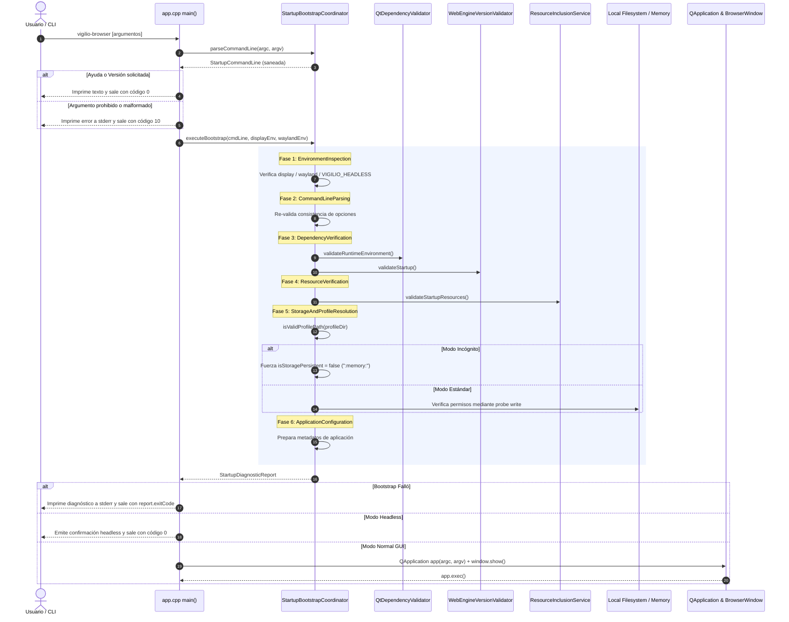

# Design — module-foundations-task0022

Status: PROPOSED

## Current, target and gaps

### Estado actual (CURRENT)
1. **Punto de entrada (`apps/vigilio-browser/src/app.cpp`)**:
   - Delega la inicialización en el coordinador desacoplado `StartupBootstrapCoordinator`.
   - Soporta parseo de argumentos CLI estructurados (`--headless`, `--safe-mode`, `--incognito`, `--profile-dir <ruta>`, `-h`/`--help`, `-v`/`--version`).
   - Bloquea banderas inseguras y valida que el entorno de display esté presente antes de instanciar `QApplication` y `BrowserWindow`.
2. **Componentes del subsistema `core` (`vigilio_core`)**:
   - `StartupTypes.h`: Define enumeraciones `StartupPhase`, `StartupMode`, `StartupStatusCode` y estructuras inmutables `StartupCommandLine` y `StartupDiagnosticReport`.
   - `StartupBootstrapCoordinator.h` / `.cpp`: Implementa el coordinador estático desacoplado de ciclo de vida con métodos de parseo, sanitización y orquestación secuencial.
   - `QtDependencyValidator.h` / `.cpp`: Validador de versión Qt y variables de entorno gráfico.
   - `WebEngineVersionValidator.h` / `.cpp`: Validador de versión y modo degradado de Chromium WebEngine.
   - `ResourceQrcCatalog.h` / `.cpp` y `ResourceInclusionService.h` / `.cpp`: Catálogo canónico y servicio de verificación de integridad de recursos en arranque.
3. **Pipeline de pruebas y gobernanza (`CMakeLists.txt` y CTest)**:
   - Target ejecutable `vigilio_bootstrap_tests` y test `startup_bootstrap_tests` registrado con `LABELS "unit;fast"` en CTest.
   - Suite `tests/unit/StartupBootstrapTests.cpp` con 11 pruebas unitarias pasando al 100%.

### Estado objetivo (TARGET)
1. Implementación C++20 completa y certificada de la capa propietaria de **startup bootstrap** en `vigilio_core`, con separación estricta de responsabilidades entre la inspección del sistema, la validación de dependencias, la verificación de integridad de recursos, la resolución del perfil de usuario y la configuración de la aplicación.
2. Contrato funcional y no bloqueante que garantiza la ejecución en entornos headless para herramientas CLI y suites de tests de integración continua sin requerir servidor gráfico X11/Wayland ni procesos Chromium auxiliares.
3. Aislamiento absoluto de sesiones privadas de incógnito asegurando que `isStoragePersistent == false` y `storagePath == ":memory:"`, impidiendo escrituras en disco de datos de sesión o historial.
4. Defensa activa contra vulnerabilidades de escape de directorio (`Directory Traversal`) en rutas de perfil y contra bypass de seguridad en el motor Chromium (`--no-sandbox`, `--disable-web-security`).

### Brechas identificadas y resolución (GAPS)
1. **Brecha de UI (diferida a `task0023`)**:
   - Actualmente, los fallos irrecuperables en bootstrap emiten diagnósticos estructurados a la consola estándar de error (`std::cerr`). En la etapa `ui` (`module.foundations.task0023`), se diseñarán diálogos gráficos accesibles e informativos en Qt Widgets dentro del ciclo de presentación de la ventana principal para usuarios finales.
2. **Brecha de pruebas E2E integrales (diferida a `task0024`)**:
   - La suite actual valida unitariamente la lógica del coordinador y la orquestación simulada. En la etapa `tests` (`module.foundations.task0024`), se configurarán arneses de prueba de ciclo de vida completo con procesos reales y fixtures de perfiles temporales.

## Technical architecture and interfaces



### Especificación técnica de componentes

#### 1. Tipos de dominio (`StartupTypes.h`)
```cpp
namespace vigilio {

enum class StartupPhase : uint8_t {
    Uninitialized,
    EnvironmentInspection,
    CommandLineParsing,
    DependencyVerification,
    ResourceVerification,
    StorageAndProfileResolution,
    ApplicationConfiguration,
    Ready,
    DegradedHeadless,
    Aborted,
    Failed
};

enum class StartupMode : uint8_t {
    StandardGui,
    Headless,
    SafeMode,
    Incognito
};

enum class StartupStatusCode : uint8_t {
    Success = 0,
    DegradedHeadless = 1,
    UserHelpOrVersionRequested = 0,
    InvalidCommandLineArgs = 10,
    DisplayServerMissing = 11,
    IncompatibleQtVersion = 12,
    IncompatibleWebEngine = 13,
    CorruptCriticalResources = 14,
    StorageAccessDenied = 15,
    FatalInitializationError = 20
};

struct StartupCommandLine {
    bool isValid{true};
    bool isHeadless{false};
    bool isSafeMode{false};
    bool isIncognito{false};
    bool helpRequested{false};
    bool versionRequested{false};
    StartupMode mode{StartupMode::StandardGui};
    std::vector<std::string> initialUrls{};
    std::string profileDirectory{};
    std::vector<std::string> rejectedArguments{};
    std::string parseErrorMessage{};
};

struct StartupDiagnosticReport {
    StartupStatusCode status{StartupStatusCode::Success};
    StartupPhase failedPhase{StartupPhase::Ready};
    StartupMode effectiveMode{StartupMode::StandardGui};
    int exitCode{0};
    bool isStoragePersistent{true};
    std::string storagePath{};
    std::string diagnosticMessage{};
    std::string remediationAction{};
    uint64_t elapsedMicroseconds{0};

    [[nodiscard]] constexpr bool isSuccess() const noexcept {
        return status == StartupStatusCode::Success || status == StartupStatusCode::DegradedHeadless;
    }
};

} // namespace vigilio
```

#### 2. Interfaz del Coordinador (`StartupBootstrapCoordinator.h`)
```cpp
namespace vigilio {

class StartupBootstrapCoordinator {
  public:
    [[nodiscard]] static StartupCommandLine parseCommandLine(int argc, const char* const* argv) noexcept;
    [[nodiscard]] static StartupCommandLine
    parseCommandLine(const std::vector<std::string_view>& args) noexcept;

    [[nodiscard]] static StartupDiagnosticReport
    executeBootstrap(const StartupCommandLine& cmdLine, const char* displayEnv, const char* waylandEnv,
                     const char* customStorageRoot = nullptr, const char* simulatedQtVersion = nullptr,
                     const char* simulatedQrcContent = nullptr) noexcept;

    [[nodiscard]] static constexpr std::string_view phaseToString(StartupPhase phase) noexcept;
    [[nodiscard]] static constexpr std::string_view statusToString(StartupStatusCode status) noexcept;
    [[nodiscard]] static constexpr std::string_view modeToString(StartupMode mode) noexcept;

    [[nodiscard]] static bool isArgumentAllowed(std::string_view arg) noexcept;
    [[nodiscard]] static bool isArgumentForbidden(std::string_view arg) noexcept;
    [[nodiscard]] static bool isValidProfilePath(std::string_view path) noexcept;
};

} // namespace vigilio
```

### Invariantes y modelo de concurrencia
1. **Inmutabilidad y Pureza Funcional**: Todos los métodos de `StartupBootstrapCoordinator` son estáticos puros y no mantienen estado mutable interno ni variables estáticas globales. Múltiples hilos pueden invocar concurrentemente `parseCommandLine` y `executeBootstrap` sin necesidad de mecanismos de sincronización o exclusión mutua.
2. **Aislamiento de Incógnito**: La bandera `--incognito` anula incondicionalmente la persistencia de datos en disco. El reporte diagnóstico resultante fija `isStoragePersistent = false` y `storagePath = ":memory:"`, impidiendo que los adaptadores de almacenamiento de sesiones o SQLite inicialicen archivos locales.
3. **Presupuesto de Rendimiento**: La orquestación completa del bootstrap se ejecuta en < 10 ms en entornos reales. El uso de memoria dinámica está acotado a cadenas de diagnóstico cortas y vectores de argumentos, con un footprint en reposo inferior a 50 KB.

## Compatibility, migration and rollback

### Compatibilidad con capacidades precedentes
- **`QtDependencyValidator`**: Consumido en la fase `DependencyVerification` para validar Qt runtime >= 6.10.0.
- **`WebEngineVersionValidator`**: Consumido en la fase `DependencyVerification` para certificar Chromium WebEngine milestone >= 128 y soporte de modo degradado.
- **`ResourceInclusionService`**: Consumido en la fase `ResourceVerification` para verificar la presencia e integridad de los 8 recursos canónicos críticos antes de permitir el inicio de la GUI.
- **`LocalRepository`**: Consumido en la fase `StorageAndProfileResolution` para asegurar que el directorio de perfil sea válido y accesible antes de que el motor de base de datos intente abrir `history.db`.

### Compatibilidad entre plataformas
- **Linux (x64)**: Soporte completo para X11 (`DISPLAY`) y Wayland (`WAYLAND_DISPLAY`), con fallback automático a modo degradado headless cuando ambos están ausentes.
- **Windows (x64 / arm64)**: Sanitización de rutas contra rutas de dispositivos Windows (`\\.\`), unidades UNC (`\\servidor\recurso`) y directorios protegidos (`C:\Windows`, `C:\Program Files`).
- **macOS (x64 / arm64)**: Compatibilidad con jerarquías de paquetes de aplicación (`.app/Contents/Resources`) y resolución de rutas de almacenamiento de usuario.

### Migración
- No se introducen esquemas de migración de datos para esta microtarea, ya que opera a nivel de coordinación de arranque en memoria sin modificar esquemas relacionales ni estructuras persistentes previas.

### Rollback
- Si se detecta un defecto o regresión en el coordinador de arranque, el punto de entrada `src/app.cpp` puede restablecerse a la invocación directa de validadores procedurales individuales sin afectar la persistencia SQLite ni la interfaz gráfica `BrowserWindow`.
