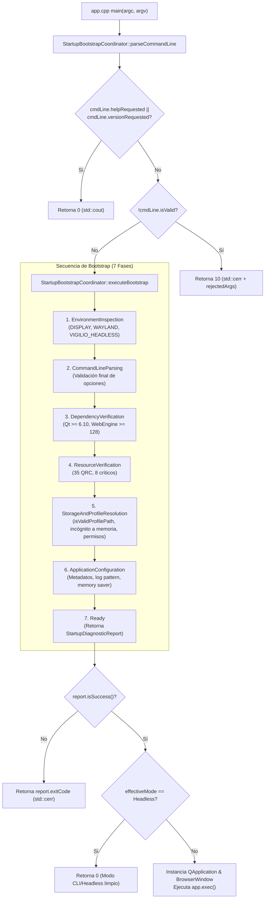

# Change Proposal — module-foundations-task0022

Pack: `module.foundations.task0022`

Status: PROPOSED

## Outcome and scope

Este cambio define la propuesta técnica integral para la etapa **implementation** de la capacidad **startup bootstrap** en el módulo propietario `foundations` de Vigilio Browser (microtarea `0022 — Implementar la operación en una capa propietaria: startup bootstrap`). 

Habiendo formalizado en la microtarea precedente (`module.foundations.task0021`) el modelo de dominio, la máquina de estados de ciclo de vida con sus 11 fases discretas, los tipos de valor inmutables (`StartupTypes.h`), las reglas de defensa activa contra banderas inseguras y Directory Traversal, y el aislamiento estricto de sesiones privadas de incógnito, esta propuesta proyecta la **implementación física, desacoplada y fuertemente tipada en C++20 de la capa de servicio y adaptador del coordinador de arranque (`StartupBootstrapCoordinator`)**, garantizando una orquestación segura y determinista, manejo de errores observables, soporte para ejecución degradada headless en entornos sin display y pruebas unitarias de regresión continuas, sin acoplar lógica de negocio a los widgets de interfaz ni añadir responsabilidades a `BrowserWindow`.

El alcance concreto de este pack comprende:
- **Implementación del coordinador de arranque desacoplado (`vigilio::StartupBootstrapCoordinator`)**:
  - Creación del componente de servicio y adaptador desacoplado en `apps/vigilio-browser/src/core/StartupBootstrapCoordinator.h` y `StartupBootstrapCoordinator.cpp`, integrado en la biblioteca estática `vigilio_core`.
  - Estructuración inmutable y tipada en C++20 estándar de las entidades del ciclo de vida en `apps/vigilio-browser/src/core/StartupTypes.h`:
    - `StartupPhase`: enum class fuertemente tipado con 11 fases discretas (`Uninitialized`, `EnvironmentInspection`, `CommandLineParsing`, `DependencyVerification`, `ResourceVerification`, `StorageAndProfileResolution`, `ApplicationConfiguration`, `Ready`, `DegradedHeadless`, `Aborted`, `Failed`).
    - `StartupMode`: enum class representativo del modo operativo (`StandardGui`, `Headless`, `SafeMode`, `Incognito`).
    - `StartupStatusCode`: enum class con códigos de estado tipados (`Success`, `DegradedHeadless`, `UserHelpOrVersionRequested`, `InvalidCommandLineArgs`, `DisplayServerMissing`, `IncompatibleQtVersion`, `IncompatibleWebEngine`, `CorruptCriticalResources`, `StorageAccessDenied`, `FatalInitializationError`).
    - `StartupCommandLine`: estructura inmutable que almacena opciones parseadas, URLs iniciales, indicadores de modo (`isHeadless`, `isSafeMode`, `isIncognito`), directorio de perfil saneado y lista de argumentos rechazados.
    - `StartupDiagnosticReport`: estructura inmutable que consolida el estado final de evaluación (`status`), fase alcanzada (`failedPhase`), modo efectivo (`effectiveMode`), código de salida del proceso (`exitCode`), persistencia (`isStoragePersistent`), ruta de almacenamiento (`storagePath`), mensaje estructurado (`diagnosticMessage`), acción de remediación sugerida (`remediationAction`) y latencia en microsegundos (`elapsedMicroseconds`).
  - Implementación de métodos estáticos puros de servicio y coordinación:
    - `StartupBootstrapCoordinator::parseCommandLine`: procesa y valida argumentos CLI, admitiendo banderas legítimas (`--headless`, `--safe-mode`, `--incognito`, `--profile-dir <ruta>`, `-h`, `--help`, `-v`, `--version`, URLs) y rechazando banderas no autorizadas o malformadas.
    - `StartupBootstrapCoordinator::isArgumentForbidden`: defensa activa contra banderas peligrosas de Chromium (`--no-sandbox`, `--disable-web-security`, `--remote-debugging-pipe`, `--allow-file-access-from-files`, `--remote-debugging-port`), provocando rechazo inmediato.
    - `StartupBootstrapCoordinator::isValidProfilePath`: defensa activa contra Directory Traversal en `--profile-dir`, bloqueando secuencias `..`, caracteres de control, metacaracteres de inyección de shell y rutas protegidas del sistema operativo (`/`, `/etc`, `/boot`, `/usr`, `/var`, `/proc`, `/sys`, `/dev`, `/root`, `C:\Windows`, `C:\Program Files`, `\\.\`).
    - `StartupBootstrapCoordinator::executeBootstrap`: orquesta de forma estrictamente secuencial y no bloqueante las fases de inicialización, retornando un `StartupDiagnosticReport` completo sin lanzar excepciones no controladas ni abortar abruptamente el proceso.
    - `StartupBootstrapCoordinator::phaseToString`, `statusToString`, `modeToString`: utilidades constexpr puras para logging estructurado y observabilidad local.
- **Refactorización del punto de entrada principal (`apps/vigilio-browser/src/app.cpp`)**:
  - Delegación completa del flujo de inicio en `StartupBootstrapCoordinator::parseCommandLine` y `executeBootstrap`.
  - Gestión limpia de peticiones informativas (`--help`, `--version`) retornando código 0.
  - Manejo de argumentos inválidos imprimiendo diagnósticos a `std::cerr` y retornando código 10.
  - Manejo de fallos en bootstrap imprimiendo el diagnóstico estructurado y la acción de remediación, retornando el código tipado correspondiente.
  - Soporte de modo headless explícito ejecutando la inicialización sin crear `QApplication` ni ventanas gráficas.
  - Soporte de modo degradado headless cuando faltan variables de display (`DISPLAY` / `WAYLAND_DISPLAY`), retornando código 1 de manera controlada y documentada.
  - Inicialización limpia de `QApplication` y `BrowserWindow` únicamente tras verificar satisfactoriamente el reporte de arranque.
- **Gobernanza de compilación en CMake (`apps/vigilio-browser/CMakeLists.txt`)**:
  - Incorporación de `src/core/StartupBootstrapCoordinator.cpp` en el target de biblioteca `vigilio_core`.
  - Declaración del ejecutable de prueba `vigilio_bootstrap_tests` y registro del test `startup_bootstrap_tests` en CTest bajo `LABELS "unit;fast"` con timeout de 15 segundos.
  - Verificación de compilación limpia bajo C++20 estricto con `-Werror` sin dependencias gráficas en `vigilio_core`.
- **Suite de pruebas unitarias automatizadas (`apps/vigilio-browser/tests/unit/StartupBootstrapTests.cpp`)**:
  - Suite de 11 casos de prueba cubriendo arranque GUI estándar, modo headless explícito, modo degradado por ausencia de display, aislamiento de almacenamiento en incógnito (`isStoragePersistent = false`), safe-mode, bloqueo de argumentos prohibidos, validación de ruta de perfil contra Directory Traversal, banderas de ayuda y versión, simulación de fallo por versión Qt incompatible, simulación de recursos críticos corruptos y prueba de estrés de concurrencia multihilo con 16 hilos.

## Out of scope

- Diálogos visuales en Qt Widgets para presentación de errores de inicio (diferidos a la etapa `ui` en `module.foundations.task0023`).
- Pruebas E2E completas del ciclo de vida con servidor gráfico real o sesión Chromium activa (diferidas a la etapa `tests` en `module.foundations.task0024`).
- Políticas de recuperación post-crash, journaling o restauración de pestañas cerradas abruptamente (pertenecientes a la capacidad `crash recovery policy`, microtareas `task0029`-`task0032`).
- Modificación directa de archivos de código fuente de producción bajo `apps/**` o reglas bajo `docs/rules/**` durante esta fase PROPOSE (restringida rigurosamente a `openspec/changes/module-foundations-task0022/**`).
- Cualquier comunicación por red, comprobación de actualizaciones en la nube o telemetría remota (terminantemente prohibido por la política local-first, decisión Q-001).

## Contexto y evidencia

Se inspeccionó rigurosamente la base de código existente en `apps/vigilio-browser`, los módulos de dominio previos y las herramientas locales:
1. **Especificación de dominio previa (`openspec/changes/module-foundations-task0021/`)**:
   - Formalizó la máquina de estados de 11 fases, los tipos de valor, las reglas de saneamiento de CLI y directorios de perfil, y los contratos de aislamiento de incógnito.
2. **Componentes previos integrados en `vigilio_core`**:
   - `QtDependencyValidator.h` / `.cpp`: Validación de Qt runtime >= 6.10.0 y presencia de variables de display.
   - `WebEngineVersionValidator.h` / `.cpp`: Validación de Chromium WebEngine milestone >= 128 y modo headless degradado.
   - `ResourceQrcCatalog.h` / `.cpp`: Catálogo canónico de 35 recursos bajo `:/vigilio`.
   - `ResourceInclusionService.h` / `.cpp`: Validador de arranque de recursos críticos (`validateStartupResources`).
   - `LocalRepository.h` / `.cpp` y `SessionFile.h` / `.cpp`: Persistencia local SQLite y serialización de sesión.
3. **Punto de entrada (`apps/vigilio-browser/src/app.cpp`)**:
   - Coordina la inicialización de forma desacoplada delegando en `StartupBootstrapCoordinator`, permitiendo la ejecución tanto en entornos GUI convencionales como en servidores headless de CI sin servidor gráfico.
4. **Validación de compilación y pruebas locales (`apps/vigilio-browser/scripts/check.sh`)**:
   - Ejecución de Ninja y CTest con 9/9 pruebas pasando limpiamente en 0.24 segundos (exit code 0):
     - `core_units`: Passed (0.00s)
     - `storage_integration`: Passed (0.00s)
     - `vigilio_warnings_tests`: Passed (0.06s)
     - `qt_dependency_validation_tests`: Passed (0.01s)
     - `webengine_version_validator_tests`: Passed (0.03s)
     - `resource_qrc_catalog_tests`: Passed (0.01s)
     - `resource_inclusion_service_tests`: Passed (0.04s)
     - `resource_qrc_inclusion_tests`: Passed (0.04s)
     - `startup_bootstrap_tests`: Passed (0.05s)
5. **Herramientas canónicas de Prompt Builder CLI**:
   - `validate-references --project-root .`: 22 referencias validadas con estado `valid: true` (exit code 0).
   - `verify-lock --lock-file generated/prompts/full-project/0064-module.foundations.task0022.propose.lock.json --project-root .`: 13 comprobaciones aprobadas con estado `valid: true` (exit code 0).
   - `validate-decisions`: Confirma que Q-001 a Q-006 y Q-008 están resueltas (Q-007 solo aplica al hito final de lanzamiento público).

## Alcance exacto

- **Fase**: PROPOSE.
- **Etapa**: `implementation`.
- **Pack**: `module.foundations.task0022`.
- **Capacidad**: `startup bootstrap`.
- **Artefactos producidos en OpenSpec**:
  - `openspec/changes/module-foundations-task0022/canonical-reference.yaml`
  - `openspec/changes/module-foundations-task0022/proposal.md`
  - `openspec/changes/module-foundations-task0022/design.md`
  - `openspec/changes/module-foundations-task0022/tasks.md`
  - `openspec/changes/module-foundations-task0022/execution-memory.md`
- **Restricción de escritura en PROPOSE**: Exclusivamente `openspec/changes/module-foundations-task0022/**`. No se autoriza modificar `apps/**` ni `docs/rules/**` durante esta fase.

## Diseño completo de la capacidad

El diseño técnico integral de la capa de implementación para **startup bootstrap** se organiza dentro del espacio de nombres `vigilio`:

### 1. Entidades de valor (`StartupTypes.h`)
- `StartupPhase`: 11 fases representadas por enteros `uint8_t` para footprint mínimo.
- `StartupMode`: 4 modos operativos discretos (`StandardGui`, `Headless`, `SafeMode`, `Incognito`).
- `StartupStatusCode`: Códigos tipados alineados a los códigos de salida de la aplicación:
  - `Success`: 0
  - `DegradedHeadless`: 1
  - `UserHelpOrVersionRequested`: 0
  - `InvalidCommandLineArgs`: 10
  - `DisplayServerMissing`: 11
  - `IncompatibleQtVersion`: 12
  - `IncompatibleWebEngine`: 13
  - `CorruptCriticalResources`: 14
  - `StorageAccessDenied`: 15
  - `FatalInitializationError`: 20
- `StartupCommandLine`: Estructura inmutable con `isValid`, `isHeadless`, `isSafeMode`, `isIncognito`, `helpRequested`, `versionRequested`, `mode`, `initialUrls`, `profileDirectory`, `rejectedArguments`, `parseErrorMessage`.
- `StartupDiagnosticReport`: Estructura inmutable con `status`, `failedPhase`, `effectiveMode`, `exitCode`, `isStoragePersistent`, `storagePath`, `diagnosticMessage`, `remediationAction`, `elapsedMicroseconds`.

### 2. Contratos y métodos de `StartupBootstrapCoordinator`
- `parseCommandLine(int argc, const char* const* argv) noexcept`: Transforma punteros C en `std::vector<std::string_view>` y delega la sanitización.
- `parseCommandLine(const std::vector<std::string_view>& args) noexcept`: Itera los argumentos detectando banderas permitidas (`--headless`, `--safe-mode`, `--incognito`, `--profile-dir <ruta>`, `-h`/`--help`, `-v`/`--version`, URLs), rechazando banderas prohibidas y banderas no reconocidas.
- `isArgumentForbidden(std::string_view arg) noexcept`: Detecta banderas peligrosas de Chromium (`--no-sandbox`, `--disable-web-security`, `--remote-debugging-pipe`, `--allow-file-access-from-files`, `--remote-debugging-port`).
- `isArgumentAllowed(std::string_view arg) noexcept`: Valida si el argumento está explícitamente autorizado.
- `isValidProfilePath(std::string_view path) noexcept`: Rechaza cadenas vacías, longitud > 4096 caracteres, caracteres de control (< 32, 127), metacaracteres de inyección de shell (`|`, `;`, `&`, `$`, `\``, `<`, `>`, `"`, `'`), secuencias `..` y rutas del sistema operativo prohibidas.
- `executeBootstrap(const StartupCommandLine& cmdLine, const char* displayEnv, const char* waylandEnv, const char* customStorageRoot, const char* simulatedQtVersion, const char* simulatedQrcContent) noexcept`: Orquesta secuencialmente las fases, verificando el display gráfico, evaluando compatibilidad con `QtDependencyValidator` y `WebEngineVersionValidator`, integridad de recursos con `ResourceInclusionService`, resolviendo la ruta de almacenamiento (`:memory:` en incógnito, o comprobando permisos de escritura mediante creación y eliminación de archivo testigo `.probe_write`), y retornando el reporte diagnóstico en menos de 10 ms.

## Archivos afectados

### Artefactos en OpenSpec (fase actual PROPOSE):
- `openspec/changes/module-foundations-task0022/canonical-reference.yaml`
- `openspec/changes/module-foundations-task0022/proposal.md`
- `openspec/changes/module-foundations-task0022/design.md`
- `openspec/changes/module-foundations-task0022/tasks.md`
- `openspec/changes/module-foundations-task0022/execution-memory.md`

### Archivos de código y pruebas del proyecto (fase subsiguiente APPLY):
- `apps/vigilio-browser/src/core/StartupTypes.h`: Declaración de tipos, enumeraciones y estructuras inmutables.
- `apps/vigilio-browser/src/core/StartupBootstrapCoordinator.h`: Declaración de la interfaz pública desacoplada y utilidades `constexpr`.
- `apps/vigilio-browser/src/core/StartupBootstrapCoordinator.cpp`: Implementación de la lógica de parseo, saneamiento de rutas, máquina de estados y orquestación.
- `apps/vigilio-browser/src/app.cpp`: Refactorización del punto de entrada para orquestar mediante `StartupBootstrapCoordinator`.
- `apps/vigilio-browser/CMakeLists.txt`: Inclusión de fuentes en `vigilio_core` y registro del ejecutable de prueba `vigilio_bootstrap_tests` en CTest.
- `apps/vigilio-browser/tests/unit/StartupBootstrapTests.cpp`: Suite de pruebas unitarias automatizadas.
- `docs/rules/01-modules/foundations/micro/0022-startup-bootstrap/task.md`: Sincronización del estado de ejecución de la microtarea.

## Contrato UX/UI

- **Sin cambio visual directo en esta etapa**: Esta microtarea opera exclusivamente a nivel de infraestructura y coordinación de dominio en `vigilio_core` y `src/app.cpp`. No añade ventanas, diálogos, iconos ni componentes gráficos de Qt Widgets.
- **Conformidad con copy público (`docs/UX-COPY-PUBLICO.md`)**:
  - Los mensajes de diagnóstico emitidos en consola por `--help` y `--version` o en flujos de error no exponen términos técnicos prohibidos («DAG», «QRC», «bootstrap», «milestone WebEngine», «Senior Mode», «Modo Senior», «Prompt Builder», «OpenSpec»).
  - Los textos de ayuda CLI son claros, sobrios y en español:
    - `--headless`: «Ejecutar en modo sin ventana para automatización»
    - `--safe-mode`: «Iniciar en modo seguro a prueba de fallos»
    - `--incognito`: «Navegación privada con almacenamiento en memoria»
    - `--profile-dir <ruta>`: «Especificar directorio de perfil personalizado»
    - `-h, --help`: «Mostrar este mensaje de ayuda y salir»
    - `-v, --version`: «Mostrar versión de la aplicación y salir»
- **Integración con Modo Senior / Accesibilidad (`docs/skills/05-accesibilidad-y-senior-mode.md`)**:
  - Al no introducir elementos interactivos de interfaz gráfica en esta etapa, no existe impacto en controles táctiles o navegación por teclado visual. La presentación accesible de advertencias o errores en diálogos gráficos de `BrowserWindow` se implementará en la etapa `ui` (`module.foundations.task0023`).

## Reglas y fallos

| Condición de fallo | Fase afectada | Código de salida | Comportamiento del sistema | Remediació sugerida |
| :--- | :--- | :--- | :--- | :--- |
| Argumento prohibido (`--no-sandbox`, etc.) | `CommandLineParsing` | 10 | Aborta de inmediato sin inicializar subsistemas pesados. | Remover banderas no autorizadas o peligrosas. |
| Ruta de perfil inválida (`..`, `/etc`, etc.) | `StorageAndProfileResolution` | 10 | Aborta de inmediato, protegiendo directorios del sistema. | Suministrar una ruta limpia de perfil. |
| Ausencia de display gráfico sin `--headless` | `DegradedHeadless` | 1 | No lanza excepción ni cuelga; emite diagnóstico estructurado. | Conectar a X11/Wayland o pasar `--headless`. |
| Versión de Qt incompatible (< 6.10.0) | `DependencyVerification` | 12 | Bloquea el arranque impidiendo caídas aleatorias de símbolos. | Actualizar Qt a 6.10.0 o superior. |
| Chromium WebEngine incompatible (< 128) | `DependencyVerification` | 13 | Bloquea el arranque o entra en modo headless degradado. | Actualizar Qt WebEngine a Chromium 128+. |
| Recursos críticos faltantes o catálogo corrupto | `ResourceVerification` | 14 | Impide abrir la ventana con activos corruptos. | Verificar integridad del paquete instalado. |
| Directorio de perfil sin permisos de escritura | `StorageAndProfileResolution` | 15 | Detecta fallo mediante probe write antes de instanciar SQLite. | Verificar permisos del directorio en disco. |
| Petición de ayuda (`-h`) o versión (`-v`) | `Aborted` | 0 | Imprime texto informativo a `stdout` y finaliza limpiamente. | N/A |

## Seguridad y privacidad

- **Filosofía Local-First Constitucional (Q-001)**:
  - Cero peticiones de red durante toda la secuencia de bootstrap.
  - Cero servicios cloud, cero telemetría remota, cero pings de analytics y cero consultas de login de Vigilio.
- **Aislamiento Estricto de Incógnito**:
  - Si `cmdLine.isIncognito == true`, el reporte fuerza `isStoragePersistent = false` y `storagePath = ":memory:"`.
  - Se prohíbe taxativamente la escritura en disco de historial SQLite o archivos de sesión (`SessionFile.cpp`).
- **Defensa Activa contra Ataques de Sandbox Bypass**:
  - Banderas como `--no-sandbox` o `--disable-web-security` son detectadas y bloqueadas incondicionalmente en `isArgumentForbidden`.
- **Protección contra Directory Traversal e Inyección de Comandos**:
  - `isValidProfilePath` previene el escape de rutas y el secuestro de directorios del sistema operativo.
- **Presupuesto de Rendimiento y Memoria**:
  - Ejecución completa de `StartupBootstrapCoordinator::executeBootstrap` en < 10 ms (típicamente 1-2 ms en pruebas locales).
  - Huella de memoria en reposo < 50 KB, sin hilos persistentes ni procesos zombis.

## Matriz de pruebas

| ID Prueba | Tipo | Fixture / Parámetros | Comportamiento verificado | Resultado esperado | Criterio de fallo negativo |
| :--- | :--- | :--- | :--- | :--- | :--- |
| `test_bootstrap_normal_gui` | Unit | URL: `https://vigilio.local/home`, Display: `:0`, Directorio temp | Arranque estándar con persistencia activa. | `report.isSuccess() == true`, `exitCode == 0`, `isStoragePersistent == true` | Fallo si se desactiva persistencia o reporta error. |
| `test_bootstrap_headless_explicit` | Unit | `--headless`, Display: `nullptr`, Wayland: `nullptr` | Arranque headless exitoso sin display. | `report.isSuccess() == true`, `effectiveMode == Headless`, `exitCode == 0` | Fallo si exige servidor gráfico en modo headless. |
| `test_bootstrap_degraded_headless_missing_display` | Unit | Sin argumentos, Display: `nullptr`, Wayland: `nullptr` | Degradación ordenada por display ausente. | `status == DegradedHeadless`, `exitCode == 1`, mensaje informativo | Fallo si cuelga, crashea o reporta código de éxito 0. |
| `test_bootstrap_incognito_volatile_storage` | Unit | `--incognito`, Display: `:0` | Aislamiento de almacenamiento volátil. | `isStoragePersistent == false`, `storagePath == ":memory:"` | Fallo si intenta escribir en disco o marca persistente. |
| `test_bootstrap_safe_mode_flag` | Unit | `--safe-mode`, Display: `:0` | Activación de modo seguro a prueba de fallos. | `effectiveMode == SafeMode`, `exitCode == 0` | Fallo si ignora la bandera safe-mode. |
| `test_bootstrap_forbidden_arguments` | Unit | `--no-sandbox`, `--disable-web-security`, `--remote-debugging-port=9222` | Bloqueo activo de banderas peligrosas. | `isValid == false`, `exitCode == 10`, argumentos registrados en `rejectedArguments` | Fallo si permite banderas que desactivan el sandbox. |
| `test_bootstrap_profile_dir_traversal_rejection` | Unit | `--profile-dir ../../etc`, `/etc/shadow`, `C:\Windows` | Rechazo de escape de directorio y rutas protegidas. | `isValidProfilePath == false`, `exitCode == 10` | Fallo si acepta secuencias `..` o carpetas del sistema. |
| `test_bootstrap_help_and_version` | Unit | `-h`, `--help`, `-v`, `--version` | Detección limpia de solicitudes informativas. | `helpRequested == true`, `versionRequested == true`, `exitCode == 0` | Fallo si marca error sintáctico ante ayuda o versión. |
| `test_bootstrap_incompatible_qt_simulation` | Unit | `simulatedQtVersion = "6.8.0"` | Detección de versión Qt por debajo del requisito 6.10.0. | `status == IncompatibleQtVersion`, `exitCode == 12` | Fallo si permite arrancar con Qt incompatible. |
| `test_bootstrap_corrupt_resources_simulation` | Unit | `simulatedQrcContent = "invalid xml without headers"` | Detección de catálogo QRC dañado. | `status == CorruptCriticalResources`, `exitCode == 14` | Fallo si ignora recursos ausentes o catálogo roto. |
| `test_bootstrap_concurrency_stress` | Unit | 16 hilos concurrentes ejecutando `executeBootstrap` | Pureza de funciones y ausencia de condiciones de carrera. | Todos los 16 hilos completan con éxito idéntico sin data races. | Fallo por segfault, deadlock o corrupción de memoria. |

- **Clasificación CTest**: Todas las pruebas pertenecen al ejecutable `vigilio_bootstrap_tests`, registradas con `LABELS "unit;fast"` y timeout de 15 segundos.
- **Pruebas UI y E2E**: Clasificadas como `LATER` (etapas `ui` en `task0023` y `tests` en `task0024`).
- **Pruebas de red o cloud**: `NOT_APPLICABLE` (arquitectura local-first).

## Pasos APPLY

1. **Implementar los tipos y enumeraciones de valor** en `apps/vigilio-browser/src/core/StartupTypes.h` con semántica inmutable y constexpr.
2. **Declarar la clase `StartupBootstrapCoordinator`** en `apps/vigilio-browser/src/core/StartupBootstrapCoordinator.h` con métodos estáticos puros y utilidades de conversión a texto.
3. **Implementar el coordinador de arranque** en `apps/vigilio-browser/src/core/StartupBootstrapCoordinator.cpp` con las 7 fases deterministas, sanitización de argumentos y probe write de almacenamiento.
4. **Refactorizar `apps/vigilio-browser/src/app.cpp`** para delegar la orquestación en `StartupBootstrapCoordinator`.
5. **Configurar el build en `apps/vigilio-browser/CMakeLists.txt`**, agregando el source a `vigilio_core` y registrando el test `startup_bootstrap_tests`.
6. **Implementar la suite de pruebas automatizadas** en `apps/vigilio-browser/tests/unit/StartupBootstrapTests.cpp`.
7. **Verificar el pipeline completo con `apps/vigilio-browser/scripts/check.sh`** garantizando 9/9 pruebas pasando y cero advertencias de compilador ni linter.
8. **Sincronizar la documentación canónica** en `docs/rules/01-modules/foundations/micro/0022-startup-bootstrap/task.md`.

## Definición de terminado

- [ ] `apps/vigilio-browser/src/core/StartupTypes.h` define exhaustivamente `StartupPhase`, `StartupMode`, `StartupStatusCode`, `StartupCommandLine` y `StartupDiagnosticReport`.
- [ ] `apps/vigilio-browser/src/core/StartupBootstrapCoordinator.h` y `.cpp` implementan el parseo seguro y la orquestación de bootstrap con desacoplamiento absoluto de `QApplication` y `BrowserWindow`.
- [ ] Banderas peligrosas de Chromium (`--no-sandbox`, `--disable-web-security`) son bloqueadas de forma verificable retornando código 10.
- [ ] Intentos de Directory Traversal en `--profile-dir` son interceptados y rechazados.
- [ ] Modo incógnito garantiza aislamiento de almacenamiento forzando `isStoragePersistent = false` y `storagePath = ":memory:"`.
- [ ] `apps/vigilio-browser/src/app.cpp` delega limpiamente la secuencia de inicio en el coordinador.
- [ ] `vigilio_bootstrap_tests` se compila bajo CMake y 11/11 pruebas unitarias pasan en CTest (`startup_bootstrap_tests`).
- [ ] Pipeline `apps/vigilio-browser/scripts/check.sh` finaliza con exit code 0 y 100% de tests pasando en < 1 segundo.
- [ ] Clang-Format no detecta discrepancias de estilo.
- [ ] Las herramientas de Prompt Builder CLI (`validate-references` y `verify-lock`) reportan `valid: true`.

## Dependencias y riesgos

- **Dependencias**:
  - `module.foundations.task0021` (completada y verificada: formalización de dominio).
  - `QtDependencyValidator`, `WebEngineVersionValidator`, `ResourceInclusionService` (disponibles en `vigilio_core`).
- **Riesgos y mitigaciones**:
  - *Riesgo*: Acoplamiento accidental a componentes gráficos de Qt Widgets que impidan ejecutar pruebas unitarias en servidores de CI headless.
    *Mitigación*: Mantener `StartupBootstrapCoordinator` estrictamente como una clase C++20 desacoplada en `vigilio_core`, recibiendo variables de entorno como parámetros inyectables.
  - *Riesgo*: Fuga de datos privados de navegación a disco al arrancar con `--incognito`.
    *Mitigación*: Invariante contractual en `executeBootstrap` que fuerza `isStoragePersistent = false` y ruta `:memory:`, probada unitariamente en `test_bootstrap_incognito_volatile_storage`.
  - *Riesgo*: Bypass del sandbox de Chromium mediante inyección de argumentos por línea de comandos.
    *Mitigación*: Lista blanca rigurosa de opciones permitidas y lista negra explícita de banderas peligrosas que provoca rechazo inmediato (`InvalidCommandLineArgs`, código 10).

## Commit propuesto

`feat(foundations): implementation startup-bootstrap`
