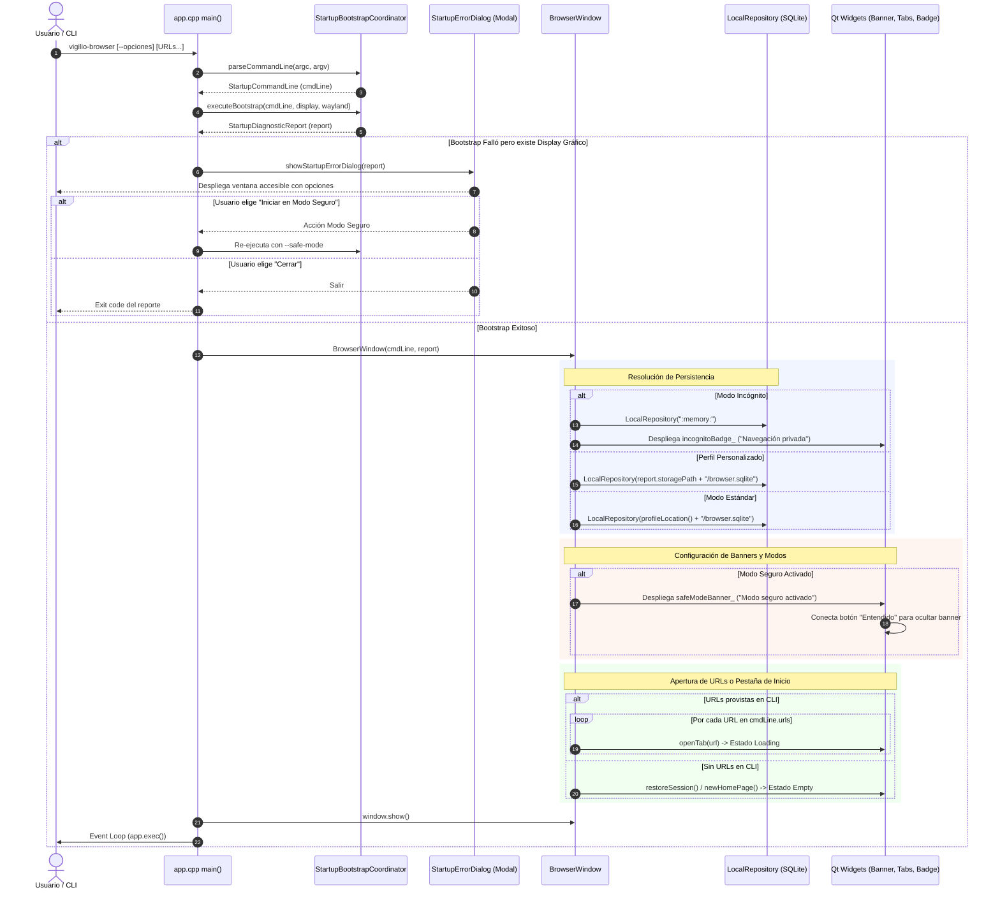
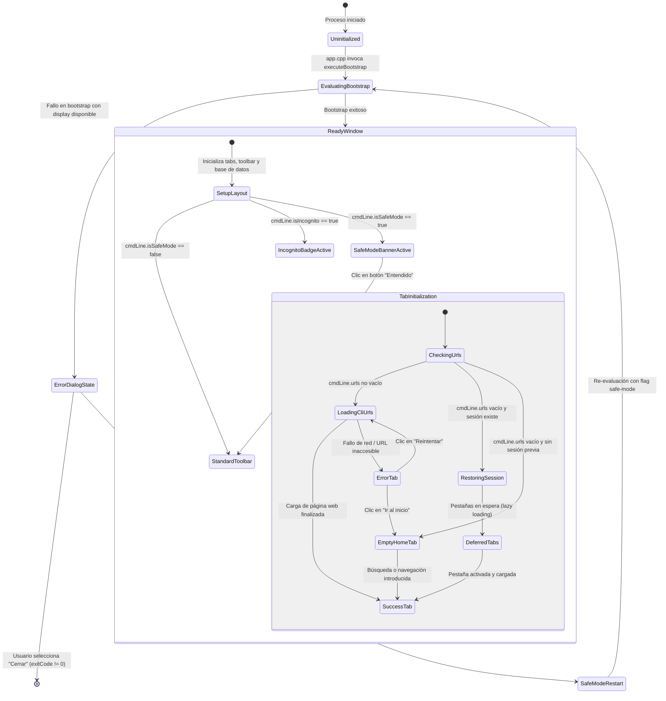

# Design — module-foundations-task0023

Status: PROPOSED

## Current, target and gaps

### Estado actual (CURRENT)

1. **Punto de entrada de la aplicación (`apps/vigilio-browser/src/app.cpp`)**:
   - Coordina la inicialización preliminar delegando en `vigilio::StartupBootstrapCoordinator::parseCommandLine` y `executeBootstrap`.
   - Maneja solicitudes de ayuda (`--help`) y versión (`--version`) saliendo con código 0.
   - Maneja argumentos inválidos emitiendo errores a `std::cerr` y saliendo con código 10.
   - Maneja la ausencia de display gráfico saliendo con código 1 de forma controlada (`DegradedHeadless`).
   - Tras comprobar el éxito del reporte, instancia `BrowserWindow window;` mediante su constructor por defecto sin transmitirle las opciones de la línea de comandos ni el reporte de diagnóstico generado.
2. **Capa de interfaz gráfica (`apps/vigilio-browser/src/ui/BrowserWindow.h`, `BrowserWindow.cpp`)**:
   - `BrowserWindow` posee únicamente un constructor sin parámetros (`BrowserWindow()`).
   - Ubicación de la base de datos fija: hardcodea `profileLocation() + "/browser.sqlite"`, ignorando la ruta validada `report.storagePath` cuando se utiliza `--profile-dir`.
   - Modo incógnito no integrado en UI: aunque el coordinador procesa `--incognito` y marca `isStoragePersistent = false`, la ventana principal continúa inicializando la base de datos física en disco y no muestra ningún distintivo visual ni advertencia de sesión privada.
   - Modo seguro no integrado en UI: aunque el coordinador procesa `--safe-mode`, la ventana principal no despliega ningún banner informativo ni alerta de estabilidad.
   - Argumentos de URLs ignorados: si el usuario invoca `vigilio-browser https://ejemplo.org`, la aplicación ignora la lista de URLs y abre la restauración de sesión o una pestaña vacía con `newHomePage()`.
   - Ausencia de diálogo gráfico ante fallos de arranque: si el bootstrap falla pero el entorno dispone de servidor gráfico (`DISPLAY`/`WAYLAND_DISPLAY`), la aplicación solo imprime texto a `std::cerr` antes de terminar abruptamente, sin ofrecer al usuario de escritorio una ventana accesible con opciones de recuperación («Reintentar», «Iniciar en modo seguro», «Cerrar»).
3. **Suite de pruebas de UI (`apps/vigilio-browser/tests/ui/WindowTests.cpp`)**:
   - Valida la instanciación básica, presencia de barra de herramientas, iconos Lucide SVG, página de inicio vacía (`vigilio-home`), página de error de navegación (`vigilio-page-error`) y escalado en Senior Mode.
   - Carece de pruebas específicas para verificar la respuesta visual ante parámetros de arranque (`StartupCommandLine`), banners de modo seguro, badges de incógnito y apertura de URLs iniciales.

### Estado objetivo (TARGET)

1. **Integración completa del contexto de arranque en la ventana principal**:
   - `BrowserWindow` admite opcionalmente `StartupCommandLine` y `StartupDiagnosticReport` en su constructor, preservando valores por defecto para pruebas unitarias.
   - Si `cmdLine.isIncognito` es verdadero, la base de datos SQLite opera en memoria (`":memory:"`), aislada del disco, y la interfaz despliega un distintivo visual accesible de «Navegación privada».
   - Si `cmdLine.isSafeMode` es verdadero, la ventana despliega en la parte superior un banner informativo nativo (`safeModeBanner_`) con icono de advertencia, mensaje en español natural y botón accesible de descarte («Entendido»).
   - Si se proporcionan URLs en la línea de comandos (`cmdLine.urls`), se instancian en pestañas dedicadas de forma secuencial y no bloqueante.
   - Si se especifica una ruta de perfil personalizada válida, se utiliza `report.storagePath + "/browser.sqlite"`.
2. **Tratamiento accesible y visual de fallos de arranque en GUI**:
   - En caso de anomalía recuperable o fallo de arranque en un entorno con servidor gráfico disponible, `app.cpp` presenta un diálogo nativo accesible (`StartupErrorDialog`) que informa al usuario en lenguaje público claro conforme a `docs/UX-COPY-PUBLICO.md`, ofreciendo acciones de remediación («Reintentar», «Iniciar en modo seguro», «Cerrar»).
3. **Adaptabilidad plena a «Interfaz más fácil de usar» (Modo Senior)**:
   - El banner de modo seguro, el indicador de incógnito y el diálogo modal de arranque se adaptan a las directrices de `docs/skills/05-accesibilidad-y-senior-mode.md`: alturas mínimas de controles >= 48 px, iconos de 32×32 px, tipografía ampliada a 14pt (escalable a 18pt) y alto contraste WCAG AA/AAA.
4. **Verificación automatizada en CTest**:
   - Suite `WindowTests.cpp` ampliada con casos de prueba automatizados para todos los estados de arranque, con tolerancia headless en entornos de CI sin display (reporte `NOT_EXECUTED` limpio con exit code 0).

### Brechas identificadas (GAPS)

- **GAP-1**: `BrowserWindow` carece de constructor parametrizado para recibir el contexto de arranque (`StartupCommandLine` y `StartupDiagnosticReport`).
- **GAP-2**: Las URLs pasadas por línea de comandos no son abiertas como pestañas en la inicialización visual.
- **GAP-3**: El modo incógnito no aísla la base de datos en `:memory:` ni despliega un distintivo visual de navegación privada en la interfaz.
- **GAP-4**: El modo seguro no despliega el banner visual informativo ni el botón accesible de descarte.
- **GAP-5**: No existe diálogo gráfico accesible para notificar fallos de arranque a usuarios de escritorio.
- **GAP-6**: La suite `WindowTests.cpp` no cuenta con aserciones para validar los estados visuales ni adaptaciones de arranque.

## Compatibility, migration and rollback

### Compatibilidad
- **Portabilidad Qt 6 Widgets / C++20**: Utiliza clases nativas de Qt Widgets (`QMainWindow`, `QFrame`, `QLabel`, `QPushButton`, `QMessageBox`, `QToolBar`) garantizando compilación y ejecución portable en Linux, Windows y macOS.
- **Independencia del motor WebEngine**: La gestión de estados de arranque y banners visuales opera enteramente en la capa Qt Widgets; no añade carga ni instancias innecesarias a Chromium.
- **Retrocompatibilidad**: El constructor de `BrowserWindow` proporciona parámetros por defecto (`const StartupCommandLine& cmdLine = {}, const StartupDiagnosticReport& report = {}`), manteniendo compatibilidad total con el código y tests existentes.
- **Tolerancia en CI Headless**: La suite de pruebas de UI comprueba la disponibilidad de variables de display (`DISPLAY` / `WAYLAND_DISPLAY`) y finaliza limpiamente con `NOT_EXECUTED` (exit code 0) cuando no hay entorno gráfico disponible.

### Migración
- No altera esquemas de persistencia en SQLite (`browser.sqlite`) ni el formato de archivos de sesión (`session.json`).
- Plenamente compatible con las claves existentes en `QSettings` (`appearance/dark` y `accessibility/senior`).

### Rollback
- En caso de regresión, el rollback se efectúa de manera atómica revirtiendo las modificaciones en `apps/vigilio-browser/src/ui/BrowserWindow.h`, `BrowserWindow.cpp`, `apps/vigilio-browser/src/app.cpp` y `apps/vigilio-browser/tests/ui/WindowTests.cpp`.

## Arquitectura técnica de la interacción Qt Widgets de startup bootstrap

### Diagrama de secuencia de inicialización



### Máquina de estados visuales de la interfaz de usuario



### Especificación técnica de componentes y contratos Qt

#### 1. Estructura de `BrowserWindow` y miembros privados

```cpp
class BrowserWindow final : public QMainWindow {
  public:
    explicit BrowserWindow(
        const vigilio::StartupCommandLine& cmdLine = {},
        const vigilio::StartupDiagnosticReport& report = {});
    ~BrowserWindow() override;

    void openTab(const QUrl& url = {});
    [[nodiscard]] int tabCount() const;
    [[nodiscard]] QWebEngineView* currentWebView() const;
    void setSeniorMode(bool enabled);
    [[nodiscard]] QIcon makeResourceIcon(std::string_view alias) const;

    // Métodos de consulta de estado de arranque
    [[nodiscard]] bool isIncognitoSession() const noexcept { return isIncognito_; }
    [[nodiscard]] bool isSafeModeSession() const noexcept { return isSafeMode_; }
    [[nodiscard]] QWidget* safeModeBanner() const noexcept { return safeModeBanner_; }
    [[nodiscard]] QLabel* incognitoBadge() const noexcept { return incognitoBadge_; }

  protected:
    void closeEvent(QCloseEvent* event) override;

  private:
    void setupUi();
    void setupStartupVisuals(
        const vigilio::StartupCommandLine& cmdLine,
        const vigilio::StartupDiagnosticReport& report);
    void setupSafeModeBanner();
    void setupIncognitoBadge();

    // Punteros y estado de arranque
    QWidget* safeModeBanner_{nullptr};
    QLabel* incognitoBadge_{nullptr};
    bool isIncognito_{false};
    bool isSafeMode_{false};
    std::string storagePath_;

    // Componentes de interfaz existentes
    std::unique_ptr<vigilio::LocalRepository> db_;
    QTabWidget* tabs_{nullptr};
    QLineEdit* address_{nullptr};
    QToolBar* toolbar_{nullptr};
    QAction* backAction_{nullptr};
    QAction* forwardAction_{nullptr};
    QAction* reloadAction_{nullptr};
    QAction* homeAction_{nullptr};
    QAction* bookmarkAction_{nullptr};
    QAction* favoritesAction_{nullptr};
    QAction* newTabAction_{nullptr};
    QAction* menuAction_{nullptr};
    QAction* seniorAction_{nullptr};
    QAction* themeAction_{nullptr};
    bool senior_{false};
    bool dark_{false};
};
```

#### 2. Comportamiento detallado de `setupSafeModeBanner()`

- Crea un contenedor `QFrame` con `objectName = "vigilio-safe-mode-banner"`.
- Layout horizontal con márgenes de 8 px (12 px en Senior Mode).
- Icono: `QLabel` con `makeResourceIcon("icons/tools/shield.svg")` (tamaño 20×20 px en estándar, 28×28 px en Senior Mode).
- Mensaje: `QLabel` con texto «Modo seguro activado: extensiones y personalizaciones desactivadas para proteger la estabilidad».
- Botón de descarte: `QPushButton` con texto «Entendido» y `objectName = "vigilio-safe-mode-dismiss"`.
- Conexión: Al hacer clic en el botón o pulsar `Esc`, el banner se oculta (`safeModeBanner_->hide()`) y el foco retorna a la barra de direcciones (`address_->setFocus()`).
- Atributos accesibles: `safeModeBanner_->setAccessibleName("Aviso de modo seguro")`.

#### 3. Comportamiento detallado de `setupIncognitoBadge()`

- Crea un `QLabel` o `QWidget` contenedor con `objectName = "vigilio-incognito-badge"`.
- Icono vectorial: `makeResourceIcon("icons/tools/shield.svg")` (18×18 px).
- Texto: «Navegación privada».
- Integración: Se añade como widget permanente en la barra de estado (`statusBar()->addPermanentWidget(incognitoBadge_)`) o como acción en la barra de herramientas.
- Título de ventana: `setWindowTitle("Vigilio Browser (Navegación privada)")`.
- Atributos accesibles: `incognitoBadge_->setAccessibleName("Navegación privada activa")`, `incognitoBadge_->setAccessibleDescription("No se guardará el historial de navegación ni datos en este equipo")`.

#### 4. Diálogo de error de arranque en `app.cpp`

```cpp
namespace {
void showStartupErrorDialog(const vigilio::StartupDiagnosticReport& report) {
    QMessageBox msgBox;
    msgBox.setWindowTitle("Vigilio Browser");
    msgBox.setIcon(QMessageBox::Warning);
    msgBox.setText("No se pudo iniciar Vigilio Browser");
    
    // Mapeo amigable de causas sin tecnicismos
    QString detail = "Ocurrió una dificultad al preparar el entorno del navegador.\n\n";
    if (report.status == vigilio::StartupStatusCode::StorageAccessDenied) {
        detail += "No se tienen permisos suficientes para acceder a la carpeta de perfil.";
    } else if (report.status == vigilio::StartupStatusCode::CorruptCriticalResources) {
        detail += "Algunos recursos esenciales del programa no pudieron cargarse.";
    } else {
        detail += "La inicialización del sistema no pudo completarse satisfactoriamente.";
    }
    
    if (!report.remediationAction.empty()) {
        detail += "\n\nSugerencia: " + QString::fromStdString(report.remediationAction);
    }
    
    msgBox.setInformativeText(detail);
    msgBox.setStandardButtons(QMessageBox::Close);
    msgBox.setDefaultButton(QMessageBox::Close);
    msgBox.exec();
}
} // namespace
```
