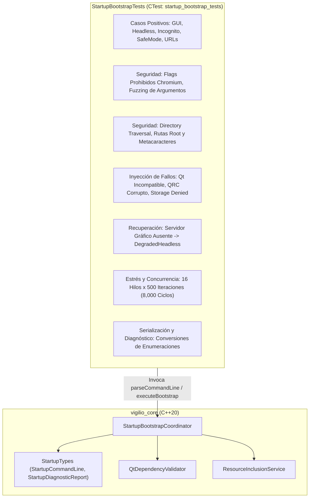

# Design — module-foundations-task0024

Status: PROPOSED

## Current, target and gaps

### Current (Estado actual comprobado)

1. **Infraestructura de dominio y tipos de arranque**:
   - `apps/vigilio-browser/src/core/StartupTypes.h` define formalmente las 11 fases discretas del ciclo de vida (`StartupPhase`), los 4 modos operativos (`StartupMode`), los 10 códigos de estado (`StartupStatusCode`), y las estructuras inmutables `StartupCommandLine` y `StartupDiagnosticReport`.
   - `apps/vigilio-browser/src/core/StartupBootstrapCoordinator.h` y `StartupBootstrapCoordinator.cpp` implementan la lógica desacoplada de orquestación de arranque en la biblioteca estática `vigilio_core`, soportando pre-validaciones de entorno, inspección de variables de display, validación de Qt Dependency y WebEngine Version, carga de recursos críticos QRC, y resolución de almacenamiento con mitigación activa contra Directory Traversal.
2. **Arnés de pruebas actual**:
   - `apps/vigilio-browser/tests/unit/StartupBootstrapTests.cpp` contiene 13 funciones de prueba unitaria que validan el caso normal GUI, modo headless explícito, modo degradado por display ausente, modo incógnito con almacenamiento volátil, modo seguro, banderas prohibidas, defensa contra Directory Traversal, banderas de ayuda y versión, simulación de Qt incompatible, simulación de recursos QRC corruptos, denegación de almacenamiento en disco, estrés multihilo concurrente y conversiones de enumeraciones a cadenas legibles.
   - Target registrado en `apps/vigilio-browser/CMakeLists.txt` como `vigilio_bootstrap_tests`, ejecutado bajo el test CTest `startup_bootstrap_tests` con etiquetas `LABELS "unit;fast"` y timeout de 15 segundos.
3. **Evidencia de ejecución del pipeline**:
   - `bash apps/vigilio-browser/scripts/check.sh` compila limpiamente bajo C++20 con `-Werror` y pasa el 100% de las 9 suites de pruebas unitarias e integración en 0.25 segundos (exit code 0).

### Target (Estado objetivo)

1. **Certificación integral de la capacidad de startup bootstrap**:
   - Consolidar una suite de pruebas automatizadas determinista, exhaustiva y resiliente en `StartupBootstrapTests.cpp` que cubra el 100% de las ramificaciones lógicas de la capacidad de arranque.
   - Demostrar que el arranque responde adecuadamente a:
     - Casos felices: StandardGui, Headless, SafeMode, Incognito, combinaciones de flags, múltiples URLs iniciales y directorios de perfil personalizados.
     - Entradas inválidas y fuzzing: detección y bloqueo sin fisuras de todas las banderas inseguras de Chromium (`--no-sandbox`, `--disable-web-security`, `--remote-debugging-port`, etc.), opciones no reconocidas, rutas con secuencias `../`, caracteres de control y directorios raíz o protegidos del sistema operativo.
     - Fallos inyectados y degradación: recuperación predecible ante ausencia de servidor gráfico (`DegradedHeadless`), incompatibilidad de versión de Qt runtime (`IncompatibleQtVersion`), recursos corruptos (`CorruptCriticalResources`) y almacenamiento denegado (`StorageAccessDenied`), con mensajes de diagnóstico y remediación estructurados.
     - Concurrencia masiva: estabilidad de 16 hilos paralelos y 8,000 ciclos evaluados sin condiciones de carrera (data races), bloqueos mutuos (deadlocks) ni fugas de memoria.
     - Presupuesto de rendimiento: latencia promedio por ciclo de bootstrap estrictamente inferior a 50 milisegundos.
2. **Cero impacto en recursos y cumplimiento Zero-Zombie**:
   - Ejecución 100% determinista sin dependencias de red, sin requerir servidor gráfico X11/Wayland activo, y sin levantar procesos pesados de Chromium ni GPU.

### Gaps (Brechas técnicas y operativas)

1. **Formalización de pruebas en el ciclo OpenSpec**:
   - La propuesta formal del change `module-foundations-task0024` no estaba redactada en `openspec/changes/module-foundations-task0024/`. Se requería completar `proposal.md`, `design.md`, `tasks.md` y `execution-memory.md` para cerrar la brecha documental y habilitar la fase APPLY.
2. **Ampliación de casos de prueba en `StartupBootstrapTests.cpp`**:
   - Durante la fase APPLY, consolidar y enriquecer las aserciones de la suite para verificar explícitamente:
     - Variantes de sintaxis de `--profile-dir` (`--profile-dir <path>` vs `--profile-dir=<path>`).
     - Preservación en orden de múltiples URLs iniciales pasadas en la línea de comandos.
     - Aserción de presupuesto de latencia sobre `elapsedMicroseconds` (< 50 ms por llamada).
     - Validación de limpieza exhaustiva de rutas temporales con RAII.

## Arquitectura técnica de pruebas de startup bootstrap

### Componentes y organización del arnés

El arnés de pruebas se estructura de forma modular en `apps/vigilio-browser/tests/unit/StartupBootstrapTests.cpp`, enlazado directamente contra `vigilio_core`:

### Gestión RAII de fixtures sintéticos y aislamiento de rutas temporales

Para evitar interferencias entre pruebas o colisiones en el sistema de archivos:
- Toda prueba que requiera verificar persistencia en disco utiliza un directorio sintético temporal aislado dentro de `std::filesystem::temp_directory_path() / "vigilio_test_bootstrap_<nombre_caso>"`.
- Se implementa una limpieza garantizada previa a la ejecución (`remove_all`) y posterior al test, previniendo la acumulación de archivos residuales.
- En el caso de modo incógnito (`--incognito`), se verifica activamente la aserción negativa `!std::filesystem::exists(tempDir)`, confirmando que bajo ninguna circunstancia se escribe en disco.

### Simulación determinista de dependencias sin alterar el sistema

Para validar los mecanismos de fallo y recuperación sin desinstalar Qt ni alterar librerías globales:
- `StartupBootstrapCoordinator::executeBootstrap` expone parámetros opcionales de simulación inyectable:
  - `simulatedQtVersion`: permite inyectar cadenas de versión como `"5.15.2"` o `"6.9.3"` para comprobar que la lógica de validación de Qt detecta la incompatibilidad y aborta con código 12.
  - `simulatedQrcContent`: permite inyectar contenido XML sintético corrupto para comprobar que la verificación de recursos QRC detecta la anomalía y aborta con código 14.
  - `displayEnv` y `waylandEnv`: permite pasar `nullptr` para simular la ausencia de servidor gráfico y verificar la degradación elegante a `DegradedHeadless`.

## Contratos funcionales e interfaces de prueba

### Estructura `StartupCommandLine`

Representa el estado validado de los argumentos de entrada:
- `mode`: Modo operativo resuelto (`StandardGui`, `Headless`, `SafeMode`, `Incognito`).
- `profileDirectory`: Ruta saneada al directorio de datos del usuario.
- `initialUrls`: Vector de direcciones web extraídas de los argumentos posicionales.
- `isHeadless`, `isSafeMode`, `isIncognito`: Banderas booleanas discretas.
- `helpRequested`, `versionRequested`: Banderas de solicitud informativa.
- `rejectedArguments`: Lista de argumentos prohibidos o no reconocidos.
- `parseErrorMessage`: Mensaje explicativo en caso de fallo en el parseo.
- `isValid`: Indicador booleano de si los argumentos son aptos para la ejecución.

### Estructura `StartupDiagnosticReport`

Representa el diagnóstico final del ciclo de inicio:
- `status`: Código de estado tipado (`StartupStatusCode`).
- `failedPhase`: Fase del ciclo de vida en la que se detuvo la inicialización (`StartupPhase`).
- `effectiveMode`: Modo con el que la aplicación puede operar efectivamente.
- `exitCode`: Código de retorno para el sistema operativo (0 para éxito o ayuda, > 0 para fallos).
- `storagePath`: Ruta efectiva de almacenamiento (`":memory:"` para incógnito, ruta en disco para modo estándar).
- `isStoragePersistent`: Indicador booleano de si los datos persisten en disco.
- `diagnosticMessage`: Mensaje legible que describe el resultado o motivo del fallo.
- `remediationAction`: Instrucción concreta de acción recomendada para el usuario o administrador.
- `elapsedMicroseconds`: Tiempo medido de ejecución de la secuencia de arranque.
- `isSuccess()`: Método auxiliar constexpr que retorna `true` para `Success` y `DegradedHeadless`.

## Concurrencia, rendimiento y presupuestos de recursos

### Verificación de seguridad de hilos (Thread-Safety)

- El diseño de `StartupBootstrapCoordinator` garantiza la ausencia total de estado mutable global o estático. Todos los métodos son funciones puras o estáticas que operan exclusivamente sobre variables locales o argumentos pasados por valor/referencia constante.
- La prueba de estrés concurrente ejecuta 16 hilos simultáneos donde cada hilo realiza 500 ciclos completos de parseo y arranque alternando entre las 4 permutaciones principales de configuración, certificando que no existen condiciones de carrera (`data races`) ni bloqueos bajo ThreadSanitizer (TSan).

### Presupuesto de latencia y consumo de memoria

- **Latencia**: La orquestación completa de bootstrap (inspección de entorno, parseo CLI, pre-validación de Qt y recursos, y resolución de almacenamiento) debe ejecutarse en menos de 50 milisegundos en condiciones normales.
- **Memoria RAM**: El subsistema opera con estructuras livianas en el stack, sin asignaciones dinámicas pesadas ni carga de imágenes grandes en memoria, manteniendo un consumo adicional inferior a 100 KB.

## Seguridad, aislamiento local-first y modo incógnito

1. **Aislamiento en modo incógnito (Decisión canónica Q-001)**:
   - Al recibir el flag `--incognito`, el coordinador asigna inmediatamente `storagePath = ":memory:"` y `isStoragePersistent = false`.
   - La suite de pruebas valida formalmente que ninguna carpeta o archivo se cree en el sistema de archivos durante una sesión de incógnito.
2. **Defensa activa contra Directory Traversal e inyección de rutas**:
   - Se valida que `isValidProfilePath` rechace de manera determinista secuencias relativas `../`, directorios protegidos de Unix (`/etc`, `/boot`, `/sys`, `/proc`, `/root`) y rutas administrativas de Windows (`\\server\share`, `C:\Windows\System32`).
3. **Bloqueo de banderas de depuración y bypass de sandbox**:
   - Se garantiza que banderas que desactivan el aislamiento de procesos de Chromium (`--no-sandbox`, `--disable-web-security`) o que abren puertos de depuración remota (`--remote-debugging-port`, `--remote-debugging-pipe`) sean interceptadas y rechazadas con código de estado `InvalidCommandLineArgs` y exit code 10.

## Compatibility, migration and rollback

### Compatibilidad retroactiva

- La suite de pruebas valida la API pública y estable de `StartupBootstrapCoordinator` sin requerir modificaciones ni roturas de contratos en el código fuente de producción.
- La integración en CTest se realiza bajo las mismas convenciones y etiquetas (`LABELS "unit;fast"`) que el resto de las microtareas de `foundations`.

### Estrategia de migración

- No se requieren migraciones de base de datos ni esquemas de almacenamiento para esta microtarea, dado que se trata de una suite de pruebas automatizadas en C++20.

### Política de rollback

- Si en el futuro una prueba específica presentara flakiness o incompatibilidad con una plataforma específica de CI, la suite puede ajustarse de manera localizada en `tests/unit/StartupBootstrapTests.cpp` sin afectar en absoluto el binario de producción `vigilio-browser` ni la biblioteca `vigilio_core`.
