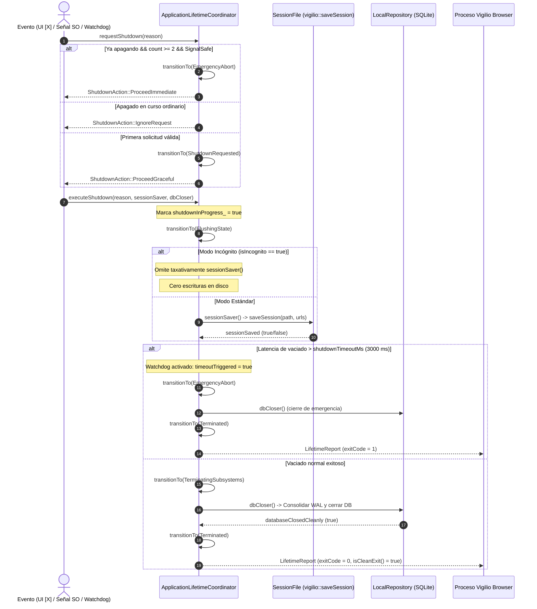

# Design — module-foundations-task0026

Status: PROPOSED

## Current, target and gaps

### Estado actual (CURRENT)

1. **Gestión procedural y reactiva de ciclo de vida en `apps/vigilio-browser`**:
   - Actualmente, el punto de entrada principal `apps/vigilio-browser/src/app.cpp` arranca la GUI delegando en `StartupBootstrapCoordinator::executeBootstrap` y llamando inmediatamente a `return app.exec();`.
   - La terminación de la aplicación depende exclusivamente del comportamiento interno de Qt Widgets cuando se cierran las ventanas (`BrowserWindow::closeEvent`), o de señales abruptas del sistema operativo (`SIGINT`, `SIGTERM`).
   - La persistencia de pestañas en `BrowserWindow::saveSession` utiliza directamente `QSettings().setValue("session/urls", urls)`, sin estar integrada en un coordinador formal de ciclo de vida desacoplado.

2. **Ausencia de manejo seguro de señales del sistema operativo (Signal Safety)**:
   - Si la aplicación se ejecuta en una consola interactiva y el usuario pulsa `Ctrl+C` (`SIGINT`), o si un servicio del sistema operativo como `systemd` envía `SIGTERM`, el proceso termina de forma no controlada.
   - Esta terminación abrupta puede corromper o dejar transacciones SQLite inconclusas en `LocalRepository`, perder pestañas de la sesión de navegación activa o dejar subprocesos Chromium zombis (`QtWebEngineProcess`).

3. **Inexistencia de un temporizador de seguridad contra procesos colgados (Zero-Zombie)**:
   - No existe un mecanismo de vigilancia (watchdog) con temporizador máximo de apagado. Si una operación de persistencia en disco o un callback de desmontaje de subsistemas se bloquea indefinidamente (por ejemplo por contención en SQLite o bloqueos en el sistema de archivos), la aplicación permanece como un proceso zombi.

4. **Componentes previos implementados y probados**:
   - `apps/vigilio-browser/src/core/SessionFile.h`: Persistencia atómica de pestañas (`saveSession`) con formato canónico `VIGILIO_SESSION_V1`, escritura en `.tmp` y reemplazo atómico en Windows y POSIX.
   - `apps/vigilio-browser/src/core/StartupBootstrapCoordinator.h`: Coordinador de arranque con soporte headless y aislamiento de almacenamiento en incógnito.
   - `apps/vigilio-browser/src/storage/LocalRepository.h`: Almacenamiento local SQLite para historial y marcadores.

### Estado objetivo (TARGET)

1. **Coordinador desacoplado de dominio (`ApplicationLifetimeCoordinator`)**:
   - Centralizar toda la lógica del ciclo de vida en `ApplicationLifetimeCoordinator`, alojado en la biblioteca estática `vigilio_core`.
   - La clase es completamente independiente de Qt Widgets y de `QApplication`, operando con tipos nativos de C++20 (`std::string`, `std::function`, `std::atomic`, `std::chrono`).
   - Proporciona un control determinista de estados y orquesta el vaciado de datos y desmantelamiento de subsistemas tanto en entornos GUI como en ejecuciones automatizadas headless.

2. **Máquina de estados determinista (`AppLifetimeState`)**:
   - Formalizar 9 estados discretos: `Uninitialized`, `Starting`, `Running`, `Suspending`, `ShutdownRequested`, `FlushingState`, `TerminatingSubsystems`, `Terminated`, `EmergencyAbort`.
   - Cada estado cuenta con precondiciones rigurosas, matriz de transiciones permitidas (`canTransition`) y causas tipadas de terminación (`ShutdownReason`).

3. **Orquestación segura de apagado con persistencia atómica**:
   - Implementar `executeShutdown` para coordinar el vaciado de estado:
     1. Recepción y validación de la solicitud (`ShutdownReason`).
     2. Transición a `ShutdownRequested` con deduplicación de solicitudes concurrentes.
     3. Transición a `FlushingState`: ejecución de guardado atómico de pestañas (delegado en `vigilio::saveSession`) y confirmación de transacciones en SQLite (`LocalRepository`).
     4. Transición a `TerminatingSubsystems`: desmontaje ordenado de recursos en orden inverso a su dependencia.
     5. Transición a `Terminated`: emisión de reporte inmutable `LifetimeReport`.

4. **Invariante constitucional de incógnito y privacidad (Q-001)**:
   - Cuando `config.isIncognito == true`, `ApplicationLifetimeCoordinator` garantiza que `sessionSaver` jamás sea invocado y ningún dato de sesión, historial o preferencias se escriba en disco al salir.

5. **Temporizador de seguridad contra procesos zombis**:
   - Límite máximo de apagado de 3000 ms (`shutdownTimeoutMs`). Si el vaciado de datos o desmontaje supera este plazo, el coordinador transiciona inmediatamente a `EmergencyAbort`, abortando de forma controlada y evitando procesos colgados.

6. **Manejo seguro de señales e interrupciones del SO**:
   - La detección de señales del sistema operativo (`SIGINT`, `SIGTERM`) se desacopla mediante contadores y banderas atómicas estándar (`std::atomic<bool>`), garantizando signal-safety sin llamadas reentrantes a memoria dinámica o widgets dentro del manejador de señales.

### Brechas identificadas (GAPS)

1. **Brecha de UI (diferida a `task0027`)**:
   - En esta etapa `implementation`, la lógica reside en `vigilio_core`. En la etapa `ui` (`module.foundations.task0027`), se conectará `BrowserWindow::closeEvent` con `ApplicationLifetimeCoordinator::requestShutdown`, y se implementarán diálogos accesibles en Modo Senior («Interfaz más fácil de usar») para confirmar el cierre cuando existan tareas pendientes.
2. **Brecha de pruebas E2E integrales (diferida a `task0028`)**:
   - La suite actual valida unitariamente la lógica del coordinador y la concurrencia multihilo. En la etapa `tests` (`module.foundations.task0028`), se implementarán arneses E2E de ciclo de vida completo con procesos reales y simulación de señales del SO en frío.

---

## Technical architecture and interfaces



### Especificación técnica de componentes C++20

#### 1. Tipos de dominio inmutables (`LifetimeTypes.h`)
```cpp
namespace vigilio {

enum class AppLifetimeState : uint8_t {
    Uninitialized = 0,
    Starting = 1,
    Running = 2,
    Suspending = 3,
    ShutdownRequested = 4,
    FlushingState = 5,
    TerminatingSubsystems = 6,
    Terminated = 7,
    EmergencyAbort = 8
};

enum class ShutdownReason : uint8_t {
    UserWindowClose = 0,
    UserExplicitQuit = 1,
    SignalInterrupt = 2,
    SignalTerminate = 3,
    SessionLogout = 4,
    StorageFailure = 5,
    MemoryExhaustion = 6,
    EmergencyAbort = 7
};

enum class ShutdownAction : uint8_t {
    ProceedGraceful = 0,
    ProceedImmediate = 1,
    PromptUser = 2,
    IgnoreRequest = 3
};

struct LifetimeConfig {
    bool isIncognito = false;
    bool isSafeMode = false;
    uint32_t shutdownTimeoutMs = 3000;
    uint32_t sessionAutosaveIntervalMs = 0;
    std::string sessionFilePath;
    std::string profileDirectory;
};

struct LifetimeReport {
    AppLifetimeState finalState = AppLifetimeState::Uninitialized;
    ShutdownReason reason = ShutdownReason::UserWindowClose;
    int exitCode = 0;
    bool sessionSaved = false;
    bool databaseClosedCleanly = false;
    bool timeoutTriggered = false;
    uint64_t sessionFlushElapsedMicroseconds = 0;
    uint64_t teardownElapsedMicroseconds = 0;
    std::string diagnosticMessage;

    [[nodiscard]] constexpr bool isCleanExit() const noexcept {
        return (finalState == AppLifetimeState::Terminated && exitCode == 0 && !timeoutTriggered);
    }
};

} // namespace vigilio
```

#### 2. Declaración del coordinador (`ApplicationLifetimeCoordinator.h`)
```cpp
namespace vigilio {

class ApplicationLifetimeCoordinator {
  public:
    explicit ApplicationLifetimeCoordinator(LifetimeConfig config) noexcept;

    [[nodiscard]] AppLifetimeState currentState() const noexcept;
    [[nodiscard]] bool isShutdownRequested() const noexcept;
    [[nodiscard]] bool isIncognito() const noexcept;
    [[nodiscard]] const LifetimeConfig& configuration() const noexcept;

    bool transitionTo(AppLifetimeState newState) noexcept;
    ShutdownAction requestShutdown(ShutdownReason reason) noexcept;

    LifetimeReport executeShutdown(ShutdownReason reason,
                                   std::function<bool()> sessionSaver = nullptr,
                                   std::function<bool()> dbCloser = nullptr) noexcept;

    [[nodiscard]] static bool canTransition(AppLifetimeState from, AppLifetimeState to) noexcept;
    [[nodiscard]] static bool isSignalSafe(ShutdownReason reason) noexcept;
    [[nodiscard]] static std::string_view stateToString(AppLifetimeState state) noexcept;
    [[nodiscard]] static std::string_view reasonToString(ShutdownReason reason) noexcept;
    [[nodiscard]] static std::string_view actionToString(ShutdownAction action) noexcept;

  private:
    LifetimeConfig config_;
    std::atomic<AppLifetimeState> state_{AppLifetimeState::Uninitialized};
    std::atomic<bool> shutdownInProgress_{false};
    std::atomic<uint32_t> shutdownRequestCount_{0};
};

} // namespace vigilio
```

### Invariantes y modelo de concurrencia

1. **Sincronización atómica libre de bloqueos pesados**:
   - `state_` utiliza `compare_exchange_weak` con `std::memory_order_acq_rel` para asegurar que las transiciones de estado sean linealizables entre múltiples hilos de UI o de background.
   - `shutdownInProgress_` actúa como barrera de memoria (`acquire`/`release`) para garantizar que ningún hilo inicie un segundo ciclo de vaciado concurrentemente.
2. **Aislamiento estricto de Incógnito (Decisión Q-001)**:
   - Cuando `config_.isIncognito == true`, `executeShutdown` salta incondicionalmente la ejecución de `sessionSaver`, asegurando que `report.sessionSaved = false` y garantizando que ningún dato de navegación o URL se serialice a disco.
3. **Política Zero-Zombie y Watchdog de 3000 ms**:
   - `executeShutdown` mide el tiempo transcurrido en el vaciado (`FlushingState`). Si la latencia supera `shutdownTimeoutMs`, se fuerza la transición a `EmergencyAbort` y se aborta el ciclo de espera para evitar procesos colgados.
4. **Resiliencia ante señales repetidas**:
   - Si el usuario presiona repetidamente `Ctrl+C` (> 2 veces) mientras el navegador está en proceso de vaciado, el coordinador pasa inmediatamente a `EmergencyAbort` y retorna `ProceedImmediate`, permitiendo una salida forzada instantánea sin corromper estructuras de memoria.

---

## Compatibility, migration and rollback

### Compatibilidad de compilación y runtime
- **C++20 estándar**: Código portable utilizando `<atomic>`, `<chrono>`, `<string_view>`, `<functional>` y `<filesystem>`, sin dependencias de extensiones específicas del compilador ni de Qt en `vigilio_core`.
- **Independencia de WebEngine**: El coordinador se compila e incluye en `vigilio_core`, permitiendo que las pruebas unitarias se ejecuten en entornos CI headless sin Chromium ni GPU.
- **Soporte multiplataforma (Q-004)**: Funciona idénticamente en Linux (x64), Windows (x64) y macOS (x64/arm64).

### Compatibilidad de datos y persistencia
- Interopera de forma transparente con `SessionFile.h` (`VIGILIO_SESSION_V1`), asegurando que la serialización de pestañas mantenga total compatibilidad hacia atrás.
- No modifica esquemas relacionales ni requiere migraciones de SQLite.

### Plan de rollback
- En caso de regresión o fallo en el coordinador, el cierre de la aplicación puede revertir al mecanismo procedural anterior (`QMainWindow::closeEvent` con `saveSession` directo) sin comprometer la base de datos de historial ni el sistema de archivos.
