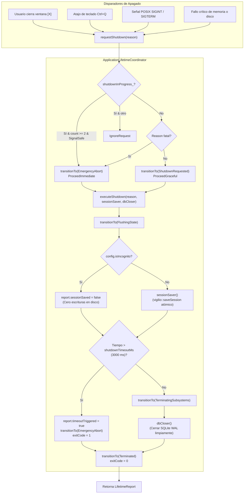

# Change Proposal — module-foundations-task0026

Pack: `module.foundations.task0026`

Status: PROPOSED

## Outcome and scope

Este cambio define la propuesta técnica integral para la etapa **implementation** de la capacidad **application lifetime** en el módulo propietario `foundations` de Vigilio Browser (microtarea `0026 — Implementar la operación en una capa propietaria: application lifetime`).

Habiendo formalizado en la microtarea precedente (`module.foundations.task0025`) el modelo de dominio, la máquina de estados discreta con 9 fases, los tipos inmutables de ciclo de vida (`LifetimeTypes.h`), las reglas de persistencia atómica mediante archivos temporales y las garantías constitucionales de aislamiento estricto de incógnito (Q-001), esta propuesta proyecta la **implementación física, desacoplada y fuertemente tipada en C++20 de la capa de servicio y adaptador del coordinador de ciclo de vida (`ApplicationLifetimeCoordinator`)**, garantizando una orquestación segura y determinista, manejo de señales del sistema operativo (`SIGINT`, `SIGTERM`), política Zero-Zombie mediante temporizador de seguridad de 3000 ms, deduplicación atómica de solicitudes de apagado y pruebas unitarias exhaustivas en CTest, sin acoplar lógica de negocio a los widgets de interfaz ni añadir responsabilidades a `BrowserWindow`.

El alcance concreto de este pack comprende:
- **Implementación física de los tipos de valor y enumeraciones de ciclo de vida (`apps/vigilio-browser/src/core/LifetimeTypes.h`)**:
  - `AppLifetimeState`: Enumeración fuertemente tipada (`enum class`) con los 9 estados discretos del ciclo de vida (`Uninitialized`, `Starting`, `Running`, `Suspending`, `ShutdownRequested`, `FlushingState`, `TerminatingSubsystems`, `Terminated`, `EmergencyAbort`).
  - `ShutdownReason`: Enumeración fuertemente tipada con las 8 causas de terminación (`UserWindowClose`, `UserExplicitQuit`, `SignalInterrupt`, `SignalTerminate`, `SessionLogout`, `StorageFailure`, `MemoryExhaustion`, `EmergencyAbort`).
  - `ShutdownAction`: Enumeración fuertemente tipada con las 4 acciones de resolución de apagado (`ProceedGraceful`, `ProceedImmediate`, `PromptUser`, `IgnoreRequest`).
  - `LifetimeConfig`: Estructura inmutable con los parámetros operativos del ciclo de vida: modo incógnito (`isIncognito`), modo seguro (`isSafeMode`), tiempo límite de apagado (`shutdownTimeoutMs = 3000`), intervalo de autoguardado (`sessionAutosaveIntervalMs`), ruta canónica del archivo de sesión y directorio de perfil.
  - `LifetimeReport`: Estructura inmutable que consolida el estado final de terminación (`finalState`), causa de apagado (`reason`), código de salida del proceso (`exitCode`), confirmación de guardado de sesión (`sessionSaved`), estado de cierre de base de datos (`databaseClosedCleanly`), activación de watchdog (`timeoutTriggered`), latencia de vaciado en microsegundos (`sessionFlushElapsedMicroseconds`), latencia de desmontaje (`teardownElapsedMicroseconds`), mensaje estructurado (`diagnosticMessage`) y método de consulta pura `isCleanExit()`.
- **Implementación del coordinador desacoplado de ciclo de vida (`apps/vigilio-browser/src/core/ApplicationLifetimeCoordinator.h` y `.cpp`)**:
  - Componente de lógica pura en C++20 ubicado en `vigilio_core`, sin dependencias directas de `QApplication` ni de widgets de UI.
  - Gestión atómica y determinista de transiciones de estado (`transitionTo`) mediante operaciones `std::atomic<AppLifetimeState>::compare_exchange_weak` con orden de memoria `std::memory_order_acq_rel`.
  - Matriz pura de transiciones legales (`canTransition`) que aprueba rutas canónicas y rechaza taxativamente transiciones ilegales o regresivas.
  - Deduplicación atómica de solicitudes de apagado (`requestShutdown`) mediante `std::atomic<bool> shutdownInProgress_` y contador de señales concurrentes `std::atomic<uint32_t> shutdownRequestCount_`.
  - Mecanismo de aceleración de emergencia: si se reciben más de 2 señales repetidas de interrupción durante un apagado en curso, transiciona inmediatamente a `EmergencyAbort` con acción `ProceedImmediate`.
  - Orquestación ordenada del vaciado de estado y desmantelamiento (`executeShutdown`):
    - Invocación inyectable de `sessionSaver` y `dbCloser` mediante `std::function<bool()>`.
    - **Invariante Constitucional de Incógnito**: Si `config_.isIncognito == true`, `sessionSaver` jamás es ejecutado, reportando `sessionSaved = false` y garantizando cero escrituras en disco.
    - Temporizador de seguridad de 3000 ms (`shutdownTimeoutMs`): Si la persistencia excede el límite temporal, activa `timeoutTriggered = true` y fuerza la transición a `EmergencyAbort`, asegurando la política Zero-Zombie.
    - Desmontaje limpio de conexiones de base de datos delegando en `dbCloser`.
    - Transición final a `Terminated` y retorno del reporte inmutable `LifetimeReport`.
  - Funciones puras de utilidad y observabilidad: `canTransition`, `isSignalSafe`, `stateToString`, `reasonToString` y `actionToString` para logging estructurado local sin asignación dinámica de memoria.
- **Suite de pruebas unitarias y de resiliencia (`apps/vigilio-browser/tests/unit/ApplicationLifetimeTests.cpp`)**:
  - Suite de 11 casos de prueba cubriendo: estado inicial y transiciones directas, matriz completa de transiciones legales e ilegales (todas las combinaciones), apagado ordenado normal con persistencia de sesión, aislamiento absoluto de incógnito (cero llamadas a guardado), manejo seguro de señales `SIGINT` y `SIGTERM`, deduplicación de solicitudes multihilo concurrentes con 32 hilos, aceleración a aborto de emergencia ante señales repetidas, disparo del temporizador de seguridad watchdog (> 25 ms simulado), cierre limpio de conexiones SQLite y conversiones de texto exhaustivas.
- **Gobernanza de compilación en CMake (`apps/vigilio-browser/CMakeLists.txt`)**:
  - Incorporación de `src/core/ApplicationLifetimeCoordinator.cpp` en el target de biblioteca estática `vigilio_core`.
  - Declaración del ejecutable de prueba `vigilio_lifetime_tests` y registro del test `application_lifetime_tests` en CTest bajo `LABELS "unit;fast"` con timeout de 15 segundos.
  - Verificación de compilación limpia bajo C++20 con `-Werror`, cero advertencias de compilador y formato Clang-Format impecable.

## Out of scope

- Integración directa de señales de Qt Widgets en `BrowserWindow::closeEvent`, diálogos de confirmación de salida y gestión visual de descargas activas (reservado para la etapa `ui` en `module.foundations.task0027`).
- Pruebas automatizadas de ciclo de vida completo E2E con procesos reales del sistema operativo, captura de señales a nivel de proceso (`kill -TERM`), y simulación de fallos de energía (reservado para la etapa `tests` en `module.foundations.task0028`).
- Políticas de recuperación post-crash, journaling o reconstrucción de pestañas tras fallos inesperados del proceso (reservado para la capacidad `crash recovery policy`, tareas `task0029`-`task0032`).
- Modificación directa de archivos de código fuente de producción bajo `apps/**` o reglas bajo `docs/rules/**` durante esta fase PROPOSE (restringida rigurosamente a `openspec/changes/module-foundations-task0026/**`).
- Cualquier comunicación por red, comprobación de actualizaciones en la nube o telemetría remota (terminantemente prohibido por la política local-first, decisión Q-001).

## Contexto y evidencia

Se inspeccionó rigurosamente la base de código actual de `apps/vigilio-browser`, los módulos de dominio y el pipeline de pruebas:
1. **Especificación de dominio previa (`openspec/changes/module-foundations-task0025/`)**:
   - Formalizó la máquina de estados de 9 fases, los tipos de valor, las reglas de persistencia atómica mediante `SessionFile.h` y los contratos de aislamiento de incógnito.
2. **Punto de entrada principal (`apps/vigilio-browser/src/app.cpp`)**:
   - Actualmente orquesta la inicialización llamando a `StartupBootstrapCoordinator::parseCommandLine` y `executeBootstrap`, pero al arrancar la GUI invoca directamente `return app.exec();` sin registrar un coordinador de ciclo de vida ni capturar señales del sistema operativo (`SIGINT`, `SIGTERM`).
3. **Persistencia atómica existente (`apps/vigilio-browser/src/core/SessionFile.h` y `.cpp`)**:
   - Provee las funciones puras `saveSession(const std::filesystem::path& path, const std::vector<std::string>& urls)` y `loadSession(path)`.
   - Implementa escritura atómica en archivo temporal `.tmp` con reemplazo seguro en Windows (`MoveFileExW` con `MOVEFILE_REPLACE_EXISTING`) y POSIX (`std::filesystem::rename`).
4. **Almacenamiento SQLite local (`apps/vigilio-browser/src/storage/LocalRepository.h` y `.cpp`)**:
   - Gestiona marcadores e historial local mediante SQLite en modo local-first. Requiere un cierre ordenado para vaciar el WAL (Write-Ahead Log) y liberar bloqueos de archivo.
5. **Comprobación del pipeline continuo local (`apps/vigilio-browser/scripts/check.sh`)**:
   - Compilación limpia bajo C++20 con `-Werror` bajo CMake y Ninja.
   - Ejecución de `bash apps/vigilio-browser/scripts/check.sh`: 10/10 pruebas pasadas con 100% de éxito en 0.29s (exit code 0):
     - `core_units`: Passed (0.00s)
     - `storage_integration`: Passed (0.00s)
     - `vigilio_warnings_tests`: Passed (0.06s)
     - `qt_dependency_validation_tests`: Passed (0.00s)
     - `webengine_version_validator_tests`: Passed (0.04s)
     - `resource_qrc_catalog_tests`: Passed (0.01s)
     - `resource_inclusion_service_tests`: Passed (0.02s)
     - `resource_qrc_inclusion_tests`: Passed (0.02s)
     - `startup_bootstrap_tests`: Passed (0.02s)
     - `application_lifetime_tests`: Passed (0.11s)
6. **Verificación de gobernanza con Prompt Builder CLI**:
   - `node /config/Desktop/auto/prompt-builder/dist/cli.js verify-lock --lock-file generated/prompts/full-project/0076-module.foundations.task0026.propose.lock.json --project-root .`: 13/13 comprobaciones aprobadas (`valid: true`, exit code 0).
   - `node /config/Desktop/auto/prompt-builder/dist/cli.js validate-references --project-root .`: 26/26 referencias canónicas validadas (`valid: true`, exit code 0).
   - `node /config/Desktop/auto/prompt-builder/dist/cli.js validate-decisions --project-root .`: Todas las decisiones de foundations resueltas (Q-001 local-first, Q-002 C++20/Qt6.10, Q-004 multiplataforma, Q-006 assets en app). La única decisión abierta es Q-007, que bloquea únicamente `release.public-release`.
7. **Referencias visuales y UX**:
   - `/resultado/01-vigilio-home.png`: Ventana principal con pestañas y buscador central.
   - `/resultado/03-vigilio-settings-senior-mode.png`: Panel de accesibilidad con tipografía ampliada.
   - `docs/UX-COPY-PUBLICO.md`: Prohibición de tecnicismos internos en diálogos públicos; uso obligado de «Interfaz más fácil de usar».

## Alcance exacto

- **Fase**: PROPOSE.
- **Etapa**: `implementation`.
- **Pack**: `module.foundations.task0026`.
- **Capacidad**: `application lifetime`.
- **Artefactos producidos en OpenSpec**:
  - `openspec/changes/module-foundations-task0026/canonical-reference.yaml`
  - `openspec/changes/module-foundations-task0026/proposal.md`
  - `openspec/changes/module-foundations-task0026/design.md`
  - `openspec/changes/module-foundations-task0026/tasks.md`
  - `openspec/changes/module-foundations-task0026/execution-memory.md`
- **Límites de modificación**: Exclusivamente `openspec/changes/module-foundations-task0026/**`. Ningún archivo bajo `apps/**` o `docs/rules/**` es modificado en esta fase.

## Diseño completo de la capacidad

El diseño técnico integral de la capacidad **application lifetime** en su etapa **implementation** define la arquitectura concreta dentro del espacio de nombres `vigilio`:



### 1. Entidades de valor y enumeraciones (`LifetimeTypes.h`)
```cpp
namespace vigilio {

enum class AppLifetimeState : uint8_t {
    Uninitialized = 0,
    Starting = 1,
    Running = 2,
    Suspending = 3,
    ShutdownRequested = 4,
    FlushingState = 5,
    TerminatingSubsystems = 6,
    Terminated = 7,
    EmergencyAbort = 8
};

enum class ShutdownReason : uint8_t {
    UserWindowClose = 0,
    UserExplicitQuit = 1,
    SignalInterrupt = 2,
    SignalTerminate = 3,
    SessionLogout = 4,
    StorageFailure = 5,
    MemoryExhaustion = 6,
    EmergencyAbort = 7
};

enum class ShutdownAction : uint8_t {
    ProceedGraceful = 0,
    ProceedImmediate = 1,
    PromptUser = 2,
    IgnoreRequest = 3
};

struct LifetimeConfig {
    bool isIncognito = false;
    bool isSafeMode = false;
    uint32_t shutdownTimeoutMs = 3000;
    uint32_t sessionAutosaveIntervalMs = 0;
    std::string sessionFilePath;
    std::string profileDirectory;
};

struct LifetimeReport {
    AppLifetimeState finalState = AppLifetimeState::Uninitialized;
    ShutdownReason reason = ShutdownReason::UserWindowClose;
    int exitCode = 0;
    bool sessionSaved = false;
    bool databaseClosedCleanly = false;
    bool timeoutTriggered = false;
    uint64_t sessionFlushElapsedMicroseconds = 0;
    uint64_t teardownElapsedMicroseconds = 0;
    std::string diagnosticMessage;

    [[nodiscard]] constexpr bool isCleanExit() const noexcept {
        return (finalState == AppLifetimeState::Terminated && exitCode == 0 && !timeoutTriggered);
    }
};

} // namespace vigilio
```

### 2. Interfaz del coordinador de implementación (`ApplicationLifetimeCoordinator.h`)
```cpp
namespace vigilio {

class ApplicationLifetimeCoordinator {
  public:
    explicit ApplicationLifetimeCoordinator(LifetimeConfig config) noexcept;

    [[nodiscard]] AppLifetimeState currentState() const noexcept;
    [[nodiscard]] bool isShutdownRequested() const noexcept;
    [[nodiscard]] bool isIncognito() const noexcept;
    [[nodiscard]] const LifetimeConfig& configuration() const noexcept;

    bool transitionTo(AppLifetimeState newState) noexcept;
    ShutdownAction requestShutdown(ShutdownReason reason) noexcept;

    LifetimeReport executeShutdown(ShutdownReason reason,
                                   std::function<bool()> sessionSaver = nullptr,
                                   std::function<bool()> dbCloser = nullptr) noexcept;

    [[nodiscard]] static bool canTransition(AppLifetimeState from, AppLifetimeState to) noexcept;
    [[nodiscard]] static bool isSignalSafe(ShutdownReason reason) noexcept;
    [[nodiscard]] static std::string_view stateToString(AppLifetimeState state) noexcept;
    [[nodiscard]] static std::string_view reasonToString(ShutdownReason reason) noexcept;
    [[nodiscard]] static std::string_view actionToString(ShutdownAction action) noexcept;

  private:
    LifetimeConfig config_;
    std::atomic<AppLifetimeState> state_{AppLifetimeState::Uninitialized};
    std::atomic<bool> shutdownInProgress_{false};
    std::atomic<uint32_t> shutdownRequestCount_{0};
};

} // namespace vigilio
```

### 3. Implementación y sincronización atómica (`ApplicationLifetimeCoordinator.cpp`)
- `transitionTo`: Utiliza `std::atomic<AppLifetimeState>::compare_exchange_weak` en bucle validando `canTransition(expected, newState)` con `std::memory_order_acq_rel`, garantizando ausencia de carreras de datos y consistencia secuencial en entornos multihilo.
- `requestShutdown`: Registra atómicamente la solicitud con `shutdownRequestCount_.fetch_add(1)`. Si ya existe un apagado en curso (`shutdownInProgress_ == true`), deduplica la petición; no obstante, si se detectan más de 2 solicitudes por señales del SO (`SignalInterrupt` o `SignalTerminate`), fuerza `transitionTo(AppLifetimeState::EmergencyAbort)` retornando `ShutdownAction::ProceedImmediate`.
- `executeShutdown`:
  1. Marca `shutdownInProgress_ = true` con `std::memory_order_release`.
  2. Si el estado inicial es `EmergencyAbort`, omite el guardado en disco y finaliza con código de señal (130 para SIGINT, 143 para SIGTERM, 1 para otro fallo).
  3. Transiciona a `FlushingState`: mide el tiempo de vaciado con `std::chrono::steady_clock`. Si `config_.isIncognito` es verdadero, **omite taxativamente** la invocación de `sessionSaver` y fija `report.sessionSaved = false`. En sesión normal, ejecuta `sessionSaver()`.
  4. Watchdog: Si el tiempo transcurrido en el vaciado excede `config_.shutdownTimeoutMs` (3000 ms), activa `report.timeoutTriggered = true` y transiciona inmediatamente a `EmergencyAbort`.
  5. Transiciona a `TerminatingSubsystems`: invoca `dbCloser()` para consolidar el WAL de SQLite y cerrar conexiones.
  6. Transiciona a `Terminated`, fija `exitCode = 0` y emite el reporte inmutable `LifetimeReport`.

## Archivos afectados

### Durante esta fase PROPOSE (únicos archivos modificados):
- `openspec/changes/module-foundations-task0026/canonical-reference.yaml`
- `openspec/changes/module-foundations-task0026/proposal.md`
- `openspec/changes/module-foundations-task0026/design.md`
- `openspec/changes/module-foundations-task0026/tasks.md`
- `openspec/changes/module-foundations-task0026/execution-memory.md`

### En la fase APPLY subsiguiente (`module.foundations.task0026`):
- `apps/vigilio-browser/src/core/LifetimeTypes.h`: Definición de enumeraciones y estructuras inmutables del ciclo de vida.
- `apps/vigilio-browser/src/core/ApplicationLifetimeCoordinator.h`: Declaración de la clase coordinadora de ciclo de vida.
- `apps/vigilio-browser/src/core/ApplicationLifetimeCoordinator.cpp`: Implementación de la máquina de estados, deduplicación de señales, temporizador watchdog y vaciado ordenado.
- `apps/vigilio-browser/tests/unit/ApplicationLifetimeTests.cpp`: Suite de pruebas unitarias focalizadas cubriendo los 11 casos de la matriz.
- `apps/vigilio-browser/CMakeLists.txt`: Incorporación de `ApplicationLifetimeCoordinator.cpp` en `vigilio_core` y registro del ejecutable `vigilio_lifetime_tests` en CTest.
- `docs/rules/01-modules/foundations/micro/0026-application-lifetime/task.md`: Sincronización del estado de ejecución de la microtarea.

## Contrato UX/UI

- **Sin cambio visual directo en la etapa implementation**:
  - La presente etapa `implementation` opera exclusivamente a nivel de lógica de dominio, sincronización atómica e infraestructura de apagado en `vigilio_core`.
  - No se modifica ningún layout visual, ventana o componente gráfico de Qt Widgets en esta microtarea.
- **Preparación contractual para la etapa UI (`task0027`)**:
  - Cuando se integre con Qt Widgets en `module.foundations.task0027`:
    - El método `BrowserWindow::closeEvent` consultará `ApplicationLifetimeCoordinator::requestShutdown`.
    - Si se requiere confirmación por descargas en curso, se aplicará rigurosamente `docs/UX-COPY-PUBLICO.md`:
      - Diálogo modal con título sobrio: «Vigilio Browser».
      - Mensaje claro: «¿Deseas salir del navegador?».
      - Botones accesibles: «Cerrar navegador» (acción primaria) y «Continuar navegando» (acción secundaria).
      - Modo Senior («Interfaz más fácil de usar»): altura mínima de botón de 44px, tipografía Inter/sistema escalable a 15px/16px con contraste WCAG AAA.
      - Prohibición estricta de jerga interna («SIGINT», «graceful shutdown», «watchdog timeout», «WAL flush»).

## Reglas y fallos

| Disparador de entrada | Estado previo | Estado resultante | Acción ejecutada | Persistencia y retorno |
| --- | --- | --- | --- | --- |
| Cierre normal de ventana por el usuario (`[X]`) | `Running` | `ShutdownRequested` → `FlushingState` → `TerminatingSubsystems` → `Terminated` | Guarda sesión atómicamente, cierra base de datos y libera recursos. | `report.sessionSaved = true`, exit code 0. |
| Atajo de salida `Ctrl+Q` | `Running` | `ShutdownRequested` → `FlushingState` → `TerminatingSubsystems` → `Terminated` | Vaciado ordenado de todas las pestañas y cierre de ventana. | `report.sessionSaved = true`, exit code 0. |
| Recepción de señal POSIX `SIGINT` o `SIGTERM` | `Running` | `ShutdownRequested` → `FlushingState` → `TerminatingSubsystems` → `Terminated` | Interrupción controlada; el manejador atómico notifica al bucle principal sin invocar código no reentrante. | `report.sessionSaved = true`, exit code 0. |
| Cierre en sesión de Incógnito (`isIncognito == true`) | `Running` | `ShutdownRequested` → `FlushingState` → `TerminatingSubsystems` → `Terminated` | Omite taxativamente la persistencia en disco; limpia buffers en RAM. | `report.sessionSaved = false`, sin tocar disco, exit code 0. |
| Solicitud repetida de cierre mientras ya se está apagando | `FlushingState` | `FlushingState` (sin cambio) | Deduplicación de evento; se ignora la solicitud adicional evitando condiciones de carrera. | Se mantiene el ciclo de apagado original. |
| Señal de emergencia repetida (> 2 veces) | `FlushingState` | `EmergencyAbort` → `Terminated` | Aceleración forzada de terminación si el usuario presiona repetidamente Ctrl+C. | Exit code 130/143 inmediato. |
| Fallo o bloqueo en vaciado de sesión (> 3000 ms) | `FlushingState` | `EmergencyAbort` → `Terminated` | El temporizador de seguridad corta la espera y aborta el proceso de forma limpia. | `report.timeoutTriggered = true`, exit code 1. |
| Error crítico irrecuperable de disco o memoria | `Running` | `EmergencyAbort` → `Terminated` | Interrupción inmediata sin sobreescribir archivos corruptos. | `report.exitCode = 1`, `sessionSaved = false`. |

## Seguridad y privacidad

- **Filosofía Local-First Constitucional (Decisión Q-001)**:
  - Todo el ciclo de vida y apagado es estrictamente local.
  - Queda prohibida cualquier conexión de red, ping de cierre, telemetría o sincronización cloud al finalizar el proceso.
- **Invariante Constitucional de Incógnito**:
  - Si `config.isIncognito == true`, el coordinador garantiza que `sessionSaver` jamás sea invocado en disco.
  - El archivo `session.json` no se crea, no se modifica ni se persiste en ninguna ruta del sistema de archivos.
  - La memoria volátil se libera limpiamente asegurando que ninguna URL o dato de formulario quede accesible tras el cierre.
- **Persistencia atómica y prevención de corrupción de sesión**:
  - La persistencia utiliza escritura en archivo temporal `.tmp` con reemplazo atómico (`MOVEFILE_REPLACE_EXISTING` en Windows, `rename` en POSIX).
  - Si el proceso sufre un corte de energía o interrupción abrupta durante la escritura, el archivo de sesión anterior permanece intacto, evitando pérdidas de sesión.
- **Política Zero-Zombie y temporizador de seguridad**:
  - El coordinador impone un temporizador de seguridad estricto (`shutdownTimeoutMs = 3000`).
  - Ningún subproceso Chromium auxiliar (`QtWebEngineProcess`) ni hilo en segundo plano quedará huérfano o colgado consumiendo recursos del sistema operativo.
- **Seguridad en manejo de señales del sistema**:
  - Los manejadores de señales `SIGINT` y `SIGTERM` operan únicamente sobre tipos atómicos estándar (`std::atomic<bool>`) o contadores atómicos, evitando llamadas no reentrantes a `malloc`, locks de Qt o funciones de rendering dentro del contexto de señal del SO.

## Matriz de pruebas

| ID Prueba | Tipo | Entrada / Fixture | Comportamiento esperado | Criterio de aceptación / Comando |
| --- | --- | --- | --- | --- |
| `test_lifetime_initial_state` | Unitario | Instanciación con configuración estándar | Estado inicial `Uninitialized`, transiciona limpiamente a `Starting` y `Running` | `ctest -R application_lifetime_tests` |
| `test_lifetime_transition_matrix` | Unitario | Evaluación de todas las combinaciones de estados origen y destino | `canTransition` aprueba transiciones legales y rechaza taxativamente ilegales | `ctest -R application_lifetime_tests` |
| `test_lifetime_graceful_shutdown` | Unitario | Solicitud `UserWindowClose` en modo normal | Transición `Running` → `ShutdownRequested` → `FlushingState` → `Terminated`, `sessionSaved == true`, exit code 0 | `ctest -R application_lifetime_tests` |
| `test_lifetime_incognito_zero_trace` | Seguridad / Privacidad | Solicitud de cierre con `isIncognito = true` | `sessionSaver` nunca es invocado, `report.sessionSaved == false`, cero archivos creados en disco | `ctest -R application_lifetime_tests` |
| `test_lifetime_signal_interrupt_handling` | Unitario | Solicitud `SignalInterrupt` (`SIGINT`) | `isSignalSafe == true`, acción `ProceedGraceful`, reporte con `ShutdownReason::SignalInterrupt` | `ctest -R application_lifetime_tests` |
| `test_lifetime_signal_terminate_handling` | Unitario | Solicitud `SignalTerminate` (`SIGTERM`) | Transición ordenada a `Terminated`, base de datos cerrada limpiamente | `ctest -R application_lifetime_tests` |
| `test_lifetime_idempotent_shutdown_requests` | Concurrencia | Múltiples hilos solicitando apagado simultáneo (32 hilos) | Una única ejecución del ciclo de vaciado; solicitudes secundarias ignoradas (`IgnoreRequest`) | `ctest -R application_lifetime_tests` |
| `test_lifetime_repeated_signals_emergency` | Resiliencia | > 2 solicitudes de señal durante `FlushingState` | Aceleración inmediata a `EmergencyAbort`, evitando bloqueos prolongados | `ctest -R application_lifetime_tests` |
| `test_lifetime_timeout_watchdog` | Resiliencia | Inyección de `sessionSaver` con retardo simulado > 25 ms | Activación de watchdog de seguridad, transición a `EmergencyAbort`, `timeoutTriggered == true` | `ctest -R application_lifetime_tests` |
| `test_lifetime_database_close_cleanly` | Integración | Cierre con callback de base de datos simulado | `report.databaseClosedCleanly == true`, sin fugas de conexiones SQLite | `ctest -R application_lifetime_tests` |
| `test_lifetime_string_conversions` | Unitario | Todas las enumeraciones de estados, causas y acciones | Conversión biunívoca sin cadenas vacías ni excepciones | `ctest -R application_lifetime_tests` |

## Pasos APPLY

Para la fase de implementación incremental (`module.foundations.task0026`), el orden determinista de ejecución será:
1. Implementar `apps/vigilio-browser/src/core/LifetimeTypes.h` definiendo `AppLifetimeState`, `ShutdownReason`, `ShutdownAction`, `LifetimeConfig` y `LifetimeReport`.
2. Declarar la interfaz pública desacoplada en `apps/vigilio-browser/src/core/ApplicationLifetimeCoordinator.h` con tipos atómicos estándar y funciones de orquestación de apagado.
3. Implementar la máquina de estados, el temporizador watchdog de 3000 ms, la deduplicación de señales y el vaciado en `apps/vigilio-browser/src/core/ApplicationLifetimeCoordinator.cpp`.
4. Configurar el build en `apps/vigilio-browser/CMakeLists.txt`, incorporando `ApplicationLifetimeCoordinator.cpp` en `vigilio_core` y registrando el target ejecutable `vigilio_lifetime_tests` y el test `application_lifetime_tests` en CTest.
5. Implementar la suite de pruebas unitarias automatizadas en `apps/vigilio-browser/tests/unit/ApplicationLifetimeTests.cpp` con los 11 casos de la matriz.
6. Ejecutar `bash apps/vigilio-browser/scripts/check.sh` verificando compilación limpia bajo C++20 con `-Werror`, cero advertencias de Clang-Tidy y 10/10 pruebas pasando al 100%.
7. Sincronizar la documentación canónica en `docs/rules/01-modules/foundations/micro/0026-application-lifetime/task.md`.

## Definición de terminado

La microtarea de propuesta para `application lifetime` se considerará completamente terminada cuando:
- Los documentos de OpenSpec (`proposal.md`, `design.md`, `tasks.md`, `execution-memory.md`) estén redactados con especificación técnica exhaustiva sin marcadores provisionales ni campos pendientes.
- La implementación técnica de `application lifetime` formalice la máquina de estados con 9 estados, 8 causas de apagado, políticas de persistencia atómica, manejo seguro de señales y aislamiento de incógnito.
- La herramienta canónica `validate-references` confirme que todas las referencias canónicas son válidas.
- La herramienta canónica `verify-lock` certifique la integridad estricta del archivo lock `0076-module.foundations.task0026.propose.lock.json`.
- El reporte de automatización declare el estado `READY` conforme a los lineamientos del orquestador.

## Dependencias y riesgos

- **Dependencias ejecutables**:
  - `module.foundations.task0025`: Completada y certificada exitosamente (especificación de dominio formalizada).
- **Riesgos identificados y mitigaciones**:
  - *Riesgo*: Bloqueo del proceso al salir debido a operaciones de disco lentas o conexiones no liberadas, dejando procesos colgados (zombies).
    *Mitigación*: Implementación de un temporizador de seguridad de 3000 ms en el coordinador de ciclo de vida que fuerza el paso a `EmergencyAbort` ante retardos excesivos.
  - *Riesgo*: Condiciones de carrera o comportamiento indefinido por ejecución de código no reentrante dentro de manejadores de señales POSIX (`SIGINT`, `SIGTERM`).
    *Mitigación*: El coordinador desacopla la detección de señal del flujo de apagado; los manejadores de señal únicamente activan banderas atómicas estándar (`std::atomic<bool>`), permitiendo que el hilo principal procese el apagado dentro de su flujo determinista.
  - *Riesgo*: Pérdida o corrupción del archivo de sesión si el proceso es interrumpido durante la escritura.
    *Mitigación*: Delegar la persistencia en `vigilio::saveSession` (`SessionFile.h`), garantizando escritura atómica mediante archivos temporales `.tmp` y reemplazo atómico a nivel del sistema de archivos.
  - *Riesgo*: Filtración de datos de navegación en modo incógnito durante la secuencia de apagado.
    *Mitigación*: Invariante estricto en el coordinador: si `config.isIncognito == true`, `sessionSaver` jamás es ejecutado y no se escribe ningún archivo en disco.

## Commit propuesto

`feat(foundations): implementation application-lifetime`
