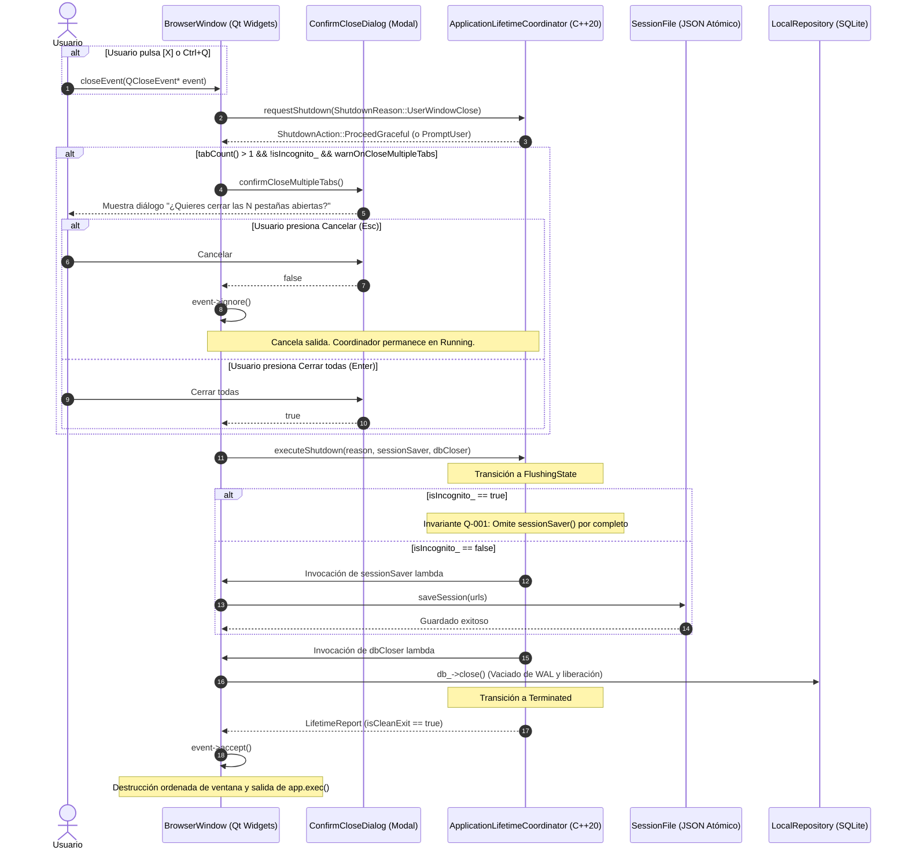

# Design — module-foundations-task0027

Status: PROPOSED

## Current, target and gaps

### Estado actual (CURRENT)

1. **Gestión procedural no coordinada de cierre en `BrowserWindow`**:
   - Actualmente, `apps/vigilio-browser/src/ui/BrowserWindow.cpp` intercepta el evento de cierre de ventana en `BrowserWindow::closeEvent` ejecutando directamente:
     ```cpp
     void BrowserWindow::closeEvent(QCloseEvent* event) {
         saveSession();
         QMainWindow::closeEvent(event);
     }
     ```
   - Este guardado invoca síncronamente `QSettings().setValue("session/urls", urls)` sin verificar el estado del ciclo de vida general del proceso, sin coordinar el vaciado de bases de datos SQLite (`LocalRepository`), y sin enlace con el coordinador formal implementado en `task0026`.
2. **Desconexión con `ApplicationLifetimeCoordinator`**:
   - En la tarea previa (`module.foundations.task0026`), se construyó y probó exhaustivamente en `vigilio_core` la clase `ApplicationLifetimeCoordinator`, con máquina de 9 estados discretos, deduplicación atómica de solicitudes de apagado, manejo seguro de señales y temporizador de seguridad de 3000 ms.
   - Sin embargo, `BrowserWindow` no posee ninguna referencia ni instancia de `ApplicationLifetimeCoordinator`, manteniendo la UI desacoplada del ciclo de vida formal.
3. **Ausencia de acción global de salida y atajos unificados (`Ctrl+Q`)**:
   - No existe una acción explícita `quitAction_` en `BrowserWindow`. El cierre depende exclusivamente de pulsar el botón de ventana de la barra de título del sistema operativo `[X]`.
   - Falta el atajo canónico `QKeySequence::Quit` (`Ctrl+Q`), estándar en navegadores web de escritorio modernos.
4. **Cierre abrupto con múltiples pestañas abiertas**:
   - Si el usuario tiene abiertas 5 o 10 pestañas y cierra accidentalmente la ventana principal, la aplicación se cierra de inmediato sin confirmación ni advertencia alguna.
5. **Falta de integración con la «Interfaz más fácil de usar» (Modo Senior)**:
   - No existen diálogos de confirmación adaptados para personas mayores o usuarios que requieren controles amplios, tipografía agrandada (>= 14 pt) y áreas táctiles de al menos 48 px.

### Estado objetivo (TARGET)

1. **Integración simbiótica con `ApplicationLifetimeCoordinator`**:
   - `BrowserWindow` instancia y custodia un `std::unique_ptr<vigilio::ApplicationLifetimeCoordinator>`, configurado con `LifetimeConfig` según los parámetros de arranque recibidos (`StartupCommandLine` y `StartupDiagnosticReport`).
   - Al terminar de inicializar la interfaz de usuario, `BrowserWindow` transiciona el estado del coordinador a `AppLifetimeState::Running`.
2. **Acción explícita `quitAction_` y atajos universales**:
   - Se crea una acción `quitAction_` («Cerrar navegador») asociada al atajo `QKeySequence::Quit` (`Ctrl+Q`).
   - Esta acción se integra en el menú contextual o menú principal de la ventana y activa de forma controlada el flujo de `close()`.
3. **Confirmación accesible para múltiples pestañas (`confirmCloseMultipleTabs`)**:
   - Si `tabCount() > 1` y no se trata de una sesión de incógnito, se consulta la preferencia `browser/warnOnCloseMultipleTabs` (activada por defecto).
   - Si está activa, se despliega un cuadro de diálogo accesible con título «Cerrar ventana» y texto claro: «¿Quieres cerrar las %1 pestañas abiertas?».
   - Si el usuario presiona «Cancelar» o presiona `Esc`, `event->ignore()` cancela la salida y mantiene la ventana operativa.
   - Si el usuario presiona «Cerrar todas» o presiona `Enter`, el proceso de apagado continúa de forma ordenada.
4. **Vaciado seguro y ordenado en `executeShutdown`**:
   - El cierre delega en `lifetimeCoordinator_->executeShutdown(...)`, suministrando un callback para guardar la sesión y otro callback para cerrar ordenadamente `LocalRepository` (`db_`).
   - Si la sesión es de incógnito (`isIncognito_ == true`), el coordinador asegura taxativamente cero escrituras en disco (Q-001).
   - El temporizador de seguridad de 3000 ms previene que la UI permanezca bloqueada indefinidamente si ocurre un error de E/S local.
5. **Conformidad total con la «Interfaz más fácil de usar»**:
   - Cumplimiento riguroso de `docs/UX-COPY-PUBLICO.md`: nunca exponer términos de ingeniería interna.
   - Si la «Interfaz más fácil de usar» está activa (`senior_ == true`), los botones del diálogo de cierre adquieren un alto mínimo de 48 px y la fuente escala a 14 pt, con contraste reforzado y navegación por teclado fluida.

### Brechas identificadas (GAPS)

1. **Brecha de UI (cubierta por esta propuesta y su implementación en APPLY)**:
   - Integrar `ApplicationLifetimeCoordinator` en `BrowserWindow`, implementar `quitAction_`, `confirmCloseMultipleTabs()` y los tests correspondientes en `WindowTests.cpp`.
2. **Brecha de pruebas E2E integrales (diferida a `task0028`)**:
   - Validación automatizada de cierre con señales del sistema operativo a nivel de proceso (`kill -TERM`), pruebas de estrés con cientos de pestañas y simulación de cortes abruptos de energía.

---

## Technical architecture and interfaces



### Declaración de interfaces en C++20 / Qt (`BrowserWindow.h`)

```cpp
// Declaraciones añadidas a BrowserWindow en apps/vigilio-browser/src/ui/BrowserWindow.h
public:
    [[nodiscard]] vigilio::ApplicationLifetimeCoordinator* lifetimeCoordinator() const noexcept {
        return lifetimeCoordinator_.get();
    }
    [[nodiscard]] QAction* quitAction() const noexcept {
        return quitAction_;
    }

protected:
    void closeEvent(QCloseEvent* event) override;

private:
    void setupLifetimeInteractions();
    bool confirmCloseMultipleTabs();

    std::unique_ptr<vigilio::ApplicationLifetimeCoordinator> lifetimeCoordinator_;
    QAction* quitAction_{nullptr};
```

---

## Visual and interaction design (Qt Widgets & UX)

### Diálogo de confirmación de salida (`confirmCloseMultipleTabs`)

Cuando el usuario intenta cerrar una ventana con más de una pestaña activa:
- **Estructura visual**:
  - Encabezado: Título claro «Cerrar ventana» con icono informativo o de advertencia discreto.
  - Cuerpo del mensaje: «¿Quieres cerrar las %1 pestañas abiertas?».
  - Texto secundario: «Puedes volver a abrirlas la próxima vez que inicies el navegador.».
  - Fila de botones:
    - Botón primario: «Cerrar todas» (estilo destacado con color de acento `#2563EB` en claro, `#294F89` en oscuro).
    - Botón secundario: «Cancelar» (estilo neutro con borde sutil).
- **Tokens de estilo (QSS)**:
  - **Modo Oscuro**:
    - Fondo del diálogo: `#1E293B`
    - Borde: `1px solid #334155`
    - Texto principal: `#E9EDF5` (fuente Inter/sistema, semibold)
    - Texto secundario: `#94A3B8`
    - Botón primario: fondo `#294F89`, texto `#FFFFFF`, hover `#3B82F6`
    - Botón secundario: fondo `#334155`, texto `#FFFFFF`, hover `#475569`
  - **Modo Claro**:
    - Fondo del diálogo: `#FFFFFF`
    - Borde: `1px solid #D9E0EA`
    - Texto principal: `#192538`
    - Texto secundario: `#5A6A80`
    - Botón primario: fondo `#2563EB`, texto `#FFFFFF`, hover `#1D4ED8`
    - Botón secundario: fondo `#E9EEF6`, texto `#192538`, hover `#DCE9FA`

---

## Senior Mode & Accessibility ("Interfaz más fácil de usar")

En estricta observancia de `docs/skills/05-accesibilidad-y-senior-mode.md` y `docs/UX-COPY-PUBLICO.md`:

1. **Terminología pública obligatoria**:
   - Queda terminantemente prohibido utilizar términos como «Senior Mode», «Modo Senior», «Prompt», «Skill», «DAG» o «Daemon» en la interfaz visible.
   - Se emplea exclusivamente la etiqueta aprobada: **«Interfaz más fácil de usar»**.
2. **Dimensiones y áreas de interacción**:
   - En modo normal: Altura mínima de botón de 32 px.
   - En «Interfaz más fácil de usar»:
     - Altura mínima de botones: **48 px**.
     - Ancho mínimo de botones: **120 px**.
     - Margen interno (padding): `12px 24px`.
     - Tamaño de fuente base: **14 pt** con contraste superior a 7:1 (cumpliendo WCAG AAA).
3. **Navegación por teclado completa**:
   - El diálogo se abre con el foco predeterminado en el botón primario («Cerrar todas»).
   - La tecla `Tab` desplaza el foco cíclicamente entre «Cerrar todas» y «Cancelar».
   - El foco visual se destaca mediante un anillo de enfoque de 2 px en color `#3B82F6`.
   - La tecla `Enter` activa el botón seleccionado.
   - La tecla `Esc` equivale inmediatamente a «Cancelar», cerrando el cuadro de diálogo sin destruir la ventana.
4. **Tecnologías asistivas (Lectores de pantalla)**:
   - Se configuran explícitamente `setAccessibleName` y `setAccessibleDescription`:
     - Botón primario: `accessibleName = "Cerrar todas las pestañas y salir"`.
     - Botón secundario: `accessibleName = "Cancelar y permanecer en el navegador"`.
     - Diálogo: `accessibleName = "Confirmación de cierre de múltiples pestañas"`.

---

## Compatibility, migration and rollback

1. **Compatibilidad hacia atrás con configuraciones existentes**:
   - La preferencia de confirmación de cierre se almacena en `QSettings` bajo la clave `browser/warnOnCloseMultipleTabs` con valor predeterminado `true`.
   - Si la clave no existe en perfiles previos, asume `true` de forma transparente sin requerir migraciones de esquema en disco.
2. **Persistencia atómica de sesión**:
   - Compatible al 100% con el formato canónico implementado en `SessionFile.h` (`VIGILIO_SESSION_V1`) y con el mecanismo de escritura atómica en archivo temporal `.tmp` con reemplazo seguro.
3. **Plan de Rollback**:
   - En caso de contingencia o anomalía visual, la lógica de `closeEvent` puede restablecerse a la delegación directa en `QMainWindow::closeEvent(event)` sin afectar la integridad del almacenamiento local ni corromper las bases de datos SQLite.
