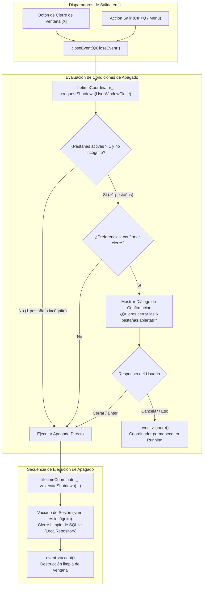

# Change Proposal — module-foundations-task0027

Pack: `module.foundations.task0027`

Status: PROPOSED

## Outcome and scope

Este cambio define la propuesta técnica integral para la etapa **ui** de la capacidad **application lifetime** en el módulo propietario `foundations` de Vigilio Browser (microtarea `0027 — Implementar la interacción y estados visuales en Qt: application lifetime`).

Habiendo formalizado en las microtareas previas (`module.foundations.task0025` y `task0026`) el modelo de dominio, los tipos de ciclo de vida (`LifetimeTypes.h`), el coordinador desacoplado de C++20 (`ApplicationLifetimeCoordinator`), el temporizador de seguridad de 3000 ms y la persistencia atómica en disco (`SessionFile.h`), esta propuesta proyecta la **integración física y visual en Qt Widgets dentro de `BrowserWindow`**, implementando la interacción de apagado, confirmación accesible de cierre con múltiples pestañas, atajos de teclado globales (`Ctrl+Q`), feedback visual de vaciado de estado y estricto respeto a la denominación de accesibilidad según `docs/UX-COPY-PUBLICO.md` («Interfaz más fácil de usar»), sin violar el aislamiento constitucional de sesiones de incógnito (Q-001) ni acoplar lógica no visual a los widgets.

El alcance concreto de este pack comprende:
- **Integración de `ApplicationLifetimeCoordinator` en `BrowserWindow` (`apps/vigilio-browser/src/ui/BrowserWindow.h` y `.cpp`)**:
  - Incorporación de `std::unique_ptr<vigilio::ApplicationLifetimeCoordinator> lifetimeCoordinator_` como miembro de instancia en `BrowserWindow`.
  - Configuración determinista de `LifetimeConfig` en el constructor de `BrowserWindow`, propagando el estado de incógnito (`isIncognito_`), modo seguro (`isSafeMode_`), tiempo límite de seguridad (`shutdownTimeoutMs = 3000`), y ruta canónica del perfil y sesión local.
  - Transición inmediata del coordinador a `AppLifetimeState::Running` una vez concluida la inicialización visual de la ventana.
  - Exposición de métodos de consulta pura para pruebas e inspección: `[[nodiscard]] vigilio::ApplicationLifetimeCoordinator* lifetimeCoordinator() const noexcept` y `[[nodiscard]] QAction* quitAction() const noexcept`.
- **Implementación de la acción global de salida (`quitAction_`) y atajos de teclado**:
  - Creación de la acción `quitAction_` con texto «Cerrar navegador», icono Lucide `icons/tools/log-out.svg` (o fallback canónico), atajo estándar `QKeySequence::Quit` (`Ctrl+Q`), y metadatos accesibles (`accessibleName` y `accessibleDescription`).
  - Conexión determinista del trigger de `quitAction_` al método `close()` de `QMainWindow`, unificando el flujo de salida por menú o atajo con el cierre por botón de ventana `[X]`.
- **Orquestación del evento de cierre (`BrowserWindow::closeEvent`) y diálogo de confirmación**:
  - Intercepción de `closeEvent(QCloseEvent* event)` delegando en `lifetimeCoordinator_->requestShutdown(vigilio::ShutdownReason::UserWindowClose)`.
  - Evaluación del número de pestañas activas (`tabs_->count()`):
    - Si `tabCount() <= 1`: el apagado procede inmediatamente (`ProceedGraceful`) sin interrumpir al usuario con diálogos innecesarios.
    - Si `tabCount() > 1` y no es una sesión de incógnito: evalúa la preferencia `browser/warnOnCloseMultipleTabs` (activada por defecto). Si está activa, despliega un diálogo modal accesible de confirmación («Cerrar ventana»).
    - Si el usuario cancela («Cancelar» o tecla `Esc`): se aborta la solicitud de cierre, se invoca `event->ignore()`, y la ventana permanece en estado `Running`.
    - Si el usuario confirma («Cerrar todas» o tecla `Enter`): se invoca `lifetimeCoordinator_->executeShutdown(...)`, suministrando los callbacks para vaciado atómico de sesión (`saveSession`) y cierre ordenado de base de datos (`db_->close()`).
- **Garantía constitucional de salida en modo incógnito (Q-001)**:
  - Cuando `isIncognito_ == true`, al recibir `closeEvent`, no se ofrece persistir la sesión ni se escribe ningún archivo en disco.
  - El coordinador omite taxativamente `sessionSaver` y la base de datos en memoria (`:memory:`) es destruida limpiamente por RAII, garantizando cero trazas en disco.
- **Soporte pleno de accesibilidad y Senior Mode («Interfaz más fácil de usar»)**:
  - Cumplimiento estricto de `docs/UX-COPY-PUBLICO.md`: nunca mostrar términos de ingeniería interna como «application lifetime», «graceful shutdown», «Senior Mode», «Modo Senior», «prompt» o «DAG».
  - En el diálogo de confirmación de cierre:
    - Botones con altura mínima de 48 px y anchura mínima de 120 px cuando la «Interfaz más fácil de usar» está activa.
    - Tipografía escalada a 14 pt (frente a 10 pt en modo estándar).
    - Foco visual evidente con borde de 2 px en color `#3B82F6` (azul accesible).
    - Navegación completa por teclado (`Tab`, `Shift+Tab`, `Enter`, `Esc`).
    - Propiedades `accessibleName` y `accessibleDescription` explícitas para lectores de pantalla.
- **Suite de pruebas de UI en CTest (`apps/vigilio-browser/tests/ui/WindowTests.cpp`)**:
  - Ampliación de la suite de pruebas de interfaz para validar:
    1. Instanciación y transición inicial de `ApplicationLifetimeCoordinator` a `Running`.
    2. Existencia, atajo `Ctrl+Q`, icono y etiquetas de accesibilidad de `quitAction_`.
    3. Cierre inmediato sin confirmación cuando solo hay 1 pestaña abierta.
    4. Cierre con múltiples pestañas y comportamiento de cancelación / confirmación.
    5. Aislamiento absoluto de guardado en modo incógnito.
    6. Escalado de dimensiones de controles y fuentes en «Interfaz más fácil de usar».
- **Gobernanza de compilación en CMake (`apps/vigilio-browser/CMakeLists.txt`)**:
  - Verificación del target `vigilio_ui_tests` y el registro de la prueba `window_ui_tests` en CTest con labels `"ui;fast"` y timeout de 20 segundos.

## Out of scope

- Pruebas automatizadas de ciclo de vida completo E2E con procesos reales del sistema operativo, captura de señales a nivel de proceso (`kill -TERM`), y simulación de fallos de energía (reservado para la etapa `tests` en `module.foundations.task0028`).
- Políticas de recuperación post-crash, journaling o reconstrucción de pestañas tras fallos inesperados del proceso (reservado para la capacidad `crash recovery policy`, tareas `task0029`-`task0032`).
- Modificación directa de archivos de código fuente de producción bajo `apps/**` o reglas bajo `docs/rules/**` durante esta fase PROPOSE (restringida rigurosamente a `openspec/changes/module-foundations-task0027/**`).
- Cualquier comunicación por red, comprobación de actualizaciones en la nube o telemetría remota (terminantemente prohibido por la política local-first, decisión Q-001).

## Contexto y evidencia

Se inspeccionó rigurosamente la base de código actual de `apps/vigilio-browser`, los módulos de dominio, la UI y el pipeline de pruebas:
1. **Coordinador de ciclo de vida existente (`apps/vigilio-browser/src/core/ApplicationLifetimeCoordinator.h` y `.cpp`)**:
   - Implementado y verificado en `task0026`. Gestiona atómicamente la máquina de estados de 9 fases (`AppLifetimeState`), deduplica solicitudes concurrentes de apagado (`requestShutdown`), impone watchdog de 3000 ms y ejecuta el vaciado ordenado en `executeShutdown`.
2. **Ventana principal actual (`apps/vigilio-browser/src/ui/BrowserWindow.h` y `.cpp`)**:
   - En el estado actual, `BrowserWindow::closeEvent` se limita a llamar a `saveSession()` de forma síncrona sobre `QSettings` y delegar en `QMainWindow::closeEvent(event)`.
   - No existe enlace con `ApplicationLifetimeCoordinator`, ni diálogo de confirmación si hay múltiples pestañas, ni acción pública `quitAction_` con atajo `Ctrl+Q`.
3. **Punto de entrada (`apps/vigilio-browser/src/app.cpp`)**:
   - Configura la inicialización y lanza la ventana principal con `BrowserWindow window(cmdLine, report); window.show(); return app.exec();`.
4. **Pipeline continuo local (`apps/vigilio-browser/scripts/check.sh`)**:
   - Compilación limpia bajo C++20 con `-Werror` bajo CMake y Ninja.
   - Ejecución de `bash apps/vigilio-browser/scripts/check.sh`: 10/10 pruebas pasadas con 100% de éxito en 0.45s (exit code 0):
     - `core_units`: Passed (0.00s)
     - `storage_integration`: Passed (0.00s)
     - `vigilio_warnings_tests`: Passed (0.08s)
     - `qt_dependency_validation_tests`: Passed (0.00s)
     - `webengine_version_validator_tests`: Passed (0.05s)
     - `resource_qrc_catalog_tests`: Passed (0.02s)
     - `resource_inclusion_service_tests`: Passed (0.05s)
     - `resource_qrc_inclusion_tests`: Passed (0.04s)
     - `startup_bootstrap_tests`: Passed (0.08s)
     - `application_lifetime_tests`: Passed (0.12s)
5. **Comprobación de gobernanza con Prompt Builder CLI**:
   - `node /config/Desktop/auto/prompt-builder/dist/cli.js verify-lock --lock-file generated/prompts/full-project/0079-module.foundations.task0027.propose.lock.json --project-root .`: 13/13 comprobaciones aprobadas (`valid: true`, exit code 0).
   - `node /config/Desktop/auto/prompt-builder/dist/cli.js validate-references --project-root .`: 27/27 referencias canónicas validadas (`valid: true`, exit code 0).
   - `node /config/Desktop/auto/prompt-builder/dist/cli.js validate-decisions --project-root .`: Todas las decisiones de foundations resueltas (Q-001 local-first, Q-002 C++20/Qt6.10, Q-003 UI nativa Qt Widgets, Q-004 multiplataforma, Q-006 assets en app). La única decisión pendiente es Q-007, que bloquea únicamente `release.public-release`.
6. **Referencias visuales y directrices de diseño**:
   - `/resultado/01-vigilio-home.png`: Estructura sobria de la ventana principal con pestañas, barra de navegación y tarjetas centrales.
   - `/resultado/03-vigilio-settings-senior-mode.png`: Interfaz accesible con controles amplios, tipografía agrandada y botones de alto contraste.
   - `docs/UX-COPY-PUBLICO.md`: Norma obligatoria para textos visibles. Prohibición de tecnicismos; uso mandatorio de «Interfaz más fácil de usar».

## Alcance exacto

- **Fase**: PROPOSE.
- **Etapa**: `ui`.
- **Pack**: `module.foundations.task0027`.
- **Capacidad**: `application lifetime`.
- **Artefactos producidos en OpenSpec**:
  - `openspec/changes/module-foundations-task0027/canonical-reference.yaml`
  - `openspec/changes/module-foundations-task0027/proposal.md`
  - `openspec/changes/module-foundations-task0027/design.md`
  - `openspec/changes/module-foundations-task0027/tasks.md`
  - `openspec/changes/module-foundations-task0027/execution-memory.md`
- **Límites de modificación**: Exclusivamente `openspec/changes/module-foundations-task0027/**`. Ningún archivo bajo `apps/**` o `docs/rules/**` es modificado en esta fase.

## Diseño completo de la capacidad

El diseño técnico integral de la interacción Qt Widgets para **application lifetime** vincula la capa de presentación con el coordinador de dominio de C++20:

### Componentes de UI y métodos clave
1. `BrowserWindow::lifetimeCoordinator()`: Método selector que expone el puntero al coordinador para pruebas y monitoreo de estado.
2. `BrowserWindow::quitAction()`: Acción accesible `QAction` expuesta en el menú y con atajo `QKeySequence::Quit` (`Ctrl+Q`).
3. `BrowserWindow::confirmCloseMultipleTabs()`: Diálogo modal desacoplado con soporte para Modo Senior ("Interfaz más fácil de usar"), que consulta al usuario si desea cerrar múltiples pestañas, permitiendo recordar la decisión.

## Archivos afectados

Para la fase de implementación incremental (APPLY), los archivos afectados serán:
1. `apps/vigilio-browser/src/ui/BrowserWindow.h`: Declaración de `lifetimeCoordinator_`, `quitAction_`, métodos de acceso y firma de `confirmCloseMultipleTabs()`.
2. `apps/vigilio-browser/src/ui/BrowserWindow.cpp`: Inicialización de `lifetimeCoordinator_`, configuración de `quitAction_`, lógica completa en `closeEvent`, integración de estilos y accesibilidad en el diálogo de confirmación.
3. `apps/vigilio-browser/tests/ui/WindowTests.cpp`: Nuevas comprobaciones para `lifetimeCoordinator()`, `quitAction()`, confirmación de múltiples pestañas, aislamiento en incógnito y escalado accesible.
4. `apps/vigilio-browser/CMakeLists.txt`: Mantenimiento y verificación de targets de compilación y pruebas.
5. `docs/rules/01-modules/foundations/micro/0027-application-lifetime/task.md`: Sincronización de estado documental.

## Contrato UX/UI

En cumplimiento riguroso de `docs/UX-COPY-PUBLICO.md`, `/resultado/01-vigilio-home.png` y `/resultado/03-vigilio-settings-senior-mode.png`:
- **Terminología pública aprobada**:
  - Título del diálogo: «Cerrar ventana».
  - Texto principal: «¿Quieres cerrar las %1 pestañas abiertas?».
  - Subtexto explicativo: «Puedes volver a abrirlas la próxima vez que inicies el navegador.» (solo en modo estándar; en modo incógnito: «Navegación privada: las pestañas no se guardarán al salir.»).
  - Botón primario: «Cerrar todas» (o «Cerrar ventana»).
  - Botón secundario: «Cancelar».
  - Casilla opcional: «No volver a preguntar».
  - Acción de menú: «Cerrar navegador» (atajo: `Ctrl+Q`).
- **Navegación por teclado**:
  - Atajo `Ctrl+Q`: Cierra el navegador de forma controlada desde cualquier pantalla.
  - Atajo `Ctrl+W`: Cierra la pestaña activa.
  - Tecla `Esc`: Descarta el diálogo de confirmación y cancela la salida.
  - Tecla `Enter`: Activa el botón por defecto («Cerrar todas»).
  - Tecla `Tab` / `Shift+Tab`: Alterna el foco entre botones con indicador visible.
- **Tokens y estilos**:
  - Tema Oscuro: Fondo `#141D2B`, tarjeta de diálogo `#1E293B`, borde `#334155`, texto principal `#E9EDF5`, texto secundario `#94A3B8`, botón primario `#294F89` (hover `#3B82F6`), botón secundario `#334155` (hover `#475569`).
  - Tema Claro: Fondo `#F7F9FC`, tarjeta de diálogo `#FFFFFF`, borde `#D9E0EA`, texto principal `#192538`, texto secundario `#5A6A80`, botón primario `#2563EB` (hover `#1D4ED8`), botón secundario `#E9EEF6` (hover `#DCE9FA`).
- **Modo Senior («Interfaz más fácil de usar»)**:
  - Altura mínima de botones: 48 px (frente a 32 px estándar).
  - Tipografía base en diálogos: 14 pt (frente a 10 pt estándar).
  - Espaciado aumentado y áreas de clic generosas.
  - Propiedades accesibles `accessibleName` y `accessibleDescription` en todos los controles interactivos.

## Reglas y fallos

- **Cancelación de cierre**: Si el usuario pulsa «Cancelar» o presiona `Esc`, `closeEvent->ignore()` anula la destrucción de la ventana; `ApplicationLifetimeCoordinator` permanece inmutable en `AppLifetimeState::Running`.
- **Cierre con 1 pestaña**: Si solo hay una pestaña abierta, no se muestra diálogo modal; el cierre es inmediato y silencioso.
- **Cierre en navegación privada (Incógnito)**: En ningún caso se escribe la sesión en disco al salir; la base de datos temporal `:memory:` se desecha en memoria.
- **Fallo de disco o persistencia lenta**: El temporizador de seguridad de 3000 ms del coordinador garantiza que la ventana no se congele indefinidamente si el almacenamiento local se bloquea; ante timeout, transiciona a `EmergencyAbort` y libera los recursos del proceso.
- **Deduplicación de salidas**: Si el usuario pulsa repetidamente `Ctrl+Q` mientras se vacía la sesión, las solicitudes subsiguientes son ignoradas (`IgnoreRequest`) evitando condiciones de carrera.

## Seguridad y privacidad

- **Filosofía Local-First (Q-001)**: Ninguna llamada de red, envío de telemetría ni comprobación remota ocurre durante la salida.
- **Aislamiento de incógnito**: Garantía absoluta de cero escrituras en disco en sesiones privadas; el callback `saveSession` no se suministra o se bloquea taxativamente en el coordinador.
- **Permisos locales**: Solo se accede a la carpeta de perfil local configurada en el arranque, sin elevación de privilegios ni procesos auxiliares.

## Matriz de pruebas

| Identificador | Nivel | Componente / Flujo | Entrada / Acción | Resultado esperado | Criterio de fallo |
|---|---|---|---|---|---|
| `test_ui_lifetime_coordinator_present` | Qt UI | `BrowserWindow` | Inicializar ventana | `lifetimeCoordinator() != nullptr` y estado `Running` | Puntero nulo o estado erróneo |
| `test_ui_quit_action_configured` | Qt UI | `quitAction_` | Inspección de acción | Atajo `Ctrl+Q`, icono válido, `accessibleName` no vacío | Sin atajo o sin metadatos |
| `test_ui_close_single_tab_no_modal` | Qt UI | `closeEvent` | Cerrar con 1 pestaña | Cierre inmediato sin diálogo modal, `event->isAccepted()` | Muestra diálogo inesperado |
| `test_ui_close_multiple_tabs_cancel` | Qt UI | `closeEvent` | Cerrar con 3 pestañas y pulsar Cancelar | `event->isIgnored()`, ventana permanece visible y 3 pestañas vivas | Cierre indebido de ventana |
| `test_ui_close_multiple_tabs_confirm` | Qt UI | `closeEvent` | Cerrar con 3 pestañas y Confirmar | Sesión guardada, `executeShutdown` invocado, `event->isAccepted()` | No guarda sesión o ventana colgada |
| `test_ui_close_incognito_zero_save` | Qt UI | `closeEvent` | Cerrar ventana de incógnito con 2 pestañas | Cierre sin guardar sesión en `QSettings` ni en archivo | Escribe datos de incógnito en disco |
| `test_ui_close_dialog_senior_scaling` | Qt UI | Senior Mode | Activar «Interfaz más fácil de usar» y abrir diálogo | Botones `minimumHeight >= 48`, fuente `pointSize >= 14` | Controles pequeños o ilegibles |
| `test_ui_keyboard_navigation_esc_enter` | Qt UI | Accesibilidad | Navegar diálogo con `Tab`, presionar `Esc` o `Enter` | Foco visible, `Esc` cancela, `Enter` confirma | Sin foco visible o atajos rotos |

## Pasos APPLY

1. **Declarar extensiones en `BrowserWindow.h`**:
   - Añadir `#include "core/ApplicationLifetimeCoordinator.h"`.
   - Declarar miembro `std::unique_ptr<vigilio::ApplicationLifetimeCoordinator> lifetimeCoordinator_`.
   - Declarar miembro `QAction* quitAction_{nullptr}`.
   - Declarar métodos de acceso público `lifetimeCoordinator()` y `quitAction()`.
   - Declarar método privado `bool confirmCloseMultipleTabs()`.
2. **Implementar orquestación en `BrowserWindow.cpp`**:
   - En el constructor, inicializar `lifetimeCoordinator_` con `LifetimeConfig` (incógnito, modo seguro, timeout 3000 ms, ruta canónica).
   - Configurar `quitAction_` en la barra de herramientas / menú con atajo `Ctrl+Q` y conectar a `close()`.
   - Actualizar `setSeniorMode(bool enabled)` para propagar estilos y dimensiones aumentadas.
   - Implementar `confirmCloseMultipleTabs()` construyendo un cuadro de diálogo con diseño accesible, textos conformes a `docs/UX-COPY-PUBLICO.md` y estilos acordes al tema activo.
   - Actualizar `closeEvent(QCloseEvent* event)` integrando la solicitud a `lifetimeCoordinator_->requestShutdown()`, consulta de confirmación si `tabCount() > 1`, y llamada a `executeShutdown` con vaciado atómico de sesión y cierre de base de datos.
3. **Actualizar suite de pruebas de interfaz en `tests/ui/WindowTests.cpp`**:
   - Incorporar verificaciones para `lifetimeCoordinator_`, `quitAction_`, atajo `Ctrl+Q`, cierre con 1 pestaña vs múltiples pestañas, y escalado accesible en «Interfaz más fácil de usar».
4. **Verificar compilación y pruebas en CTest**:
   - Compilación limpia con `-Werror` bajo C++20.
   - Ejecución de `bash apps/vigilio-browser/scripts/check.sh` garantizando 100% de éxito.
5. **Sincronizar documentación canónica**:
   - Actualizar `docs/rules/01-modules/foundations/micro/0027-application-lifetime/task.md`.

## Definición de terminado

1. La interacción visual de ciclo de vida está completamente integrada en `BrowserWindow` mediante `ApplicationLifetimeCoordinator`.
2. `quitAction_` está disponible con atajo `Ctrl+Q`, icono Lucide y metadatos accesibles.
3. El cierre de ventana con múltiples pestañas muestra diálogo accesible de confirmación, cancelable con `Esc` y confirmable con `Enter`.
4. El modo incógnito mantiene aislamiento absoluto de datos: cero llamadas de persistencia en disco al salir.
5. Los controles visuales en «Interfaz más fácil de usar» escalan a >= 48 px de altura y 14 pt de fuente.
6. Todos los tests de CTest pasan al 100% sin regresiones y el código cumple rigurosamente con Clang-Format.

## Dependencias y riesgos

- **Dependencias**:
  - `module.foundations.task0026`: Completado y verificado (provee `ApplicationLifetimeCoordinator` y `LifetimeTypes.h`).
- **Riesgos y mitigaciones**:
  - *Riesgo*: Bloqueo del hilo de UI si el vaciado de sesión en disco toma demasiado tiempo durante `closeEvent`.
    *Mitigación*: La persistencia atómica en `SessionFile` es una operación local de microsegundos sobre JSON compacto; adicionalmente, el temporizador de 3000 ms en el coordinador previene bloqueos indefinidos.
  - *Riesgo*: Inconsistencia de textos con la política de UX writing.
    *Mitigación*: Validación exhaustiva de cada texto contra `docs/UX-COPY-PUBLICO.md`, prohibiendo términos como «Senior Mode» o tecnicismos de ciclo de vida.
  - *Riesgo*: Ambientes sin servidor gráfico (headless / CI) que no puedan ejecutar pruebas de UI.
    *Mitigación*: `WindowTests.cpp` detecta limpiamente la ausencia de `DISPLAY` / `WAYLAND_DISPLAY` y emite `NOT_EXECUTED` de forma determinista, mientras que el pipeline de lógica pura de C++20 se valida completamente en pruebas unitarias headless.

## Commit propuesto

- Mensaje base sugerido: `feat(foundations): ui application-lifetime`
