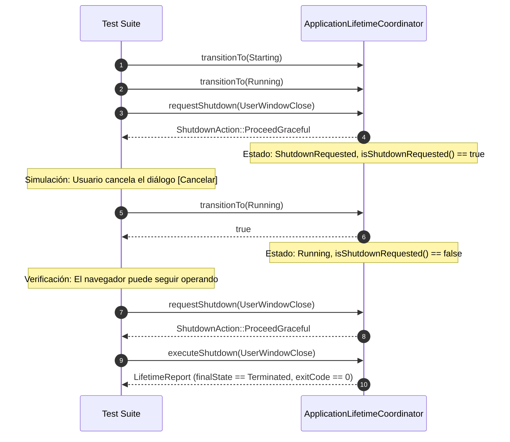

# Design — module-foundations-task0028

Status: PROPOSED

## Current, target and gaps

### Estado actual (CURRENT)

1. **Implementación de ciclo de vida existente en el núcleo (`vigilio_core`)**:
   - `LifetimeTypes.h` define `AppLifetimeState` (9 estados discretos), `ShutdownReason` (8 motivos), `ShutdownAction` (4 acciones posibles), `LifetimeConfig` y `LifetimeReport`.
   - `ApplicationLifetimeCoordinator` orquesta las transiciones atómicas, deduplica solicitudes de apagado concurrentes, aplica un temporizador de seguridad de 3000 ms y ejecuta el vaciado en `executeShutdown`.
2. **Integración existente en la capa de interfaz (`BrowserWindow`)**:
   - `BrowserWindow` custodia un `std::unique_ptr<ApplicationLifetimeCoordinator>`, inicializado durante el arranque y transicionado a `Running`.
   - `BrowserWindow::closeEvent` intercepta la salida, evalúa el diálogo de confirmación `confirmCloseMultipleTabs` ante múltiples pestañas y delega en el coordinador el vaciado de sesión y cierre de base de datos.
   - En modo incógnito (`isIncognito_ == true`), se garantiza constitucionalmente cero escrituras en disco (Q-001).
3. **Estado actual de las pruebas automatizadas**:
   - `ApplicationLifetimeTests.cpp` cuenta actualmente con 11 pruebas unitarias básicas que validan la máquina de estados elemental, el camino feliz, el aislamiento de incógnito básico, señales elementales, watchdog sintético y conversiones a texto.
   - No obstante, la suite actual carece de validaciones sistemáticas para:
     - Cancelación voluntaria de apagado (`ShutdownRequested -> Running`) tras aborto por el usuario.
     - Fallos inyectados en callbacks (`sessionSaver` o `dbCloser` devolviendo `false`).
     - Invocación con callbacks nulos (`nullptr`).
     - Invocación directa de `executeShutdown` desde estados iniciales sin llamada previa a `requestShutdown`.
     - Timeouts de frontera (0 ms y valores máximos).
     - Carreras críticas multi-hilo sobre `executeShutdown`.
     - Manejo de motivos críticos como `MemoryExhaustion` y `StorageFailure`.
     - Precisión de las métricas de tiempo transcurrido en microsegundos.

### Estado objetivo (TARGET)

1. **Suite de pruebas exhaustiva, determinista y hermética**:
   - Ampliación de `ApplicationLifetimeTests.cpp` para incorporar cobertura del 100% de los caminos lógicos, casos de borde, fallos inducidos y concurrencia.
   - Cada escenario se ejecuta como una prueba unitaria independiente en C++20, sin dependencias de red, sin interfaces gráficas reales y sin levantar procesos Chromium.
2. **Garantía formal de tolerancia a fallos**:
   - La aplicación jamás entra en bucle infinito o bloqueo permanente durante el apagado; si un callback se cuelga, el watchdog garantiza la finalización forzada en menos de `shutdownTimeoutMs`.
   - Si el guardado de sesión falla (disco lleno, permisos), la base de datos aún se cierra de forma segura para prevenir corrupción y el reporte refleja fielmente la incidencia.
3. **Garantía formal de cancelación segura**:
   - Si el usuario cancela el diálogo de salida, la aplicación transiciona limpiamente de `ShutdownRequested` de vuelta a `Running`, permitiendo continuar la navegación normalmente y procesar futuros cierres sin efectos secundarios residuales.
4. **Rendimiento y Zero-Zombie**:
   - Tiempo de ejecución de la suite completa inferior a 250 ms en CTest.
   - Cero procesos huérfanos, cero fugas de descriptores de archivo y cero datos residuales en disco.

### Brechas identificadas (GAPS)

1. **Brecha de casos de prueba (cubierta por esta propuesta y su implementación en APPLY)**:
   - Implementar los casos de prueba para cancelación y reversión de estado, fallos inyectados en callbacks, concurrencia en `executeShutdown`, y motivos críticos de salida.
2. **Brecha de E2E con procesos de sistema operativo reales (diferida a suites E2E)**:
   - Simulación de corte abrupto de energía y terminación con `kill -9` a nivel de proceso real del SO (manejada a nivel de integración del sistema operativo y pruebas E2E especializadas).

---

## Compatibility, migration and rollback

- **Compatibilidad**:
  - Las nuevas pruebas utilizan la API pública existente de `ApplicationLifetimeCoordinator` (`canTransition`, `transitionTo`, `requestShutdown`, `executeShutdown`, `currentState`, `isShutdownRequested`, etc.).
  - No se modifica la firma de métodos públicos de producción; la arquitectura preserva compatibilidad binaria y de cabeceras en `vigilio_core`.
- **Migración**:
  - No aplica migración de esquemas ni datos; las pruebas son autocontenidas y sintéticas.
- **Rollback**:
  - En caso de regresión en las pruebas o fallos de compilación, el archivo de pruebas puede revertirse inmediatamente sin afectar a los módulos funcionales del navegador.

---

## Technical architecture and test harness

---

## Detailed test suite architecture and contracts

### 1. Flujo de cancelación y reactivación (`test_lifetime_cancellation_and_recovery`)

### 2. Flujo de resiliencia ante fallos en callbacks (`test_lifetime_callback_failures_resilience`)

- **Escenario A: `sessionSaver` devuelve `false`**:
  - El coordinador transiciona a `FlushingState`.
  - Invoca `sessionSaver()`, que retorna `false`.
  - Registra `report.sessionSaved = false`.
  - Transiciona a `TerminatingSubsystems` e invoca `dbCloser()`.
  - Transiciona a `Terminated` con `exitCode = 0`.
  - Garantiza que un fallo al guardar pestañas no impide el cierre seguro de la base de datos SQLite.
- **Escenario B: Callbacks nulos (`nullptr`)**:
  - `executeShutdown(reason, nullptr, nullptr)`.
  - Ningún puntero de función se desreferencia.
  - `report.sessionSaved == false`, `report.databaseClosedCleanly == false`.
  - Estado final: `Terminated`, `exitCode = 0`, `isCleanExit() == true`.
- **Escenario C: `dbCloser` devuelve `false`**:
  - El coordinador registra `report.databaseClosedCleanly = false`.
  - Transiciona a `Terminated` de forma predecible sin fugas ni excepciones no capturadas.

### 3. Flujo de concurrencia en `executeShutdown` (`test_lifetime_concurrent_execute_shutdown`)

- Se lanzan 16 hilos que intentan ejecutar `executeShutdown` de forma concurrente con lambdas instrumentadas.
- La bandera atómica `shutdownInProgress_` con semántica `acquire/release` garantiza que las lambdas de persistencia se ejecutan en un único hilo, protegiendo las estructuras de datos compartidas.
- Todos los hilos finalizan limpiamente con `thread.join()`.

### 4. Flujo de motivos críticos (`test_lifetime_critical_reasons`)

- **`ShutdownReason::MemoryExhaustion`**:
  - Al recibir agotamiento de memoria, `requestShutdown` devuelve `ProceedImmediate` y transiciona inmediatamente a `EmergencyAbort`.
  - En `executeShutdown`, el vaciado de estado a disco se salta para evitar asignaciones de memoria adicionales que provoquen un OOM inminente.
  - La base de datos intenta cerrarse de inmediato y el código de salida es 1.
- **`ShutdownReason::StorageFailure`**:
  - El coordinador transiciona a `ShutdownRequested`, omite o registra el fallo de guardado y cierra los subsistemas con diagnóstico claro.

---

## Chromium isolation, resource bounds and Zero-Zombie policy

1. **Aislamiento absoluto de Chromium**:
   - Las pruebas de ciclo de vida en `ApplicationLifetimeTests.cpp` pertenecen a la librería de pruebas del núcleo (`vigilio_lifetime_tests`).
   - No se enlaza con `Qt6::WebEngineWidgets` ni se invoca `QWebEngineView`.
   - Cero subprocesos de renderizado de Chromium o sandbox de GPU.
2. **Límites de recursos y memoria**:
   - Consumo de RAM inferior a 15 MB durante la ejecución de las pruebas.
   - Duración acotada de las pruebas de watchdog: los retardos simulados se configuran en milisegundos mínimos (p. ej. 30-50 ms frente a un watchdog de 10-20 ms), garantizando que toda la suite concluya en < 250 ms.
3. **Política Zero-Zombie**:
   - Cada hilo creado en pruebas concurrentes se recolecta formalmente con `t.join()`.
   - Ningún temporizador de prueba queda activo al finalizar `main()`.
   - Cualquier archivo de prueba se crea en `/tmp` con guardia RAII y se borra al salir del bloque de prueba.
