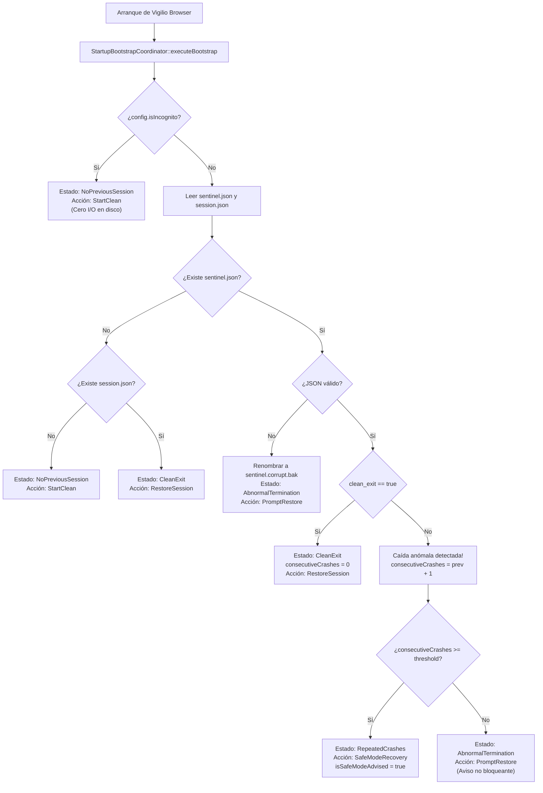
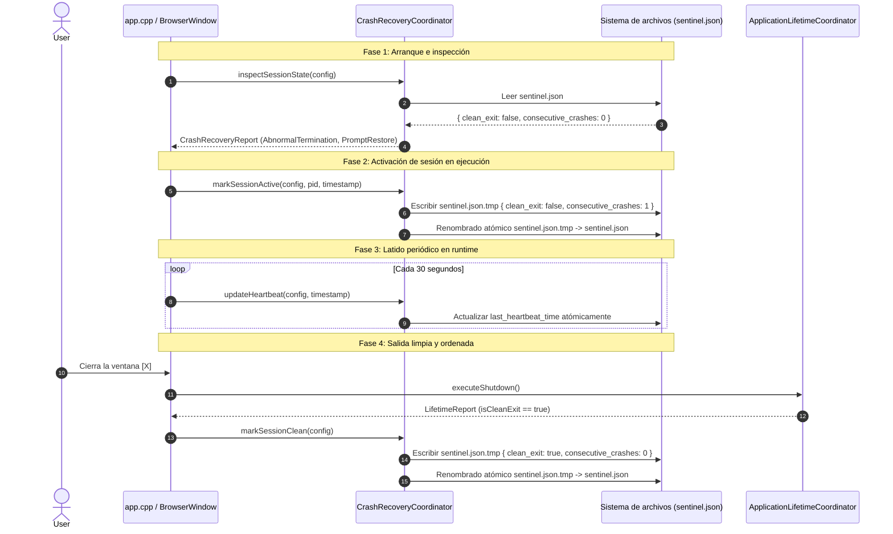

# Design — module-foundations-task0029

Status: PROPOSED

## Current, target and gaps

### Estado actual (CURRENT)

1. **Gestión pasiva de sesiones en `apps/vigilio-browser`**:
   - Actualmente, la persistencia de pestañas se gestiona mediante `BrowserWindow::saveSession()` y `BrowserWindow::restoreSession()`, delegando la serialización en `QSettings` o en la función atómica `vigilio::saveSession` (`apps/vigilio-browser/src/core/SessionFile.h`).
   - Al iniciar la ventana principal (`BrowserWindow::BrowserWindow`), si no se pasan URLs por línea de comandos, el navegador llama ciegamente a `restoreSession()`, abriendo las URLs guardadas sin evaluar las condiciones en que finalizó la sesión anterior.
2. **Ausencia de detección de terminación anómala (Crash Detection)**:
   - Si el proceso del navegador sufre un crash violento (`SIGSEGV`, `SIGABRT`, `SIGFPE`), es terminado abruptamente por el usuario (`kill -9`), o sufre un corte de energía, no existe ningún indicador persistente en disco que distinga una salida limpia de una caída inesperada.
   - Aunque `ApplicationLifetimeCoordinator` produce un reporte en memoria (`LifetimeReport::isCleanExit()`), este valor se destruye al morir el proceso y no se preserva en un centinela durable.
3. **Vulnerabilidad a bucles infinitos de caída (Crash Loops)**:
   - Si una página web específica contiene código que desborda la memoria de WebEngine o genera un fallo crítico en el proceso de renderizado, el navegador la guardará en la sesión antes del fallo o conservará la sesión previa; al volver a iniciar, el navegador reabrirá la misma página inmediatamente, desencadenando un bucle de caídas continuo que impide al usuario volver a utilizar la aplicación.
4. **Ausencia de saneamiento de URLs en la recuperación**:
   - Si el archivo de sesión resultase manipulado o corrompido, URLs con esquemas maliciosos (`javascript:`, `data:`, `file:` no autorizadas) o con longitudes gigantescas podrían ser procesadas sin un filtro centralizado de seguridad en el dominio.

### Estado objetivo (TARGET)

1. **Coordinador desacoplado de recuperación en el núcleo (`CrashRecoveryCoordinator`)**:
   - Un componente estático puro de C++20 ubicado en `vigilio_core`, completamente independiente de Qt Widgets y de Chromium WebEngine.
   - Responsable de inspeccionar el estado previo de la sesión en el arranque, actualizar el centinela durable, detectar caídas, proteger contra bucles de caídas y sanear las URLs a restaurar.
2. **Protocolo de archivo centinela atómico (`sentinel.json`)**:
   - Registro compacto en disco dentro del directorio de perfil que marca activamente el estado de la sesión (`clean_exit: false` durante la ejecución, `clean_exit: true` únicamente tras un apagado ordenado).
   - Sustitución atómica mediante archivo `.tmp` y renombrado atómico (`MoveFileExW` / `std::filesystem::rename`) para tolerar pérdidas repentinas de energía sin corromper el centinela.
3. **Protección constitucional contra Crash Loops**:
   - Conteo acumulativo de caídas consecutivas (`consecutive_crashes`). Si el conteo alcanza el umbral (`crashLoopThreshold = 2`), el estado escala automáticamente a `RepeatedCrashes` y la acción recomendada pasa a `SafeModeRecovery` o inicio limpio, evitando bucles infinitos.
4. **Saneamiento riguroso y bounded buffers**:
   - Filtrado de esquemas mediante `vigilio::resolveInput`, admitiendo únicamente `http`, `https` y páginas locales autorizadas `vigilio://`.
   - Límite estricto de 1000 pestañas y 8192 caracteres por URL.
5. **Invariante constitucional de Incógnito (Q-001)**:
   - En modo incógnito (`isIncognito == true`), el coordinador jamás lee ni escribe archivos en disco; retorna siempre `NoPreviousSession` y `StartClean`.

### Brechas identificadas (GAPS)

1. **Brecha de tipos y dominio**: No existen los tipos `CrashDetectionState`, `RecoveryAction`, `CrashReason`, `CrashSentinel`, `CrashRecoveryConfig` ni `CrashRecoveryReport`.
2. **Brecha de centinela**: No existe la lógica de creación, actualización y cierre del archivo centinela en disco.
3. **Brecha de bucle de caídas**: No existe el algoritmo para registrar caídas consecutivas y recomendar el modo seguro.
4. **Brecha de saneamiento**: No existe una función centralizada de dominio para sanear la lista de URLs a recuperar.
5. **Brecha de pruebas**: No existe suite de pruebas automatizadas que certifique las combinaciones de estado de crash recovery.

---

## Compatibility, migration and rollback

- **Compatibilidad**:
  - El formato del centinela `sentinel.json` utiliza `schema_version: 1`, compatible hacia adelante mediante adición de claves sin romper versiones existentes.
  - La persistencia de pestañas preserva la cabecera canónica `VIGILIO_SESSION_V1` de `SessionFile.h`.
  - La interfaz de dominio en C++20 es portable en Linux (POSIX), Windows (Win32) y macOS, sin dependencias externas de librerías ajenas a Qt / STL C++20.
- **Migración**:
  - Si un usuario ya tiene un archivo `session.json` existente sin `sentinel.json`, el coordinador interpreta la situación como `CleanExit` o `NoPreviousSession`, migrando de forma transparente al nuevo modelo centinela en la primera ejecución.
- **Rollback**:
  - En caso de necesidad de reversión, la eliminación de `sentinel.json` devuelve al navegador a su comportamiento tradicional sin efectos secundarios en el perfil del usuario.

---

## Technical architecture and domain model

### 1. Diagrama de flujo de detección de caídas



### 2. Diagrama de secuencia del ciclo de vida del centinela



---

## Domain types and interfaces specification

### 1. Enumeraciones y estructuras de datos (`CrashRecoveryTypes.h`)

```cpp
#pragma once

#include <cstdint>
#include <string>
#include <string_view>
#include <vector>

namespace vigilio {

/// @brief Estados de detección del estado de la sesión previa en disco.
enum class CrashDetectionState : uint8_t {
    NoPreviousSession = 0,   // Sin sesión previa o perfil nuevo
    CleanExit = 1,           // Cierre previo ordenado
    AbnormalTermination = 2, // Cierre previo por crash o fallo abrupto
    RepeatedCrashes = 3,     // Caídas consecutivas repetidas (bucle de caídas)
    CorruptedSession = 4,    // Archivo de sesión o centinela ilegible
    Recovered = 5            // Decisión procesada (estado terminal)
};

/// @brief Acciones resolutivas recomendadas para el navegador.
enum class RecoveryAction : uint8_t {
    StartClean = 0,          // Abrir página de inicio limpia
    RestoreSession = 1,      // Restaurar pestañas automáticamente
    PromptRestore = 2,       // Mostrar banner accesible al usuario
    SafeModeRecovery = 3,    // Recomendar inicio en modo seguro
    DiscardCorrupted = 4     // Archivar datos dañados y reiniciar limpio
};

/// @brief Causa diagnosticada del cierre.
enum class CrashReason : uint8_t {
    Unknown = 0,
    ProcessCrash = 1,
    WatchdogTimeout = 2,
    MemoryExhaustion = 3,
    StorageFailure = 4,
    CleanShutdown = 5
};

/// @brief Estructura del archivo centinela persistido en disco.
struct CrashSentinel {
    uint32_t schemaVersion = 1;
    bool cleanExit = false;
    uint32_t consecutiveCrashes = 0;
    uint64_t pid = 0;
    int64_t sessionStartTime = 0;
    int64_t lastHeartbeatTime = 0;
    CrashReason lastCrashReason = CrashReason::Unknown;
    std::string appVersion = "0.1.0-alpha";
};

/// @brief Parámetros de configuración de la política de recuperación.
struct CrashRecoveryConfig {
    bool isIncognito = false;
    bool isSafeMode = false;
    uint32_t crashLoopThreshold = 2;
    uint32_t sessionAutosaveIntervalMs = 30000;
    std::string sentinelFilePath;
    std::string sessionFilePath;
    std::string profileDirectory;
};

/// @brief Reporte consolidado emitido tras inspeccionar el entorno.
struct CrashRecoveryReport {
    CrashDetectionState state = CrashDetectionState::NoPreviousSession;
    RecoveryAction recommendedAction = RecoveryAction::StartClean;
    uint32_t consecutiveCrashCount = 0;
    std::vector<std::string> recoverableUrls;
    std::string failureReason;
    bool isSafeModeAdvised = false;
    bool sessionCorrupted = false;
    bool backupCreated = false;
    std::string diagnosticMessage;

    [[nodiscard]] constexpr bool hasRecoverableTabs() const noexcept {
        return !recoverableUrls.empty();
    }
};

} // namespace vigilio
```

### 2. Interfaz del coordinador estático (`CrashRecoveryCoordinator.h`)

```cpp
#pragma once

#include "core/CrashRecoveryTypes.h"
#include <filesystem>
#include <string_view>
#include <vector>

namespace vigilio {

class CrashRecoveryCoordinator {
public:
    [[nodiscard]] static CrashRecoveryReport inspectSessionState(
        const CrashRecoveryConfig& config) noexcept;

    [[nodiscard]] static bool markSessionActive(
        const CrashRecoveryConfig& config,
        uint64_t pid,
        int64_t timestamp) noexcept;

    [[nodiscard]] static bool markSessionClean(
        const CrashRecoveryConfig& config) noexcept;

    [[nodiscard]] static bool updateHeartbeat(
        const CrashRecoveryConfig& config,
        int64_t timestamp) noexcept;

    [[nodiscard]] static std::vector<std::string> sanitizeRecoverableUrls(
        const std::vector<std::string>& rawUrls) noexcept;

    [[nodiscard]] static bool archiveCorruptedSession(
        const std::filesystem::path& sessionPath) noexcept;

    [[nodiscard]] static constexpr std::string_view stateToString(
        CrashDetectionState state) noexcept {
        switch (state) {
        case CrashDetectionState::NoPreviousSession: return "NoPreviousSession";
        case CrashDetectionState::CleanExit: return "CleanExit";
        case CrashDetectionState::AbnormalTermination: return "AbnormalTermination";
        case CrashDetectionState::RepeatedCrashes: return "RepeatedCrashes";
        case CrashDetectionState::CorruptedSession: return "CorruptedSession";
        case CrashDetectionState::Recovered: return "Recovered";
        }
        return "Unknown";
    }

    [[nodiscard]] static constexpr std::string_view actionToString(
        RecoveryAction action) noexcept {
        switch (action) {
        case RecoveryAction::StartClean: return "StartClean";
        case RecoveryAction::RestoreSession: return "RestoreSession";
        case RecoveryAction::PromptRestore: return "PromptRestore";
        case RecoveryAction::SafeModeRecovery: return "SafeModeRecovery";
        case RecoveryAction::DiscardCorrupted: return "DiscardCorrupted";
        }
        return "Unknown";
    }

    [[nodiscard]] static constexpr std::string_view reasonToString(
        CrashReason reason) noexcept {
        switch (reason) {
        case CrashReason::Unknown: return "Unknown";
        case CrashReason::ProcessCrash: return "ProcessCrash";
        case CrashReason::WatchdogTimeout: return "WatchdogTimeout";
        case CrashReason::MemoryExhaustion: return "MemoryExhaustion";
        case CrashReason::StorageFailure: return "StorageFailure";
        case CrashReason::CleanShutdown: return "CleanShutdown";
        }
        return "Unknown";
    }
};

} // namespace vigilio
```

---

## Sentinel protocol and atomic persistence

### 1. Formato y serialización
El archivo centinela se serializa en JSON canónico compacto sin dependencias externas pesadas, asegurando:
- Invariancia de tamaño: menor a 512 bytes.
- Parseo estricto con validación de tipo de campos.
- Conversión segura de enteros (`schema_version`, `consecutive_crashes`, `pid`, `session_start_time`, `last_heartbeat_time`).

### 2. Sustitución atómica en disco
Para garantizar que un fallo eléctrico o crash del kernel mientras se escribe el centinela no deje un archivo a medio escribir:
1. Se escribe el contenido completo en `${sentinelFilePath}.tmp`.
2. Se ejecuta `file.flush()` y cierre seguro del descriptor.
3. Se aplica el reemplazo atómico del sistema operativo:
   - **En Windows**: `MoveFileExW(tempPath, sentinelPath, MOVEFILE_REPLACE_EXISTING | MOVEFILE_WRITE_THROUGH)`.
   - **En POSIX**: `std::filesystem::rename(tempPath, sentinelPath, ec)`.
4. Si ocurre cualquier error, el archivo temporal `.tmp` se elimina limpiamente mediante `std::filesystem::remove`.

---

## URL sanitization and bounds enforcement

El método `sanitizeRecoverableUrls` aplica filtros deterministas sobre cada URL:
1. **Longitud**: Máximo 8192 bytes por URL. Las que superen esta cota son descartadas.
2. **Esquema**: Debe resolver con `vigilio::resolveInput` a `NavigationTarget::Kind::Url` con esquema `http`, `https` o esquema interno `vigilio://`.
3. **Esquemas prohibidos**: Esquemas `javascript:`, `data:`, `file:`, `about:blank` malformados o scripts inyectados se rechazan de inmediato.
4. **Capacidad máxima**: Truncamiento defensivo a 1000 pestañas máximas.
5. **Deduplicación contigua**: Eliminación de URLs idénticas consecutivas.

---

## Anti-crash loop protection

Para evitar bucles infinitos de reinicio:
- `consecutiveCrashes` se incrementa cada vez que se detecta `clean_exit == false`.
- Si `consecutiveCrashes >= crashLoopThreshold` (por defecto 2):
  - El estado se clasifica como `CrashDetectionState::RepeatedCrashes`.
  - La acción se establece en `RecoveryAction::SafeModeRecovery`.
  - Se activa `isSafeModeAdvised = true` en el reporte.
  - La interfaz de usuario no intentará cargar las pestañas de forma automática ni restaurará procesos en segundo plano.
- Únicamente tras una sesión que complete un ciclo ordenado de apagado (`markSessionClean`), `consecutiveCrashes` se restablece a 0.

---

## Incognito isolation invariant

La política de navegación privada (incógnito) impone la regla de oro:
$$\text{isIncognito} = \text{true} \implies \text{Operaciones de disco} = \emptyset$$
- `inspectSessionState` retorna inmediatamente `CrashRecoveryReport` con:
  - `state = CrashDetectionState::NoPreviousSession`
  - `recommendedAction = RecoveryAction::StartClean`
  - `recoverableUrls = {}`
  - Cero lecturas de archivo.
- `markSessionActive`, `markSessionClean` y `updateHeartbeat` retornan `true` sin tocar el disco.
- Ningún archivo `sentinel.json` ni `session.json` es creado o modificado en perfiles de incógnito.
