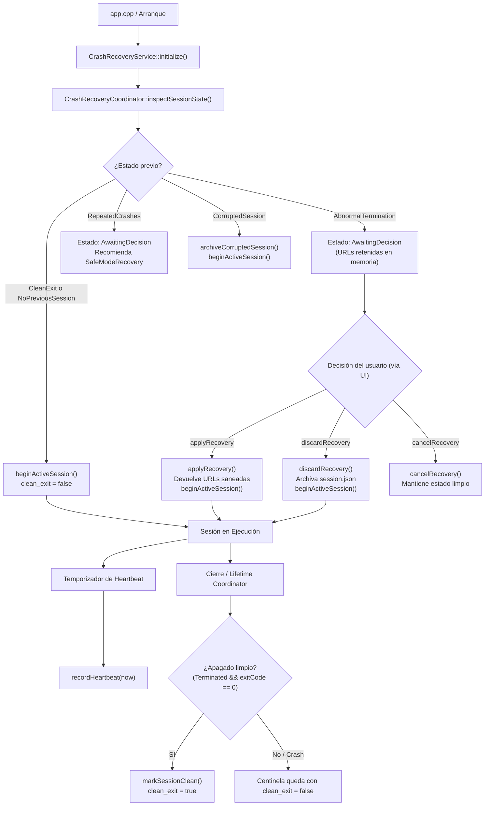
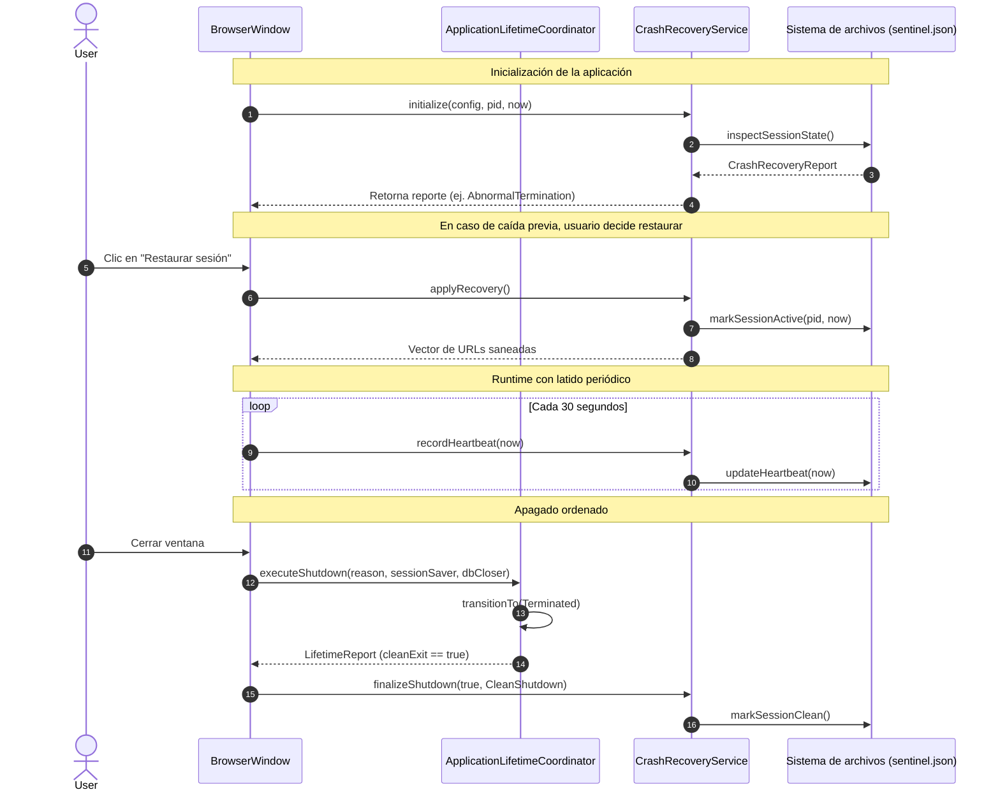
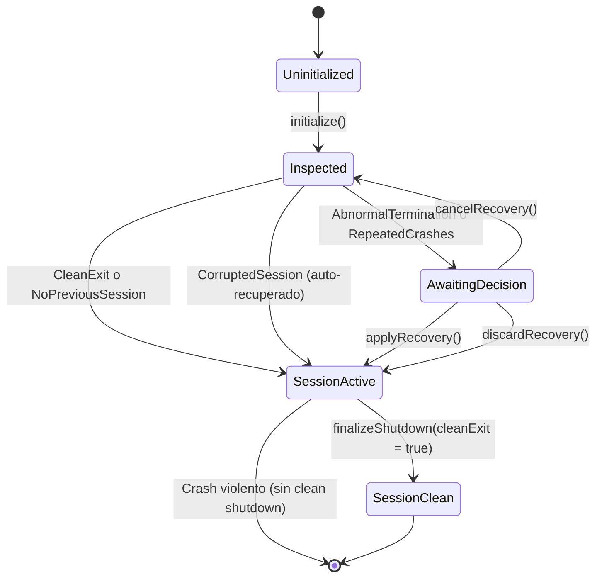

# Design — module-foundations-task0030

Status: PROPOSED

## Current, target and gaps

### Estado actual (CURRENT)

1. **Definición de dominio y helpers estáticos existentes (`task0029`)**:
   - `CrashRecoveryTypes.h` define enumeraciones fuertemente tipadas (`CrashDetectionState`, `RecoveryAction`, `CrashReason`) y estructuras inmutables (`CrashSentinel`, `CrashRecoveryConfig`, `CrashRecoveryReport`).
   - `CrashRecoveryCoordinator.h` y `.cpp` implementan métodos estáticos de inspección (`inspectSessionState`), mutación atómica de centinela (`markSessionActive`, `markSessionClean`, `updateHeartbeat`), saneamiento de URLs (`sanitizeRecoverableUrls`) y archivo de sesiones corruptas (`archiveCorruptedSession`).
2. **Desconexión con el flujo de ejecución de la aplicación**:
   - `BrowserWindow` y `app.cpp` no orquestan aún el ciclo de vida del centinela:
     - Al iniciar el navegador en `app.cpp` o `BrowserWindow`, no se invoca `markSessionActive` para registrar el nuevo proceso y timestamp.
     - Al restaurar la sesión en `BrowserWindow::restoreSession`, se leen ciegamente las URLs de `QSettings` sin consultar el reporte de `CrashRecoveryCoordinator::inspectSessionState`.
     - Durante el apagado en `BrowserWindow::closeEvent`, `ApplicationLifetimeCoordinator::executeShutdown` guarda la sesión en disco pero no invoca `markSessionClean`.
     - No existe un mecanismo de latido periódico activo durante la ejecución de la ventana.
3. **Falta de una capa de servicio desacoplada para gestión de decisiones**:
   - No existe un servicio operativo en `core` que retenga el estado de recuperación de la sesión previa, gestione decisiones del usuario (`applyRecovery`, `discardRecovery`, `cancelRecovery`) y coordine la transición hacia la sesión activa sin introducir lógica de negocio dentro de los widgets de UI.

---

### Estado objetivo (TARGET)

1. **Capa de servicio operativo desacoplada en C++20 (`CrashRecoveryService` / `CrashRecoveryCoordinator`)**:
   - Un componente en `vigilio_core` que mantiene el estado de la sesión activa y gestiona de manera transaccional las decisiones de recuperación sin depender de Qt Widgets ni de WebEngine.
   - Provee una API limpia y clara:
     - `initialize(config, pid, timestamp)`: inspecciona el estado previo y configura el entorno.
     - `applyRecovery()`: entrega las URLs recuperables saneadas y transiciona a sesión activa.
     - `discardRecovery()`: descarta las pestañas de la sesión caída, archiva de forma segura el archivo de sesión (`.discarded.bak`) y arranca en limpio.
     - `cancelRecovery()`: revierte la acción de recuperación manteniendo el estado accesible.
     - `recordHeartbeat(timestamp)`: actualiza el latido periódicamente de manera atómica.
     - `finalizeShutdown(cleanExit, reason)`: asegura el cierre ordenado del centinela.
2. **Integración con el ciclo de vida de la aplicación (`ApplicationLifetimeCoordinator`)**:
   - Cierre limpio automático: al finalizar `executeShutdown` con `AppLifetimeState::Terminated` y `exitCode == 0`, se invoca `markSessionClean` garantizando que el centinela refleje `clean_exit: true`.
   - Si ocurre una salida anómala (`EmergencyAbort` o caída violenta), el centinela permanece con `clean_exit: false`.
3. **Invariante constitucional de Incógnito (Q-001)**:
   - Cero operaciones en disco cuando `config.isIncognito == true`.
4. **Protección contra Crash Loops y escalado a Modo Seguro**:
   - Si `consecutive_crashes >= threshold` ($\ge 2$), el servicio aconseja y facilita el inicio en modo seguro (`SafeModeRecovery`).

---

### Brechas identificadas (GAPS)

1. **Brecha de orquestación de servicio**: Los métodos estáticos de `CrashRecoveryCoordinator` requieren ser coordinados por un servicio o interfaz operativa con estado transaccional en `src/core`.
2. **Brecha de decisiones y descarte seguro**: Falta implementar la función para descartar o archivar la sesión previa rechazada por el usuario (`discardRecovery`) sin pérdida inadvertida de datos.
3. **Brecha de cancelación de recuperación**: Falta implementar la lógica de cancelación de la operación de restauración para devolver el sistema a un estado estable.
4. **Brecha de enlace con ApplicationLifetimeCoordinator**: Falta coordinar la llamada a `markSessionClean` al completar un apagado exitoso en `executeShutdown`.
5. **Brecha de pruebas de servicio**: Se requieren pruebas unitarias que certifiquen el flujo completo de vida del servicio: inicialización, inspección, aplicación, descarte, cancelación y apagado limpio.

---

## Compatibility, migration and rollback

- **Compatibilidad**:
  - El archivo centinela `sentinel.json` mantiene `schema_version: 1`, totalmente compatible con versiones previas y futuras.
  - La persistencia de sesiones sigue usando `SessionFile.h` con cabecera `VIGILIO_SESSION_V1`.
  - Código C++20 estándar sin dependencias propietarias o binarias ajenas al proyecto.
- **Migración**:
  - En perfiles existentes donde exista `session.json` pero no `sentinel.json`, el servicio lo reconoce como migración limpia (`CleanExit`), creando el centinela en la primera ejecución.
- **Rollback**:
  - En caso de reversión, la eliminación de `sentinel.json` devuelve el navegador a su comportamiento por defecto sin romper el perfil del usuario.

---

## Technical architecture and operational service model

### 1. Diagrama de arquitectura del servicio de recuperación

### 2. Diagrama de secuencia de integración con el ciclo de vida

### 3. Máquina de estados del servicio de recuperación

---

## Invariantes, condiciones de error y resiliencia

1. **Invariante Constitucional de Incógnito (Q-001)**:
   - Toda llamada de persistencia o inspección en modo incógnito cortocircuita de inmediato: no hay acceso al sistema de archivos, no se crean temporales ni se leen ficheros.
2. **Resiliencia de E/S atómica**:
   - Todo centinela se escribe primero en `.tmp` en el mismo directorio padre y se renombra atómicamente (`MoveFileExW` / `std::filesystem::rename`).
3. **Bounded Buffers y límites de seguridad**:
   - URLs limitadas a 8192 bytes.
   - Pestañas limitadas a 1000 elementos.
   - Eliminación estricta de esquemas peligrosos (`javascript:`, `data:`, `file:`).
4. **Desacoplamiento arquitectónico**:
   - Cero dependencias de `QWidget`, `QApplication` o `QWebEngineView` en `CrashRecoveryService` ni `CrashRecoveryCoordinator`.
   - Compatible con ejecución Headless, consola y pruebas unitarias aisladas.
