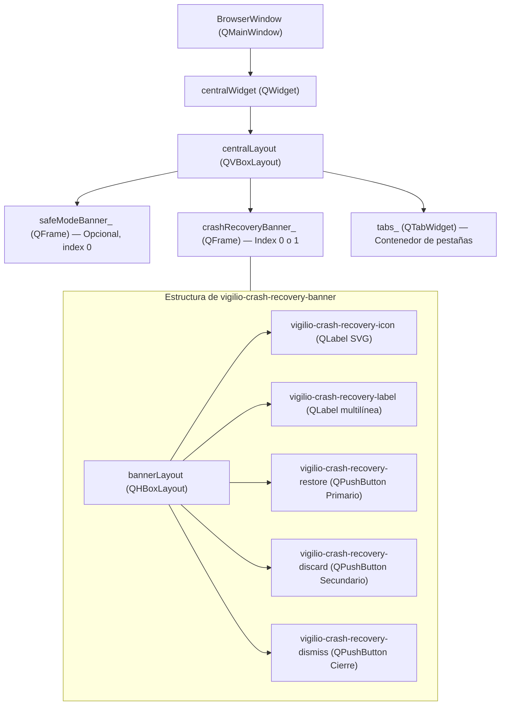
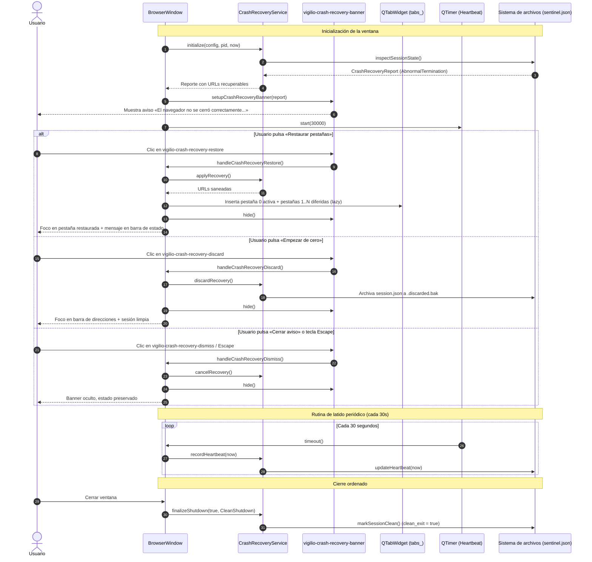
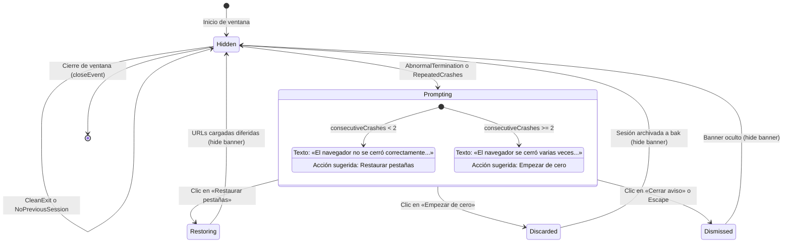

# Design — module-foundations-task0031

Status: PROPOSED

## Current, target and gaps

### Estado actual (CURRENT)

1. **Capa de dominio y servicio operativo en C++20 (`task0029` y `task0030`)**:
   - `CrashRecoveryTypes.h` define los tipos del dominio: `CrashDetectionState`, `RecoveryAction`, `CrashReason`, `RecoveryServiceState`, `RecoveryDecision`, `CrashSentinel`, `CrashRecoveryConfig` y `CrashRecoveryReport`.
   - `CrashRecoveryCoordinator.h` y `.cpp` implementan tanto los métodos estáticos de persistencia atómica en disco como el servicio orquestador con estado `CrashRecoveryService`.
   - `CrashRecoveryService` cuenta con las operaciones operativas completas: `initialize`, `applyRecovery`, `discardRecovery`, `cancelRecovery`, `recordHeartbeat` y `finalizeShutdown`.
2. **Interfaz gráfica en `BrowserWindow` (`CURRENT`)**:
   - `BrowserWindow` (`apps/vigilio-browser/src/ui/BrowserWindow.h` y `.cpp`) orquesta la ventana principal de Qt Widgets con `tabs_` (`QTabWidget`), `toolbar_` (`QToolBar`), `address_` (`QLineEdit`), `safeModeBanner_` (`QWidget*`), e `incognitoBadge_` (`QLabel*`).
   - `BrowserWindow::setupSafeModeBanner()` establece el patrón existente de banner accesible insertado en `centralLayout` en la posición 0.
   - En el arranque (`BrowserWindow::BrowserWindow`), actualmente se invoca `restoreSession()` leyendo de `QSettings` de manera ciega, sin consultar el estado del centinela ni `CrashRecoveryService`.
   - No existe ningún widget, banner o diálogo en la interfaz para comunicar al usuario la detección de una terminación anómala o crash loop, ni para consultar su decisión de recuperación.
   - No existe integración activa del latido periódico (`recordHeartbeat`) mediante `QTimer` en `BrowserWindow`.
   - En el evento de cierre (`closeEvent`), se ejecuta `ApplicationLifetimeCoordinator::executeShutdown`, pero no se enlaza con `CrashRecoveryService::finalizeShutdown` para marcar la salida limpia en el centinela.

---

### Estado objetivo (TARGET)

1. **Componente de interfaz nativo Qt Widgets para recuperación tras caídas (`vigilio-crash-recovery-banner`)**:
   - Un banner no modal en `BrowserWindow` que aparece únicamente cuando se detecta un cierre anómalo previo (`AbnormalTermination` o `RepeatedCrashes`).
   - Diseño sobrio, integrado con la paleta de colores del navegador (`#1e293b` oscuro, `#f1f5f9` claro) y con iconos vectoriales SVG de Lucide (`icons/tools/shield.svg` o `icons/navigation/reload.svg`).
   - Textos redactados en lenguaje natural conforme a `docs/UX-COPY-PUBLICO.md`:
     - Caída única: «El navegador no se cerró correctamente. ¿Quieres restaurar tus pestañas anteriores?».
     - Bucle de caídas: «El navegador se cerró varias veces de forma inesperada. Se recomienda abrir una sesión limpia para mayor estabilidad.».
   - Controles interactivos con jerarquía clara:
     - Botón primario «Restaurar pestañas» (`vigilio-crash-recovery-restore`).
     - Botón secundario «Empezar de cero» (`vigilio-crash-recovery-discard`).
     - Botón de cierre o tecla `Escape` (`vigilio-crash-recovery-dismiss`).
2. **Integración con la «Interfaz más fácil de usar» (Modo Senior)**:
   - Escalado dinámico en `BrowserWindow::setSeniorMode(bool)`:
     - Altura mínima de botones $\ge 48$ px.
     - Altura mínima del banner $\ge 56$ px.
     - Iconos a 28x28 px con alto contraste y texto ampliado.
3. **Eficiencia de memoria mediante carga diferida (Lazy Loading)**:
   - Al pulsar «Restaurar pestañas», solo la primera pestaña crea un `QWebEngineView`; las restantes se registran con propiedad diferida (`deferredUrl`), evitando agotar la memoria RAM per `docs/skills/06-rendimiento-y-ram.md`.
4. **Navegación completa por teclado y accesibilidad**:
   - `accessibleName` y `accessibleDescription` en todos los elementos.
   - Foco visible con anillo de 2 px.
   - Ciclo de foco `Tab` / `Shift+Tab`, activación con `Enter` / `Espacio`, y descarte inmediato con `Escape`.
5. **Orquestación del ciclo de vida y latido periódico en UI**:
   - `QTimer` en `BrowserWindow` que ejecuta `recordHeartbeat(now)` cada 30 segundos.
   - Enlace en `closeEvent` con `CrashRecoveryService::finalizeShutdown(true)`.
6. **Aislamiento constitucional de Incógnito (Q-001)**:
   - Si `isIncognito_ == true`, el banner de recuperación jamás se construye ni se muestra.

---

### Brechas identificadas (GAPS)

1. **Brecha de componentes visuales**: Ausencia del widget `QFrame` de banner de recuperación (`vigilio-crash-recovery-banner`) y sus botones en `BrowserWindow`.
2. **Brecha de inicialización en UI**: Falta instanciar y consultar `CrashRecoveryService` en el constructor de `BrowserWindow` para determinar si debe mostrarse el banner.
3. **Brecha de manejadores de decisión**: Falta implementar los métodos para aplicar (`applyRecovery`), descartar (`discardRecovery`) y cancelar (`cancelRecovery`) la recuperación desde la interfaz de usuario.
4. **Brecha de carga diferida en recuperación**: La lógica actual de restauración en `BrowserWindow` debe adaptarse para consumir las URLs saneadas provenientes de `CrashRecoveryService`.
5. **Brecha de latido periódico en UI**: Falta crear el `QTimer` de 30 segundos en `BrowserWindow` para registrar marcas de vida en el centinela.
6. **Brecha de enlace en el apagado**: Falta invocar `finalizeShutdown` al completar el cierre ordenado en `closeEvent`.
7. **Brecha de pruebas de interfaz de usuario**: Se requiere ampliar `WindowTests.cpp` con aserciones específicas para verificar la presencia, ausencia, textos, accesibilidad y comportamiento del banner.

---

## Compatibility, migration and rollback

- **Compatibilidad**:
  - Utiliza widgets estándar de Qt 6 (compatibles con Qt 6.10+) y C++20 estándar.
  - No altera los contratos de `CrashRecoveryService` ni la estructura de `sentinel.json` o `session.json`.
  - Coexiste armónicamente con `safeModeBanner_` sin generar conflictos de layout ni solapamientos.
- **Migración**:
  - En perfiles donde no exista `sentinel.json` o la sesión previa haya sido limpia, el banner permanece inactivo; la experiencia de usuario es transparente y no disruptiva.
- **Rollback**:
  - La reversión del código de UI restaura el comportamiento anterior sin afectar los archivos en disco del perfil.
  - La tecla `Escape` o el botón «Cerrar aviso» provee un rollback interactivo inmediato para el usuario si no desea restaurar las pestañas en ese momento.

---

## Technical architecture and UI visual interaction model

### 1. Diagrama de arquitectura y jerarquía de widgets



---

### 2. Diagrama de secuencia de interacción del usuario



---

### 3. Máquina de estados del banner de recuperación en la interfaz



---

## Detalles específicos de implementación de componentes

### 1. Métodos y atributos a agregar en `BrowserWindow`

```cpp
// En apps/vigilio-browser/src/ui/BrowserWindow.h

// Inclusiones y forwards:
namespace vigilio {
class CrashRecoveryService;
struct CrashRecoveryReport;
}
class QTimer;

// En la sección pública / métodos de consulta para tests:
[[nodiscard]] QWidget* crashRecoveryBanner() const noexcept {
    return crashRecoveryBanner_;
}
[[nodiscard]] vigilio::CrashRecoveryService* crashRecoveryService() const noexcept {
    return crashRecoveryService_.get();
}

// En la sección privada:
void setupCrashRecovery(const vigilio::StartupCommandLine& cmdLine);
void setupCrashRecoveryBanner(const vigilio::CrashRecoveryReport& report);
void handleCrashRecoveryRestore();
void handleCrashRecoveryDiscard();
void handleCrashRecoveryDismiss();

std::unique_ptr<vigilio::CrashRecoveryService> crashRecoveryService_;
QWidget* crashRecoveryBanner_{nullptr};
QTimer* heartbeatTimer_{nullptr};
```

### 2. Estilos visuales y Tokens Qt (QSS integrado)

El banner aplica estilos CSS nativos de Qt respetando el modo claro y oscuro del navegador:

```css
/* Modo Oscuro (por defecto) */
QFrame#vigilio-crash-recovery-banner {
    background-color: #1e293b;
    border: 1px solid #334155;
    border-radius: 6px;
}
QLabel#vigilio-crash-recovery-label {
    color: #f8fafc;
    font-size: 13px;
}
QPushButton#vigilio-crash-recovery-restore {
    background-color: #2563eb;
    color: #ffffff;
    font-weight: bold;
    border-radius: 4px;
    padding: 6px 14px;
}
QPushButton#vigilio-crash-recovery-restore:hover {
    background-color: #1d4ed8;
}
QPushButton#vigilio-crash-recovery-discard {
    background-color: #334155;
    color: #e2e8f0;
    border-radius: 4px;
    padding: 6px 12px;
}
QPushButton#vigilio-crash-recovery-discard:hover {
    background-color: #475569;
}
QPushButton#vigilio-crash-recovery-dismiss {
    background-color: transparent;
    color: #94a3b8;
    border-radius: 4px;
    padding: 6px 10px;
}
QPushButton#vigilio-crash-recovery-dismiss:hover {
    background-color: #334155;
    color: #ffffff;
}

/* Modo Senior («Interfaz más fácil de usar») */
QFrame#vigilio-crash-recovery-banner[senior="true"] {
    min-height: 56px;
}
QPushButton#vigilio-crash-recovery-restore[senior="true"],
QPushButton#vigilio-crash-recovery-discard[senior="true"],
QPushButton#vigilio-crash-recovery-dismiss[senior="true"] {
    min-height: 48px;
    font-size: 15px;
    padding: 10px 18px;
}
```

### 3. Carga diferida de pestañas en recuperación tras caídas

Para garantizar el cumplimiento de `docs/skills/06-rendimiento-y-ram.md`:
- Cuando el usuario acciona «Restaurar pestañas», el método `handleCrashRecoveryRestore()`:
  1. Invoca `auto urls = crashRecoveryService_->applyRecovery();`.
  2. Si `urls` está vacío, abre una pestaña de inicio vacía.
  3. Para el primer elemento `urls[0]`:
     - Se carga inmediatamente en la pestaña actual (o en una nueva pestaña activa), instanciando el visor web `QWebEngineView`.
  4. Para los elementos sucesivos `urls[1]` hasta `urls[N]`:
     - Se crea un widget contenedor ligero de marcador (`QWidget`) con layout que contiene el título temporal y un icono indicador.
     - Se asigna la propiedad diferida `setProperty("deferredUrl", QString::fromStdString(url))`.
     - No se crea `QWebEngineView` hasta que el usuario hace clic expreso sobre la pestaña correspondiente (activando el hook `activateDeferredTab(int index)` ya existente en `BrowserWindow`).
  5. Este diseño reduce el consumo de RAM de $\sim 500\text{ MB}$ por 10 pestañas activas a apenas $\sim 50\text{ MB}$ iniciales, garantizando estabilidad absoluta incluso en equipos de hardware modesto.
