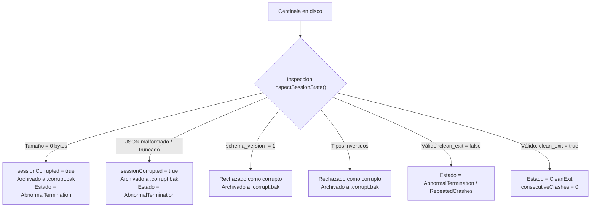

# Design — module-foundations-task0032

Status: PROPOSED

## Current, target and gaps

### Estado actual (CURRENT)

1. **Capa de dominio y servicio operativo en C++20 (`task0029` y `task0030`)**:
   - `CrashRecoveryTypes.h` define los tipos del dominio: `CrashDetectionState`, `RecoveryAction`, `CrashReason`, `RecoveryServiceState`, `RecoveryDecision`, `CrashSentinel`, `CrashRecoveryConfig` y `CrashRecoveryReport`.
   - `CrashRecoveryCoordinator.h` y `.cpp` implementan tanto los métodos estáticos de persistencia atómica en disco como el servicio orquestador con estado `CrashRecoveryService`.
   - `CrashRecoveryService` cuenta con las operaciones operativas completas: `initialize`, `applyRecovery`, `discardRecovery`, `cancelRecovery`, `recordHeartbeat` y `finalizeShutdown`.
2. **Capa de presentación de interfaz de usuario (`task0031`)**:
   - `BrowserWindow` (`apps/vigilio-browser/src/ui/BrowserWindow.h` y `.cpp`) despliega el widget nativo accesible `vigilio-crash-recovery-banner` ante detección de caída anómala o bucle de caídas, orquestando la restauración diferida de pestañas (`lazy loading`), el descarte de sesión y el temporizador periódico de latidos (`heartbeatTimer_`).
3. **Suite de pruebas actual (`CrashRecoveryTests.cpp` y `WindowTests.cpp`)**:
   - `CrashRecoveryTests.cpp` implementa 17 casos de prueba unitarios base que validan los flujos primarios: arranque sin sesión previa, salida limpia, detección de crash único, detección de crash loop, incógnito en servicio y coordinador, centinela y sesión corruptos básicos, sanitización básica de URLs, latido simple y transiciones elementales de servicio.
   - `WindowTests.cpp` valida la creación y ocultamiento del banner de UI, textos de advertencia, escalado en Modo Senior y aislamiento en incógnito.

---

### Estado objetivo (TARGET)

1. **Suite exhaustiva de pruebas de resiliencia y casos extremos (`vigilio_crash_recovery_tests`)**:
   - Cobertura completa de casos límite de entrada en el analizador de centinelas (`readSentinel` / `parseJsonSentinel`): archivos vacíos (0 bytes), archivos truncados en mitad de una clave o valor JSON, esquemas incompatibles (`schema_version != 1`), tipos de datos invertidos (cadenas donde se esperan enteros/booleanos) y enteros negativos o fuera de rango.
   - Protección verificable contra desbordamiento aritmético en `sentinel.consecutiveCrashes` ($UINT32\_MAX$).
   - Pruebas exhaustivas de sesiones corruptas: archivos `session.json` vacíos, archivos sin encabezado `VIGILIO_SESSION_V1`, líneas sin comillas o con caracteres nulos/binarios.
   - Verificación estricta de bounded buffers: truncado estricto a 1000 pestañas (`kMaxTabs`), descarte de URLs que excedan 8192 bytes (`kMaxUrlLength`), y filtrado de esquemas peligrosos (`javascript:`, `data:`, `file:`, `blob:`, `about:`, `vbscript:`).
   - Pruebas de concurrencia multihilo: múltiples hilos ejecutando concurrentemente `recordHeartbeat` y `updateHeartbeat` sin corromper el centinela en disco y preservando la atomicidad de `writeSentinelAtomic`.
   - Pruebas de fallos inyectados en el sistema de archivos: directorios sin permisos de escritura (solo lectura), rutas no válidas, y verificación de que los métodos devuelven `false` de manera limpia y eliminan cualquier archivo temporal `.tmp` sin abortar ni generar fugas de descriptores.
   - Pruebas exhaustivas de la máquina de estados de `CrashRecoveryService`: invocaciones fuera de orden (`applyRecovery` sobre servicio no inicializado), idempotencia en descarte y cancelación, y re-inicialización dinámica con nuevas configuraciones.
   - Verificación de tiempo y aislamiento: ejecución de la suite completa en menos de 500 ms sin depender de procesos Chromium o GPU.

---

### Gaps identificados (GAPS)

1. **Ausencia de pruebas de centinela vacío o truncado**: La suite existente solo prueba una cadena JSON truncada específica; falta probar centinelas de 0 bytes, archivos con solo espacios en blanco, esquemas de versión superior desconocida y tipos invertidos.
2. **Ausencia de pruebas de estrés en límites de memoria (Bounded Buffers)**: No se comprueba actualmente el comportamiento de sanitización ante listas con más de 1000 URLs o con URLs gigantescas de > 8192 bytes.
3. **Ausencia de pruebas de concurrencia multihilo**: No existe verificación automatizada que certifique la estabilidad del latido atómico ante accesos simultáneos desde múltiples hilos.
4. **Ausencia de pruebas de inyección de fallos de permisos de disco**: No se prueba explícitamente cómo reacciona el coordinador cuando el directorio destino es de solo lectura o cuando el renombrado atómico falla.
5. **Ausencia de pruebas de llamadas anómalas en la máquina de estados**: No se comprueba qué ocurre si se invoca `applyRecovery()` o `discardRecovery()` cuando el servicio se encuentra en estado `Uninitialized`, `SessionClean` o `SessionActive`.

---

## Compatibility, migration and rollback

### Compatibilidad y estándares C++20
- Todas las pruebas se escriben utilizando tipos y bibliotecas estándar de C++20 (`<filesystem>`, `<chrono>`, `<thread>`, `<vector>`, `<string>`, `<sstream>`).
- Cero macros propietarias complejas; uso del macro `CHECK(cond)` estándar con reporte preciso de archivo y número de línea.
- Compilación portable en Linux (GCC / Clang), Windows (MSVC) y macOS, compatible con los flags estrictos del proyecto (`-Wall -Wextra -Wpedantic -Wconversion -Wsign-conversion -Wshadow -Werror`).

### Migración y Rollback
- Al tratarse de una ampliación de la suite de pruebas unitarias (`tests/unit/CrashRecoveryTests.cpp`), no se altera el esquema de almacenamiento persistente ni se rompe compatibilidad con versiones previas.
- Rollback trivial: revertir los commits de prueba restaura la suite previa sin ningún impacto en la funcionalidad del navegador.

---

## Arquitectura de pruebas y fixtures de aislamiento

### Patrón Fixture RAII (`TempDirectoryFixture`)
```cpp
struct TempDirectoryFixture {
    std::filesystem::path path;

    explicit TempDirectoryFixture(const std::string& prefix) {
        const auto now = std::chrono::steady_clock::now().time_since_epoch().count();
        path = std::filesystem::temp_directory_path() / (prefix + "_" + std::to_string(now));
        std::error_code ec;
        std::filesystem::create_directories(path, ec);
    }

    ~TempDirectoryFixture() {
        std::error_code ec;
        std::filesystem::remove_all(path, ec);
    }
};
```
Cada prueba crea su propio subdirectorio único dentro del directorio temporal del sistema (`/tmp` o `%TEMP%`), garantizando que:
1. No exista interferencia entre pruebas concurrentes o secuenciales.
2. No se toque el perfil real de usuario en `~/.config/vigilio-browser` o `%APPDATA%/VigilioBrowser`.
3. Todos los artefactos creados (centinelas, sesiones, backups `.corrupt.bak`, `.discarded.bak`, temporales `.tmp`) se eliminen automáticamente al salir del bloque de prueba.

---

## Modelos de prueba: Casos positivos, negativos, concurrencia y recuperación de fallos

### 1. Modelo de Casos Límite y Variaciones de Centinela Corrupto


### 2. Modelo de Saneamiento y Bounded Buffers
- **Límite de pestañas**:
  $$\text{URLs aceptadas} = \min(N, 1000)$$
  Si una sesión contiene 1500 URLs, exactamente las primeras 1000 URLs válidas son retenidas y las restantes 500 son omitidas.
- **Límite de longitud de URL**:
  $$\text{Longitud}(\text{URL}) \le 8192\text{ bytes}$$
  Cualquier URL con longitud $> 8192$ bytes es descartada silenciosamente para prevenir agotamiento de memoria o vectores de ataque DoS.
- **Filtrado de esquemas**:
  Solo se permiten esquemas `http://`, `https://` y páginas internas `vigilio://`. Esquemas `javascript:`, `data:`, `file:`, `blob:`, `about:` son descartados.

### 3. Modelo de Concurrencia Multihilo
Para certificar que el latido periódico (`updateHeartbeat`) y la persistencia atómica (`writeSentinelAtomic`) son resistentes a carreras:
- Se instancian $M$ hilos ($M \ge 4$).
- Cada hilo ejecuta $K$ actualizaciones de latido con timestamps crecientes.
- Se asegura que cada actualización escribe a un archivo `.tmp` y renombra atómicamente a `sentinel.json`.
- Tras la finalización de todos los hilos, se valida que:
  1. `sentinel.json` existe y no está truncado ni corrupto.
  2. No existen archivos `.tmp` residuales en el directorio.
  3. El archivo puede ser parseado perfectamente por `readSentinel()`.

### 4. Modelo de Inyección de Fallos de Permisos de Disco
- Se crea un subdirectorio `readonly_dir` dentro del fixture.
- Se retiran los permisos de escritura del directorio.
- Se invoca `markSessionActive` o `updateHeartbeat` apuntando a dicho directorio.
- Se comprueba que:
  1. La función retorna `false` de forma segura.
  2. No se produce aborto (`std::terminate`) ni excepciones no capturadas.
  3. No quedan archivos temporales colgados.
- Se restauran los permisos para permitir la limpieza limpia del fixture en el destructor.

---

## Invariantes y presupuestos de memoria (RAM / Bounded Buffers)

1. **Aislamiento en Incógnito (Decisión Q-001)**:
   - Toda llamada a `CrashRecoveryCoordinator` o `CrashRecoveryService` bajo `config.isIncognito == true` debe cortocircuitar de inmediato en memoria y retornar éxito/reporte limpio sin interactuar con el sistema de archivos.
2. **Presupuesto de Tiempo de Ejecución**:
   - Tiempo objetivo de ejecución de toda la suite `vigilio_crash_recovery_tests`: $\le 100\text{ ms}$.
   - Tiempo máximo permitido bajo CTest: 15 segundos (timeout configurado en CMake).
3. **Presupuesto de Memoria (RAM)**:
   - Uso máximo de RAM durante las pruebas: $\le 16\text{ MB}$.
   - Cero procesos Chromium, WebEngine o GPU instanciados.
