# Design — module-foundations-task0033

Status: PROPOSED

## Current, target and gaps

### Estado actual (CURRENT)

1. **Configuración existente de CMake Presets (`apps/vigilio-browser/CMakePresets.json`)**:
   - El proyecto cuenta con un archivo prototipo en `apps/vigilio-browser/CMakePresets.json` basado en el esquema versión 6 de CMake.
   - Define únicamente dos presets de configuración:
     - `core-debug`: Generador Ninja, `binaryDir`: `${sourceDir}/build-core-debug`, `CMAKE_BUILD_TYPE=Debug`, `VIGILIO_BUILD_GUI=OFF`, `BUILD_TESTING=ON`.
     - `desktop-debug`: Generador Ninja, `binaryDir`: `${sourceDir}/build-desktop-debug`, `CMAKE_BUILD_TYPE=Debug`, `VIGILIO_BUILD_GUI=ON`, `BUILD_TESTING=ON`, `VIGILIO_ENABLE_E2E=OFF`.
   - Define dos presets de compilación asociados (`core-debug`, `desktop-debug`).
   - Define un único preset de prueba (`core-debug`) con `outputOnFailure=true`.
2. **Infraestructura de construcción en CMake (`apps/vigilio-browser/CMakeLists.txt`)**:
   - Define el proyecto `VigilioBrowser VERSION 0.1.0` con estándar C++20 requerido y extensiones desactivadas.
   - Cuenta con targets estáticos (`vigilio_core`, `vigilio_storage`), target de interfaz (`vigilio_compiler_warnings`) y 11 ejecutables de pruebas unitarias/integración en CTest.
   - Expone conmutadores de configuración: `VIGILIO_BUILD_GUI`, `VIGILIO_ENABLE_E2E`, `VIGILIO_REQUIRE_QT`, `BUILD_TESTING`, `VIGILIO_WARNINGS_AS_ERRORS`.
3. **Pipeline de comprobación continua local (`apps/vigilio-browser/scripts/check.sh`)**:
   - Automatiza la compilación con Ninja y la ejecución de pruebas bajo CTest con la etiqueta `fast`.
   - 11 de 11 tests aprobados en 0.68s con exit code 0.

---

### Estado objetivo (TARGET)

1. **Catálogo integral y estandarizado de CMake Presets (`CMakePresets.json`)**:
   - Especificación completa bajo el esquema versión 6 que cubre la totalidad de los flujos de trabajo del ciclo de vida del navegador:
     1. `core-debug`: Desarrollo diario headless C++20 sin dependencias Qt.
     2. `core-release`: Pruebas de rendimiento y benchmarks de persistencia headless.
     3. `desktop-debug`: Desarrollo y depuración con interfaz gráfica Qt6 y Chromium WebEngine.
     4. `desktop-release`: Compilación optimizada para distribución final y empaquetado de producción.
     5. `desktop-e2e`: Batería de pruebas de humo end-to-end con interfaz gráfica completa y ejecución serializada.
     6. `ci-linux-debug`: Pipeline automatizado de integración continua en Linux con `-Werror` estricto.
     7. `ci-linux-release`: Pipeline de validación de empaquetado en Linux.
     8. `sanitizer-asan`: Detección de corrupción y fugas de memoria con AddressSanitizer.
     9. `sanitizer-ubsan`: Detección de comportamiento indefinido con UndefinedBehaviorSanitizer.
   - Estandarización de `binaryDir` bajo la convención determinista `${sourceDir}/build-${presetName}`.
   - Cobertura simétrica: Cada preset de configuración con pruebas activas (`BUILD_TESTING=ON`) dispone de su correspondiente `testPreset` enlazado.
2. **Modelo de dominio y validador desacoplado en C++20 (`vigilio::CMakePresetsValidator`)**:
   - Implementación pura en C++20 dentro de `vigilio_core`, libre de acoplamientos con Qt Widgets o Chromium.
   - Análisis estático de JSON de presets que certifica:
     - Versión de esquema compatible ($\ge 3$, estándar canónico v6).
     - Presencia de presets indispensables (`core-debug`, `desktop-debug`).
     - Integridad referencial (cero presets de build o test con `configurePreset` huérfanos).
     - Unicidad de identificadores de presets.
     - Higiene estricta de rutas de binarios (rechazo de `..` y rutas absolutas fijas).
     - Coherencia de variables de caché (prevención de configuraciones contradictorias).
3. **Suite de pruebas unitarias deterministas (`tests/unit/CMakePresetsTests.cpp`)**:
   - Cobertura exhaustiva de los 12 escenarios de prueba definidos en la matriz de `proposal.md`, garantizando ejecución en < 50 ms en CTest.

---

### Gaps identificados (GAPS)

1. **Ausencia de presets de Release**: No existen perfiles `core-release` ni `desktop-release`, lo que dificulta la verificación de compilaciones optimizadas y la detección de advertencias específicas de optimizador.
2. **Ausencia de presets de CI y Sanitizadores**: No existen configuraciones explícitas para pipelines automatizados con `-Werror` ni perfiles de AddressSanitizer/UndefinedBehaviorSanitizer para auditorías de seguridad.
3. **Ausencia de presets de prueba para escritorio**: El archivo actual solo define `testPreset` para `core-debug`, omitiendo pruebas gráficas de `desktop-debug` y E2E de `desktop-e2e`.
4. **Falta de validador programático en el dominio**: No existe una clase C++20 en `vigilio_core` que verifique la validez sintáctica y referencial de los presets, exponiendo al proyecto a fallos silenciosos por errores tipográficos o referencias rotas en `CMakePresets.json`.

---

## Compatibility, migration and rollback

### Compatibilidad con versiones de CMake
- **Baseline de CMake**: CMake $\ge 3.24$ (requerido por `CMakeLists.txt` línea 1).
- **Esquema de Presets**: Presets versión 6 (introducido en CMake 3.25 y plenamente soportado por CMake 4.2.3 instalado en el entorno).
- **Compatibilidad hacia atrás**: El formato JSON v6 es retrocompatible con herramientas modernas (VS Code CMake Tools, CLion 2023+, Qt Creator 12+).
- **Portabilidad de generador**: Se estandariza `generator: "Ninja"` para todas las plataformas (Linux, Windows, macOS), garantizando tiempos de compilación mínimos e invocaciones idénticas.

### Estrategia de Migración y Rollback
- La ampliación de `CMakePresets.json` preserva al 100% los nombres y variables de los dos presets existentes (`core-debug` y `desktop-debug`), garantizando cero disrupción en los scripts de desarrollo existentes (`scripts/check.sh`).
- Rollback trivial: Al ser un archivo declarativo versionado en Git, revertir el commit restaura inmediatamente la versión previa sin efectos colaterales en la base de datos local ni en la configuración de usuario.

---

## Taxonomía y catálogo canónico de CMake Presets

```mermaid
flowchart TD
    subgraph ConfigurePresets["Configure Presets (CMakePresets.json)"]
        CD["core-debug\n(Headless, Debug, Testing ON)"]
        CR["core-release\n(Headless, Release, Testing ON)"]
        DD["desktop-debug\n(Qt6 WebEngine, Debug, Testing ON)"]
        DR["desktop-release\n(Qt6 WebEngine, Release, Testing OFF)"]
        DE["desktop-e2e\n(Qt6 WebEngine, Debug, E2E ON)"]
        CID["ci-linux-debug\n(Warnings as Errors ON, Debug)"]
        CIR["ci-linux-release\n(Warnings as Errors ON, Release)"]
        ASAN["sanitizer-asan\n(-fsanitize=address, Debug)"]
        UBSAN["sanitizer-ubsan\n(-fsanitize=undefined, Debug)"]
    end

    subgraph BuildPresets["Build Presets"]
        B_CD["build: core-debug"] --> CD
        B_CR["build: core-release"] --> CR
        B_DD["build: desktop-debug"] --> DD
        B_DR["build: desktop-release"] --> DR
        B_DE["build: desktop-e2e"] --> DE
        B_CID["build: ci-linux-debug"] --> CID
        B_CIR["build: ci-linux-release"] --> CIR
        B_ASAN["build: sanitizer-asan"] --> ASAN
        B_UBSAN["build: sanitizer-ubsan"] --> UBSAN
    end

    subgraph TestPresets["Test Presets"]
        T_CD["test: core-debug\n(filter: fast)"] --> CD
        T_CR["test: core-release\n(filter: fast)"] --> CR
        T_DD["test: desktop-debug\n(filter: fast, ui)"] --> DD
        T_DE["test: desktop-e2e\n(filter: e2e, serial)"] --> DE
        T_CID["test: ci-linux-debug\n(filter: fast)"] --> CID
        T_ASAN["test: sanitizer-asan\n(filter: fast)"] --> ASAN
        T_UBSAN["test: sanitizer-ubsan\n(filter: fast)"] --> UBSAN
    end
```



---

## Modelo de dominio en C++20 (`vigilio::CMakePresetsValidator`)

### 1. Definición de Estructuras y Enumeraciones (`CMakePresetsTypes.h`)
```cpp
namespace vigilio {

enum class CMakePresetKind {
    Configure,
    Build,
    Test,
    Package,
    Workflow
};

enum class CMakeBuildType {
    Debug,
    Release,
    RelWithDebInfo,
    MinSizeRel,
    Unknown
};

enum class CMakeGenerator {
    Ninja,
    UnixMakefiles,
    NinjaMultiConfig,
    VisualStudiov17,
    Unknown
};

enum class CMakePresetValidationOutcome {
    Valid,
    InvalidSchemaVersion,
    MissingRequiredPreset,
    OrphanConfigurePresetReference,
    DuplicatePresetName,
    UnsafeBinaryDir,
    ConflictingVariables,
    MalformedJson
};

struct CMakePresetDefinition {
    CMakePresetKind kind{CMakePresetKind::Configure};
    std::string name;
    std::string displayName;
    std::string description;
    std::string generator{"Ninja"};
    std::string binaryDir;
    std::string configurePreset; // Requerido para build y test presets
    std::map<std::string, std::string> cacheVariables;
    std::map<std::string, std::string> environment;
    bool outputOnFailure{true};
};

struct CMakePresetsValidationReport {
    CMakePresetValidationOutcome outcome{CMakePresetValidationOutcome::Valid};
    size_t configurePresetsCount{0};
    size_t buildPresetsCount{0};
    size_t testPresetsCount{0};
    std::vector<std::string> errors;
    std::vector<std::string> warnings;

    [[nodiscard]] bool isValid() const noexcept {
        return outcome == CMakePresetValidationOutcome::Valid && errors.empty();
    }
};

} // namespace vigilio
```

### 2. Interfaz del Validador (`CMakePresetsValidator.h`)
```cpp
namespace vigilio {

class CMakePresetsValidator {
public:
    // Validación de buffer JSON en memoria
    [[nodiscard]] static CMakePresetsValidationReport validatePresetsJson(const std::string& jsonContent);

    // Validación de archivo en disco
    [[nodiscard]] static CMakePresetsValidationReport validatePresetsFile(const std::filesystem::path& path);

    // Comprobación de seguridad sobre binaryDir
    [[nodiscard]] static bool isSafeBinaryDir(const std::string& binaryDir);

    // Nombres de los presets canónicos obligatorios
    [[nodiscard]] static std::vector<std::string> canonicalRequiredPresets();

    // Traducción de estado a texto legible
    [[nodiscard]] static std::string outcomeToString(CMakePresetValidationOutcome outcome);
};

} // namespace vigilio
```

---

## Reglas de validación e invariantes de seguridad

1. **Invariante de Esquema Mínimo (Schema Version $\ge 3$)**:
   - El analizador extrae el campo `"version"`.
   - Si no existe, no es un entero positivo o es menor a 3, el resultado es `InvalidSchemaVersion`.
2. **Invariante de Integridad Referencial**:
   - Cada elemento en `"buildPresets"` debe contener una clave `"configurePreset"`. El valor debe coincidir exactamente con el campo `"name"` de algún elemento en `"configurePresets"`.
   - Cada elemento en `"testPresets"` debe contener una clave `"configurePreset"`. El valor debe coincidir exactamente con el campo `"name"` de algún elemento en `"configurePresets"`.
   - El incumplimiento produce `OrphanConfigurePresetReference`.
3. **Invariante de Seguridad de Rutas (`binaryDir`)**:
   - Toda ruta de compilación debe iniciar con el prefijo `${sourceDir}/build-` o `${sourceDir}/_build-` (o rutas relativas sin prefijo que comiencen con `build-` / `_build-`).
   - Se prohíbe explícitamente:
     - Rutas absolutas fijas (e.g. `/home/`, `/tmp/`, `C:\`).
     - Secuencias de retroceso de directorio (`..`).
     - Caracteres de control o cadenas vacías.
   - El incumplimiento produce `UnsafeBinaryDir`.
4. **Invariante de Presets Críticos Obligatorios**:
   - Todo archivo de configuración válido para Vigilio Browser debe contener, como mínimo absoluto, los presets de configuración `core-debug` y `desktop-debug`.
   - La ausencia de cualquiera de ellos produce `MissingRequiredPreset`.
5. **Invariante de Variables de Caché No Conflictivas**:
   - Si un preset establece `VIGILIO_BUILD_GUI=OFF` (modo headless), no puede establecer simultáneamente `VIGILIO_ENABLE_E2E=ON` (los smoke tests E2E requieren renderizado nativo).
   - El incumplimiento produce `ConflictingVariables`.

---

## Presupuesto de recursos y observabilidad

- **Consumo de Memoria RAM**: El validador opera con buffers acotados; el tamaño del archivo `CMakePresets.json` no supera los 100 KB, manteniendo el consumo en memoria inferior a 2 MB durante el análisis.
- **Tiempo de Ejecución**: La validación sintáctica y referencial se ejecuta en $\le 2\text{ ms}$, permitiendo su inclusión en suites de pruebas unitarias rápidas (`fast`, $< 50\text{ ms}$).
- **Zero-Zombie / Local-First**: No se ejecutan procesos en segundo plano, subprocesos ni demonios de sondeo. Cero llamadas de red externa o telemetría.
