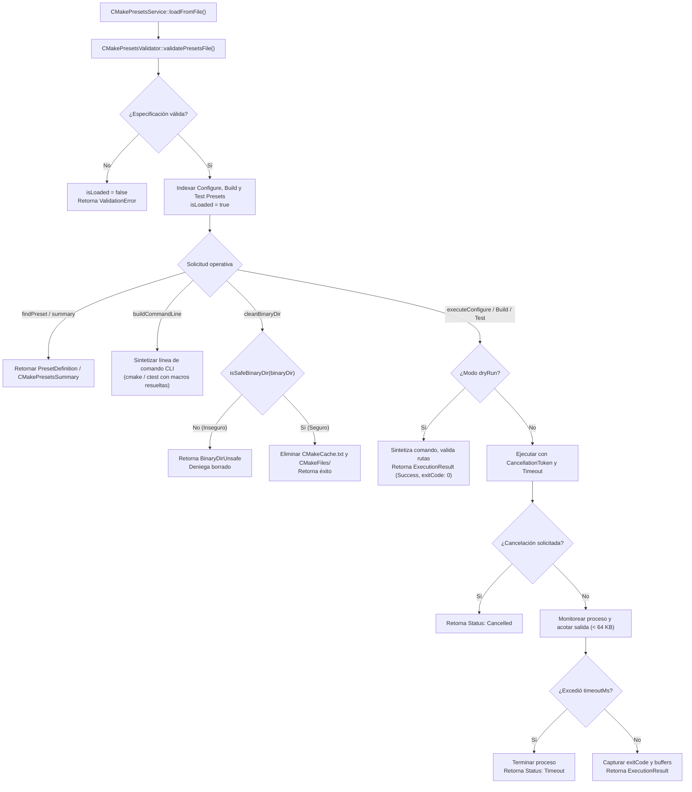
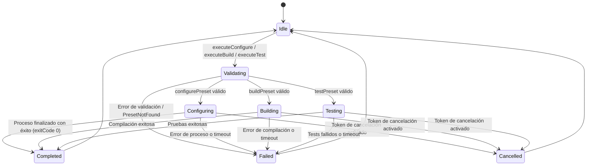
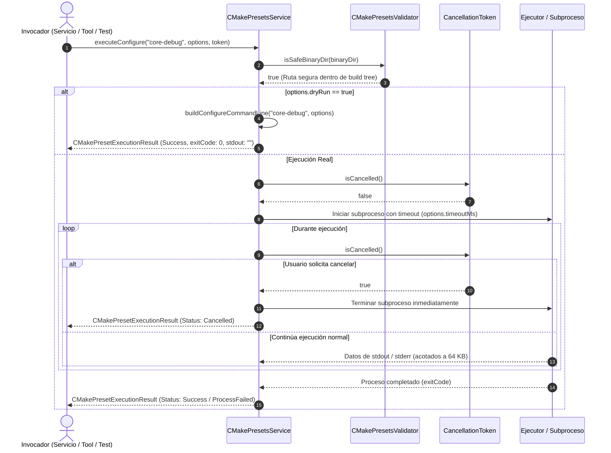

# Design — module-foundations-task0034

Status: PROPOSED

## Current, target and gaps

### Estado actual (CURRENT)

1. **Definición de dominio y validador estático existentes (`task0033`)**:
   - `apps/vigilio-browser/src/core/CMakePresetsTypes.h`: Define las enumeraciones `CMakePresetKind`, `CMakeBuildType`, `CMakeGenerator`, `CMakePresetValidationOutcome`, y las estructuras `CMakePresetDefinition` y `CMakePresetsValidationReport`.
   - `apps/vigilio-browser/src/core/CMakePresetsValidator.h` y `.cpp`: Implementa el parser JSON liviano, la verificación estricta de esquemas v6/v3+, la validación de presets obligatorios (`core-debug` y `desktop-debug`), la detección de referencias huérfanas entre presets y la comprobación de rutas seguras (`isSafeBinaryDir`).
   - `apps/vigilio-browser/CMakePresets.json`: Catálogo canónico con los 9 perfiles estándar (`core-debug`, `core-release`, `desktop-debug`, `desktop-release`, `desktop-e2e`, `ci-linux-debug`, `ci-linux-release`, `sanitizer-asan`, `sanitizer-ubsan`).
   - `apps/vigilio-browser/tests/unit/CMakePresetsTests.cpp`: Batería de pruebas unitarias que valida la integridad estática de los archivos y reglas del dominio.
2. **Ausencia de capa operativa de servicio**:
   - No existe un servicio en `src/core` que mantenga en memoria la especificación activa, resuelva jerarquías de dependencias entre presets de configuración, construcción y pruebas, y provea métodos de consulta estructurados.
3. **Ausencia de síntesis determinista de líneas de comando**:
   - No existe un mecanismo que construya programáticamente y de forma determinista las invocaciones CLI para `cmake --preset`, `cmake --build --preset` y `ctest --preset` con soporte de opciones y argumentos adicionales.
4. **Ausencia de ejecutor acotado y cancelación cooperativa**:
   - No existe un ejecutor con soporte para modo simulación (`dryRun`), control estricto de tiempos de espera (`timeoutMs`), límites de memoria para captura de salidas estándar y de error (política Zero-Zombie) ni cancelación cooperativa no bloqueante mediante tokens atómicos (`CancellationToken`).
5. **Ausencia de operaciones de saneamiento y recuperación**:
   - No existe una operación desacoplada (`cleanBinaryDir`) que limpie de forma segura los directorios de compilación binarios verificando previamente que no se vulnere la política de higiene de rutas.

---

### Estado objetivo (TARGET)

1. **Capa de servicio operativo en C++20 (`vigilio::CMakePresetsService`)**:
   - Componente en `vigilio_core` que encapsula la carga, indexación, consulta y resolución de dependencias entre presets de configuración, construcción y pruebas.
   - Provee una API limpia y desacoplada de `QApplication` y `QWidget`:
     - `loadFromFile(path)` y `loadFromJson(content, sourceDir)`: Carga y valida la especificación.
     - `findPreset(name, kind)` y `listPresetsByKind(kind)`: Consultas indexadas de definiciones.
     - `resolveAssociatedConfigurePreset(presetName, kind)`: Vinculación determinista de build/test presets con su configure preset padre.
     - `buildConfigureCommandLine`, `buildBuildCommandLine`, `buildTestCommandLine`: Síntesis determinista de comandos CLI.
     - `executeConfigure`, `executeBuild`, `executeTest`: Ejecución acotada con soporte de modo `dryRun`, timeout y cancelación cooperativa.
     - `cleanBinaryDir(configurePresetName)`: Saneamiento y limpieza segura de directorios de compilación.
     - `executionStatusToString` y `executionStateToString`: Formateo legible de diagnósticos conforme a `docs/UX-COPY-PUBLICO.md`.
2. **Mecanismo de cancelación cooperativa (`vigilio::CancellationToken`)**:
   - Estructura thread-safe con `std::atomic<bool>` para cancelar operaciones en segundo plano sin bloquear el hilo principal ni generar fugas de procesos.
3. **Resiliencia de memoria y política Zero-Zombie**:
   - Salidas estándar y de error acotadas estrictamente a 64 KB (`maxOutputBytes = 65536`).
   - Tiempos de espera acotados para evitar bloqueos indefinidos de subprocesos.
4. **Aislamiento local-first y sandboxing de rutas**:
   - Toda operación de borrado o ejecución verifica `isSafeBinaryDir`, denegando Directory Traversal (`..`) y rutas absolutas arbitrarias fuera de `${sourceDir}/build-*`.
   - Cero dependencias de red o servicios en la nube.

---

### Brechas identificadas (GAPS)

1. **Brecha de servicio de orquestación**: Falta implementar `CMakePresetsService.h` y `CMakePresetsService.cpp` en `src/core`.
2. **Brecha de tipos operativos**: Falta declarar en `CMakePresetsTypes.h` las enumeraciones y estructuras operativas (`CMakePresetExecutionState`, `CMakePresetExecutionStatus`, `CMakePresetCommandOptions`, `CMakePresetExecutionResult`, `CMakePresetsSummary`, `CancellationToken`).
3. **Brecha de síntesis de comandos**: Falta la lógica de ensamblado de líneas de comando CLI para CMake y CTest con resolución de macros `${sourceDir}`.
4. **Brecha de ejecución segura y cancelación**: Falta implementar el ejecutor con soporte para `dryRun`, búferes acotados y chequeo de tokens de cancelación.
5. **Brecha de saneamiento de directorios**: Falta implementar la función `cleanBinaryDir` con verificación de sandbox.
6. **Brecha de pruebas unitarias de servicio**: Falta implementar `tests/unit/CMakePresetsServiceTests.cpp` y registrar el target `vigilio_presets_service_tests` en `CMakeLists.txt`.

---

## Compatibility, migration and rollback

- **Compatibilidad**:
  - Plenamente compatible con la especificación CMake Presets Schema versión 6 (CMake 3.25+) y versiones retrocompatibles $\ge 3$.
  - Código C++20 puro que compila sin advertencias con GCC, Clang y MSVC bajo `-Werror`.
  - Integrado en la biblioteca estática `vigilio_core` sin añadir dependencias externas.
- **Migración**:
  - No altera el archivo de configuración `apps/vigilio-browser/CMakePresets.json` existente, sino que proporciona la capa operativa para consumirlo e interactuar con él programáticamente.
- **Rollback**:
  - Al tratarse de una nueva capa desacoplada (`CMakePresetsService`), cualquier reversión se realiza de forma limpia sin impacto sobre el código existente ni sobre las ventanas de la aplicación.

---

## Technical architecture and operational service model

### 1. Diagrama de flujo del ciclo de vida operativo de CMakePresetsService

### 2. Diagrama de estados de ejecución de presets (`CMakePresetExecutionState`)

### 3. Diagrama de secuencia de ejecución acotada y cancelación cooperativa

---

## Invariantes, condiciones de error y resiliencia

1. **Invariante Constitucional Local-First (Q-001)**:
   - Cero dependencias de red, servicios en la nube o telemetría. Toda operación se resuelve sobre binarios y archivos locales.
2. **Invariante de Higiene de Rutas y Sandbox**:
   - `cleanBinaryDir` y el ejecutor exigen que `binaryDir` pase la prueba `CMakePresetsValidator::isSafeBinaryDir`. Rutas que contengan `..`, barras invertidas sospechosas o rutas absolutas fuera del workspace son inmediatamente bloqueadas con `CMakePresetExecutionStatus::BinaryDirUnsafe`.
3. **Invariante Zero-Zombie y Bounded Buffers**:
   - Todo comando ejecutado tiene un límite de tiempo finito (`timeoutMs`). Si el proceso no finaliza en dicho lapso, se aborta forzosamente.
   - La captura de salida de texto se encuentra estrictamente limitada a `maxOutputBytes = 65536` (64 KB) por flujo, garantizando que el consumo de memoria del servicio no supere en ningún caso los 2 MB.
4. **Cancelación Cooperativa Thread-Safe**:
   - `CancellationToken` utiliza `std::atomic<bool>` con orden de memoria seguro para permitir que hilos secundarios de control soliciten la detención inmediata de tareas sin generar condiciones de carrera ni accesos fuera de límites.
5. **Desacoplamiento Estricto del Núcleo**:
   - `CMakePresetsService` se compila enteramente dentro de `vigilio_core`, sin requerir módulos de interfaz gráfica (`QtWidgets`, `QtGui`) ni Chromium (`QtWebEngineWidgets`).
