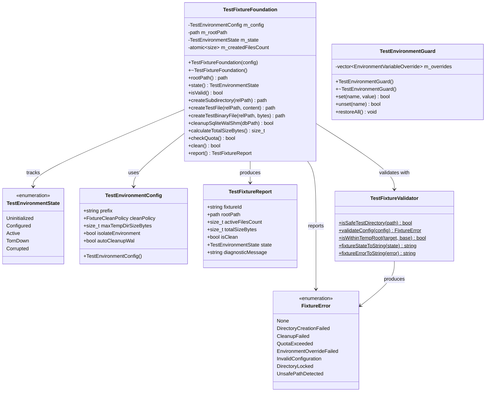

# Design — module-foundations-task0037

Status: PROPOSED

## Current, target and gaps

### Estado actual (CURRENT)

1. **Patrones dispersos y duplicados de fixtures en suites de prueba (`tests/`)**:
   - `StorageTests.cpp` declara `struct TempDbGuard` para limpiar archivos SQLite (`.sqlite`, `-wal`, `-shm`) mediante llamadas directas a `std::filesystem::remove`.
   - `CrashRecoveryTests.cpp` define `struct TempDirectoryFixture` creando rutas ad-hoc en `/tmp` con marcas temporales y borrado con `remove_all`.
   - `CMakePresetsServiceTests.cpp` utiliza rutas fijas como `/tmp/vigilio-clean-test` con creación manual de subdirectorios sin guardián generalizado.
2. **Carencia de validación formal de seguridad de rutas en el arnés de pruebas**:
   - Ninguna de las estructuras auxiliares existentes valida si la ruta temporal a eliminar está estrictamente confinada al directorio temporal del sistema operativo, exponiendo teóricamente a riesgos de borrado accidental si una ruta relativa o corrupta se pasa al destructor.
   - No se comprueba Directory Traversal (`..`) en los prefijos o nombres de carpetas de prueba.
3. **Ausencia de control de cuotas y política Zero-Zombie en disco**:
   - No existe limitación sobre la cantidad de megabytes que un test puede escribir en el sistema de archivos temporal, lo que ante pruebas fallidas o bucles infinitos puede saturar el disco `/tmp`.
4. **Falta de guardián RAII para variables de entorno**:
   - Pruebas que manipulan `DISPLAY`, `TMPDIR` o rutas de datos deben gestionar manualmente `setenv` / `unsetenv`, arriesgando la contaminación del entorno del proceso para pruebas subsiguientes en caso de fallo prematuro.

---

### Estado objetivo (TARGET)

1. **Modelo de dominio unificado y tipos inmutables (`vigilio_core`)**:
   - `TestFixtureTypes.h`: Define formalmente las enumeraciones fuertemente tipadas (`FixtureScope`, `FixtureCleanPolicy`, `TestEnvironmentState`, `TempDirectoryMode`, `FixtureLifecycleEvent`, `FixtureError`) y las estructuras inmutables `TestEnvironmentConfig`, `TestFixtureReport` y `EnvironmentVariableOverride`.
   - Cero dependencias hacia `QApplication`, widgets de Qt o Chromium WebEngine.
2. **Validador estático de higiene y contención (`TestFixtureValidator`)**:
   - `isSafeTestDirectory`: Verificación canónica de que el directorio del fixture reside bajo `temp_directory_path()`, contiene el prefijo `vigilio_test_`, no es la raíz del sistema ni del directorio temporal, y no contiene secuencias `..`.
   - `validateConfig`: Validación de prefijos y cuotas de disco permitidas (1 KB $\le \text{cuota} \le 500$ MB).
   - `fixtureStateToString` y `fixtureErrorToString`: Conversión determinista a cadenas legibles en español neutro cumpliendo `docs/UX-COPY-PUBLICO.md`.
3. **Administrador RAII de ciclo de vida (`TestFixtureFoundation`)**:
   - Generación determinista y libre de colisiones de directorios temporales mediante PID + nanosegundos + contador atómico.
   - Creación segura de subcarpetas y archivos de prueba (texto y binarios).
   - Control continuo de cuota acumulada (`maxTempDirSizeBytes = 52428800`, 50 MB por defecto).
   - Saneamiento recursivo seguro y purga especializada de archivos de base de datos SQLite y sus diarios transaccionales (`-wal`, `-shm`).
4. **Guardián RAII de variables de entorno (`TestEnvironmentGuard`)**:
   - Sobrescritura determinista de variables de entorno con captura del estado original y restauración atómica en el destructor, resistente a excepciones y retornos tempranos.
5. **Aislamiento y rendimiento**:
   - Suite de especificación de dominio con 10 pruebas unitarias en `TestFixtureFoundationTests.cpp`.
   - Tiempo de ejecución de la suite en CTest inferior a 100 ms, sin interacción de red ni procesos en segundo plano.

---

### Gaps identificados (GAPS)

| Componente | Estado actual | Estado objetivo | Brecha a subsanar (GAP) |
| --- | --- | --- | --- |
| Tipos de dominio de fixture | No existen en el proyecto | `TestFixtureTypes.h` con enumeraciones y estructuras inmutables | Crear nuevo archivo de encabezado con taxonomía completa. |
| Validador de seguridad de rutas | Inexistente; eliminación directa sin comprobación | `TestFixtureValidator` con `isSafeTestDirectory` y contención estricta | Crear validador estático que impida borrados fuera de `/tmp/vigilio_test_*`. |
| Administrador RAII de fixture | Estructuras ad-hoc en tests específicos | `TestFixtureFoundation` generalizado y reusable en `vigilio_core` | Implementar clase con ciclo de vida, cuotas y utilidades de archivos. |
| Guardián de entorno | No existe; llamadas manuales a `setenv` | `TestEnvironmentGuard` con restauración garantizada en destructor | Implementar clase RAII para preservación y reversión de variables. |
| Batería de pruebas unitarias | 0 pruebas para infraestructura de fixtures | 10 pruebas unitarias deterministas en `vigilio_fixture_tests` | Crear suite completa en `tests/unit/TestFixtureFoundationTests.cpp`. |
| Integración en CMakeLists | No configurado | Target `vigilio_fixture_tests` en CTest con labels `unit;fast` | Actualizar `CMakeLists.txt` para incluir fuentes y registrar test. |

---

## Compatibility, migration and rollback

### Compatibilidad y estándares C++20
- Implementación conforme a la norma ISO C++20 utilizando exclusivamente las bibliotecas estándar: `<filesystem>`, `<chrono>`, `<thread>`, `<atomic>`, `<string>`, `<vector>`, `<map>`, `<optional>`, `<cstdlib>`.
- Portabilidad garantizada entre Linux (GCC 12+, Clang 15+), Windows (MSVC 2022) y macOS (Apple Clang 14+).
- Cumplimiento estricto de las banderas de compilación del proyecto: `-Wall -Wextra -Wpedantic -Wconversion -Wsign-conversion -Wshadow -Werror`.
- Ausencia total de dependencias gráficas; compilación limpia tanto en perfiles headless (`VIGILIO_BUILD_GUI=OFF`) como de escritorio.

### Estrategia de migración
- La creación de `TestFixtureFoundation` y `TestEnvironmentGuard` en `vigilio_core` es puramente aditiva: no altera ninguna clase de negocio existente ni rompe las suites de prueba actuales.
- Las suites existentes (`CrashRecoveryTests.cpp`, `StorageTests.cpp`, etc.) continuarán operando sin cambios inmediatos. Su migración progresiva hacia la nueva fundación se planificará como tareas de consolidación posteriores.

### Plan de contingencia y rollback
- En caso de anomalías o regresiones durante la fase APPLY, la reversión es atómica y determinista:
  - Eliminar los nuevos archivos creados en `src/core/` y `tests/unit/`.
  - Revertir los cambios en `CMakeLists.txt`.
  - El sistema de build y los 13 tests existentes permanecen completamente desacoplados e inalterados.

---

## Arquitectura técnica de test fixture foundation

### Diagrama de clases y relaciones



### Contrato de seguridad de rutas (`isSafeTestDirectory`)

Para prevenir cualquier borrado accidental catastrófico en la máquina local o servidor de CI, `TestFixtureValidator::isSafeTestDirectory` evalúa una conjunción estricta de invariantes booleanas:

$$\text{isSafe}(P) \iff \begin{cases}
\text{canonical}(P) \subseteq \text{canonical}(\text{temp\_directory\_path()}) \\
\text{canonical}(P) \neq \text{canonical}(\text{temp\_directory\_path()}) \\
P.\text{filename}().\text{string}().\text{starts\_with}(\text{"vigilio_test_"}) \\
\neg (P \text{ contiene } \text{".."}) \\
\neg (P \text{ contiene caracteres nulos o no imprimibles})
\end{cases}$$

Si alguna de estas condiciones falla, cualquier operación de limpieza se rechaza inmediatamente con `FixtureError::UnsafePathDetected`.

### Guardián de entorno y reversión atómica (`TestEnvironmentGuard`)

```cpp
class TestEnvironmentGuard {
public:
    TestEnvironmentGuard() = default;
    ~TestEnvironmentGuard() { restoreAll(); }

    bool set(const std::string& name, const std::string& value);
    bool unset(const std::string& name);
    void restoreAll();

    TestEnvironmentGuard(const TestEnvironmentGuard&) = delete;
    TestEnvironmentGuard& operator=(const TestEnvironmentGuard&) = delete;

private:
    std::vector<EnvironmentVariableOverride> m_overrides;
};
```

Al invocar `set(name, value)`:
1. Comprueba si la variable ya fue interceptada en esta instancia; si es así, actualiza su valor manteniendo el valor original previo.
2. Si es la primera vez que se modifica, consulta `std::getenv(name)`.
3. Almacena en `EnvironmentVariableOverride`:
   - `name`: nombre de la variable.
   - `hasOriginalValue`: `true` si existía, `false` si no estaba definida.
   - `originalValue`: contenido original si existía.
4. Establece el nuevo valor en el entorno del proceso.
5. Al invocar el destructor (o `restoreAll()`), recorre los overrides en orden inverso (LIFO) y restaura el valor anterior o elimina la variable si no existía, dejando el entorno en estado prístino.
