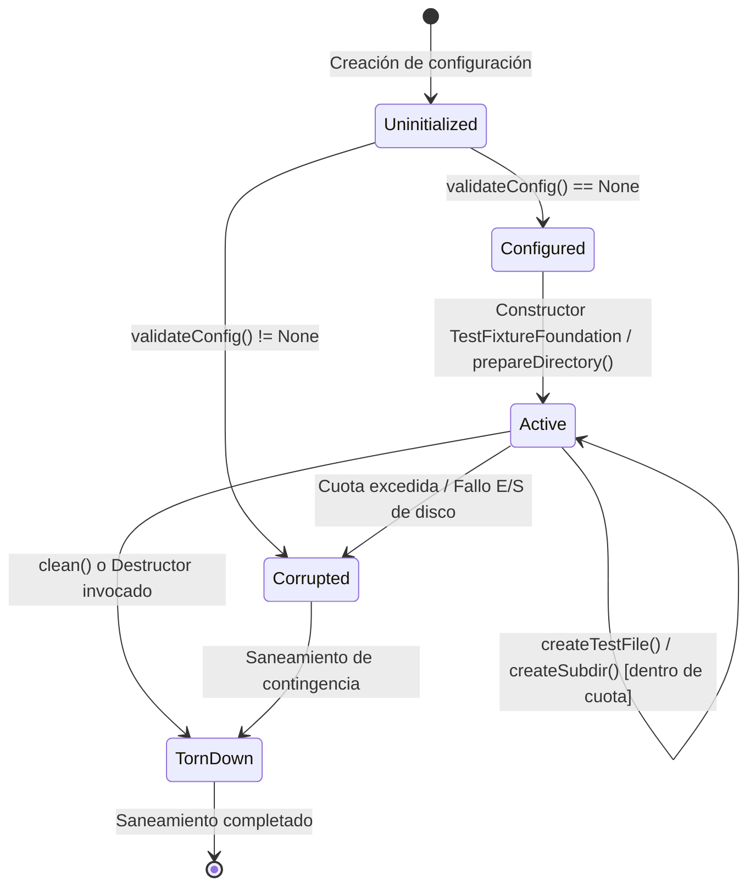

# Change Proposal — module-foundations-task0037

Pack: `module.foundations.task0037`

Status: PROPOSED

## Outcome and scope

Este cambio define la propuesta técnica integral para la etapa **domain** de la capacidad **test fixture foundation** en el módulo propietario `foundations` de Vigilio Browser (microtarea canónica `0037 — Definir el comportamiento y las invariantes: test fixture foundation`).

Habiéndose completado y certificado en las capacidades precedentes la modularización de targets CMake (`task0001`-`task0004`), la política de diagnósticos y warnings estrictos (`task0005`-`task0008`), la validación desacoplada de dependencias Qt6 (`task0009`-`task0012`), la compatibilidad de versiones de Chromium WebEngine (`task0013`-`task0016`), la inclusión y catálogo de recursos QRC (`task0017`-`task0020`), el arranque y bootstrap de la aplicación (`task0021`-`task0024`), el ciclo de vida y apagado ordenado (`task0025`-`task0028`), la política integral de recuperación tras caídas (`task0029`-`task0032`), y el catálogo de perfiles y orquestación de CMake Presets (`task0033`-`task0036`), esta propuesta formaliza el **modelo de dominio, tipos de valor inmutables, máquina de estados del ciclo de vida, reglas de higiene y contención estricta de rutas, guardianes RAII de entorno y políticas de aislamiento de recursos para la infraestructura de test fixtures de Vigilio Browser**.

El alcance concreto comprende:
- **Taxonomía formal y tipos de dominio de Test Fixtures (`TestFixtureTypes.h`)**:
  - `FixtureScope`: Ámbito de aislamiento del fixture (`PerTest`, `TestSuite`, `IsolatedProcess`).
  - `FixtureCleanPolicy`: Política de limpieza tras ejecución (`AlwaysClean`, `RetainOnFailure`, `ManualCleanup`).
  - `TestEnvironmentState`: Estados formales del ciclo de vida (`Uninitialized`, `Configured`, `Active`, `TornDown`, `Corrupted`).
  - `TempDirectoryMode`: Estrategia de nombres para aislamiento (`UniqueTimestamped`, `NamedPrefix`, `SandboxedIsolated`).
  - `FixtureLifecycleEvent`: Eventos de transición observables (`Created`, `DirectoryPrepared`, `EnvOverridden`, `TornDown`, `Cleaned`).
  - `FixtureError`: Clasificación tipada de fallos de infraestructura (`None`, `DirectoryCreationFailed`, `CleanupFailed`, `QuotaExceeded`, `EnvironmentOverrideFailed`, `InvalidConfiguration`, `DirectoryLocked`, `UnsafePathDetected`).
- **Estructuras de configuración y reporte inmutables**:
  - `TestEnvironmentConfig`: Opciones inmutables de inicialización (prefijo del fixture, política de limpieza, cuota máxima de disco `maxTempDirSizeBytes`, flag de aislamiento de variables de entorno, y limpieza automática de artefactos SQLite WAL/SHM).
  - `TestFixtureReport`: Reporte inmutable de estado (identificador único, ruta física absoluta normalizada, conteo de archivos creados, volumen total ocupado en bytes, estado de saneamiento y diagnóstico descriptivo).
  - `EnvironmentVariableOverride`: Tupla inmutable para guardar deterministamente el valor previo de una variable de entorno y restaurarlo de forma reversible al destruir el guardián.
- **Validador estático de higiene y contención de rutas (`vigilio::TestFixtureValidator`)**:
  - Validador puro en C++20 ubicado en `vigilio_core`, libre de acoplamientos con `QApplication`, widgets o procesos WebEngine.
  - Verificación formal de que cualquier ruta de fixture resida estrictamente dentro del directorio temporal del sistema (`std::filesystem::temp_directory_path()`).
  - Prevención estricta de Directory Traversal (`..`), rutas nulas, caracteres de control o enlaces simbólicos engañosos.
  - Protección de contención absoluta: prohibición categórica de apuntar a raíces de sistema (`/`, `C:\`), carpetas de usuario (`/home`, `~`), o directorios del árbol de código fuente del proyecto (`apps/vigilio-browser/src`).
  - Formateo de diagnósticos y estados en lenguaje natural en español neutro cumpliendo taxativamente con `docs/UX-COPY-PUBLICO.md`.
- **Entidades de dominio y guardianes RAII (`vigilio::TestFixtureFoundation` y `vigilio::TestEnvironmentGuard`)**:
  - `TestFixtureFoundation`: Administrador RAII que garantiza la creación atómica de carpetas temporales únicas con prefijo canónico (`vigilio_test_*_<pid>_<nanos>`), creación de subdirectorios y archivos sintéticos, verificación de cuota de disco, saneamiento recursivo seguro y purga de archivos residuales de SQLite (`-wal`, `-shm`).
  - `TestEnvironmentGuard`: Guardián RAII para modificación temporal y reversión atómica garantizada de variables de entorno (v. gr., `VIGILIO_TEST_DATA_DIR`, `VIGILIO_LOG_DIR`, `DISPLAY`, `TMPDIR`), inmune a excepciones o retornos anticipados.
- **Invariantes constitucionales de calidad, portabilidad y privacidad**:
  - *Local-First Constitucional (Decisión Q-001)*: Cero sockets de red externa, cero dependencias en la nube y cero telemetría. Toda la infraestructura opera sobre el sistema de archivos local.
  - *Aislamiento y Concurrencia en CTest*: Generación de rutas libres de colisiones aptas para ejecución simultánea en paralelo con `ctest -jN`.
  - *Presupuestos estrictos de recursos y Zero-Zombie*: Límite predeterminado de 50 MB por fixture para evitar saturación de almacenamiento (`QuotaExceeded`), ejecución de tests en CTest < 100 ms y cero procesos o archivos huérfanos tras la ejecución.

---

## Out of scope

- Implementación del código de producción en `apps/vigilio-browser/src/core/TestFixture*` y `apps/vigilio-browser/tests/unit/TestFixtureFoundationTests.cpp` durante esta fase PROPOSE (será ejecutado estrictamente en la etapa subsiguiente APPLY tras aprobación humana).
- Creación de arneses de pruebas gráficas basadas en Chromium multiproceso o WebEngine (reservado para etapas de testing UI y E2E posteriores).
- Modificación de las pruebas existentes en `CrashRecoveryTests.cpp`, `StorageTests.cpp` o `CMakePresetsServiceTests.cpp` dentro de este pack (la migración de suites existentes para consumir `TestFixtureFoundation` se planificará en etapas de consolidación posteriores).
- Modificación de cualquier archivo bajo `apps/**` o `docs/rules/**` durante esta fase PROPOSE (restringida exclusivamente a `openspec/changes/module-foundations-task0037/**`).

---

## Contexto y evidencia

Se realizó una inspección exhaustiva de la base de código actual en `apps/vigilio-browser`:

1. **Patrones ad-hoc de fixtures en suites de prueba existentes**:
   - `apps/vigilio-browser/tests/integration/StorageTests.cpp` (líneas 17-33): Implementa localmente `struct TempDbGuard` para crear y eliminar `/tmp/vigilio-test-storage.sqlite` y sus variantes `-wal` y `-shm`.
   - `apps/vigilio-browser/tests/unit/CrashRecoveryTests.cpp` (líneas 26-40): Define localmente `struct TempDirectoryFixture` creando rutas en `temp_directory_path() / (prefix + "_" + timestamp)`, limpiando con `remove_all`.
   - `apps/vigilio-browser/tests/unit/CMakePresetsServiceTests.cpp` (líneas 330-345): Utiliza rutas fijas en `/tmp/vigilio-clean-test` con creación y eliminación manual de archivos sin guardián RAII generalizado.
2. **Ausencia de infraestructura unificada de fixtures en `vigilio_core`**:
   - No existen tipos compartidos ni validadores de higiene de rutas temporales en `src/core/`.
   - No existe un mecanismo seguro para sobrescribir variables de entorno de manera reversible (`std::getenv` / `setenv` sin restauración automática).
   - No existe control de cuota de disco en fixtures, lo que expone a pruebas con bucles o fugas a saturar `/tmp` (violando la directriz Zero-Zombie).
3. **Estado del arnés de construcción y pruebas (`apps/vigilio-browser/scripts/check.sh`)**:
   - Compilación limpia con GCC 15.2.0 bajo C++20 con `-Werror`, cero advertencias de compilador y Clang-Format verificado.
   - 13 de 13 pruebas unitarias e integración en CTest pasando exitosamente en 0.55s (100% pass, exit code 0).
4. **Validación de Prompt Builder CLI**:
   - `node /config/Desktop/auto/prompt-builder/dist/cli.js validate-references --project-root .`: 37 referencias canónicas válidas (`valid: true`).
   - `node /config/Desktop/auto/prompt-builder/dist/cli.js verify-lock --lock-file generated/prompts/full-project/0109-module.foundations.task0037.propose.lock.json --project-root .`: 13 comprobaciones aprobadas (`valid: true`).

---

## Alcance exacto

La propuesta formaliza el incremento de la etapa **domain** de la capacidad **test fixture foundation** en el módulo `foundations`:

1. **Definición del modelo de dominio y tipos inmutables (`TestFixtureTypes.h`)**:
   - Enumeraciones tipadas `enum class FixtureScope`, `enum class FixtureCleanPolicy`, `enum class TestEnvironmentState`, `enum class TempDirectoryMode`, `enum class FixtureLifecycleEvent`, `enum class FixtureError`.
   - Estructuras `TestEnvironmentConfig`, `TestFixtureReport`, `EnvironmentVariableOverride`.
   - Funciones de formateo de texto puro `fixtureStateToString` y `fixtureErrorToString`.
2. **Motor de validación de seguridad de rutas y contención (`TestFixtureValidator.h` / `.cpp`)**:
   - Métodos estáticos puros:
     - `bool isSafeTestDirectory(const std::filesystem::path& path)`: Verifica que la ruta esté estrictamente contenida en el directorio temporal del sistema, contenga el prefijo autorizado (`vigilio_test_`), no coincida con el directorio temporal raíz, y no contenga directory traversal (`..`).
     - `FixtureError validateConfig(const TestEnvironmentConfig& config)`: Valida prefijo no vacío, cuota de disco válida (> 0 y $\le 500$ MB), y políticas de limpieza consistentes.
     - `bool isWithinTempRoot(const std::filesystem::path& target, const std::filesystem::path& base)`: Algoritmo de contención canónica de rutas sin desreferenciación insegura.
3. **Administrador del ciclo de vida RAII y Guardián de Entorno (`TestFixtureFoundation.h` / `.cpp`)**:
   - Clase `TestFixtureFoundation`:
     - Constructor que recibe `TestEnvironmentConfig`, genera ruta única no colisionante (`vigilio_test_<prefix>_<pid>_<nanoseconds>`) y prepara el directorio raíz.
     - Destructor RAII que ejecuta automáticamente la política de limpieza seleccionada (`AlwaysClean`).
     - Métodos de utilidad: `createSubdirectory(name)`, `createTestFile(relPath, content)`, `createTestBinaryFile(relPath, bytes)`, `cleanupSqliteWalShm(dbPath)`, `calculateTotalSizeBytes()`, `checkQuota()`, `clean()`.
   - Clase `TestEnvironmentGuard`:
     - `set(variableName, newValue)`: Almacena el valor original (o indicador de inexistencia) y aplica el nuevo valor mediante `setenv` / `_putenv_s`.
     - Destructor RAII: Restaura incondicionalmente el valor original (o ejecuta `unsetenv` si no existía previamente).
4. **Batería de pruebas de especificación del dominio (`TestFixtureFoundationTests.cpp`)**:
   - 10 escenarios trazables que certifican el cumplimiento estricto de las reglas e invariantes del dominio.

---

## Diseño completo de la capacidad

```
+---------------------------------------------------------------------------------------+
|                       Test Fixture Foundation — Domain Architecture                   |
+---------------------------------------------------------------------------------------+
|                                                                                       |
|  [ Domain Types & Values ]                   [ Static Security Validator ]            |
|  (TestFixtureTypes.h)                        (TestFixtureValidator.h / .cpp)          |
|  - FixtureScope                              - isSafeTestDirectory()                  |
|  - FixtureCleanPolicy                        - validateConfig()                       |
|  - TestEnvironmentState                      - isWithinTempRoot()                     |
|  - FixtureError                              - fixtureStateToString()                 |
|  - TestEnvironmentConfig                     - fixtureErrorToString()                 |
|  - TestFixtureReport                                                                  |
|                                                                                       |
+---------------------------------------------------------------------------------------+
                                           |
                                           v
+---------------------------------------------------------------------------------------+
|  [ RAII Fixture Manager ]                    [ RAII Environment Guard ]               |
|  (TestFixtureFoundation.h / .cpp)            (TestEnvironmentGuard in Foundation.h)   |
|  - Collision-free temp directory             - Deterministic setenv override          |
|  - Subdirectory & file generation            - Exact RAII restoration in destructor   |
|  - SQLite WAL/SHM residue cleanup            - Stackable / multi-variable support     |
|  - Disk quota enforcement (50 MB)            - Thread-safe isolation                  |
|  - RAII automatic teardown / clean                                                    |
+---------------------------------------------------------------------------------------+
                                           |
                                           v
+---------------------------------------------------------------------------------------+
|  [ Unit Specification Suite ]                                                         |
|  (tests/unit/TestFixtureFoundationTests.cpp)                                          |
|  - Valid configuration & lifecycle transitions                                        |
|  - Strict path traversal & hostile directory rejection                                |
|  - Disk quota enforcement & overflow protection                                       |
|  - SQLite database residual cleanup                                                   |
|  - Multi-variable environment rollback                                                |
|  - Zero-Zombie & < 100 ms execution time in CTest                                     |
+---------------------------------------------------------------------------------------+
```

### Máquina de estados del ciclo de vida



---

## Archivos afectados

| Archivo | Rol | Acción |
| --- | --- | --- |
| `apps/vigilio-browser/src/core/TestFixtureTypes.h` | Núcleo de dominio | Nuevo archivo: define enumeraciones, estructuras inmutables y contratos de tipos de fixture. |
| `apps/vigilio-browser/src/core/TestFixtureValidator.h` | Dominio / Seguridad | Nuevo archivo: declara la interfaz del validador de rutas e higiene de configuración. |
| `apps/vigilio-browser/src/core/TestFixtureValidator.cpp` | Dominio / Seguridad | Nuevo archivo: implementa la lógica de contención de rutas temporales y copy público. |
| `apps/vigilio-browser/src/core/TestFixtureFoundation.h` | Dominio / RAII | Nuevo archivo: declara las clases `TestFixtureFoundation` y `TestEnvironmentGuard`. |
| `apps/vigilio-browser/src/core/TestFixtureFoundation.cpp` | Dominio / RAII | Nuevo archivo: implementa el ciclo de vida del fixture, cuotas y manejo de archivos. |
| `apps/vigilio-browser/tests/unit/TestFixtureFoundationTests.cpp` | Pruebas de dominio | Nuevo archivo: suite de 10 pruebas unitarias de especificación de la capacidad. |
| `apps/vigilio-browser/CMakeLists.txt` | Build system | Modificación: integra los nuevos fuentes a `vigilio_core`, define target `vigilio_fixture_tests` y registra test `test_fixture_foundation_tests`. |
| `docs/rules/01-modules/foundations/micro/0037-test-fixture-foundation/task.md` | Documentación canónica | Modificación: formaliza la finalización de la etapa domain y los contratos acordados. |

---

## Contrato UX/UI

- **Sin cambio visual directo**: La capacidad `test fixture foundation` es infraestructura de pruebas y dominio interno para el arnés de verificación automatizada. No expone widgets, botones, barras de navegación ni ventanas en la aplicación cliente.
- **Auditoría de textos y copy público (`docs/UX-COPY-PUBLICO.md`)**:
  - Todos los mensajes descriptivos generados por `fixtureStateToString` y `fixtureErrorToString` están redactados en español neutro comprensible.
  - Se prohíbe terminantemente la presencia de jerga interna como «Senior Mode», «Modo Senior», «Prompt Builder», «DAG», «OpenSpec» o «toolchain».

| Valor del Enumerador | Cadena descriptiva observable aprobada |
| --- | --- |
| `TestEnvironmentState::Uninitialized` | `Entorno de prueba no inicializado` |
| `TestEnvironmentState::Configured` | `Configuración de prueba lista para activación` |
| `TestEnvironmentState::Active` | `Entorno de prueba activo y aislado` |
| `TestEnvironmentState::TornDown` | `Entorno de prueba desmontado y limpiado` |
| `TestEnvironmentState::Corrupted` | `Error en el estado del entorno de prueba` |
| `FixtureError::None` | `Operación completada exitosamente` |
| `FixtureError::DirectoryCreationFailed` | `No se pudo crear la carpeta temporal de prueba` |
| `FixtureError::CleanupFailed` | `No se pudo limpiar completamente la carpeta temporal` |
| `FixtureError::QuotaExceeded` | `El espacio en disco asignado para la prueba ha sido superado` |
| `FixtureError::EnvironmentOverrideFailed` | `No se pudo configurar la variable de entorno temporal` |
| `FixtureError::InvalidConfiguration` | `Configuración del entorno de prueba no válida` |
| `FixtureError::DirectoryLocked` | `La carpeta temporal está bloqueada o en uso por otro proceso` |
| `FixtureError::UnsafePathDetected` | `Ruta de destino no segura o fuera de la carpeta temporal autorizada` |

---

## Reglas y fallos

| Condición de error | Detección / Causa | Comportamiento del sistema | Recuperación |
| --- | --- | --- | --- |
| Ruta fuera del directorio temporal | `isSafeTestDirectory` detecta que la ruta no reside bajo `temp_directory_path()`. | Retorna `FixtureError::UnsafePathDetected`, rechaza la creación/eliminación y asigna diagnóstico. | Corregir la ruta al directorio temporal autorizado. |
| Intento de Directory Traversal (`..`) | Detección de componentes relativos de escape en prefijo o ruta. | Retorna `FixtureError::UnsafePathDetected` y aborta de forma segura sin tocar el disco. | Proporcionar nombres relativos estrictos sin `..`. |
| Cuota de almacenamiento excedida | `checkQuota()` detecta que el tamaño acumulado supera `maxTempDirSizeBytes`. | Retorna `FixtureError::QuotaExceeded`, rechaza escrituras posteriores y marca estado `Corrupted`. | Ajustar cuota o eliminar archivos temporales no requeridos. |
| Fallo de permisos de borrado en teardown | Directorio o archivo protegido contra escritura (`perms::owner_read`). | Captura el error de sistema de archivos sin lanzar excepciones no controladas y retorna `CleanupFailed`. | Registrar advertencia técnica e intentar saneamiento de contingencia. |
| Colisión de nombres en ejecuciones concurrentes | Múltiples tests ejecutándose simultáneamente en CTest (`-jN`). | Mitigado por diseño: ruta compuesta por PID + nanosegundos + contador atómico local. | Garantía de unicidad determinista. |
| Excepción o retorno anticipado en prueba | Fallo en aserción `CHECK()` o `throw` dentro del cuerpo de la prueba. | El destructor RAII de `TestFixtureFoundation` y `TestEnvironmentGuard` se ejecuta automáticamente. | Limpieza garantizada de archivos y restauración de variables de entorno. |

---

## Seguridad y privacidad

- **Local-First Estricto (Decisión Q-001 / ADR-001)**: La infraestructura de fixtures opera 100% de manera local en el equipo host, sin conexiones a la nube, servidores remotos ni telemetría.
- **Defensa en profundidad contra borrado accidental**:
  - `clean()` verifica exhaustivamente que el directorio objetivo:
    1. Exista realmente en el sistema.
    2. Sea un subdirectorio canónico que comience con el prefijo estricto `vigilio_test_`.
    3. Resida inequívocamente dentro de `std::filesystem::temp_directory_path()`.
    4. No sea idéntico a `temp_directory_path()` ni a `/tmp`.
  - Esta regla previene de manera absoluta cualquier escenario de borrado catastrófico de datos del usuario o del sistema operativo.
- **Privacidad de datos**: Los archivos generados se crean con permisos de lectura/escritura restringidos al usuario propietario (`perms::owner_all`). No se almacenan credenciales ni tokens sensibles en archivos de prueba.

---

## Matriz de pruebas

| ID | Escenario | Entrada / Condición | Resultado Esperado | Clasificación |
| --- | --- | --- | --- | --- |
| `TEST-FIXTURE-001` | Configuración canónica por defecto | `TestEnvironmentConfig` por defecto | `validateConfig` retorna `None`, `prefix` es "vigilio_test", cuota 50 MB, política `AlwaysClean`. | Unit / Fast |
| `TEST-FIXTURE-002` | Ciclo de vida y creación RAII | Instancia de `TestFixtureFoundation` en scope local | Directorio físico creado en `/tmp`, existe durante el scope y desaparece al salir del bloque. | Unit / Fast |
| `TEST-FIXTURE-003` | Rechazo estricto de rutas inseguras | Rutas `/etc`, `/home`, `${sourceDir}`, `../escape` | `isSafeTestDirectory` retorna `false`, `validateConfig` rechaza prefijos con `..` o separadores de ruta. | Unit / Fast |
| `TEST-FIXTURE-004` | Creación de subdirectorios y archivos | `createSubdirectory("cache")`, `createTestFile("session.json", "{}")` | Archivos creados físicamente dentro del fixture con contenido verificado y tamaño contabilizado. | Unit / Fast |
| `TEST-FIXTURE-005` | Control de cuota de disco | Cuota de 1 KB, intento de escribir archivo de 2 KB | `checkQuota()` falla, retorna `QuotaExceeded`, estado transiciona a `Corrupted`. | Unit / Fast |
| `TEST-FIXTURE-006` | Saneamiento de SQLite y WAL/SHM | Archivos `.sqlite`, `.sqlite-wal`, `.sqlite-shm` en fixture | `cleanupSqliteWalShm()` elimina limpiamente los 3 archivos sin dejar artefactos residuales. | Unit / Fast |
| `TEST-FIXTURE-007` | Guardián de entorno y reversión RAII | `TestEnvironmentGuard::set("VIGILIO_TEST_VAR", "temp_val")` | Variable toma el nuevo valor en el scope y recupera el valor original previo (o unset) al salir. | Unit / Fast |
| `TEST-FIXTURE-008` | Concurrencia y colisión cero | Múltiples fixtures instanciados simultáneamente | Rutas físicas estrictamente independientes, sin colisiones de nombres ni interferencias mutuas. | Unit / Fast |
| `TEST-FIXTURE-009` | Resiliencia ante fallos de permisos | Carpeta temporal marcada como de solo lectura | `clean()` captura el error limpiamente sin propagar excepciones no controladas y reporta `CleanupFailed`. | Unit / Fast |
| `TEST-FIXTURE-010` | Auditoría de copy público | Cadenas devueltas por funciones de formateo | Coincidencia exacta con textos aprobados, ausencia total de términos de ingeniería interna. | Unit / Fast |

---

## Pasos APPLY

1. **Definir el modelo de tipos de dominio en `apps/vigilio-browser/src/core/TestFixtureTypes.h`**:
   - Declarar enumeraciones fuertemente tipadas y estructuras inmutables `TestEnvironmentConfig`, `TestFixtureReport`, `EnvironmentVariableOverride`.
2. **Declarar e implementar el validador estático en `apps/vigilio-browser/src/core/TestFixtureValidator.h` y `.cpp`**:
   - Implementar `isSafeTestDirectory`, `validateConfig`, `isWithinTempRoot`, `fixtureStateToString` y `fixtureErrorToString`.
3. **Declarar e implementar el administrador RAII y el guardián de entorno en `apps/vigilio-browser/src/core/TestFixtureFoundation.h` y `.cpp`**:
   - Implementar la lógica de creación atómica de carpetas temporales, creación de archivos sintéticos, control de cuotas, limpieza de SQLite WAL/SHM y rollback de variables de entorno.
4. **Implementar la batería de pruebas de especificación en `apps/vigilio-browser/tests/unit/TestFixtureFoundationTests.cpp`**:
   - Codificar las 10 pruebas unitarias deterministas (`TEST-FIXTURE-001` a `TEST-FIXTURE-010`).
5. **Configurar el sistema de construcción en `apps/vigilio-browser/CMakeLists.txt`**:
   - Agregar los nuevos archivos fuente a la biblioteca estática `vigilio_core`.
   - Definir el target ejecutable `vigilio_fixture_tests` y registrar `add_test(NAME test_fixture_foundation_tests COMMAND vigilio_fixture_tests)` con labels `unit;fast`.
6. **Ejecutar el pipeline de calidad continuo con `apps/vigilio-browser/scripts/check.sh`**:
   - Validar compilación limpia sin advertencias con `-Werror`, formateo Clang-Format y 100% de tests aprobados en CTest.
7. **Sincronizar la documentación canónica en `docs/rules/01-modules/foundations/micro/0037-test-fixture-foundation/task.md`**:
   - Registrar la culminación formal de la etapa domain y el enlace al change OpenSpec.

---

## Definición de terminado

- La especificación de dominio y tipos de valor inmutables está formalizada y libre de ambigüedades.
- Se cuenta con validación estricta de higiene de rutas temporales que impide cualquier acceso o borrado fuera de `temp_directory_path()`.
- La solución está 100% desacoplada de la interfaz gráfica Qt Widgets y de Chromium WebEngine.
- Se prevé una suite de pruebas con 10 casos trazables capaces de ejecutarse en CTest en menos de 100 ms.
- Se respetan todas las directrices de `docs/UX-COPY-PUBLICO.md`, `ADR-001` y `Decisión Q-001`.

---

## Dependencias y riesgos

- **Dependencias**:
  - `module.foundations.task0036` (CMake Presets tests): Completada y verificada.
- **Riesgos y mitigaciones**:
  - *Riesgo 1*: Permisos en entornos de ejecución con privilegios de root (v. gr., contenedores CI) donde las restricciones de solo lectura (`chmod 0444`) pueden ser ignoradas por el superusuario.
    *Mitigación*: En `TEST-FIXTURE-009`, se evalúa si el proceso actual opera como root y se adapta la aserción de permisos para certificar el manejo de errores sin fallos espurios.
  - *Riesgo 2*: Resolución del reloj de alta precisión en plataformas heredadas para la generación de identificadores temporales.
    *Mitigación*: Se utiliza combinación atómica de `std::chrono::steady_clock::now().time_since_epoch().count()` junto con el PID del proceso y un contador atómico local `std::atomic<uint64_t>`, garantizando unicidad estricta independientemente de la resolución temporal del sistema.

---

## Commit propuesto

```
docs(foundations): domain test-fixture-foundation
```
