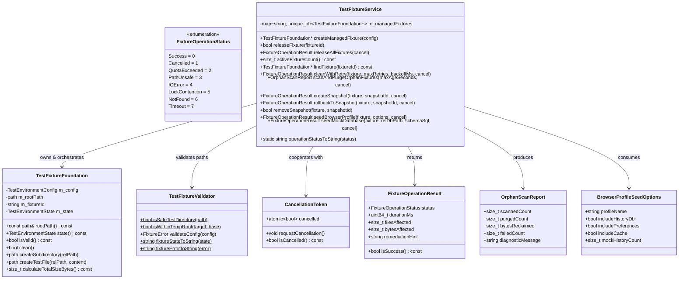

# Design — module-foundations-task0038

Status: PROPOSED

## Current, target and gaps

### Estado actual (CURRENT)

1. **Infraestructura básica de fixtures de dominio disponible (`module.foundations.task0037`)**:
   - `TestFixtureFoundation` proporciona creación RAII básica y eliminación de directorios temporales aislados en `temp_directory_path()`.
   - `TestFixtureValidator` proporciona comprobaciones estáticas de seguridad (`isSafeTestDirectory`, `isWithinTempRoot`, `validateConfig`) y conversión de copy observable a español neutro.
   - `TestEnvironmentGuard` proporciona sobrescritura y reversión determinista de variables de entorno del proceso.
   - 10 pruebas unitarias en `TestFixtureFoundationTests.cpp` verifican la especificación de dominio inicial.
2. **Carencia de capa operativa de servicio y orquestación unificada**:
   - Cada suite de pruebas o componente debe gestionar manualmente las instancias de `TestFixtureFoundation`.
   - No existe un registro centralizado ni un servicio que administre el ciclo de vida de múltiples fixtures concurrentes, ni operaciones en lote (`releaseAllFixtures`).
3. **Ausencia de soporte para cancelación cooperativa multihilo**:
   - Las operaciones de I/O de disco (limpieza recursiva, cálculo de cuotas, copiado de archivos) se ejecutan de manera síncrona sin puntos de interrupción cooperativa, arriesgando colgar hilos si una prueba es cancelada por timeout del arnés de pruebas (vulnerando el principio Zero-Zombie).
4. **Ausencia de mecanismo para recolección de basura de fixtures huérfanos**:
   - Si un proceso de prueba termina anormalmente (`SIGKILL`, corte abrupto o fallo irrecuperable), el arnés RAII no llega a ejecutarse, dejando directorios `vigilio_test_*` abandonados en `/tmp`. Actualmente no existe un procedimiento seguro y acotado para detectar y purgar estos residuos.
5. **Falta de resiliencia ante contención de bloqueos temporales en sistemas de archivos**:
   - En plataformas como Windows o bajo herramientas de monitorización locales (antivirus, indexadores), los handles de archivo pueden demorar unos milisegundos en liberarse tras cerrar descriptores de bases de datos SQLite. La llamada directa a `clean()` falla inmediatamente sin reintentos inteligentes.
6. **Falta de soporte para puntos de control (Snapshots) y Rollback**:
   - Suites de prueba que necesitan simular mutaciones sucesivas o validar estados intermedios deben destruir y volver a inicializar directorios completos desde cero, lo que degrada el tiempo de ejecución en CTest.
7. **Falta de utilidades estandarizadas para sembrado sintético de perfiles**:
   - Pruebas que requieren validar componentes de perfiles (`preferences.json`, estructura de carpetas de almacenamiento local, bases de datos de historial SQLite) repiten código ad-hoc o inicializan estructuras incompletas.

---

### Estado objetivo (TARGET)

1. **Capa operativa de servicio desacoplada (`vigilio::TestFixtureService`)**:
   - Gestión y orquestación completa del ciclo de vida de fixtures administrados (`createManagedFixture`, `releaseFixture`, `releaseAllFixtures`, `findFixture`, `activeFixtureCount`).
   - Cero dependencias hacia `QApplication`, `QWidget`, `BrowserWindow` o Chromium WebEngine.
2. **Cancelación cooperativa y política Zero-Zombie**:
   - Integración nativa con `CancellationToken` en todas las operaciones intensivas de I/O de disco.
   - Interrupción inmediata y saneamiento de artefactos transitorios cuando se solicita la cancelación.
3. **Detección y purga segura de fixtures huérfanos (`scanAndPurgeOrphanFixtures`)**:
   - Escaneo determinista de `temp_directory_path()`, verificación no negociable mediante `TestFixtureValidator::isSafeTestDirectory`, y purga controlada de directorios `vigilio_test_*` residuales con reporte estructurado (`OrphanScanReport`).
4. **Resiliencia operativa y reintentos con retroceso exponencial (`cleanWithRetry`)**:
   - Recuperación automática ante contención transitoria de bloqueos en el sistema de archivos con reintentos configurables y pausas escalonadas antes de reportar fallo.
5. **Instantáneas y Rollback atómico (`createSnapshot`, `rollbackToSnapshot`)**:
   - Capacidad de capturar puntos de control en subdirectorios reservados y restaurar el árbol del fixture de forma determinista para pruebas de mutación rápida.
6. **Sembrado sintético de perfil de navegador y base de datos SQLite**:
   - Generación determinista de estructuras canónicas de perfil (`profiles/default/preferences.json`, `cache/`, `storage/local/`) y bases de datos SQLite sintéticas con modo WAL para pruebas de integración de alta fidelidad.
7. **Presupuesto estricto y rendimiento CTest**:
   - Suite completa de 12 pruebas unitarias en `TestFixtureServiceTests.cpp` ejecutándose en menos de 150 ms en CTest.

---

### Gaps identificados (GAPS)

| Componente | Estado actual (CURRENT) | Estado objetivo (TARGET) | Brecha a subsanar (GAP) |
| --- | --- | --- | --- |
| **Capa de servicio de fixtures** | Inexistente; solo arnés RAII individual | `vigilio::TestFixtureService` con registro, ciclo de vida y orquestación | Crear `src/core/TestFixtureService.h` y `src/core/TestFixtureService.cpp`. |
| **Cancelación cooperativa** | No soportada en operaciones de disco | Soporte para `CancellationToken*` en todas las operaciones del servicio | Incorporar comprobaciones periódicas de cancelación en bucles de E/S. |
| **Purga de fixtures huérfanos** | Manual o inexistente; riesgo de saturar `/tmp` | `scanAndPurgeOrphanFixtures` seguro y validado con `TestFixtureValidator` | Implementar escaneo y purga de directorios huérfanos con reporte inmutable. |
| **Reintentos ante bloqueos de disco** | Fallo inmediato ante error de E/S | `cleanWithRetry` con backoff exponencial configurable | Implementar reintentos en bucle con pausas de corta duración. |
| **Snapshots y Rollback** | Inexistente; recreación forzada de fixtures | `createSnapshot` y `rollbackToSnapshot` rápidos y atómicos | Implementar copiado y restauración de árboles dentro de subcarpetas reservadas. |
| **Sembrado sintético de perfil** | Pruebas crean archivos de forma ad-hoc | `seedBrowserProfile` y `seedMockDatabase` estandarizados | Implementar generadores locales de jerarquías de perfil y cabeceras SQLite. |
| **Tipos del servicio operativo** | Solo tipos de dominio base en `TestFixtureTypes.h` | `FixtureOperationStatus`, `FixtureOperationResult`, `OrphanScanReport`, `BrowserProfileSeedOptions` | Ampliar `src/core/TestFixtureTypes.h` con tipos inmutables adicionales. |
| **Pruebas del servicio** | 0 pruebas para la capa operativa | 12 pruebas unitarias en `TestFixtureServiceTests.cpp` | Implementar suite completa en `tests/unit/TestFixtureServiceTests.cpp`. |
| **Integración CMake** | Solo target `vigilio_fixture_tests` | Target `vigilio_fixture_service_tests` registrado en CTest | Actualizar `CMakeLists.txt` para compilar y registrar la nueva suite. |

---

## Compatibility, migration and rollback

### Compatibilidad y estándares C++20
- Implementación conforme a la norma ISO C++20 utilizando exclusivamente bibliotecas estándar: `<filesystem>`, `<chrono>`, `<thread>`, `<atomic>`, `<string>`, `<vector>`, `<map>`, `<optional>`, `<cstdlib>`, `<fstream>`.
- Portabilidad garantizada entre Linux (GCC 12+, Clang 15+), Windows (MSVC 2022) y macOS (Apple Clang 14+).
- Cumplimiento riguroso de las banderas estrictas de compilación: `-Wall -Wextra -Wpedantic -Wconversion -Wsign-conversion -Wshadow -Werror`.
- Totalmente libre de cabeceras de GUI (`QWidget`, `QApplication`) o de Chromium WebEngine (`QWebEngineView`), permitiendo compilación y pruebas en entornos headless y de integración continua sin servidor X11/Wayland.

### Estrategia de migración
- La incorporación de `TestFixtureService` y sus tipos asociados es estrictamente aditiva y no rompe ninguna interfaz existente de `TestFixtureFoundation`, `TestEnvironmentGuard` o `TestFixtureValidator`.
- Las suites existentes continuarán funcionando sin modificaciones. Las suites de prueba que requieran gestión en lote, sembrado o snapshots podrán adoptar `TestFixtureService` de forma inmediata o progresiva.

### Plan de contingencia y rollback
- En caso de anomalías o regresiones durante la fase APPLY:
  - Eliminar los nuevos archivos: `src/core/TestFixtureService.h`, `src/core/TestFixtureService.cpp`, `tests/unit/TestFixtureServiceTests.cpp`.
  - Revertir las adiciones en `src/core/TestFixtureTypes.h` y `CMakeLists.txt`.
  - El sistema de construcción y las 14 pruebas existentes en CTest permanecerán completamente intactos y operativos.

---

## Arquitectura técnica de test fixture foundation

### Diagrama de clases y relaciones



---

### Contrato de seguridad de rutas y purga de huérfanos

La purga de huérfanos en `scanAndPurgeOrphanFixtures` aplica un filtro de contención de tres niveles:

$$\forall P \in \text{temp\_directory\_path()}: \text{purgeCandidate}(P) \iff \begin{cases}
\text{is\_directory}(P) \\
P.\text{filename}().\text{string}().\text{starts\_with}(\text{"vigilio_test_"}) \\
\text{TestFixtureValidator::isSafeTestDirectory}(P) = \text{true} \\
\text{now}() - \text{last\_write\_time}(P) \ge \text{maxAgeSeconds} \lor \text{isProcessDead}(P.\text{pid})
\end{cases}$$

Bajo ninguna circunstancia se invoca `remove_all` sobre una ruta que no satisfaga simultáneamente todas las condiciones de la regla formal anterior.

---

### Protocolo de recuperación y reintentos (`cleanWithRetry`)

```cpp
FixtureOperationResult TestFixtureService::cleanWithRetry(
    TestFixtureFoundation& fixture,
    uint32_t maxRetries,
    uint32_t backoffMs,
    CancellationToken* cancel)
```

1. **Intento inicial**: Se comprueba `cancel != nullptr && cancel->isCancelled()`. Si es verdadero, retorna `FixtureOperationStatus::Cancelled`.
2. **Ejecución de saneamiento**: Invoca `fixture.clean()`. Si retorna `true`, devuelve inmediatamente `FixtureOperationStatus::Success`.
3. **Bucle de retroceso exponencial (*exponential backoff*)**:
   - Para $i = 1$ hasta $\text{maxRetries}$:
     - Evalúa de nuevo la cancelación cooperativa.
     - Aplica una pausa con `std::this_thread::sleep_for(std::chrono::milliseconds(backoffMs * (1 << (i - 1))))`.
     - Intenta nuevamente `fixture.clean()`.
     - Si tiene éxito, devuelve `FixtureOperationStatus::Success`.
4. **Manejo de fallo no recuperable**: Si tras agotar los reintentos la carpeta continúa bloqueada, retorna `FixtureOperationStatus::LockContention` con `remediationHint` en español neutro describiendo la contingencia.

---

### Instantáneas y Rollback atómico

```cpp
FixtureOperationResult TestFixtureService::createSnapshot(
    TestFixtureFoundation& fixture,
    const std::string& snapshotId,
    CancellationToken* cancel);

FixtureOperationResult TestFixtureService::rollbackToSnapshot(
    TestFixtureFoundation& fixture,
    const std::string& snapshotId,
    CancellationToken* cancel);
```

- **Ubicación de snapshots**: Se almacenan en `fixture.rootPath() / "_snapshots" / snapshotId`.
- **Exclusión de auto-copiado**: Al generar una instantánea, se ignoran recursivamente la carpeta `_snapshots` y sus contenidos.
- **Validación de cuota**: Se comprueba que el tamaño de los datos a copiar no exceda el espacio remanente permitido por `maxTempDirSizeBytes`.
- **Rollback atómico**:
  1. Elimina todos los elementos en `fixture.rootPath()` excepto la carpeta `_snapshots`.
  2. Copia recursivamente todos los archivos y subcarpetas desde `_snapshots/<snapshotId>` hacia la raíz del fixture.
  3. Si la operación es cancelada a mitad de la restauración, se intenta volver a desplegar el snapshot completo para evitar estados híbridos.

---

### Sembrado sintético de perfil de navegador (`seedBrowserProfile`)

Estructura generada en el fixture:
```text
<fixture_root>/
├── profiles/
│   └── <profileName>/
│       ├── preferences.json       # Configuración sintética válida
│       └── history.sqlite         # Base de datos SQLite sintética (opcional)
├── cache/                         # Carpeta para archivos temporales web
└── storage/
    └── local/                     # Carpeta para almacenamiento persistente local
```

Contenido canónico sintético de `preferences.json`:
```json
{
  "version": 1,
  "profile": {
    "name": "<profileName>",
    "created_at": 1729250000
  },
  "privacy": {
    "block_trackers": true,
    "block_ads": true,
    "local_first_strict": true
  },
  "ui": {
    "easy_interface_enabled": false,
    "theme": "dark"
  }
}
```
*(Nota: Cumple estrictamente `docs/UX-COPY-PUBLICO.md`, sin menciones a términos técnicos prohibidos en claves o valores de configuración).*
