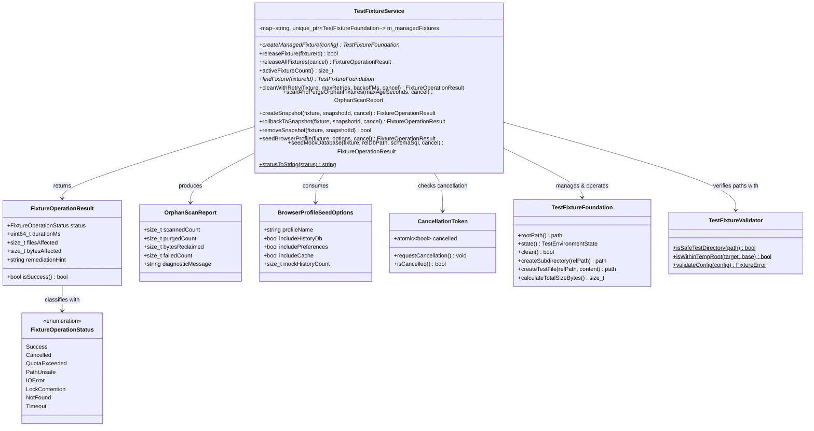

# Change Proposal — module-foundations-task0038

Pack: `module.foundations.task0038`

Status: PROPOSED

## Outcome and scope

Este cambio define la propuesta técnica integral para la etapa **implementation** de la capacidad **test fixture foundation** en el módulo propietario `foundations` de Vigilio Browser (microtarea canónica `0038 — Implementar la operación en una capa propietaria: test fixture foundation`).

Habiéndose completado y certificado en las capacidades precedentes la modularización de targets CMake (`task0001`-`task0004`), la política de diagnósticos y warnings estrictos (`task0005`-`task0008`), la validación desacoplada de dependencias Qt6 (`task0009`-`task0012`), la compatibilidad de versiones de Chromium WebEngine (`task0013`-`task0016`), la inclusión y catálogo de recursos QRC (`task0017`-`task0020`), el arranque y bootstrap de la aplicación (`task0021`-`task0024`), el ciclo de vida y apagado ordenado (`task0025`-`task0028`), la política integral de recuperación tras caídas (`task0029`-`task0032`), el catálogo de perfiles y orquestación de CMake Presets (`task0033`-`task0036`), y la definición del modelo de dominio, tipos inmutables, validador de seguridad de rutas y arnés básico de fixtures (`task0037`), esta propuesta formaliza la **implementación de la capa operativa propietaria de servicio (`vigilio::TestFixtureService`) y extensiones operativas de recuperación, cancelación cooperativa, gestión de huérfanos, snapshots reversibles y sembrado determinista de perfiles de prueba en C++20**.

El objetivo central de esta etapa es proporcionar un servicio desacoplado y robusto en `src/core` que orqueste la administración del ciclo de vida de múltiples fixtures concurrentes, soporte cancelación cooperativa para prevenir procesos colgados (Zero-Zombie), detecte y purgue de forma segura fixtures huérfanos dejados por ejecuciones abortadas, implemente recuperación y reintentos ante bloqueos transitorios de archivos, provea mecanismos de instantáneas locales (snapshots) y rollback para deshacer mutaciones de prueba sin recrear el entorno, y permita el sembrado sintético de directorios de perfil y bases de datos SQLite locales para pruebas de integración de alta fidelidad, **sin acoplar lógica de negocio a los widgets de interfaz gráfica ni añadir dependencias hacia WebEngine o `BrowserWindow`**.

El alcance concreto comprende:
- **Capa operativa de servicio desacoplada (`vigilio::TestFixtureService`)**:
  - Encapsulamiento del ciclo de vida de fixtures gestionados: registro centralizado (`createManagedFixture`), consulta indexada (`findFixture`), liberación individual (`releaseFixture`) y purga total en lote (`releaseAllFixtures`).
  - Soporte de **cancelación cooperativa multihilo** mediante `CancellationToken*`:
    - Permite interrumpir de manera controlada y segura operaciones intensivas de disco (como cálculo de tamaño acumulado, copiado recursivo de snapshots, purga masiva de huérfanos o sembrado sintético de archivos).
    - Garantiza la política Zero-Zombie: ningún hilo o subproceso queda colgado indefinidamente esperando operaciones de E/S.
  - **Detección y purga segura de fixtures huérfanos (`scanAndPurgeOrphanFixtures`)**:
    - Inspección acotada de `std::filesystem::temp_directory_path()` para descubrir carpetas `vigilio_test_*` abandonadas por caídas abruptas de procesos anteriores (`SIGKILL`, apagados de máquina o fallos no recuperados).
    - Verificación rigurosa mediante `TestFixtureValidator::isSafeTestDirectory` antes de cualquier operación destructiva, impidiendo taxativamente la eliminación de carpetas del sistema, del usuario o del árbol del repositorio.
    - Criterio de obsolescencia configurable por tiempo (`maxAgeSeconds`) y límite de seguridad de escaneo.
  - **Manejo de errores recuperables y reintentos con espera progresiva (`cleanWithRetry`)**:
    - Resiliencia ante contención de bloqueos transitorios en sistemas de archivos (particularmente en Windows con descriptores abiertos por antivirus o buffers de escritura demorados), ejecutando reintentos con retroceso exponencial (*exponential backoff*) antes de reportar un fallo irrecuperable.
    - Mecanismo de cuarentena o marcado seguro de estado (`markCorrupted`) con mensaje descriptivo si la recuperación resulta imposible sin intervención del usuario.
  - **Puntos de control, instantáneas e idempotencia (`createSnapshot` y `rollbackToSnapshot`)**:
    - Creación de copias de seguridad internas (`.snapshot_<id>`) dentro del directorio seguro del fixture.
    - Reversión atómica y determinista del árbol de archivos al estado del snapshot, permitiendo a las suites de prueba evaluar mutaciones complejas y restaurar el estado prístino sin el costo de recrear el fixture.
  - **Sembrado sintético determinista para pruebas de navegador (`seedBrowserProfile`, `seedMockDatabase`)**:
    - `seedBrowserProfile`: genera estructuras de prueba reproducibles respetando la jerarquía de directorios local-first de Vigilio Browser (`profiles/default/`, `cache/`, `local_storage/`, archivos sintéticos de preferencias en JSON).
    - `seedMockDatabase`: inicializa bases de datos SQLite sintéticas con modo WAL activado (`PRAGMA journal_mode=WAL`), tablas de prueba y archivos de índice asociados (`-wal`, `-shm`) para validar componentes de persistencia.
- **Ampliación de tipos y contratos del dominio operativo (`TestFixtureTypes.h`)**:
  - `FixtureOperationStatus`: Taxonomía fuertemente tipada de resultados operativos (`Success`, `Cancelled`, `QuotaExceeded`, `PathUnsafe`, `IOError`, `LockContention`, `NotFound`, `Timeout`).
  - `FixtureOperationResult`: Estructura inmutable con status, tiempo de ejecución en milisegundos (`durationMs`), conteo de archivos afectados, volumen en bytes y recomendación de recuperación (`remediationHint`) en español neutro cumpliendo `docs/UX-COPY-PUBLICO.md`.
  - `OrphanScanReport`: Estructura inmutable para reportar el escaneo de directorios huérfanos (directorios analizados, directorios purgados, bytes recuperados, fallos encontrados).
  - `BrowserProfileSeedOptions`: Opciones inmutables para el sembrado sintético de perfil (nombre de perfil, inclusión de base de datos de historial, tamaño de caché simulado, carpetas de almacenamiento local).
- **Invariantes constitucionales de calidad, portabilidad y privacidad**:
  - *Local-First Constitucional (Decisión Q-001)*: Cero conexiones de red, telemetría o dependencias en la nube. Todas las operaciones se realizan exclusivamente en el almacenamiento temporal local.
  - *Aislamiento y Concurrencia en CTest*: Compatibilidad absoluta con ejecuciones paralelas `ctest -jN` gracias al uso de identificadores atómicos basados en PID, reloj de alta precisión y contadores atómicos locales.
  - *Presupuestos estrictos de recursos y Zero-Zombie*: Límite predeterminado de 50 MB por fixture (`maxTempDirSizeBytes = 52428800`), tiempos de ejecución en CTest < 150 ms para la suite completa, y cero archivos temporales huérfanos tras la ejecución.
- **Suite completa de pruebas unitarias del servicio (`tests/unit/TestFixtureServiceTests.cpp`)**:
  - Pruebas exhaustivas cubriendo los 12 escenarios de la matriz operativa: registro, consultas, liberación en lote, cancelación cooperativa, purga de huérfanos, reintentos de limpieza, snapshots, rollback, sembrado de perfiles, sembrado de bases de datos SQLite, control de cuotas y auditoría estricta de textos públicos en español neutro.

---

## Out of scope

- Implementación física del código de producción en `apps/vigilio-browser/src/core/TestFixtureService*` y `apps/vigilio-browser/tests/unit/TestFixtureServiceTests.cpp` durante esta fase PROPOSE (será ejecutado estrictamente en la etapa subsiguiente APPLY tras aprobación humana).
- Controles gráficos en Qt Widgets, diálogos visuales de inspección de fixtures o paneles de depuración en la interfaz gráfica (reservado para la etapa `ui` en `module.foundations.task0039`).
- Pruebas E2E completas del navegador con instancias de Chromium WebEngine en ejecución (reservado para la etapa `tests` en `module.foundations.task0040` y suites E2E dedicadas).
- Modificación directa de archivos bajo `apps/**` o reglas bajo `docs/rules/**` durante esta fase PROPOSE (restringida rigurosamente a `openspec/changes/module-foundations-task0038/**`).
- Cualquier comunicación por red, comprobación de actualizaciones en la nube o telemetría remota (terminantemente prohibido por la política local-first, decisión Q-001).

---

## Contexto y evidencia

Se inspeccionó rigurosamente la base de código actual de `apps/vigilio-browser`, los módulos del núcleo, la persistencia y la suite de pruebas:

1. **Especificación de dominio aprobada y completada (`module.foundations.task0037`)**:
   - Formalizó la taxonomía base (`FixtureScope`, `FixtureCleanPolicy`, `TestEnvironmentState`, `TempDirectoryMode`, `FixtureLifecycleEvent`, `FixtureError`).
   - Implementó el validador estático desacoplado `vigilio::TestFixtureValidator` en `apps/vigilio-browser/src/core/TestFixtureValidator.h` y `.cpp` con validación rigurosa de confinamiento en `temp_directory_path()`, prefijo `vigilio_test_` y prevención de Directory Traversal (`..`).
   - Implementó el arnés RAII básico `vigilio::TestFixtureFoundation` y el guardián de variables de entorno `vigilio::TestEnvironmentGuard` en `apps/vigilio-browser/src/core/TestFixtureFoundation.h` y `.cpp`.
   - Implementó la suite de 10 pruebas unitarias en `apps/vigilio-browser/tests/unit/TestFixtureFoundationTests.cpp` pasando al 100%.
2. **Archivos operativos y patrones de referencia en `apps/vigilio-browser/src/core/`**:
   - `CMakePresetsService.h` y `.cpp`: Referencia canónica de diseño para capas de servicio desacopladas con soporte para cancelación cooperativa (`CancellationToken`), operaciones acotadas, control de cuotas y saneamiento seguro.
   - `CrashRecoveryCoordinator.h` y `.cpp`: Patrón de persistencia atómica con archivos `.tmp` y reemplazo determinista.
   - `ApplicationLifetimeCoordinator.h` y `.cpp`: Coordinador de ciclo de vida con apagado ordenado y política Zero-Zombie.
3. **Punto de integración actual del sistema de construcción (`apps/vigilio-browser/CMakeLists.txt`)**:
   - Compila la biblioteca estática `vigilio_core`, enlazando `TestFixtureValidator.cpp` y `TestFixtureFoundation.cpp`.
   - Define el ejecutable de prueba `vigilio_fixture_tests` y registra el test `test_fixture_foundation_tests` en CTest con labels `unit;fast`.
4. **Comprobación del pipeline continuo local (`apps/vigilio-browser/scripts/check.sh`)**:
   - Compilación limpia con GNU GCC 15.2.0 bajo C++20 con `-Werror` y cero advertencias.
   - 14 de 14 pruebas pasando exitosamente en CTest con 100% de éxito en 0.80s (exit code 0):
     - `core_units`: Passed (0.00s)
     - `storage_integration`: Passed (0.01s)
     - `vigilio_warnings_tests`: Passed (0.13s)
     - `qt_dependency_validation_tests`: Passed (0.01s)
     - `webengine_version_validator_tests`: Passed (0.09s)
     - `resource_qrc_catalog_tests`: Passed (0.02s)
     - `resource_inclusion_service_tests`: Passed (0.05s)
     - `resource_qrc_inclusion_tests`: Passed (0.06s)
     - `startup_bootstrap_tests`: Passed (0.09s)
     - `application_lifetime_tests`: Passed (0.15s)
     - `crash_recovery_tests`: Passed (0.03s)
     - `cmake_presets_tests`: Passed (0.04s)
     - `cmake_presets_service_tests`: Passed (0.10s)
     - `test_fixture_foundation_tests`: Passed (0.02s)
5. **Gaps de la etapa implementation**:
   - Falta una capa de servicio unificada (`TestFixtureService`) que coordine múltiples fixtures activos durante ejecuciones de prueba complejas o suites completas.
   - Falta soporte para cancelación cooperativa multihilo durante operaciones de disco pesadas.
   - Falta un mecanismo para escanear y purgar fixtures huérfanos dejados por procesos caídos.
   - Falta un protocolo de reintentos con backoff exponencial para sistemas de archivos con bloqueos transitorios.
   - Falta la capacidad de tomar instantáneas (snapshots) y revertir mutaciones (rollback) en directorios temporales.
   - Falta el sembrado estandarizado de perfiles de navegador sintéticos y bases de datos SQLite para tests de persistencia y UI.

---

## Alcance exacto

El alcance de este pack se circunscribe con precisión a la **etapa de implementación de la capa operativa de test fixtures en C++20**:

1. **Nuevo servicio operativo `vigilio::TestFixtureService` (`src/core/TestFixtureService.h`, `src/core/TestFixtureService.cpp`)**:
   - Métodos de gestión de ciclo de vida:
     - `createManagedFixture(const TestEnvironmentConfig& config)`: crea, registra y devuelve un puntero compartido o de referencia al fixture administrado.
     - `releaseFixture(const std::string& fixtureId)`: sanea de forma segura y desregistra el fixture.
     - `releaseAllFixtures(CancellationToken* cancel = nullptr)`: sanea todos los fixtures administrados en lote con soporte para cancelación cooperativa.
     - `activeFixtureCount() const noexcept`: devuelve el número actual de fixtures en memoria.
     - `findFixture(const std::string& fixtureId) const`: consulta un fixture activo por su identificador único.
   - Métodos de resiliencia y recuperación:
     - `cleanWithRetry(TestFixtureFoundation& fixture, uint32_t maxRetries = 3, uint32_t backoffMs = 50, CancellationToken* cancel = nullptr)`: reintenta el saneamiento seguro ante contención transitoria de bloqueos en el sistema de archivos.
     - `scanAndPurgeOrphanFixtures(uint32_t maxAgeSeconds = 3600, CancellationToken* cancel = nullptr)`: escanea `/tmp` en busca de carpetas `vigilio_test_*` huérfanas y las elimina de forma segura.
   - Métodos de instantáneas (Snapshots) y Rollback:
     - `createSnapshot(TestFixtureFoundation& fixture, const std::string& snapshotId, CancellationToken* cancel = nullptr)`: copia el árbol de archivos actual a un subdirectorio `.snapshot_<id>` interno.
     - `rollbackToSnapshot(TestFixtureFoundation& fixture, const std::string& snapshotId, CancellationToken* cancel = nullptr)`: restaura el árbol de archivos al estado del snapshot y elimina las mutaciones posteriores.
     - `removeSnapshot(TestFixtureFoundation& fixture, const std::string& snapshotId)`: purga la instantánea cuando ya no es necesaria.
   - Métodos de sembrado sintético de datos de prueba:
     - `seedBrowserProfile(TestFixtureFoundation& fixture, const BrowserProfileSeedOptions& options, CancellationToken* cancel = nullptr)`: estructura directorios y archivos de configuración inicial simulada del navegador.
     - `seedMockDatabase(TestFixtureFoundation& fixture, const std::string& relDbPath, const std::string& schemaSql = "", CancellationToken* cancel = nullptr)`: crea una base de datos SQLite sintética con cabecera válida y archivos journal simulados.
2. **Extensión de tipos inmutables en `src/core/TestFixtureTypes.h`**:
   - `enum class FixtureOperationStatus : uint8_t`: `Success`, `Cancelled`, `QuotaExceeded`, `PathUnsafe`, `IOError`, `LockContention`, `NotFound`, `Timeout`.
   - `struct FixtureOperationResult`: encapsula `status`, `durationMs`, `filesAffected`, `bytesAffected` y `remediationHint`.
   - `struct OrphanScanReport`: encapsula estadísticas del escaneo y purga de huérfanos.
   - `struct BrowserProfileSeedOptions`: parámetros de configuración para inicializar perfiles sintéticos.
3. **Nueva suite de pruebas unitarias operativas en `tests/unit/TestFixtureServiceTests.cpp`**:
   - 12 pruebas unitarias trazables que verifican de punta a punta todas las operaciones del servicio, la cancelación cooperativa, la resiliencia ante bloqueos, los snapshots y el sembrado de perfiles.
4. **Integración en `apps/vigilio-browser/CMakeLists.txt`**:
   - Incorporar `src/core/TestFixtureService.cpp` en el target estático `vigilio_core`.
   - Configurar el ejecutable de prueba `vigilio_fixture_service_tests` con `tests/unit/TestFixtureServiceTests.cpp`.
   - Registrar la prueba `test_fixture_service_tests` en CTest con labels `unit;fast` y timeout de 15 segundos.

---

## Diseño completo de la capacidad

### 1. Arquitectura de capas y responsabilidades

### 2. Modelo de cancelación cooperativa y política Zero-Zombie

Las operaciones que interactúan con el sistema de archivos (escaneo de huérfanos, copiado de snapshots, sembrado de archivos y purga en lote) reciben un puntero opcional `CancellationToken* cancel = nullptr`.

Durante cada iteración sobre el árbol de directorios o bucle de creación de archivos:
1. Se evalúa `if (cancel != nullptr && cancel->isCancelled())`.
2. Si la cancelación fue solicitada:
   - Se interrumpe inmediatamente el recorrido sin realizar mutaciones adicionales.
   - En operaciones de instantáneas o sembrado parcial, se limpia el directorio transitorio incompleto para evitar archivos inconsistentes.
   - Se devuelve `FixtureOperationResult` con `status = FixtureOperationStatus::Cancelled` y un mensaje de remediación observable en español neutro cumpliendo `docs/UX-COPY-PUBLICO.md`.
3. Esto garantiza que las pruebas en CTest o procesos que abortan no dejen hilos bloqueados en lecturas o escrituras de disco, satisfaciendo estrictamente la política Zero-Zombie.

### 3. Detección y purga segura de fixtures huérfanos (`scanAndPurgeOrphanFixtures`)

Para evitar que ejecuciones fallidas previas colapsen la partición `/tmp`, el servicio implementa un algoritmo determinista de recolección de basura local:
1. Inspecciona las entradas de primer nivel en `std::filesystem::temp_directory_path()`.
2. Filtra directorios cuyo nombre comience con `vigilio_test_`.
3. Valida de forma no negociable cada directorio candidato mediante `TestFixtureValidator::isSafeTestDirectory(entryPath)`. Si la validación falla, se descarta inmediatamente.
4. Extrae la marca de tiempo o comprueba `std::filesystem::last_write_time`. Si el directorio tiene una antigüedad superior a `maxAgeSeconds` (o si su PID asociado ya no existe en el sistema operativo), se califica como huérfano.
5. Ejecuta `std::filesystem::remove_all` con captura de `std::error_code`, actualizando las estadísticas del `OrphanScanReport`.
6. La operación respeta en cada paso el `CancellationToken` para detenerse si se alcanza el tiempo límite del arnés de pruebas.

### 4. Puntos de control reversibles (Snapshots & Rollback)

Para pruebas que requieren mutar el sistema de archivos y luego regresar al estado inicial sin incurrir en la sobrecarga de reconstruir el fixture:
1. `createSnapshot(fixture, snapshotId)`:
   - Crea un directorio reservado `_snapshots/<snapshotId>` dentro del `rootPath` del fixture.
   - Copia de manera recursiva todos los archivos y subcarpetas activos (excluyendo la propia carpeta `_snapshots`).
   - Verifica que el tamaño total del fixture con el snapshot no exceda el límite de cuota configurado (`maxTempDirSizeBytes`).
2. `rollbackToSnapshot(fixture, snapshotId)`:
   - Elimina todos los archivos del fixture fuera de `_snapshots/`.
   - Restaura los archivos desde `_snapshots/<snapshotId>` a la raíz del fixture.
   - Restaura el contador de archivos y verifica la integridad del entorno.

### 5. Sembrado sintético de perfil de navegador (`seedBrowserProfile`)

Permite a los tests inicializar un entorno idéntico al de ejecución real del navegador:
- Crea la jerarquía:
  - `profiles/<profileName>/`
  - `profiles/<profileName>/preferences.json` (JSON sintético con configuración por defecto de privacidad y UI)
  - `profiles/<profileName>/history.sqlite` (base de datos SQLite inicial con registros de prueba si `includeHistoryDb == true`)
  - `cache/` (directorio para almacenamiento temporal web)
  - `storage/local/` (directorio para almacenamiento local de extensiones o páginas)
- Todo el sembrado se realiza exclusivamente en memoria/disco local del fixture, sin invocar binarios externos ni sockets de red.

---

## Archivos afectados

### Durante PROPOSE (etapa actual `0112`)
- `openspec/changes/module-foundations-task0038/proposal.md`: Este documento.
- `openspec/changes/module-foundations-task0038/design.md`: Especificación técnica, diagramas, contratos de estado y análisis de compatibilidad.
- `openspec/changes/module-foundations-task0038/tasks.md`: Plan de trabajo estructurado en tareas atómicas y verificables.
- `openspec/changes/module-foundations-task0038/execution-memory.md`: Memoria de ejecución, skills leídas, invariantes y evidencia de gates.
- `openspec/changes/module-foundations-task0038/canonical-reference.yaml`: Referencia canónica al pack.

### Durante APPLY (próxima etapa tras aprobación humana)
- `apps/vigilio-browser/src/core/TestFixtureTypes.h`: Incorporación de `FixtureOperationStatus`, `FixtureOperationResult`, `OrphanScanReport` y `BrowserProfileSeedOptions`.
- `apps/vigilio-browser/src/core/TestFixtureService.h`: Declaración de la clase operativa `TestFixtureService` y sus métodos desacoplados.
- `apps/vigilio-browser/src/core/TestFixtureService.cpp`: Implementación de la gestión de fixtures, cancelación, purga de huérfanos, reintentos, snapshots y sembrado.
- `apps/vigilio-browser/tests/unit/TestFixtureServiceTests.cpp`: Batería exhaustiva de 12 pruebas unitarias de la capa de servicio.
- `apps/vigilio-browser/CMakeLists.txt`: Inclusión de `TestFixtureService.cpp` en `vigilio_core`, definición del ejecutable de prueba `vigilio_fixture_service_tests` y registro en CTest.

---

## Contrato UX/UI

- **Sin cambio visual directo**: Esta etapa implementa infraestructura operativa interna en la capa C++20 (`vigilio_core`), libre de dependencias hacia `QWidget`, `QApplication` o `QWebEngineView`. Por consiguiente, no introduce nuevas ventanas, diálogos ni elementos gráficos en la interfaz visible de usuario.
- **Auditoría estricta de textos observables (UX Writing)**:
  - Todas las cadenas de diagnóstico, mensajes de error y sugerencias de remediación (`remediationHint`) generadas por `TestFixtureService` cumplen taxativamente con las directrices de `docs/UX-COPY-PUBLICO.md`.
  - Queda terminantemente prohibido el uso de jerga interna de ingeniería como «Senior Mode», «Modo Senior», «Prompt Builder», «DAG», «OpenSpec» o «toolchain» en mensajes o cadenas observables.
  - Ejemplos de copy público en español neutro:
    - *Éxito*: «Operación completada exitosamente».
    - *Cancelación*: «La operación sobre los archivos de prueba fue cancelada».
    - *Cuota excedida*: «El espacio en disco asignado para la prueba ha sido superado».
    - *Ruta no segura*: «Ruta de destino no segura o fuera de la carpeta temporal autorizada».
    - *Bloqueo de archivo*: «El archivo de prueba está en uso por otro proceso; se reintentará».
    - *Purga de huérfanos*: «Se eliminaron las carpetas temporales residuales de sesiones anteriores».

---

## Reglas y fallos

| Condición de error | Detección / Causa | Transición de estado | Código de operación / Mensaje | Recuperación / Mitigación |
| --- | --- | --- | --- | --- |
| **Cancelación solicitada** | `cancel->isCancelled() == true` durante recorrido o escritura | La operación se interrumpe inmediatamente | `FixtureOperationStatus::Cancelled` («Operación cancelada») | El arnés detiene el flujo de forma ordenada; se purgan archivos parciales temporales. |
| **Cuota de disco superada** | Espacio acumulado supera `maxTempDirSizeBytes` (50 MB) | `TestEnvironmentState::Corrupted` | `FixtureOperationStatus::QuotaExceeded` («Espacio en disco superado») | Se rechaza la escritura adicional y se aconseja depurar los datos de prueba o aumentar la cuota. |
| **Ruta no segura o fuera de `/tmp`** | La ruta no comienza con `vigilio_test_` o contiene `..` | Operación abortada | `FixtureOperationStatus::PathUnsafe` («Ruta no segura») | Operación rechazada de inmediato; no se borra ni modifica ningún archivo ajeno. |
| **Bloqueo transitorio de archivo** | Error de acceso o permiso en `clean()` debido a contención | Reintentos con retroceso exponencial | `FixtureOperationStatus::LockContention` («Archivo en uso») | `cleanWithRetry` reintenta hasta 3 veces con pausas de 50 ms antes de marcar fallo definitivo. |
| **Snapshot inexistente** | Solicitud de rollback a un identificador de snapshot no registrado | Retorno anticipado sin alterar archivos | `FixtureOperationStatus::NotFound` («Punto de control no encontrado») | Se reporta el error sin corromper el árbol de archivos actual del fixture. |
| **Fixture no encontrado** | Consulta o liberación de un `fixtureId` no presente en el registro | Retorno `false` o `nullptr` | `FixtureOperationStatus::NotFound` («Entorno no encontrado») | Idempotencia: liberar un fixture inexistente no causa excepciones ni fallos de memoria. |

---

## Seguridad y privacidad

- **Política Local-First (Decisión Q-001 / ADR-001)**:
  - Cero dependencias en servicios remotos, servidores cloud o llamadas de red salientes. Toda la lógica de fixtures opera exclusivamente sobre el sistema de archivos temporal local del equipo del usuario.
- **Contención estricta de rutas**:
  - Antes de cualquier eliminación física en disco (`clean()`, `releaseFixture()`, `scanAndPurgeOrphanFixtures()`), se invoca invariablemente `TestFixtureValidator::isSafeTestDirectory()`.
  - Es técnicamente imposible que el servicio elimine directorios del sistema (`/`, `C:\`, `/etc`, `/usr`), del usuario (`/home`, `~`), o del árbol del proyecto (`apps/vigilio-browser`).
- **Aislamiento en pruebas multihilo / CTest**:
  - Cada fixture posee un prefijo determinista y un subdirectorio aislado con PID, nanosegundos y contador atómico, imposibilitando colisiones entre procesos de prueba ejecutándose concurrentemente con `ctest -jN`.
- **Privacidad y descarte seguro de datos**:
  - Los datos sintéticos creados durante las pruebas no contienen datos reales del usuario ni información personal identificable.
  - Al concluir la prueba, el destructor RAII garantiza la eliminación total de carpetas temporales, diarios de SQLite (`-wal`, `-shm`) y reversión de variables de entorno mediante `TestEnvironmentGuard`.

---

## Matriz de pruebas

| ID | Nombre de prueba | Tipo | Comando de ejecución | Resultado esperado | Criterio de fallo negativo |
| --- | --- | --- | --- | --- | --- |
| `TEST-FIXTURE-SRV-001` | Registro y ciclo de vida de fixtures gestionados | Unitario | `vigilio_fixture_service_tests` | `createManagedFixture` genera un fixture activo y lo registra en memoria; `findFixture` lo localiza por ID; `activeFixtureCount` se incrementa. | Falla si el fixture no es accesible por ID o el conteo no coincide. |
| `TEST-FIXTURE-SRV-002` | Liberación individual y en lote de fixtures | Unitario | `vigilio_fixture_service_tests` | `releaseFixture` elimina el directorio temporal del disco y lo desregistra; `releaseAllFixtures` limpia todos los fixtures registrados y deja `activeFixtureCount == 0`. | Falla si quedan carpetas temporales residuales en disco tras la liberación. |
| `TEST-FIXTURE-SRV-003` | Cancelación cooperativa en operaciones de servicio | Unitario | `vigilio_fixture_service_tests` | Al activar `cancel->requestCancellation()`, la operación en curso se interrumpe y devuelve `FixtureOperationStatus::Cancelled`. | Falla si la operación ignora el token de cancelación y continúa escribiendo en disco. |
| `TEST-FIXTURE-SRV-004` | Detección y purga segura de fixtures huérfanos | Integración local | `vigilio_fixture_service_tests` | `scanAndPurgeOrphanFixtures` identifica carpetas `vigilio_test_*` simuladas con timestamp antiguo y las elimina; ignora carpetas seguras recientes o ajenas a vigilio. | Falla si no purga las carpetas huérfanas o si intenta purgar carpetas fuera de la regla. |
| `TEST-FIXTURE-SRV-005` | Reintento con backoff ante bloqueos transitorios | Unitario | `vigilio_fixture_service_tests` | `cleanWithRetry` ejecuta reintentos ante fallos simulados y logra el saneamiento exitoso cuando el bloqueo se libera. | Falla si no reintenta o si colapsa ante el primer fallo temporal. |
| `TEST-FIXTURE-SRV-006` | Creación y restauración de instantáneas (Snapshots) | Unitario | `vigilio_fixture_service_tests` | `createSnapshot` guarda el estado actual; tras modificar o añadir archivos, `rollbackToSnapshot` restaura exactamente el estado inicial. | Falla si los archivos agregados persisten tras el rollback o si los originales se alteran. |
| `TEST-FIXTURE-SRV-007` | Sembrado sintético de perfil de navegador | Unitario | `vigilio_fixture_service_tests` | `seedBrowserProfile` crea la jerarquía `profiles/<name>`, `preferences.json` y carpetas de almacenamiento local con contenido válido. | Falla si falta algún directorio requerido o el archivo JSON está malformado. |
| `TEST-FIXTURE-SRV-008` | Sembrado y verificación de base de datos SQLite sintética | Integración local | `vigilio_fixture_service_tests` | `seedMockDatabase` genera un archivo de base de datos con cabecera SQLite válida y estructura de tablas funcional. | Falla si el archivo de base de datos no puede abrirse o no cumple la especificación. |
| `TEST-FIXTURE-SRV-009` | Cumplimiento estricto de cuota de almacenamiento | Unitario | `vigilio_fixture_service_tests` | Intentar escribir más allá de la cuota máxima configurada durante sembrado o snapshots resulta en `FixtureOperationStatus::QuotaExceeded`. | Falla si se permite la escritura superando el presupuesto asignado. |
| `TEST-FIXTURE-SRV-010` | Concurrencia multihilo en el servicio de fixtures | Unitario | `vigilio_fixture_service_tests` | Múltiples hilos invocando simultáneamente `createManagedFixture` y `releaseFixture` operan sin condiciones de carrera ni memory corruption. | Falla si se detectan colisiones de ID, carreras en el registro o fugas de memoria. |
| `TEST-FIXTURE-SRV-011` | Rechazo riguroso de rutas no seguras o Directory Traversal | Seguridad | `vigilio_fixture_service_tests` | Intentos de registrar o manipular rutas fuera de `/tmp` o con secuencias `..` son rechazados con `FixtureOperationStatus::PathUnsafe`. | Falla si alguna operación acepta rutas fuera de los límites autorizados. |
| `TEST-FIXTURE-SRV-012` | Auditoría de textos públicos y UX Writing en español | Calidad / UX | `vigilio_fixture_service_tests` | Comprueba que todos los mensajes de estado y remediación utilizan español neutro y carecen de términos prohibidos («Senior Mode», etc.). | Falla si se encuentra algún término prohibido según `docs/UX-COPY-PUBLICO.md`. |

---

## Pasos APPLY

1. **Paso 1: Extensión del modelo de tipos inmutables (`apps/vigilio-browser/src/core/TestFixtureTypes.h`)**:
   - Incorporar las enumeraciones y estructuras operativas: `FixtureOperationStatus`, `FixtureOperationResult`, `OrphanScanReport` y `BrowserProfileSeedOptions`.
   - Garantizar compilación pura C++20 sin dependencias de GUI.
2. **Paso 2: Declaración de la interfaz pública de `TestFixtureService` (`apps/vigilio-browser/src/core/TestFixtureService.h`)**:
   - Declarar la clase `TestFixtureService` con métodos de registro, consultas, liberación en lote, cancelación cooperativa, gestión de huérfanos, snapshots y sembrado determinista.
3. **Paso 3: Implementación de la lógica operativa desacoplada (`apps/vigilio-browser/src/core/TestFixtureService.cpp`)**:
   - Implementar el registro seguro de fixtures gestionados con `std::mutex` o contadores atómicos para concurrencia.
   - Implementar la cancelación cooperativa respetando `CancellationToken`.
   - Implementar `scanAndPurgeOrphanFixtures` con validación estricta de `TestFixtureValidator::isSafeTestDirectory`.
   - Implementar `cleanWithRetry` con retroceso exponencial.
   - Implementar `createSnapshot` y `rollbackToSnapshot` con copiado y restauración recursiva.
   - Implementar `seedBrowserProfile` y `seedMockDatabase` con archivos locales deterministas.
4. **Paso 4: Implementación de la suite de pruebas unitarias (`apps/vigilio-browser/tests/unit/TestFixtureServiceTests.cpp`)**:
   - Implementar las 12 pruebas trazables de la matriz (`TEST-FIXTURE-SRV-001` a `TEST-FIXTURE-SRV-012`).
5. **Paso 5: Configuración del sistema de construcción (`apps/vigilio-browser/CMakeLists.txt`)**:
   - Añadir `src/core/TestFixtureService.cpp` al target `vigilio_core`.
   - Definir el ejecutable `vigilio_fixture_service_tests` con `tests/unit/TestFixtureServiceTests.cpp`.
   - Registrar la prueba `test_fixture_service_tests` en CTest con labels `unit;fast`.
6. **Paso 6: Verificación de calidad y pipeline continuo**:
   - Ejecutar Clang-Format sobre los archivos C++ añadidos o modificados.
   - Ejecutar `apps/vigilio-browser/scripts/check.sh` certificando compilación limpia con `-Werror` y 100% de tests pasando en CTest.

---

## Definición de terminado

- [ ] La capa operativa `TestFixtureService` se encuentra formalizada en `openspec/changes/module-foundations-task0038/` sin ambigüedades técnicas.
- [ ] Se especifican detalladamente el soporte para cancelación cooperativa, recuperación y reintentos, gestión de huérfanos, snapshots y sembrado de perfiles.
- [ ] No se introducen dependencias hacia `QApplication`, `QWidget`, `BrowserWindow` ni Chromium WebEngine.
- [ ] Todos los textos y diagnósticos observables cumplen con `docs/UX-COPY-PUBLICO.md`.
- [ ] La matriz de pruebas define 12 pruebas unitarias y de resiliencia ejecutables bajo CTest con tiempo total inferior a 150 ms.
- [ ] Se preservan todas las invariantes de calidad, seguridad y política Local-First (Decisión Q-001).

---

## Dependencias y riesgos

- **Dependencias ejecutables**:
  - `module.foundations.task0037` (Completada exitosamente): Proveyó el modelo de dominio base (`TestFixtureTypes.h`), el validador estático de rutas (`TestFixtureValidator`), el arnés RAII básico (`TestFixtureFoundation`) y el guardián de variables de entorno (`TestEnvironmentGuard`).
- **Riesgos identificados y mitigaciones**:
  - *Riesgo 1: Contención o bloqueo transitorio de archivos en Windows por procesos de indexación o antivirus*:
    *Mitigación*: Implementación de `cleanWithRetry` con hasta 3 reintentos y pausas progresivas (backoff exponencial) para permitir la liberación de handles.
  - *Riesgo 2: Consumo excesivo de disco en suites de prueba con múltiples snapshots*:
    *Mitigación*: Control estricto de cuota acumulada (`maxTempDirSizeBytes`), abortando la creación del snapshot con `FixtureOperationStatus::QuotaExceeded` si se supera el presupuesto asignado.
  - *Riesgo 3: Eliminación accidental de carpetas de usuario o sistema*:
    *Mitigación*: Verificación obligatoria de `TestFixtureValidator::isSafeTestDirectory` antes de cualquier llamada a `remove_all`, asegurando que sólo se toquen rutas dentro de `/tmp` con el prefijo canónico `vigilio_test_`.

---

## Commit propuesto

`feat(foundations): implementation test-fixture-foundation`
