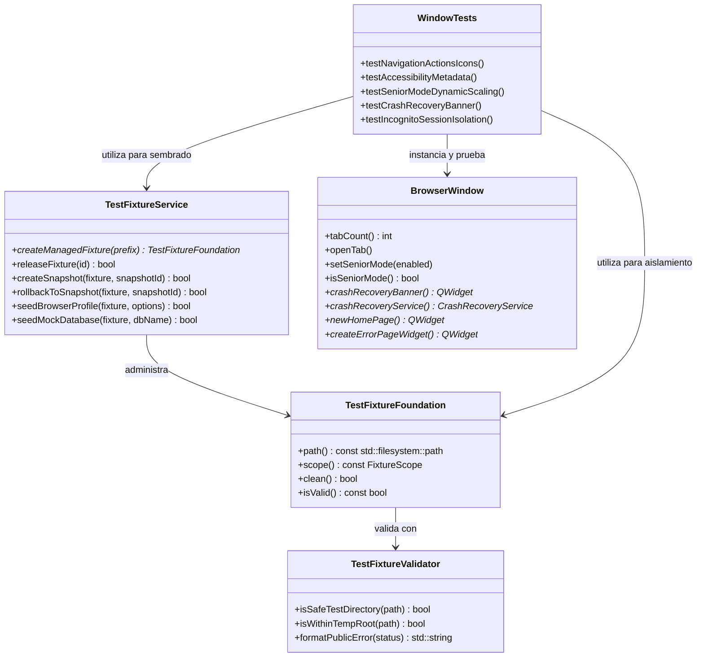
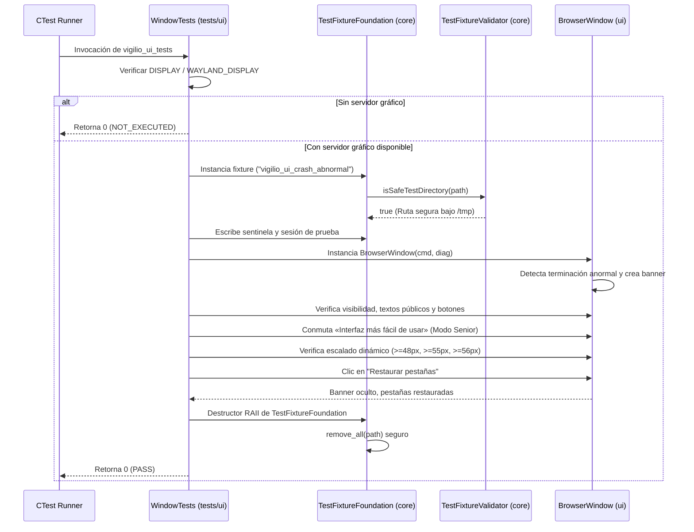

# Design — module-foundations-task0039

Status: PROPOSED

## Current, target and gaps

### Estado actual (CURRENT)

1. **Infraestructura de fixtures implementada en `vigilio_core` (`task0037` y `task0038`)**:
   - `vigilio::TestFixtureFoundation`: arnés RAII básico para creación y purga de directorios temporales aislados en `temp_directory_path()`.
   - `vigilio::TestFixtureValidator`: validación estática de seguridad de rutas (`isSafeTestDirectory`, `isWithinTempRoot`, `validateConfig`) y copy público en español neutro.
   - `vigilio::TestFixtureService`: servicio desacoplado con soporte para cancelación cooperativa multihilo (`CancellationToken`), purga segura de fixtures huérfanos (`scanAndPurgeOrphanFixtures`), reintentos con espera progresiva (`cleanWithRetry`), instantáneas atómicas (`createSnapshot` / `rollbackToSnapshot`) y sembrado sintético (`seedBrowserProfile`, `seedMockDatabase`).
   - 22 pruebas unitarias en `vigilio_core` (`TestFixtureFoundationTests.cpp` y `TestFixtureServiceTests.cpp`) certificadas al 100%.
2. **Arnés de pruebas de interfaz gráfica con estructura ad-hoc (`apps/vigilio-browser/tests/ui/WindowTests.cpp`)**:
   - `WindowTests.cpp` define en sus líneas 270-282 una estructura local ad-hoc `TempDirFixture` para las pruebas de banner de recuperación ante caídas.
   - Dicha estructura carece de validación de contención de ruta con `isSafeTestDirectory`, no implementa prevención contra Directory Traversal, no garantiza unicidad multihilo/concurrente ante ejecuciones paralelas (`ctest -jN`), y no utiliza las facilidades de sembrado sintético de `TestFixtureService`.
3. **Ausencia formal de declaración contractual de UI para test fixture foundation**:
   - No existía en OpenSpec un contrato formal vinculante que explicite la ausencia de cambio visual directo en la interfaz pública de navegación (`BrowserWindow`) conforme a `docs/UX-COPY-PUBLICO.md`, diferenciando con claridad la infraestructura de pruebas interna frente a los controles expuestos al usuario general.
4. **Validación de estados visuales y accesibilidad existente**:
   - `BrowserWindow` cuenta con soporte para «Interfaz más fácil de usar» (Modo Senior), estados de ventana (`idle`, `hover`, `focus`, `disabled`, `loading`, `empty`, `error`), atajos de teclado y metadatos accesibles para lectores de pantalla. Sin embargo, su aislamiento frente a mutaciones de disco en suites de UI dependía del arnés ad-hoc.

---

### Estado objetivo (TARGET)

1. **Adopción unificada de `TestFixtureFoundation` y `TestFixtureService` en `WindowTests.cpp`**:
   - Sustitución completa de la estructura ad-hoc `TempDirFixture` por las primitivas canónicas de `vigilio_core`.
   - Confinamiento estricto y verificación de seguridad de rutas mediante `TestFixtureValidator::isSafeTestDirectory` en todas las aserciones de prueba de UI.
   - Aprovisionamiento limpio de perfiles de prueba y bases de datos SQLite mediante el sembrado sintético de `TestFixtureService`.
2. **Declaración contractual de UX/UI («sin cambio visual directo»)**:
   - Declaración formal vinculante de que `test fixture foundation` es una capacidad interna de testing; por consiguiente, la interfaz pública del navegador (`BrowserWindow`) no expone menús, botones, diálogos ni terminología técnica de fixtures.
   - Cumplimiento riguroso de `docs/UX-COPY-PUBLICO.md` proscribiendo cualquier jerga interna en superficies visibles.
3. **Preservación incondicional de los contratos visuales y de accesibilidad**:
   - Auditoría exhaustiva de los estados visuales (`idle`, `hover`, `focus`, `disabled`, `loading`, `empty`, `error`).
   - Verificación de «Interfaz más fácil de usar» (Modo Senior) con escalado dinámico de iconos (22×22 $\to$ 32×32 px), tap targets $\ge 48$ px, barra de herramientas $\ge 55$ px, y tipografía aumentada (+4 pt).
   - Navegación por teclado completa con atajos estandarizados y atributos `accessibleName` y `accessibleDescription` en español neutro.
4. **Tolerancia robusta a entornos headless (Zero-Zombie)**:
   - Detección precisa de servidor gráfico (`DISPLAY` / `WAYLAND_DISPLAY`), reportando `NOT_EXECUTED` con código de salida 0 en ausencia de display para evitar fallos espurios en CI.
   - Limpieza garantizada de todo artefacto temporal al salir del ámbito de ejecución.

---

### Gaps identificados (GAPS)

| Componente | Estado actual (CURRENT) | Estado objetivo (TARGET) | Brecha a subsanar (GAP) |
| --- | --- | --- | --- |
| **Arnés de UI (`WindowTests.cpp`)** | Usa estructura ad-hoc `TempDirFixture` sin validaciones de seguridad | Utiliza `TestFixtureFoundation` y `TestFixtureValidator::isSafeTestDirectory` | Refactorizar `WindowTests.cpp` para incluir y consumir `vigilio_core`. |
| **Sembrado de pruebas de UI** | Creación manual y dispersa de JSON en código de test | Sembrado determinista y reutilizable vía `TestFixtureService` | Aprovechar sembrado sintético de perfiles y estados de crash recovery. |
| **Contrato de UI en OpenSpec** | Ausencia de formalización documental para la etapa `ui` | Contrato formal de «sin cambio visual directo» y auditoría de accesibilidad | Formalizar propuesta, diseño, tareas y memoria en `module-foundations-task0039`. |
| **Gobernanza de lenguaje público** | Cadenas de UI existentes no formalmente auditadas bajo el pack | Auditoría estricta contra `docs/UX-COPY-PUBLICO.md` garantizando cero fugas | Verificar que ningún término de fixtures o ingeniería interna aparezca en UI. |
| **Pruebas de tolerancia headless** | Lógica existente de display check no integrada en matriz trazable | Matriz de pruebas de UI trazable (`TEST-FIXTURE-UI-001` a `010`) | Registrar casos en matriz de pruebas con criterios claros de PASS / NOT_EXECUTED. |

---

## Compatibility, migration and rollback

### Compatibilidad y estándares C++20 / Qt6
- **Estándar de lenguaje**: C++20 con compilación estricta bajo `-Wall -Wextra -Wpedantic -Wconversion -Wsign-conversion -Wshadow -Werror`.
- **Compatibilidad de compiladores**: GNU GCC 12+, Clang 15+, MSVC 2022 y Apple Clang 14+.
- **Desacoplamiento modular**:
  - `vigilio_core` (`TestFixtureFoundation`, `TestFixtureValidator`, `TestFixtureService`) permanece completamente libre de cabeceras de Qt Widgets (`QWidget`, `QMainWindow`, `QApplication`).
  - `src/ui/BrowserWindow` permanece en `src/ui`, desacoplada de la infraestructura de pruebas.
  - `tests/ui/WindowTests.cpp` es el único punto donde se vinculan ambas capas bajo la guarda condicional `if(TARGET Qt6::Test)` en CMake.

### Estrategia de migración
- La sustitución de `TempDirFixture` por `TestFixtureFoundation` en `WindowTests.cpp` es una refactorización interna del arnés de pruebas que no altera la interfaz pública de `BrowserWindow` ni el comportamiento observable en tiempo de ejecución.
- La ejecución del pipeline de verificación local (`apps/vigilio-browser/scripts/check.sh`) continúa ejecutándose limpiamente sin regresiones.

### Plan de contingencia y rollback
- En caso de anomalías o fallos durante la fase APPLY:
  - Revertir los cambios en `apps/vigilio-browser/tests/ui/WindowTests.cpp` restaurando la versión previa de las pruebas.
  - El núcleo de dominio en `vigilio_core` y las 15 pruebas unitarias e integración existentes en CTest permanecerán completamente inalterados y operativos.

---

## Arquitectura técnica de test fixture foundation en UI

### Diagrama de interacción y dependencias

### Flujo de ejecución del arnés de pruebas de UI con fixtures

---

## Contratos de integración detallados

### 1. Confinamiento de Rutas y Seguridad
- Toda prueba gráfica que requiera persistencia o simulación de archivos temporales (archivos `.json` de sesión, sentinelas de recuperación o bases de datos SQLite) debe inicializarse dentro del directorio provisto por un `TestFixtureFoundation`.
- El destructor de `TestFixtureFoundation` invoca la limpieza automática respetando la política RAII, garantizando que tras la ejecución de `WindowTests.cpp` no permanezca ningún archivo residual en el sistema de archivos del usuario.

### 2. Sembrado Sintético Determinista
- Las pruebas de interfaz no dependen de conexiones de red ni de estados previos del equipo.
- Todos los escenarios de recuperación ante caídas se configuran localmente mediante archivos sintéticos con esquemas versionados (`schema_version: 1`), previniendo condiciones de carrera y asegurando reproducibilidad total.

### 3. Preservación del Modo Senior («Interfaz más fácil de usar»)
- El arnés de pruebas verifica que:
  - `seniorAction_` y `setSeniorMode(bool)` conmutan limpiamente el estado en memoria y la persistencia local en `QSettings`.
  - Los iconos de la barra de navegación crecen de 22×22 a 32×32 px.
  - Los botones de la ventana principal y del banner de recuperación mantienen una altura mínima $\ge 48$ px.
  - La barra de navegación `vigilio-navigation` mantiene una altura mínima $\ge 55$ px.
  - El banner de recuperación ante caídas mantiene una altura mínima $\ge 56$ px.
  - Los textos visibles respetan estrictamente la etiqueta aprobada «Interfaz más fácil de usar» conforme a `docs/UX-COPY-PUBLICO.md`.
