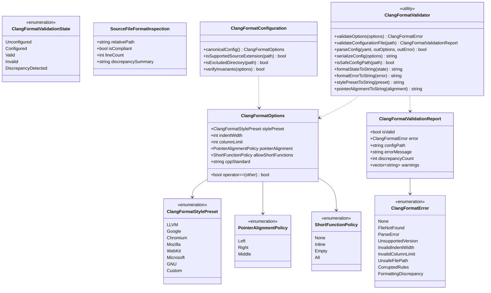
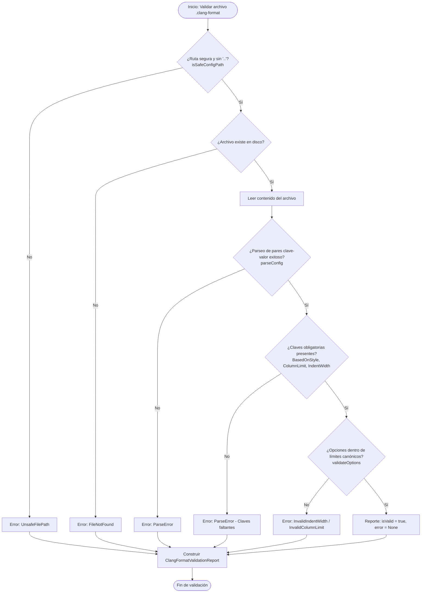

# Design — module-foundations-task0041

Status: PROPOSED

## Current, target and gaps

### Estado actual (CURRENT)

1. **Configuración física estática de Clang-Format sin abstracción de dominio en C++**:
   - El proyecto cuenta con un archivo físico `apps/vigilio-browser/.clang-format` que define:
     ```yaml
     BasedOnStyle: LLVM
     IndentWidth: 4
     ColumnLimit: 105
     PointerAlignment: Left
     AllowShortFunctionsOnASingleLine: None
     ```
   - No existe representación tipada de estas opciones dentro del código fuente de `vigilio_core`.
2. **Validación dependiente exclusivamente de script Bash (`check.sh`)**:
   - La comprobación de formato se realiza mediante una llamada de shell externa en `apps/vigilio-browser/scripts/check.sh` (`clang-format --dry-run --Werror "$file"`).
   - No es posible consultar, verificar o inspeccionar programáticamente la validez de la configuración o el estado de formato desde el arnés de CTest o servicios internos.
3. **Carencia de validación formal de seguridad de rutas para archivos de formato**:
   - No existe un validador que impida accesos inseguros o directory traversal si un proceso solicita validar una ruta de configuración.
4. **Ausencia de parser y serializador determinista para `.clang-format`**:
   - No hay utilidades en C++20 para analizar el archivo YAML canónico ni para serializar configuraciones garantizando idempotencia.
5. **Falta de catálogo de extensiones soportadas y reglas de exclusión**:
   - Las extensiones analizadas (`.cpp`, `.h`) están codificadas de forma ad-hoc en el script de shell, sin definición centralizada en el dominio de foundations.

---

### Estado objetivo (TARGET)

1. **Modelo de dominio unificado y tipos inmutables (`vigilio_core`)**:
   - `ClangFormatTypes.h`: Define formalmente las enumeraciones fuertemente tipadas (`ClangFormatStylePreset`, `PointerAlignmentPolicy`, `ShortFunctionPolicy`, `ClangFormatValidationState`, `ClangFormatError`) y las estructuras inmutables `ClangFormatOptions`, `ClangFormatValidationReport` y `SourceFileFormatInspection`.
   - Cero dependencias hacia `QApplication`, widgets de Qt o subprocesos Chromium.
2. **Validador estático desacoplado y parser YAML (`ClangFormatValidator`)**:
   - `validateOptions`: Verificación de invariantes numéricas y políticas de formato (sangría 2-8 espacios, columna 80-140, punteros a la izquierda, sin funciones cortas en una línea).
   - `validateConfigurationFile`: Validación de existencia, permisos, ausencia de `..` y presencia de claves canónicas.
   - `parseConfig`: Parser ligero y determinista de pares clave-valor YAML sin bibliotecas externas.
   - `serializeConfig`: Serializador determinista con generación de YAML canónico normalizado.
   - `isSafeConfigPath`: Verificación estricta de rutas sin directory traversal.
   - `formatStateToString` y `formatErrorToString`: Textos claros en español neutro cumpliendo `docs/UX-COPY-PUBLICO.md`.
3. **Entidad de configuración canónica (`ClangFormatConfiguration`)**:
   - `canonicalConfig()`: Retorna exactamente la configuración estándar del proyecto (LLVM, 4, 105, Left, None).
   - `isSupportedSourceExtension`: Filtro oficial de archivos fuente C++ (`.cpp`, `.h`, `.hpp`, `.cc`, `.cxx`).
   - `isExcludedDirectory`: Filtro oficial de carpetas que nunca deben procesarse (`_build`, `build`, `generated`, `.git`, `.prompt-runner`).
4. **Batería de pruebas unitarias trazables en CTest**:
   - Suite `vigilio_clang_format_tests` con 10 pruebas unitarias deterministas en `tests/unit/ClangFormatConfigurationTests.cpp`.
   - Tiempo de ejecución en CTest < 50 ms en modo headless sin interacción de red ni procesos pesados.

---

### Gaps identificados (GAPS)

| Componente | Estado actual | Estado objetivo | Brecha a subsanar (GAP) |
| --- | --- | --- | --- |
| Tipos de dominio de Clang-Format | Inexistentes en `src/core/` | `ClangFormatTypes.h` con enumeraciones y estructuras inmutables | Crear nuevo archivo de encabezado con taxonomía completa. |
| Validador y parser YAML | Solo script externo Bash | `ClangFormatValidator` estático con parser y serializador en C++20 | Crear clase utilitaria en `src/core/` con validación y parsing seguro. |
| Entidad de configuración canónica | Solo archivo físico `.clang-format` | `ClangFormatConfiguration` con `canonicalConfig` y filtros de archivos | Implementar clase con configuración por defecto y exclusiones. |
| Funciones de copy público | No existen funciones de reporte | Mapeo tipado a cadenas legibles en español sin jerga interna | Implementar conversores conformes a `docs/UX-COPY-PUBLICO.md`. |
| Suite de pruebas unitarias | 0 pruebas unitarias de configuración de formato | 10 pruebas unitarias deterministas en `vigilio_clang_format_tests` | Crear suite completa en `tests/unit/ClangFormatConfigurationTests.cpp`. |
| Integración en CMakeLists | Archivos no registrados | Target `vigilio_core` actualizado y test CTest registrado | Añadir fuentes a `vigilio_core` y registrar test con labels `unit;fast`. |

---

## Compatibility, migration and rollback

### Compatibilidad y estándares C++20
- Implementación conforme a la norma ISO C++20 utilizando exclusivamente bibliotecas estándar: `<string>`, `<string_view>`, `<vector>`, `<filesystem>`, `<optional>`, `<charconv>`, `<algorithm>`.
- Portabilidad garantizada en los compiladores soportados: GCC (12+), Clang (15+) y MSVC (2022).
- Cumplimiento estricto de las banderas de compilación del proyecto: `-Wall -Wextra -Wpedantic -Wconversion -Wsign-conversion -Wshadow -Werror`.
- Compilación completamente independiente del arnés gráfico de Qt; compatible tanto en perfiles headless (`VIGILIO_BUILD_GUI=OFF`) como de escritorio.

### Estrategia de migración
- La creación de `ClangFormatTypes.h`, `ClangFormatValidator` y `ClangFormatConfiguration` es puramente aditiva en `vigilio_core`.
- No altera la configuración física existente en `apps/vigilio-browser/.clang-format` ni interfiere con la ejecución de `apps/vigilio-browser/scripts/check.sh`.
- Proporciona las bases arquitectónicas para que `ClangFormatService` (etapa `implementation` en `task0042`) consuma el modelo de dominio sin acoplamiento a scripts externos.

### Plan de contingencia y rollback
- En caso de anomalías o regresiones durante la fase APPLY, la reversión es atómica y determinista:
  - Eliminar los nuevos archivos creados en `src/core/` y `tests/unit/`.
  - Revertir los cambios en `apps/vigilio-browser/CMakeLists.txt`.
  - El sistema de build y los 15 tests existentes permanecen completamente desacoplados e inalterados.

---

## Arquitectura técnica de clang-format configuration

### Diagrama de clases y relaciones



### Flujo de validación y parsing de configuración



---

## Definición de tipos y estructuras detalladas

### 1. `ClangFormatOptions`
```cpp
namespace vigilio {

enum class ClangFormatStylePreset {
    LLVM,
    Google,
    Chromium,
    Mozilla,
    WebKit,
    Microsoft,
    GNU,
    Custom
};

enum class PointerAlignmentPolicy {
    Left,
    Right,
    Middle
};

enum class ShortFunctionPolicy {
    None,
    Inline,
    Empty,
    All
};

struct ClangFormatOptions {
    ClangFormatStylePreset stylePreset{ClangFormatStylePreset::LLVM};
    int indentWidth{4};
    int columnLimit{105};
    PointerAlignmentPolicy pointerAlignment{PointerAlignmentPolicy::Left};
    ShortFunctionPolicy allowShortFunctions{ShortFunctionPolicy::None};
    std::string cppStandard{"c++20"};

    bool operator==(const ClangFormatOptions& other) const = default;
};

} // namespace vigilio
```

### 2. `ClangFormatValidationReport`
```cpp
namespace vigilio {

enum class ClangFormatValidationState {
    Unconfigured,
    Configured,
    Valid,
    Invalid,
    DiscrepancyDetected
};

enum class ClangFormatError {
    None,
    FileNotFound,
    ParseError,
    UnsupportedVersion,
    InvalidIndentWidth,
    InvalidColumnLimit,
    UnsafeFilePath,
    CorruptedRules,
    FormattingDiscrepancy
};

struct ClangFormatValidationReport {
    bool isValid{false};
    ClangFormatError error{ClangFormatError::None};
    std::string configPath;
    std::string errorMessage;
    int discrepancyCount{0};
    std::vector<std::string> warnings;
};

} // namespace vigilio
```

---

## Invariantes de diseño y límites transaccionales

1. **Invariante de inmutabilidad y pureza**: Los validadores `ClangFormatValidator` son funciones puras sin efectos secundarios sobre el sistema de archivos ni estado global mutable.
2. **Invariante de no-bloqueo y presupuesto de CPU**: El parsing de un archivo `.clang-format` estándar consume $< 1$ ms y no excede $64$ KB de memoria de trabajo temporal.
3. **Invariante de contención de rutas**: Toda consulta a archivos de configuración pasa por `isSafeConfigPath`, que normaliza la ruta y verifica que no contenga separadores hacia arriba (`..`) ni caracteres nulos.
4. **Invariante de consistencia con el repositorio**: La función `ClangFormatConfiguration::canonicalConfig()` genera exactamente la configuración que valida y aprueba el archivo `.clang-format` en la raíz del proyecto.
