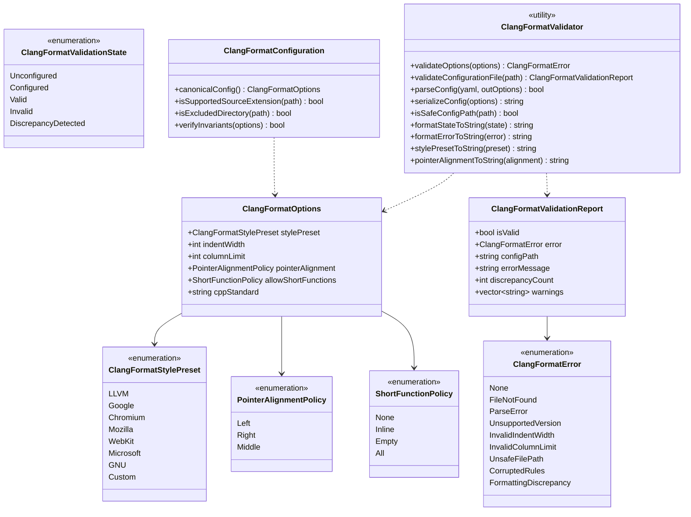
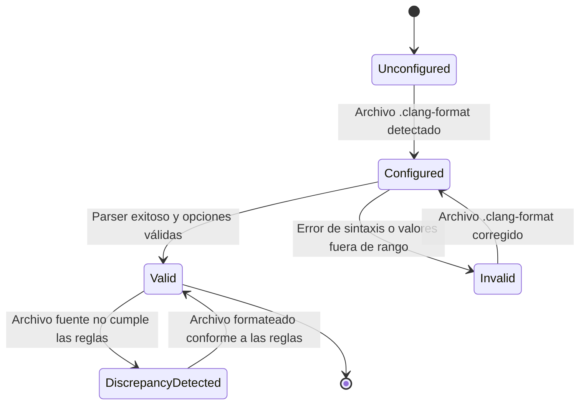

# Change Proposal — module-foundations-task0041

Pack: `module.foundations.task0041`

Status: PROPOSED

## Outcome and scope

Este cambio define la propuesta técnica integral para la etapa **domain** de la capacidad **clang-format configuration** en el módulo propietario `foundations` de Vigilio Browser (microtarea canónica `0041 — Definir el comportamiento y las invariantes: clang-format configuration`).

Habiéndose culminado y certificado en las capacidades precedentes la modularización de targets CMake (`task0001`-`task0004`), la política de diagnósticos y advertencias estrictas (`task0005`-`task0008`), la validación desacoplada de dependencias Qt6 (`task0009`-`task0012`), la compatibilidad de versiones de Chromium WebEngine (`task0013`-`task0016`), la inclusión y catálogo de recursos QRC (`task0017`-`task0020`), el arranque y bootstrap de la aplicación (`task0021`-`task0024`), el ciclo de vida y apagado ordenado (`task0025`-`task0028`), la política integral de recuperación tras caídas (`task0029`-`task0032`), la orquestación de CMake Presets (`task0033`-`task0036`), y la infraestructura de test fixtures desacoplada (`task0037`-`task0040`), esta propuesta formaliza el **modelo de dominio, tipos fuertemente tipados, estructuras inmutables de configuración, parser y serializador determinista de YAML, motor de validación de reglas de estilo e invariantes, y políticas de exclusión/inclusión para la configuración canónica de Clang-Format en Vigilio Browser**.

El alcance concreto comprende:
- **Taxonomía formal y tipos de dominio de Clang-Format (`ClangFormatTypes.h`)**:
  - `ClangFormatStylePreset`: Estilos base de formateo reconocidos (`LLVM`, `Google`, `Chromium`, `Mozilla`, `WebKit`, `Microsoft`, `GNU`, `Custom`).
  - `PointerAlignmentPolicy`: Política de alineación de punteros y referencias (`Left`, `Right`, `Middle`).
  - `ShortFunctionPolicy`: Regla de colocación de cuerpos de funciones cortas en una sola línea (`None`, `Inline`, `Empty`, `All`).
  - `ClangFormatValidationState`: Estados formales del ciclo de vida y validación de la configuración (`Unconfigured`, `Configured`, `Valid`, `Invalid`, `DiscrepancyDetected`).
  - `ClangFormatError`: Clasificación exhaustiva y tipada de errores de formato e infraestructura (`None`, `FileNotFound`, `ParseError`, `UnsupportedVersion`, `InvalidIndentWidth`, `InvalidColumnLimit`, `UnsafeFilePath`, `CorruptedRules`, `FormattingDiscrepancy`).
- **Estructuras de configuración, reporte e inspección inmutables**:
  - `ClangFormatOptions`: Opciones inmutables representativas del archivo canónico `.clang-format` de Vigilio Browser (`stylePreset = LLVM`, `indentWidth = 4`, `columnLimit = 105`, `pointerAlignment = Left`, `allowShortFunctions = None`, `standard = "c++20"`).
  - `ClangFormatValidationReport`: Reporte inmutable de validación que encapsula el estado (`isValid`), código de error (`error`), mensaje explicativo en lenguaje accesible, ruta física del archivo analizado, conteo de discrepancias y lista de advertencias diagnósticas.
  - `SourceFileFormatInspection`: Estructura para registrar los resultados de inspección individual por archivo fuente (ruta relativa normalizada, conformidad estricta, número de líneas examinadas y estado de formato).
- **Funciones puras de diagnóstico y copy público**:
  - `formatStateToString(ClangFormatValidationState)` y `formatErrorToString(ClangFormatError)`: Mapeo determinista hacia cadenas legibles en español neutro, cumpliendo taxativamente la directriz `docs/UX-COPY-PUBLICO.md` (sin jerga técnica interna, sin menciones a «Senior Mode», «Prompt Builder», «DAG» u «OpenSpec»).
  - `stylePresetToString(ClangFormatStylePreset)` y `pointerAlignmentToString(PointerAlignmentPolicy)`: Conversión limpia para reporte y diagnóstico.
- **Validador de reglas, seguridad de rutas y consistencia (`vigilio::ClangFormatValidator`)**:
  - Validador estático desacoplado en C++20 puro, ubicado en `vigilio_core`, libre de dependencias hacia `QApplication`, widgets de Qt o subprocesos de Chromium WebEngine.
  - `validateOptions(const ClangFormatOptions&)`: Verificación de invariantes numéricas y consistencia (v. gr., `indentWidth` acotado entre 2 y 8 espacios, `columnLimit` acotado entre 80 y 140 columnas, política de punteros definida).
  - `validateConfigurationFile(const std::filesystem::path&)`: Verificación formal de existencia, permisos de lectura, prevención de Directory Traversal (`..`), rechazo de rutas fuera de las fronteras autorizadas del proyecto y comprobación de claves obligatorias mínimas.
  - `parseConfig(std::string_view yamlContent, ClangFormatOptions& outOptions)`: Parser ligero, determinista y seguro de subconjunto YAML, libre de dependencias externas pesadas, que procesa las propiedades clave del `.clang-format`.
  - `serializeConfig(const ClangFormatOptions&)`: Serializador determinista que genera el archivo YAML normalizado canónico sin introducir artefactos ni caracteres de control inválidos.
- **Entidad de configuración canónica y filtro de fuentes (`vigilio::ClangFormatConfiguration`)**:
  - Provisión de la configuración canónica del proyecto (`canonicalConfig()`), alineada exactamente con el archivo raíz `apps/vigilio-browser/.clang-format`.
  - Filtro canónico de extensiones de archivo sujetas a formato C++ (`.cpp`, `.h`, `.hpp`, `.cc`, `.cxx`).
  - Filtro canónico de exclusión de directorios (`_build`, `build`, `generated`, `.git`, `.prompt-runner`, `node_modules`).
- **Invariantes constitucionales de calidad, portabilidad y privacidad**:
  - *Local-First Constitucional (ADR-001 / Decisión Q-001)*: Cero consultas de red, cero componentes cloud y cero telemetría remota.
  - *Compilación portable C++20*: Implementación estándar portable para Linux, macOS y Windows con flags estrictas `-Wall -Wextra -Wpedantic -Werror`.
  - *Rendimiento y Zero-Zombie*: Validación en memoria < 5 ms, parsing determinista sin bucles ni recursión no acotada.

---

## Out of scope

- Implementación del servicio de ejecución activa de formateo y subprocesos (`ClangFormatService`) con buffers o ejecución en segundo plano (reservado estrictamente para la etapa `implementation` en `task0042`).
- Creación de paneles o widgets gráficos de configuración en Qt (reservado para la etapa `ui` en `task0043`).
- Suite de pruebas de integración completa y recuperación ante fallos de disco masivos (reservado para la etapa `tests` en `task0044`).
- Modificación directa de archivos bajo `apps/vigilio-browser/src/**`, `apps/vigilio-browser/tests/**` o `CMakeLists.txt` durante esta fase PROPOSE (se ejecutarán exclusivamente durante la fase APPLY tras aprobación humana).
- Modificación de la configuración de Clang-Tidy (capacidad separada gestionada en las microtareas `0045`-`0048`).

---

## Contexto y evidencia

Se realizó una inspección exhaustiva de la base de código actual en `apps/vigilio-browser`:

1. **Configuración existente de `.clang-format`**:
   - Archivo presente en `apps/vigilio-browser/.clang-format`:
     ```yaml
     BasedOnStyle: LLVM
     IndentWidth: 4
     ColumnLimit: 105
     PointerAlignment: Left
     AllowShortFunctionsOnASingleLine: None
     ```
   - Esta configuración define el estándar de estilo vinculante para todo el código C++20 del proyecto.
2. **Mecanismo de verificación actual en `apps/vigilio-browser/scripts/check.sh`**:
   - `check.sh` invoca:
     ```bash
     if command -v clang-format >/dev/null 2>&1; then
         find "$ROOT/src" "$ROOT/tests" -name '*.cpp' -o -name '*.h' | while read -r file; do clang-format --dry-run --Werror "$file"; done
     else
         echo 'clang-format NOT_RUN (not installed)'
     fi
     ```
   - No existe representación programática en `src/core/` para validar, inspeccionar o reportar el estado de esta configuración de manera tipada y desacoplada del script Bash.
3. **Ausencia de abstracción de dominio en `vigilio_core`**:
   - A diferencia de `CMakePresets` (`CMakePresetsTypes.h`, `CMakePresetsValidator.h/.cpp`) y `TestFixture` (`TestFixtureTypes.h`, `TestFixtureValidator.h/.cpp`), `clang-format` carece actualmente de tipos estructurados, validadores de opciones, parsers y generadores de copy accesible.
4. **Estado del pipeline continuo y pruebas**:
   - Compilación limpia con GCC bajo C++20 con `-Werror` y cero advertencias.
   - 15 de 15 pruebas unitarias e integración en CTest pasando exitosamente en 1.10s (100% pass, exit code 0).
5. **Validación de Prompt Builder CLI**:
   - `node /config/Desktop/auto/prompt-builder/dist/cli.js validate-references --project-root .`: 41 referencias canónicas válidas (`valid: true`).
   - `node /config/Desktop/auto/prompt-builder/dist/cli.js verify-lock --lock-file generated/prompts/full-project/0121-module.foundations.task0041.propose.lock.json --project-root .`: 13 comprobaciones aprobadas (`valid: true`).

---

## Alcance exacto

La propuesta formaliza el incremento de la etapa **domain** de la capacidad **clang-format configuration** en el módulo `foundations`:

1. **Definición del modelo de dominio y tipos inmutables (`ClangFormatTypes.h`)**:
   - Enumeraciones tipadas `enum class ClangFormatStylePreset`, `enum class PointerAlignmentPolicy`, `enum class ShortFunctionPolicy`, `enum class ClangFormatValidationState`, `enum class ClangFormatError`.
   - Estructuras `ClangFormatOptions`, `ClangFormatValidationReport`, `SourceFileFormatInspection`.
   - Funciones de conversión a texto puro `formatStateToString`, `formatErrorToString`, `stylePresetToString`, `pointerAlignmentToString`.
2. **Motor de validación de reglas de formato y parser YAML (`ClangFormatValidator.h` / `.cpp`)**:
   - Métodos estáticos puros:
     - `ClangFormatError validateOptions(const ClangFormatOptions& options)`: Valida rangos numéricos (`indentWidth` entre 2 y 8, `columnLimit` entre 80 y 140) y coherencia de políticas.
     - `ClangFormatValidationReport validateConfigurationFile(const std::filesystem::path& configPath)`: Valida existencia física, ruta segura y coherencia de las claves obligatorias.
     - `bool parseConfig(std::string_view yamlContent, ClangFormatOptions& outOptions, std::string* outErrorMessage = nullptr)`: Extrae deterministamente las propiedades clave del archivo `.clang-format`.
     - `std::string serializeConfig(const ClangFormatOptions& options)`: Genera el contenido YAML equivalente canónico.
     - `bool isSafeConfigPath(const std::filesystem::path& path)`: Certifica que la ruta no contenga secuencias de directory traversal (`..`) ni apunte a ubicaciones del sistema no autorizadas.
3. **Entidad de configuración canónica y filtro de fuentes (`ClangFormatConfiguration.h` / `.cpp`)**:
   - `ClangFormatOptions canonicalConfig()`: Retorna la configuración base oficial de Vigilio Browser.
   - `bool isSupportedSourceExtension(const std::filesystem::path& path)`: Identifica si un archivo debe ser validado por Clang-Format (`.cpp`, `.h`, `.hpp`, `.cc`, `.cxx`).
   - `bool isExcludedDirectory(const std::filesystem::path& path)`: Filtra carpetas de compilación, temporales y control de versiones.
4. **Batería de pruebas unitarias de especificación del dominio (`ClangFormatConfigurationTests.cpp`)**:
   - 10 escenarios trazables en CTest (`TEST-FORMAT-001` a `TEST-FORMAT-010`) que certifican el cumplimiento de las invariantes y reglas de dominio.
5. **Integración en `CMakeLists.txt`**:
   - Incorporación de `src/core/ClangFormatValidator.cpp` y `src/core/ClangFormatConfiguration.cpp` a `vigilio_core`.
   - Registro del ejecutable `vigilio_clang_format_tests` y test CTest `clang_format_configuration_tests` con labels `unit;fast`.

---

## Diseño completo de la capacidad



### Ciclo de vida y máquina de estados de validación



---

## Archivos afectados

| Archivo | Acción | Responsabilidad técnica |
| --- | --- | --- |
| `apps/vigilio-browser/src/core/ClangFormatTypes.h` | Crear | Declaración de enumeraciones fuertemente tipadas (`ClangFormatStylePreset`, `PointerAlignmentPolicy`, `ShortFunctionPolicy`, `ClangFormatValidationState`, `ClangFormatError`), estructuras inmutables (`ClangFormatOptions`, `ClangFormatValidationReport`, `SourceFileFormatInspection`) y funciones de conversión a texto legible. |
| `apps/vigilio-browser/src/core/ClangFormatValidator.h` | Crear | Declaración de la clase utilitaria estática `ClangFormatValidator` en el namespace `vigilio`. |
| `apps/vigilio-browser/src/core/ClangFormatValidator.cpp` | Crear | Implementación de las funciones de validación de rangos numéricos, parser y serializador determinista YAML, validación de seguridad de rutas y copy accesible según `docs/UX-COPY-PUBLICO.md`. |
| `apps/vigilio-browser/src/core/ClangFormatConfiguration.h` | Crear | Declaración de la entidad de configuración canónica `ClangFormatConfiguration`, opciones por defecto, extensiones admitidas y exclusiones de carpetas. |
| `apps/vigilio-browser/src/core/ClangFormatConfiguration.cpp` | Crear | Implementación de `canonicalConfig`, filtros de extensión y directorio, y comprobación de invariantes. |
| `apps/vigilio-browser/tests/unit/ClangFormatConfigurationTests.cpp` | Crear | Batería de 10 pruebas unitarias deterministas (`TEST-FORMAT-001` a `TEST-FORMAT-010`) en CTest. |
| `apps/vigilio-browser/CMakeLists.txt` | Modificar | Incorporar `src/core/ClangFormatValidator.cpp` y `src/core/ClangFormatConfiguration.cpp` a la librería `vigilio_core`, definir el ejecutable `vigilio_clang_format_tests` y registrar el test `clang_format_configuration_tests`. |
| `docs/rules/01-modules/foundations/micro/0041-clang-format-configuration/task.md` | Modificar | Sincronizar el estado de la microtarea al completar la etapa domain. |

---

## Contrato UX/UI

- **Sin cambio visual directo**: La capacidad `clang-format configuration` en su etapa `domain` opera como infraestructura interna de calidad de código y análisis estático en `vigilio_core`. No añade elementos visuales a la ventana principal del navegador (`BrowserWindow`).
- **Cumplimiento de textos públicos (`docs/UX-COPY-PUBLICO.md`)**:
  - Toda función de diagnóstico y reporte accesible al usuario o en interfaces de diagnóstico utiliza lenguaje claro y natural en español neutro.
  - Prohibición estricta de términos de ingeniería interna como «Senior Mode», «Modo Senior», «Prompt Builder», «DAG», «OpenSpec» o «toolchain».
  - Mapeo de errores y estados:
    - `ClangFormatValidationState::Valid`: `"Configuración de formato válida"`
    - `ClangFormatValidationState::Invalid`: `"Configuración de formato no válida"`
    - `ClangFormatValidationState::DiscrepancyDetected`: `"Se detectaron diferencias en el formato del código"`
    - `ClangFormatError::None`: `"Sin errores"`
    - `ClangFormatError::FileNotFound`: `"Archivo de configuración no encontrado"`
    - `ClangFormatError::ParseError`: `"Error al leer el archivo de configuración"`
    - `ClangFormatError::InvalidIndentWidth`: `"El ancho de sangría no es válido"`
    - `ClangFormatError::InvalidColumnLimit`: `"El límite de columnas no es válido"`
    - `ClangFormatError::UnsafeFilePath`: `"Ruta de archivo no permitida"`
- **Integración futura con Interfaz más fácil de usar**: Si en etapas posteriores (`task0043`) se exponen métricas de calidad en un diálogo de opciones avanzadas o diagnóstico, se garantizará texto escalable, foco visible y contraste adecuado.

---

## Reglas y fallos

### Invariantes y reglas de validación
1. **Estilo base oficial**: El estilo base obligatorio es `LLVM`. Cualquier configuración que declare un estilo no admitido es rechazada con `ClangFormatError::ParseError`.
2. **Ancho de sangría (`IndentWidth`)**: Debe ser un valor entero par entre 2 y 8 espacios inclusive. El valor canónico del proyecto es `4`. Valores como `0`, números impares no estándar o valores superiores a `8` generan `ClangFormatError::InvalidIndentWidth`.
3. **Límite de columna (`ColumnLimit`)**: Debe ubicarse entre 80 y 140 columnas. El valor canónico de Vigilio Browser es `105`. Valores inferiores a `80` o superiores a `140` devuelven `ClangFormatError::InvalidColumnLimit`.
4. **Alineación de punteros (`PointerAlignment`)**: Debe ser `Left` (estándar canónico del proyecto `Type* ptr` y `Type& ref`).
5. **Funciones cortas en una línea (`AllowShortFunctionsOnASingleLine`)**: Debe ser `None`.
6. **Seguridad y contención de rutas**: El validador rechaza cualquier ruta que contenga secuencias de directory traversal (`..`) o intente acceder a rutas absolutas fuera del árbol del proyecto.
7. **Determinismo YAML**: La serialización y el parseo son bidireccionales y deterministas (prueba de ida y vuelta roundtrip idéntica).

### Manejo de condiciones anómalas
- **Archivo ausente**: Si la ruta configurada no existe en disco, se reporta inmediatamente `ClangFormatError::FileNotFound` sin generar excepciones no controladas ni abortar el proceso.
- **Archivo vacío o malformado**: Si el YAML no contiene pares clave-valor válidos o faltan las claves obligatorias, se asigna `ClangFormatError::ParseError` y `isValid = false`.
- **Ruta no segura**: Intentos de validar rutas con `..` disparan `ClangFormatError::UnsafeFilePath`.
- **Sin asignaciones dinámicas descontroladas**: La lectura se realiza mediante vistas `std::string_view` y parsing iterativo acotado para prevenir consumo indebido de memoria.

---

## Seguridad y privacidad

- **Local-First Constitucional (ADR-001 / Decisión Q-001)**: La validación y configuración de Clang-Format opera estrictamente en local. No genera conexiones de red, no envía telemetría ni interactúa con servidores remotos.
- **Prevención de Directory Traversal**: Validación estricta de rutas mediante `isSafeConfigPath` impidiendo que atacantes o configuraciones erróneas puedan sondear la estructura de archivos del sistema operativo mediante rutas relativas maliciosas.
- **Aislamiento de procesos y memoria**: Ninguna operación del dominio de Clang-Format instancia procesos de Chromium, WebEngine ni componentes MCP. El validador opera en el mismo hilo sin crear hilos adicionales innecesarios.

---

## Matriz de pruebas

| Identificador | Nombre de la prueba | Tipo | Comando / Fixture | Resultado esperado | Criterio de fallo negativo |
| --- | --- | --- | --- | --- | --- |
| `TEST-FORMAT-001` | `test_clang_format_canonical_options` | Unitario (APPLY) | `vigilio_clang_format_tests` | `canonicalConfig()` retorna `LLVM`, `IndentWidth=4`, `ColumnLimit=105`, `PointerAlignment=Left`, `AllowShortFunctions=None`, `standard="c++20"`. | Falla si algún campo difiere de la especificación canónica. |
| `TEST-FORMAT-002` | `test_clang_format_validator_valid_options` | Unitario (APPLY) | `vigilio_clang_format_tests` | `validateOptions` con configuración canónica retorna `ClangFormatError::None`. | Falla si una configuración válida es rechazada. |
| `TEST-FORMAT-003` | `test_clang_format_validator_invalid_indent` | Unitario (APPLY) | `vigilio_clang_format_tests` | `indentWidth=0` o `indentWidth=16` devuelven `ClangFormatError::InvalidIndentWidth`. | Falla si se aceptan sangrías inválidas o nulas. |
| `TEST-FORMAT-004` | `test_clang_format_validator_invalid_column_limit` | Unitario (APPLY) | `vigilio_clang_format_tests` | `columnLimit=30` o `columnLimit=250` devuelven `ClangFormatError::InvalidColumnLimit`. | Falla si se aceptan límites de columna no razonables. |
| `TEST-FORMAT-005` | `test_clang_format_parse_canonical_yaml` | Unitario (APPLY) | `vigilio_clang_format_tests` | Parsea exitosamente el contenido real de `apps/vigilio-browser/.clang-format` produciendo las opciones esperadas. | Falla si no reconoce el formato canónico YAML del proyecto. |
| `TEST-FORMAT-006` | `test_clang_format_serialize_roundtrip` | Unitario (APPLY) | `vigilio_clang_format_tests` | `serializeConfig` produce un YAML que re-parseado genera un `ClangFormatOptions` idéntico. | Falla si hay divergencia tras serializar y deserializar. |
| `TEST-FORMAT-007` | `test_clang_format_missing_mandatory_keys` | Unitario (APPLY) | `vigilio_clang_format_tests` | YAML sin `BasedOnStyle` o sin `ColumnLimit` es rechazado con error descriptivo. | Falla si se acepta un archivo de configuración incompleto. |
| `TEST-FORMAT-008` | `test_clang_format_unsafe_path_rejection` | Unitario (APPLY) | `vigilio_clang_format_tests` | Rutas con `../../etc/.clang-format` o `/etc/shadow` son rechazadas por `isSafeConfigPath`. | Falla si se procesa una ruta maliciosa con directory traversal. |
| `TEST-FORMAT-009` | `test_clang_format_file_extensions_and_exclusions` | Unitario (APPLY) | `vigilio_clang_format_tests` | `.cpp`, `.h`, `.hpp` son aceptados; `.json`, `.md`, `.txt`, `.qrc` son rechazados; carpetas `_build`, `generated` son excluidas. | Falla si se intenta formatear archivos no C++ o carpetas de build. |
| `TEST-FORMAT-010` | `test_clang_format_public_copy_compliance` | Unitario (APPLY) | `vigilio_clang_format_tests` | `formatErrorToString` y `formatStateToString` devuelven textos en español sin términos prohibidos («Senior Mode», «Prompt Builder», «DAG»). | Falla si aparecen términos técnicos internos prohibidos en el copy público. |

- *Clasificación de pruebas*:
  - **APPLY**: Pruebas unitarias puras (`TEST-FORMAT-001` a `TEST-FORMAT-010`) ejecutables en CTest headless (< 50 ms).
  - **LATER**: Pruebas de integración del servicio de ejecución (`task0042`), pruebas de diálogo/UI (`task0043`) y pruebas de resiliencia y concurrencia (`task0044`).
  - **NOT_APPLICABLE**: Pruebas con navegación WebEngine viva, perfiles de Chromium o dependencias de red externa.

---

## Pasos APPLY

1. **Crear tipos y modelos de datos**: Implementar `apps/vigilio-browser/src/core/ClangFormatTypes.h` con enumeraciones fuertemente tipadas y estructuras inmutables.
2. **Declarar interfaz del validador**: Crear `apps/vigilio-browser/src/core/ClangFormatValidator.h` definiendo los métodos estáticos de validación, parser YAML, serialización y copy público.
3. **Implementar validador y parser**: Crear `apps/vigilio-browser/src/core/ClangFormatValidator.cpp` con las comprobaciones de rango, parsing de pares clave-valor YAML, seguridad de rutas y cadenas en español.
4. **Declarar e implementar configuración canónica**: Crear `apps/vigilio-browser/src/core/ClangFormatConfiguration.h` y `apps/vigilio-browser/src/core/ClangFormatConfiguration.cpp` con `canonicalConfig()`, filtros de extensiones (`.cpp`, `.h`, `.hpp`) y exclusiones de directorios.
5. **Implementar suite de pruebas unitarias**: Crear `apps/vigilio-browser/tests/unit/ClangFormatConfigurationTests.cpp` con los 10 escenarios trazables.
6. **Actualizar `CMakeLists.txt`**: Añadir los nuevos archivos `.cpp` a la biblioteca `vigilio_core`, definir el ejecutable `vigilio_clang_format_tests` y vincular el test `clang_format_configuration_tests` en CTest con labels `unit;fast`.
7. **Verificar compilación y tests**: Ejecutar `bash apps/vigilio-browser/scripts/check.sh` certificando compilación limpia con `-Werror` y 16/16 pruebas en verde.
8. **Validar referencias canónicas y lockfile**: Ejecutar `validate-references` y `verify-lock` con Prompt Builder CLI.
9. **Sincronizar documentación de microtarea**: Actualizar `docs/rules/01-modules/foundations/micro/0041-clang-format-configuration/task.md`.

---

## Definición de terminado

- [ ] Modelo de dominio de Clang-Format formalizado en `ClangFormatTypes.h`.
- [ ] Validador estático de reglas y parser YAML implementado en `ClangFormatValidator.h` y `ClangFormatValidator.cpp`.
- [ ] Entidad de configuración canónica y reglas de inclusión/exclusión implementadas en `ClangFormatConfiguration.h` y `ClangFormatConfiguration.cpp`.
- [ ] 10 pruebas unitarias de especificación implementadas en `ClangFormatConfigurationTests.cpp` pasando en CTest al 100%.
- [ ] Target `vigilio_core` y test `clang_format_configuration_tests` registrados en `CMakeLists.txt`.
- [ ] Cero advertencias de compilador bajo `-Wall -Wextra -Wpedantic -Werror` y formato verificado con Clang-Format.
- [ ] Cumplimiento total de textos públicos conforme a `docs/UX-COPY-PUBLICO.md`.
- [ ] Aprobación de `validate-references` y `verify-lock` mediante Prompt Builder CLI.

---

## Dependencias y riesgos

- **Dependencias ejecutables**: `module.foundations.task0040` (completada y certificada).
- **Riesgos identificados**:
  - *Riesgo 1*: Divergencia entre el archivo físico `.clang-format` y las opciones representadas en el código C++.
    *Mitigación*: La prueba `TEST-FORMAT-005` parsea directamente el archivo físico del repositorio y verifica su coincidencia exacta con `canonicalConfig()`.
  - *Riesgo 2*: Ambigüedad en sintaxis YAML si se agregan opciones avanzadas en el futuro.
    *Mitigación*: El parser de `ClangFormatValidator` se enfoca de manera robusta en las directivas canónicas clave utilizadas en Vigilio Browser, con manejo seguro de comentarios y espacios en blanco.
  - *Riesgo 3*: Introducción involuntaria de jerga técnica en cadenas de error visibles.
    *Mitigación*: `TEST-FORMAT-010` audita programáticamente que ninguna cadena generada contenga palabras restringidas por la política de copy público.

---

## Commit propuesto

`docs(foundations): domain clang-format-configuration`
