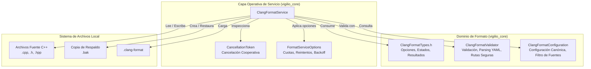
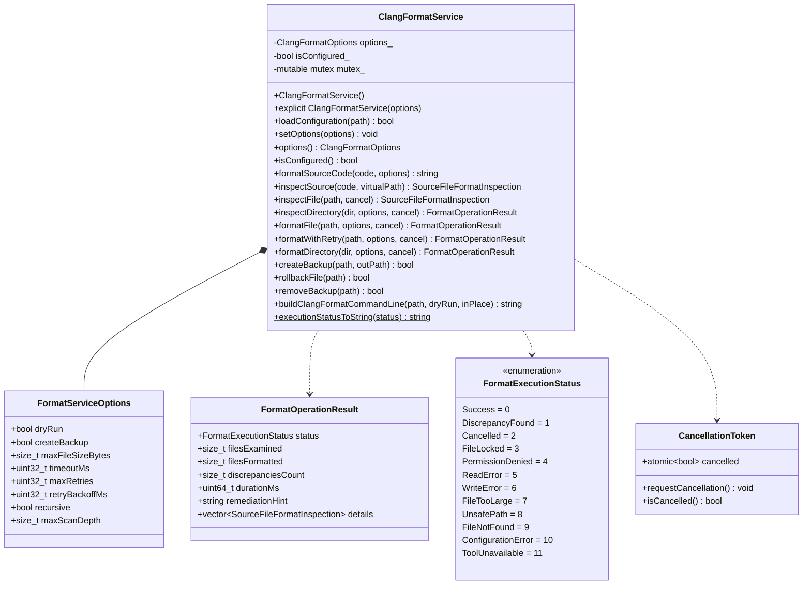
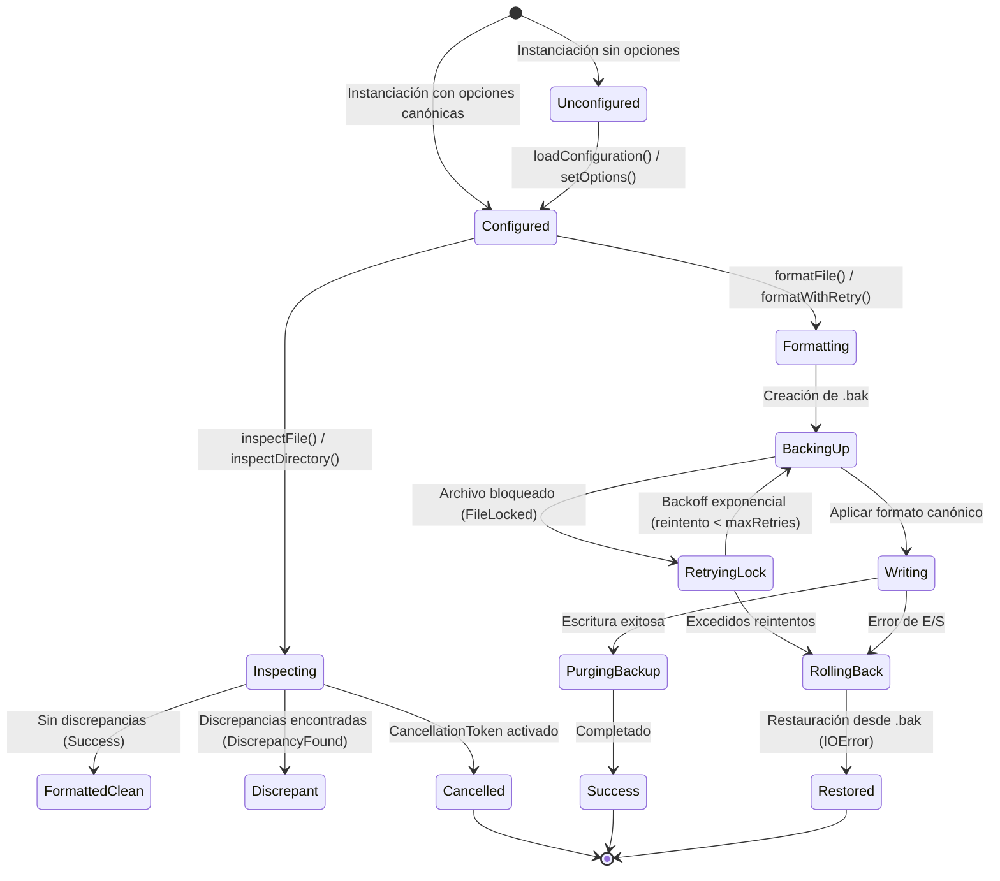

# Design — module-foundations-task0042

Status: PROPOSED

## Current, target and gaps

### Estado actual (CURRENT)

1. **Modelo de dominio de Clang-Format establecido pero sin capa operativa de servicio**:
   - En la etapa precedente (`task0041`), se implementó la taxonomía de dominio en `ClangFormatTypes.h`, el validador estático desacoplado `ClangFormatValidator` (con parsing y serialización determinista de YAML y chequeo de seguridad de rutas) y `ClangFormatConfiguration` con la configuración canónica oficial.
   - Sin embargo, no existe una capa de servicio operativa (`ClangFormatService`) que consuma estas abstracciones para realizar inspecciones en modo dry-run, formatear archivos o directorios de forma segura, gestionar reintentos o permitir cancelación cooperativa.
2. **Validación ligada a scripts Bash externos**:
   - La comprobación continua de formato en el proyecto reside actualmente en llamadas de shell en `apps/vigilio-browser/scripts/check.sh` (`clang-format --dry-run --Werror "$file"`).
   - No existe un mecanismo programático en C++20 para que otros componentes internos de `vigilio_core`, arneses de pruebas o futuras interfaces de usuario puedan consultar o invocar operaciones de formateo e inspección de forma controlada y segura.
3. **Ausencia de tolerancia a fallos de archivo y contención**:
   - No hay protocolo de reintentos con retroceso exponencial (*exponential backoff*) ante bloqueos transitorios de archivos abiertos por editores de código o procesos concurrentes en plataformas como Windows.
4. **Falta de mecanismos de respaldo atómico y reversión**:
   - Modificar archivos en disco sin respaldo expone al usuario a corrupción en caso de fallos de alimentación, disco lleno o interrupciones forzadas.
5. **Carencia de cancelación cooperativa multihilo (Riesgo de procesos zombi)**:
   - El escaneo recursivo de directorios o colecciones de archivos no puede ser interrumpido de forma limpia desde otro hilo sin forzar la terminación abrupta del proceso.

---

### Estado objetivo (TARGET)

1. **Capa operativa de servicio desacoplada (`vigilio::ClangFormatService`)**:
   - Ubicada en `src/core/`, compilada dentro de `vigilio_core`.
   - Libre de dependencias hacia `QApplication`, widgets de Qt o subprocesos de Chromium WebEngine.
   - Proporciona una interfaz fluida y segura para configurar, inspeccionar en memoria, ejecutar dry-run sobre archivos y directorios, y formatear código con respaldo y reversión automática.
2. **Inspección en modo Dry-Run sin mutaciones**:
   - Los métodos `inspectFile` e `inspectDirectory` analizan archivos fuente (`.cpp`, `.h`, `.hpp`, `.cc`, `.cxx`) ignorando directorios excluidos (`_build`, `build`, `generated`, `.git`, `.prompt-runner`), detectando discrepancias de estilo sin alterar el sistema de archivos.
3. **Resiliencia ante bloqueos de archivos (`formatWithRetry`)**:
   - Implementa un bucle de reintento determinista con retroceso exponencial (`50ms * 2^i`) configurable ante fallos transitorios de E/S o contención de bloqueos.
4. **Respaldos atómicos y Rollback seguro**:
   - Todo formateo destructivo crea preventivamente una copia `.bak`. En caso de fallo durante la escritura, se restaura automáticamente el archivo original mediante `rollbackFile`.
5. **Cancelación cooperativa multihilo (Zero-Zombie)**:
   - Integración con `CancellationToken*`: inspección continua en bucles de escaneo para detener inmediatamente el procesamiento si el usuario o el arnés de prueba solicita cancelación.
6. **Límites estrictos de memoria y profundidad de escaneo**:
   - Rechazo categórico de archivos mayores a 10 MB (`FileTooLarge`) para prevenir desbordamientos de memoria.
   - Límite de profundidad de recorrido de directorios fijado en 32 niveles.
7. **Suite de pruebas unitarias trazables en CTest**:
   - 12 pruebas unitarias deterministas en `tests/unit/ClangFormatServiceTests.cpp` ejecutándose en menos de 150 ms con cero advertencias de compilador.

---

### Brechas identificadas (GAPS)

| Componente | Estado actual | Estado objetivo | Brecha a subsanar (GAP) |
| --- | --- | --- | --- |
| Tipos operativos de servicio | Solo tipos de dominio en `ClangFormatTypes.h` | `FormatExecutionStatus`, `FormatOperationResult`, `FormatServiceOptions`, `CancellationToken` | Extender `ClangFormatTypes.h` con tipos operativos. |
| Servicio de formateo | No existe `ClangFormatService` | Clase `ClangFormatService` en `src/core/` con API completa | Implementar `ClangFormatService.h` y `ClangFormatService.cpp`. |
| Resiliencia y reintentos | Sin reintentos ante bloqueo de archivos | `formatWithRetry` con backoff exponencial configurable | Implementar lógica de reintento y espera progresiva. |
| Respaldo y Rollback | Sin copias de seguridad antes de formatear | Creación de `.bak`, restauración con `rollbackFile` y purga con `removeBackup` | Implementar copiado atómico y restauración ante error. |
| Cancelación multihilo | Sin soporte de cancelación | Integración con `CancellationToken` en todas las operaciones | Comprobar `isCancelled()` en bucles de escaneo y E/S. |
| Control de cuotas de E/S | Sin límite de tamaño por archivo | Rechazo de archivos > 10 MB con estado `FileTooLarge` | Verificar tamaño en metadatos antes de leer contenido. |
| Pruebas operativas | 10 pruebas de dominio (`ClangFormatConfigurationTests.cpp`) | 12 pruebas unitarias operativas en `ClangFormatServiceTests.cpp` | Crear suite exhaustiva de tests para el servicio. |
| Build e integración CTest | Target de servicio no registrado | Target ejecutable `vigilio_clang_format_service_tests` en CTest | Modificar `CMakeLists.txt` registrando fuentes y test. |

---

## Compatibility, migration and rollback

### Compatibilidad y estándares C++20
- Implementación conforme a la norma ISO C++20 utilizando exclusivamente bibliotecas de la STL: `<filesystem>`, `<fstream>`, `<chrono>`, `<thread>`, `<atomic>`, `<mutex>`, `<string>`, `<string_view>`, `<vector>`, `<optional>`, `<algorithm>`.
- Totalmente portable entre plataformas Linux (GCC/Clang), macOS (Apple Clang) y Windows (MSVC 2022).
- Cumplimiento riguroso de las banderas estrictas del compilador: `-Wall -Wextra -Wpedantic -Wconversion -Wsign-conversion -Wshadow -Werror`.
- Cero dependencias hacia `QApplication`, widgets de interfaz gráfica o el motor Chromium WebEngine.

### Estrategia de migración
- La incorporación de `ClangFormatService` es un incremento puramente aditivo en `vigilio_core`.
- No modifica ni invalida el modelo de dominio establecido en `task0041` (`ClangFormatValidator` y `ClangFormatConfiguration`).
- Preserva la funcionalidad de los scripts existentes (`apps/vigilio-browser/scripts/check.sh`), proporcionando una base programática moderna que podrá ser aprovechada en la etapa de UI (`task0043`).

### Plan de contingencia y rollback
- En caso de anomalías o regresiones durante la fase APPLY:
  - Revertir los cambios en `apps/vigilio-browser/src/core/ClangFormatTypes.h`.
  - Eliminar `apps/vigilio-browser/src/core/ClangFormatService.h` y `.cpp`.
  - Eliminar `apps/vigilio-browser/tests/unit/ClangFormatServiceTests.cpp`.
  - Revertir `apps/vigilio-browser/CMakeLists.txt` a su estado previo.
  - El sistema de build y los 16 tests existentes permanecerán completamente inalterados y operativos.

---

## Arquitectura técnica de clang-format configuration (implementation)

### Diagrama de componentes y flujo operativo



### Diagrama de clases y relaciones



### Máquina de estados operativos de formateo



### Interfaces y contratos de ClangFormatService

```cpp
namespace vigilio {

class ClangFormatService {
  public:
    ClangFormatService();
    explicit ClangFormatService(const ClangFormatOptions& options);
    ~ClangFormatService() = default;

    // Configuración del servicio
    [[nodiscard]] bool loadConfiguration(const std::filesystem::path& configPath);
    void setOptions(const ClangFormatOptions& options) noexcept;
    [[nodiscard]] const ClangFormatOptions& options() const noexcept;
    [[nodiscard]] bool isConfigured() const noexcept;

    // Inspección y formateo en memoria pura
    [[nodiscard]] std::string formatSourceCode(std::string_view sourceCode, const ClangFormatOptions& options);
    [[nodiscard]] SourceFileFormatInspection inspectSource(std::string_view sourceCode,
                                                           std::string_view virtualPath = "virtual.cpp");

    // Inspección en disco (Modo Dry-Run)
    [[nodiscard]] SourceFileFormatInspection inspectFile(const std::filesystem::path& filePath,
                                                         CancellationToken* cancel = nullptr);
    [[nodiscard]] FormatOperationResult inspectDirectory(const std::filesystem::path& dirPath,
                                                         const FormatServiceOptions& options = {},
                                                         CancellationToken* cancel = nullptr);

    // Formateo en disco con resiliencia y respaldo
    [[nodiscard]] FormatOperationResult formatFile(const std::filesystem::path& filePath,
                                                   const FormatServiceOptions& options = {},
                                                   CancellationToken* cancel = nullptr);
    [[nodiscard]] FormatOperationResult formatWithRetry(const std::filesystem::path& filePath,
                                                        const FormatServiceOptions& options = {},
                                                        CancellationToken* cancel = nullptr);
    [[nodiscard]] FormatOperationResult formatDirectory(const std::filesystem::path& dirPath,
                                                        const FormatServiceOptions& options = {},
                                                        CancellationToken* cancel = nullptr);

    // Gestión atómica de respaldos
    [[nodiscard]] bool createBackup(const std::filesystem::path& filePath, std::string* outBackupPath = nullptr);
    [[nodiscard]] bool rollbackFile(const std::filesystem::path& filePath);
    [[nodiscard]] bool removeBackup(const std::filesystem::path& filePath);

    // Integración CLI
    [[nodiscard]] std::string buildClangFormatCommandLine(const std::filesystem::path& targetPath,
                                                          bool dryRun = true, bool inPlace = false) const;

    // Conversión de diagnósticos y UX Copy
    [[nodiscard]] static std::string executionStatusToString(FormatExecutionStatus status);

  private:
    ClangFormatOptions options_;
    bool isConfigured_{false};
    mutable std::mutex mutex_;
};

} // namespace vigilio
```

### Manejo de errores recuperables y reintentos (exponential backoff)
- En `formatWithRetry`, cuando un archivo no puede abrirse debido a contención de bloqueos (`std::errc::permission_denied` o `std::errc::device_or_resource_busy`), el servicio aplica un algoritmo de espera exponencial:
  $$\text{waitMs} = \text{retryBackoffMs} \times 2^{\text{attempt}}$$
- Predeterminado: intento 0 espera 50 ms, intento 1 espera 100 ms, intento 2 espera 200 ms. Si tras `maxRetries = 3` el archivo permanece inaccesible, se cancela la operación y se restaura el archivo previo.

### Cancelación cooperativa multihilo y política Zero-Zombie
- Todas las operaciones que involucran bucles de procesamiento (como `inspectDirectory`, `formatDirectory` y `formatWithRetry`) reciben un puntero opcional a `CancellationToken`.
- Al inicio de cada iteración y antes de cada operación de E/S, se evalúa:
  ```cpp
  if (cancel && cancel->isCancelled()) {
      result.status = FormatExecutionStatus::Cancelled;
      result.remediationHint = "La verificación de formato fue cancelada por el usuario.";
      return result;
  }
  ```
- Ningún hilo o subproceso espera bloqueos indefinidamente.

### Prevención de corrupción y preservación de copias de seguridad (.bak)
- Cuando `options.createBackup == true`, antes de sobrescribir cualquier archivo se genera una copia en `path.string() + ".bak"`.
- Si la escritura del archivo formateado falla, se ejecuta `rollbackFile` para sobreescribir la mutación parcial con el contenido íntegro del `.bak`.
- Solo tras comprobar que el archivo formateado fue escrito exitosamente en su totalidad se purga el archivo `.bak` vía `removeBackup`.

### Concurrencia y aislamiento en CTest
- Las suites de prueba CTest (`vigilio_clang_format_service_tests`) operan sobre directorios temporales aislados creados mediante prefijos únicos con identificador de proceso (PID) y reloj de alta resolución (`vigilio_fmt_srv_XXXXXX`).
- Cada prueba limpia sus artefactos en el teardown, garantizando ejecución determinista en entornos paralelos `ctest -jN`.
