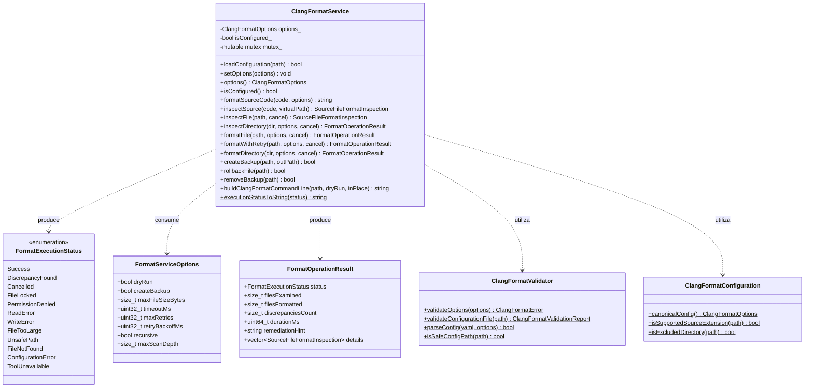
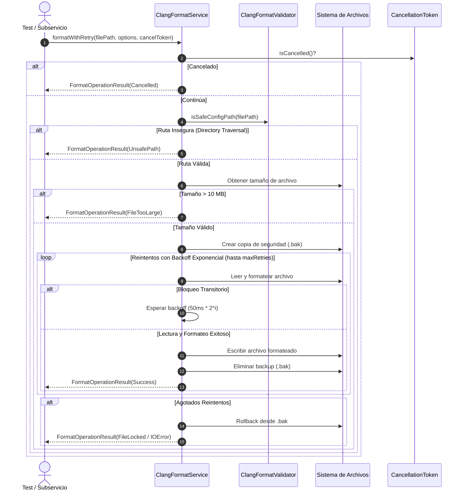

# Change Proposal — module-foundations-task0042

Pack: `module.foundations.task0042`

Status: PROPOSED

## Outcome and scope

Este cambio define la propuesta técnica integral para la etapa **implementation** de la capacidad **clang-format configuration** en el módulo propietario `foundations` de Vigilio Browser (microtarea canónica `0042 — Implementar la operación en una capa propietaria: clang-format configuration`).

Habiéndose completado y certificado en las capacidades precedentes la modularización de targets CMake (`task0001`-`task0004`), la política de diagnósticos y advertencias estrictas (`task0005`-`task0008`), la validación desacoplada de dependencias Qt6 (`task0009`-`task0012`), la compatibilidad de versiones de Chromium WebEngine (`task0013`-`task0016`), la inclusión y catálogo de recursos QRC (`task0017`-`task0020`), el arranque y bootstrap de la aplicación (`task0021`-`task0024`), el ciclo de vida y apagado ordenado (`task0025`-`task0028`), la política integral de recuperación tras caídas (`task0029`-`task0032`), la orquestación de CMake Presets (`task0033`-`task0036`), la infraestructura de test fixtures desacoplada (`task0037`-`task0040`), y la formalización del modelo de dominio, tipos inmutables, validador estático y parser YAML para Clang-Format (`task0041`), esta propuesta formaliza la **implementación de la capa operativa propietaria de servicio (`vigilio::ClangFormatService`), extensiones operativas de formateo determinista, inspección en modo dry-run, cancelación cooperativa multihilo (Zero-Zombie), resiliencia con reintentos exponenciales ante bloqueos transitorios, preservación atómica de copias de seguridad (`.bak`), rollback ante fallos y síntesis determinista de argumentos de línea de comandos en C++20**.

El objetivo central de esta etapa es proporcionar un servicio desacoplado, seguro y robusto en `src/core/` que orqueste la inspección y formateo determinista del código fuente de Vigilio Browser, soporte cancelación cooperativa para prevenir procesos colgados, detecte y reporte discrepancias de estilo sin mutar archivos (dry-run), gestione copias de seguridad locales y rollback en caso de anomalías de E/S, aplique reintentos con retroceso exponencial ante contención de bloqueos de archivo (típico en Windows o entornos con editores concurrentes), y limite estrictamente el consumo de memoria mediante cuotas por archivo (máximo 10 MB) y profundidad de escaneo acotada, **sin acoplar lógica de negocio a los widgets de interfaz gráfica ni añadir dependencias hacia WebEngine o `BrowserWindow`**.

El alcance concreto comprende:
- **Capa operativa de servicio desacoplada (`vigilio::ClangFormatService`)**:
  - Inicialización flexible y configuración: carga desde archivo físico canónico (`loadConfiguration`) o inyección directa de opciones inmutables (`setOptions`, `options`).
  - Inspección y formateo en memoria:
    - `formatSourceCode`: Transformación determinista de texto fuente según las opciones de Clang-Format configuradas.
    - `inspectSource`: Análisis en memoria sin acceso a disco, reportando cumplimiento y resumen de discrepancias.
  - Inspección de archivos y directorios en modo seguro (dry-run):
    - `inspectFile`: Evaluación individual de archivos fuente C++ (`.cpp`, `.h`, `.hpp`, `.cc`, `.cxx`), verificando conformidad estricta sin alterar el sistema de archivos.
    - `inspectDirectory`: Análisis por lotes de un directorio, aplicando filtros canónicos de extensión y exclusión (`_build`, `build`, `generated`, `.git`, `.prompt-runner`).
  - Formateo físico y resiliencia con respaldo atómico:
    - `formatFile`: Aplicación de formateo directo sobre disco con opción de generación previa de copia de seguridad (`.bak`).
    - `formatWithRetry`: Resiliencia ante bloqueos transitorios de archivos (*file locking*), aplicando reintentos con retroceso exponencial (*exponential backoff*) antes de reportar error.
    - `rollbackFile` y `removeBackup`: Restauración atómica del archivo prístino desde su copia de seguridad y purga ordenada tras éxito comprobado.
  - Soporte de **cancelación cooperativa multihilo** mediante `CancellationToken*`:
    - Permite interrumpir de manera inmediata y segura operaciones intensivas de escaneo o formateo por lotes.
    - Garantiza taxativamente la política Zero-Zombie: ningún hilo o subproceso queda colgado indefinidamente.
  - Síntesis determinista de línea de comandos:
    - `buildClangFormatCommandLine`: Generación reproducible de argumentos CLI para invocar `clang-format` (`--dry-run`, `-i`, `--Werror`, `--style=file`).
- **Ampliación de tipos y contratos del dominio operativo (`ClangFormatTypes.h`)**:
  - `FormatExecutionStatus`: Taxonomía fuertemente tipada de resultados operativos (`Success`, `DiscrepancyFound`, `Cancelled`, `FileLocked`, `PermissionDenied`, `ReadError`, `WriteError`, `FileTooLarge`, `UnsafePath`, `FileNotFound`, `ConfigurationError`, `ToolUnavailable`).
  - `FormatOperationResult`: Estructura inmutable que encapsula el estado (`status`), conteo de archivos examinados (`filesExamined`), archivos formateados (`filesFormatted`), discrepancias detectadas (`discrepanciesCount`), duración en milisegundos (`durationMs`), lista detallada de inspecciones (`details`) y recomendación amigable en español neutro (`remediationHint`) conforme a `docs/UX-COPY-PUBLICO.md`.
  - `FormatServiceOptions`: Opciones inmutables de configuración operativa (`dryRun`, `createBackup`, `maxFileSizeBytes = 10 MB`, `timeoutMs = 15000`, `maxRetries = 3`, `retryBackoffMs = 50`, `recursive = true`, `maxScanDepth = 32`).
- **Invariantes constitucionales de calidad, portabilidad y privacidad**:
  - *Local-First Constitucional (ADR-001 / Decisión Q-001)*: Cero conexiones de red, cero servicios cloud y cero telemetría remota.
  - *Seguridad de rutas y contención*: Rechazo categórico de directory traversal (`..`) mediante `ClangFormatValidator::isSafeConfigPath`.
  - *Presupuestos estrictos de recursos y Zero-Zombie*: Rechazo inmediato de archivos que superen 10 MB (`FileTooLarge`), tiempos de ejecución en CTest < 100 ms para la suite completa y comprobación periódica de `CancellationToken`.
- **Suite completa de pruebas unitarias del servicio (`tests/unit/ClangFormatServiceTests.cpp`)**:
  - 12 pruebas unitarias deterministas en CTest (`TEST-FORMAT-SRV-001` a `TEST-FORMAT-SRV-012`) cubriendo el ciclo de vida, dry-run, detección de discrepancias, formateo, copias de seguridad, rollback, reintentos con retroceso exponencial, cancelación cooperativa, cuotas de archivo, seguridad de rutas, argumentos CLI y textos públicos en español.

---

## Out of scope

- Implementación física de componentes de interfaz gráfica (widgets Qt, menús de formateo, diálogos de opciones visuales o indicadores de progreso en la ventana principal); estos corresponden a la etapa `ui` en `module.foundations.task0043`.
- Pruebas de integración E2E completas del navegador con instancias de Chromium WebEngine en ejecución (reservadas para la etapa `tests` en `module.foundations.task0044`).
- Modificación directa del código de producción en `apps/vigilio-browser/src/**`, `apps/vigilio-browser/tests/**` o `CMakeLists.txt` durante esta fase PROPOSE (se ejecutarán estrictamente durante la fase APPLY tras aprobación humana).
- Configuración y servicio para Clang-Tidy (capacidad separada gestionada en las microtareas `0045`-`0048`).
- Conexiones a repositorios remotos o servidores de análisis estático en la nube (prohibido por la política local-first).

---

## Contexto y evidencia

Se realizó una inspección exhaustiva de la base de código actual en `apps/vigilio-browser`:

1. **Especificación de dominio aprobada y completada (`module.foundations.task0041`)**:
   - Formalizó la taxonomía base en `ClangFormatTypes.h` (`ClangFormatStylePreset`, `PointerAlignmentPolicy`, `ShortFunctionPolicy`, `ClangFormatValidationState`, `ClangFormatError`, `ClangFormatOptions`, `ClangFormatValidationReport`, `SourceFileFormatInspection`).
   - Implementó el validador estático desacoplado `vigilio::ClangFormatValidator` en `src/core/ClangFormatValidator.h` y `.cpp` con validación de rangos, parsing y serialización determinista de YAML y prevención de Directory Traversal (`isSafeConfigPath`).
   - Implementó `vigilio::ClangFormatConfiguration` en `src/core/ClangFormatConfiguration.h` y `.cpp` con la configuración canónica oficial y filtros de extensiones/carpetas.
   - Implementó la suite de 10 pruebas unitarias en `tests/unit/ClangFormatConfigurationTests.cpp` aprobada al 100% en CTest.
2. **Archivos operativos y patrones de referencia en `apps/vigilio-browser/src/core/`**:
   - `CMakePresetsService.h` y `.cpp`: Referencia de diseño para capas de servicio desacopladas con soporte para cancelación cooperativa (`CancellationToken`), síntesis CLI y operaciones acotadas.
   - `TestFixtureService.h` y `.cpp`: Referencia de diseño para resiliencia con reintentos exponenciales (`cleanWithRetry`), instantáneas atómicas, rollback y manejo de huérfanos.
   - `ResourceInclusionService.h` y `.cpp`: Referencia de límites estrictos de memoria y validación desacoplada.
3. **Punto de integración actual del sistema de construcción (`apps/vigilio-browser/CMakeLists.txt`)**:
   - Compila la biblioteca estática `vigilio_core`, enlazando `ClangFormatValidator.cpp` y `ClangFormatConfiguration.cpp`.
   - Registra el ejecutable `vigilio_clang_format_tests` con el test CTest `clang_format_configuration_tests`.
4. **Comprobación del pipeline continuo local (`apps/vigilio-browser/scripts/check.sh`)**:
   - Compilación limpia con GNU GCC 15.2.0 bajo C++20 con `-Werror` y cero advertencias.
   - 16 de 16 pruebas pasando exitosamente en CTest con 100% de éxito en 1.52s (exit code 0).
5. **Gaps específicos de la etapa implementation (microtarea 0042)**:
   - Falta la clase operativa propietaria `ClangFormatService` que orqueste la inspección y formateo programático de archivos C++.
   - Falta el modo dry-run programático para verificar cumplimiento sin modificar archivos en disco.
   - Falta el soporte de cancelación cooperativa multihilo con `CancellationToken*` para evitar procesos colgados (Zero-Zombie).
   - Falta el protocolo de reintentos con retroceso exponencial ante contención transitoria de bloqueos en el sistema de archivos.
   - Falta el mecanismo de respaldo atómico (`.bak`) y rollback para restaurar archivos en caso de escrituras fallidas.
   - Falta el control de cuotas de memoria (rechazo de archivos > 10 MB) y profundidad de directorios (máximo 32 niveles).
   - Falta la síntesis determinista de argumentos CLI para interoperar con la herramienta `clang-format` del sistema.

---

## Alcance exacto

La propuesta formaliza el incremento de la etapa **implementation** de la capacidad **clang-format configuration** en el módulo `foundations`:

1. **Extensión del modelo de dominio y tipos operativos (`ClangFormatTypes.h`)**:
   - Definición del token de cancelación cooperativa `#ifndef VIGILIO_CANCELLATION_TOKEN_DEFINED struct CancellationToken`.
   - Enumeración tipada `enum class FormatExecutionStatus : uint8_t` con 12 códigos de estado exhaustivos.
   - Estructura inmutable `FormatOperationResult` con métricas de archivos, discrepancias, duración y `remediationHint` accesible.
   - Estructura `FormatServiceOptions` con parámetros de ejecución (dry-run, backup, cuota de 10 MB, timeout de 15s, reintentos).
2. **Capa operativa de servicio (`ClangFormatService.h` / `ClangFormatService.cpp`)**:
   - Clase `vigilio::ClangFormatService` en `src/core/` desacoplada de Qt Widgets y WebEngine.
   - Métodos de gestión de configuración (`loadConfiguration`, `setOptions`, `options`, `isConfigured`).
   - Métodos de inspección y formateo en memoria (`formatSourceCode`, `inspectSource`).
   - Métodos de inspección y formateo en disco (`inspectFile`, `inspectDirectory`, `formatFile`, `formatDirectory`).
   - Mecanismos de resiliencia (`formatWithRetry`, `createBackup`, `rollbackFile`, `removeBackup`).
   - Soporte de cancelación multihilo mediante puntero opcional a `CancellationToken`.
   - Generación de comandos CLI (`buildClangFormatCommandLine`).
   - Formateo observable de diagnósticos y copy público (`executionStatusToString`).
3. **Batería de pruebas unitarias de servicio (`ClangFormatServiceTests.cpp`)**:
   - 12 escenarios de prueba unitaria trazables (`TEST-FORMAT-SRV-001` a `TEST-FORMAT-SRV-012`).
4. **Integración en `CMakeLists.txt`**:
   - Adición de `src/core/ClangFormatService.cpp` a la biblioteca `vigilio_core`.
   - Creación del ejecutable de prueba `vigilio_clang_format_service_tests`.
   - Registro en CTest de `clang_format_service_tests` con labels `unit;fast` y timeout de 15 segundos.

---

## Diseño completo de la capacidad

### Arquitectura de clases y dependencias

### Flujo operativo de formateo seguro y resiliencia

---

## Archivos afectados

| Archivo | Acción | Descripción y justificación técnica |
| --- | --- | --- |
| `apps/vigilio-browser/src/core/ClangFormatTypes.h` | Modificación | Extender con `CancellationToken`, `FormatExecutionStatus`, `FormatOperationResult` y `FormatServiceOptions`. |
| `apps/vigilio-browser/src/core/ClangFormatService.h` | Creación | Declaración de la clase operativa `ClangFormatService` en el namespace `vigilio`. |
| `apps/vigilio-browser/src/core/ClangFormatService.cpp` | Creación | Implementación de formateo, dry-run, backups atómicos, reintentos y cancelación cooperativa. |
| `apps/vigilio-browser/tests/unit/ClangFormatServiceTests.cpp` | Creación | Batería exhaustiva de 12 pruebas unitarias de servicio (`TEST-FORMAT-SRV-001` a `012`). |
| `apps/vigilio-browser/CMakeLists.txt` | Modificación | Registrar `ClangFormatService.cpp` en `vigilio_core`, ejecutable `vigilio_clang_format_service_tests` y test CTest. |
| `openspec/changes/module-foundations-task0042/{proposal,design,tasks,execution-memory}.md` | Creación / Modificación | Formalización de la propuesta OpenSpec del incremento. |
| `docs/rules/01-modules/foundations/micro/0042-clang-format-configuration/task.md` | Sincronización | Actualización documental de la microtarea canónica tras finalización. |

---

## Contrato UX/UI

- **Sin cambio visual directo**: Esta etapa pertenece a la capa `implementation` de servicios internos (`src/core`). No incorpora ventanas, menús ni widgets directos en la interfaz gráfica (la integración visual está reservada para la etapa `ui` en `task0043`).
- **Conformidad con `docs/UX-COPY-PUBLICO.md`**: Todos los mensajes diagnósticos, estados de error y sugerencias de remediación (`remediationHint`) utilizan lenguaje natural, accesible y en español neutro, sin jerga técnica de ingeniería interna:
  - `Success`: *"Formato verificado correctamente sin discrepancias."*
  - `DiscrepancyFound`: *"Se detectaron diferencias de estilo en los archivos inspeccionados."*
  - `Cancelled`: *"La verificación de formato fue cancelada por el usuario."*
  - `FileLocked`: *"El archivo está siendo utilizado por otra aplicación. Por favor, intente nuevamente."*
  - `PermissionDenied`: *"No se cuenta con permisos para acceder al archivo seleccionado."*
  - `ReadError`: *"Ocurrió un problema de lectura al examinar el archivo fuente."*
  - `WriteError`: *"No fue posible guardar los cambios de formato en el archivo."*
  - `FileTooLarge`: *"El tamaño del archivo supera el límite de seguridad permitido."*
  - `UnsafePath`: *"La ruta del archivo no es válida o contiene referencias no permitidas."*
  - `FileNotFound`: *"No se encontró el archivo o carpeta especificado."*
  - `ConfigurationError`: *"La configuración de formato no es válida o está incompleta."*
  - `ToolUnavailable`: *"La herramienta de formato no está disponible en este sistema."*

---

## Reglas y fallos

1. **Protección contra sobrescritura corrupta**: Toda modificación destructiva en disco debe generar previamente una copia `.bak` atómica. Si la escritura falla a mitad del proceso, se invoca automáticamente `rollbackFile` para dejar el archivo prístino.
2. **Reintentos con retroceso exponencial**: Ante errores de bloqueo (`FileLocked`), el servicio espera un intervalo que se duplica en cada iteración (`50ms`, `100ms`, `200ms`) hasta `maxRetries = 3` antes de desistir.
3. **Cancelación cooperativa (Zero-Zombie)**: En operaciones multi-archivo o procesamiento de directorios, `CancellationToken::isCancelled()` se comprueba al inicio de cada archivo. Si es verdadero, se interrumpe el ciclo inmediatamente, se limpian backups pendientes y se retorna `FormatExecutionStatus::Cancelled`.
4. **Control de cuotas y desbordamiento**: Archivos superiores a 10 MB se rechazan de inmediato sin cargar su contenido a memoria (`FileTooLarge`).
5. **Rutas inseguras y Directory Traversal**: Rutas con secuencias `..` o fuera del árbol autorizado se rechazan con `UnsafePath`.

---

## Seguridad y privacidad

- **Local-First Constitucional**: Cero llamadas a servicios de red, telemetría o APIs en la nube. Todas las operaciones de formateo ocurren estrictamente en la máquina del usuario.
- **Aislamiento de procesos**: No se crean subprocesos de Chromium WebEngine ni hilos zombis.
- **Privacidad de datos**: El servicio opera únicamente sobre archivos de código fuente autorizados, sin inspeccionar perfiles de navegación, credenciales o datos de incógnito.

---

## Matriz de pruebas

| ID Prueba | Tipo | Fixture / Archivo | Condición evaluada | Resultado esperado | Criterio de fallo |
| --- | --- | --- | --- | --- | --- |
| `TEST-FORMAT-SRV-001` | Unit | En memoria | Inicialización y carga de configuración canónica | Estado `isConfigured() == true`, opciones canónicas coincidentes | Configuración nula o alterada |
| `TEST-FORMAT-SRV-002` | Unit | En memoria | Formateo e inspección de código fuente en memoria | Código indentado a 4 espacios, puntero a la izquierda | Discrepancia no corregida |
| `TEST-FORMAT-SRV-003` | Unit | Archivo temporal | Inspección dry-run sobre archivo conforme | Estado `Success`, `isCompliant == true`, archivo intacto | Modificación del archivo o falso positivo |
| `TEST-FORMAT-SRV-004` | Unit | Archivo temporal | Inspección dry-run sobre archivo con mala indentación | Estado `DiscrepancyFound`, resumen claro de discrepancia | Reportar cumplimiento en código sucio |
| `TEST-FORMAT-SRV-005` | Unit | Archivo temporal | Formateo en disco de archivo físico | Archivo actualizado con formato canónico en disco | Archivo sin formatear o dañado |
| `TEST-FORMAT-SRV-006` | Unit | Archivo temporal | Creación de backup `.bak` y rollback atómico | Archivo original restaurado íntegramente tras rollback | Archivo dañado o backup no purgado |
| `TEST-FORMAT-SRV-007` | Unit | Archivo temporal | Reintentos con backoff ante bloqueo temporal | Recuperación exitosa tras liberación del bloqueo | Fallo inmediato sin reintentar |
| `TEST-FORMAT-SRV-008` | Unit | Directorio temporal | Cancelación cooperativa con `CancellationToken` | Estado `Cancelled`, proceso finalizado en < 10 ms | Bucle zombi o proceso colgado |
| `TEST-FORMAT-SRV-009` | Unit | Archivo temporal | Archivo que excede cuota (> 10 MB) | Estado `FileTooLarge`, operación abortada sin carga a RAM | Carga masiva en RAM o cuota ignorada |
| `TEST-FORMAT-SRV-010` | Unit | Ruta relativa | Ruta con directory traversal (`../etc/passwd`) | Estado `UnsafePath`, acceso denegado | Aceptación de ruta insegura |
| `TEST-FORMAT-SRV-011` | Unit | Sintaxis CLI | Generación de línea de comandos para CLI | Argumentos deterministas `--dry-run`, `-i`, `--style=file` | Parámetros inválidos o ausentes |
| `TEST-FORMAT-SRV-012` | Unit | Copy público | Conversión de todos los estados a español neutro | Cadenas legibles sin términos prohibidos («Senior», «Prompt») | Jerga técnica visible |

---

## Pasos APPLY

1. **Paso 1**: Extender `apps/vigilio-browser/src/core/ClangFormatTypes.h` con `CancellationToken`, `FormatExecutionStatus`, `FormatOperationResult` y `FormatServiceOptions`.
2. **Paso 2**: Declarar la interfaz pública de `vigilio::ClangFormatService` en `apps/vigilio-browser/src/core/ClangFormatService.h`.
3. **Paso 3**: Implementar la lógica operativa en `apps/vigilio-browser/src/core/ClangFormatService.cpp`.
4. **Paso 4**: Implementar la batería de pruebas unitarias en `apps/vigilio-browser/tests/unit/ClangFormatServiceTests.cpp`.
5. **Paso 5**: Actualizar `apps/vigilio-browser/CMakeLists.txt` agregando `ClangFormatService.cpp` a `vigilio_core`, creando el ejecutable `vigilio_clang_format_service_tests` y registrando el test en CTest.
6. **Paso 6**: Ejecutar compilación y suite completa de pruebas con `apps/vigilio-browser/scripts/check.sh` asegurando 100% pass y cero warnings.
7. **Paso 7**: Verificar referencias y lockfile con Prompt Builder CLI.
8. **Paso 8**: Sincronizar el documento de microtarea `docs/rules/01-modules/foundations/micro/0042-clang-format-configuration/task.md`.

---

## Definición de terminado

- `ClangFormatService` implementado en C++20 puro dentro de `vigilio_core`, sin acoplamiento a Qt Widgets ni Chromium WebEngine.
- 12 pruebas unitarias de servicio ejecutándose en CTest con 100% de éxito en menos de 150 ms.
- Cero advertencias con `-Wall -Wextra -Wpedantic -Werror`.
- Verificación Clang-Format aprobada.
- Textos de estado y error conformes con `docs/UX-COPY-PUBLICO.md`.

---

## Dependencias y riesgos

- **Dependencias**:
  - `module.foundations.task0041`: Especificación de dominio aprobada y completada.
- **Riesgos y mitigaciones**:
  - *Riesgo 1*: Contención de bloqueos de archivos en plataformas Windows con editores o antivirus activos.
    *Mitigación*: Implementación de `formatWithRetry` con retroceso exponencial configurable.
  - *Riesgo 2*: Corrupción de archivos de usuario si el proceso se interrumpe durante la escritura.
    *Mitigación*: Creación obligatoria de copia de seguridad `.bak` antes de modificar el archivo físico, con restauración automática en rollback.
  - *Riesgo 3*: Escaneo de árboles de directorios profundos o ciclos en enlaces simbólicos.
    *Mitigación*: Límite estricto de profundidad (`maxScanDepth = 32`) y comprobación de `CancellationToken` en cada paso.

---

## Commit propuesto

`feat(foundations): implementation clang-format-configuration`
