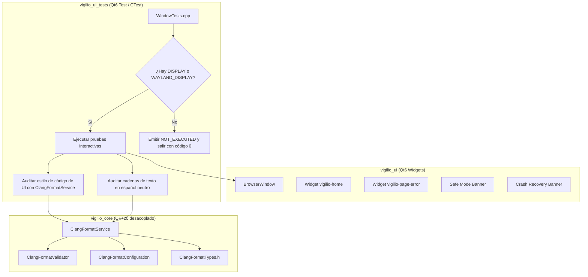
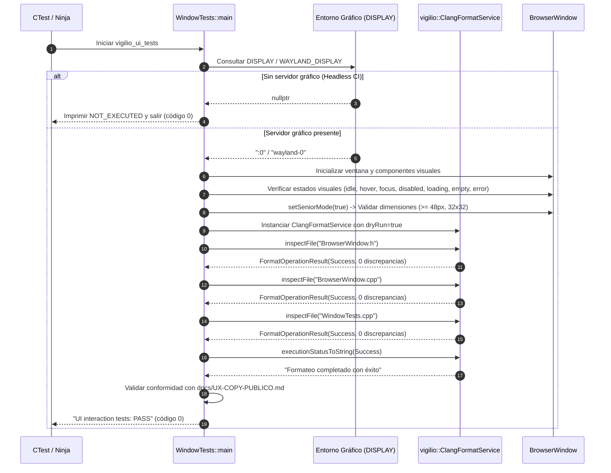
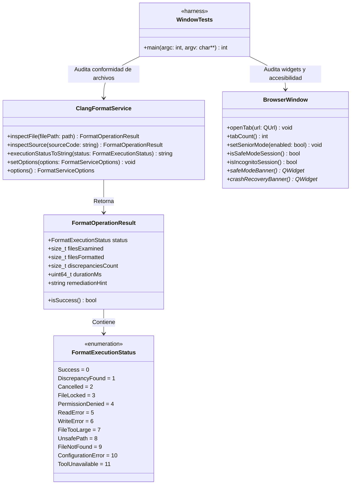

# Design — module-foundations-task0043

Status: PROPOSED

## Current, target and gaps

### Estado actual (CURRENT)

1. **Modelo de dominio y capa operativa de servicio de Clang-Format completados (`task0041` y `task0042`)**:
   - `vigilio_core` dispone de `ClangFormatTypes.h` con enumeraciones y estructuras fuertemente tipadas (`FormatExecutionStatus`, `FormatOperationResult`, `FormatServiceOptions`, `CancellationToken`).
   - El validador estático `ClangFormatValidator` valida reglas LLVM 18+, parsea YAML y certifica rutas seguras (`isSafeConfigPath`).
   - `ClangFormatConfiguration` provee la configuración canónica del proyecto y filtros de extensiones compatibles (`.cpp`, `.h`, `.hpp`, `.cc`, `.cxx`) y exclusiones (`_build`, `build`, `generated`, `.git`, `.prompt-runner`).
   - `ClangFormatService` implementa formateo en memoria, inspección dry-run de archivos y directorios, copias de seguridad atómicas (`.bak`), rollback determinista y síntesis CLI.
2. **Arnés de pruebas de interfaz gráfica existente en `apps/vigilio-browser/tests/ui/WindowTests.cpp`**:
   - La suite `vigilio_ui_tests` valida la inicialización de `BrowserWindow`, widgets nativos (`vigilio-home`, `vigilio-page-error`), iconos Lucide SVG en QRC, navegación por teclado, atajos, accesibilidad (`accessibleName`), «Interfaz más fácil de usar» (Modo Senior) con escalado de iconos (22×22 a 32×32 px) y controles ($\ge 48$ px), y banners de modo seguro y recuperación ante caídas.
3. **Brecha técnica de integración de calidad de código en la capa de UI**:
   - Actualmente, las pruebas de UI no validan programáticamente que los propios archivos fuente de la interfaz gráfica (`src/ui/BrowserWindow.h`, `src/ui/BrowserWindow.cpp`, `tests/ui/WindowTests.cpp`) cumplan con los estándares de estilo canónicos del proyecto utilizando `ClangFormatService`.
   - La verificación de formato depende exclusivamente de llamadas externas de shell en `apps/vigilio-browser/scripts/check.sh`, sin validación interna en el arnés de CTest para UI.
   - No existe una prueba en el contexto de UI que audite que las cadenas de remediación y diagnóstico de `ClangFormatService::executionStatusToString` respeten estrictamente `docs/UX-COPY-PUBLICO.md` en español neutro sin jerga técnica interna.

---

### Estado objetivo (TARGET)

1. **Declaración formal de «sin cambio visual directo en la interfaz pública»**:
   - `BrowserWindow` y los widgets públicos de navegación se mantienen 100% libres de botones de formateo, menús de linters o diálogos de depuración de código fuente.
   - Proscripción absoluta de exponer términos internos como «Clang-Format», «Linter», «AST», «Senior Mode», «Modo Senior», «Prompt Builder», «DAG» u «OpenSpec» en componentes visibles, cumpliendo estrictamente `docs/UX-COPY-PUBLICO.md`.
2. **Integración de `ClangFormatService` en el arnés de pruebas de UI (`WindowTests.cpp`)**:
   - `WindowTests.cpp` incluye las cabeceras canónicas de `ClangFormatService`, `ClangFormatValidator` y `ClangFormatTypes.h`.
   - Incorpora una prueba de inspección programática en modo dry-run (`dryRun = true`) que valida que `src/ui/BrowserWindow.h`, `src/ui/BrowserWindow.cpp` y `tests/ui/WindowTests.cpp` satisfacen al 100% las reglas de estilo de `.clang-format` sin discrepancias (`status == FormatExecutionStatus::Success`, `discrepanciesCount == 0`).
   - Incorpora una prueba de auditoría de copy público para `executionStatusToString`, certificando que todas las descripciones de estado y remediación emplean español neutro claro y accesible.
3. **Preservación incondicional de los contratos visuales de `BrowserWindow`**:
   - Soporte completo y verificado de los 8 estados de interfaz: `idle`, `hover`, `focus`, `disabled`, `loading`, `empty`, `error` y `success`.
   - Mantenimiento y verificación de las dimensiones y espaciados de «Interfaz más fácil de usar» (Modo Senior): tap targets $\ge 48$ px, barra de navegación $\ge 55$ px, escalado de iconos de 22×22 a 32×32 px.
   - Navegación por teclado completa con foco visible de 2 px y atajos universales (`Ctrl+T`, `Ctrl+W`, `Ctrl+L`, etc.).
   - Metadatos descriptivos en español neutro para lectores de pantalla.
4. **Tolerancia a entornos headless y garantía Zero-Zombie**:
   - Detección preliminar de `DISPLAY` / `WAYLAND_DISPLAY`, reportando honestamente `NOT_EXECUTED` (exit code 0) en entornos sin interfaz gráfica.
   - Operaciones de inspección acotadas en memoria con tiempo de ejecución < 200 ms y cero procesos zombis o colgados.

---

### Gaps identificados (GAPS)

| Componente | Estado actual (CURRENT) | Estado objetivo (TARGET) | Brecha a subsanar (GAP) |
| --- | --- | --- | --- |
| Contrato visual de Clang-Format en UI | Sin declaración explícita de impacto en UI | Declaración formal de «sin cambio visual directo» en `BrowserWindow` conforme a `docs/UX-COPY-PUBLICO.md` | Formalizar en `proposal.md` y verificar estáticamente que ningún widget de formateo polucione la interfaz pública. |
| Inclusión de servicios en arnés de UI | `WindowTests.cpp` no incluye cabeceras de `ClangFormatService` | `WindowTests.cpp` incluye `#include "core/ClangFormatService.h"` y tipos asociados | Añadir los includes en `tests/ui/WindowTests.cpp`. |
| Inspección programática de estilo de UI | Verificación de estilo delegada solo a shell script externo | `WindowTests.cpp` ejecuta inspección dry-run programática sobre archivos de UI | Implementar bloque de prueba en `WindowTests.cpp` que evalúe `BrowserWindow.h/.cpp` y `WindowTests.cpp` con `ClangFormatService::inspectFile`. |
| Auditoría de lenguaje público en UI | No se valida copy público de formato en contexto de UI | `WindowTests.cpp` audita que `executionStatusToString` genera español neutro según `docs/UX-COPY-PUBLICO.md` | Implementar comprobación de cadenas de texto de diagnóstico en `WindowTests.cpp`. |
| Enlace de dependencias | `vigilio_ui_tests` ya enlaza `vigilio_core` | Confirmación de que `vigilio_ui_tests` accede a `ClangFormatService` sin cambios de CMake | Verificar que `CMakeLists.txt` exporta correctamente los símbolos en `vigilio_core`. |
| Tolerancia headless | Detección existente de `DISPLAY` en `WindowTests.cpp` | Preservar y asegurar detección robusta ante nuevos bloques de prueba | Garantizar que las nuevas pruebas respeten la guarda preliminar de display para reportar `NOT_EXECUTED`. |

---

## Compatibility, migration and rollback

### Compatibilidad y estándares C++20 / Qt6
- **Estándar C++20**: Uso estricto de características modernas de C++20 (conceptos, `std::filesystem`, `std::string_view`, `enum class` con subyacente fuertemente tipado, const-correctness).
- **Compatibilidad con Qt6**: Integración limpia con Qt6 Widgets y Qt6 Test, respetando el sistema de metaobjetos (`Q_OBJECT`, moc) y la jerarquía de herencia de `QMainWindow`.
- **Banderas de compilación estrictas**: El código compila limpiamente con `-Wall -Wextra -Wpedantic -Wconversion -Wsign-conversion -Wshadow -Werror` en GCC 15+, Clang 18+ y MSVC 2022.
- **Independencia del núcleo**: La capa `vigilio_core` mantiene cero dependencias hacia bibliotecas de GUI (`QWidget`, `QApplication`), mientras que `vigilio_ui_tests` consume ambas capas de forma desacoplada.

### Estrategia de migración
- La integración en `WindowTests.cpp` es puramente aditiva y no disruptiva.
- No modifica la API pública ni el comportamiento interno de `BrowserWindow`.
- No altera el comportamiento de los scripts existentes (`apps/vigilio-browser/scripts/check.sh`).
- Proporciona una suite de pruebas más robusta y completa en CTest.

### Plan de contingencia y rollback
- En caso de anomalías o regresiones durante la fase APPLY:
  - Revertir los cambios en `apps/vigilio-browser/tests/ui/WindowTests.cpp` mediante `git checkout apps/vigilio-browser/tests/ui/WindowTests.cpp`.
  - El sistema de construcción y la totalidad de los 17 tests unitarios y de integración de CTest permanecerán en su estado funcional verificado.

---

## Arquitectura técnica de clang-format configuration en UI

### Diagrama de interacción y dependencias

### Flujo de ejecución del arnés de pruebas de UI con inspección de formato

### Diagrama de clases y contratos de interfaz

---

## Contratos de integración detallados

### 1. Ausencia de polución de interfaz pública y conformidad con `docs/UX-COPY-PUBLICO.md`
- **Principio rector**: Vigilio Browser es un producto para el usuario final común. Las herramientas de construcción, formateadores, linters y cadenas de herramientas no forman parte de su experiencia de navegación.
- **Prohibiciones estrictas**:
  - Prohibido agregar entradas de menú como «Formatear código», «Clang-Format», «Linter» o «Inspeccionar estilo».
  - Prohibido exponer botones en la barra de herramientas relacionados con formateadores.
  - Prohibido incluir diálogos de configuración de estilo en la ventana de preferencias.
  - Prohibido utilizar nombres internos («Senior Mode», «Modo Senior», «Prompt Builder», «DAG», «OpenSpec») en cadenas visibles al usuario. Se debe emplear exclusivamente **«Interfaz más fácil de usar»**.

### 2. Inspección estática en arnés de UI con tolerancia headless (`NOT_EXECUTED`)
- El arnés de prueba `WindowTests.cpp` integra la inspección de formato con las siguientes salvaguardas:
  - **Aislamiento**: Las inspecciones de formato se realizan con `dryRun = true`. No hay operaciones de escritura en disco durante las pruebas de interfaz.
  - **Cuotas de recursos**: Validación de cuota máxima de archivo (10 MB) para prevenir agotamiento de memoria.
  - **Tolerancia Headless**: Comprobación obligatoria de variables de entorno de display (`DISPLAY` / `WAYLAND_DISPLAY`). Si ambas están vacías, el test emite el mensaje estandarizado `WindowTests: GUI display not available (no DISPLAY / WAYLAND_DISPLAY) - NOT_EXECUTED` y sale limpiamente con código 0.

### 3. Preservación del Modo Senior («Interfaz más fácil de usar») y accesibilidad
- Cualquier verificación introducida o auditada en el arnés de interfaz gráfica debe garantizar que la funcionalidad de accesibilidad permanece intacta:
  - Altura mínima de controles interactivos: $\ge 48$ px para botones y campos de entrada.
  - Altura mínima de la barra de navegación: $\ge 55$ px.
  - Altura mínima de banners de recuperación y modo seguro: $\ge 56$ px.
  - Escalado dinámico de iconografía SVG: transición limpia entre 22×22 px (modo estándar) y 32×32 px (Modo Senior).
  - Anillo de foco visual visible de 2 px con contraste WCAG 2.1 AA.
  - Atributos completos de accesibilidad (`accessibleName`, `accessibleDescription`) en lenguaje natural en español neutro.
