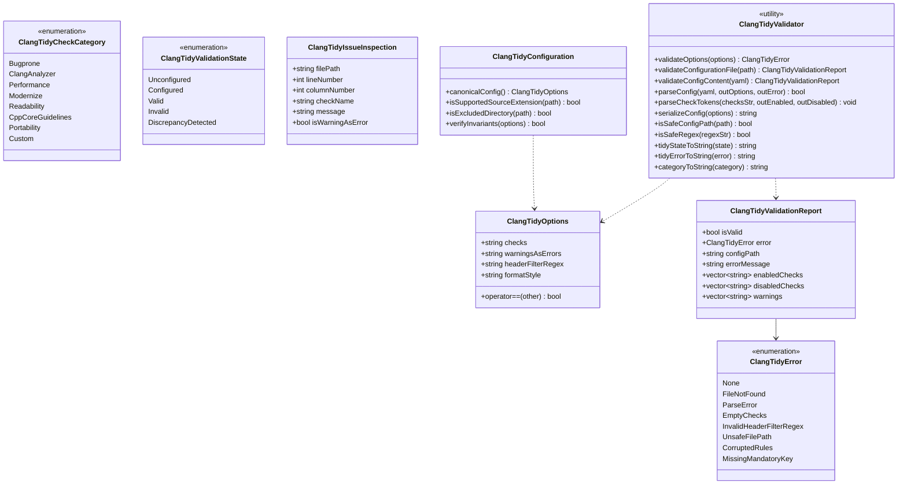
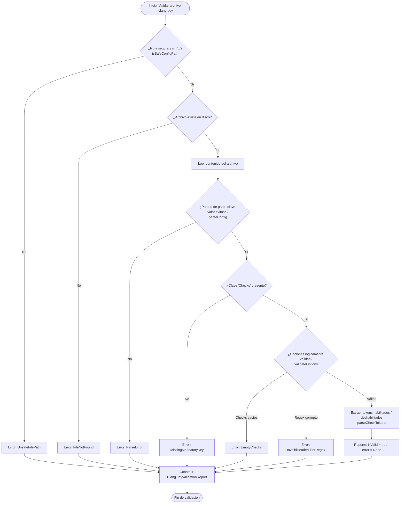

# Design — module-foundations-task0045

Status: PROPOSED

## Current, target and gaps

### Estado actual (CURRENT)

1. **Configuración física estática de Clang-Tidy sin modelo de dominio en C++20**:
   - El proyecto cuenta con un archivo físico `apps/vigilio-browser/.clang-tidy` en la raíz del submódulo de la aplicación:
     ```yaml
     Checks: '-*,bugprone-*,clang-analyzer-*,performance-*,modernize-use-nullptr,readability-braces-around-statements'
     WarningsAsErrors: ''
     HeaderFilterRegex: 'src/.*'
     ```
   - No existe representación tipada de estas opciones dentro del código fuente de `vigilio_core`.
2. **Validación limitada a detección de binario en shell (`check.sh`)**:
   - En `apps/vigilio-browser/scripts/check.sh`, la verificación de Clang-Tidy se reduce a:
     ```bash
     if command -v clang-tidy >/dev/null 2>&1; then
         echo 'clang-tidy available: run with compile_commands.json on supported compiler'
     else
         echo 'clang-tidy NOT_RUN (not installed)'
     fi
     ```
   - No es posible consultar, verificar o inspeccionar programáticamente la validez de la configuración ni el conjunto de comprobaciones activas desde el arnés de CTest ni desde servicios del navegador.
3. **Carencia de validación formal de seguridad de rutas y contención**:
   - No existe un validador que impida accesos inseguros, sondeo del sistema de archivos o directory traversal (`../`) si un componente solicita validar una ruta de configuración.
4. **Ausencia de parser y serializador determinista para `.clang-tidy`**:
   - No hay utilidades en C++20 para analizar el archivo YAML canónico ni para serializar configuraciones garantizando idempotencia y preservación de reglas.
5. **Falta de catálogo tipado de extensiones y carpetas excluidas**:
   - Las reglas sobre qué archivos inspeccionar (`.cpp`, `.cc`, `.cxx`, `.h`, `.hpp`) y qué carpetas ignorar (`_build`, `build`, `generated`, `.git`, `.prompt-runner`) no están formalizadas en el dominio de foundations.

---

### Estado objetivo (TARGET)

1. **Modelo de dominio unificado y tipos inmutables (`vigilio_core`)**:
   - `ClangTidyTypes.h`: Define formalmente las familias de comprobaciones (`ClangTidyCheckCategory`), estados de validación (`ClangTidyValidationState`), códigos de error (`ClangTidyError`) y las estructuras inmutables `ClangTidyOptions`, `ClangTidyValidationReport` y `ClangTidyIssueInspection`.
   - Cero dependencias hacia `QApplication`, widgets de Qt o subprocesos de Chromium.
2. **Validador estático desacoplado y parser YAML (`ClangTidyValidator`)**:
   - `validateOptions`: Verificación de invariantes lógicas (checks no vacíos, sin desactivación total sin reglas activas, regex seguro).
   - `validateConfigurationFile`: Validación de existencia física, permisos, ausencia de escapes de directorio y presencia de directivas obligatorias.
   - `parseConfig`: Parser determinista y liviano de pares clave-valor YAML sin dependencias de bibliotecas externas.
   - `parseCheckTokens`: Particionador de tokens de comprobación discriminando reglas activadas y desactivadas.
   - `serializeConfig`: Serializador determinista con generación de YAML canónico normalizado.
   - `isSafeConfigPath`: Verificación estricta de rutas sin directory traversal ni escapes de raíz.
   - `isSafeRegex`: Comprobación de que la expresión regular de filtrado compile limpiamente y no posea riesgos de denegación de servicio.
   - `tidyStateToString` y `tidyErrorToString`: Textos claros en español neutro cumpliendo `docs/UX-COPY-PUBLICO.md`.
3. **Entidad de configuración canónica (`ClangTidyConfiguration`)**:
   - `canonicalConfig()`: Retorna exactamente la configuración canónica del proyecto (`Checks: '-*,bugprone-*,clang-analyzer-*,performance-*,modernize-use-nullptr,readability-braces-around-statements'`, `WarningsAsErrors: ''`, `HeaderFilterRegex: 'src/.*'`).
   - `isSupportedSourceExtension`: Filtro oficial de archivos fuente C++ admitidos (`.cpp`, `.cc`, `.cxx`, `.h`, `.hpp`).
   - `isExcludedDirectory`: Filtro oficial de carpetas que nunca deben procesarse (`_build`, `build`, `generated`, `.git`, `.prompt-runner`, `assets`).
   - `verifyInvariants`: Comprobación de que las reglas esenciales del navegador estén activas.
4. **Batería de pruebas unitarias trazables en CTest**:
   - Suite `vigilio_clang_tidy_tests` con 11 pruebas unitarias deterministas en `tests/unit/ClangTidyConfigurationTests.cpp`.
   - Tiempo de ejecución en CTest < 50 ms en modo headless sin interacción de red ni procesos externos.

---

### Brechas identificadas (GAPS)

| Componente | Estado actual (CURRENT) | Estado objetivo (TARGET) | Brecha a subsanar (GAP) |
| --- | --- | --- | --- |
| Tipos de dominio de Clang-Tidy | Inexistentes en `src/core/` | `ClangTidyTypes.h` con taxonomía completa de enumeraciones y estructuras inmutables | Crear archivo de encabezado con modelos de datos fuertemente tipados. |
| Validador y parser YAML | Solo detección en script de shell | `ClangTidyValidator` estático con parser YAML, validación de regex y seguridad de rutas | Crear clase utilitaria en `src/core/` con métodos estáticos de validación y parsing seguro. |
| Entidad de configuración canónica | Solo archivo físico `.clang-tidy` | `ClangTidyConfiguration` con `canonicalConfig()`, filtros de archivos y exclusiones | Implementar clase con configuración por defecto y políticas de filtrado. |
| Funciones de copy público | No existen funciones de reporte | Mapeo tipado a cadenas legibles en español sin jerga interna | Implementar conversores conformes a `docs/UX-COPY-PUBLICO.md`. |
| Suite de pruebas unitarias | 0 pruebas unitarias de configuración de Clang-Tidy | 11 pruebas unitarias deterministas en `vigilio_clang_tidy_tests` | Crear suite completa en `tests/unit/ClangTidyConfigurationTests.cpp`. |
| Integración en CMakeLists | Archivos no registrados | Target `vigilio_core` actualizado y test CTest registrado con macro de ruta | Añadir fuentes a `vigilio_core` y registrar test con labels `unit;fast`. |

---

## Compatibility, migration and rollback

### Compatibilidad y estándares C++20
- Implementación conforme al estándar ISO C++20 empleando exclusivamente facilidades de la biblioteca estándar: `<string>`, `<string_view>`, `<vector>`, `<filesystem>`, `<regex>`, `<optional>`, `<algorithm>`.
- Portabilidad certificada en los compiladores soportados: Clang (15+), GCC (12+) y MSVC (2022).
- Cumplimiento riguroso de las banderas de compilación del proyecto: `-Wall -Wextra -Wpedantic -Wconversion -Wsign-conversion -Wshadow -Werror`.
- Compilación completamente independiente de Qt Widgets; compatible tanto en modo headless (`VIGILIO_BUILD_GUI=OFF`) como en perfiles de escritorio.

### Estrategia de migración
- La incorporación de `ClangTidyTypes.h`, `ClangTidyValidator` y `ClangTidyConfiguration` es puramente aditiva dentro de la biblioteca `vigilio_core`.
- No modifica la configuración física existente en `apps/vigilio-browser/.clang-tidy` ni interfiere con los 17 tests unitarios y de integración actualmente pasando en CTest.
- Establece la base contractual sólida para que `ClangTidyService` (etapa `implementation` en `task0046`) consuma el modelo de dominio sin dependencias ad-hoc.

### Plan de contingencia y rollback
- En caso de anomalías o fallos imprevistos en la compilación de la fase APPLY:
  - Eliminar los nuevos archivos creados en `src/core/` y `tests/unit/`.
  - Revertir los cambios en `apps/vigilio-browser/CMakeLists.txt`.
  - El sistema de build y la totalidad de los tests previos permanecen completamente operativos e intactos.

---

## Arquitectura técnica de clang-tidy configuration

### Diagrama de clases y relaciones



### Flujo de validación y parsing de configuración



---

## Definición de tipos y estructuras detalladas

### 1. `ClangTidyOptions` y enumeraciones de soporte
```cpp
namespace vigilio {

enum class ClangTidyCheckCategory {
    Bugprone,
    ClangAnalyzer,
    Performance,
    Modernize,
    Readability,
    CppCoreGuidelines,
    Portability,
    Custom
};

enum class ClangTidyValidationState {
    Unconfigured,
    Configured,
    Valid,
    Invalid,
    DiscrepancyDetected
};

enum class ClangTidyError {
    None,
    FileNotFound,
    ParseError,
    EmptyChecks,
    InvalidHeaderFilterRegex,
    UnsafeFilePath,
    CorruptedRules,
    MissingMandatoryKey
};

struct ClangTidyOptions {
    std::string checks{
        "-*,bugprone-*,clang-analyzer-*,performance-*,modernize-use-nullptr,readability-braces-around-statements"};
    std::string warningsAsErrors{""};
    std::string headerFilterRegex{"src/.*"};
    std::string formatStyle{"none"};

    bool operator==(const ClangTidyOptions& other) const = default;
};

} // namespace vigilio
```

### 2. `ClangTidyValidationReport` y `ClangTidyIssueInspection`
```cpp
namespace vigilio {

struct ClangTidyValidationReport {
    bool isValid{false};
    ClangTidyError error{ClangTidyError::None};
    std::string configPath;
    std::string errorMessage;
    std::vector<std::string> enabledChecks;
    std::vector<std::string> disabledChecks;
    std::vector<std::string> warnings;
};

struct ClangTidyIssueInspection {
    std::string filePath;
    int lineNumber{0};
    int columnNumber{0};
    std::string checkName;
    std::string message;
    bool isWarningAsError{false};
};

} // namespace vigilio
```

### 3. Declaración de `ClangTidyValidator`
```cpp
namespace vigilio {

class ClangTidyValidator {
  public:
    ClangTidyValidator() = delete;

    [[nodiscard]] static ClangTidyError validateOptions(const ClangTidyOptions& options);
    [[nodiscard]] static ClangTidyValidationReport validateConfigurationFile(const std::filesystem::path& configPath);
    [[nodiscard]] static ClangTidyValidationReport validateConfigContent(std::string_view yamlContent);
    [[nodiscard]] static bool parseConfig(std::string_view yamlContent, ClangTidyOptions& outOptions,
                                          std::string* outErrorMessage = nullptr);
    [[nodiscard]] static void parseCheckTokens(std::string_view checksStr,
                                              std::vector<std::string>& outEnabled,
                                              std::vector<std::string>& outDisabled);
    [[nodiscard]] static std::string serializeConfig(const ClangTidyOptions& options);
    [[nodiscard]] static bool isSafeConfigPath(const std::filesystem::path& path);
    [[nodiscard]] static bool isSafeRegex(std::string_view regexStr);
    [[nodiscard]] static std::string tidyStateToString(ClangTidyValidationState state);
    [[nodiscard]] static std::string tidyErrorToString(ClangTidyError error);
    [[nodiscard]] static std::string categoryToString(ClangTidyCheckCategory category);
};

} // namespace vigilio
```

### 4. Declaración de `ClangTidyConfiguration`
```cpp
namespace vigilio {

class ClangTidyConfiguration {
  public:
    ClangTidyConfiguration() = delete;

    [[nodiscard]] static ClangTidyOptions canonicalConfig();
    [[nodiscard]] static bool isSupportedSourceExtension(const std::filesystem::path& path);
    [[nodiscard]] static bool isExcludedDirectory(const std::filesystem::path& path);
    [[nodiscard]] static bool verifyInvariants(const ClangTidyOptions& options);
};

} // namespace vigilio
```

---

## Invariantes de diseño y límites transaccionales

1. **Invariante de inmutabilidad y pureza de funciones**:
   - `ClangTidyValidator` y `ClangTidyConfiguration` son clases utilitarias estáticas con constructor eliminado (`= delete`).
   - Todos los métodos son funciones puras sin efectos secundarios sobre el sistema de archivos ni variables globales mutables.
2. **Invariante de no-bloqueo y presupuesto de CPU/memoria**:
   - El parsing de un archivo `.clang-tidy` estándar se ejecuta en $< 1$ milisegundo y consume $< 32$ KB de memoria temporal.
   - El uso de `std::string_view` y parsing iterativo lineal evita la creación de árboles de sintaxis abstracta innecesarios.
3. **Invariante de contención de rutas (`isSafeConfigPath`)**:
   - Toda consulta a archivos en disco normaliza la ruta y verifica que no contenga secuencias de escape hacia directorios superiores (`..`), caracteres nulos (`\0`) ni referencias a rutas raíz sensibles del sistema.
4. **Invariante de seguridad de expresiones regulares (`isSafeRegex`)**:
   - `headerFilterRegex` se valida contra longitud máxima (256 caracteres) y compilación estricta con `std::regex`. Expresiones no compilables o con sintaxis trunca son rechazadas sin lanzar excepciones no controladas.
5. **Invariante de consistencia con el repositorio**:
   - `ClangTidyConfiguration::canonicalConfig()` genera exactamente la configuración que valida y aprueba el archivo `.clang-tidy` en la raíz del proyecto.
