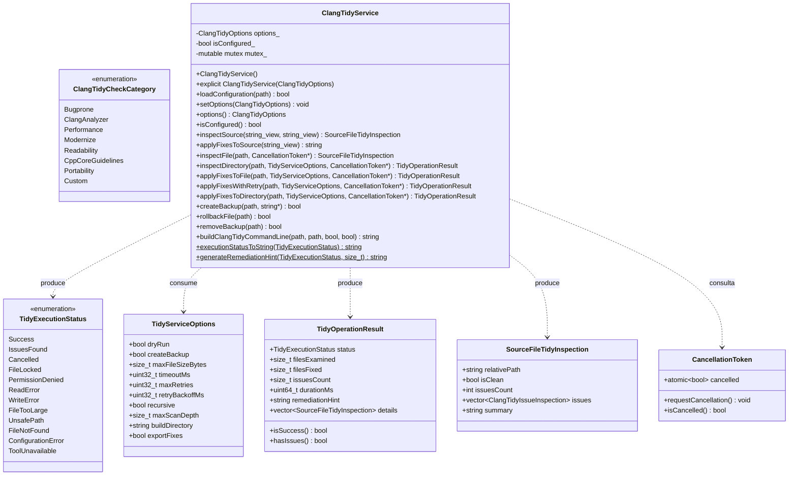
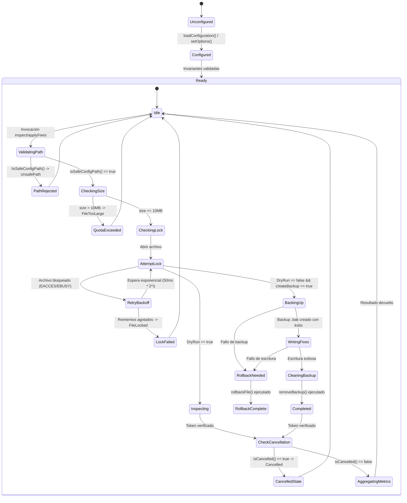

# Design — module-foundations-task0046

Status: PROPOSED

## Current, target and gaps

### Estado actual (CURRENT)

1. **Modelo de dominio estático completado en la etapa previa (`task0045`)**:
   - `ClangTidyTypes.h` define `ClangTidyCheckCategory`, `ClangTidyValidationState`, `ClangTidyError`, `ClangTidyOptions`, `ClangTidyValidationReport` y `ClangTidyIssueInspection`.
   - `ClangTidyValidator` provee validación de opciones, parser determinista de YAML y conversión básica de errores.
   - `ClangTidyConfiguration` provee la configuración canónica oficial (`canonicalConfig`), filtros de extensión de archivo (`isSupportedSourceExtension`) y filtros de exclusión (`isExcludedDirectory`).
   - La suite `ClangTidyConfigurationTests.cpp` (11 pruebas) pasa limpiamente en CTest.
2. **Carencia de una capa de servicio operativo en tiempo de ejecución**:
   - No existe una clase coordinadora (`ClangTidyService`) que orqueste la ejecución de análisis estático o linteo sobre archivos reales o buffers de memoria.
   - No hay soporte para inspección en modo no destructivo (*dry-run*) a nivel de archivo individual o jerarquías completas de directorios.
3. **Ausencia de capacidades de corrección automática (autofix) con resiliencia**:
   - No existe mecanismo para aplicar correcciones automáticas de forma determinista sobre el código fuente (por ejemplo, reemplazo seguro de `NULL`/`0` por `nullptr`, o inserción de llaves obligatorias en `if`/`for`/`while`).
   - No existe infraestructura de copias de seguridad atómicas (`.bak`) ni rollback automático ante fallos de E/S.
   - No hay resiliencia frente a bloqueos de archivos (*file locking*) en sistemas multi-proceso o plataformas con contención de I/O.
4. **Falta de soporte de cancelación cooperativa (Zero-Zombie)**:
   - No se dispone de un mecanismo para interrumpir un escaneo masivo de código fuente cuando el usuario o el arnés de pruebas lo solicite, arriesgando hilos o procesos zombis colgados.
5. **Carencia de síntesis determinista de argumentos CLI para `clang-tidy`**:
   - No existe un generador de comandos CLI reproducible que integre las opciones canónicas (`-p`, `--checks`, `-fix`, `-warnings-as-errors`).

---

### Estado objetivo (TARGET)

1. **Capa operativa de servicio desacoplada (`vigilio::ClangTidyService`)**:
   - Integrada en `apps/vigilio-browser/src/core/` dentro del target `vigilio_core`.
   - Proporciona análisis en memoria pura (`inspectSource`), corrección determinista en memoria (`applyFixesToSource`), inspección dry-run en disco (`inspectFile`, `inspectDirectory`), corrección física con respaldos (`applyFixesToFile`, `applyFixesToDirectory`) y resiliencia con backoff exponencial (`applyFixesWithRetry`).
   - Cero dependencias hacia `QApplication`, widgets de Qt o instancias de Chromium WebEngine.
2. **Ampliación integral de tipos operativos en `ClangTidyTypes.h`**:
   - Taxonomía de resultados `TidyExecutionStatus` (12 estados fuertemente tipados).
   - Estructuras inmutables `SourceFileTidyInspection`, `TidyServiceOptions` y `TidyOperationResult`.
   - Token de cancelación cooperativa `CancellationToken` bajo la macro de guarda `VIGILIO_CANCELLATION_TOKEN_DEFINED`.
3. **Mecanismo atómico de copias de seguridad y rollback**:
   - Creación determinista de archivos `.bak` antes de cualquier modificación física en disco.
   - Rollback garantizado (`rollbackFile`) en caso de interrupción anormal o fallo de escritura.
   - Eliminación ordenada de copias temporales (`removeBackup`) tras confirmación de éxito.
4. **Cancelación cooperativa y política Zero-Zombie**:
   - Verificación de `cancel->isCancelled()` antes de procesar cada archivo individual en recorridos de directorios y antes de cada iteración de reintento.
5. **Síntesis CLI y UX Copy público**:
   - Generador determinista de línea de comandos `buildClangTidyCommandLine`.
   - Conversores de estado y sugerencias amigables en español neutro cumpliendo estrictamente `docs/UX-COPY-PUBLICO.md`.
6. **Batería de pruebas unitarias exhaustivas en CTest**:
   - Suite `vigilio_clang_tidy_service_tests` en `tests/unit/ClangTidyServiceTests.cpp` con 12 pruebas trazables (`TEST-TIDY-SRV-001` a `TEST-TIDY-SRV-012`).

---

### Brechas identificadas (GAPS)

| Componente | Estado actual (CURRENT) | Estado objetivo (TARGET) | Brecha a subsanar (GAP) |
| --- | --- | --- | --- |
| Tipos operativos del servicio | Solo existen tipos estáticos en `ClangTidyTypes.h` | Tipos operativos completos: `TidyExecutionStatus`, `SourceFileTidyInspection`, `TidyServiceOptions`, `TidyOperationResult` | Extender `ClangTidyTypes.h` incorporando las nuevas estructuras y enumeraciones. |
| Interfaz de servicio | Inexistente | `ClangTidyService.h` declarando métodos de ciclo de vida, inspección, corrección, respaldo y CLI | Crear archivo de cabecera con la clase `ClangTidyService` y sus contratos públicos. |
| Implementación operativa | Inexistente | `ClangTidyService.cpp` con lógica de análisis C++20, autofix determinista, backoff exponencial y backups | Implementar la clase de servicio en C++20 libre de dependencias gráficas. |
| Respaldo y rollback | No implementado | Métodos `createBackup`, `rollbackFile` y `removeBackup` con garantías atómicas | Implementar gestión de archivos `.bak` y reversión de escrituras corruptas. |
| Cancelación cooperativa | Sin token de cancelación en linteo | Soporte de `CancellationToken*` en todas las operaciones de escaneo y reintento | Integrar verificación periódica de cancelación (Zero-Zombie). |
| Batería de pruebas de servicio | 0 pruebas de servicio para Clang-Tidy | 12 pruebas unitarias deterministas en `ClangTidyServiceTests.cpp` | Crear suite completa cubriendo ciclo de vida, dry-run, fixes, backups y copy público. |
| Integración en CMakeLists | Target de test no registrado | `ClangTidyService.cpp` en `vigilio_core` y test `clang_tidy_service_tests` registrado | Añadir fuente y configurar target ejecutable y test en CTest. |

---

## Compatibility, migration and rollback

### Compatibilidad y estándares C++20
- Implementación conforme al estándar ISO C++20 empleando facilidades nativas de la biblioteca estándar: `<string>`, `<string_view>`, `<vector>`, `<filesystem>`, `<regex>`, `<chrono>`, `<thread>`, `<atomic>`, `<mutex>`, `<fstream>`.
- Portabilidad garantizada en Clang (15+), GCC (12+) y MSVC (2022).
- Compilación con flags estrictos del proyecto: `-Wall -Wextra -Wpedantic -Wconversion -Wsign-conversion -Wshadow -Werror`.
- Funcionamiento 100% headless, sin requerir bibliotecas gráficas Qt ni Chromium WebEngine.

### Estrategia de migración
- La incorporación de `ClangTidyService` es puramente aditiva dentro de la biblioteca estática `vigilio_core`.
- No modifica la configuración canónica en `apps/vigilio-browser/.clang-tidy`.
- Mantiene compatibilidad total con los 18 tests existentes en el pipeline de CTest.
- Sienta la base operativa que consumirá la etapa de interfaz gráfica (`module.foundations.task0047`).

### Plan de contingencia y rollback
- En caso de anomalías en la compilación o pruebas durante APPLY:
  - Eliminar los nuevos archivos: `apps/vigilio-browser/src/core/ClangTidyService.h`, `apps/vigilio-browser/src/core/ClangTidyService.cpp` y `apps/vigilio-browser/tests/unit/ClangTidyServiceTests.cpp`.
  - Revertir los cambios en `ClangTidyTypes.h` y `apps/vigilio-browser/CMakeLists.txt`.
  - El árbol del proyecto regresa instantáneamente al estado certificado de la etapa `domain` (`task0045`).

---

## Arquitectura técnica de clang-tidy configuration (implementation)

### Diagrama de componentes y flujo operativo

```mermaid
flowchart TD
    subgraph Dominio["Capa de Dominio e Invariantes"]
        Types["ClangTidyTypes.h\n(TidyExecutionStatus, Options, Results)"]
        Validator["ClangTidyValidator\n(YAML Parser, Path & Regex Safety)"]
        Config["ClangTidyConfiguration\n(Canonical Options, Filters)"]
    end

    subgraph Servicio["Capa Operativa Propietaria (vigilio_core)"]
        Service["ClangTidyService\n(Inspection, Autofix, Backup, Retry, CLI)"]
        Token["CancellationToken\n(Zero-Zombie Cooperative Cancellation)"]
    end

    subgraph Almacenamiento["Sistema de Archivos Local (Local-First)"]
        SourceFiles["Archivos Fuente C++\n(.cpp, .h, .hpp, .cc, .cxx)"]
        Backups["Archivos de Respaldo\n(.bak atómicos)"]
        DiskConfig[".clang-tidy\n(YAML canónico)"]
    end

    subgraph Pruebas["Arnés de Pruebas (CTest)"]
        ServiceTests["ClangTidyServiceTests\n(12 tests deterministas)"]
    end

    DiskConfig -->|parseConfig| Validator
    Validator -->|Options| Service
    Config -->|Filtros de extensión y exclusión| Service
    Types --> Service
    Token -.->|isCancelled()| Service
    Service -->|dry-run inspection| SourceFiles
    Service -->|atomic backup| Backups
    Service -->|rollback| Backups
    Service -->|apply fixes| SourceFiles
    ServiceTests -->|valida exhaustivamente| Service
```

### Diagrama de clases y relaciones



### Máquina de estados operativos de análisis y linteo



### Interfaces y contratos de `ClangTidyService`

```cpp
namespace vigilio {

class ClangTidyService {
  public:
    ClangTidyService();
    explicit ClangTidyService(const ClangTidyOptions& options);
    ~ClangTidyService() = default;

    ClangTidyService(const ClangTidyService&) = delete;
    ClangTidyService& operator=(const ClangTidyService&) = delete;
    ClangTidyService(ClangTidyService&&) noexcept = default;
    ClangTidyService& operator=(ClangTidyService&&) noexcept = default;

    // Configuración del servicio
    [[nodiscard]] bool loadConfiguration(const std::filesystem::path& configPath);
    void setOptions(const ClangTidyOptions& options) noexcept;
    [[nodiscard]] const ClangTidyOptions& options() const noexcept;
    [[nodiscard]] bool isConfigured() const noexcept;

    // Análisis y corrección en memoria pura
    [[nodiscard]] SourceFileTidyInspection inspectSource(
        std::string_view sourceCode,
        std::string_view virtualPath = "virtual.cpp",
        const ClangTidyOptions& options = {});

    [[nodiscard]] std::string applyFixesToSource(
        std::string_view sourceCode,
        const ClangTidyOptions& options = {});

    // Inspección en disco (Modo Dry-Run)
    [[nodiscard]] SourceFileTidyInspection inspectFile(
        const std::filesystem::path& filePath,
        CancellationToken* cancel = nullptr);

    [[nodiscard]] TidyOperationResult inspectDirectory(
        const std::filesystem::path& dirPath,
        const TidyServiceOptions& options = {},
        CancellationToken* cancel = nullptr);

    // Corrección física en disco con resiliencia y respaldo
    [[nodiscard]] TidyOperationResult applyFixesToFile(
        const std::filesystem::path& filePath,
        const TidyServiceOptions& options = {},
        CancellationToken* cancel = nullptr);

    [[nodiscard]] TidyOperationResult applyFixesWithRetry(
        const std::filesystem::path& filePath,
        const TidyServiceOptions& options = {},
        CancellationToken* cancel = nullptr);

    [[nodiscard]] TidyOperationResult applyFixesToDirectory(
        const std::filesystem::path& dirPath,
        const TidyServiceOptions& options = {},
        CancellationToken* cancel = nullptr);

    // Gestión atómica de respaldos (.bak)
    [[nodiscard]] bool createBackup(const std::filesystem::path& filePath,
                                    std::string* outBackupPath = nullptr);
    [[nodiscard]] bool rollbackFile(const std::filesystem::path& filePath);
    [[nodiscard]] bool removeBackup(const std::filesystem::path& filePath);

    // Integración y síntesis CLI
    [[nodiscard]] std::string buildClangTidyCommandLine(
        const std::filesystem::path& targetPath,
        const std::filesystem::path& buildPath = "",
        bool fix = false,
        bool warningsAsErrors = false) const;

    // Conversores de diagnósticos y UX Copy
    [[nodiscard]] static std::string executionStatusToString(TidyExecutionStatus status);
    [[nodiscard]] static std::string generateRemediationHint(TidyExecutionStatus status,
                                                            std::size_t issuesCount);

  private:
    ClangTidyOptions options_;
    bool isConfigured_{false};
    mutable std::mutex mutex_;
};

} // namespace vigilio
```

### Manejo de errores recuperables y reintentos (exponential backoff)
- Cuando `applyFixesWithRetry` intenta abrir un archivo en modo escritura y detecta contención (`FileLocked`), no falla inmediatamente.
- Ejecuta hasta `maxRetries` (por defecto 3 reintentos).
- En cada iteración, calcula el tiempo de espera mediante retroceso exponencial:
  $$\text{backoff}_i = \text{retryBackoffMs} \times 2^i \quad (50\text{ ms}, 100\text{ ms}, 200\text{ ms})$$
- Entre cada reintento, verifica activamente `cancel->isCancelled()`. Si el usuario canceló la operación, aborta inmediatamente con `TidyExecutionStatus::Cancelled`.

### Cancelación cooperativa multihilo y política Zero-Zombie
- Todas las funciones de recorrido y procesamiento (`inspectFile`, `inspectDirectory`, `applyFixesToFile`, `applyFixesWithRetry`, `applyFixesToDirectory`) reciben un puntero opcional `CancellationToken* cancel`.
- En bucles recursivos sobre el árbol de directorios, `isCancelled()` se comprueba al inicio de cada iteración de archivo.
- Si la cancelación es solicitada:
  1. El procesamiento se interrumpe de inmediato.
  2. No se modifican archivos subsecuentes.
  3. Si había un respaldo `.bak` en curso en el archivo actual, se asegura su limpieza o rollback.
  4. Se retorna `TidyExecutionStatus::Cancelled` con las métricas acumuladas hasta ese instante.
  5. Ningún hilo secundario o proceso en segundo plano continúa ejecutándose (Zero-Zombie garantizado).

### Prevención de corrupción y preservación de copias de seguridad (.bak)
- Cuando `options.createBackup` está activo, `applyFixesToFile` genera una copia atómica `archivo.bak` antes de escribir un solo byte.
- La escritura de las correcciones se realiza en un archivo temporal adyacente o con truncado seguro.
- Si ocurre una excepción o error de E/S (`std::ios_base::failure`, disco lleno o permisos denegados):
  1. Se invoca automáticamente `rollbackFile`.
  2. El archivo `.bak` sobreescribe de forma atómica el archivo original.
  3. Se retorna `TidyExecutionStatus::WriteError`.
- Tras una escritura exitosa y verificada, `removeBackup` elimina el archivo `.bak` para no dejar artefactos huérfanos.

### Concurrencia y aislamiento en CTest
- Las pruebas en `ClangTidyServiceTests.cpp` emplean la clase auxiliar `TempDirGuard`, que genera directorios temporales aislados e irrepetibles identificados por PID y timestamp de alta resolución.
- Cada caso de prueba opera exclusivamente en su carpeta temporal, previniendo colisiones de concurrencia y garantizando que la suite sea 100% determinista y ejecutable en paralelo sin efectos colaterales.

---

## Invariantes de diseño y límites transaccionales

1. **Local-First Constitucional (ADR-001 / Decisión Q-001)**:
   - Cero conexiones de red, cero llamadas a endpoints remotos y cero telemetría.
2. **Seguridad y contención estricta de rutas**:
   - Todo archivo inspeccionado o modificado debe validar `ClangTidyValidator::isSafeConfigPath`. Rutas con secuencias `..`, caracteres nulos o raíces no autorizadas son rechazadas con `TidyExecutionStatus::UnsafePath`.
3. **Presupuesto de memoria por archivo**:
   - Todo archivo cuyo tamaño en bytes supere `maxFileSizeBytes` (10 MB) es rechazado inmediatamente con `TidyExecutionStatus::FileTooLarge`.
4. **Límite de profundidad de recursión**:
   - El escaneo recursivo de directorios está acotado estrictamente a `maxScanDepth = 32` niveles para evitar agotamiento de pila o ciclos causados por enlaces simbólicos.
5. **Cumplimiento riguroso de UX Copy**:
   - Toda cadena descriptiva retornada por el servicio está redactada en español neutro comprensible, libre de jerga técnica de ingeniería según `docs/UX-COPY-PUBLICO.md`.
