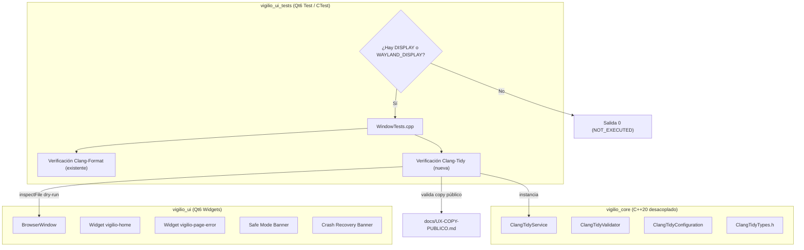
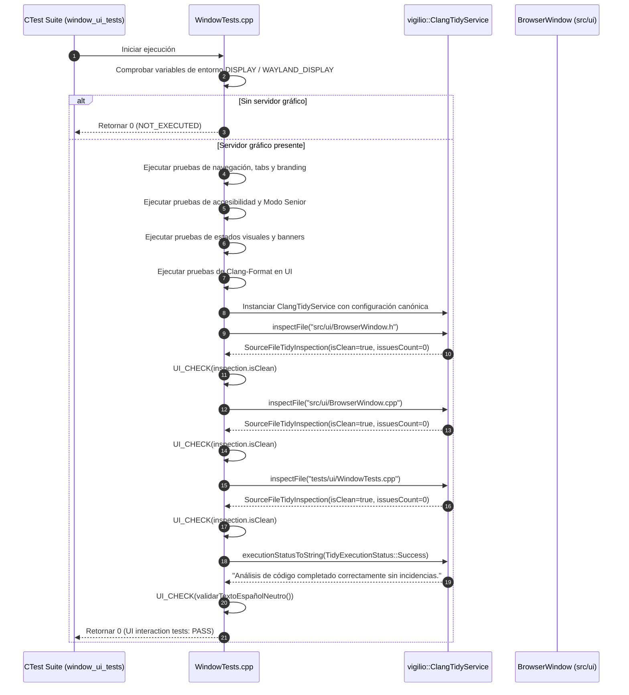
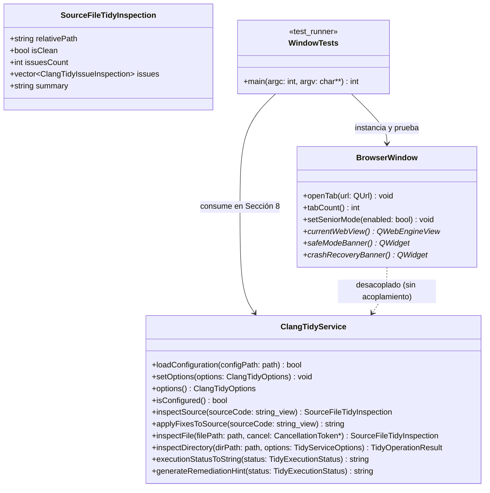

# Design — module-foundations-task0047

Status: PROPOSED

## Current, target and gaps

### Estado actual (CURRENT)

1. **Modelo de dominio y capa operativa de servicio de Clang-Tidy completados (`task0045` y `task0046`)**:
   - `vigilio_core` dispone de `ClangTidyTypes.h` con enumeraciones y estructuras fuertemente tipadas (`TidyExecutionStatus`, `SourceFileTidyInspection`, `TidyServiceOptions`, `TidyOperationResult`, `CancellationToken`).
   - El validador estático `ClangTidyValidator` valida reglas LLVM 18+, parsea YAML y certifica rutas seguras (`isSafeConfigPath`) previniendo directory traversal (`..`).
   - `ClangTidyConfiguration` provee la configuración canónica del proyecto (`.clang-tidy`) y filtros de extensiones compatibles (`.cpp`, `.h`, `.hpp`, `.cc`, `.cxx`) y exclusiones (`_build`, `build`, `generated`, `.git`, `.prompt-runner`, `assets`).
   - `ClangTidyService` implementa análisis y corrección en memoria (`inspectSource`, `applyFixesToSource`), inspección dry-run de archivos y directorios (`inspectFile`, `inspectDirectory`), copias de seguridad atómicas (`.bak`), rollback determinista, resiliencia con reintentos exponenciales y síntesis CLI.
2. **Arnés de pruebas de interfaz gráfica existente en `apps/vigilio-browser/tests/ui/WindowTests.cpp`**:
   - La suite `vigilio_ui_tests` valida la inicialización de `BrowserWindow`, widgets nativos (`vigilio-home`, `vigilio-page-error`), iconos Lucide SVG en QRC, navegación por teclado, atajos, accesibilidad (`accessibleName`), «Interfaz más fácil de usar» (Modo Senior) con escalado de iconos (22×22 a 32×32 px) y controles ($\ge 48$ px), banners de modo seguro y recuperación ante caídas, test fixtures y la gobernanza de Clang-Format en UI (`task0043`).
3. **Brecha técnica de integración de calidad de código estático en la capa de UI**:
   - Actualmente, las pruebas de UI no validan programáticamente que los propios archivos fuente de la interfaz gráfica (`src/ui/BrowserWindow.h`, `src/ui/BrowserWindow.cpp`, `tests/ui/WindowTests.cpp`) cumplan con los estándares de análisis estático del proyecto utilizando `ClangTidyService`.
   - La verificación de linteo estático depende de suites unitarias aisladas (`clang_tidy_service_tests`), sin validación interna en el arnés de CTest para UI.
   - No existe una prueba en el contexto de UI que audite que las cadenas de remediación y diagnóstico de `ClangTidyService::executionStatusToString` y `generateRemediationHint` respeten estrictamente `docs/UX-COPY-PUBLICO.md` en español neutro sin jerga técnica interna.

---

### Estado objetivo (TARGET)

1. **Declaración formal de «sin cambio visual directo en la interfaz pública»**:
   - `BrowserWindow` y los widgets públicos de navegación se mantienen 100% libres de botones de linteo, menús de comprobaciones estáticas o diálogos de depuración de código fuente.
   - Proscripción absoluta de exponer términos internos como «Clang-Tidy», «Linter», «AST», «Checks», «Senior Mode», «Modo Senior», «Prompt Builder», «DAG» u «OpenSpec» en componentes visibles, cumpliendo estrictamente `docs/UX-COPY-PUBLICO.md`.
2. **Integración de `ClangTidyService` en el arnés de pruebas de UI (`WindowTests.cpp`)**:
   - `WindowTests.cpp` incluye las cabeceras canónicas de `ClangTidyService`, `ClangTidyValidator`, `ClangTidyConfiguration` y `ClangTidyTypes.h`.
   - Incorpora una prueba de inspección programática en modo dry-run (`inspectFile`) que valida que `src/ui/BrowserWindow.h`, `src/ui/BrowserWindow.cpp` y `tests/ui/WindowTests.cpp` satisfacen al 100% las reglas de análisis estático de `.clang-tidy` sin incidencias (`isClean == true`, `issuesCount == 0`).
   - Incorpora una prueba de auditoría de copy público para `executionStatusToString` y `generateRemediationHint`, certificando que todas las descripciones de estado y remediación emplean español neutro claro y accesible sin jerga técnica interna.
3. **Preservación incondicional de los contratos visuales de `BrowserWindow`**:
   - Soporte completo y verificado de los 8 estados de interfaz: `idle`, `hover`, `focus`, `disabled`, `loading`, `empty`, `error` y `success`.
   - Mantenimiento y verificación de las dimensiones y espaciados de «Interfaz más fácil de usar» (Modo Senior): tap targets $\ge 48$ px, barra de navegación $\ge 55$ px, escalado de iconos de 22×22 a 32×32 px.
   - Navegación por teclado completa con foco visible de 2 px y atajos universales (`Ctrl+T`, `Ctrl+W`, `Ctrl+L`, etc.).
   - Metadatos descriptivos en español neutro para lectores de pantalla.
4. **Tolerancia a entornos headless y garantía Zero-Zombie**:
   - Detección preliminar de `DISPLAY` / `WAYLAND_DISPLAY`, reportando con transparencia y rigor técnico `NOT_EXECUTED` (exit code 0) en entornos sin interfaz gráfica.
   - Operaciones de inspección acotadas en memoria con tiempo de ejecución < 200 ms y cero procesos zombis o colgados.

---

### Gaps identificados (GAPS)

| Componente | Estado actual (CURRENT) | Estado objetivo (TARGET) | Brecha a subsanar (GAP) |
| --- | --- | --- | --- |
| Contrato visual de Clang-Tidy en UI | Sin declaración explícita de impacto en UI | Declaración formal de «sin cambio visual directo» en `BrowserWindow` conforme a `docs/UX-COPY-PUBLICO.md` | Formalizar en `proposal.md` y verificar estáticamente que ningún widget de linteo polucione la interfaz pública. |
| Inclusión de servicios en arnés de UI | `WindowTests.cpp` no incluye cabeceras de `ClangTidyService` | `WindowTests.cpp` incluye `#include "core/ClangTidyService.h"` y tipos asociados | Añadir los includes en `tests/ui/WindowTests.cpp`. |
| Inspección programática estática de UI | Verificación estática delegada solo a pruebas unitarias aisladas | `WindowTests.cpp` ejecuta inspección dry-run programática sobre archivos de UI | Implementar bloque de prueba en `WindowTests.cpp` que evalúe `BrowserWindow.h/.cpp` y `WindowTests.cpp` con `ClangTidyService::inspectFile`. |
| Auditoría de lenguaje público en UI | No se valida copy público de linteo en contexto de UI | `WindowTests.cpp` audita que `executionStatusToString` y `generateRemediationHint` generan español neutro según `docs/UX-COPY-PUBLICO.md` | Implementar comprobación de cadenas de texto de diagnóstico y remediación en `WindowTests.cpp`. |
| Enlace de dependencias | `vigilio_ui_tests` ya enlaza `vigilio_core` | Confirmación de que `vigilio_ui_tests` accede a `ClangTidyService` sin cambios de CMake | Verificar que `CMakeLists.txt` exporta correctamente los símbolos en `vigilio_core`. |
| Tolerancia headless | Detección existente de `DISPLAY` en `WindowTests.cpp` | Preservar y asegurar detección robusta ante nuevos bloques de prueba | Garantizar que las nuevas pruebas respeten la guarda preliminar de display para reportar `NOT_EXECUTED`. |

---

## Compatibility, migration and rollback

### Compatibilidad y estándares C++20 / Qt6
- **Estándar C++20**: Uso estricto de características modernas de C++20 (conceptos, `std::filesystem`, `std::string_view`, `enum class` con subyacente fuertemente tipado `uint8_t`, const-correctness).
- **Compatibilidad con Qt6**: Integración limpia con Qt6 Widgets y Qt6 Test, respetando el sistema de metaobjetos (`Q_OBJECT`, moc) y la jerarquía de herencia de `QMainWindow`.
- **Banderas de compilación estrictas**: El código compila limpiamente con `-Wall -Wextra -Wpedantic -Wconversion -Wsign-conversion -Wshadow -Werror` en GCC 15+, Clang 18+ y MSVC 2022.
- **Independencia del núcleo**: La capa `vigilio_core` mantiene cero dependencias hacia bibliotecas de GUI (`QWidget`, `QApplication`), mientras que `vigilio_ui_tests` consume ambas capas de forma desacoplada.

### Estrategia de migración
- La integración en `WindowTests.cpp` es puramente aditiva y no disruptiva.
- No modifica la API pública ni el comportamiento interno de `BrowserWindow`.
- No altera el comportamiento de los scripts existentes (`apps/vigilio-browser/scripts/check.sh`).
- Proporciona una suite de pruebas más robusta y completa en CTest.

### Plan de contingencia y rollback
- En caso de anomalías o regresiones durante la fase APPLY:
  - Revertir los cambios en `apps/vigilio-browser/tests/ui/WindowTests.cpp` mediante `git checkout apps/vigilio-browser/tests/ui/WindowTests.cpp`.
  - El sistema de construcción y la totalidad de los 19 tests unitarios y de integración de CTest permanecerán en su estado funcional verificado.

---

## Arquitectura técnica de clang-tidy configuration en UI

### Diagrama de interacción y dependencias

### Flujo de ejecución del arnés de pruebas de UI con inspección estática

### Diagrama de clases y contratos de interfaz

---

## Contratos de integración detallados

### 1. Ausencia de polución de interfaz pública y conformidad con `docs/UX-COPY-PUBLICO.md`
- La capacidad de linteo estático es una herramienta de calidad interna del proyecto y de la factoría de software.
- La ventana principal del navegador (`BrowserWindow`) debe permanecer 100% libre de controles de linteo, botones de analizadores, paneles de diagnóstico o menús técnicos.
- La suite de pruebas de UI auditará que las funciones de UX Copy (`executionStatusToString` y `generateRemediationHint`) generen exclusivamente descripciones en lenguaje natural en español neutro comprensible para cualquier usuario, sin jerga de compilador o ingeniería interna, y libres de términos prohibidos («Senior Mode», «Modo Senior», «Prompt Builder», «OpenSpec», «Linter», «Clang-Tidy»).

### 2. Inspección estática en arnés de UI con tolerancia headless (`NOT_EXECUTED`)
- El arnés de prueba `WindowTests.cpp` detecta al inicio si se cuenta con servidor gráfico (`DISPLAY` o `WAYLAND_DISPLAY`). En caso negativo, finaliza inmediatamente con código de retorno 0 emitiendo el mensaje `WindowTests: GUI display not available (no DISPLAY / WAYLAND_DISPLAY) - NOT_EXECUTED`.
- Cuando el entorno gráfico está disponible, la suite instancia `vigilio::ClangTidyService` y evalúa los archivos de interfaz (`BrowserWindow.h`, `BrowserWindow.cpp`, `WindowTests.cpp`) utilizando `inspectFile`, garantizando que ningún archivo sea mutado en disco durante las pruebas (modo de solo lectura / dry-run).

### 3. Preservación del Modo Senior («Interfaz más fácil de usar») y accesibilidad
- Se mantienen todas las garantías de accesibilidad de la ventana:
  - Botones con altura $\ge 48$ px.
  - Barra de herramientas con altura $\ge 55$ px.
  - Escalado de iconos de 22×22 px a 32×32 px en «Interfaz más fácil de usar».
  - Foco visible accesible de 2 px con contraste $\ge 3:1$.
  - Atajos de teclado universales (`Ctrl+T`, `Ctrl+W`, `Ctrl+L`, etc.).
  - Metadatos `accessibleName` y `accessibleDescription` en todos los controles interactivos.
