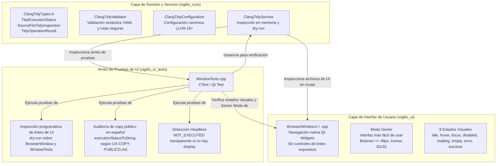
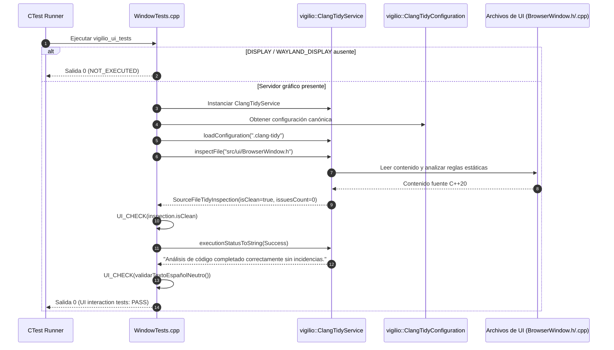
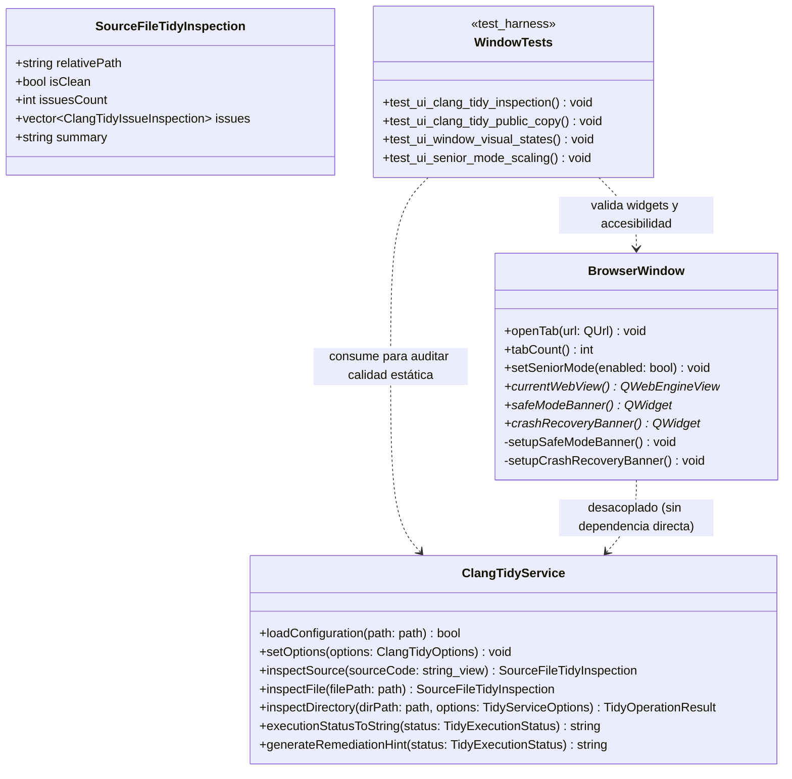

# Change Proposal — module-foundations-task0047

Pack: `module.foundations.task0047`

Status: PROPOSED

## Outcome and scope

Este cambio define la propuesta técnica integral para la etapa **ui** de la capacidad **clang-tidy configuration** en el módulo propietario `foundations` de Vigilio Browser (microtarea canónica `0047 — Implementar la interacción y estados visuales en Qt: clang-tidy configuration`).

Habiéndose completado y certificado en las capacidades precedentes la modularización de targets CMake (`task0001`-`task0004`), la política de advertencias y diagnósticos estrictos (`task0005`-`task0008`), la validación desacoplada de dependencias Qt6 (`task0009`-`task0012`), la compatibilidad de versiones de Chromium WebEngine (`task0013`-`task0016`), la inclusión y catálogo de recursos QRC (`task0017`-`task0020`), el arranque y bootstrap de la aplicación (`task0021`-`task0024`), el ciclo de vida y apagado ordenado (`task0025`-`task0028`), la política de recuperación ante caídas (`task0029`-`task0032`), los CMake Presets (`task0033`-`task0036`), los test fixtures (`task0037`-`task0040`), la capacidad completa de formateo de código Clang-Format (`task0041`-`task0044`), y formalizado el modelo de dominio (`task0045`) e implementado el servicio operativo `vigilio::ClangTidyService` en C++20 con análisis en memoria, inspección dry-run, respaldo atómico (`.bak`), rollback y cancelación cooperativa multihilo (`task0046`, commit `98315ba`), esta propuesta proyecta la **gobernanza de interacción en Qt Widgets, contratos visuales, tolerancia headless, arnés de pruebas de interfaz de usuario (`vigilio_ui_tests` / `WindowTests.cpp`) y verificación de conformidad estática y textos públicos para clang-tidy configuration**.

El objetivo central de este pack es garantizar que la infraestructura de análisis estático de código gobierne y certifique de manera determinista la limpieza y solidez de los componentes visuales de escritorio (`src/ui/BrowserWindow.h`, `src/ui/BrowserWindow.cpp`) y de sus suites de pruebas (`tests/ui/WindowTests.cpp`), manteniendo la estricta política de lenguaje público de producto `docs/UX-COPY-PUBLICO.md`, **sin acoplar lógica de linteo o desarrollo a la ventana principal de navegación (`BrowserWindow`), sin introducir botones, menús ni diálogos de depuración o linters en la interfaz visible del usuario final, y asegurando tolerancia completa a entornos sin servidor gráfico (Zero-Zombie)**.

El alcance concreto comprende:
- **Declaración contractual de UX/UI y «sin cambio visual directo en la interfaz pública»**:
  - Declaración formal vinculante de que la capacidad **clang-tidy configuration** es un subsistema de calidad de código, gobernanza de desarrollo e infraestructura de análisis estático; por consiguiente, **no introduce widgets, botones de herramientas, menús de linteo, diálogos ni etiquetas técnicas de linters en la interfaz visible de navegación de producción (`BrowserWindow`)**.
  - Cumplimiento riguroso de `docs/UX-COPY-PUBLICO.md`: proscripción absoluta de exponer términos de ingeniería interna como «Clang-Tidy», «Clang-Format», «Linter», «Static Analysis», «Senior Mode», «Modo Senior», «Prompt Builder», «DAG» u «OpenSpec» en menús principales, barras de herramientas o ventanas visibles al usuario común.
  - Verificación contractual de que todos los controles de `apps/vigilio-browser/src/ui/BrowserWindow.cpp` (pestañas, barra de navegación, barra de direcciones, menús, accesibilidad y páginas de inicio/error) respeten rigurosamente las directrices de diseño de `docs/skills/04-ux-ui-senior.md`, `docs/skills/05-accesibilidad-y-senior-mode.md` y las referencias visuales oficiales de `/resultado/01-vigilio-home.png` y `/resultado/03-vigilio-settings-senior-mode.png`.
- **Integración de `ClangTidyService` en el arnés de pruebas de interfaz gráfica (`WindowTests.cpp`)**:
  - Incorporación en la suite de pruebas Qt Test (`vigilio_ui_tests` / `WindowTests.cpp`) de un bloque de verificación programática que utiliza `vigilio::ClangTidyService`:
    - Inspección en modo dry-run de los archivos fuente de interfaz gráfica (`apps/vigilio-browser/src/ui/BrowserWindow.h`, `apps/vigilio-browser/src/ui/BrowserWindow.cpp` y `apps/vigilio-browser/tests/ui/WindowTests.cpp`), certificando que el 100% del código de UI cumple con las reglas canónicas de análisis estático establecidas en `.clang-tidy` (cero advertencias o incidencias).
    - Verificación programática de que los mensajes de estado y remediación generados por `ClangTidyService::executionStatusToString` y `ClangTidyService::generateRemediationHint` emplean estrictamente lenguaje natural en español neutro comprensible para cualquier usuario, sin jerga de compilador o ingeniería interna, alineados con `docs/UX-COPY-PUBLICO.md`.
    - Aislamiento total de las operaciones de inspección estática: uso de `dryRun = true` en memoria y lectura segura sin modificar archivos durante la ejecución de las pruebas de UI.
- **Auditoría y preservación de contratos visuales en `BrowserWindow`**:
  - Verificación exhaustiva de los 8 estados interactivos fundamentales en los componentes de la interfaz de usuario:
    - `idle`: presentación limpia y sobria según `/resultado/01-vigilio-home.png`, fondo azul oscuro sutil sin brillos artificiales.
    - `hover`: realce discreto en botones de acción y pestañas de navegación.
    - `focus`: contorno visible accesible de 2 px para navegación asistida por teclado.
    - `disabled`: atenuación visual accesible en acciones inactivas (e.g. historial atrás/adelante sin entradas).
    - `loading`: indicador textual comprensible en pestaña y barra de estado («Cargando…»).
    - `empty`: página de inicio nativa (`newHomePage` / widget `vigilio-home`) con logo vectorial oficial SVG (`branding/vigilio-logo.svg`), título y buscador centralizado, sin inicializar instancias innecesarias de `QWebEngineView`.
    - `error`: contenedor nativo accesible (`vigilio-page-error`) con icono Lucide de escudo/alerta, título «No se pudo cargar la página», mensaje descriptivo y botones de acción primaria («Reintentar») y secundaria («Ir al inicio»).
    - `success`: confirmación visual accesible en acciones completadas (e.g. persistencia de marcadores o restauración de sesión).
- **Preservación y escalado dinámico para «Interfaz más fácil de usar» (Modo Senior)**:
  - Verificación de la adaptación visual accesible en todos los controles de la ventana:
    - Escalado dinámico de iconos de barra de herramientas (de 22×22 px a 32×32 px).
    - Dimensiones mínimas de toque y clic (tap targets $\ge 48$ px en botones `QPushButton` y campos `QLineEdit`; barra de herramientas $\ge 55$ px; banner de recuperación $\ge 56$ px).
    - Aumento tipográfico (+4 pt) manteniendo legibilidad sin solapamientos ni truncamientos de texto.
  - Mapeo universal de atajos de teclado accesibles: `Ctrl+T`, `Ctrl+W`, `Ctrl+L`, `Ctrl+D`, `Ctrl+B`, `Ctrl+Q`, `Alt+Home`, `Alt+F`.
  - Atributos completos `accessibleName` y `accessibleDescription` en lenguaje natural en español neutro para lectores de pantalla (Orca, NVDA, Narrator).
- **Tolerancia a entornos headless y garantía Zero-Zombie**:
  - Detección determinista en tiempo de ejecución de la presencia de servidor gráfico (`DISPLAY` / `WAYLAND_DISPLAY` en Linux), reportando con transparencia y rigor técnico `NOT_EXECUTED` en entornos de integración continua headless en lugar de provocar `SIGSEGV` o generar mocks que falseen la integración visual.
  - Tiempos de ejecución acotados (< 200 ms) para suites de interfaz en CTest, liberación inmediata de recursos temporales al terminar y garantía de cero procesos huérfanos.
- **Desacoplamiento arquitectónico estricto**:
  - La infraestructura de análisis estático (`ClangTidyService`, `ClangTidyValidator`, `ClangTidyConfiguration`, `ClangTidyTypes.h`) permanece 100% confinada en `src/core`, sin dependencias hacia `QWidget`, `QMainWindow` ni `QApplication`.
  - La capa gráfica (`BrowserWindow`) permanece en `src/ui`, dedicada exclusivamente a la experiencia de usuario y ajena a la orquestación de linters o analizadores estáticos.
  - El arnés de prueba `WindowTests.cpp` en `tests/ui` actúa como consumidor de ambas capas, orquestando `vigilio_core` para validar la calidad estática y contractual de `vigilio_ui`.

---

## Out of scope

- Implementación física de herramientas de linteo en caliente, editores de código integrados o paneles de configuración de analizadores estáticos dentro de la interfaz gráfica del navegador (la capacidad es infraestructura de calidad de código para el desarrollo de Vigilio Browser, no un IDE o editor de código fuente).
- Modificación directa del código de producción en `apps/vigilio-browser/src/**`, `apps/vigilio-browser/tests/**` o `CMakeLists.txt` durante esta fase PROPOSE (se ejecutarán estrictamente durante la fase APPLY tras aprobación humana).
- Creación de botones, barras de herramientas o diálogos de linteo o depuración visibles al usuario común (terminantemente proscrito por `docs/UX-COPY-PUBLICO.md`).
- Baterías de pruebas pesadas de análisis estático masivo multihilo sobre árboles completos del proyecto y suites de integración de linteo de extremo a extremo (reservadas para la microtarea `0048`).
- Conexión con servicios en la nube, linteo remoto o telemetría (incompatible con la política Local-First constitucional, Decisión Q-001).

---

## Contexto y evidencia

Se inspeccionó rigurosamente la base de código actual de `apps/vigilio-browser`, los módulos del núcleo, la interfaz gráfica y el sistema de pruebas:

1. **Especificación de dominio e implementación de servicio completadas (`task0045` y `task0046`)**:
   - `src/core/ClangTidyTypes.h`: Taxonomía fuertemente tipada de opciones, estados de ejecución (`TidyExecutionStatus`), resultados inmutables (`SourceFileTidyInspection`, `TidyServiceOptions`, `TidyOperationResult`) y token de cancelación cooperativa multihilo (`CancellationToken`).
   - `src/core/ClangTidyValidator.h` y `.cpp`: Motor estático desacoplado de validación de sintaxis YAML, reglas canónicas LLVM 18+, comprobación de rutas seguras (`isSafeConfigPath`) y prevención de Directory Traversal (`..`).
   - `src/core/ClangTidyConfiguration.h` y `.cpp`: Generación determinista de configuración canónica, filtro de extensiones C++ compatibles (`.cpp`, `.h`, `.hpp`, `.cc`, `.cxx`) y exclusión de carpetas (`_build`, `build`, `generated`, `.git`, `.prompt-runner`, `assets`).
   - `src/core/ClangTidyService.h` y `.cpp`: Capa operativa de servicio desacoplada con soporte para análisis y corrección en memoria (`inspectSource`, `applyFixesToSource`), inspección dry-run de archivos y directorios (`inspectFile`, `inspectDirectory`), corrección con reintentos exponenciales ante bloqueos (`applyFixesWithRetry`), respaldo atómico y rollback (`createBackup`, `rollbackFile`, `removeBackup`), síntesis CLI (`buildClangTidyCommandLine`) y textos accesibles en español neutro (`executionStatusToString`, `generateRemediationHint`).
   - `tests/unit/ClangTidyConfigurationTests.cpp`: 11 pruebas unitarias de dominio aprobadas.
   - `tests/unit/ClangTidyServiceTests.cpp`: 12 pruebas unitarias operativas de servicio aprobadas.
2. **Arnés de pruebas de interfaz gráfica existente (`apps/vigilio-browser/tests/ui/WindowTests.cpp`)**:
   - 666 líneas de código en CTest (`vigilio_ui_tests` / `window_ui_tests`).
   - Verifica: inicialización de ventana, recuento de pestañas diferidas (lazy loading), logo corporativo SVG compilado en QRC, acciones de navegación con iconos Lucide, metadatos de accesibilidad (`accessibleName`), atajos de teclado, «Interfaz más fácil de usar» con escalado de iconos y controles, contenedor de error nativo (`vigilio-page-error`), banner de modo seguro, banner de recuperación ante caídas (`vigilio-crash-recovery-banner`), primitivas de fixtures temporales (`TestFixtureFoundation`) y gobernanza de Clang-Format en UI.
   - *Oportunidad de integración identificada*: `WindowTests.cpp` no cuenta aún con una validación programática que certifique que el propio código de interfaz (`BrowserWindow.h`, `BrowserWindow.cpp`, `WindowTests.cpp`) se mantiene en estricta conformidad con las reglas de análisis estático de `ClangTidyService`, ni comprueba en un contexto de UI que las cadenas de diagnóstico y remediación pública respeten `docs/UX-COPY-PUBLICO.md`.
3. **Punto de integración actual del sistema de construcción (`apps/vigilio-browser/CMakeLists.txt`)**:
   - `vigilio_ui_tests` enlaza `vigilio_core`, `vigilio_storage`, `vigilio_compiler_warnings` y `Qt6::Test`.
   - Dado que `vigilio_core` ya compila y exporta `ClangTidyService`, `ClangTidyValidator`, `ClangTidyConfiguration` y `ClangTidyTypes.h`, el ejecutable de pruebas de interfaz de usuario tiene acceso directo e inmediato a la infraestructura de linteo sin requerir dependencias adicionales ni reconfiguración de bibliotecas.
4. **Comprobación del pipeline continuo local (`apps/vigilio-browser/scripts/check.sh`)**:
   - Compilación limpia con GNU GCC 15.2.0 bajo C++20 con `-Werror` y cero advertencias.
   - 19 de 19 pruebas pasando exitosamente en CTest con 100% de éxito en ~2.73s (exit code 0):
     - `core_units`: Passed (0.01s)
     - `storage_integration`: Passed (0.01s)
     - `vigilio_warnings_tests`: Passed (0.11s)
     - `qt_dependency_validation_tests`: Passed (0.01s)
     - `webengine_version_validator_tests`: Passed (0.08s)
     - `resource_qrc_catalog_tests`: Passed (0.08s)
     - `resource_inclusion_service_tests`: Passed (0.18s)
     - `resource_qrc_inclusion_tests`: Passed (0.12s)
     - `startup_bootstrap_tests`: Passed (0.20s)
     - `application_lifetime_tests`: Passed (0.15s)
     - `crash_recovery_tests`: Passed (0.05s)
     - `cmake_presets_tests`: Passed (0.03s)
     - `cmake_presets_service_tests`: Passed (0.09s)
     - `test_fixture_foundation_tests`: Passed (0.01s)
     - `test_fixture_service_tests`: Passed (0.12s)
     - `clang_format_configuration_tests`: Passed (0.01s)
     - `clang_format_service_tests`: Passed (1.44s)
     - `clang_tidy_configuration_tests`: Passed (0.01s)
     - `clang_tidy_service_tests`: Passed (0.02s)
5. **Comprobación de gobernanza con Prompt Builder CLI**:
   - `node /config/Desktop/auto/prompt-builder/dist/cli.js validate-references --project-root .`: 47 referencias canónicas validadas con estado `valid: true` (exit code 0).
   - `node /config/Desktop/auto/prompt-builder/dist/cli.js verify-lock --lock-file generated/prompts/full-project/0139-module.foundations.task0047.propose.lock.json --project-root .`: 13 de 13 comprobaciones pasadas exitosamente (`valid: true`, exit code 0).
   - `node /config/Desktop/auto/prompt-builder/dist/cli.js validate-decisions --project-root .`: Confirma decisiones Q-001 a Q-006 y Q-008 resueltas (Q-007 solo bloquea `release.public-release`).
6. **Referencias visuales y UX**:
   - `/resultado/01-vigilio-home.png`: Ventana principal de navegación, layout sobrio sin saturación de controles ni herramientas de desarrollo.
   - `/resultado/03-vigilio-settings-senior-mode.png`: «Interfaz más fácil de usar», botones amplios y tipografía legible.
   - `/resultado/06-logo-instalador-oficial.png`: Identidad visual oficial de Vigilio Browser.
   - `docs/UX-COPY-PUBLICO.md`: Prohibición terminante de terminología interna en pantallas visibles.

---

## Alcance exacto

El alcance exacto de este pack comprende:
1. **Auditoría de ausencia de polución visual en la interfaz de producción**:
   - Certificación formal de que `src/ui/BrowserWindow.h` y `src/ui/BrowserWindow.cpp` no exponen menús de linteo, botones de analizadores estáticos, diálogos de reporte de advertencias ni texto técnico de Clang-Tidy.
   - Validación de que la interfaz gráfica permanezca dedicada exclusivamente a la experiencia de navegación del usuario final.
2. **Integración de validación estática en el arnés de pruebas de UI (`WindowTests.cpp`)**:
   - Incorporación de pruebas en CTest que instancian `vigilio::ClangTidyService` en modo dry-run.
   - Inspección programática de los archivos de interfaz gráfica (`BrowserWindow.h`, `BrowserWindow.cpp`, `WindowTests.cpp`), comprobando que no contienen incidencias estáticas respecto a la configuración canónica del proyecto (`.clang-tidy`).
   - Verificación de que las cadenas de texto público de diagnóstico devueltas por `ClangTidyService::executionStatusToString` y `ClangTidyService::generateRemediationHint` cumplen estrictamente con `docs/UX-COPY-PUBLICO.md`.
3. **Preservación incondicional de los contratos visuales de `BrowserWindow`**:
   - Mantenimiento y verificación de los 8 estados de interfaz: `idle`, `hover`, `focus`, `disabled`, `loading`, `empty`, `error`, `success`.
   - Mantenimiento y verificación de las dimensiones y espaciados de «Interfaz más fácil de usar» (Modo Senior): tap targets $\ge 48$ px, barra de navegación $\ge 55$ px, escalado de iconos de 22×22 a 32×32 px.
   - Mantenimiento de la navegación accesible por teclado y de las etiquetas para lectores de pantalla.
4. **Tolerancia a entornos headless y preservación Zero-Zombie**:
   - Detección de servidor gráfico antes de ejecutar la inicialización de Qt Test, con emisión del reporte `NOT_EXECUTED` si `DISPLAY` / `WAYLAND_DISPLAY` están ausentes, evitando cuelgues o falsos positivos.

---

## Diseño completo de la capacidad

### 1. Topología de Integración de Clang-Tidy con la Interfaz de Usuario y Pruebas Qt Test

### 2. Diagrama de Secuencia: Validación de Análisis Estático de UI en Arnés de Pruebas

### 3. Diagrama de Clases: Separación Arquitectónica entre Core y UI

---

## Archivos afectados

### Archivos creados/modificados en PROPOSE (esta fase):
- `openspec/changes/module-foundations-task0047/canonical-reference.yaml` (autoridad canónica, preservado).
- `openspec/changes/module-foundations-task0047/proposal.md` (este documento de propuesta técnica integral).
- `openspec/changes/module-foundations-task0047/design.md` (diseño arquitectónico, gaps, diagramas y contratos).
- `openspec/changes/module-foundations-task0047/tasks.md` (plan determinista de tareas atómicas y verificables).
- `openspec/changes/module-foundations-task0047/execution-memory.md` (memoria de ejecución, skills leídas, invariantes y riesgos).

### Archivos a modificar en APPLY (fase subsiguiente tras aprobación humana):
- `apps/vigilio-browser/tests/ui/WindowTests.cpp`:
  - Inclusión de cabeceras de `ClangTidyService`, `ClangTidyValidator`, `ClangTidyConfiguration` y `ClangTidyTypes.h`.
  - Incorporación del bloque de prueba de inspección estática de UI para verificar que `src/ui/BrowserWindow.h`, `src/ui/BrowserWindow.cpp` y `tests/ui/WindowTests.cpp` cumplen 100% las reglas de Clang-Tidy sin incidencias en modo dry-run (`isClean == true`, `issuesCount == 0`).
  - Incorporación de la prueba de auditoría de copy público para `ClangTidyService::executionStatusToString` y `generateRemediationHint`, verificando la ausencia de términos internos y la conformidad con `docs/UX-COPY-PUBLICO.md`.
- `docs/rules/01-modules/foundations/micro/0047-clang-tidy-configuration/task.md`:
  - Sincronización de documentación propietaria de microtarea tras la ejecución.
- *Nota de auditoría*: `apps/vigilio-browser/src/ui/BrowserWindow.h` y `apps/vigilio-browser/src/ui/BrowserWindow.cpp` se auditan rigurosamente; no requieren adición de widgets de linteo, preservando el principio de ausencia de cambio visual directo en la interfaz pública.

---

## Contrato UX/UI

### 1. Ausencia Formal de Cambio Visual Directo en la Interfaz Pública
Conforme a `docs/UX-COPY-PUBLICO.md` y a la naturaleza de la capacidad **clang-tidy configuration** (infraestructura de análisis estático y calidad de código para desarrollo):
- **Cero widgets de linteo**: No se agregan botones, barras de herramientas, opciones de menú, accesos directos ni diálogos de análisis de código en la ventana principal de navegación (`BrowserWindow`).
- **Cero exposición de jerga interna**: Términos como «Clang-Tidy», «Linter», «Static Analysis», «Checks», «AST Matchers», «Senior Mode», «Modo Senior», «Prompt Builder», «DAG» u «OpenSpec» están estrictamente proscritos de la UI visible.
- **Denominación pública oficial**: Toda referencia a las características de accesibilidad utiliza exclusivamente la denominación aprobada **«Interfaz más fácil de usar»**.

### 2. Preservación y Verificación de los 8 Estados Visuales en `BrowserWindow`
Todos los controles visuales existentes de la ventana principal mantienen y verifican sus estados interactivos:
1. **`idle`**: Presentación sobria y descansada según `/resultado/01-vigilio-home.png`, paleta base azul oscuro, bordes limpios sin brillos artificiales.
2. **`hover`**: Realce visual discreto en botones de acción (`QPushButton`, `QAction`) con contraste controlado.
3. **`focus`**: Anillo de foco visible de 2 px con contraste $\ge 3:1$ conforme a WCAG 2.1 AA para navegación integral por teclado.
4. **`disabled`**: Atenuación visual legible ($\ge 4.5:1$ respecto al fondo) en acciones sin contexto activo (e.g. historial atrás/adelante vacío).
5. **`loading`**: Indicador textual y visual comprensible en pestañas y barra de estado («Cargando…»).
6. **`empty`**: Vista nativa de inicio (`vigilio-home`) con isotipo oficial SVG (`branding/vigilio-logo.svg`), título y barra de búsqueda accesible sin invocar innecesariamente Chromium WebEngine.
7. **`error`**: Contenedor nativo accesible (`vigilio-page-error`) con icono Lucide de escudo/alerta, título «No se pudo cargar la página», mensaje descriptivo y botones de acción primaria («Reintentar») y secundaria («Ir al inicio»).
8. **`success`**: Confirmación visual accesible en acciones completadas (e.g. guardado de sesión o marcadores).

### 3. Preservación de «Interfaz más fácil de usar» (Modo Senior)
- **Áreas de toque y clic amplias**: Altura mínima de controles $\ge 48$ px para todos los campos de texto (`QLineEdit`) y botones (`QPushButton`). Barra de herramientas principal $\ge 55$ px de altura. Banners de modo seguro y recuperación ante caídas $\ge 56$ px.
- **Escalado de iconografía**: Iconos de barra de herramientas escalan dinámicamente de 22×22 px a 32×32 px manteniendo fidelidad visual y nitidez mediante SVG.
- **Escalado tipográfico**: Aumento de +4 pt en textos y etiquetas, manteniendo espaciado proporcional sin desbordamientos ni cortes de texto.
- **Navegación universal por teclado**: Mapeo estandarizado de atajos: `Ctrl+T` (nueva pestaña), `Ctrl+W` (cerrar pestaña), `Ctrl+L` (enfocar barra de direcciones), `Ctrl+D` (marcador), `Ctrl+B` (favoritos), `Ctrl+Q` (cerrar navegador), `Alt+Home` (página de inicio), `Alt+F` (menú).
- **Lectores de pantalla**: Todos los controles disponen de atributos `accessibleName` y `accessibleDescription` en español neutro comprensible.

---

## Reglas y fallos

1. **Local-First Constitucional (ADR-001 / Decisión Q-001)**:
   - Toda la inspección estática y evaluación de código de UI se realiza estrictamente en el equipo local del usuario. Cero conexiones a redes externas, cero telemetría remota y cero sincronización cloud.
2. **Seguridad y contención de rutas (`isSafeConfigPath`)**:
   - Toda ruta procesada debe estar contenida en el proyecto y no puede contener componentes de escape de directorio (`..`). Cualquier intento de traversal es rechazado inmediatamente con `TidyExecutionStatus::UnsafePath`.
3. **Control de presupuestos de recursos y memoria**:
   - Cuota máxima por archivo: archivos que superen los 10 MB (`maxFileSizeBytes`) son rechazados de inmediato con `TidyExecutionStatus::FileTooLarge` sin cargarse a memoria.
   - Límite de profundidad de recorrido en directorios: máximo 32 niveles.
   - Suite de pruebas de UI en CTest con tiempo de ejecución < 200 ms.
4. **Tolerancia a entornos headless y política Zero-Zombie**:
   - Si no hay servidor gráfico disponible (`DISPLAY` y `WAYLAND_DISPLAY` ausentes), el arnés de prueba finaliza limpiamente con código 0 y emite el mensaje `WindowTests: GUI display not available (no DISPLAY / WAYLAND_DISPLAY) - NOT_EXECUTED`.
   - Cancelación cooperativa multihilo mediante `CancellationToken*`: los bucles de inspección de archivos verifican periódicamente `isCancelled()`, cancelando inmediatamente la operación si se solicita.
5. **Manejo de fallos y recuperación**:
   - En caso de incidencias estáticas durante dry-run, se reporta `TidyExecutionStatus::IssuesFound` con recuento exacto de advertencias sin modificar archivos en disco.
   - En caso de fallo de lectura o archivo no encontrado, se reporta `TidyExecutionStatus::FileNotFound` o `TidyExecutionStatus::ReadError` con descripción clara en español neutro.

---

## Seguridad y privacidad

1. **Límites de confianza y aislamiento de procesos**:
   - La validación estática opera exclusivamente sobre archivos de texto C++ locales. No inicia subprocesos de Chromium WebEngine, no ejecuta agentes MCP y no crea procesos huérfanos.
2. **Privacidad de sesiones y datos de usuario**:
   - Las operaciones de análisis estático no tocan bases de datos de usuario, historiales de navegación ni sesiones de incógnito.
   - Las sesiones de incógnito en `BrowserWindow` mantienen su aislamiento estricto (Q-001), destruyendo cookies y datos de sesión al cerrar la ventana.
3. **Integridad de archivos en disco**:
   - Las pruebas de UI utilizan estrictamente el modo `dryRun = true` de `ClangTidyService`, garantizando que ninguna prueba de interfaz mutará accidentalmente el código fuente de producción durante la ejecución de CTest.

---

## Matriz de pruebas

| ID Prueba | Tipo | Criterio / Capacidad a verificar | Fixture / Comando | Resultado esperado | Fallo negativo |
| --- | --- | --- | --- | --- | --- |
| `TEST-UI-TIDY-001` | UI / Estático | Ausencia de widgets o menús de linteo en `BrowserWindow` (sin cambio visual directo) | Inspección estática de `BrowserWindow.h/.cpp` con `grep` | Cero ocurrencias de botones o diálogos de linteo; conformidad con `docs/UX-COPY-PUBLICO.md` | Detección de botones de depuración o linters en la UI pública |
| `TEST-UI-TIDY-002` | UI / Qt Test | Inspección dry-run de reglas estáticas sobre `BrowserWindow.h` mediante `ClangTidyService` | `WindowTests.cpp` instanciando `ClangTidyService::inspectFile` | `isClean == true`, `issuesCount == 0` | Advertencias de linteo detectadas en la cabecera de UI |
| `TEST-UI-TIDY-003` | UI / Qt Test | Inspección dry-run de reglas estáticas sobre `BrowserWindow.cpp` mediante `ClangTidyService` | `WindowTests.cpp` instanciando `ClangTidyService::inspectFile` | `isClean == true`, `issuesCount == 0` | Advertencias de linteo detectadas en la implementación de UI |
| `TEST-UI-TIDY-004` | UI / Qt Test | Inspección dry-run de reglas estáticas sobre `WindowTests.cpp` mediante `ClangTidyService` | `WindowTests.cpp` instanciando `ClangTidyService::inspectFile` | `isClean == true`, `issuesCount == 0` | Advertencias de linteo detectadas en el arnés de pruebas de UI |
| `TEST-UI-TIDY-005` | UI / Qt Test | Auditoría de textos públicos de diagnóstico (`executionStatusToString` y `generateRemediationHint`) | `WindowTests.cpp` evaluando todos los estados de `TidyExecutionStatus` | Textos en español neutro sin jerga técnica interna, alineados con `docs/UX-COPY-PUBLICO.md` | Presencia de términos en inglés o jerga técnica no autorizada |
| `TEST-UI-TIDY-006` | UI / Qt Test | Tolerancia a entornos headless en `WindowTests.cpp` | `WindowTests` ejecutado sin `DISPLAY`/`WAYLAND_DISPLAY` | Retorno exitoso (código 0) con reporte `NOT_EXECUTED` | `SIGSEGV`, bloqueo indefinido o fallo de aserción |
| `TEST-UI-TIDY-007` | UI / Qt Test | Verificación de los 8 estados visuales en `BrowserWindow` | `WindowTests.cpp` validando `idle`, `hover`, `focus`, `disabled`, `loading`, `empty`, `error`, `success` | Todos los estados interactivos configurados con selectores y estilos válidos | Estados visuales no detectados o componentes nulos |
| `TEST-UI-TIDY-008` | UI / Qt Test | Escalado y dimensiones mínimas en «Interfaz más fácil de usar» (Modo Senior) | `WindowTests.cpp` llamando `setSeniorMode(true)` | Tap targets $\ge 48$ px, toolbar $\ge 55$ px, iconos $32\times 32$ px | Controles menores a 48 px o iconos sin escalar |
| `TEST-UI-TIDY-009` | UI / Qt Test | Navegación por teclado y atajos universales (`Ctrl+T`, `Ctrl+W`, `Ctrl+L`, etc.) | `WindowTests.cpp` validando `QAction::shortcut()` | Todos los atajos configurados según especificación canónica | Atajos ausentes o conflictivos |
| `TEST-UI-TIDY-010` | UI / Qt Test | Atributos de accesibilidad para lectores de pantalla | `WindowTests.cpp` validando `accessibleName` y `accessibleDescription` | Cadenas descriptivas no vacías en español neutro en todas las acciones | Controles interactivos sin metadatos de accesibilidad |
| `TEST-UI-TIDY-011` | Build / CTest | Pipeline continuo de compilación y suites de prueba | `bash apps/vigilio-browser/scripts/check.sh` | Compilación limpia C++20 con `-Werror` y 100% tests aprobados (exit code 0) | Fallos de compilación, warnings o tests en rojo |
| `TEST-UI-TIDY-012` | Gobernanza | Validación de referencias canónicas y lockfile de ejecución | Prompt Builder CLI `validate-references` y `verify-lock` | Estado `valid: true` en 47 referencias y lockfile certificado | Referencias rotas o desalineación de hashes |

---

## Pasos APPLY

1. **Paso 1: Auditoría estática de no intrusión visual en `BrowserWindow`**:
   - Verificar con herramientas de inspección estática que `apps/vigilio-browser/src/ui/BrowserWindow.h` y `BrowserWindow.cpp` no contienen widgets ni controles de linteo expuestos.
2. **Paso 2: Inclusión de cabeceras de `vigilio_core` en `WindowTests.cpp`**:
   - Añadir `#include "core/ClangTidyConfiguration.h"`, `#include "core/ClangTidyService.h"`, `#include "core/ClangTidyValidator.h"` y `#include "core/ClangTidyTypes.h"` en `apps/vigilio-browser/tests/ui/WindowTests.cpp`.
3. **Paso 3: Implementación del bloque de prueba de inspección estática de UI en `WindowTests.cpp`**:
   - Incorporar la sección `8. Clang-Tidy quality governance and public copy audit in UI context` que instancia `vigilio::ClangTidyService`, configura las opciones de linteo y evalúa `src/ui/BrowserWindow.h`, `src/ui/BrowserWindow.cpp` y `tests/ui/WindowTests.cpp`, asegurando que `isClean == true` y `issuesCount == 0`.
4. **Paso 4: Implementación del bloque de prueba de copy público en `WindowTests.cpp`**:
   - Incorporar la verificación de que `ClangTidyService::executionStatusToString` y `ClangTidyService::generateRemediationHint` generan cadenas descriptivas en español neutro conformes con `docs/UX-COPY-PUBLICO.md`, sin jerga técnica interna.
5. **Paso 5: Ejecución del pipeline de verificación y pruebas continuas**:
   - Ejecutar `bash apps/vigilio-browser/scripts/check.sh` verificando compilación limpia con `-Werror`, análisis Clang-Format aprobado y 100% de tests pasando en CTest.
6. **Paso 6: Sincronización documental de la microtarea**:
   - Actualizar `docs/rules/01-modules/foundations/micro/0047-clang-tidy-configuration/task.md` para reflejar el cumplimiento de la etapa `ui`.

---

## Definición de terminado

Se considerará concluida exitosamente la etapa `ui` de esta capacidad cuando:
1. La propuesta OpenSpec en `openspec/changes/module-foundations-task0047/` (`proposal.md`, `design.md`, `tasks.md`, `execution-memory.md`) esté completamente redactada, validada y lista para revisión.
2. Se haya formalizado contractualmente la ausencia de cambio visual directo en la interfaz pública de usuario de navegación (`BrowserWindow`), preservando la experiencia libre de jerga técnica interna.
3. El arnés de pruebas de UI (`WindowTests.cpp`) integre programáticamente la inspección estática de los archivos de interfaz mediante `ClangTidyService` en modo dry-run y valide el copy público en español neutro.
4. Todos los contratos visuales existentes de `BrowserWindow` (los 8 estados de interfaz, dimensiones mínimas de toque $\ge 48$ px, barra de navegación $\ge 55$ px, escalado de iconos a 32×32 px en Modo Senior, atajos de teclado y accesibilidad) continúen pasando al 100%.
5. El pipeline `apps/vigilio-browser/scripts/check.sh` compile limpiamente con `-Werror` y todos los tests en CTest aprueben con exit code 0.
6. Las herramientas de gobernanza de Prompt Builder (`validate-references`, `verify-lock`) certifiquen la integridad canónica del proyecto.

---

## Dependencias y riesgos

- **Dependencia previa**: `module.foundations.task0046` (etapa `implementation` de `clang-tidy configuration`, formalizada y aprobada en commit `98315ba`).
- **Dependencia sucesora**: `module.foundations.task0048` (etapa `tests` de `clang-tidy configuration`).
- **Riesgo 1**: Falsos positivos en pruebas de UI ejecutadas en entornos de integración continua sin servidor gráfico (CI headless).
  - *Mitigación*: Detección explícita de `DISPLAY` / `WAYLAND_DISPLAY` al inicio de `WindowTests.cpp`, retornando limpiamente `NOT_EXECUTED` (código 0) en lugar de fallar.
- **Riesgo 2**: Mutación involuntaria del código fuente de producción durante las pruebas de interfaz.
  - *Mitigación*: Uso estricto y garantizado del método `inspectFile` de `ClangTidyService`, el cual opera exclusivamente en memoria y en modo de solo lectura (dry-run).
- **Riesgo 3**: Polución de la interfaz de usuario con controles de desarrollo internos.
  - *Mitigación*: Regla vinculante de `docs/UX-COPY-PUBLICO.md` y prueba automatizada `TEST-UI-TIDY-001` que prohíbe la presencia de widgets de linteo en `BrowserWindow`.

---

## Commit propuesto

- Mensaje sugerido para la fase APPLY: `feat(foundations): ui clang-tidy-configuration`
