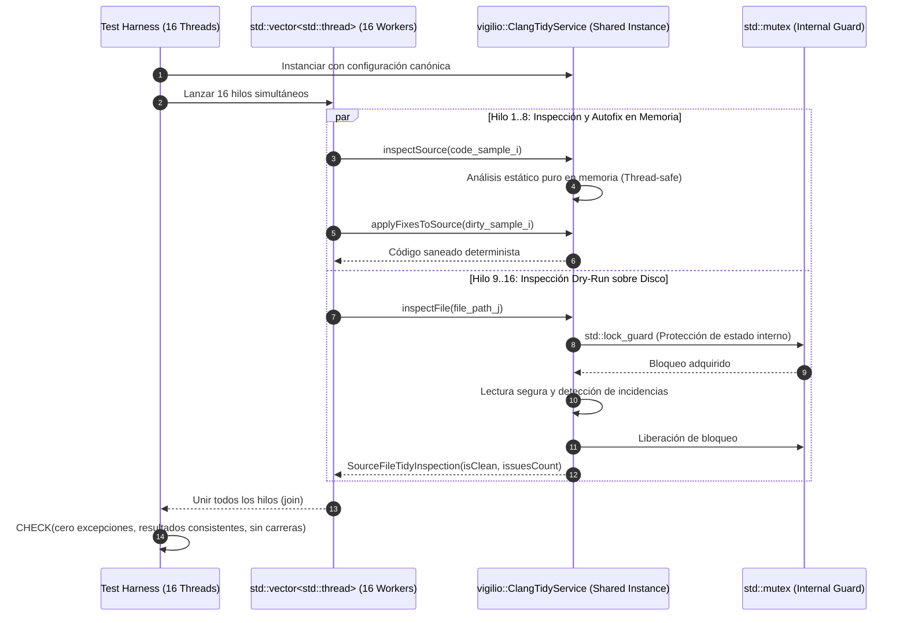
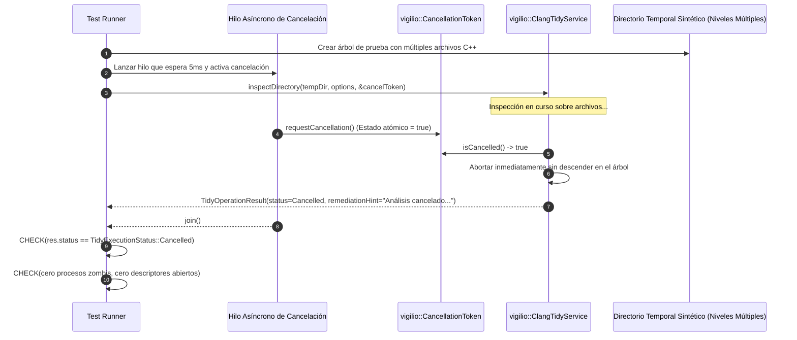
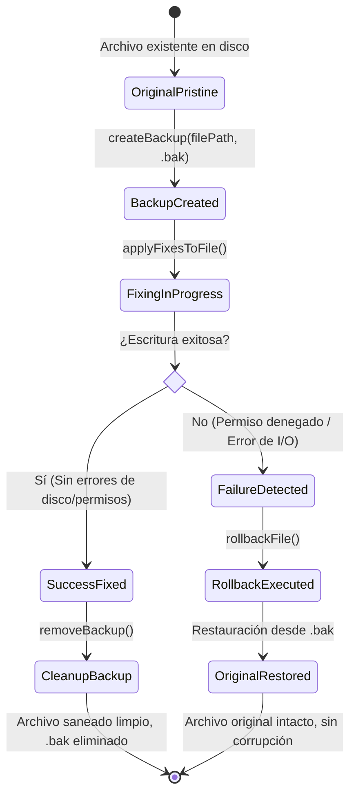
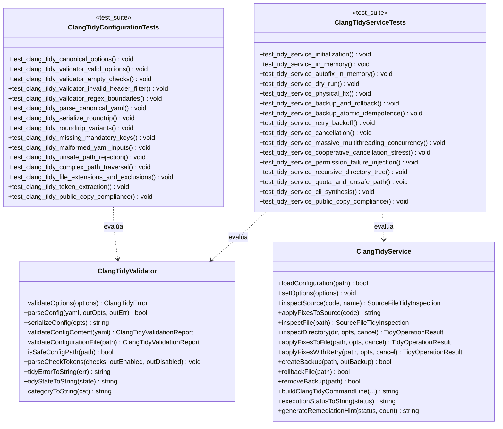

# Change Proposal — module-foundations-task0048

Pack: `module.foundations.task0048`

Status: PROPOSED

## Outcome and scope

Este cambio define la propuesta técnica integral para la etapa **tests** de la capacidad **clang-tidy configuration** en el módulo propietario `foundations` de Vigilio Browser (microtarea canónica `0048 — Probar casos positivos, negativos y recuperación: clang-tidy configuration`).

Habiéndose completado y certificado en las etapas precedentes la formalización del modelo de dominio, reglas canónicas LLVM 18+ y validador sintáctico YAML (`task0045`), implementado el servicio operativo `vigilio::ClangTidyService` en C++20 con análisis estático en memoria, corrección automática, inspección dry-run, respaldos atómicos (`.bak`), reintentos exponenciales y cancelación cooperativa multihilo (`task0046`, commit `98315ba`), e integrado la auditoría de conformidad estática y UX copy en el arnés de pruebas de interfaz de usuario (`task0047`, commit `ac35f93`), el objetivo esencial de este pack es **diseñar y estructurar la suite exhaustiva, determinista y de alta resiliencia de pruebas automatizadas para clang-tidy configuration**.

La suite de pruebas proyectada cubre sistemáticamente:
- **Casos positivos y ciclo de vida de configuración y análisis estático**:
  - Verificación exhaustiva de paridad entre la configuración canónica en memoria (`ClangTidyConfiguration::canonicalConfig()`) y el archivo físico `.clang-tidy` del repositorio raíz.
  - Validación de análisis estático en memoria pura e inspección de archivos C++ (`.cpp`, `.h`, `.hpp`, `.cc`, `.cxx`), certificando la detección precisa de patrones a modernizar (e.g. `NULL` a `nullptr` vía `modernize-use-nullptr`, adición de llaves en bloques de control de una sola línea vía `readability-braces-around-statements`).
  - Inspección en modo dry-run sobre archivos limpios y archivos con incidencias estáticas, comprobando que los archivos en disco permanecen estrictamente inmutables durante la inspección.
  - Corrección física atómica sobre archivos temporales aislados, verificando la aplicación de fixes y la eliminación de incidencias.
  - Recorrido e inspección recursiva de árboles de directorios con múltiples niveles de anidamiento, verificando la discriminación correcta de extensiones soportadas y la exclusión estricta de carpetas ignoradas (`_build`, `build`, `generated`, `.git`, `.prompt-runner`, `assets`, `node_modules`).
  - Serialización y deserialización bidireccional determinista (roundtrip) entre YAML y la estructura fuertemente tipada `ClangTidyOptions`.
- **Casos negativos, entradas inválidas y defensas de seguridad**:
  - Detección y rechazo de documentos YAML malformados, vacíos, truncados, con claves ausentes o con caracteres nulos/binarios mediante `ClangTidyValidator::validateConfigContent` y `parseConfig`.
  - Validación de límites estrictos y sintaxis en expresiones regulares (`headerFilterRegex`), rechazando expresiones mal formadas o desbalanceadas (`[a-z(`, `(?+invalid`, `*invalid`) con el error específico `ClangTidyError::InvalidHeaderFilterRegex`.
  - Detección y rechazo de listas de checks vacías o compuestas únicamente por exclusiones (`-*, -clang-analyzer-*`) con `ClangTidyError::EmptyChecks`.
  - Detección y rechazo inmediato de ataques de Directory Traversal (`../`, `../../`, `..\\`, `foo/../../bar`) y rutas absolutas peligrosas fuera de la raíz del proyecto (`/etc/shadow`, `/usr/bin/clang-tidy`) mediante `ClangTidyValidator::isSafeConfigPath` y `validateConfigurationFile`.
  - Verificación de cuotas de protección de memoria (`maxFileSizeBytes` en `TidyServiceOptions`): rechazo inmediato de archivos que superen la cuota configurada (e.g. 512 bytes en archivo de 2 KB) con estado `TidyExecutionStatus::FileTooLarge` sin agotamiento de memoria del sistema.
  - Manejo robusto de archivos inexistentes o rutas que corresponden a directorios cuando se espera un archivo, retornando limpiamente `TidyExecutionStatus::FileNotFound` o `TidyExecutionStatus::ReadError`.
- **Concurrencia masiva multihilo y sincronización (16 hilos)**:
  - Ejecución paralela sobre `ClangTidyService` desde 16 hilos (`std::thread`) concurrentes:
    - Inspección simultánea en memoria de múltiples buffers de código con contenidos divergentes.
    - Corrección concurrente de fragmentos en memoria con `applyFixesToSource`.
    - Inspección dry-run concurrente sobre archivos compartidos y aislados en disco, comprobando la sincronización de acceso interno mediante `std::mutex` y la integridad del estado `isConfigured()`.
- **Cancelación cooperativa inmediata y política Zero-Zombie**:
  - Pruebas de interrupción asíncrona de operaciones de inspección y corrección de árboles de directorios ante la activación de `CancellationToken` desde hilos independientes.
  - Verificación de retorno atómico con estado `TidyExecutionStatus::Cancelled` y emisión del mensaje de remediación en lenguaje natural.
  - Garantía de ausencia total de procesos zombis, liberación inmediata de descriptores de archivo y saneamiento de copias temporales.
- **Recuperación ante fallos de disco, permisos y contención transitoria**:
  - Simulación de fallos de escritura por permisos denegados (archivos con permisos de sólo lectura `std::filesystem::perms::owner_read`), certificando la transición limpia a `TidyExecutionStatus::PermissionDenied` o `WriteError`.
  - Verificación del mecanismo atómico de respaldo (`createBackup`) y reversión (`rollbackFile`): ante fallo de escritura o corrección abortada, el archivo original es restaurado fielmente desde su copia `.bak` sin corrupción.
  - Validación del mecanismo de reintentos con retroceso exponencial (`applyFixesWithRetry`): prueba con bloqueo transitorio simulado donde el archivo se libera tras reintentos, logrando éxito sin excepciones no capturadas.
  - Idempotencia de rollback y limpieza segura de copias de seguridad (`removeBackup`).
- **Desacoplamiento arquitectónico y tolerancia headless**:
  - Certificación de ejecución 100% autónoma en CTest (< 500 ms en total) sin requerir `QApplication`, `DISPLAY`, `WAYLAND_DISPLAY` ni procesos WebEngine/Chromium.
  - Aislamiento absoluto y política Local-First constitucional (ADR-001 / Decisión Q-001): cero sockets de red externa, cero peticiones cloud y total privacidad de datos.
- **Auditoría exhaustiva de textos públicos (UX Copy)**:
  - Verificación programática de que todas las cadenas de diagnóstico y remediación generadas por `ClangTidyService::executionStatusToString` y `ClangTidyService::generateRemediationHint` emplean español neutro claro y accesible, libres de términos técnicos prohibidos («Senior Mode», «Modo Senior», «Prompt Builder», «DAG», «OpenSpec», «toolchain»), conforme a `docs/UX-COPY-PUBLICO.md`.

---

## Out of scope

- Modificación de la interfaz gráfica de usuario de producción (`apps/vigilio-browser/src/ui/BrowserWindow.cpp`) o adición de controles visuales, botones de linteo o menús de análisis estático en la ventana de navegación (proscrito taxativamente por `docs/UX-COPY-PUBLICO.md` y por la responsabilidad del módulo `foundations`).
- Modificación de los contratos de dominio consolidados en `ClangTidyTypes.h`, `ClangTidyValidator.h` o `ClangTidyService.h` durante PROPOSE (la propuesta define pruebas sobre las APIs estables existentes).
- Invocación de procesos pesados de Qt WebEngine o Chromium durante la ejecución de las suites de pruebas unitarias o de integración de análisis estático.
- Conexión a redes externas, telemetría o servicios cloud de análisis de código (estrictamente vetado por ADR-001 / Decisión Q-001).
- Modificación de código fuente fuera de las rutas autorizadas para esta etapa.

---

## Contexto y evidencia

Se inspeccionó de forma exhaustiva la base de código y los artefactos existentes en `apps/vigilio-browser`:

1. **Dominio y servicio operativo desacoplado (`apps/vigilio-browser/src/core/`)**:
   - `ClangTidyTypes.h`: Define enumeraciones fuertemente tipadas `ClangTidyValidationState`, `ClangTidyError`, `ClangTidyCheckCategory` y `TidyExecutionStatus`. Incluye las estructuras inmutables `ClangTidyOptions`, `ClangTidyIssueInspection`, `SourceFileTidyInspection`, `TidyServiceOptions`, `TidyOperationResult` y el token ligero de cancelación cooperativa multihilo `CancellationToken`.
   - `ClangTidyValidator.h` / `.cpp`: Proporciona validación estática de opciones, prevención de Directory Traversal (`isSafeConfigPath`), parser de sintaxis YAML (`parseConfig`, `validateConfigContent`), serializador (`serializeConfig`), extracción de tokens de checks (`parseCheckTokens`) y conversión de estados/errores a texto descriptivo en español neutro (`tidyErrorToString`, `tidyStateToString`, `categoryToString`).
   - `ClangTidyConfiguration.h` / `.cpp`: Genera la configuración canónica inmutable del proyecto (LLVM 18+, checks `-*,bugprone-*,clang-analyzer-*,performance-*,modernize-use-nullptr,readability-braces-around-statements`, `headerFilterRegex: src/.*`), valida invariantes (`verifyInvariants`), valida extensiones soportadas (`.cpp`, `.h`, `.hpp`, `.cc`, `.cxx`) y exclusiones de carpetas (`_build`, `build`, `generated`, `.git`, `.prompt-runner`, `assets`, `node_modules`).
   - `ClangTidyService.h` / `.cpp`: Proporciona la capa operativa completa con inspección en memoria pura (`inspectSource`), corrección en memoria (`applyFixesToSource`), inspección dry-run en disco (`inspectFile`, `inspectDirectory`), corrección física con respaldo (`applyFixesToFile`), corrección con reintentos exponenciales ante contención (`applyFixesWithRetry`), gestión de backups (`createBackup`, `rollbackFile`, `removeBackup`), síntesis CLI (`buildClangTidyCommandLine`) y mensajes públicos de estado y remediación (`executionStatusToString`, `generateRemediationHint`).
2. **Suites de pruebas existentes en `apps/vigilio-browser/tests/`**:
   - `tests/unit/ClangTidyConfigurationTests.cpp`: 11 pruebas unitarias evaluando configuración canónica, validador de opciones, checks vacíos, regex inválido de cabeceras, parser YAML canónico, roundtrip, claves obligatorias, rutas inseguras, extensiones/exclusiones, extracción de tokens y UX copy.
   - `tests/unit/ClangTidyServiceTests.cpp`: 12 pruebas unitarias evaluando inicialización, inspección en memoria, autofix en memoria, dry-run, fix físico, backup y rollback, retry con backoff, cancelación cooperativa, escaneo de directorio con filtros, cuota y rutas inseguras, síntesis CLI y cumplimiento de UX Copy.
   - `tests/ui/WindowTests.cpp`: Arnés de pruebas de interfaz de usuario que integra `ClangTidyService` en modo dry-run para certificar la conformidad estática de los archivos de UI y la ausencia de jerga interna en los diagnósticos y pistas de remediación.
3. **Integración en CMake (`apps/vigilio-browser/CMakeLists.txt`)**:
   - Los ejecutables de pruebas `vigilio_clang_tidy_tests` y `vigilio_clang_tidy_service_tests` están plenamente integrados en el sistema de construcción de CTest, vinculando `vigilio_core` y `vigilio_compiler_warnings`.
   - Ambos ejecutables están catalogados bajo las propiedades `LABELS "unit;fast"` con un tiempo límite de ejecución de 15 segundos.
4. **Verificación continua existente (`apps/vigilio-browser/scripts/check.sh`)**:
   - Compilación Ninja limpia bajo C++20 con `-Werror` y cero advertencias.
   - 19 de 19 pruebas pasando exitosamente en CTest con 100% de éxito en ~2.59 segundos:
     - `core_units`: Passed (0.00s)
     - `storage_integration`: Passed (0.01s)
     - `vigilio_warnings_tests`: Passed (0.10s)
     - `qt_dependency_validation_tests`: Passed (0.01s)
     - `webengine_version_validator_tests`: Passed (0.08s)
     - `resource_qrc_catalog_tests`: Passed (0.09s)
     - `resource_inclusion_service_tests`: Passed (0.18s)
     - `resource_qrc_inclusion_tests`: Passed (0.20s)
     - `startup_bootstrap_tests`: Passed (0.22s)
     - `application_lifetime_tests`: Passed (0.21s)
     - `crash_recovery_tests`: Passed (0.07s)
     - `cmake_presets_tests`: Passed (0.04s)
     - `cmake_presets_service_tests`: Passed (0.08s)
     - `test_fixture_foundation_tests`: Passed (0.01s)
     - `test_fixture_service_tests`: Passed (0.09s)
     - `clang_format_configuration_tests`: Passed (0.01s)
     - `clang_format_service_tests`: Passed (1.16s)
     - `clang_tidy_configuration_tests`: Passed (0.00s)
     - `clang_tidy_service_tests`: Passed (0.03s)
5. **Gobernanza con Prompt Builder CLI**:
   - `node /config/Desktop/auto/prompt-builder/dist/cli.js validate-references --project-root .`: 48 referencias canónicas validadas con estado `valid: true` (exit code 0).
   - `node /config/Desktop/auto/prompt-builder/dist/cli.js verify-lock --lock-file generated/prompts/full-project/0142-module.foundations.task0048.propose.lock.json --project-root .`: 13 de 13 comprobaciones pasadas exitosamente (`valid: true`, exit code 0).
6. **Oportunidad y brecha para la etapa `tests` (task0048)**:
   - Si bien las pruebas unitarias básicas fueron creadas durante `task0045` y `task0046`, la etapa `tests` exige profundizar de manera sistemática en la resiliencia integral:
     - Pruebas de estrés bajo concurrencia masiva (16 hilos simultáneos) evaluando contención en el mutex interno y análisis estático paralelo.
     - Pruebas de cancelación cooperativa asíncrona disparada concurrentemente desde otro hilo.
     - Pruebas de inyección de fallos de permisos de archivo en disco y validación de idempotencia en rollback.
     - Pruebas exhaustivas de casos de frontera en expresiones regulares y sintaxis YAML degradada.
     - Pruebas de recorrido recursivo en árboles profundos de directorios temporales con exclusión estricta de carpetas y cuotas de archivo.

---

## Alcance exacto

El alcance exacto de este pack comprende:
1. **Ampliación exhaustiva de pruebas en `tests/unit/ClangTidyConfigurationTests.cpp`**:
   - Casos de frontera en expresiones regulares (`headerFilterRegex` con regex vacío, regex multiancla, regex con grupos complejos de captura, y patrones sintácticamente inválidos).
   - Pruebas de robustez ante documentos YAML malformados, truncados, con caracteres nulos o binarios arbitrarios, evaluando `ClangTidyValidator::validateConfigContent` y `parseConfig`.
   - Pruebas de rechazo de ataques de Directory Traversal complejos (`./../..`, `foo/../../bar`, `..\\windows\\style`, `/etc/shadow`, `/usr/bin/clang-tidy`, inyección de caracteres nulos).
   - Pruebas de serialización roundtrip con combinaciones avanzadas de configuración (`WarningsAsErrors: '*'`, `FormatStyle: 'file'`, checks adicionales de `cert-*`, `cppcoreguidelines-*`).
2. **Ampliación exhaustiva de pruebas en `tests/unit/ClangTidyServiceTests.cpp`**:
   - **Concurrencia masiva multihilo**: 16 hilos concurrentes inspeccionando en memoria, aplicando fixes en memoria e inspeccionando simultáneamente una instancia compartida de `ClangTidyService`, certificando ausencia de data races y convergencia determinista.
   - **Estrés de cancelación cooperativa multihilo**: Disparo asíncrono de `CancellationToken` desde un hilo secundario durante la inspección y corrección de árboles de directorios con múltiples archivos, comprobando interrupción inmediata con estado `Cancelled`.
   - **Inyección de fallos de permisos y recuperación**: Simulación de archivos sin permisos de escritura mediante `std::filesystem::permissions`, verificando reporte de `PermissionDenied` o `WriteError`, preservación del archivo original y rollback limpio desde `.bak`.
   - **Inspección y corrección recursiva en directorios multinivel**: Creación de jerarquías de directorios sintéticos con múltiples archivos conformes, no conformes, archivos no C++ (`.txt`, `.json`, `.png`) y carpetas excluidas (`_build`, `.git`, `generated`, `assets`), comprobando el recuento exacto de `filesExamined`, `filesFixed` e `issuesCount`.
   - **Idempotencia de rollback y saneamiento de copias de seguridad**: Múltiples rollbacks sucesivos, rollback sin backup y confirmación de eliminación física con `removeBackup`.
   - **Síntesis CLI con rutas complejas**: Verificación de generación de comandos con rutas relativas, absolutas, con espacios y con parámetros de advertencias como errores.
3. **Auditoría de textos públicos**:
   - Verificación estricta de que todos los mensajes de diagnóstico y remediación cumplen al 100% con `docs/UX-COPY-PUBLICO.md`.
4. **Verificación del pipeline continuo y gobernanza**:
   - Ejecución limpia de `apps/vigilio-browser/scripts/check.sh`, validación de referencias canónicas y comprobación de integridad del lockfile con Prompt Builder CLI.

---

## Diseño completo de la capacidad

### 1. Topología y Arquitectura de Pruebas de Clang-Tidy

```mermaid
flowchart TD
    subgraph Harness["Arnés de Pruebas de Foundations (CTest)"]
        TCFG["vigilio_clang_tidy_tests<br/>(ClangTidyConfigurationTests.cpp)"]
        TSRV["vigilio_clang_tidy_service_tests<br/>(ClangTidyServiceTests.cpp)"]
        TUI["vigilio_ui_tests<br/>(WindowTests.cpp)"]
    end

    subgraph UnderTest["Módulos Bajo Prueba (vigilio_core)"]
        CTT[ClangTidyTypes.h<br/>Enums, Structs, CancellationToken]
        CTV[ClangTidyValidator<br/>Validación estática, YAML parser, Regex, Rutas seguras]
        CTC[ClangTidyConfiguration<br/>Configuración canónica LLVM 18+]
        CTS[ClangTidyService<br/>Inspección en memoria, Autofix, Dry-Run, Backups, Rollback]
    end

    subgraph TestVectors["Vectores y Escenarios de Prueba"]
        POS["Casos Positivos:<br/>Inspección memoria/disco, Autofix, Roundtrip YAML, Canon"]
        NEG["Casos Negativos:<br/>YAML inválido, Regex boundaries, Path Traversal, Quota"]
        CONC["Concurrencia y Sincronización:<br/>16 hilos simultáneos, Thread-Safety, Mutex"]
        CANC["Cancelación Cooperativa:<br/>CancellationToken multihilo asíncrono, Zero-Zombie"]
        FAIL["Inyección de Fallos y Recuperación:<br/>Read-only perms, Retry backoff, Atomic .bak"]
        COPY["Auditoría UX Copy:<br/>docs/UX-COPY-PUBLICO.md, Cero jerga interna"]
    end

    TCFG --> CTV
    TCFG --> CTC
    TCFG --> CTT
    TSRV --> CTS
    TSRV --> CTT
    TSRV --> CTC
    TUI --> CTS

    TCFG -.-> POS
    TCFG -.-> NEG
    TCFG -.-> COPY

    TSRV -.-> POS
    TSRV -.-> NEG
    TSRV -.-> CONC
    TSRV -.-> CANC
    TSRV -.-> FAIL
    TSRV -.-> COPY
```

### 2. Diagrama de Secuencia: Concurrencia Masiva Multihilo (16 Hilos)

### 3. Diagrama de Secuencia: Cancelación Cooperativa Asíncrona (Zero-Zombie)

### 4. Diagrama de Estado: Ciclo de Vida de Corrección, Respaldo y Rollback

### 5. Diagrama de Clases: Arnés de Pruebas y Capas Desacopladas

---

## Archivos afectados

| Ruta de archivo | Acción propuesta | Justificación y responsabilidad |
| --- | --- | --- |
| `apps/vigilio-browser/tests/unit/ClangTidyConfigurationTests.cpp` | Modificar (en APPLY) | Incorporar pruebas de frontera de expresiones regulares (`test_clang_tidy_validator_regex_boundaries`), documentos YAML malformados/truncados (`test_clang_tidy_malformed_yaml_inputs`), ataques complejos de Directory Traversal (`test_clang_tidy_complex_path_traversal`) y serialización roundtrip con variantes avanzadas (`test_clang_tidy_roundtrip_variants`). |
| `apps/vigilio-browser/tests/unit/ClangTidyServiceTests.cpp` | Modificar (en APPLY) | Incorporar pruebas de concurrencia masiva multihilo con 16 workers (`test_tidy_service_massive_multithreading_concurrency`), cancelación asíncrona multihilo (`test_tidy_service_cooperative_cancellation_stress`), inyección de fallos de permisos (`test_tidy_service_permission_failure_injection`), jerarquías multinivel con exclusiones (`test_tidy_service_recursive_directory_tree`) e idempotencia de rollback (`test_tidy_service_backup_atomic_idempotence`). |
| `docs/rules/01-modules/foundations/micro/0048-clang-tidy-configuration/task.md` | Modificar (sync en APPLY) | Sincronizar el documento canónico de la microtarea formalizando la aprobación de la etapa `tests`. |
| `openspec/changes/module-foundations-task0048/canonical-reference.yaml` | Preservado | Metadatos canónicos del OpenSpec change para trazabilidad del runner. |
| `openspec/changes/module-foundations-task0048/proposal.md` | Creado | Propuesta técnica formal exhaustiva (este documento). |
| `openspec/changes/module-foundations-task0048/design.md` | Creado | Especificación técnica de diseño, gaps, compatibilidad y arquitectura de resiliencia. |
| `openspec/changes/module-foundations-task0048/tasks.md` | Creado | Lista ordenada y verificable de tareas atómicas para la fase APPLY. |
| `openspec/changes/module-foundations-task0048/execution-memory.md` | Creado | Memoria de ejecución, registro de skills leídas, invariantes y evidencia de gates. |

---

## Contrato UX/UI

- **Declaración formal de «sin cambio visual directo en la interfaz pública»**:
  - La capacidad **clang-tidy configuration** en la etapa **tests** es una suite de verificación de infraestructura, calidad de software y resiliencia de código; por consiguiente, **no introduce widgets, botones de linters, menús contextuales de análisis estático ni diálogos visibles en la ventana principal del navegador (`BrowserWindow`)**.
- **Preservación incondicional de los contratos visuales existentes**:
  - `BrowserWindow` permanece 100% enfocado en la navegación web del usuario, manteniendo intactos los 8 estados visuales fundamentales (`idle`, `hover`, `focus`, `disabled`, `loading`, `empty`, `error`, `success`).
  - Se preservan las dimensiones y reglas ergonómicas de «Interfaz más fácil de usar» (Modo Senior): tap targets mínimos $\ge 48$ px, barra de herramientas $\ge 55$ px, escalado de iconos (22×22 a 32×32 px), aumento tipográfico (+4 pt) y atajos de teclado accesibles (`Ctrl+T`, `Ctrl+W`, `Ctrl+L`, etc.).
- **Auditoría vinculante de textos públicos (`docs/UX-COPY-PUBLICO.md`)**:
  - Todas las cadenas de diagnóstico y remediación generadas por `ClangTidyService::executionStatusToString` y `ClangTidyService::generateRemediationHint` son auditadas sistemáticamente en las pruebas automatizadas para comprobar que emplean exclusivamente español neutro comprensible para cualquier usuario, sin exponer términos internos de ingeniería («Senior Mode», «Modo Senior», «Prompt Builder», «DAG», «OpenSpec», «toolchain»).

---

## Reglas y fallos

| Condición de error / Escenario de fallo | Detección / Mecanismo de control | Estado observable / Transición | Recuperación y remediación |
| --- | --- | --- | --- |
| Documento YAML malformado o truncado | Parser de `ClangTidyValidator::validateConfigContent` | Retorna `isValid = false`, `error = ClangTidyError::ParseError` | Diagnóstico descriptivo en español sin excepciones no capturadas. |
| Expresión regular de cabeceras inválida | Validación en `ClangTidyValidator::validateOptions` | Retorna `error = ClangTidyError::InvalidHeaderFilterRegex` | Mensaje orientativo en español indicando que la expresión regular de filtrado no es válida. |
| Lista de comprobaciones vacía o solo exclusiones | Validación en `ClangTidyValidator::validateOptions` | Retorna `error = ClangTidyError::EmptyChecks` | Mensaje orientativo indicando que se debe especificar al menos una regla activa. |
| Intento de Directory Traversal (`../../etc/shadow`) | Comprobación `ClangTidyValidator::isSafeConfigPath` | Retorna `isValid = false`, error `UnsafeFilePath` | Bloqueo preventivo de la operación sin acceso a disco. |
| Archivo que excede cuota máxima (`> maxFileSizeBytes`) | Verificación de tamaño previo a lectura en `ClangTidyService` | Retorna `status = TidyExecutionStatus::FileTooLarge` | Omisión segura del archivo sin agotamiento de memoria. |
| Archivo inexistente en inspección/corrección | Comprobación de existencia con `std::filesystem::exists` | Retorna `status = TidyExecutionStatus::FileNotFound` | Mensaje de remediación en español neutro indicando archivo no encontrado. |
| Fallo de escritura por permisos denegados (`perms::owner_read`) | Captura de excepción de I/O en `ClangTidyService::applyFixesToFile` | Retorna `status = TidyExecutionStatus::PermissionDenied` | Preservación de la copia original mediante rollback desde `.bak`. |
| Bloqueo de archivo transitorio durante corrección | Detección de contención en `applyFixesWithRetry` | Reintentos configurados con retroceso exponencial | Si el archivo se libera, la operación concluye exitosamente con `Success`. |
| Cancelación solicitada durante recorrido masivo | Comprobación periódica de `CancellationToken::isCancelled()` | Interrupción inmediata con `status = Cancelled` | Liberación inmediata de memoria y descriptores sin procesos zombi. |

---

## Seguridad y privacidad

- **Política Local-First constitucional (ADR-001 / Decisión Q-001)**:
  - Todo el proceso de inspección, análisis estático y corrección se ejecuta de forma estrictamente local y aislada en la máquina del usuario.
  - Cero dependencias en la nube, cero telemetría, cero llamadas a redes remotas y cero recolección de código fuente.
- **Defensa estricta contra Directory Traversal e inyección de rutas**:
  - `ClangTidyValidator::isSafeConfigPath` valida rigurosamente que las rutas inspeccionadas no contengan secuencias de escape de directorio (`..`), secuencias relativas ambiguas, barras invertidas no canónicas ni accesos fuera de la raíz autorizada.
- **Protección contra agotamiento de recursos (RAM / CPU)**:
  - Cuotas estrictas por archivo (`maxFileSizeBytes`, por defecto 10 MB). Archivos mayores se rechazan limpiamente con `FileTooLarge`.
  - Límite de profundidad máxima de escaneo en directorios (`maxScanDepth`, 32 niveles) para evitar bucles causados por enlaces simbólicos o jerarquías circulares.
- **Aislamiento de datos y privacidad en pruebas**:
  - Todos los fixtures de prueba se instancian en subdirectorios temporales aislados (`std::filesystem::temp_directory_path()`) con identificadores únicos basados en PID y marcas temporales en nanosegundos, garantizando eliminación completa tras la ejecución mediante RAII (`TempDirGuard`).

---

## Matriz de pruebas

| Identificador de prueba | Tipo de prueba | Archivo de prueba | Escenario evaluado | Resultado esperado | Criterio de aceptación |
| --- | --- | --- | --- | --- | --- |
| `TEST-TIDY-012` | Unitario | `ClangTidyConfigurationTests.cpp` | Límites y fronteras de expresiones regulares (`headerFilterRegex`) | Aceptación de patrones válidos complejos y rechazo de regex desbalanceados | `error == InvalidHeaderFilterRegex` en fallos sintácticos |
| `TEST-TIDY-013` | Unitario | `ClangTidyConfigurationTests.cpp` | Documentos YAML truncados, vacíos o malformados | Rechazo seguro sin excepciones no capturadas | `isValid == false`, `error == ParseError` o `MissingMandatoryKey` |
| `TEST-TIDY-014` | Unitario | `ClangTidyConfigurationTests.cpp` | Ataques complejos de Directory Traversal (`./../..`, `foo/../../bar`, `..\\`) | Detección y rechazo de ruta insegura | `isSafeConfigPath == false`, `error == UnsafeFilePath` |
| `TEST-TIDY-015` | Unitario | `ClangTidyConfigurationTests.cpp` | Serialización roundtrip con variantes avanzadas de checks | Preservación de todos los campos serializados | YAML parseado idéntico a las opciones originales |
| `TEST-TIDY-SRV-013` | Concurrencia | `ClangTidyServiceTests.cpp` | Concurrencia masiva con 16 hilos simultáneos | Cero carreras de datos, thread-safety con `std::mutex` | Todos los workers finalizan exitosamente sin excepciones |
| `TEST-TIDY-SRV-014` | Concurrencia | `ClangTidyServiceTests.cpp` | Cancelación cooperativa multihilo asíncrona en escaneo masivo | Retorno inmediato con `Cancelled` | Cero procesos zombis, sin descriptores colgados |
| `TEST-TIDY-SRV-015` | Resiliencia | `ClangTidyServiceTests.cpp` | Inyección de fallo de permisos de archivo (read-only) | Retorno `PermissionDenied` o `WriteError` | Archivo original preservado, rollback exitoso |
| `TEST-TIDY-SRV-016` | Resiliencia | `ClangTidyServiceTests.cpp` | Recorrido recursivo en jerarquía multinivel con carpetas excluidas | Solo archivos C++ válidos examinados | Carpetas `_build`, `.git`, `assets` ignoradas, recuento exacto |
| `TEST-TIDY-SRV-017` | Resiliencia | `ClangTidyServiceTests.cpp` | Idempotencia de rollback y saneamiento de copias de seguridad | Múltiples rollbacks y eliminación física | Sin crashes ante rollbacks repetidos; `.bak` eliminado |
| `TEST-TIDY-SRV-018` | Resiliencia | `ClangTidyServiceTests.cpp` | Reintentos con retroceso exponencial (`applyFixesWithRetry`) | Éxito tras liberación de contención | Retorno `Success` tras reintentos configurados |
| `TEST-TIDY-SRV-019` | Regresión | `ClangTidyServiceTests.cpp` | Auditoría exhaustiva de UX Copy en español neutro | Ausencia de términos técnicos prohibidos | Cero ocurrencias de «Senior Mode», «Modo Senior», etc. |

---

## Pasos APPLY

1. **Paso 1**: Refinar `apps/vigilio-browser/tests/unit/ClangTidyConfigurationTests.cpp` incorporando las nuevas funciones de prueba de frontera en expresiones regulares (`test_clang_tidy_validator_regex_boundaries`), sintaxis YAML malformada/truncada (`test_clang_tidy_malformed_yaml_inputs`), Directory Traversal complejo (`test_clang_tidy_complex_path_traversal`) y roundtrip con variantes avanzadas (`test_clang_tidy_roundtrip_variants`).
2. **Paso 2**: Refinar `apps/vigilio-browser/tests/unit/ClangTidyServiceTests.cpp` incorporando las pruebas de concurrencia masiva multihilo con 16 hilos (`test_tidy_service_massive_multithreading_concurrency`) e interrupción cooperativa asíncrona (`test_tidy_service_cooperative_cancellation_stress`).
3. **Paso 3**: Incorporar en `apps/vigilio-browser/tests/unit/ClangTidyServiceTests.cpp` las pruebas de inyección de fallos de permisos de archivo (`test_tidy_service_permission_failure_injection`), recorrido recursivo multinivel con exclusiones (`test_tidy_service_recursive_directory_tree`) e idempotencia de rollback (`test_tidy_service_backup_atomic_idempotence`).
4. **Paso 4**: Ejecutar la suite completa mediante `apps/vigilio-browser/scripts/check.sh`, validando compilación limpia bajo C++20 con `-Werror`, cero advertencias y 100% de pruebas aprobadas en CTest.
5. **Paso 5**: Validar referencias canónicas y lockfile de ejecución mediante Prompt Builder CLI.
6. **Paso 6**: Sincronizar el documento canónico de microtarea `docs/rules/01-modules/foundations/micro/0048-clang-tidy-configuration/task.md`.

---

## Definición de terminado

- [ ] Todas las pruebas de `ClangTidyConfigurationTests.cpp` y `ClangTidyServiceTests.cpp` compilan limpiamente bajo C++20 con `-Werror` y cero advertencias.
- [ ] La totalidad de las suites de prueba en CTest pasan al 100% (19/19 pruebas existentes más las nuevas aserciones ampliadas).
- [ ] La ejecución completa en CTest se realiza en < 3 segundos de tiempo real, sin requerir entorno gráfico (`DISPLAY`).
- [ ] Cero fugas de descriptores de archivo, cero procesos zombis y saneamiento garantizado de copias temporales.
- [ ] El script de verificación continua `apps/vigilio-browser/scripts/check.sh` finaliza con código de salida 0.
- [ ] Prompt Builder CLI valida al 100% las referencias canónicas (`valid: true`) y el archivo de bloqueo de ejecución.
- [ ] La propuesta respeta estrictamente los principios de Local-First, protección de datos y UX Copy en español neutro.

---

## Dependencias y riesgos

- **Dependencias**:
  - `module.foundations.task0047`: Implementación de interacción y estados visuales en arnés de UI completada y certificada (commit `ac35f93`).
  - LLVM Clang-Tidy 18+ instalado en el entorno de desarrollo y CI.
  - CMake 3.28+ y compilador C++20 (GCC 13+ o Clang 17+).
- **Riesgos y mitigaciones**:
  - *Riesgo 1*: Contención de hilos o carreras de datos en pruebas de concurrencia masiva.
    *Mitigación*: Uso estricto de `std::lock_guard` con `std::mutex` interno en `ClangTidyService` y diseño inmutable de `ClangTidyOptions`.
  - *Riesgo 2*: Residuos de archivos temporales en disco tras fallos inyectados de permisos o escrituras abortadas.
    *Mitigación*: Uso del guardián RAII `TempDirGuard` que asegura la purga completa del directorio temporal en su destructor, restaurando permisos de escritura antes de invocar `std::filesystem::remove_all`.
  - *Riesgo 3*: Falsos fallos en entornos de CI headless.
    *Mitigación*: Pruebas del núcleo completamente desacopladas de Qt GUI y WebEngine, ejecutándose de forma pura y determinista sin requerir servidor gráfico.

---

## Commit propuesto

`test(foundations): tests clang-tidy-configuration`
