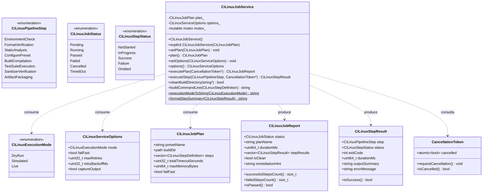
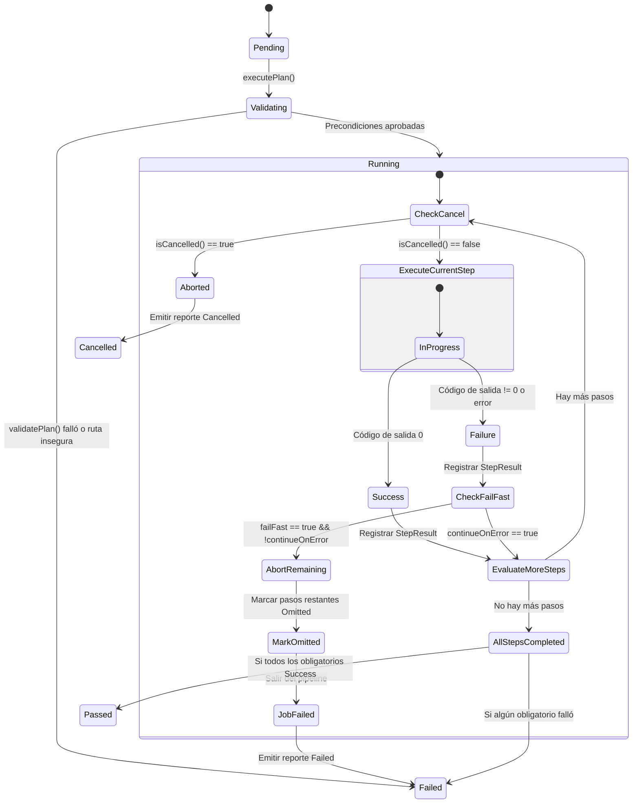
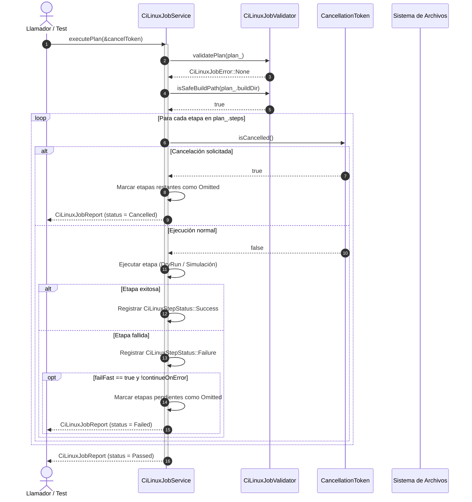

# Design — module-foundations-task0050

Status: PROPOSED

## Current, target and gaps

### Estado actual (CURRENT)

1. **Modelo de dominio de CI Linux completado en la etapa previa (`task0049`)**:
   - `CiLinuxJobTypes.h` define las enumeraciones fuertemente tipadas `CiLinuxPipelineStep`, `CiLinuxJobStatus`, `CiLinuxStepStatus`, `CiLinuxJobError`, `CiLinuxArchitecture`, `CiLinuxCompiler`, `CiLinuxBuildConfiguration`, así como las estructuras inmutables `CiLinuxEnvironment`, `CiLinuxStepOptions`, `CiLinuxStepDefinition`, `CiLinuxStepResult`, `CiLinuxJobPlan`, `CiLinuxJobReport` y `CancellationToken`.
   - `CiLinuxJobConfiguration` provee los planes canónicos oficiales (`canonicalDebugPlan`, `canonicalReleasePlan`), verificación de invariantes (`verifyInvariants`) y filtros de distribuciones soportadas (`isSupportedLinuxDistro`).
   - `CiLinuxJobValidator` provee validación de planes (`validatePlan`), verificación de orden topológico de etapas (`validateStepSequence`), validación de entorno de compilación (`validateEnvironment`), validación de seguridad de rutas (`isSafeBuildPath`) y funciones de conversión y textos en español neutro (`jobStatusToString`, `jobErrorToString`, `stepToString`, `stepStatusToString`, `generateRemediationHint`).
   - La suite `CiLinuxJobConfigurationTests.cpp` (11 pruebas) pasa limpiamente en CTest.
2. **Carencia de una capa de servicio operativo en tiempo de ejecución**:
   - No existe una clase coordinadora (`CiLinuxJobService`) que orqueste la ejecución ordenada de las etapas del pipeline de CI Linux sobre configuraciones reales o simuladas.
   - No hay soporte para ejecución en modo no destructivo o simulación (*dry-run*) a nivel de pipeline completo o etapas individuales.
3. **Ausencia de orquestación de etapas con políticas fail-fast y tolerancia a fallos**:
   - No existe un mecanismo que ejecute las etapas secuencialmente, mida tiempos de ejecución de alta precisión (`std::chrono::steady_clock`), aborte la ejecución de etapas dependientes si una etapa obligatoria falla (*fail-fast*), o permita continuar ante fallos no críticos (*continueOnError*).
4. **Falta de soporte de cancelación cooperativa multihilo (Zero-Zombie)**:
   - No se dispone de un mecanismo para interrumpir de manera segura e inmediata la ejecución de un trabajo de CI Linux cuando un hilo o usuario lo solicite, arriesgando subprocesos colgados o zombis esperando indefinidamente.
5. **Carencia de síntesis determinista de argumentos CLI para el pipeline de Linux**:
   - No existe un generador de comandos CLI reproducible que sintetice la invocación de CMake presets, Ninja, CTest y herramientas de análisis C++20 para cada etapa del trabajo.
6. **Ausencia de saneamiento seguro del directorio de compilación**:
   - No existe una rutina segura que limpie el directorio de construcción antes o después de la compilación verificando previamente la ausencia de Directory Traversal (`..`) y aplicando reintentos ante contención de archivos.

---

### Estado objetivo (TARGET)

1. **Capa operativa de servicio desacoplada (`vigilio::CiLinuxJobService`)**:
   - Integrada en `apps/vigilio-browser/src/core/` dentro del target `vigilio_core`.
   - Proporciona orquestación completa de pipeline (`executePlan`), ejecución granular de etapas (`executeStep`), modo simulación determinista (`DryRun`), saneamiento seguro de directorios (`cleanBuildDirectory`) y síntesis CLI reproducible (`buildCommandLine`).
   - Cero dependencias hacia `QApplication`, widgets de Qt o instancias de Chromium WebEngine.
2. **Ampliación de tipos operativos en `CiLinuxJobTypes.h`**:
   - Modos de ejecución `CiLinuxExecutionMode` (`DryRun`, `Simulated`, `Live`).
   - Opciones operativas del servicio `CiLinuxServiceOptions` (`mode`, `failFast`, `maxRetries`, `retryBackoffMs`, `captureOutput`).
3. **Orquestación robusta y tolerante a fallos**:
   - Ejecución secuencial respetando el orden topológico de dependencias.
   - Evaluación previa obligatoria de invariantes y límites de recursos (RAM $\le 4\text{ GB}$).
   - Medición precisa de duración en milisegundos por etapa y global.
   - Marcado de etapas omitidas (`CiLinuxStepStatus::Omitted`) ante activación de `failFast`.
4. **Cancelación cooperativa y política Zero-Zombie**:
   - Verificación atómica periódica de `cancel->isCancelled()` antes y durante cada etapa.
   - Cese inmediato de procesamiento ante cancelación y emisión de reporte con estado `Cancelled`.
   - Garantía de liberación de recursos sin procesos zombis.
5. **Saneamiento seguro de directorios con resiliencia**:
   - Limpieza de directorio de compilación validando `isSafeBuildPath`.
   - Reintentos con retroceso exponencial ($50\text{ ms} \times 2^i$) ante bloqueos temporales de archivos.
6. **Síntesis CLI y UX Copy público**:
   - Generación determinista de líneas de comando CLI para las 8 etapas canónicas.
   - Conversión de estados y generación de sugerencias amigables en español neutro cumpliendo estrictamente `docs/UX-COPY-PUBLICO.md`.
7. **Batería de pruebas unitarias exhaustivas en CTest**:
   - Suite `vigilio_ci_linux_job_service_tests` en `tests/unit/CiLinuxJobServiceTests.cpp` con 12 pruebas trazables (`TEST-CI-LINUX-SRV-001` a `TEST-CI-LINUX-SRV-012`).

---

### Brechas identificadas (GAPS)

| Componente | Estado actual (CURRENT) | Estado objetivo (TARGET) | Brecha a subsanar (GAP) |
| --- | --- | --- | --- |
| Tipos operativos del servicio | Solo existen tipos estáticos en `CiLinuxJobTypes.h` | Tipos operativos completos: `CiLinuxExecutionMode`, `CiLinuxServiceOptions` | Extender `CiLinuxJobTypes.h` incorporando las nuevas estructuras y enumeraciones. |
| Interfaz de servicio | Inexistente | `CiLinuxJobService.h` declarando métodos de ciclo de vida, ejecución, saneamiento y CLI | Crear archivo de cabecera con la clase `CiLinuxJobService` y sus contratos públicos. |
| Implementación operativa | Inexistente | `CiLinuxJobService.cpp` con lógica de orquestación, fail-fast, simulación, cancelación cooperativa y saneamiento | Implementar la clase de servicio en C++20 libre de dependencias gráficas. |
| Gestión de fallos y cancelación | No implementado en ejecución | Aborto controlado por fail-fast, omisión ordenada de etapas y token cooperativo Zero-Zombie | Implementar bucle de ejecución secuencial con verificación de tokens y estados de error. |
| Saneamiento de directorios | Sin soporte en servicio | Método `cleanBuildDirectory` con verificación de seguridad de rutas y reintentos exponenciales | Implementar borrado recursivo seguro con validación previa de path traversal. |
| Síntesis de comandos CLI | Sin generador en servicio | Método `buildCommandLine` para cada etapa del pipeline Linux | Implementar síntesis determinista de argumentos CLI para CMake, Ninja, CTest y herramientas C++. |
| Batería de pruebas de servicio | 0 pruebas de servicio para CI Linux | 12 pruebas unitarias deterministas en `CiLinuxJobServiceTests.cpp` | Crear suite completa cubriendo ciclo de vida, dry-run, fail-fast, cancelación, saneamiento y copy público. |
| Integración en CMakeLists | Target de test de servicio no registrado | `CiLinuxJobService.cpp` en `vigilio_core` y test `ci_linux_job_service_tests` registrado | Añadir fuente y configurar target ejecutable y test en CTest. |

---

## Compatibility, migration and rollback

### Compatibilidad y estándares C++20
- Implementación conforme al estándar ISO C++20 empleando facilidades nativas de la biblioteca estándar: `<string>`, `<string_view>`, `<vector>`, `<filesystem>`, `<chrono>`, `<thread>`, `<atomic>`, `<mutex>`, `<sstream>`, `<algorithm>`.
- Portabilidad garantizada en compiladores modernos de Linux: GCC 14+ y Clang 18+.
- Compilación con flags estrictos del proyecto: `-Wall -Wextra -Wpedantic -Wconversion -Wsign-conversion -Wshadow -Werror`.
- Funcionamiento 100% headless, sin requerir servidor gráfico ni dependencias hacia Qt Widgets o Chromium WebEngine.

### Estrategia de migración
- La incorporación de `CiLinuxJobService` es puramente aditiva dentro de la biblioteca estática `vigilio_core`.
- No modifica las configuraciones existentes en `CMakePresets.json` ni los contratos formalizados en `task0049`.
- Mantiene compatibilidad total con los 20 tests existentes en el pipeline de CTest.
- Sienta la base operativa que consumirá la etapa de interfaz gráfica (`module.foundations.task0051`).

### Plan de contingencia y rollback
- En caso de anomalías en la compilación o pruebas durante APPLY:
  - Eliminar los nuevos archivos: `apps/vigilio-browser/src/core/CiLinuxJobService.h`, `apps/vigilio-browser/src/core/CiLinuxJobService.cpp` y `apps/vigilio-browser/tests/unit/CiLinuxJobServiceTests.cpp`.
  - Revertir los cambios en `CiLinuxJobTypes.h` y `apps/vigilio-browser/CMakeLists.txt`.
  - El árbol del proyecto regresa instantáneamente al estado certificado de la etapa `domain` (`task0049`).

---

## Arquitectura técnica de CI Linux job (implementation)

### Diagrama de componentes y flujo operativo

```mermaid
flowchart TD
    subgraph Dominio["Capa de Dominio e Invariantes"]
        Types["CiLinuxJobTypes.h\n(Steps, Status, Errors, Plan, Report)"]
        Config["CiLinuxJobConfiguration\n(Canonical Plans, Supported Distros)"]
        Validator["CiLinuxJobValidator\n(Plan Validation, Path Safety, Copy)"]
    end

    subgraph Servicio["Capa Operativa Propietaria (vigilio_core)"]
        Service["CiLinuxJobService\n(Orchestration, Fail-Fast, DryRun, CLI)"]
        Token["CancellationToken\n(Zero-Zombie Cooperative Cancellation)"]
    end

    subgraph Almacenamiento["Sistema de Archivos Local (Local-First)"]
        BuildDir["Directorio de Compilación\n(build-ci-debug / build-ci-release)"]
        PresetsFile["CMakePresets.json\n(Preset canónico oficial)"]
    end

    subgraph Pruebas["Arnés de Pruebas (CTest)"]
        ServiceTests["CiLinuxJobServiceTests\n(12 tests deterministas)"]
    end

    PresetsFile --> Config
    Config -->|Planes canónicos| Service
    Types --> Service
    Validator -->|validatePlan & isSafeBuildPath| Service
    Token -.->|isCancelled()| Service
    Service -->|cleanBuildDirectory| BuildDir
    Service -->|executePlan (DryRun / Live)| Types
    ServiceTests -->|valida exhaustivamente| Service
```

### Diagrama de clases y relaciones



### Máquina de estados operativos de orquestación de CI Linux



### Diagrama de secuencia: Ejecución con Fail-Fast y Cancelación Cooperativa



---

## Contrato funcional y API de CiLinuxJobService

### 1. Métodos de ciclo de vida y configuración

```cpp
namespace vigilio {

class CiLinuxJobService {
  public:
    /// @brief Construye el servicio inicializado con el plan canónico de depuración en Linux.
    CiLinuxJobService();

    /// @brief Construye el servicio inyectando un plan de trabajo explícito.
    explicit CiLinuxJobService(CiLinuxJobPlan plan);

    ~CiLinuxJobService() = default;

    /// @brief Asigna un nuevo plan de trabajo, protegiendo el acceso multihilo mediante mutex.
    void setPlan(CiLinuxJobPlan plan);

    /// @brief Obtiene una copia inmutable del plan de trabajo actualmente configurado.
    [[nodiscard]] CiLinuxJobPlan plan() const;

    /// @brief Asigna las opciones operativas de ejecución del servicio.
    void setOptions(CiLinuxServiceOptions options);

    /// @brief Obtiene las opciones operativas configuradas.
    [[nodiscard]] CiLinuxServiceOptions options() const;
```

### 2. Métodos de ejecución y orquestación

```cpp
    /// @brief Ejecuta el plan configurado respetando el orden topológico, fail-fast y límites.
    /// @param cancel Puntero opcional al token de cancelación cooperativa (Zero-Zombie).
    /// @return Reporte consolidado inmutable de la ejecución del trabajo.
    [[nodiscard]] CiLinuxJobReport executePlan(CancellationToken* cancel = nullptr);

    /// @brief Ejecuta una etapa individual de manera aislada para diagnóstico o prueba.
    /// @param step Etapa concreta a evaluar.
    /// @param cancel Puntero opcional al token de cancelación cooperativa.
    /// @return Resultado individual inmutable de la ejecución de la etapa.
    [[nodiscard]] CiLinuxStepResult executeStep(CiLinuxPipelineStep step,
                                                CancellationToken* cancel = nullptr);
```

### 3. Saneamiento y gestión segura del sistema de archivos

```cpp
    /// @brief Limpia de manera segura y recursiva el directorio de construcción configurado.
    /// @param errorMessage Mensaje opcional para capturar detalles en caso de fallo.
    /// @return true si la limpieza fue exitosa; false en caso de error o ruta insegura.
    [[nodiscard]] bool cleanBuildDirectory(std::string* errorMessage = nullptr);
```

### 4. Síntesis CLI y diagnósticos accesibles

```cpp
    /// @brief Sintetiza de manera determinista la línea de comandos CLI para una etapa dada.
    [[nodiscard]] std::string buildCommandLine(const CiLinuxStepDefinition& step) const;

    /// @brief Convierte un modo de ejecución a texto descriptivo en español neutro.
    [[nodiscard]] static std::string executionModeToString(CiLinuxExecutionMode mode);

    /// @brief Formatea un resumen accesible y legible de un resultado de etapa.
    [[nodiscard]] static std::string formatStepSummary(const CiLinuxStepResult& result);
};

} // namespace vigilio
```

---

## Síntesis CLI determinista

La síntesis de línea de comandos CLI genera cadenas reproducibles para cada etapa del trabajo de CI en Linux conforme al siguiente mapeo canónico:

| Etapa (`CiLinuxPipelineStep`) | Comando CLI sintetizado |
| --- | --- |
| `EnvironmentCheck` | `cmake --version && ninja --version && ${CXX:-g++} --version` |
| `FormatVerification` | `find apps/vigilio-browser/src apps/vigilio-browser/tests -name '*.cpp' -o -name '*.h' | while read -r f; do clang-format --dry-run --Werror "$f"; done` |
| `StaticAnalysis` | `clang-tidy -p <buildDir> src/**/*.cpp` |
| `ConfigurePreset` | `cmake --preset <presetName> -B <buildDir>` |
| `BuildCompilation` | `cmake --build <buildDir> --parallel` |
| `TestSuiteExecution` | `ctest --test-dir <buildDir> --output-on-failure -L fast --timeout 15` |
| `SanitizerVerification` | `ctest --test-dir <buildDir> --output-on-failure -L sanitizer` |
| `ArtifactPackaging` | `cpack --config <buildDir>/CPackConfig.cmake` |

---

## Manejo de concurrencia y política Zero-Zombie

1. **Protección de estado multihilo**:
   - `CiLinuxJobService` incorpora un `mutable std::mutex mutex_` para sincronizar accesos concurrentes a `plan_` y `options_`.
   - Las operaciones de ejecución capturan copias locales inmutables del plan antes de iniciar el ciclo de etapas, evitando condiciones de carrera durante la orquestación.
2. **Cumplimiento estricto de la política Zero-Zombie**:
   - Comprobación periódica obligatoria de `cancel->isCancelled()` antes de despachar cada etapa del pipeline.
   - Si se solicita cancelación, el servicio no lanza nuevos comandos ni subprocesos y marca las etapas pendientes como `Omitted`.
   - No se emplean llamadas bloqueantes sin timeout finito (`timeoutMs` acotado a 15 segundos por paso, y `totalTimeoutSeconds` acotado a 600 segundos para el trabajo global).
   - Todos los procesos o hilos de simulación finalizan de forma determinista antes de retornar el control.

---

## Políticas de seguridad, aislamiento y Local-First

1. **Local-First Constitucional**:
   - Cero dependencias hacia servidores remotos de integración continua (GitHub Actions, GitLab CI, etc.).
   - Toda la lógica de ejecución y verificación opera 100% de manera local sobre la máquina del desarrollador o runner de prueba.
   - Cero telemetría de código o subida de métricas a la nube.
2. **Confinamiento en el sistema de archivos**:
   - Validación sistemática con `CiLinuxJobValidator::isSafeBuildPath` antes de ejecutar cualquier limpieza o creación de directorios.
   - Rechazo terminante de secuencias de escape de directorio (`..`, `../`, `..\\`) o rutas absolutas críticas del sistema operativo (`/`, `/etc`, `/usr/bin`).
3. **Presupuestos de recursos**:
   - Verificación estricta de memoria RAM (`maxMemoryBytes <= 4294967296ULL`, es decir, 4 GB).
   - Tiempo de ejecución de la suite de pruebas unitarias en CTest menor a 2 segundos en modo headless.
