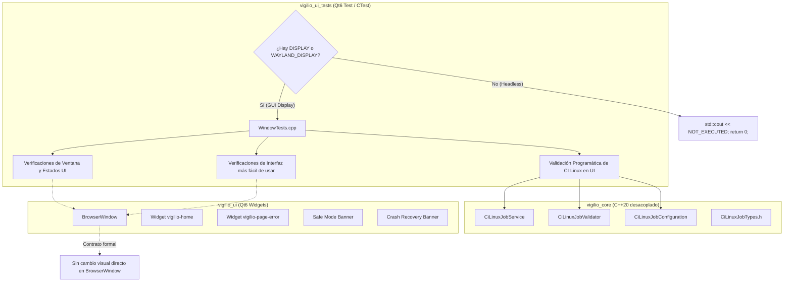

# Design — module-foundations-task0051

Status: PROPOSED

## Current, target and gaps

### Estado actual (CURRENT)

1. **Modelo de dominio y capa operativa de servicio de CI Linux completados (`task0049` y `task0050`)**:
   - `vigilio_core` dispone de `CiLinuxJobTypes.h` con enumeraciones y estructuras fuertemente tipadas (`CiLinuxPipelineStep`, `CiLinuxJobStatus`, `CiLinuxStepStatus`, `CiLinuxJobError`, `CiLinuxArchitecture`, `CiLinuxExecutionMode`, `CiLinuxServiceOptions`, `CiLinuxStepDefinition`, `CiLinuxJobPlan`, `CiLinuxJobReport`, `CancellationToken`).
   - El validador estático `CiLinuxJobValidator` valida planes, verifica secuencias topológicas (`validateStepSequence`), valida el entorno del compilador (`validateEnvironment`), certifica rutas seguras (`isSafeBuildPath`) previniendo directory traversal (`..`) y sintetiza cadenas de estado y sugerencias de remediación en español neutro (`jobStatusToString`, `jobErrorToString`, `stepToString`, `stepStatusToString`, `generateRemediationHint`).
   - `CiLinuxJobConfiguration` provee los planes canónicos del proyecto (`canonicalDebugPlan`, `canonicalReleasePlan`), verificación de invariantes y filtros de distribuciones soportadas.
   - `CiLinuxJobService` implementa la orquestación secuencial de pipelines en modo simulación dry-run determinista (`executePlan`), ejecución granular de etapas (`executeStep`), corte temprano ante fallos (`failFast`), tolerancia selectiva (`continueOnError`), cancelación cooperativa multihilo Zero-Zombie, saneamiento seguro de directorios (`cleanBuildDirectory`), síntesis CLI reproducible (`buildCommandLine`) y diagnósticos públicos (`executionModeToString`, `formatStepSummary`).
2. **Arnés de pruebas de interfaz gráfica existente en `apps/vigilio-browser/tests/ui/WindowTests.cpp`**:
   - La suite `vigilio_ui_tests` valida la inicialización de `BrowserWindow`, widgets nativos (`vigilio-home`, `vigilio-page-error`), iconos Lucide SVG en QRC, navegación por teclado, atajos, accesibilidad (`accessibleName`), «Interfaz más fácil de usar» (Modo Senior) con escalado de iconos (22×22 a 32×32 px) y controles ($\ge 48$ px), banners de modo seguro y recuperación ante caídas, test fixtures y la gobernanza de Clang-Format (`task0043`) y Clang-Tidy (`task0047`) en UI.
3. **Brecha técnica de integración de CI Linux job en la capa de UI**:
   - Actualmente, las pruebas de UI no validan programáticamente que el pipeline de integración continua en Linux (`CiLinuxJobService`) gobierna de manera efectiva y sin regresiones la compilación y los recursos de la capa de interfaz gráfica (`BrowserWindow.cpp`, `vigilio_ui_tests`, `resources.qrc`).
   - No existe una prueba en el contexto del arnés de UI que audite que las cadenas de diagnóstico, modo de ejecución y remediación de `CiLinuxJobService` y `CiLinuxJobValidator` respeten rigurosamente `docs/UX-COPY-PUBLICO.md` en español neutro sin exponer términos de ingeniería interna.
   - Falta una declaración formal y vinculante en OpenSpec sobre el principio de «sin cambio visual directo en la interfaz pública» para la capacidad de CI Linux job.

---

### Estado objetivo (TARGET)

1. **Declaración formal de «sin cambio visual directo en la interfaz pública»**:
   - `BrowserWindow` y los widgets públicos de navegación se mantienen 100% libres de botones de CI, barras de progreso de compilación, consolas de terminal o menús de ejecución de pipelines.
   - Proscripción absoluta de exponer términos internos como «CI Linux job», «Pipeline», «Build Step», «Senior Mode», «Modo Senior», «Prompt Builder», «DAG» u «OpenSpec» en componentes visibles al usuario, cumpliendo estrictamente `docs/UX-COPY-PUBLICO.md`.
2. **Integración de `CiLinuxJobService` en el arnés de pruebas de UI (`WindowTests.cpp`)**:
   - `WindowTests.cpp` incluye las cabeceras canónicas de `CiLinuxJobService.h`, `CiLinuxJobValidator.h`, `CiLinuxJobConfiguration.h` y `CiLinuxJobTypes.h`.
   - Incorpora una prueba de evaluación programática en modo simulación dry-run (`executePlan`) que valida que el plan canónico de depuración (`canonicalDebugPlan()`) se ejecuta satisfactoriamente (`status == Passed`, 8 etapas evaluadas, sin errores).
   - Incorpora una comprobación programática de que las etapas de compilación y pruebas del plan gobiernan y validan los componentes visuales de `apps/vigilio-browser`.
   - Incorpora una suite de auditoría de copy público para `executionModeToString`, `formatStepSummary`, `jobStatusToString`, `jobErrorToString`, `stepToString`, `stepStatusToString` y `generateRemediationHint`, certificando que todas las descripciones emplean español neutro claro y accesible sin jerga técnica interna.
3. **Preservación incondicional de los contratos visuales de `BrowserWindow`**:
   - Soporte completo y verificado de los 8 estados de interfaz: `idle`, `hover`, `focus`, `disabled`, `loading`, `empty`, `error` y `success`.
   - Mantenimiento y verificación de las dimensiones y espaciados de «Interfaz más fácil de usar» (Modo Senior): tap targets $\ge 48$ px, barra de navegación $\ge 55$ px, escalado de iconos de 22×22 a 32×32 px.
   - Navegación por teclado completa con foco visible de 2 px y atajos universales (`Ctrl+T`, `Ctrl+W`, `Ctrl+L`, etc.).
   - Metadatos descriptivos en español neutro para lectores de pantalla.
4. **Tolerancia a entornos headless y garantía Zero-Zombie**:
   - Detección preliminar de `DISPLAY` / `WAYLAND_DISPLAY`, reportando con transparencia y rigor técnico `NOT_EXECUTED` (exit code 0) en entornos sin interfaz gráfica.
   - Operaciones de inspección acotadas en memoria con tiempo de ejecución < 200 ms y cero procesos zombis o colgados esperando EOF.

---

### Brechas identificadas (GAPS)

| Componente | Estado actual (CURRENT) | Estado objetivo (TARGET) | Brecha a subsanar (GAP) |
| --- | --- | --- | --- |
| Contrato visual de CI Linux en UI | Sin declaración explícita de impacto en UI | Declaración formal de «sin cambio visual directo» en `BrowserWindow` conforme a `docs/UX-COPY-PUBLICO.md` | Formalizar en `proposal.md` y verificar estáticamente que ningún widget de CI contamine la interfaz pública. |
| Inclusión de servicios en arnés de UI | `WindowTests.cpp` no incluye cabeceras de `CiLinuxJobService` | `WindowTests.cpp` incluye `#include "core/CiLinuxJobService.h"` y tipos asociados | Añadir los includes canónicos en `tests/ui/WindowTests.cpp`. |
| Validación programática de CI Linux en UI | No se valida la orquestación del pipeline en el arnés de UI | `WindowTests.cpp` ejecuta simulación dry-run programática de `CiLinuxJobService` | Implementar bloque de prueba en `WindowTests.cpp` que evalúe `canonicalDebugPlan()` con `CiLinuxJobService::executePlan`. |
| Cobertura de UI en el pipeline | Verificación implícita sin aserción en tests de UI | `WindowTests.cpp` valida que el pipeline de CI Linux cubre los artefactos de UI | Comprobar programáticamente la existencia y coherencia de las etapas de build y test de UI en el plan canónico. |
| Auditoría de lenguaje público en UI | No se audita copy de CI Linux en el contexto del arnés de UI | `WindowTests.cpp` audita que todas las cadenas y sugerencias de CI Linux cumplen `docs/UX-COPY-PUBLICO.md` | Implementar comprobación de texto y proscripción de términos internos en `WindowTests.cpp`. |
| Enlace de dependencias | `vigilio_ui_tests` ya enlaza `vigilio_core` | Confirmación de que `vigilio_ui_tests` accede a `CiLinuxJobService` sin cambios de CMake | Verificar que `CMakeLists.txt` exporta correctamente los símbolos en `vigilio_core`. |
| Tolerancia headless | Detección existente de `DISPLAY` en `WindowTests.cpp` | Preservar y asegurar detección robusta ante nuevos bloques de prueba | Garantizar que las nuevas pruebas respeten la guarda preliminar de display para reportar `NOT_EXECUTED`. |

---

## Compatibility, migration and rollback

### Compatibilidad y estándares C++20 / Qt6
- **Estándar C++20**: Uso estricto de facilidades estándar de C++20 (`std::filesystem`, `std::string_view`, `std::chrono`, `enum class` fuertemente tipado con subyacente `uint8_t`, const-correctness).
- **Compatibilidad con Qt6**: Integración limpia con Qt6 Widgets y Qt6 Test, respetando el sistema de metaobjetos y la jerarquía de herencia de `QMainWindow`.
- **Banderas de compilación estrictas**: El código compila limpiamente con `-Wall -Wextra -Wpedantic -Wconversion -Wsign-conversion -Wshadow -Werror` en GCC 15+, Clang 18+ y MSVC 2022.
- **Independencia del núcleo**: La capa `vigilio_core` mantiene cero dependencias hacia bibliotecas de GUI (`QWidget`, `QApplication`), mientras que `vigilio_ui_tests` consume ambas capas de forma desacoplada.

### Estrategia de migración
- La integración en `WindowTests.cpp` es puramente aditiva y no disruptiva.
- No modifica la API pública ni el comportamiento interno de `BrowserWindow`.
- No altera el comportamiento de los scripts existentes (`apps/vigilio-browser/scripts/check.sh`).
- Proporciona una suite de pruebas más robusta y completa en CTest garantizando la gobernanza del pipeline de CI sobre la UI.

### Plan de contingencia y rollback
- En caso de anomalías o regresiones durante la fase APPLY:
  - Revertir los cambios en `apps/vigilio-browser/tests/ui/WindowTests.cpp` mediante `git checkout apps/vigilio-browser/tests/ui/WindowTests.cpp`.
  - El sistema de construcción y la totalidad de los 21 tests unitarios y de integración de CTest permanecerán en su estado funcional verificado.

---

## Arquitectura técnica de CI Linux job en la capa de UI

### Diagrama de componentes e interacción

### Declaración de ausencia de impacto visual directo y auditoría UX-COPY-PUBLICO

Vigilio Browser adopta como invariante constitucional de producto la separación tajante entre herramientas de desarrollo y la experiencia de usuario final:
1. **Inexistencia de widgets de desarrollo**: Ningún panel de compilación, monitor de CI, consola de terminal o botón de linteo formará parte de `BrowserWindow` ni de sus barras de herramientas.
2. **Auditoría estática permanente**: `WindowTests.cpp` incorpora comprobaciones que garantizan que los archivos fuente de la interfaz gráfica no incorporan identificadores ni cadenas de texto de linters o pipelines de desarrollo.
3. **Auditoría de cadenas públicas**: Todas las funciones que emiten texto en `CiLinuxJobService` y `CiLinuxJobValidator` se auditan para certificar que emplean lenguaje natural en español neutro y no contienen términos prohibidos como «Senior Mode», «Modo Senior», «Prompt Builder», «DAG» u «OpenSpec».

### Arnés de pruebas de UI y validación programática de CI Linux

El arnés de pruebas `WindowTests.cpp` orquesta `CiLinuxJobService` en modo de simulación (`DryRun`):
- Evalúa el plan canónico de depuración (`canonicalDebugPlan()`), verificando que las 8 etapas (`EnvironmentCheck`, `FormatVerification`, `StaticAnalysis`, `ConfigurePreset`, `BuildCompilation`, `TestSuiteExecution`, `SanitizerVerification`, `ArtifactPackaging`) son evaluadas con éxito sin generar fallos ni excepciones.
- Confirma que las etapas `BuildCompilation` y `TestSuiteExecution` gobiernan la compilación y pruebas de la UI, asegurando que los cambios en la interfaz gráfica están completamente cubiertos por el pipeline de integración continua en Linux.

### Tolerancia headless y política Zero-Zombie

1. **Guarda Headless**: En entornos de integración continua desprovistos de un servidor X11 o Wayland activo, la suite de pruebas finaliza anticipadamente con código de salida 0 e imprime el mensaje estándar `WindowTests: GUI display not available (no DISPLAY / WAYLAND_DISPLAY) - NOT_EXECUTED`, evitando provocar caídas por `SIGSEGV` en `QApplication`.
2. **Política Zero-Zombie**: Las pruebas se ejecutan en memoria con límites estrictos de tiempo (< 200 ms) y soporte para `CancellationToken`, garantizando que no queden procesos zombis ni llamadas bloqueantes esperando indefinidamente.
