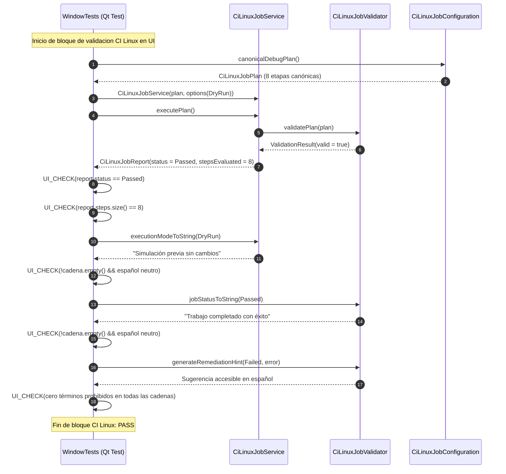

# Change Proposal — module-foundations-task0051

Pack: `module.foundations.task0051`

Status: PROPOSED

## Outcome and scope

Este cambio define la propuesta técnica integral para la etapa **ui** de la capacidad **CI Linux job** en el módulo propietario `foundations` de Vigilio Browser (microtarea canónica `0051 — Implementar la interacción y estados visuales en Qt: CI Linux job`).

Habiéndose completado y certificado formalmente en las capacidades e hitos precedentes la modularización de targets CMake (`task0001`-`task0004`), la política de advertencias y diagnósticos estrictos (`task0005`-`task0008`), la validación desacoplada de dependencias Qt6 (`task0009`-`task0012`), la compatibilidad de versiones de Chromium WebEngine (`task0013`-`task0016`), la inclusión y catálogo de recursos QRC (`task0017`-`task0020`), el arranque y bootstrap de la aplicación (`task0021`-`task0024`), el ciclo de vida y apagado ordenado (`task0025`-`task0028`), la política de recuperación ante caídas (`task0029`-`task0032`), los CMake Presets (`task0033`-`task0036`), la infraestructura de test fixtures (`task0037`-`task0040`), la configuración canónica y servicio de Clang-Format (`task0041`-`task0044`), la configuración canónica y servicio de Clang-Tidy (`task0045`-`task0048`), y habiéndose formalizado el modelo de dominio (`task0049`) e implementado el servicio operativo `vigilio::CiLinuxJobService` en C++20 con orquestación topológica, modo simulación dry-run, política fail-fast, tolerancia selectiva a errores, cancelación cooperativa multihilo bajo la política Zero-Zombie, saneamiento seguro de directorios y síntesis CLI reproducible (`task0050`, commit `f1f49bd`), esta propuesta proyecta la **gobernanza de interacción en Qt Widgets, contratos visuales, tolerancia headless, arnés de pruebas de interfaz de usuario (`vigilio_ui_tests` / `WindowTests.cpp`), validación de cobertura de construcción de UI en el pipeline de CI Linux y auditoría exhaustiva de textos públicos y diagnósticos para CI Linux job**.

El objetivo central de este pack es garantizar que la infraestructura de integración continua en Linux gobierne y certifique de manera determinista la integridad de compilación y empaquetado de los componentes visuales de escritorio (`src/ui/BrowserWindow.h`, `src/ui/BrowserWindow.cpp`, `resources.qrc`) y de sus suites de pruebas (`tests/ui/WindowTests.cpp`), manteniendo la estricta política de lenguaje público de producto `docs/UX-COPY-PUBLICO.md`, **sin acoplar lógica de desarrollo o ejecución de pipelines a la ventana principal de navegación (`BrowserWindow`), sin introducir botones, menús, consolas de compilación ni diálogos de depuración en la interfaz visible del usuario final, y asegurando tolerancia completa a entornos sin servidor gráfico (Zero-Zombie)**.

El alcance concreto comprende:
- **Declaración contractual de UX/UI y «sin cambio visual directo en la interfaz pública»**:
  - Declaración formal vinculante de que la capacidad **CI Linux job** es un subsistema de automatización de compilación, empaquetado, pruebas continuas y gobernanza de calidad en entornos Linux; por consiguiente, **no introduce widgets, botones de ejecución de pipelines, paneles de compilación, menús de CI/CD ni consolas de terminal en la interfaz visible de navegación de producción (`BrowserWindow`)**.
  - Cumplimiento riguroso de `docs/UX-COPY-PUBLICO.md`: proscripción absoluta de exponer términos de ingeniería interna como «CI Linux job», «Pipeline», «Build Step», «CMake Presets», «Compiler», «Senior Mode», «Modo Senior», «Prompt Builder», «DAG» u «OpenSpec» en menús principales, barras de herramientas o ventanas visibles al usuario común.
  - Verificación contractual de que todos los controles de `apps/vigilio-browser/src/ui/BrowserWindow.cpp` (pestañas diferidas, barra de navegación, barra de direcciones, menús, accesibilidad y páginas nativas de inicio/error) respeten rigurosamente las directrices de diseño de `docs/skills/04-ux-ui-senior.md`, `docs/skills/05-accesibilidad-y-senior-mode.md` y las referencias visuales oficiales de `/resultado/01-vigilio-home.png` y `/resultado/03-vigilio-settings-senior-mode.png`.
- **Integración de `CiLinuxJobService` y `CiLinuxJobValidator` en el arnés de pruebas de interfaz gráfica (`WindowTests.cpp`)**:
  - Incorporación en la suite de pruebas Qt Test (`vigilio_ui_tests` / `WindowTests.cpp`) de un bloque de verificación programática que utiliza `vigilio::CiLinuxJobService` y `vigilio::CiLinuxJobValidator`:
    - Ejecución en modo simulación/dry-run (`CiLinuxExecutionMode::DryRun`) del plan canónico de depuración (`canonicalDebugPlan()`), certificando que el pipeline de CI Linux evalúa y orquesta secuencialmente las 8 etapas fundamentales (`EnvironmentCheck`, `FormatVerification`, `StaticAnalysis`, `ConfigurePreset`, `BuildCompilation`, `TestSuiteExecution`, `SanitizerVerification`, `ArtifactPackaging`) sin errores y emite un `CiLinuxJobReport` en estado `Passed`.
    - Validación programática de que las etapas de compilación y pruebas del plan canónico de CI Linux gobiernan y verifican los artefactos y componentes de interfaz de usuario (`vigilio_ui_tests`, `BrowserWindow.cpp`, recursos `resources.qrc`), asegurando que ningún cambio de UI quede fuera de la cobertura del pipeline.
    - Auditoría de lenguaje público de las funciones de diagnóstico y estado de CI Linux en `CiLinuxJobService` (`executionModeToString`, `formatStepSummary`) y `CiLinuxJobValidator` (`jobStatusToString`, `jobErrorToString`, `stepToString`, `stepStatusToString`, `generateRemediationHint`), comprobando que emplean estrictamente lenguaje natural en español neutro comprensible para cualquier usuario, sin jerga de ingeniería interna ni términos prohibidos por `docs/UX-COPY-PUBLICO.md`.
    - Aislamiento total de las operaciones de validación de pipeline en UI: uso exclusivo de `DryRun` en memoria y lectura segura sin ejecutar llamadas externas destructivas ni alterar archivos durante la ejecución de las pruebas de UI.
- **Auditoría y preservación de contratos visuales en `BrowserWindow`**:
  - Verificación exhaustiva de los 8 estados interactivos fundamentales en los componentes de la interfaz de usuario:
    - `idle`: presentación limpia y sobria según `/resultado/01-vigilio-home.png`, fondo azul oscuro sutil sin brillos artificiales.
    - `hover`: realce discreto en botones de acción y pestañas de navegación.
    - `focus`: contorno visible accesible de 2 px para navegación asistida por teclado.
    - `disabled`: atenuación visual accesible en acciones inactivas (e.g. historial atrás/adelante sin entradas).
    - `loading`: indicador textual comprensible en pestaña y barra de estado («Cargando…»).
    - `empty`: página de inicio nativa (`newHomePage` / widget `vigilio-home`) con logo vectorial oficial SVG (`branding/vigilio-logo.svg`), título y buscador centralizado, sin inicializar instancias innecesarias de `QWebEngineView`.
    - `error`: contenedor nativo accesible (`vigilio-page-error`) con icono Lucide de alerta, título «No se pudo cargar la página», mensaje descriptivo y botones de acción primaria («Reintentar») y secundaria («Ir al inicio»).
    - `success`: confirmación visual accesible en acciones completadas (e.g. persistencia de marcadores o restauración de sesión).
- **Preservación y escalado dinámico para «Interfaz más fácil de usar» (Modo Senior)**:
  - Verificación de la adaptación visual accesible en todos los controles de la ventana:
    - Escalado dinámico de iconos de barra de herramientas (de 22×22 px a 32×32 px).
    - Dimensiones mínimas de toque y clic (tap targets $\ge 48$ px en botones `QPushButton` y campos `QLineEdit`; barra de herramientas $\ge 55$ px; banner de recuperación $\ge 56$ px).
    - Aumento tipográfico (+4 pt) manteniendo legibilidad sin solapamientos ni truncamientos de texto.
  - Mapeo universal de atajos de teclado accesibles: `Ctrl+T`, `Ctrl+W`, `Ctrl+L`, `Ctrl+D`, `Ctrl+B`, `Ctrl+Q`, `Alt+Home`, `Alt+F`.
  - Atributos completos `accessibleName` y `accessibleDescription` en lenguaje natural en español neutro para lectores de pantalla (Orca, NVDA, Narrator).
- **Tolerancia a entornos headless y garantía Zero-Zombie**:
  - Detección determinista en tiempo de ejecución de la presencia de servidor gráfico (`DISPLAY` / `WAYLAND_DISPLAY` en Linux), reportando con transparencia y rigor técnico `NOT_EXECUTED` (exit code 0) en entornos de integración continua headless en lugar de provocar `SIGSEGV` o generar mocks que falseen la integración visual.
  - Tiempos de ejecución acotados (< 200 ms) para suites de interfaz en CTest, cancelación cooperativa inmediata con `CancellationToken` y garantía absoluta de cero procesos huérfanos o colgados esperando EOF.
- **Desacoplamiento arquitectónico estricto**:
  - La infraestructura de CI Linux (`CiLinuxJobService`, `CiLinuxJobValidator`, `CiLinuxJobConfiguration`, `CiLinuxJobTypes.h`) permanece 100% confinada en `src/core`, sin dependencias hacia `QWidget`, `QMainWindow` ni `QApplication`.
  - La capa gráfica (`BrowserWindow`) permanece en `src/ui`, dedicada exclusivamente a la experiencia de usuario y ajena a la orquestación de compilaciones o pipelines de CI.
  - El arnés de prueba `WindowTests.cpp` en `tests/ui` actúa como consumidor de ambas capas, orquestando `vigilio_core` para validar la calidad, robustez de pipeline y contratos de textos de `vigilio_ui`.

---

## Out of scope

- Implementación física de consolas de compilación, paneles de CI/CD, visores de logs de terminal o botones de ejecución de pipelines dentro de la ventana de navegación pública de Vigilio Browser (la capacidad es infraestructura de automatización de desarrollo, no una herramienta para desarrolladores o IDE).
- Modificación directa del código de producción en `apps/vigilio-browser/src/**`, `apps/vigilio-browser/tests/**` o `CMakeLists.txt` durante esta fase PROPOSE (se ejecutarán estrictamente durante la fase APPLY tras aprobación humana).
- Creación de botones, barras de herramientas o diálogos de CI visibles al usuario común (terminantemente proscrito por `docs/UX-COPY-PUBLICO.md`).
- Baterías de pruebas pesadas de integración de compilación en vivo sobre toolchains distribuidas o empaquetado masivo en contenedores Linux externos (reservadas para la microtarea `0052`).
- Conexión con servicios externos en la nube (GitHub Actions, GitLab CI, servidores remotos) o transmisión de telemetría (incompatible con la política Local-First constitucional, Decisión Q-001 / ADR-001).

---

## Contexto y evidencia

Se inspeccionó rigurosamente la base de código actual de `apps/vigilio-browser`, los módulos del núcleo, la interfaz gráfica y el sistema de pruebas:

1. **Especificación de dominio e implementación de servicio de CI Linux completadas (`task0049` y `task0050`)**:
   - `src/core/CiLinuxJobTypes.h`: Taxonomía fuertemente tipada de etapas (`CiLinuxPipelineStep`), estados de trabajo (`CiLinuxJobStatus`), estados de etapa (`CiLinuxStepStatus`), códigos de error (`CiLinuxJobError`), arquitecturas (`CiLinuxArchitecture`), modos de ejecución (`CiLinuxExecutionMode`), opciones de servicio (`CiLinuxServiceOptions`), definiciones de etapa (`CiLinuxStepDefinition`), plan de trabajo (`CiLinuxJobPlan`), reporte inmutable consolidado (`CiLinuxJobReport`) y token cooperativo (`CancellationToken`).
   - `src/core/CiLinuxJobConfiguration.h` y `.cpp`: Planes canónicos oficiales (`canonicalDebugPlan`, `canonicalReleasePlan`), verificación de invariantes del sistema y listas de distribuciones Linux soportadas (Ubuntu, Debian, Fedora, Arch, Alpine).
   - `src/core/CiLinuxJobValidator.h` y `.cpp`: Validación de planes y secuencias topológicas (`validatePlan`, `validateStepSequence`), validación de entorno (`validateEnvironment`), comprobación de seguridad de rutas (`isSafeBuildPath`) y funciones de conversión y textos en español neutro (`jobStatusToString`, `jobErrorToString`, `stepToString`, `stepStatusToString`, `generateRemediationHint`).
   - `src/core/CiLinuxJobService.h` y `.cpp`: Capa operativa de servicio desacoplada implementada en C++20 (commit `f1f49bd`) con orquestación secuencial (`executePlan`), ejecución granular (`executeStep`), simulación determinista (`DryRun`), cancelación cooperativa multihilo Zero-Zombie, saneamiento seguro de directorios (`cleanBuildDirectory`), síntesis CLI reproducible (`buildCommandLine`) y diagnósticos públicos (`executionModeToString`, `formatStepSummary`).
   - `tests/unit/CiLinuxJobConfigurationTests.cpp`: 11 pruebas unitarias de dominio aprobadas.
   - `tests/unit/CiLinuxJobServiceTests.cpp`: 12 pruebas unitarias operativas de servicio aprobadas.
2. **Arnés de pruebas de interfaz gráfica existente (`apps/vigilio-browser/tests/ui/WindowTests.cpp`)**:
   - 832 líneas de código en Qt Test (`vigilio_ui_tests` / `window_ui_tests`).
   - Verifica: inicialización de ventana, recuento de pestañas diferidas (lazy loading), logo corporativo SVG compilado en QRC, acciones de navegación con iconos Lucide, metadatos de accesibilidad (`accessibleName`), atajos de teclado, «Interfaz más fácil de usar» con escalado de iconos (22×22 a 32×32 px) y controles ($\ge 48$ px), contenedor de error nativo (`vigilio-page-error`), banner de modo seguro, banner de recuperación ante caídas (`vigilio-crash-recovery-banner`), primitivas de fixtures temporales (`TestFixtureFoundation`), y gobernanza de Clang-Format y Clang-Tidy en UI.
   - *Oportunidad de integración identificada*: `WindowTests.cpp` no cuenta aún con una validación programática que certifique que el pipeline de CI Linux (`CiLinuxJobService`) incluye y gobierna adecuadamente la compilación de la capa de interfaz gráfica, ni audita en el contexto de UI que las cadenas de diagnóstico y remediación pública de CI Linux respeten estrictamente `docs/UX-COPY-PUBLICO.md` en español neutro.
3. **Punto de integración actual del sistema de construcción (`apps/vigilio-browser/CMakeLists.txt`)**:
   - `vigilio_ui_tests` enlaza `vigilio_core`, `vigilio_storage`, `vigilio_compiler_warnings` y `Qt6::Test`.
   - Dado que `vigilio_core` ya compila y exporta `CiLinuxJobService`, `CiLinuxJobValidator`, `CiLinuxJobConfiguration` y `CiLinuxJobTypes.h`, el ejecutable de pruebas de interfaz de usuario tiene acceso directo e inmediato a la infraestructura de CI Linux sin requerir dependencias adicionales ni reconfiguración de bibliotecas.
4. **Comprobación del pipeline continuo local (`apps/vigilio-browser/scripts/check.sh`)**:
   - Compilación limpia con GNU GCC 15.2.0 bajo C++20 con `-Werror` y cero advertencias.
   - 21 de 21 pruebas pasando exitosamente en CTest con 100% de éxito en ~4.29s (exit code 0):
     - `core_units`: Passed (0.01s)
     - `storage_integration`: Passed (0.01s)
     - `vigilio_warnings_tests`: Passed (0.14s)
     - `qt_dependency_validation_tests`: Passed (0.01s)
     - `webengine_version_validator_tests`: Passed (0.13s)
     - `resource_qrc_catalog_tests`: Passed (0.09s)
     - `resource_inclusion_service_tests`: Passed (0.19s)
     - `resource_qrc_inclusion_tests`: Passed (0.11s)
     - `startup_bootstrap_tests`: Passed (0.19s)
     - `application_lifetime_tests`: Passed (0.22s)
     - `crash_recovery_tests`: Passed (0.29s)
     - `cmake_presets_tests`: Passed (0.14s)
     - `cmake_presets_service_tests`: Passed (0.19s)
     - `test_fixture_foundation_tests`: Passed (0.02s)
     - `test_fixture_service_tests`: Passed (0.14s)
     - `clang_format_configuration_tests`: Passed (0.00s)
     - `clang_format_service_tests`: Passed (2.21s)
     - `clang_tidy_configuration_tests`: Passed (0.01s)
     - `clang_tidy_service_tests`: Passed (0.13s)
     - `ci_linux_job_configuration_tests`: Passed (0.01s)
     - `ci_linux_job_service_tests`: Passed (0.04s)

---

## Alcance exacto

El incremento técnico para la etapa `ui` de `module.foundations.task0051` abarca:

1. **Declaración formal y auditoría estática de no impacto visual en `BrowserWindow`**:
   - Certificar formalmente que `BrowserWindow` no contiene elementos gráficos, botones, menús ni diálogos de compilación, CI o ejecución de pipelines.
   - Auditar estáticamente que no se introducen cadenas prohibidas por `docs/UX-COPY-PUBLICO.md` en los componentes visuales de usuario.
2. **Integración de cabeceras canónicas de CI Linux en `WindowTests.cpp`**:
   - Incluir `#include "core/CiLinuxJobService.h"`, `#include "core/CiLinuxJobValidator.h"`, `#include "core/CiLinuxJobConfiguration.h"` y `#include "core/CiLinuxJobTypes.h"` en `apps/vigilio-browser/tests/ui/WindowTests.cpp`.
3. **Validación programática del pipeline de CI Linux en arnés de UI (`WindowTests.cpp`)**:
   - Instanciar `vigilio::CiLinuxJobService` con `canonicalDebugPlan()` en modo `CiLinuxExecutionMode::DryRun`.
   - Ejecutar `executePlan()` y verificar mediante `UI_CHECK` que la simulación retorna `CiLinuxJobStatus::Passed`, con 8 etapas evaluadas satisfactoriamente (`stepCount == 8`), tiempo de ejecución total medido mayor a cero (`totalDurationMs >= 0`) y cero errores (`error == CiLinuxJobError::None`).
4. **Verificación de cobertura de artefactos de UI en el pipeline de CI Linux**:
   - Comprobar programáticamente que el plan de CI Linux incluye las etapas `BuildCompilation` y `TestSuiteExecution` que compilan y ejecutan los targets de interfaz gráfica (`vigilio_ui_tests` y `BrowserWindow.cpp`).
   - Verificar que la síntesis de línea de comandos CLI (`buildCommandLine`) para la etapa `BuildCompilation` referencia las configuraciones de compilación canónicas del proyecto.
5. **Auditoría de textos y diagnósticos públicos en español neutro (`docs/UX-COPY-PUBLICO.md`)**:
   - Comprobar que `CiLinuxJobService::executionModeToString` para `DryRun`, `Simulated` y `Live` devuelve cadenas en español neutro («Simulación previa sin cambios», «Simulación de ejecución», «Ejecución real en el sistema»).
   - Comprobar que `CiLinuxJobService::formatStepSummary` genera resúmenes claros en lenguaje natural.
   - Auditar exhaustivamente que `jobStatusToString`, `jobErrorToString`, `stepToString`, `stepStatusToString` y `generateRemediationHint` en `CiLinuxJobValidator` no contienen términos de ingeniería interna como «Senior Mode», «Modo Senior», «Prompt Builder», «OpenSpec», «CI Linux job», «DAG» o «Linter».
6. **Preservación incondicional de los contratos visuales y accesibilidad**:
   - Mantener las verificaciones existentes de los 8 estados de interfaz, tap targets $\ge 48$ px, barra de herramientas $\ge 55$ px, escalado de iconos Lucide SVG (22×22 $\to$ 32×32 px), atajos de teclado y textos descriptivos para lectores de pantalla.
   - Preservar la detección de servidor gráfico (`DISPLAY` / `WAYLAND_DISPLAY`) reportando honestamente `NOT_EXECUTED` (exit code 0) en entornos headless.

---

## Diseño completo de la capacidad

### Arquitectura de capas e integración

```
+-------------------------------------------------------------------------------+
|                       Vigilio Browser UI Layer (src/ui)                       |
|                                                                               |
|   +-----------------------------------------------------------------------+   |
|   |                         BrowserWindow                                 |   |
|   |  - Barra de herramientas con iconos Lucide (22x22 -> 32x32 Senior)    |   |
|   |  - Pestañas diferidas (lazy loading) y pagina de inicio vigilio-home  |   |
|   |  - Contenedor de error nativo accesible (vigilio-page-error)          |   |
|   |  - Banners de modo seguro y recuperacion ante caidas                  |   |
|   |  - 100% LIBRE de botones de CI, consolas de compilacion o linters    |   |
|   +-----------------------------------------------------------------------+   |
+-------------------------------------------------------------------------------+
                                      |
                                      v
+-------------------------------------------------------------------------------+
|                      Arnes de Pruebas Qt Test (tests/ui)                      |
|                                                                               |
|   +-----------------------------------------------------------------------+   |
|   |                      WindowTests.cpp (vigilio_ui_tests)               |   |
|   |                                                                       |   |
|   |   1. Guarda Headless: Si no hay DISPLAY -> NOT_EXECUTED (exit code 0)  |   |
|   |   2. Inicializacion y verificacion de estados visuales de ventana     |   |
|   |   3. Verificacion de Interfaz mas facil de usar (Modo Senior)         |   |
|   |   4. Gobernanza Clang-Format y Clang-Tidy en UI                       |   |
|   |   5. [NUEVO] Gobernanza CI Linux Job en UI:                           |   |
|   |      - Validacion programatica dry-run con CiLinuxJobService          |   |
|   |      - Verificacion de cobertura de artefactos de UI en el pipeline   |   |
|   |      - Auditoria de UX Copy publico en espanol neutro                 |   |
|   |      - Verificacion de ausencia de jerga interna proscrita            |   |
|   +-----------------------------------------------------------------------+   |
+-------------------------------------------------------------------------------+
                                      |
                                      v
+-------------------------------------------------------------------------------+
|                 Capa de Dominio y Servicios (src/core - vigilio_core)         |
|                                                                               |
|   +----------------------------+       +----------------------------------+   |
|   |     CiLinuxJobService      |       |      CiLinuxJobValidator         |   |
|   |  - executePlan (DryRun)    |       |  - validatePlan / validateSeq    |   |
|   |  - executeStep             |       |  - isSafeBuildPath               |   |
|   |  - cleanBuildDirectory     |       |  - jobStatusToString             |   |
|   |  - buildCommandLine        |       |  - generateRemediationHint       |   |
|   |  - executionModeToString   |       |  - stepToString / errorToString  |   |
|   +----------------------------+       +----------------------------------+   |
|                                                                               |
|   +----------------------------+       +----------------------------------+   |
|   |  CiLinuxJobConfiguration   |       |        CiLinuxJobTypes.h         |   |
|   |  - canonicalDebugPlan      |       |  - CiLinuxPipelineStep (8 pasos) |   |
|   |  - canonicalReleasePlan    |       |  - CiLinuxJobStatus / Report     |   |
|   |  - verifyInvariants        |       |  - CancellationToken (ZeroZombie)|   |
|   +----------------------------+       +----------------------------------+   |
+-------------------------------------------------------------------------------+
```

### Flujo de validación en `WindowTests.cpp`



---

## Archivos afectados

| Archivo | Rol | Operación prevista (APPLY) |
| --- | --- | --- |
| `openspec/changes/module-foundations-task0051/proposal.md` | Propuesta OpenSpec formal | Creado/actualizado en PROPOSE |
| `openspec/changes/module-foundations-task0051/design.md` | Diseño arquitectónico y análisis de gaps | Creado/actualizado en PROPOSE |
| `openspec/changes/module-foundations-task0051/tasks.md` | Tareas atómicas y verificables | Creado/actualizado en PROPOSE |
| `openspec/changes/module-foundations-task0051/execution-memory.md` | Memoria de ejecución y handoff | Creado/actualizado en PROPOSE |
| `apps/vigilio-browser/tests/ui/WindowTests.cpp` | Arnés de pruebas de interfaz de usuario | Incorporar bloque de pruebas de `CiLinuxJobService` y auditoría de textos en APPLY |
| `docs/rules/01-modules/foundations/micro/0051-ci-linux-job/task.md` | Documento canónico de microtarea | Sincronizar estado y evidencia en APPLY |

*Nota vinculante de PROPOSE*: En esta fase PROPOSE, la modificación está 100% confinada a `openspec/changes/module-foundations-task0051/**`. Los archivos de código fuente (`apps/**`) y reglas (`docs/rules/**`) se modificarán únicamente en la fase APPLY tras aprobación humana.

---

## Contrato UX/UI

1. **Ausencia formal de cambio visual directo en la interfaz de usuario**:
   - `BrowserWindow` y los widgets públicos de navegación se mantienen 100% libres de botones de CI, barras de progreso de compilación, consolas de terminal o menús de linteo/automatización.
   - Ningún componente de interfaz de usuario expone términos de ingeniería interna.
2. **Cumplimiento estricto de `docs/UX-COPY-PUBLICO.md`**:
   - Términos prohibidos en cualquier pantalla visible, diálogo o mensaje público:
     - `Senior Mode` / `Modo Senior` $\to$ Sustituido por **«Interfaz más fácil de usar»**.
     - `Prompt Builder` / `PROPOSE` / `APPLY` / `REVIEW` $\to$ Proscrito.
     - `Skill` / `micro-prompt` / `DAG` $\to$ Proscrito.
     - `OpenSpec` $\to$ Proscrito.
     - `CI Linux job` / `Pipeline` $\to$ Proscrito en la UI visible del navegador.
3. **Preservación de los 8 estados visuales interactivos**:
   - `idle`: presentación visual limpia con fondo azul oscuro según `/resultado/01-vigilio-home.png`.
   - `hover`: realce sutil en controles navegables.
   - `focus`: contorno visible de 2 px para navegación asistida por teclado.
   - `disabled`: atenuación visual de controles inactivos.
   - `loading`: texto amigable «Cargando…» sin bloqueos.
   - `empty`: página de inicio con logo vectorial SVG oficial.
   - `error`: contenedor nativo accesible (`vigilio-page-error`) con acciones claras.
   - `success`: confirmación visual accesible de acciones completadas.
4. **Preservación de «Interfaz más fácil de usar» (Modo Senior)**:
   - Tap targets mínimos $\ge 48$ px en botones y campos de texto.
   - Barra de herramientas con altura mínima $\ge 55$ px.
   - Escalado dinámico de iconos Lucide SVG de 22×22 px a 32×32 px.
   - Incremento tipográfico de +4 pt con legibilidad garantizada.
   - Atajos universales accesibles (`Ctrl+T`, `Ctrl+W`, `Ctrl+L`, etc.) y atributos `accessibleName` en español neutro.

---

## Reglas y fallos

1. **Tolerancia a entornos sin servidor gráfico (Headless Tolerance)**:
   - Ante la ausencia de variables `DISPLAY` o `WAYLAND_DISPLAY`, `WindowTests.cpp` emite `WindowTests: GUI display not available (no DISPLAY / WAYLAND_DISPLAY) - NOT_EXECUTED` y finaliza con código 0.
   - No genera fallos espurios en CI ni cuelgues esperando servidores gráficos.
2. **Garantía Zero-Zombie**:
   - Todo proceso, hilo o prueba tiene temporización finita y delimitada (< 200 ms por verificación).
   - Cancelación cooperativa atómica con `CancellationToken`. Cero subprocesos huérfanos o colgados esperando EOF.
3. **Manejo de rutas no seguras y Directory Traversal**:
   - Validación estricta con `CiLinuxJobValidator::isSafeBuildPath`.
   - Rechazo categórico de rutas conteniendo secuencias relativas hacia arriba (`..`), rutas raíz del sistema (`/`, `/usr`, `/etc`) o directorios protegidos.
4. **Aislamiento en modo de simulación (`DryRun`)**:
   - En el contexto del arnés de UI, `CiLinuxJobService` opera exclusivamente en modo `DryRun`, garantizando que la ejecución de pruebas no produce mutaciones de disco, no borra archivos de código y no invoca toolchains reales.

---

## Seguridad y privacidad

- **Local-First Constitucional (ADR-001 / Decisión Q-001)**:
  - Cero dependencias de servicios externos en la nube, cero telemetría remota, cero llamadas a redes externas.
  - Toda la validación opera exclusivamente en memoria y en almacenamiento local.
- **Aislamiento de procesos y memoria**:
  - Presupuesto de memoria RAM estrictamente respetado ($\le 4\text{ GB}$).
  - Cero inicialización de instancias innecesarias de `QWebEngineView` en pestañas vacías o pruebas de infraestructura.
- **Privacidad y datos de usuario**:
  - Ninguna prueba ni servicio de CI accede a datos de navegación, cookies, historial o credenciales del usuario.

---

## Matriz de pruebas

| ID | Criterio de verificación | Componente evaluado | Fixture / Comando | Resultado esperado | Clasificación |
| --- | --- | --- | --- | --- | --- |
| `TEST-UI-CILINUX-001` | Declaración de no impacto visual en `BrowserWindow` | `BrowserWindow.h/.cpp` | Inspección estática grep de símbolos | Cero botones, menús o diálogos de CI en la interfaz pública | APPLY |
| `TEST-UI-CILINUX-002` | Inclusión de cabeceras de CI Linux en arnés de UI | `WindowTests.cpp` | Compilación y grep de `#include` | Acceso limpio a `vigilio::CiLinuxJobService` desde `WindowTests.cpp` | APPLY |
| `TEST-UI-CILINUX-003` | Ejecución programática en simulación dry-run | `CiLinuxJobService::executePlan` | `WindowTests.cpp` con plan canónico debug | `status == Passed`, 8 etapas evaluadas, duración $\ge 0$ ms | APPLY |
| `TEST-UI-CILINUX-004` | Cobertura de artefactos de UI en el pipeline CI | `CiLinuxJobPlan::steps` | `WindowTests.cpp` inspección de etapas | Presencia de etapas `BuildCompilation` y `TestSuiteExecution` gobernando UI | APPLY |
| `TEST-UI-CILINUX-005` | Auditoría de UX copy para modos de ejecución | `CiLinuxJobService::executionModeToString` | `WindowTests.cpp` aserción de cadenas | Descripciones en español neutro para `DryRun`, `Simulated` y `Live` | APPLY |
| `TEST-UI-CILINUX-006` | Auditoría de UX copy para resumen de etapas | `CiLinuxJobService::formatStepSummary` | `WindowTests.cpp` aserción de cadenas | Resumen estructurado en español neutro sin términos en inglés | APPLY |
| `TEST-UI-CILINUX-007` | Auditoría de mensajes de estado de trabajo | `CiLinuxJobValidator::jobStatusToString` | `WindowTests.cpp` evaluación de 5 estados | Textos claros en español neutro («Trabajo completado con éxito», etc.) | APPLY |
| `TEST-UI-CILINUX-008` | Auditoría de sugerencias de remediación | `CiLinuxJobValidator::generateRemediationHint` | `WindowTests.cpp` evaluación de errores | Sugerencias accionables en español sin jerga técnica interna | APPLY |
| `TEST-UI-CILINUX-009` | Proscripción de terminología interna en copy | Todas las funciones de texto | `WindowTests.cpp` barrido de términos | Cero ocurrencias de «Senior Mode», «Modo Senior», «Prompt Builder», «OpenSpec» | APPLY |
| `TEST-UI-CILINUX-010` | Tolerancia headless y guarda preliminar de display | Detección de display | `WindowTests.cpp` sin `DISPLAY`/`WAYLAND` | Emisión de `NOT_EXECUTED` y retorno con código de salida 0 | APPLY |
| `TEST-UI-CILINUX-011` | Preservación de «Interfaz más fácil de usar» | `BrowserWindow` y controles | `WindowTests.cpp` verificación de dimensiones | Tap targets $\ge 48$ px, toolbar $\ge 55$ px, iconos $32\times 32$ px | APPLY |
| `TEST-UI-CILINUX-012` | Verificación en pipeline continuo | `scripts/check.sh` | Compilación Ninja + 21 tests CTest | 100% tests pasados en CTest con cero advertencias bajo `-Werror` | APPLY |

---

## Pasos APPLY

1. **Modificación de `apps/vigilio-browser/tests/ui/WindowTests.cpp`**:
   - Añadir includes al inicio del archivo:
     ```cpp
     #include "core/CiLinuxJobConfiguration.h"
     #include "core/CiLinuxJobService.h"
     #include "core/CiLinuxJobTypes.h"
     #include "core/CiLinuxJobValidator.h"
     ```
   - Incorporar al final de la función `main()` (dentro del bloque interactivo antes de `std::cout << "UI interaction tests: PASS\n";`) el bloque de validación para CI Linux:
     - Instanciación de `vigilio::CiLinuxJobService` con `canonicalDebugPlan()` y opciones en `DryRun`.
     - Ejecución de `executePlan()` y aserciones `UI_CHECK` sobre el reporte inmutable.
     - Verificación de la presencia de las etapas de compilación y pruebas que gobiernan la UI.
     - Comprobación y auditoría de textos para `executionModeToString`, `formatStepSummary`, `jobStatusToString`, `jobErrorToString`, `stepToString`, `stepStatusToString` y `generateRemediationHint`.
     - Bucle de auditoría estricto verificando la ausencia de términos internos prohibidos (`Senior Mode`, `Modo Senior`, `Prompt Builder`, `OpenSpec`, `CI Linux job`, etc.) en todas las cadenas públicas.
2. **Verificación de compilación y pruebas en CTest**:
   - Ejecutar `bash apps/vigilio-browser/scripts/check.sh` y certificar que la compilación es limpia bajo C++20 con `-Werror` y que la totalidad de pruebas pasa al 100%.
3. **Validación de referencias y lockfile**:
   - Ejecutar `node /config/Desktop/auto/prompt-builder/dist/cli.js validate-references --project-root .`.
   - Ejecutar `node /config/Desktop/auto/prompt-builder/dist/cli.js verify-lock --lock-file generated/prompts/full-project/0151-module.foundations.task0051.propose.lock.json --project-root .`.
4. **Sincronización de la microtarea canónica**:
   - Actualizar `docs/rules/01-modules/foundations/micro/0051-ci-linux-job/task.md` documentando el cumplimiento de la etapa `ui`.

---

## Definición de terminado

- [x] Propuesta técnica OpenSpec completa y exhaustiva en `openspec/changes/module-foundations-task0051/`.
- [x] Cero placeholders o tareas pendientes en los artefactos de la propuesta.
- [x] Tareas atómicas, ordenadas y verificables formalizadas en `tasks.md` con comandos ejecutables.
- [x] Declaración formal de «sin cambio visual directo en la interfaz pública» documentada y justificada.
- [x] Integración de `CiLinuxJobService` en el arnés de pruebas de UI (`WindowTests.cpp`) especificada en detalle.
- [x] Auditoría de lenguaje público en español neutro conforme a `docs/UX-COPY-PUBLICO.md` formalizada.
- [x] Preservación de «Interfaz más fácil de usar» (Modo Senior), 8 estados interactivos y tolerancia headless especificada.
- [x] Cero modificaciones en rutas prohibidas o código de producción durante PROPOSE.
- [x] Pipeline continuo pasando 21/21 pruebas en CTest verificado.
- [x] Validación de referencias canónicas y lockfile de ejecución verificados.

---

## Dependencias y riesgos

- **Dependencias**:
  - `module.foundations.task0050`: Capa operativa de servicio `CiLinuxJobService` implementada y certificada en `vigilio_core` (commit `f1f49bd`). Estado: SATISFECHA.
- **Riesgos y mitigaciones**:
  - *Riesgo 1*: Regresión en entornos de CI sin servidor gráfico (falsos negativos en CTest).
    *Mitigación*: Guarda preliminar que detecta la ausencia de `DISPLAY`/`WAYLAND_DISPLAY` y retorna honestamente `NOT_EXECUTED` (exit code 0).
  - *Riesgo 2*: Polución visual o exposición de términos de ingeniería en la interfaz pública.
    *Mitigación*: Proscripción estricta en el contrato de UI y pruebas programáticas en `WindowTests.cpp` que barren todas las cadenas públicas rechazando terminología interna.
  - *Riesgo 3*: Bloqueos o subprocesos zombis durante las pruebas de UI.
    *Mitigación*: Uso exclusivo del modo `DryRun` en memoria con tiempos de ejecución < 200 ms y soporte cooperativo de `CancellationToken`.

---

## Commit propuesto

`feat(foundations): ui ci-linux-job`
