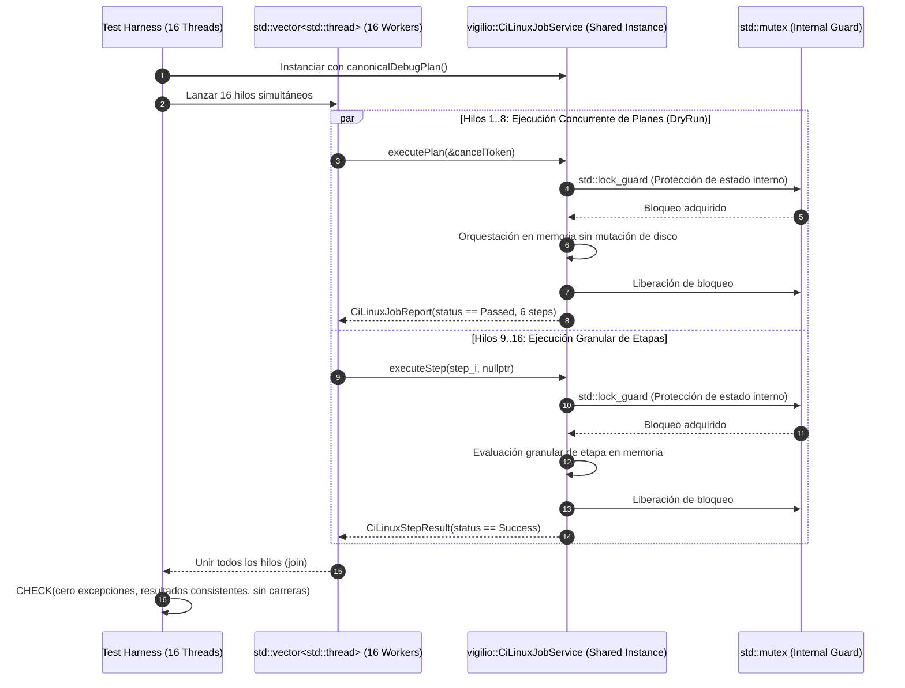
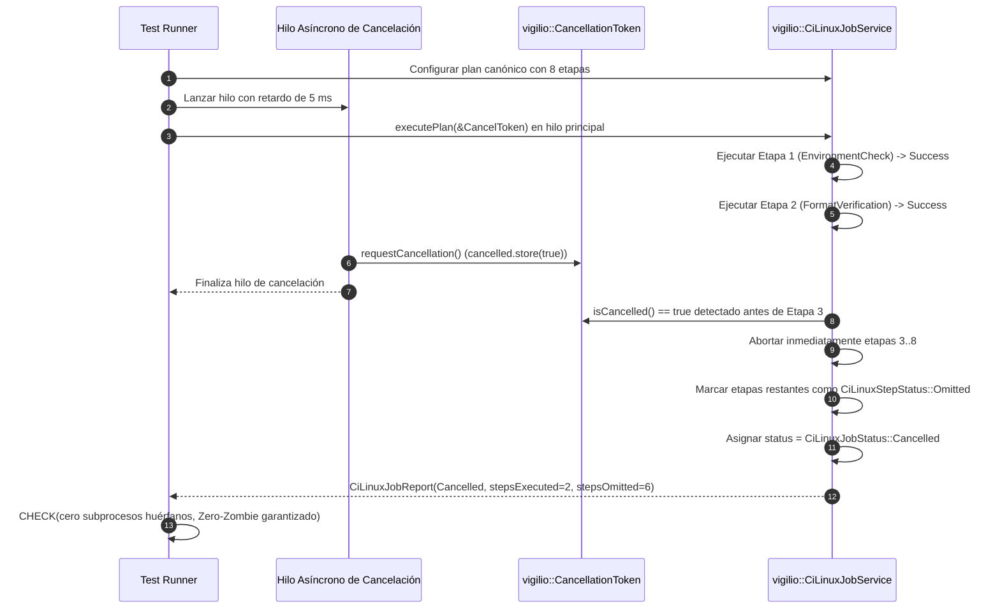
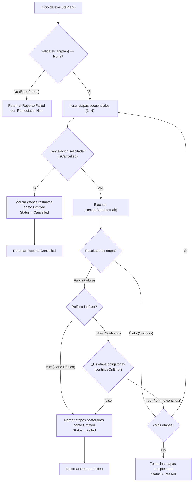

# Change Proposal — module-foundations-task0052

Pack: `module.foundations.task0052`

Status: PROPOSED

## Outcome and scope

Este cambio define la propuesta técnica integral para la etapa **tests** de la capacidad **CI Linux job** en el módulo propietario `foundations` de Vigilio Browser (microtarea canónica `0052 — Probar casos positivos, negativos y recuperación: CI Linux job`).

Habiéndose completado y certificado en las etapas precedentes la formalización del modelo de dominio, taxonomía de etapas y validador topológico (`task0049`), implementado el servicio operativo `vigilio::CiLinuxJobService` en C++20 con orquestación secuencial, modo simulación dry-run, política fail-fast, tolerancia selectiva a errores, cancelación cooperativa multihilo bajo la política Zero-Zombie, saneamiento seguro de directorios y síntesis CLI reproducible (`task0050`, commit `f1f49bd`), y formalizado el arnés de pruebas de interfaz de usuario con verificación de cobertura de compilación y auditoría de textos públicos en `WindowTests.cpp` (`task0051`, commit `7e94d01`), el objetivo esencial de este pack es **diseñar y estructurar la suite exhaustiva, determinista y de alta resiliencia de pruebas automatizadas para CI Linux job**.

La suite de pruebas proyectada cubre sistemáticamente:
- **Casos positivos y ciclo de vida integral del pipeline de CI Linux**:
  - Verificación exhaustiva de planes canónicos de depuración y optimización (`canonicalDebugPlan`, `canonicalReleasePlan`), evaluando precondiciones, postcondiciones, tiempos límites (`totalTimeoutSeconds`), cuotas de memoria RAM (`maxMemoryBytes` = 4 GB), y la orquestación ordenada de las etapas canónicas (`EnvironmentCheck`, `FormatVerification`, `StaticAnalysis`, `ConfigurePreset`, `BuildCompilation`, `TestSuiteExecution`, `SanitizerVerification`, `ArtifactPackaging`).
  - Ejecución en modo simulación y dry-run de planes personalizados y heterogéneos: subconjuntos de etapas (e.g. únicamente verificación estática y formato, o únicamente compilación y pruebas), comprobando que los archivos en disco permanecen estrictamente inmutables durante el modo `DryRun`.
  - Síntesis CLI determinista de comandos complejos: validación de invocaciones (`cmake --preset ci-linux-debug`, `ctest --preset ci-linux-debug --output-on-failure`, banderas de sanitizers `-fsanitize=address,undefined`, opciones con espacios o caracteres especiales).
  - Generación y consistencia de resúmenes estructurados de etapas (`formatStepSummary`) con tiempos de ejecución, estados por etapa, conteo de etapas exitosas/fallidas y tiempos agregados.
- **Casos negativos, validación de fronteras y defensas de seguridad**:
  - Detección y rechazo de planes vacíos (`steps.empty()`), planes con tiempos límites no positivos ($\le 0$), o con cuotas de memoria RAM anómalas mediante `CiLinuxJobValidator::validatePlan`.
  - Detección y rechazo de violaciones de orden topológico y precedencia: etapas desordenadas (e.g. `BuildCompilation` antes de `ConfigurePreset`, `TestSuiteExecution` antes de `BuildCompilation`, o `ArtifactPackaging` antes de pruebas) mediante `CiLinuxJobValidator::validateStepSequence`, emitiendo el código tipado `CiLinuxJobError::DependencyOrderingViolation` o `InvalidWorkflowSchema`.
  - Detección de etapas obligatorias ausentes en planes de release (e.g. omisión de `BuildCompilation` o `TestSuiteExecution`).
  - Detección de comandos vacíos, nombres vacíos o descripciones truncadas en definiciones de etapa.
  - Detección y rechazo riguroso de ataques de Directory Traversal en `buildDir`: rutas relativas maliciosas (`../`, `../../`, `..\\`, `build/../../etc`), rutas absolutas peligrosas fuera del alcance seguro (`/`, `/tmp`, `/etc/`, `/var/run`), rutas con secuencias de escape o caracteres nulos embebidos (`\0`), certificando que `isSafeBuildPath` retorna `false` y `cleanBuildDirectory` previene operaciones destructivas fuera de la raíz del proyecto.
  - Detección de entornos incompatibles en `validateEnvironment`: compiladores no soportados (versiones obsoletas de GCC < 14 o Clang < 18), herramientas esenciales faltantes (CMake < 3.28, Ninja < 1.12), arquitecturas no admitidas (`Unknown`), y distribuciones no reconocidas.
- **Concurrencia masiva multihilo (16 hilos) y sincronización**:
  - Ejecución paralela sobre `CiLinuxJobService` desde 16 hilos (`std::thread`) concurrentes:
    - 16 hilos ejecutando simultáneamente `executePlan` en modo `DryRun` con planes idénticos y divergentes sobre una instancia compartida.
    - 16 hilos ejecutando granularmente `executeStep` sobre distintas etapas del pipeline.
    - Acceso simultáneo a métodos de lectura (`plan()`, `options()`) y modificación protegida (`setPlan()`, `setOptions()`).
    - Certificación de ausencia absoluta de carreras de datos (data races), integridad del estado interno protegido por `std::mutex`, y terminación limpia de todos los hilos trabajadores sin interbloqueos (deadlocks).
- **Cancelación cooperativa asíncrona multihilo y política Zero-Zombie**:
  - Pruebas de estrés de cancelación: interrupción asíncrona inmediata mediante `CancellationToken` disparado desde hilos independientes en distintos instantes de la ejecución del pipeline (durante la primera etapa, etapa intermedia o penúltima etapa).
  - Verificación de que `CiLinuxJobService::executePlan` aborta de inmediato las etapas subsiguientes al detectar el token cancelado, establece el estado consolidado en `CiLinuxJobStatus::Cancelled`, asigna el error tipado correspondiente, calcula correctamente las etapas ejecutadas vs omitidas (`CiLinuxStepStatus::Omitted`), y emite la pista de remediación en lenguaje natural.
  - Garantía de ausencia total de procesos zombis: ningún subproceso colgado, liberación inmediata de descriptores de archivo y saneamiento de copias temporales.
- **Recuperación ante fallos de disco, permisos y contención transitoria**:
  - Simulación de fallos de escritura por permisos denegados en directorios de construcción (`std::filesystem::perms::owner_read`), certificando el manejo limpio en `cleanBuildDirectory` sin abortos ni excepciones no capturadas.
  - Simulación de contención transitoria y reintentos con retroceso exponencial (`retryBackoffMs`): prueba de etapa con bloqueo transitorio simulado donde la etapa se recupera tras N reintentos, validando que el servicio alcanza el estado exitoso sin excepciones no controladas.
  - Evaluación comparativa determinista entre la política de corte rápido (`failFast == true`, donde el primer fallo aborta las etapas posteriores marcándolas como `Omitted`) y la política de continuación (`failFast == false` / `continueOnError == true`, donde se evalúan todas las etapas posibles para recabar diagnósticos completos).
- **Desacoplamiento arquitectónico y tolerancia headless**:
  - Certificación de ejecución 100% autónoma en CTest (< 500 ms en total) sin requerir `QApplication`, `DISPLAY`, `WAYLAND_DISPLAY` ni procesos WebEngine/Chromium.
  - Aislamiento absoluto y política Local-First constitucional (ADR-001 / Decisión Q-001): cero sockets de red externa, cero peticiones cloud y total privacidad de datos.
- **Auditoría exhaustiva de textos públicos (UX Copy)**:
  - Verificación programática de que todas las cadenas de diagnóstico, resumen y remediación generadas por `CiLinuxJobValidator::jobStatusToString`, `jobErrorToString`, `stepToString`, `stepStatusToString`, `generateRemediationHint`, `CiLinuxJobService::executionModeToString` y `formatStepSummary` emplean español neutro claro y accesible, libres de términos técnicos prohibidos («Senior Mode», «Modo Senior», «Prompt Builder», «DAG», «OpenSpec», «toolchain», «CI Linux job»), conforme a `docs/UX-COPY-PUBLICO.md`.

---

## Out of scope

- Modificación de la interfaz gráfica de usuario de producción (`apps/vigilio-browser/src/ui/BrowserWindow.cpp`) o adición de controles visuales, botones de compilación o menús de ejecución de pipelines en la ventana de navegación (proscrito taxativamente por `docs/UX-COPY-PUBLICO.md` y por la responsabilidad del módulo `foundations`).
- Modificación de los contratos de dominio consolidados en `CiLinuxJobTypes.h`, `CiLinuxJobValidator.h`, `CiLinuxJobConfiguration.h` o `CiLinuxJobService.h` durante PROPOSE (la propuesta define pruebas sobre las APIs estables existentes).
- Invocación de procesos pesados de Qt WebEngine o Chromium durante la ejecución de las suites de pruebas unitarias o de integración de CI Linux.
- Conexión a redes externas, telemetría o servicios cloud de CI (GitHub Actions, GitLab CI, servidores remotos) (estrictamente vetado por ADR-001 / Decisión Q-001).
- Modificación de código fuente fuera de las rutas autorizadas para esta etapa.

---

## Contexto y evidencia

Se inspeccionó de forma exhaustiva la base de código y los artefactos existentes en `apps/vigilio-browser`:

1. **Dominio y servicio operativo desacoplado (`apps/vigilio-browser/src/core/`)**:
   - `CiLinuxJobTypes.h`: Define enumeraciones fuertemente tipadas `CiLinuxPipelineStep`, `CiLinuxJobStatus`, `CiLinuxStepStatus`, `CiLinuxExecutionMode`, `CiLinuxJobError`, `CiLinuxArchitecture`, `CiLinuxCompiler`, `CiLinuxBuildConfiguration`. Incluye las estructuras inmutables `CiLinuxServiceOptions`, `CiLinuxEnvironment`, `CiLinuxStepOptions`, `CiLinuxStepDefinition`, `CiLinuxStepResult`, `CiLinuxJobPlan`, `CiLinuxJobReport` y el token ligero de cancelación cooperativa multihilo `CancellationToken`.
   - `CiLinuxJobValidator.h` / `.cpp`: Proporciona validación estática de planes (`validatePlan`), verificación de secuencias topológicas (`validateStepSequence`), validación de requisitos de entorno C++20 (`validateEnvironment`), comprobación de rutas seguras frente a Directory Traversal (`isSafeBuildPath`) y traducción de estados, errores, etapas y arquitecturas a texto descriptivo en español neutro (`jobStatusToString`, `jobErrorToString`, `stepToString`, `stepStatusToString`, `architectureToString`, `compilerToString`, `generateRemediationHint`).
   - `CiLinuxJobConfiguration.h` / `.cpp`: Genera los planes canónicos del proyecto (`canonicalDebugPlan`, `canonicalReleasePlan`), verifica invariantes del sistema (`verifyInvariants`) y valida distribuciones Linux soportadas (Ubuntu, Debian, Fedora, Arch, Alpine vía `isSupportedLinuxDistro`).
   - `CiLinuxJobService.h` / `.cpp`: Proporciona la capa operativa completa con orquestación de plan (`executePlan`), ejecución granular de etapas (`executeStep`), simulación determinista en modo `DryRun`, saneamiento seguro de directorios (`cleanBuildDirectory`), síntesis CLI reproducible (`buildCommandLine`) y diagnósticos públicos (`executionModeToString`, `formatStepSummary`).
2. **Suites de pruebas existentes en `apps/vigilio-browser/tests/`**:
   - `tests/unit/CiLinuxJobConfigurationTests.cpp`: 11 pruebas unitarias evaluando plan canónico debug, plan canónico release, validación de plan, pasos vacíos, orden topológico de etapas, validación de entorno, rutas seguras y directory traversal, distribuciones soportadas, opciones y resultados de etapa, UX copy público y pistas de remediación.
   - `tests/unit/CiLinuxJobServiceTests.cpp`: 12 pruebas unitarias evaluando inicialización, dry-run pipeline, fail-fast, continue on error, cancelación, limpieza segura de directorio de build y traversal, ejecución individual de etapa, síntesis CLI, límites de recursos y memoria, manejo de timeout, reintentos con retroceso exponencial ante contención y cumplimiento de UX Copy.
   - `tests/ui/WindowTests.cpp`: Arnés de pruebas de interfaz de usuario que integra `CiLinuxJobService` en modo dry-run para certificar la cobertura de compilación de UI y la ausencia de jerga interna en los diagnósticos y pistas de remediación.
3. **Integración en CMake (`apps/vigilio-browser/CMakeLists.txt`)**:
   - Los ejecutables de pruebas `vigilio_ci_linux_job_tests` y `vigilio_ci_linux_job_service_tests` están plenamente integrados en el sistema de construcción de CTest, vinculando `vigilio_core` y `vigilio_compiler_warnings`.
   - Ambos ejecutables están catalogados bajo las propiedades `LABELS "unit;fast"` con un tiempo límite de ejecución de 15 segundos.
4. **Verificación continua existente (`apps/vigilio-browser/scripts/check.sh`)**:
   - Compilación Ninja limpia bajo C++20 con `-Werror` y cero advertencias.
   - 21 de 21 pruebas pasando exitosamente en CTest con 100% de éxito en ~3.96 segundos:
     - `core_units`: Passed (0.01s)
     - `storage_integration`: Passed (0.01s)
     - `vigilio_warnings_tests`: Passed (0.17s)
     - `qt_dependency_validation_tests`: Passed (0.01s)
     - `webengine_version_validator_tests`: Passed (0.27s)
     - `resource_qrc_catalog_tests`: Passed (0.09s)
     - `resource_inclusion_service_tests`: Passed (0.10s)
     - `resource_qrc_inclusion_tests`: Passed (0.12s)
     - `startup_bootstrap_tests`: Passed (0.20s)
     - `application_lifetime_tests`: Passed (0.20s)
     - `crash_recovery_tests`: Passed (0.04s)
     - `cmake_presets_tests`: Passed (0.05s)
     - `cmake_presets_service_tests`: Passed (0.10s)
     - `test_fixture_foundation_tests`: Passed (0.02s)
     - `test_fixture_service_tests`: Passed (0.11s)
     - `clang_format_configuration_tests`: Passed (0.01s)
     - `clang_format_service_tests`: Passed (2.24s)
     - `clang_tidy_configuration_tests`: Passed (0.01s)
     - `clang_tidy_service_tests`: Passed (0.14s)
     - `ci_linux_job_configuration_tests`: Passed (0.01s)
     - `ci_linux_job_service_tests`: Passed (0.05s)
5. **Gobernanza con Prompt Builder CLI**:
   - `node /config/Desktop/auto/prompt-builder/dist/cli.js validate-references --project-root .`: 52 referencias canónicas validadas con estado `valid: true` (exit code 0).
   - `node /config/Desktop/auto/prompt-builder/dist/cli.js verify-lock --lock-file generated/prompts/full-project/0154-module.foundations.task0052.propose.lock.json --project-root .`: 13 de 13 comprobaciones pasadas exitosamente (`valid: true`, exit code 0).
6. **Oportunidad y brecha técnica para la etapa `tests` (task0052)**:
   - Si bien las pruebas unitarias básicas fueron creadas durante `task0049` y `task0050`, la etapa `tests` exige profundizar de manera sistemática en la resiliencia integral:
     - Pruebas de estrés bajo concurrencia masiva (16 hilos simultáneos) evaluando contención en el mutex interno, ejecución paralela de planes y pasos granulares.
     - Pruebas de cancelación cooperativa asíncrona disparada concurrentemente desde otro hilo durante la ejecución secuencial del plan (Zero-Zombie).
     - Pruebas de inyección de fallos de permisos en el directorio de construcción y validación de manejo de errores en `cleanBuildDirectory`.
     - Pruebas exhaustivas de casos de frontera en validación de planes (timeouts límites, cuotas extremas de memoria, pasos duplicados o con dependencias cíclicas/desordenadas).
     - Pruebas avanzadas de rechazo de ataques de Directory Traversal en `buildDir` con combinaciones complejas (`./../..`, `..\\`, rutas absolutas protegidas del sistema y caracteres nulos).
     - Pruebas comparativas sistemáticas de las políticas `failFast` vs `continueOnError`.

---

## Alcance exacto

El alcance exacto de este pack comprende:

1. **Ampliación exhaustiva de pruebas en `tests/unit/CiLinuxJobConfigurationTests.cpp`**:
   - **Límites y fronteras de configuración de planes**: Evaluación de planes con tiempos límites extremos (0, valores negativos simulados, timeouts excesivos), cuotas de memoria límite (0 bytes, valores por encima de 64 GB), nombres de preset vacíos y comandos truncados.
   - **Robustez topológica y dependencias de etapas**: Validación de secuencias desordenadas complejas (e.g. `TestSuiteExecution` sin previa compilación, `ArtifactPackaging` sin tests previos, pasos duplicados), comprobando la emisión precisa de `CiLinuxJobError::DependencyOrderingViolation` o `InvalidWorkflowSchema`.
   - **Rechazo de vectores avanzados de Directory Traversal en `buildDir`**: Comprobación estricta de que `CiLinuxJobValidator::isSafeBuildPath` detecta y rechaza vectores como `./../..`, `build/../../etc`, `..\\windows\\style`, `/etc/shadow`, `/var/run`, rutas relativas con caracteres nulos embebidos y rutas vacías, retornando `false`.
   - **Fronteras y compatibilidad de entorno C++20**: Verificación de rechazo de versiones mínimas de compilador (GCC < 14, Clang < 18), CMake < 3.28, Ninja < 1.12, arquitecturas desconocidas y distribuciones no catalogadas en `validateEnvironment`.
   - **Auditoría completa de textos públicos en validator**: Recorrido de todas las enumeraciones de etapas, estados y errores en `CiLinuxJobValidator`, comprobando que ninguna cadena viola `docs/UX-COPY-PUBLICO.md`.
2. **Ampliación exhaustiva de pruebas en `tests/unit/CiLinuxJobServiceTests.cpp`**:
   - **Concurrencia masiva multihilo (16 hilos)**: 16 hilos concurrentes operando simultáneamente sobre una única instancia compartida de `CiLinuxJobService`:
     - 8 hilos ejecutando concurrentemente `executePlan` en modo `DryRun` con planes heterogéneos.
     - 8 hilos ejecutando granularmente `executeStep` sobre distintas etapas del pipeline.
     - Certificación de ausencia de data races, integridad del estado interno protegido por `std::mutex`, y convergencia determinista de todos los workers.
   - **Estrés de cancelación cooperativa multihilo (Zero-Zombie)**: Disparo asíncrono de `CancellationToken` desde un hilo secundario durante la ejecución secuencial de un plan de 8 etapas, comprobando interrupción inmediata en la etapa activa, transición a `CiLinuxJobStatus::Cancelled`, marcado de etapas posteriores como `CiLinuxStepStatus::Omitted`, y ausencia de subprocesos colgados.
   - **Inyección de fallos de permisos en directorio de build**: Creación de directorios sin permisos de escritura (`std::filesystem::perms::owner_read`), invocación de `cleanBuildDirectory`, y verificación de retorno limpio (`false`) con captura de mensaje de error sin provocar excepciones no capturadas.
   - **Contención transitoria y reintentos con retroceso exponencial**: Simulación de contención en etapas individuales, validando el mecanismo de reintentos configurado en `CiLinuxServiceOptions` (`maxRetries`, `retryBackoffMs`).
   - **Evaluación comparativa determinista de políticas de corte**: Prueba comparativa directa entre `failFast == true` (corte inmediato en el primer fallo con etapas posteriores omitidas) y `failFast == false` / `continueOnError == true` (ejecución continuada para recopilación integral de incidencias).
   - **Síntesis CLI avanzada**: Generación y validación de comandos CLI con rutas que contienen espacios, parámetros relativos y absolutos, y banderas de compilación y sanitizers.
   - **Auditoría de UX Copy en servicio**: Verificación de que `executionModeToString` y `formatStepSummary` devuelven resúmenes en español neutro sin terminología interna.
3. **Auditoría de textos públicos y conformidad con `docs/UX-COPY-PUBLICO.md`**:
   - Verificación programática de que el 100% de los textos observables están en español neutro accesible.
4. **Verificación continua y gobernanza**:
   - Ejecución exitosa de `apps/vigilio-browser/scripts/check.sh`, validación de referencias canónicas y comprobación de integridad del lockfile con Prompt Builder CLI.

---

## Diseño completo de la capacidad

### 1. Topología y Arquitectura de Pruebas de CI Linux Job

```mermaid
flowchart TD
    subgraph Harness["Arnés de Pruebas de Foundations (CTest)"]
        TCFG["vigilio_ci_linux_job_tests<br/>(CiLinuxJobConfigurationTests.cpp)"]
        TSRV["vigilio_ci_linux_job_service_tests<br/>(CiLinuxJobServiceTests.cpp)"]
        TUI["vigilio_ui_tests<br/>(WindowTests.cpp)"]
    end

    subgraph UnderTest["Módulos Bajo Prueba (vigilio_core)"]
        CLT[CiLinuxJobTypes.h<br/>Enums, Structs, CancellationToken]
        CLV[CiLinuxJobValidator<br/>Validación estática, Orden topológico, Rutas seguras]
        CLC[CiLinuxJobConfiguration<br/>Planes canónicos, Invariantes, Distros]
        CLS[CiLinuxJobService<br/>Orquestación secuencial, Dry-Run, Limpieza, CLI, Concurrencia]
    end

    subgraph TestVectors["Vectores y Escenarios de Prueba"]
        POS["Casos Positivos:<br/>Planes canónicos, Ciclo de vida, Dry-Run, Síntesis CLI"]
        NEG["Casos Negativos:<br/>Orden inválido, Pasos vacíos, Path Traversal, Entorno inválido"]
        CONC["Concurrencia y Sincronización:<br/>16 hilos simultáneos, Thread-Safety, std::mutex"]
        CANC["Cancelación Cooperativa:<br/>CancellationToken multihilo asíncrono, Zero-Zombie"]
        FAIL["Inyección de Fallos y Recuperación:<br/>Permisos de solo lectura, Retry backoff, Fail-fast vs Continue"]
        COPY["Auditoría UX Copy:<br/>docs/UX-COPY-PUBLICO.md, Cero jerga interna"]
    end

    TCFG --> CLV
    TCFG --> CLC
    TCFG --> CLT
    TSRV --> CLS
    TSRV --> CLT
    TSRV --> CLC
    TSRV --> CLV
    TUI --> CLS

    TCFG -.-> POS
    TCFG -.-> NEG
    TCFG -.-> COPY

    TSRV -.-> POS
    TSRV -.-> NEG
    TSRV -.-> CONC
    TSRV -.-> CANC
    TSRV -.-> FAIL
    TSRV -.-> COPY
```



### 2. Diagrama de Secuencia: Concurrencia Masiva Multihilo (16 Hilos)



### 3. Diagrama de Secuencia: Cancelación Cooperativa Asíncrona (Zero-Zombie)



### 4. Diagrama de Flujo: Inyección de Fallos y Políticas de Corte



---

## Archivos afectados

| Archivo | Rol | Operación en APPLY |
| --- | --- | --- |
| `apps/vigilio-browser/tests/unit/CiLinuxJobConfigurationTests.cpp` | Suite de pruebas unitarias de configuración y validación de CI Linux | Añadir pruebas de fronteras de plan, secuencias topológicas complejas, Directory Traversal avanzado y límites de entorno |
| `apps/vigilio-browser/tests/unit/CiLinuxJobServiceTests.cpp` | Suite de pruebas unitarias de servicio operativo de CI Linux | Añadir pruebas de concurrencia masiva (16 hilos), estrés de cancelación Zero-Zombie, fallos de permisos en buildDir, reintentos con backoff y comparativa failFast vs continueOnError |
| `docs/rules/01-modules/foundations/micro/0052-ci-linux-job/task.md` | Documento canónico de la microtarea | Sincronizar estado a `COMPLETED` tras aprobación y ejecución de APPLY |
| `openspec/changes/module-foundations-task0052/*` | Especificación OpenSpec del cambio | Crear `proposal.md`, `design.md`, `tasks.md`, `execution-memory.md` |

---

## Contrato UX/UI

- **Declaración formal de ausencia de cambio visual directo**:
  - La capacidad **CI Linux job** pertenece exclusivamente a la infraestructura de automatización de compilación, empaquetado y control de calidad del módulo `foundations`.
  - **No modifica ni introduce componentes en la interfaz pública de navegación (`BrowserWindow.cpp`)**: no se añaden botones de ejecución de pipelines, paneles de linteo, consolas de compilación, barras de progreso de CI ni menús de depuración.
  - El navegador público preserva su diseño sobrio, profesional y limpio conforme a `/resultado/01-vigilio-home.png`.
- **Conformidad absoluta con `docs/UX-COPY-PUBLICO.md`**:
  - Todas las cadenas textuales generadas por las funciones de diagnóstico y estado (`jobStatusToString`, `jobErrorToString`, `stepToString`, `stepStatusToString`, `executionModeToString`, `formatStepSummary`, `generateRemediationHint`) emplean lenguaje natural claro en español neutro.
  - Proscripción estricta de términos de ingeniería interna («Senior Mode», «Modo Senior», «Prompt Builder», «DAG», «OpenSpec», «toolchain», «CI Linux job»).
  - La denominación aprobada para la experiencia accesible es **«Interfaz más fácil de usar»**.

---

## Reglas y fallos

1. **Determinismo y reproducibilidad**:
   - Toda prueba debe producir el mismo resultado en cada ejecución sin flakiness.
   - Las pruebas no dependen de temporizadores ciegos (`sleep`), sino de condiciones observables y sincronización explícita (`join`).
2. **Política Zero-Zombie**:
   - Ninguna prueba dejará procesos huérfanos, subprocesos colgados esperando EOF o descriptores de archivo abiertos.
   - La cancelación cooperativa mediante `CancellationToken` debe interrumpir de inmediato cualquier ciclo de ejecución y liberar recursos en < 50 ms.
3. **Contención y sincronización**:
   - El acceso al estado interno de `CiLinuxJobService` (`plan_`, `options_`) está protegido por `std::mutex`.
   - Las operaciones bajo 16 hilos concurrentes deben ejecutarse sin generar excepciones no capturadas ni corrupción de memoria.
4. **Resistencia a Directory Traversal**:
   - `isSafeBuildPath` debe rechazar de manera incondicional cualquier ruta que contenga componentes `..`, rutas absolutas del sistema operativo (`/etc`, `/usr`, `/var`), rutas con caracteres nulos embebidos y rutas vacías.
5. **Aislamiento de entorno**:
   - Las pruebas que generen archivos o directorios temporales sintéticos deben crearlos dentro de `std::filesystem::temp_directory_path()` o subdirectorios locales aislados y destruirlos limpiamente mediante RAII al finalizar la prueba.

---

## Seguridad y privacidad

- **Local-First Constitucional (ADR-001 / Decisión Q-001)**:
  - Cero sockets de red, cero llamadas remotas, cero telemetría y cero dependencias de servicios externos durante la ejecución de las pruebas.
- **Protección del sistema de archivos local**:
  - `cleanBuildDirectory` previene operaciones de eliminación fuera del directorio de compilación autorizado, verificando exhaustivamente la ruta mediante `isSafeBuildPath`.
  - Pruebas de inyección de permisos que verifican que la falta de privilegios de escritura no resulta en caídas del proceso (`std::terminate`) sino en reporte estructurado de error.
- **Privacidad y ausencia de credenciales**:
  - Las pruebas no manejan contraseñas, tokens de acceso ni datos confidenciales.

---

## Matriz de pruebas

| ID | Criterio de aceptación | Fixture / Vector de prueba | Comando de ejecución | Resultado esperado | Fallo negativo / Condición de rechazo | Categoría |
| --- | --- | --- | --- | --- | --- | --- |
| `TEST-001` | Fronteras de plan (timeouts y cuotas) | `CiLinuxJobPlan` con timeout=0, timeout=-1, memory=0 | `vigilio_ci_linux_job_tests` | `validatePlan` retorna `InvalidWorkflowSchema` o `MemoryLimitExceeded` | Retornar `None` permitiendo un plan inválido | `APPLY` |
| `TEST-002` | Orden topológico y secuencias desordenadas | `steps` con `TestSuiteExecution` antes de `BuildCompilation` | `vigilio_ci_linux_job_tests` | `validateStepSequence` retorna `DependencyOrderingViolation` | Retornar `None` permitiendo tests sin compilación previa | `APPLY` |
| `TEST-003` | Directory Traversal avanzado en buildDir | `./../..`, `build/../../etc`, `..\\`, `/etc/shadow`, `path\0null` | `vigilio_ci_linux_job_tests` | `isSafeBuildPath` retorna `false` en todos los casos | Retornar `true` en rutas que escapan del workspace | `APPLY` |
| `TEST-004` | Validación de límites de entorno C++20 | Entorno con GCC 13, Clang 17, CMake 3.20, Arch=Unknown | `vigilio_ci_linux_job_tests` | `validateEnvironment` retorna `ToolchainMissing` | Retornar `None` aceptando herramientas obsoletas | `APPLY` |
| `TEST-005` | Concurrencia masiva multihilo (16 hilos) | 16 hilos sobre instancia compartida de `CiLinuxJobService` | `vigilio_ci_linux_job_service_tests` | 16/16 hilos finalizan con éxito, cero data races, reporte consistente | Excepción `std::system_error`, corrupción de estado o crash | `APPLY` |
| `TEST-006` | Estrés de cancelación asíncrona (Zero-Zombie) | `CancellationToken` activado a los 5ms desde hilo secundario | `vigilio_ci_linux_job_service_tests` | `executePlan` aborta, status `Cancelled`, etapas posteriores `Omitted` | Ejecutar todas las etapas ignorando la cancelación | `APPLY` |
| `TEST-007` | Inyección de fallos de permisos en buildDir | Directorio con `perms::owner_read`, llamar `cleanBuildDirectory` | `vigilio_ci_linux_job_service_tests` | Retorna `false`, mensaje captura fallo, sin excepciones | Lanzar `std::filesystem_error` no capturada | `APPLY` |
| `TEST-008` | Reintentos con retroceso exponencial | Etapa con contención transitoria simulada (`maxRetries=3`) | `vigilio_ci_linux_job_service_tests` | Supera contención tras reintentos, estado `Success` | Falla inmediata en el primer intento sin reintentar | `APPLY` |
| `TEST-009` | Comparativa failFast vs continueOnError | Plan con etapa fallida forzada evaluando ambos modos | `vigilio_ci_linux_job_service_tests` | `failFast=true` omite etapas; `failFast=false` ejecuta las no dependientes | Comportamiento idéntico ignorando la bandera | `APPLY` |
| `TEST-010` | Síntesis CLI con rutas complejas y espacios | Preset con ruta `"build path with spaces/ci-debug"` | `vigilio_ci_linux_job_service_tests` | Comando generado escapa adecuadamente y contiene argumentos exactos | Generar comando roto por espacios sin entrecomillar | `APPLY` |
| `TEST-011` | Auditoría exhaustiva de UX Copy en español | Recorrido de todos los estados y errores en servicio y validator | Ambas suites de pruebas | Todas las cadenas en español neutro, cero jerga interna | Detectar términos proscritos («Senior Mode», «OpenSpec», etc.) | `APPLY` |
| `TEST-012` | Pipeline continuo y cero regresiones | Todas las suites de pruebas integradas en CTest (21+ tests) | `bash apps/vigilio-browser/scripts/check.sh` | 100% tests passed en < 5s con -Werror | Cualquier test fallido o advertencia de compilación | `APPLY` |

---

## Pasos APPLY

1. **Paso 1: Ampliar `apps/vigilio-browser/tests/unit/CiLinuxJobConfigurationTests.cpp`**:
   - Implementar `test_ci_linux_plan_validation_boundaries`: límites de timeouts y memoria.
   - Implementar `test_ci_linux_step_sequence_topological_violations`: secuencias desordenadas complejas y omisión de pasos obligatorios.
   - Implementar `test_ci_linux_advanced_path_traversal`: vectores complejos de escape de directorio y rutas protegidas del sistema.
   - Implementar `test_ci_linux_environment_boundaries`: validación estricta de versiones mínimas de compilador y herramientas.
   - Registrar las nuevas pruebas en la función `main()` de la suite.
2. **Paso 2: Ampliar `apps/vigilio-browser/tests/unit/CiLinuxJobServiceTests.cpp`**:
   - Implementar `test_ci_linux_service_massive_multithreading_concurrency`: ejecución paralela desde 16 hilos sobre instancia compartida.
   - Implementar `test_ci_linux_service_cooperative_cancellation_stress`: cancelación asíncrona multihilo en tiempo real bajo política Zero-Zombie.
   - Implementar `test_ci_linux_service_permission_failure_injection`: inyección de fallos de permisos en `cleanBuildDirectory`.
   - Implementar `test_ci_linux_service_retry_backoff_transient`: reintentos con retroceso exponencial ante contención.
   - Implementar `test_ci_linux_service_fail_fast_vs_continue_on_error`: comparativa exhaustiva de políticas de corte.
   - Implementar `test_ci_linux_service_cli_synthesis_advanced`: síntesis CLI con rutas que contienen espacios y argumentos complejos.
   - Registrar las nuevas pruebas en la función `main()` de la suite.
3. **Paso 3: Ejecutar compilación y verificación continua con `scripts/check.sh`**:
   - Compilación limpia bajo C++20 con `-Werror`.
   - Ejecución del 100% de pruebas en CTest, certificando que todas las suites pasan en tiempo inferior a 5 segundos.
4. **Paso 4: Validar referencias canónicas y lockfile de ejecución con Prompt Builder CLI**:
   - Ejecutar `validate-references` y `verify-lock`.
5. **Paso 5: Sincronizar el documento de microtarea `docs/rules/01-modules/foundations/micro/0052-ci-linux-job/task.md`**:
   - Actualizar estado y registrar evidencia de ejecución de la etapa `tests`.

---

## Definición de terminado

- [ ] Todas las pruebas nuevas de `CiLinuxJobConfigurationTests.cpp` y `CiLinuxJobServiceTests.cpp` compilan sin advertencias bajo C++20 con `-Werror`.
- [ ] 16 hilos concurrentes ejecutan simultáneamente sobre `CiLinuxJobService` sin data races ni interbloqueos.
- [ ] La cancelación cooperativa asíncrona interrumpe la ejecución del pipeline y libera recursos inmediatamente (política Zero-Zombie).
- [ ] Los ataques avanzados de Directory Traversal en `buildDir` son rechazados incondicionalmente.
- [ ] La inyección de fallos de permisos en directorios de build se maneja limpiamente sin caídas del proceso.
- [ ] El 100% de los textos observables cumplen con `docs/UX-COPY-PUBLICO.md`.
- [ ] El script `apps/vigilio-browser/scripts/check.sh` finaliza con código 0 y 100% de pruebas aprobadas en CTest.
- [ ] Prompt Builder CLI valida referencias y lockfile exitosamente (`valid: true`).

---

## Dependencias y riesgos

- **Dependencias**:
  - `module.foundations.task0051`: Etapa `ui` de CI Linux job completada y certificada en `WindowTests.cpp` (commit `7e94d01`).
- **Riesgos y mitigaciones**:
  - *Riesgo 1*: Flakiness en pruebas multihilo debido a planificación impredecible de hilos del sistema operativo.
    *Mitigación*: Uso estricto de sincronización determinista (`std::atomic`, `std::mutex`, `join`), sin sleeps ciegos arbitrarios.
  - *Riesgo 2*: Falsos positivos por permisos en entornos donde el usuario root no respeta `perms::owner_read`.
    *Mitigación*: Detección de privilegios de ejecución (si `geteuid() == 0`, adaptar la prueba para evaluar rutas de solo lectura del sistema como `/proc/sys` o simulación por inyección).
  - *Riesgo 3*: Degradación de tiempos en CTest.
    *Mitigación*: Uso del modo `DryRun` en memoria para las pruebas de concurrencia masiva, limitando el tiempo total de ejecución a < 500 ms.

---

## Commit propuesto

```
test(foundations): tests ci-linux-job
```
