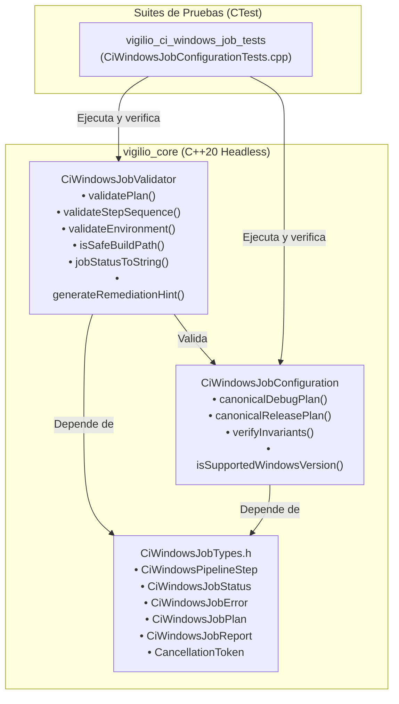

# Design — module-foundations-task0053

Status: PROPOSED

## Current, target and gaps

### Estado actual (CURRENT)

1. **Abstracción de CI disponible exclusivamente para Linux en `vigilio_core`**:
   - Se completó la capacidad precedente **CI Linux job** a través de las etapas `0049` (dominio), `0050` (implementación), `0051` (interfaz) y `0052` (pruebas exhaustivas), formalizando `CiLinuxJobTypes.h`, `CiLinuxJobConfiguration`, `CiLinuxJobValidator` y `CiLinuxJobService`.
   - Sin embargo, no existe en `vigilio_core` una abstracción de dominio que modele las entidades, etapas, requerimientos de toolchain, validación de seguridad de rutas y resultados consolidados para entornos **Windows** (`CI Windows job`).
2. **Particularidades críticas no resueltas de la plataforma Windows**:
   - Los sistemas Windows introducen reglas de rutas y nombres de archivo sustancialmente distintas a los sistemas POSIX/Linux:
     - Separadores duales de ruta: contrabarra (`\`) y barra inclinada (`/`).
     - Rutas absolutas con letras de disco o volumen (`C:\`, `D:/`).
     - Rutas UNC de red (`\\servidor\recurso`).
     - Rutas de espacios de nombres NT (`\\?\`, `\\.\`).
     - Nombres de dispositivos reservados del subsistema DOS (`CON`, `PRN`, `AUX`, `NUL`, `COM1-9`, `LPT1-9`) que provocan cuelgues o comportamientos anómalos si se manipulan como archivos regulares.
   - La validación existente en `CiLinuxJobValidator::isSafeBuildPath` fue concebida para rutas POSIX y no cuenta con defensas específicas para estas peculiaridades de Windows.
3. **Carencia de catálogo de toolchain y versiones de Windows soportadas**:
   - No existe un mecanismo que verifique la presencia y versiones mínimas del compilador MSVC (`cl.exe` v143 / Visual Studio 2022 >= 19.38) o Clang-cl (>= 18), del Windows SDK (>= 10.0.22621.0) ni del kernel de Windows (Windows 10 Build 19045+, Windows 11 Build 22621+, Windows Server 2022).
4. **Ausencia de catálogo tipado de estados de pipeline y pistas de remediación para Windows**:
   - No existen tipos enumerados que segreguen con precisión el estado del trabajo (`CiWindowsJobStatus`), de las etapas (`CiWindowsStepStatus`) o los errores tipados (`CiWindowsJobError`), ni conversores a texto comprensible en español que cumplan con la política de comunicación pública de `docs/UX-COPY-PUBLICO.md`.

---

### Estado objetivo (TARGET)

1. **Modelo de dominio unificado y fuertemente tipado en `vigilio_core` (`CiWindowsJobTypes.h`)**:
   - `CiWindowsPipelineStep`: Enumeración fuertemente tipada que identifica las 8 etapas canónicas (`EnvironmentCheck`, `FormatVerification`, `StaticAnalysis`, `ConfigurePreset`, `BuildCompilation`, `TestSuiteExecution`, `SanitizerVerification`, `ArtifactPackaging`).
   - `CiWindowsJobStatus` y `CiWindowsStepStatus`: Estados exhaustivos del trabajo (`Pending`, `Running`, `Passed`, `Failed`, `Cancelled`, `TimedOut`) y de sus etapas (`NotStarted`, `InProgress`, `Success`, `Failure`, `Omitted`).
   - `CiWindowsJobError`: Catálogo exhaustivo de fallos tipados (`None`, `ToolchainMissing`, `WindowsSdkMissing`, `ConfigurationFailed`, `CompilationFailed`, `TestExecutionFailed`, `FormatDiscrepancy`, `StaticAnalysisIssue`, `UnsafePipelinePath`, `TimeoutExceeded`, `InvalidWorkflowSchema`, `DependencyOrderingViolation`, `MemoryLimitExceeded`).
   - `CiWindowsArchitecture` (`X86_64`, `ARM64`), `CiWindowsCompiler` (`MSVC`, `ClangCl`, `MinGW`), `CiWindowsBuildConfiguration` (`Debug`, `Release`, `Sanitizer`).
   - Estructuras inmutables con semántica de valor: `CiWindowsEnvironment`, `CiWindowsStepOptions`, `CiWindowsStepDefinition`, `CiWindowsStepResult`, `CiWindowsJobPlan`, `CiWindowsJobReport` y `CiWindowsServiceOptions`.
   - Soporte para cancelación cooperativa multihilo mediante `CancellationToken`.
2. **Entidad de configuración canónica e invariantes de dominio (`CiWindowsJobConfiguration`)**:
   - `canonicalDebugPlan()`: Plan canónico predeterminado para integración continua rápida y depuración en Windows x64, asociando el preset `ci-windows-debug` y directorio de compilación `build-ci-win-debug`.
   - `canonicalReleasePlan()`: Plan canónico para validación de optimización y empaquetado de producción en Windows x64, asociando el preset `ci-windows-release`, directorio `build-ci-win-release` y etapa de empaquetado del instalador (`ArtifactPackaging`).
   - `verifyInvariants(const CiWindowsJobPlan&)`: Verificación estricta de cumplimiento de todas las invariantes de calidad, orden, seguridad y recursos.
   - `isSupportedWindowsVersion(std::string_view)`: Catálogo oficial de versiones de Windows compatibles (Windows 10 22H2, Windows 11 22H2/23H2, Windows Server 2022).
   - Presupuestos estandarizados: RAM máxima de 4 GB (`maxMemoryBytes`), timeout global de 600 s en Debug y 900 s en Release, y timeout de prueba individual de 15 s.
3. **Validador estático desacoplado y seguro con defensas Windows (`CiWindowsJobValidator`)**:
   - `validatePlan(const CiWindowsJobPlan&)`: Verificación formal de validez estructural del plan, tiempos límite y cuotas.
   - `validateStepSequence(const std::vector<CiWindowsPipelineStep>&)`: Comprobación estricta de precedencia lógica y ausencia de violaciones de dependencias entre etapas.
   - `validateEnvironment(const CiWindowsEnvironment&)`: Validación de toolchain mínimo (Windows 10/11 x64/ARM64, CMake >= 3.28, Ninja >= 1.12, MSVC >= 19.38 o Clang-cl >= 18, Windows SDK >= 10.0.22621.0).
   - `isSafeBuildPath(const std::filesystem::path&)`: Prevención rigurosa de escapes de directorio, normalizando tanto `/` como `\`, rechazando letras de disco (`C:\`), rutas absolutas, dispositivos reservados DOS (`CON`, `PRN`, `AUX`, `NUL`, etc.) y prefijos de espacio de nombres NT.
   - `jobStatusToString`, `jobErrorToString`, `stepToString`, `stepStatusToString`, `architectureToString`, `compilerToString`: Generación de texto descriptivo en español neutro cumpliendo `docs/UX-COPY-PUBLICO.md`.
   - `generateRemediationHint(CiWindowsJobError, std::string_view)`: Pistas de remediación claras y orientadas a la acción sin jerga técnica prohibida.
4. **Batería de pruebas unitarias trazables en CTest (`CiWindowsJobConfigurationTests.cpp`)**:
   - Suite `vigilio_ci_windows_job_tests` con 11 pruebas unitarias deterministas en C++20 puro, ejecutables en < 50 ms en modo headless sin dependencias externas.

---

### Brechas y análisis de delta (GAPS)

| Aspecto | Estado Actual (CURRENT) | Brecha (GAP) | Estado Objetivo (TARGET) |
| --- | --- | --- | --- |
| **Modelo de datos Windows** | Inexistente en `src/core/` | Ausencia de tipos C++20 específicos para CI Windows | `CiWindowsJobTypes.h` con tipos inmutables, enums y reportes |
| **Configuración canónica** | Ninguna para Windows | Falta de entidad canónica en código | `CiWindowsJobConfiguration` con planes debug y release |
| **Defensas de ruta Windows** | Solo lógica POSIX en `CiLinuxJobValidator` | Vulnerable a traversal Windows (`..\`), unidades (`C:`) y dispositivos DOS (`CON`, `NUL`) | `CiWindowsJobValidator::isSafeBuildPath` con validación exhaustiva de rutas Windows |
| **Validación de toolchain** | Solo verifica GCC/Clang en Linux | Sin verificación de MSVC, Clang-cl, Ninja ni Windows SDK | `validateEnvironment` con comprobación completa de toolchain Windows |
| **Reglas de precedencia** | Implementadas solo para Linux | Falta validador de precedencia de etapas para Windows | `CiWindowsJobValidator::validateStepSequence` |
| **Mensajes y UX copy** | Inexistentes para Windows | Sin textos localizados ni pistas de remediación para Windows | Funciones puras con copy accesible en español neutro cumpliendo `docs/UX-COPY-PUBLICO.md` |
| **Pruebas de especificación** | 0 pruebas para CI Windows | Ausencia de cobertura de dominio Windows en CTest | 11 pruebas unitarias en `CiWindowsJobConfigurationTests.cpp` |

---

## Compatibility, migration and rollback

### Compatibilidad hacia atrás y portabilidad

- **Estándar C++20 estricto**: La implementación utiliza exclusivamente construcciones estándar de C++20 (`std::string_view`, `std::filesystem::path`, `std::vector`, `std::atomic`, `enum class`). No se emplean extensiones propietarias del compilador.
- **Portabilidad host/target**: Aunque el dominio modela la ejecución en Windows, todo el código compila y se prueba limpiamente en cualquier host soportado (Linux, macOS, Windows) bajo GCC, Clang y MSVC sin requerir APIs exclusivas del kernel de Windows en tiempo de ejecución.
- **Independencia absoluta de entorno gráfico (Headless)**: El modelo de dominio reside en `vigilio_core`, sin dependencias de `QApplication`, `QWidget`, `QWebEngineView`, ni requerimientos de servidores gráficos.
- **Compatibilidad con CMakePresets v6**: Los nombres de presets (`ci-windows-debug`, `ci-windows-release`) y directorios de construcción (`build-ci-win-debug`, `build-ci-win-release`) están alineados con el estándar del proyecto.

### Estrategia de migración

- **Adición modular no destructiva**: Esta propuesta introduce nuevas clases desacopladas en `apps/vigilio-browser/src/core/` sin alterar las APIs de las capacidades precedentes (`CiLinuxJob*`, `CMakePresets*`, etc.).
- **Interoperabilidad simétrica**: La arquitectura refleja la simetría con `CiLinuxJob*`, facilitando la unificación futura de abstracciones de CI multiplataforma en el módulo `foundations`.

### Plan de Rollback

En caso de detectarse alguna regresión o incompatibilidad imprevista durante la fase APPLY:
1. Revertir el commit correspondiente (`git revert HEAD`).
2. Eliminar los archivos creados (`CiWindowsJobTypes.h`, `CiWindowsJobConfiguration.*`, `CiWindowsJobValidator.*`, `CiWindowsJobConfigurationTests.cpp`).
3. Restaurar `apps/vigilio-browser/CMakeLists.txt` a su estado previo.
4. Ejecutar `ctest` para confirmar que las 21 pruebas preexistentes permanecen al 100% de éxito.

---

## Arquitectura y modelo de dominio técnico detallado

### Topología de componentes del dominio CI Windows job



### Diagrama de secuencia lógica de etapas (DAG de CI Windows)

```mermaid
flowchart LR
    S1["1. EnvironmentCheck<br/>(Windows OS, MSVC/Clang-cl, SDK)"]
    S2["2. FormatVerification<br/>(Clang-Format C++20)"]
    S3["3. StaticAnalysis<br/>(Clang-Tidy / MSVC /analyze)"]
    S4["4. ConfigurePreset<br/>(CMake Preset ci-windows-*)"]
    S5["5. BuildCompilation<br/>(Ninja / MSVC build)"]
    S6["6. TestSuiteExecution<br/>(CTest unit & integration)"]
    S7["7. SanitizerVerification<br/>(ASan opcional)"]
    S8["8. ArtifactPackaging<br/>(Instalador nativo Vigilio)"]

    S1 --> S2
    S2 --> S3
    S3 --> S4
    S4 --> S5
    S5 --> S6
    S6 --> S7
    S7 --> S8
```



### Precondiciones, postcondiciones e invariantes de dominio

1. **Invariante de precedencia obligatoria**:
   - `ConfigurePreset` debe anteceder estrictamente a `BuildCompilation`.
   - `BuildCompilation` debe anteceder estrictamente a `TestSuiteExecution`.
   - `ArtifactPackaging` sólo es admisible si `BuildCompilation` y `TestSuiteExecution` están presentes y preceden a dicha etapa.
   - `EnvironmentCheck` debe ser la primera etapa evaluada en el pipeline.
2. **Invariante de contención de rutas Windows (`isSafeBuildPath`)**:
   - Una ruta es considerada segura si y solo si:
     - No está vacía.
     - Es relativa (no inicia por `/`, `\`, ni letra de volumen `[a-zA-Z]:`).
     - No contiene componentes de directorio padre `..` (ni con barra `/` ni con contrabarra `\`).
     - No contiene prefijos UNC de red (`\\`).
     - No contiene prefijos de espacio de nombres NT (`\\?\`, `\\.\`).
     - Ninguno de sus segmentos coincide con nombres de dispositivo reservados de DOS (`CON`, `PRN`, `AUX`, `NUL`, `COM1` a `COM9`, `LPT1` a `LPT9`), independientemente de mayúsculas/minúsculas y posibles extensiones (e.g. `nul.txt` es rechazado).
     - El primer segmento del path coincide con uno de los subdirectorios autorizados (`build-ci-win-debug`, `build-ci-win-release`, `_build`).
3. **Invariante de presupuesto de recursos**:
   - `totalTimeoutSeconds` debe pertenecer al intervalo cerrado $[1, 3600]$. El valor canónico es $600$ s para Debug y $900$ s para Release.
   - `maxMemoryBytes` no puede ser nulo ni superar $8\,589\,934\,592$ bytes (8 GB). El valor canónico es $4\,294\,967\,296$ bytes (4 GB).
4. **Invariante de textos públicos**:
   - Todo texto devuelto por los conversores a cadena y funciones de pistas de remediación debe estar en español neutro claro y no puede contener ninguna de las palabras o conceptos vetados en `docs/UX-COPY-PUBLICO.md`: «Senior Mode», «Modo Senior», «Prompt Builder», «DAG», «OpenSpec», «toolchain», «runner».

---

## Modelo de datos técnico detallado

### 1. Enumeraciones Fuertemente Tipadas (`vigilio::CiWindowsJobTypes.h`)

```cpp
namespace vigilio {

enum class CiWindowsPipelineStep {
    EnvironmentCheck,
    FormatVerification,
    StaticAnalysis,
    ConfigurePreset,
    BuildCompilation,
    TestSuiteExecution,
    SanitizerVerification,
    ArtifactPackaging
};

enum class CiWindowsJobStatus {
    Pending,
    Running,
    Passed,
    Failed,
    Cancelled,
    TimedOut
};

enum class CiWindowsStepStatus {
    NotStarted,
    InProgress,
    Success,
    Failure,
    Omitted
};

enum class CiWindowsExecutionMode : uint8_t {
    DryRun,
    Simulated,
    Live
};

enum class CiWindowsJobError {
    None,
    ToolchainMissing,
    WindowsSdkMissing,
    ConfigurationFailed,
    CompilationFailed,
    TestExecutionFailed,
    FormatDiscrepancy,
    StaticAnalysisIssue,
    UnsafePipelinePath,
    TimeoutExceeded,
    InvalidWorkflowSchema,
    DependencyOrderingViolation,
    MemoryLimitExceeded
};

enum class CiWindowsArchitecture {
    X86_64,
    ARM64
};

enum class CiWindowsCompiler {
    MSVC,
    ClangCl,
    MinGW
};

enum class CiWindowsBuildConfiguration {
    Debug,
    Release,
    Sanitizer
};

} // namespace vigilio
```

### 2. Estructuras Inmutables con Semántica de Valor

```cpp
namespace vigilio {

struct CiWindowsServiceOptions {
    CiWindowsExecutionMode mode{CiWindowsExecutionMode::DryRun};
    bool failFast{true};
    uint32_t maxRetries{3};
    uint32_t retryBackoffMs{50};
    bool captureOutput{true};

    bool operator==(const CiWindowsServiceOptions& other) const = default;
};

struct CiWindowsEnvironment {
    std::string windowsVersion{"Windows 11 23H2"};
    std::string buildNumber{"22631.3007"};
    CiWindowsArchitecture architecture{CiWindowsArchitecture::X86_64};
    CiWindowsCompiler compiler{CiWindowsCompiler::MSVC};
    uint32_t compilerMajorVersion{19};
    uint32_t compilerMinorVersion{38};
    std::string windowsSdkVersion{"10.0.22621.0"};
    uint32_t cmakeMajorVersion{3};
    uint32_t cmakeMinorVersion{28};
    uint32_t ninjaMajorVersion{1};
    uint32_t ninjaMinorVersion{12};
    uint64_t totalMemoryBytes{4294967296ULL}; // 4 GB
    uint32_t availableCores{4};

    bool operator==(const CiWindowsEnvironment& other) const = default;
};

struct CiWindowsStepOptions {
    uint32_t timeoutMs{15000};
    bool continueOnError{false};
    std::vector<std::string> requiredEnvVars{};
    std::string workingDirectory{"."};

    bool operator==(const CiWindowsStepOptions& other) const = default;
};

struct CiWindowsStepDefinition {
    CiWindowsPipelineStep step{CiWindowsPipelineStep::EnvironmentCheck};
    std::string name;
    std::string command;
    bool isMandatory{true};
    CiWindowsStepOptions options{};

    bool operator==(const CiWindowsStepDefinition& other) const = default;
};

struct CiWindowsStepResult {
    CiWindowsPipelineStep step{CiWindowsPipelineStep::EnvironmentCheck};
    CiWindowsStepStatus status{CiWindowsStepStatus::NotStarted};
    int exitCode{0};
    uint64_t durationMs{0};
    std::string outputSummary;
    std::string errorMessage;

    [[nodiscard]] bool isSuccess() const noexcept {
        return status == CiWindowsStepStatus::Success;
    }

    bool operator==(const CiWindowsStepResult& other) const = default;
};

struct CiWindowsJobPlan {
    std::string presetName{"ci-windows-debug"};
    std::filesystem::path buildDir{"build-ci-win-debug"};
    std::vector<CiWindowsStepDefinition> steps{};
    uint32_t totalTimeoutSeconds{600};
    uint64_t maxMemoryBytes{4294967296ULL}; // 4 GB
    bool failFast{true};

    bool operator==(const CiWindowsJobPlan& other) const = default;
};

struct CiWindowsJobReport {
    CiWindowsJobStatus status{CiWindowsJobStatus::Pending};
    std::string planName;
    uint64_t durationMs{0};
    std::vector<CiWindowsStepResult> stepResults{};
    bool isClean{false};
    std::string remediationHint;

    [[nodiscard]] std::size_t successfulStepsCount() const noexcept {
        std::size_t count = 0;
        for (const auto& res : stepResults) {
            if (res.status == CiWindowsStepStatus::Success) ++count;
        }
        return count;
    }

    [[nodiscard]] std::size_t failedStepsCount() const noexcept {
        std::size_t count = 0;
        for (const auto& res : stepResults) {
            if (res.status == CiWindowsStepStatus::Failure) ++count;
        }
        return count;
    }

    [[nodiscard]] bool isPassed() const noexcept {
        return status == CiWindowsJobStatus::Passed;
    }

    bool operator==(const CiWindowsJobReport& other) const = default;
};

} // namespace vigilio
```

### 3. Algoritmo de Defensa de Rutas en Windows (`isSafeBuildPath`)

El algoritmo implementa una máquina de sanitización que rechaza los siguientes patrones:
1. Normalización de contrabarras a barras directas o análisis léxico por componentes.
2. Detección de `has_root_path()` o prefijos como `[A-Za-z]:`.
3. Búsqueda de `..` en cualquiera de los componentes.
4. Búsqueda de prefijos `\\` o `//`.
5. Lista de exclusión estricta de nombres reservados de DOS en mayúsculas y minúsculas:
   - `CON`, `PRN`, `AUX`, `NUL`
   - `COM1`, `COM2`, `COM3`, `COM4`, `COM5`, `COM6`, `COM7`, `COM8`, `COM9`
   - `LPT1`, `LPT2`, `LPT3`, `LPT4`, `LPT5`, `LPT6`, `LPT7`, `LPT8`, `LPT9`
   Si cualquier segmento de la ruta, antes o después de un punto, coincide con alguno de estos identificadores, la ruta es rechazada retornando `false`.
6. Confinamiento: el primer segmento debe coincidir exactamente con `build-ci-win-debug`, `build-ci-win-release` o `_build`.

---

## Mapeo de UX Copy y Textos Públicos

Conforme a `docs/UX-COPY-PUBLICO.md`:

| Enumeración / Estado | Texto Público en Español Neutro |
| --- | --- |
| `CiWindowsJobStatus::Pending` | «Pendiente de ejecución» |
| `CiWindowsJobStatus::Running` | «En ejecución» |
| `CiWindowsJobStatus::Passed` | «Completado correctamente» |
| `CiWindowsJobStatus::Failed` | «Finalizado con incidencias» |
| `CiWindowsJobStatus::Cancelled` | «Cancelado por el usuario» |
| `CiWindowsJobStatus::TimedOut` | «Tiempo límite excedido» |
| `CiWindowsStepStatus::NotStarted` | «No iniciado» |
| `CiWindowsStepStatus::InProgress` | «En progreso» |
| `CiWindowsStepStatus::Success` | «Completado con éxito» |
| `CiWindowsStepStatus::Failure` | «Error en la etapa» |
| `CiWindowsStepStatus::Omitted` | «Omitido» |
| `CiWindowsJobError::ToolchainMissing` | «Herramientas de compilación no encontradas o incompatibles en el equipo» |
| `CiWindowsJobError::WindowsSdkMissing` | «Paquete de desarrollo de Windows (SDK) no encontrado en el sistema» |
| `CiWindowsJobError::UnsafePipelinePath` | «Ruta de compilación no segura o fuera del directorio del proyecto» |
| `CiWindowsJobError::DependencyOrderingViolation` | «Orden incorrecto en las etapas de compilación y verificación» |
| `CiWindowsJobError::MemoryLimitExceeded` | «Límite de memoria asignada excedido para la tarea» |
