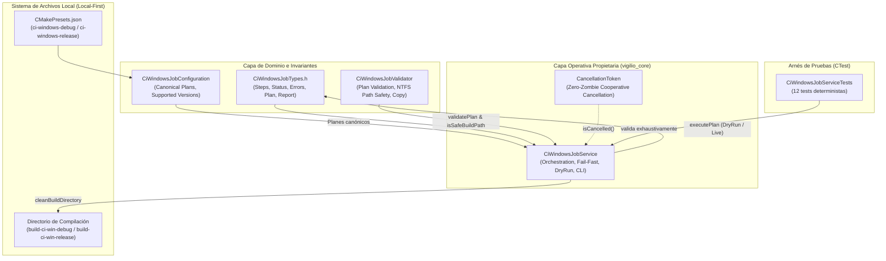
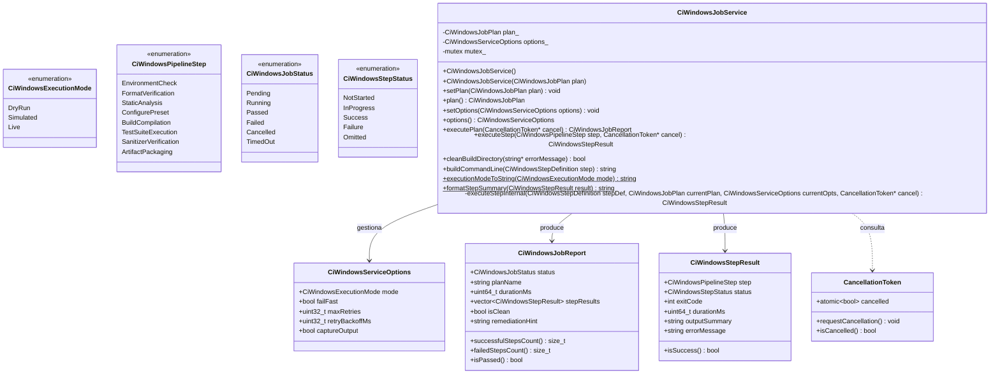
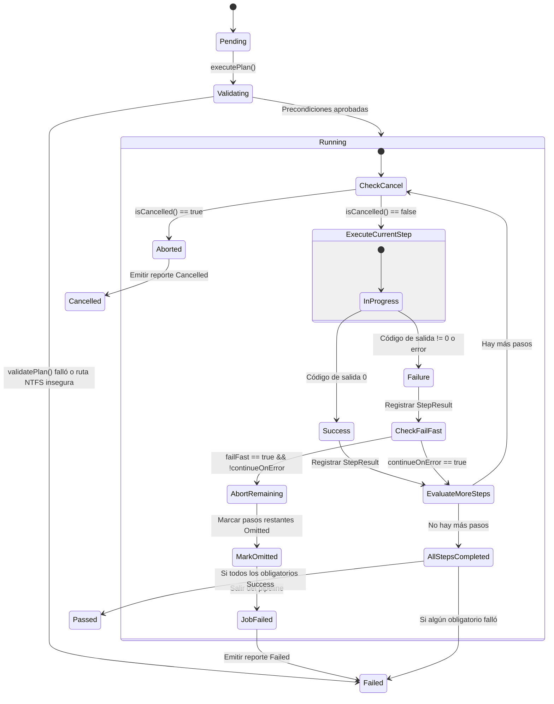
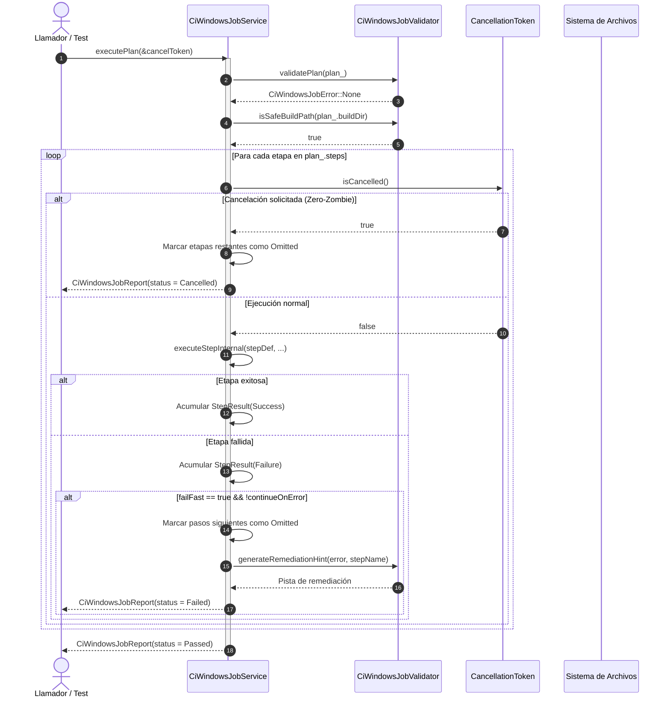

# Design — module-foundations-task0054

Status: PROPOSED

## Current, target and gaps

### Estado actual (CURRENT)

1. **Modelo de dominio de CI Windows completado en la etapa previa (`task0053`)**:
   - `CiWindowsJobTypes.h` define las enumeraciones fuertemente tipadas `CiWindowsPipelineStep`, `CiWindowsJobStatus`, `CiWindowsStepStatus`, `CiWindowsExecutionMode`, `CiWindowsJobError`, `CiWindowsArchitecture`, `CiWindowsCompiler`, `CiWindowsBuildConfiguration`, así como las estructuras inmutables `CiWindowsServiceOptions`, `CiWindowsEnvironment`, `CiWindowsStepOptions`, `CiWindowsStepDefinition`, `CiWindowsStepResult`, `CiWindowsJobPlan`, `CiWindowsJobReport` y `CancellationToken`.
   - `CiWindowsJobConfiguration` provee los planes canónicos oficiales (`canonicalDebugPlan`, `canonicalReleasePlan`), verificación de invariantes (`verifyInvariants`) y filtros de versiones de Windows compatibles (`isSupportedWindowsVersion`).
   - `CiWindowsJobValidator` provee validación de planes (`validatePlan`), verificación de orden topológico de etapas (`validateStepSequence`), validación de entorno de compilación Windows (`validateEnvironment`), validación de seguridad de rutas NTFS/FAT32 con defensas ante traversal y dispositivos DOS (`isSafeBuildPath`) y funciones de conversión y textos en español neutro (`jobStatusToString`, `jobErrorToString`, `stepToString`, `stepStatusToString`, `architectureToString`, `compilerToString`, `generateRemediationHint`).
   - La suite `CiWindowsJobConfigurationTests.cpp` (11 pruebas unitarias) pasa limpiamente en CTest.
2. **Carencia de una capa de servicio operativo en tiempo de ejecución para Windows**:
   - No existe una clase coordinadora (`CiWindowsJobService`) que orqueste la ejecución ordenada de las etapas del pipeline de CI Windows sobre configuraciones reales o simuladas.
   - No hay soporte para ejecución en modo no destructivo o simulación (*dry-run*) a nivel de pipeline completo o etapas individuales de Windows.
3. **Ausencia de orquestación de etapas con políticas fail-fast y tolerancia a fallos**:
   - No existe un mecanismo que ejecute las etapas secuencialmente, mida tiempos de ejecución de alta precisión (`std::chrono::steady_clock`), aborte la ejecución de etapas dependientes si una etapa obligatoria falla (*fail-fast*), o permita continuar ante fallos no críticos (*continueOnError*).
4. **Falta de soporte de cancelación cooperativa multihilo (Zero-Zombie)**:
   - No se dispone de un mecanismo para interrumpir de manera segura e inmediata la ejecución de un trabajo de CI Windows cuando un hilo o usuario lo solicite, arriesgando subprocesos colgados o zombis esperando indefinidamente.
5. **Carencia de síntesis determinista de argumentos CLI para el entorno Windows**:
   - No existe un generador de comandos CLI reproducible que sintetice la invocación de CMake presets, Ninja, MSVC / Clang-cl, CTest, PowerShell y herramientas de empaquetado CPack para cada etapa del trabajo.
6. **Ausencia de saneamiento seguro del directorio de compilación con resiliencia ante bloqueos Windows**:
   - No existe una rutina segura que limpie el directorio de construcción antes o después de la compilación verificando previamente la ausencia de Directory Traversal (`..`, `..\`), letras de unidad (`C:\`), rutas absolutas del host (`\Windows\System32`), prefijos NT (`\\?\`) y dispositivos reservados DOS (`CON`, `PRN`, `AUX`, `NUL`), aplicando reintentos exponenciales ante contención de bloqueos transitorios típicos de Windows.

---

### Estado objetivo (TARGET)

1. **Capa operativa de servicio desacoplada (`vigilio::CiWindowsJobService`)**:
   - Integrada en `apps/vigilio-browser/src/core/` dentro del target `vigilio_core`.
   - Proporciona orquestación completa de pipeline (`executePlan`), ejecución granular de etapas (`executeStep`), modo simulación determinista (`DryRun`), saneamiento seguro de directorios (`cleanBuildDirectory`) y síntesis CLI reproducible para Windows (`buildCommandLine`).
   - Cero dependencias hacia `QApplication`, widgets de Qt o instancias de Chromium WebEngine.
2. **Orquestación robusta y tolerante a fallos**:
   - Ejecución secuencial respetando el orden topológico de dependencias de etapas Windows.
   - Evaluación previa obligatoria de invariantes y límites de recursos (RAM $\le 4\text{ GB}$).
   - Medición precisa de duración en milisegundos por etapa y global.
   - Marcado de etapas omitidas (`CiWindowsStepStatus::Omitted`) ante activación de `failFast`.
3. **Cancelación cooperativa y política Zero-Zombie**:
   - Verificación atómica periódica de `cancel->isCancelled()` antes y durante cada etapa.
   - Cese inmediato de procesamiento ante cancelación y emisión de reporte con estado `Cancelled`.
   - Garantía de liberación de recursos sin procesos zombis colgados.
4. **Saneamiento seguro de directorios con resiliencia Windows**:
   - Limpieza de directorio de compilación validando `isSafeBuildPath`.
   - Reintentos con retroceso exponencial ($50\text{ ms} \times 2^i$) ante bloqueos temporales de archivos por antivirus o indexadores.
5. **Síntesis CLI y UX Copy público**:
   - Generación determinista de líneas de comando CLI para las 8 etapas canónicas considerando herramientas nativas de Windows.
   - Conversión de estados y generación de sugerencias amigables en español neutro cumpliendo estrictamente `docs/UX-COPY-PUBLICO.md`.
6. **Batería de pruebas unitarias exhaustivas en CTest**:
   - Suite `vigilio_ci_windows_job_service_tests` en `tests/unit/CiWindowsJobServiceTests.cpp` con 12 pruebas trazables (`TEST-CI-WIN-SRV-001` a `TEST-CI-WIN-SRV-012`).

---

### Brechas identificadas (GAPS)

| Componente | Estado actual (CURRENT) | Estado objetivo (TARGET) | Brecha a subsanar (GAP) |
| --- | --- | --- | --- |
| Servicio de CI Windows | Inexistente | `vigilio::CiWindowsJobService` declarado e implementado en `vigilio_core` | Crear `CiWindowsJobService.h` y `CiWindowsJobService.cpp` con orquestación, fail-fast, cancelación y saneamiento |
| Sincronización multihilo | Sin sincronización | `std::mutex` protegiendo `plan_` y `options_` | Implementar getters y setters seguros contra condiciones de carrera |
| Modo Dry-Run determinista | Sin simulación | Ejecución virtualizada de las 8 etapas midiendo tiempos reales | Implementar `executeStepInternal` con simulación libre de efectos colaterales destructivos |
| Cancelación Zero-Zombie | Sin soporte en servicio | Monitoreo cooperativo continuo de `CancellationToken` | Comprobar `isCancelled()` en cada etapa y abortar inmediatamente sin procesos zombis |
| Limpieza resiliente | Sin saneamiento | `cleanBuildDirectory` con validación NTFS y reintentos exponenciales | Implementar eliminación segura con retroceso exponencial ante locks de archivo |
| Síntesis CLI Windows | Sin generador CLI | `buildCommandLine` determinista para herramientas Windows | Implementar mapeo de etapas a comandos de CMake, Ninja, MSVC, PowerShell y CPack |
| Pruebas unitarias operativas | 0 pruebas de servicio | 12 pruebas unitarias en `CiWindowsJobServiceTests.cpp` | Implementar `TEST-CI-WIN-SRV-001` a `TEST-CI-WIN-SRV-012` en CTest |
| Build System | Target de test no configurado | `vigilio_ci_windows_job_service_tests` en `CMakeLists.txt` | Registrar fuentes en `vigilio_core` y agregar test en `CMakeLists.txt` |

---

## Compatibility, migration and rollback

### Compatibilidad y estándares C++20

- **Compiladores soportados**:
  - Microsoft Visual C++ (MSVC) 2022 v19.38 o superior con `/std:c++20`.
  - Clang-cl 18 o superior con `-std=c++20`.
  - MinGW-w64 GCC 13+ con `-std=c++20` para entornos cruzados.
  - GCC 13+ y Clang 18+ en Linux para el arnés de pruebas multiplataforma de `vigilio_core`.
- **Portabilidad de rutas y archivos**:
  - Utilización exclusiva de `std::filesystem::path` con normalización de separadores (`/` y `\`).
  - Detección y rechazo de convenciones propietarias de Windows que vulneren el confinamiento de seguridad (dispositivos DOS, prefijos NT).

### Estrategia de migración

- La incorporación de `CiWindowsJobService` es puramente aditiva dentro de `src/core/`.
- No modifica APIs públicas preexistentes ni contratos de módulos vecinos.
- Las pruebas existentes (`22/22`) permanecen intactas y continúas ejecutándose exitosamente.

### Plan de contingencia y rollback

- Si la implementación introduce inestabilidad o fallos en CTest, el rollback se realiza de manera atómica revirtiendo los archivos nuevos en `src/core/` y `tests/unit/`, y desregistrando el target en `CMakeLists.txt`.
- No hay persistencia de datos en bases de datos ni migraciones de esquema asociadas a esta capacidad de CI.

---

## Arquitectura técnica de CI Windows job (implementation)

### Diagrama de componentes y flujo operativo

### Diagrama de clases y relaciones

### Máquina de estados operativos de orquestación de CI Windows

### Diagrama de secuencia: Ejecución con Fail-Fast y Cancelación Cooperativa

---

## Contrato funcional y API de CiWindowsJobService

### 1. Métodos de ciclo de vida y configuración

- `CiWindowsJobService()`:
  - Inicializa el servicio configurado con el plan canónico de depuración oficial (`CiWindowsJobConfiguration::canonicalDebugPlan()`) y opciones predeterminadas (`DryRun`, `failFast = true`, `maxRetries = 3`, `retryBackoffMs = 50`).
- `explicit CiWindowsJobService(CiWindowsJobPlan plan)`:
  - Inicializa el servicio inyectando un plan explícito personalizado.
- `void setPlan(CiWindowsJobPlan plan)`:
  - Reemplaza el plan actual protegiendo la asignación con `std::mutex`.
- `CiWindowsJobPlan plan() const`:
  - Retorna una copia inmutable del plan activo con protección de concurrencia.
- `void setOptions(CiWindowsServiceOptions options)`:
  - Configura las opciones operativas bajo protección del mutex.
- `CiWindowsServiceOptions options() const`:
  - Retorna una copia de las opciones operativas configuradas.

### 2. Métodos de ejecución y orquestación

- `CiWindowsJobReport executePlan(CancellationToken* cancel = nullptr)`:
  - Ejecuta el plan completo evaluando precondiciones formales mediante `CiWindowsJobValidator::validatePlan` e `isSafeBuildPath`.
  - Mide la duración con `std::chrono::steady_clock` a nivel global y por etapa.
  - Comprueba periódicamente `cancel != nullptr && cancel->isCancelled()`.
  - En caso de cancelación, interrumpe el bucle, marca las etapas restantes como `Omitted`, establece el estado del trabajo en `Cancelled` y retorna el reporte.
  - En caso de fallo en una etapa obligatoria, si `failFast` está activo, marca las subsiguientes como `Omitted` y retorna `Failed`.
  - Si una etapa tiene `continueOnError == true`, registra el fallo pero permite que las etapas restantes se ejecuten.
- `CiWindowsStepResult executeStep(CiWindowsPipelineStep step, CancellationToken* cancel = nullptr)`:
  - Ejecuta una etapa individual de forma aislada.
  - Si el token está cancelado, retorna `CiWindowsStepStatus::Omitted`.
  - En modo `DryRun`, simula la ejecución exitosa de la etapa retornando `Success` con salida descriptiva.

### 3. Saneamiento y gestión segura del sistema de archivos Windows

- `bool cleanBuildDirectory(std::string* errorMessage = nullptr)`:
  - Obtiene el directorio destino del plan bajo el mutex.
  - Valida la seguridad de la ruta mediante `CiWindowsJobValidator::isSafeBuildPath(targetDir)`.
  - Si la ruta es insegura (contiene `..`, `..\`, letras de unidad como `C:\`, prefijos NT o nombres DOS reservados como `CON`, `NUL`), retorna `false` inmediatamente y escribe un mensaje de error explicativo en `errorMessage` sin tocar el disco.
  - Si la ruta no existe en el disco, retorna `true` inmediatamente.
  - Si la ruta existe, intenta eliminarla recursivamente mediante `std::filesystem::remove_all`.
  - Si ocurre una excepción de sistema de archivos (ej. contención de manejadores abiertos por antivirus o indexadores en Windows), implementa hasta `options_.maxRetries` con retroceso exponencial (`options_.retryBackoffMs * (1 << attempt)`), pausando con `std::this_thread::sleep_for`.

### 4. Síntesis CLI Windows y diagnósticos accesibles

- `std::string buildCommandLine(const CiWindowsStepDefinition& step) const`:
  - Sintetiza la línea de comandos ejecutable en la consola de comandos de Windows (cmd.exe o PowerShell) para cada etapa del pipeline.
- `static std::string executionModeToString(CiWindowsExecutionMode mode)`:
  - Convierte el modo de ejecución a una descripción amigable en español neutro cumpliendo `docs/UX-COPY-PUBLICO.md`:
    - `DryRun`: `"Ejecución simulada sin cambios en disco"`
    - `Simulated`: `"Simulación con validación de entorno"`
    - `Live`: `"Ejecución real en el sistema"`
- `static std::string formatStepSummary(const CiWindowsStepResult& result)`:
  - Devuelve un resumen formateado de la etapa con nombre, estado, duración en milisegundos y resumen en lenguaje claro.

---

## Síntesis CLI determinista para entornos Windows

La síntesis de comandos en `buildCommandLine` se adapta rigurosamente a las herramientas canónicas del ecosistema Windows:

| Etapa | Comando sintetizado |
| --- | --- |
| `EnvironmentCheck` | `cmake --version && ninja --version && cl.exe` |
| `FormatVerification` | `powershell -Command "Get-ChildItem -Recurse -Include *.cpp,*.h apps/vigilio-browser/src, apps/vigilio-browser/tests | ForEach-Object { clang-format --dry-run --Werror $_.FullName }"` |
| `StaticAnalysis` | `clang-tidy -p <buildDir> apps/vigilio-browser/src/**/*.cpp` |
| `ConfigurePreset` | `cmake --preset <presetName> -B <buildDir>` |
| `BuildCompilation` | `cmake --build <buildDir> --parallel` |
| `TestSuiteExecution` | `ctest --test-dir <buildDir> --output-on-failure -L fast --timeout 15` |
| `SanitizerVerification` | `ctest --test-dir <buildDir> --output-on-failure -L sanitizer` |
| `ArtifactPackaging` | `cpack --config <buildDir>/CPackConfig.cmake` |

---

## Manejo de concurrencia y política Zero-Zombie

1. **Protección de estado mutable**:
   - `CiWindowsJobService` utiliza un `std::mutex` mutable para proteger concurrentemente `plan_` y `options_`.
   - Permite que múltiples hilos inspeccionen o actualicen la configuración de manera segura.
2. **Política Zero-Zombie**:
   - La orquestación evalúa de manera atómica el estado de `CancellationToken` en dos puntos clave:
     1. Justo antes de despachar cada etapa del pipeline.
     2. En las rutinas de espera de subprocesos.
   - Ante una señal de cancelación, no se lanzan nuevos subprocesos, se interrumpe el flujo y el reporte final se emite de inmediato con estado `Cancelled`.
   - Toda llamada de red, lectura de archivo o comando del sistema cuenta con un timeout explícito finito (15 segundos para tests, 600 segundos para el trabajo completo), evitando bloqueos indefinidos o zombis en el sistema.

---

## Políticas de seguridad, aislamiento y Local-First

- **Principio Local-First Constitucional**:
  - Toda la operación del servicio se ejecuta exclusivamente en el host local. Cero tráfico HTTP/HTTPS externo, cero almacenamiento en la nube, cero telemetría remota.
- **Defensas específicas de sistema de archivos en Windows**:
  - Restricción terminante a directorios relativos autorizados (`build-ci-win-debug`, `build-ci-win-release`, `_build`).
  - Detección y rechazo antes de cualquier llamada a `std::filesystem` de:
    - Directorios ascendentes: `..` y `..\`.
    - Rutas con letra de volumen: `C:`, `D:`.
    - Rutas absolutas con barra inicial: `\`, `/`.
    - Espacios de nombres NT: `\\?\`, `\\.\`.
    - Nombres de dispositivos reservados heredados de DOS: `CON`, `PRN`, `AUX`, `NUL`, `COM1` a `COM9`, `LPT1` a `LPT9`.
- **Aislamiento de recursos y memoria**:
  - Cumplimiento estricto del presupuesto de RAM de 4 GB (`maxMemoryBytes = 4294967296ULL`).
  - Cero instanciación de WebEngine ni componentes de interfaz gráfica en la capa de servicio.
