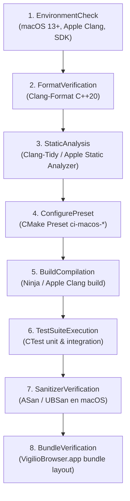

# Design — module-foundations-task0057

Status: PROPOSED

## Current, target and gaps

### Estado actual (CURRENT)

1. **Abstracciones de CI previas para Linux y Windows en `vigilio_core`**:
   - Se completó la capacidad **CI Linux job** en las microtareas `0049`-`0052` formalizando `CiLinuxJobTypes.h`, `CiLinuxJobConfiguration`, `CiLinuxJobValidator` y `CiLinuxJobService`.
   - Se completó la capacidad **CI Windows job** en las microtareas `0053`-`0056` formalizando `CiWindowsJobTypes.h`, `CiWindowsJobConfiguration`, `CiWindowsJobValidator` y `CiWindowsJobService`, incluyendo soporte para defensas de rutas Windows y particularidades de MSVC.
   - Sin embargo, no existe aún en `vigilio_core` una abstracción de dominio que modele las entidades, etapas, requerimientos de toolchain, validación de seguridad de rutas y resultados consolidados para entornos **macOS** (`CI macOS job`).
2. **Particularidades críticas no resueltas de la plataforma macOS**:
   - Los sistemas macOS (núcleo Darwin) presentan requerimientos de toolchain y sistema de archivos singulares:
     - Compilador primario Apple Clang provisto por Xcode o Xcode Command Line Tools (`/Library/Developer/CommandLineTools`), y soporte alternativo para Homebrew Clang.
     - Arquitecturas múltiples: Apple Silicon (`ARM64` / `aarch64`), Intel 64 bits (`X86_64`) y soporte conceptual para binarios universales (`Universal`).
     - Requerimiento de macOS SDK (`MacOSX.sdk` >= 13.0) para enlaces de frameworks del sistema (Cocoa, CoreFoundation) y Qt6.
     - Estructura de paquete y aplicación de escritorio nativa macOS: bundle `.app` (`VigilioBrowser.app/Contents/MacOS/vigilio-browser`, `Contents/Resources`, `Contents/Info.plist`).
     - Particularidades de APFS y sistema de archivos macOS: archivos ocultos de metadatos `.DS_Store` y bifurcaciones de recursos AppleDouble (`._*`), que no deben contaminar los árboles de compilación ni pasar desapercibidos en comprobaciones de seguridad.
     - Rutas absolutas del sistema operativo macOS (`/System`, `/Library`, `/Applications`, `/private`, `/usr`, `/Volumes`) que deben bloquearse categóricamente para evitar escapes del espacio de trabajo.
3. **Carencia de catálogo de toolchain y versiones de macOS soportadas**:
   - No existe un mecanismo en `vigilio_core` que certifique las versiones mínimas soportadas de macOS: macOS 13 Ventura (Darwin 22), macOS 14 Sonoma (Darwin 23) y macOS 15 Sequoia (Darwin 24), ni la versión del macOS SDK.
4. **Ausencia de catálogo tipado de estados de pipeline y pistas de remediación para macOS**:
   - No existen tipos enumerados que segreguen con precisión el estado del trabajo (`CiMacOsJobStatus`), de las etapas (`CiMacOsStepStatus`) o los errores tipados (`CiMacOsJobError`), ni conversores a texto comprensible en español que cumplan con la política de comunicación pública de `docs/UX-COPY-PUBLICO.md`.

---

### Estado objetivo (TARGET)

1. **Modelo de dominio unificado y fuertemente tipado en `vigilio_core` (`CiMacOsJobTypes.h`)**:
   - `CiMacOsPipelineStep`: Enumeración fuertemente tipada que identifica las 8 etapas canónicas (`EnvironmentCheck`, `FormatVerification`, `StaticAnalysis`, `ConfigurePreset`, `BuildCompilation`, `TestSuiteExecution`, `SanitizerVerification`, `BundleVerification`).
   - `CiMacOsJobStatus` y `CiMacOsStepStatus`: Estados exhaustivos del trabajo (`Pending`, `Running`, `Passed`, `Failed`, `Cancelled`, `TimedOut`) y de sus etapas (`NotStarted`, `InProgress`, `Success`, `Failure`, `Omitted`).
   - `CiMacOsJobError`: Catálogo exhaustivo de fallos tipados (`None`, `ToolchainMissing`, `MacOsSdkMissing`, `XcodeToolsMissing`, `ConfigurationFailed`, `CompilationFailed`, `TestExecutionFailed`, `FormatDiscrepancy`, `StaticAnalysisIssue`, `UnsafePipelinePath`, `TimeoutExceeded`, `InvalidWorkflowSchema`, `DependencyOrderingViolation`, `MemoryLimitExceeded`, `BundleVerificationFailed`).
   - `CiMacOsArchitecture` (`ARM64`, `X86_64`, `Universal`), `CiMacOsCompiler` (`AppleClang`, `HomebrewClang`), `CiMacOsBuildConfiguration` (`Debug`, `Release`, `Sanitizer`).
   - Estructuras inmutables con semántica de valor: `CiMacOsEnvironment`, `CiMacOsStepOptions`, `CiMacOsStepDefinition`, `CiMacOsStepResult`, `CiMacOsJobPlan`, `CiMacOsJobReport` y `CiMacOsServiceOptions`.
   - Soporte para cancelación cooperativa multihilo mediante `CancellationToken`.
2. **Entidad de configuración canónica e invariantes de dominio (`CiMacOsJobConfiguration`)**:
   - `canonicalDebugPlan()`: Plan canónico predeterminado para integración continua rápida y depuración en macOS, asociando el preset `ci-macos-debug` y directorio de compilación `build-ci-macos-debug`.
   - `canonicalReleasePlan()`: Plan canónico para validación de optimización y empaquetado de producción en macOS, asociando el preset `ci-macos-release`, directorio `build-ci-macos-release` y etapa de verificación de bundle (`BundleVerification`).
   - `verifyInvariants(const CiMacOsJobPlan&)`: Verificación estricta de cumplimiento de todas las invariantes de calidad, orden, seguridad y recursos.
   - `isSupportedMacOsVersion(std::string_view)`: Catálogo oficial de versiones de macOS compatibles (macOS 13 Ventura / Darwin 22, macOS 14 Sonoma / Darwin 23, macOS 15 Sequoia / Darwin 24).
   - Presupuestos estandarizados: RAM máxima de 4 GB (`maxMemoryBytes`), timeout global de 600 s en Debug y 900 s en Release, y timeout de prueba individual de 15 s.
3. **Validador estático desacoplado y seguro con defensas macOS (`CiMacOsJobValidator`)**:
   - `validatePlan(const CiMacOsJobPlan&)`: Verificación formal de validez estructural del plan, tiempos límite y cuotas.
   - `validateStepSequence(const std::vector<CiMacOsPipelineStep>&)`: Comprobación estricta de precedencia lógica y ausencia de violaciones de dependencias entre etapas.
   - `validateEnvironment(const CiMacOsEnvironment&)`: Validación de toolchain mínimo (macOS 13/14/15, Darwin 22/23/24, CMake >= 3.28, Ninja >= 1.12, Apple Clang >= 15.0 o Homebrew Clang >= 18.0, macOS SDK >= 13.0).
   - `isSafeBuildPath(const std::filesystem::path&)`: Prevención rigurosa de escapes de directorio, normalizando rutas, rechazando rutas absolutas del host (`/System`, `/Library`, `/Applications`), artefactos macOS (`.DS_Store`, `._*`) y caracteres de control.
   - `jobStatusToString`, `jobErrorToString`, `stepToString`, `stepStatusToString`, `architectureToString`, `compilerToString`: Generación de texto descriptivo en español neutro cumpliendo `docs/UX-COPY-PUBLICO.md`.
   - `generateRemediationHint(CiMacOsJobError, std::string_view)`: Pistas de remediación claras y orientadas a la acción sin jerga técnica prohibida.
4. **Batería de pruebas unitarias trazables en CTest (`CiMacOsJobConfigurationTests.cpp`)**:
   - Suite `vigilio_ci_macos_job_tests` con 11 pruebas unitarias deterministas en C++20 puro, ejecutables en < 50 ms en modo headless sin dependencias externas.

---

### Brechas y análisis de delta (GAPS)

| Aspecto | Estado Actual (CURRENT) | Brecha (GAP) | Estado Objetivo (TARGET) |
| --- | --- | --- | --- |
| **Modelo de datos macOS** | Inexistente en `src/core/` | Ausencia de tipos C++20 específicos para CI macOS | `CiMacOsJobTypes.h` con tipos inmutables, enums y reportes |
| **Configuración canónica** | Ninguna para macOS | Falta de entidad canónica en código para macOS | `CiMacOsJobConfiguration` con planes debug y release |
| **Defensas de ruta macOS** | Lógica previa solo para Linux y Windows | Sin defensas específicas contra rutas absolutas de macOS (`/System`, `/Library`) ni artefactos (`.DS_Store`, `._*`) | `CiMacOsJobValidator::isSafeBuildPath` con validación exhaustiva de rutas macOS |
| **Validación de toolchain** | Solo verifica Linux (GCC/Clang) y Windows (MSVC) | Sin verificación de Apple Clang, Xcode Command Line Tools ni macOS SDK | `validateEnvironment` con comprobación completa de toolchain macOS |
| **Reglas de precedencia** | Implementadas solo para Linux y Windows | Falta validador de precedencia de etapas para macOS (incluyendo Bundle) | `CiMacOsJobValidator::validateStepSequence` |
| **Mensajes y UX copy** | Inexistentes para macOS | Sin textos localizados ni pistas de remediación para macOS | Funciones puras con copy accesible en español neutro cumpliendo `docs/UX-COPY-PUBLICO.md` |
| **Pruebas de especificación** | 0 pruebas para CI macOS | Ausencia de cobertura de dominio macOS en CTest | 11 pruebas unitarias en `CiMacOsJobConfigurationTests.cpp` |

---

## Compatibility, migration and rollback

### Compatibilidad hacia atrás y portabilidad

1. **Portabilidad estándar C++20**:
   - Todo el código de dominio utiliza estrictamente bibliotecas estándar (`<filesystem>`, `<string>`, `<vector>`, `<chrono>`, `<atomic>`), garantizando compilación transparente en Linux, Windows y macOS.
2. **Independencia absoluta de frameworks de interfaz y WebEngine**:
   - Ningún tipo de dominio incluye `<QWidget>`, `<QApplication>` ni dependencias de Chromium WebEngine.
   - Las pruebas unitarias operan de manera 100% headless en CTest en cualquier runner.
3. **Compatibilidad simétrica con Linux y Windows**:
   - La arquitectura de tipos (`CiMacOsJobTypes.h`), configuración (`CiMacOsJobConfiguration`) y validación (`CiMacOsJobValidator`) refleja de manera isomórfica los patrones de `CiLinuxJob*` y `CiWindowsJob*`, facilitando la mantenibilidad cruzada del proyecto.

### Estrategia de migración

- La introducción de las entidades de dominio para macOS es puramente aditiva en `vigilio_core`.
- No modifica las firmas ni el comportamiento existente de las clases de CI de Linux o Windows.
- Los presets de CMake `ci-macos-debug` y `ci-macos-release` se formalizan dentro del esquema de configuración canónica sin perturbar los presets vigentes.

### Plan de Rollback

- Dado que la fase actual es PROPOSE, no se han alterado archivos de código en producción.
- Si en la fase APPLY se detectase cualquier incompatibilidad de compilador o regresión en CTest, el cambio puede revertirse de manera atómica retirando los archivos creados (`CiMacOsJob*`) y revirtiendo la adición de targets en `apps/vigilio-browser/CMakeLists.txt` mediante `git checkout` / `git restore`.

---

## Arquitectura y modelo de dominio técnico detallado

### Topología de componentes del dominio CI macOS job

```
┌────────────────────────────────────────────────────────────────────────┐
│                        vigilio_core (C++20 puro)                       │
│                                                                        │
│   ┌────────────────────────┐         ┌─────────────────────────────┐   │
│   │    CiMacOsJobTypes     │         │   CiMacOsJobConfiguration   │   │
│   │  - Enums (Step, State) │◄────────┤ - canonicalDebugPlan()      │   │
│   │  - Structs inmutables  │         │ - canonicalReleasePlan()    │   │
│   │  - CancellationToken   │         │ - verifyInvariants()        │   │
│   └───────────▲────────────┘         │ - isSupportedMacOsVersion() │   │
│               │                      └─────────────────────────────┘   │
│               │                                                        │
│   ┌───────────┴────────────┐                                           │
│   │   CiMacOsJobValidator  │                                           │
│   │  - validatePlan()      │                                           │
│   │  - validateStepSeq()   │                                           │
│   │  - validateEnvironment│                                           │
│   │  - isSafeBuildPath()   │                                           │
│   │  - UX copy en español  │                                           │
│   └────────────────────────┘                                           │
└────────────────────────────────────────────────────────────────────────┘
```

### Diagrama de secuencia lógica de etapas (DAG de CI macOS)



### Precondiciones, postcondiciones e invariantes de dominio

1. **Invariante de precedencia obligatoria**:
   - `ConfigurePreset` debe anteceder estrictamente a `BuildCompilation`.
   - `BuildCompilation` debe anteceder estrictamente a `TestSuiteExecution`.
   - `BundleVerification` sólo es admisible si `BuildCompilation` y `TestSuiteExecution` están presentes y preceden a dicha etapa.
   - `EnvironmentCheck` debe ser la primera etapa evaluada en el pipeline.
2. **Invariante de contención de rutas macOS (`isSafeBuildPath`)**:
   - Una ruta es considerada segura si y solo si:
     - No está vacía.
     - Es estrictamente relativa (no inicia con barra `/` ni tilde `~`).
     - No contiene componentes de directorio padre `..` (escape de directorio).
     - No apunta a rutas del sistema de macOS (`/System`, `/Library`, `/Applications`, `/private`, `/usr`, `/Volumes`, `/Users`).
     - Ninguno de sus segmentos coincide con artefactos conflictivos de macOS:
       - `.DS_Store`
       - Archivos AppleDouble que comienzan por `._` (e.g. `._icon`, `._metadata`).
     - No contiene caracteres de control no imprimibles ni bytes nulos.
     - El primer segmento del path coincide con uno de los subdirectorios autorizados (`build-ci-macos-debug`, `build-ci-macos-release`, `_build`).
3. **Invariante de presupuesto de recursos**:
   - `totalTimeoutSeconds` debe pertenecer al intervalo cerrado $[1, 3600]$. El valor canónico es $600$ s para Debug y $900$ s para Release.
   - `maxMemoryBytes` no puede ser nulo ni superar $8\,589\,934\,592$ bytes (8 GB). El valor canónico es $4\,294\,967\,296$ bytes (4 GB).
4. **Invariante de textos públicos**:
   - Todo texto devuelto por los conversores a cadena y funciones de pistas de remediación debe estar en español neutro claro y no puede contener ninguna de las palabras o conceptos vetados en `docs/UX-COPY-PUBLICO.md`: «Senior Mode», «Modo Senior», «Prompt Builder», «DAG», «OpenSpec», «toolchain», «runner».

---

## Modelo de datos técnico detallado

### 1. Enumeraciones Fuertemente Tipadas (`vigilio::CiMacOsJobTypes.h`)

```cpp
namespace vigilio {

enum class CiMacOsPipelineStep {
    EnvironmentCheck,
    FormatVerification,
    StaticAnalysis,
    ConfigurePreset,
    BuildCompilation,
    TestSuiteExecution,
    SanitizerVerification,
    BundleVerification
};

enum class CiMacOsJobStatus {
    Pending,
    Running,
    Passed,
    Failed,
    Cancelled,
    TimedOut
};

enum class CiMacOsStepStatus {
    NotStarted,
    InProgress,
    Success,
    Failure,
    Omitted
};

enum class CiMacOsExecutionMode : uint8_t {
    DryRun,
    Simulated,
    Live
};

enum class CiMacOsJobError {
    None,
    ToolchainMissing,
    MacOsSdkMissing,
    XcodeToolsMissing,
    ConfigurationFailed,
    CompilationFailed,
    TestExecutionFailed,
    FormatDiscrepancy,
    StaticAnalysisIssue,
    UnsafePipelinePath,
    TimeoutExceeded,
    InvalidWorkflowSchema,
    DependencyOrderingViolation,
    MemoryLimitExceeded,
    BundleVerificationFailed
};

enum class CiMacOsArchitecture {
    ARM64,
    X86_64,
    Universal
};

enum class CiMacOsCompiler {
    AppleClang,
    HomebrewClang
};

enum class CiMacOsBuildConfiguration {
    Debug,
    Release,
    Sanitizer
};

} // namespace vigilio
```

### 2. Estructuras Inmutables con Semántica de Valor

```cpp
namespace vigilio {

struct CiMacOsServiceOptions {
    CiMacOsExecutionMode mode{CiMacOsExecutionMode::DryRun};
    bool failFast{true};
    uint32_t maxRetries{3};
    uint32_t retryBackoffMs{50};
    bool captureOutput{true};

    bool operator==(const CiMacOsServiceOptions& other) const = default;
};

struct CiMacOsEnvironment {
    std::string osVersion{"macOS 14 Sonoma"};
    std::string darwinKernelVersion{"23.4.0"};
    CiMacOsArchitecture architecture{CiMacOsArchitecture::ARM64};
    CiMacOsCompiler compiler{CiMacOsCompiler::AppleClang};
    uint32_t compilerMajorVersion{15};
    uint32_t compilerMinorVersion{0};
    std::string sdkVersion{"14.2"};
    uint32_t cmakeMajorVersion{3};
    uint32_t cmakeMinorVersion{28};
    uint32_t ninjaMajorVersion{1};
    uint32_t ninjaMinorVersion{12};
    uint64_t totalMemoryBytes{4294967296ULL}; // 4 GB
    uint32_t availableCores{8};

    bool operator==(const CiMacOsEnvironment& other) const = default;
};

struct CiMacOsStepOptions {
    uint32_t timeoutMs{15000};
    bool continueOnError{false};
    std::vector<std::string> requiredEnvVars{};
    std::string workingDirectory{"."};

    bool operator==(const CiMacOsStepOptions& other) const = default;
};

struct CiMacOsStepDefinition {
    CiMacOsPipelineStep step{CiMacOsPipelineStep::EnvironmentCheck};
    std::string name;
    std::string command;
    bool isMandatory{true};
    CiMacOsStepOptions options{};

    bool operator==(const CiMacOsStepDefinition& other) const = default;
};

struct CiMacOsStepResult {
    CiMacOsPipelineStep step{CiMacOsPipelineStep::EnvironmentCheck};
    CiMacOsStepStatus status{CiMacOsStepStatus::NotStarted};
    int exitCode{0};
    uint64_t durationMs{0};
    std::string outputSummary;
    std::string errorMessage;

    [[nodiscard]] bool isSuccess() const noexcept {
        return status == CiMacOsStepStatus::Success;
    }

    bool operator==(const CiMacOsStepResult& other) const = default;
};

struct CiMacOsJobPlan {
    std::string presetName{"ci-macos-debug"};
    std::filesystem::path buildDir{"build-ci-macos-debug"};
    std::vector<CiMacOsStepDefinition> steps{};
    uint32_t totalTimeoutSeconds{600};
    uint64_t maxMemoryBytes{4294967296ULL}; // 4 GB
    bool failFast{true};

    bool operator==(const CiMacOsJobPlan& other) const = default;
};

struct CiMacOsJobReport {
    CiMacOsJobStatus status{CiMacOsJobStatus::Pending};
    std::string planName;
    uint64_t durationMs{0};
    std::vector<CiMacOsStepResult> stepResults{};
    bool isClean{false};
    std::string remediationHint;

    [[nodiscard]] std::size_t successfulStepsCount() const noexcept {
        std::size_t count = 0;
        for (const auto& res : stepResults) {
            if (res.status == CiMacOsStepStatus::Success) ++count;
        }
        return count;
    }

    [[nodiscard]] std::size_t failedStepsCount() const noexcept {
        std::size_t count = 0;
        for (const auto& res : stepResults) {
            if (res.status == CiMacOsStepStatus::Failure) ++count;
        }
        return count;
    }

    [[nodiscard]] bool isPassed() const noexcept {
        return status == CiMacOsJobStatus::Passed;
    }

    bool operator==(const CiMacOsJobReport& other) const = default;
};

} // namespace vigilio
```

### 3. Algoritmo de Defensa de Rutas en macOS (`isSafeBuildPath`)

El algoritmo implementa una máquina de sanitización para rutas en macOS que opera del siguiente modo:
1. Rechazo de rutas vacías o que comiencen con `/` o `~` (rutas absolutas del host).
2. Detección y rechazo de `..` en cualquiera de los componentes normalizados (`/`).
3. Detección y rechazo de rutas absolutas que apunten a directorios protegidos del sistema macOS:
   - `/System`, `/Library`, `/Applications`, `/private`, `/usr`, `/bin`, `/sbin`, `/Volumes`, `/Users`.
4. Detección y rechazo de artefactos conflictivos de macOS:
   - Archivos con nombre exacto `.DS_Store`.
   - Segmentos o nombres que comiencen por `._` (bifurcaciones de recursos de AppleDouble).
5. Detección y rechazo de caracteres no imprimibles o bytes nulos.
6. Confinamiento: el primer segmento de la ruta debe coincidir exactamente con uno de los prefijos de construcción autorizados: `build-ci-macos-debug`, `build-ci-macos-release` o `_build`.

---

## Mapeo de UX Copy y Textos Públicos

Conforme a `docs/UX-COPY-PUBLICO.md`:

| Enumeración / Estado | Texto Público en Español Neutro |
| --- | --- |
| `CiMacOsJobStatus::Pending` | «Pendiente de ejecución» |
| `CiMacOsJobStatus::Running` | «En ejecución» |
| `CiMacOsJobStatus::Passed` | «Completado correctamente» |
| `CiMacOsJobStatus::Failed` | «Finalizado con incidencias» |
| `CiMacOsJobStatus::Cancelled` | «Cancelado por el usuario» |
| `CiMacOsJobStatus::TimedOut` | «Tiempo límite excedido» |
| `CiMacOsStepStatus::NotStarted` | «No iniciado» |
| `CiMacOsStepStatus::InProgress` | «En progreso» |
| `CiMacOsStepStatus::Success` | «Completado con éxito» |
| `CiMacOsStepStatus::Failure` | «Error en la etapa» |
| `CiMacOsStepStatus::Omitted` | «Omitido» |
| `CiMacOsJobError::ToolchainMissing` | «Herramientas de compilación no encontradas o incompatibles en el equipo» |
| `CiMacOsJobError::MacOsSdkMissing` | «Paquete de desarrollo de macOS (SDK) no encontrado en el sistema» |
| `CiMacOsJobError::XcodeToolsMissing` | «Herramientas de línea de comandos de Xcode no instaladas en el sistema» |
| `CiMacOsJobError::UnsafePipelinePath` | «Ruta de compilación no segura o fuera del directorio del proyecto» |
| `CiMacOsJobError::DependencyOrderingViolation` | «Orden incorrecto en las etapas de compilación y verificación» |
| `CiMacOsJobError::MemoryLimitExceeded` | «Límite de memoria asignada excedido para la tarea» |
| `CiMacOsJobError::BundleVerificationFailed` | «Verificación de la estructura del paquete de la aplicación fallida» |
