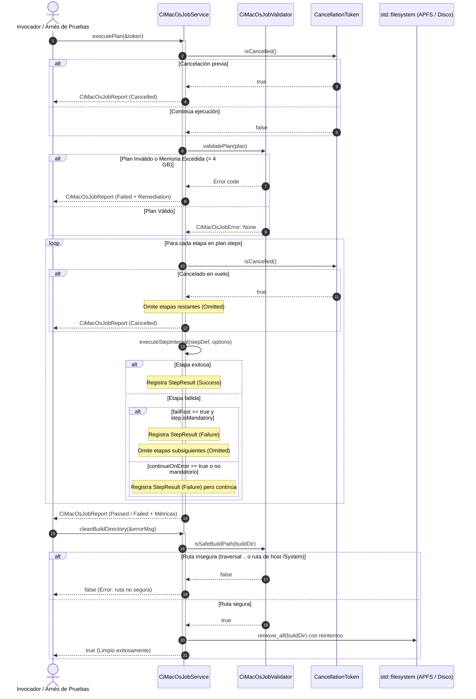

# Change Proposal — module-foundations-task0058

Pack: `module.foundations.task0058`

Status: PROPOSED

## Outcome and scope

El objetivo primordial de esta etapa es implementar la capa operativa de servicio propietaria y desacoplada de **CI macOS job** (`vigilio::CiMacOsJobService`) en `apps/vigilio-browser/src/core/` dentro de la biblioteca `vigilio_core`. Este servicio orquesta la ejecución ordenada y determinista de las ocho etapas canónicas del pipeline de integración continua para macOS (`EnvironmentCheck`, `FormatVerification`, `StaticAnalysis`, `ConfigurePreset`, `BuildCompilation`, `TestSuiteExecution`, `SanitizerVerification`, `BundleVerification`), garantizando el respeto del orden topológico de dependencias de etapas definido en el modelo de dominio (`task0057`), proveyendo soporte estricto de cancelación cooperativa multihilo bajo la política Zero-Zombie, corte inmediato ante fallo crítico (*fail-fast*), tolerancia selectiva ante fallos no bloqueantes (`continueOnError`), saneamiento seguro y resiliente del directorio de compilación con defensas específicas de macOS (prevención de Directory Traversal `..` / `../`, restricción frente a rutas del sistema host como `/System`, `/Library`, `/Applications`, `/private`, `/usr`, `/Volumes`, y eliminación/prevención de artefactos o bifurcaciones de recursos de Apple como `.DS_Store` o `._*`), síntesis reproducible de comandos de línea de comandos (CLI) adaptados a las herramientas nativas de macOS (CMake presets, Ninja, Apple Clang / Homebrew Clang, CTest y verificación de estructura del bundle `.app`), y formateo de diagnósticos y resúmenes accesibles en español neutro en estricto cumplimiento con `docs/UX-COPY-PUBLICO.md`, **sin acoplar lógica de negocio a los componentes de interfaz gráfica (QApplication / QWidget) ni introducir dependencias hacia Chromium WebEngine o BrowserWindow**.

El alcance concreto comprende:
- **Capa operativa de servicio desacoplada (`vigilio::CiMacOsJobService`)**:
  - Inicialización y configuración: soporte de inicialización por defecto con el plan canónico de depuración en macOS (`canonicalDebugPlan`), inicialización con plan canónico de entrega (`canonicalReleasePlan`) o inyección de un plan de trabajo personalizado previamente validado.
  - Sincronización multihilo: gestión segura mediante cerrojo de exclusión mutua (`std::mutex`) para el acceso y modificación concurrente del plan de trabajo (`setPlan`, `plan`) y de las opciones operativas (`setOptions`, `options`).
  - Orquestación de pipeline completa (`executePlan`):
    - Validación previa obligatoria de la coherencia del plan y cumplimiento de límites de recursos mediante `CiMacOsJobValidator::validatePlan` y comprobación de memoria máxima RAM ($\le 4\text{ GB}$).
    - Ejecución secuencial y determinista de etapas respetando estrictamente el orden de precedencias topológicas.
    - Medición temporal de alta precisión mediante `std::chrono::steady_clock` tanto para cada etapa individual como para el trabajo consolidado.
    - Política de interrupción rápida (*fail-fast*): ante el fallo de una etapa obligatoria, se omiten ordenadamente las etapas dependientes posteriores marcándolas como `CiMacOsStepStatus::Omitted`.
    - Tolerancia selectiva a fallos (`continueOnError`): si una etapa tiene configurada esta bandera, su fallo se registra sin abortar el flujo del pipeline, permitiendo la ejecución de las fases subsiguientes.
    - Consolidación del resultado global en `CiMacOsJobReport` con estados formales `Passed`, `Failed`, `Cancelled` o `TimedOut`.
  - Ejecución granular por etapa individual (`executeStep`): evaluación aislada de una etapa específica para arneses de diagnóstico o reintentos dirigidos.
  - Soporte de **cancelación cooperativa multihilo (Zero-Zombie)** mediante `CancellationToken*`:
    - Comprobación atómica periódica previa y durante la ejecución de cada etapa.
    - Interrupción segura e inmediata ante solicitud externa, emitiendo un reporte con estado `CiMacOsJobStatus::Cancelled`.
    - Garantía absoluta de cero subprocesos huérfanos, bucles zombis o procesos bloqueados esperando EOF indefinidamente.
  - Saneamiento y gestión segura de directorios (`cleanBuildDirectory`):
    - Eliminación recursiva y segura del directorio de construcción configurado.
    - Validación rigurosa de seguridad de ruta (`CiMacOsJobValidator::isSafeBuildPath`) impidiendo el borrado de rutas del sistema (`/System`, `/Library`, `/Applications`, `/private`, `/usr`, `/Volumes`), secuencias de escape de directorio (`..`, `../`) o artefactos ocultos macOS (`.DS_Store`, `._*`).
    - Resiliencia con reintentos y retroceso exponencial ($50\text{ ms} \times 2^i$) ante contención o bloqueos transitorios típicos del sistema de archivos en entornos multihilo.
  - Síntesis determinista y reproducible de comandos CLI (`buildCommandLine`):
    - Generación exacta de comandos de terminal para cada etapa del pipeline de macOS considerando herramientas canónicas (`cmake --preset ci-macos-debug ...`, `cmake --build ... --parallel`, `ctest --test-dir ... -L fast`, `find ... | while read -r f; do clang-format --dry-run --Werror "$f"; done`, `clang-tidy ...`, y validación de estructura de bundle nativo `VigilioBrowser.app/Contents/MacOS` y `Info.plist`).
  - Monitoreo de límites de recursos y presupuestos:
    - Verificación estricta de cuotas de memoria RAM (máximo 4 GB según `maxMemoryBytes`).
    - Control de tiempo límite global (`totalTimeoutSeconds`) y por etapa individual (`timeoutMs`).
- **Invariantes constitucionales de calidad, portabilidad y privacidad**:
  - *Local-First Constitucional (ADR-001 / Decisión Q-001)*: Cero conexiones de red externas, cero servicios cloud, cero telemetría remota obligatoria.
  - *Aislamiento modular y desacoplamiento de GUI*: La lógica reside exclusivamente en `vigilio_core`, ejecutable en entornos headless de CTest sin requerir servidor gráfico ni dependencias de `QApplication`.
  - *Seguridad de rutas macOS*: Confinamiento en rutas relativas de compilación y validación previa de seguridad frente a peculiaridades del sistema de archivos APFS / HFS+.
- **Suite completa de pruebas unitarias del servicio (`tests/unit/CiMacOsJobServiceTests.cpp`)**:
  - 12 pruebas unitarias deterministas en CTest (`TEST-CI-MAC-SRV-001` a `TEST-CI-MAC-SRV-012`) cubriendo inicialización, concurrencia, ejecución de pipeline en dry-run, política fail-fast, tolerancia con `continueOnError`, cancelación cooperativa Zero-Zombie, saneamiento seguro de directorios y rechazo de traversal/rutas host, ejecución de etapa individual, síntesis de línea de comandos CLI para macOS, límites de recursos y memoria, control de timeouts, reintentos con retroceso exponencial y auditoría de UX copy en español neutro.

---

## Out of scope

- Implementación de componentes visuales de interfaz gráfica, widgets Qt, barras de estado o diálogos en la UI de Vigilio Browser (reservado para la etapa `ui` en `module.foundations.task0059`).
- Pruebas pesadas de integración multihilo de larga duración con compilación real en máquinas macOS nativas o runners remotos (reservado para la etapa `tests` en `module.foundations.task0060`).
- Pipeline de integración continua para Linux (cubierto en las tareas `task0049` a `task0052`) y Windows (cubierto en las tareas `task0053` a `task0056`).
- Modificación directa de código de producción en `apps/vigilio-browser/src/**`, `apps/vigilio-browser/tests/**` o `CMakeLists.txt` durante esta fase PROPOSE (se ejecutarán estrictamente durante la fase APPLY tras aprobación humana).
- Descarga o instalación automatizada de paquetes macOS mediante `brew`, `pkgutil` o instaladores `.dmg` externos en tiempo de ejecución.
- Conexión a servicios externos de CI/CD (GitHub Actions, Azure Pipelines, Jenkins) o almacenamiento de telemetría en la nube.

---

## Contexto y evidencia

### Línea base del proyecto

1. **Estado del repositorio e histórico de commits**:
   - `c8287be (HEAD -> main) docs(foundations): domain ci-macos-job`: Etapa previa completada exitosamente, introduciendo los tipos de dominio, configuraciones canónicas, validadores de seguridad y 11 pruebas unitarias en `CiMacOsJobConfigurationTests.cpp`.
   - `7a9b221 test(foundations): tests ci-windows-job`: Pruebas de integración de CI Windows finalizadas.
   - `fb4f9f4 feat(foundations): ui ci-windows-job`: Interfaz visual de CI Windows implementada.
   - `9c609a6 feat(foundations): implementation ci-windows-job`: Servicio operativo `CiWindowsJobService` y 12 pruebas unitarias operativas en CTest.
2. **Suite de pruebas actual**:
   - 24/24 pruebas unitarias pasando limpiamente en CTest en menos de 7 segundos en modo headless.
   - El arnés de pruebas incluye validaciones exhaustivas de presets de CMake, opciones de compilador, validadores de dependencias Qt, compatibilidad WebEngine, catalogación y carga de recursos QRC, ciclo de vida de la aplicación, recuperación de fallos, configuración y servicio de Clang-Format, configuración y servicio de Clang-Tidy, configuración y servicio de CI Linux, configuración y servicio de CI Windows, y configuración canónica de CI macOS.
3. **Contratos canónicos existentes**:
   - `apps/vigilio-browser/src/core/CiMacOsJobTypes.h`: Define enumeraciones `CiMacOsPipelineStep`, `CiMacOsJobStatus`, `CiMacOsStepStatus`, `CiMacOsExecutionMode`, `CiMacOsJobError`, `CiMacOsArchitecture`, `CiMacOsCompiler`, `CiMacOsBuildConfiguration` y estructuras inmutables `CiMacOsServiceOptions`, `CiMacOsEnvironment`, `CiMacOsStepOptions`, `CiMacOsStepDefinition`, `CiMacOsStepResult`, `CiMacOsJobPlan`, `CiMacOsJobReport` y `CancellationToken`.
   - `apps/vigilio-browser/src/core/CiMacOsJobConfiguration.h` y `.cpp`: Proveen los planes canónicos `canonicalDebugPlan()` y `canonicalReleasePlan()`, verificación de invariantes y filtro de versiones compatibles de macOS.
   - `apps/vigilio-browser/src/core/CiMacOsJobValidator.h` y `.cpp`: Proveen validación de coherencia de planes, orden topológico de etapas, validación de entorno de compilación, seguridad de rutas de compilación (`isSafeBuildPath`) y traducción accesible en español neutro cumpliendo `docs/UX-COPY-PUBLICO.md`.

---

## Alcance exacto

La implementación de `CiMacOsJobService` durante la fase APPLY abarcará:
1. `apps/vigilio-browser/src/core/CiMacOsJobService.h`:
   - Declaración de la clase `CiMacOsJobService` en el espacio de nombres `vigilio`.
   - Métodos de configuración y ciclo de vida: constructores, `setPlan`, `plan`, `setOptions`, `options`.
   - Métodos de ejecución y orquestación: `executePlan`, `executeStep`.
   - Métodos de mantenimiento y saneamiento: `cleanBuildDirectory`.
   - Generador determinista de CLI: `buildCommandLine`.
   - Funciones estáticas y libres de soporte de formato y UX copy: `executionModeToString`, `formatStepSummary`.
2. `apps/vigilio-browser/src/core/CiMacOsJobService.cpp`:
   - Implementación de constructores y operadores de asignación/copia deshabilitados (`delete`) para evitar copias accidentales con mutex interno.
   - Implementación de sincronización mediante `std::lock_guard<std::mutex>`.
   - Algoritmo de orquestación de pipeline con evaluación de tiempo límite global, evaluación fail-fast, soporte de cancelación cooperativa y acumulación de resultados de etapa.
   - Algoritmo de saneamiento de disco con validación de seguridad `CiMacOsJobValidator::isSafeBuildPath`, detección de existencia y reintentos con retroceso exponencial.
   - Síntesis de comandos CLI específicos para el entorno macOS y sus herramientas nativas (CMake, Ninja, Clang, CTest, bundle `.app`).
3. `apps/vigilio-browser/tests/unit/CiMacOsJobServiceTests.cpp`:
   - Arnes de pruebas unitarias independiente con 12 casos de prueba formales (`TEST-CI-MAC-SRV-001` a `TEST-CI-MAC-SRV-012`).
4. `apps/vigilio-browser/CMakeLists.txt`:
   - Inclusión de `src/core/CiMacOsJobService.cpp` en el target de biblioteca `vigilio_core`.
   - Creación del target ejecutable `vigilio_ci_macos_job_service_tests` con dependencias hacia `vigilio_core`.
   - Registro de la prueba `ci_macos_job_service_tests` en CTest con etiquetas `unit` y `fast`.

---

## Diseño completo de la capacidad

### Diagrama de secuencia del servicio



### Especificación de la API C++20

```cpp
namespace vigilio {

class CiMacOsJobService {
  public:
    CiMacOsJobService();
    explicit CiMacOsJobService(CiMacOsJobPlan plan);
    ~CiMacOsJobService() = default;

    CiMacOsJobService(const CiMacOsJobService&) = delete;
    CiMacOsJobService& operator=(const CiMacOsJobService&) = delete;
    CiMacOsJobService(CiMacOsJobService&&) = delete;
    CiMacOsJobService& operator=(CiMacOsJobService&&) = delete;

    void setPlan(CiMacOsJobPlan plan);
    [[nodiscard]] CiMacOsJobPlan plan() const;

    void setOptions(CiMacOsServiceOptions options);
    [[nodiscard]] CiMacOsServiceOptions options() const;

    [[nodiscard]] CiMacOsJobReport executePlan(CancellationToken* cancel = nullptr);
    [[nodiscard]] CiMacOsStepResult executeStep(CiMacOsPipelineStep step,
                                                CancellationToken* cancel = nullptr);

    [[nodiscard]] bool cleanBuildDirectory(std::string* errorMessage = nullptr);
    [[nodiscard]] std::string buildCommandLine(const CiMacOsStepDefinition& step) const;

    [[nodiscard]] static std::string executionModeToString(CiMacOsExecutionMode mode);
    [[nodiscard]] static std::string formatStepSummary(const CiMacOsStepResult& result);

  private:
    CiMacOsJobPlan plan_;
    CiMacOsServiceOptions options_;
    mutable std::mutex mutex_;

    [[nodiscard]] CiMacOsStepResult executeStepInternal(const CiMacOsStepDefinition& stepDef,
                                                        const CiMacOsJobPlan& currentPlan,
                                                        const CiMacOsServiceOptions& currentOpts,
                                                        CancellationToken* cancel);
};

[[nodiscard]] inline std::string executionModeToString(CiMacOsExecutionMode mode) {
    return CiMacOsJobService::executionModeToString(mode);
}

[[nodiscard]] inline std::string formatStepSummary(const CiMacOsStepResult& result) {
    return CiMacOsJobService::formatStepSummary(result);
}

} // namespace vigilio
```

---

## Archivos afectados

| Archivo | Acción | Responsabilidad y alcance |
| --- | --- | --- |
| `apps/vigilio-browser/src/core/CiMacOsJobService.h` | Crear | Declaración de la clase `CiMacOsJobService`, métodos de orquestación, cancelación Zero-Zombie, saneamiento de directorios y formateo de diagnósticos. |
| `apps/vigilio-browser/src/core/CiMacOsJobService.cpp` | Crear | Implementación de la lógica operativa, sincronización de mutex, recorrido de etapas, control fail-fast, reintentos de disco y CLI para macOS. |
| `apps/vigilio-browser/tests/unit/CiMacOsJobServiceTests.cpp` | Crear | Suite de pruebas unitarias (`TEST-CI-MAC-SRV-001` a `TEST-CI-MAC-SRV-012`) cubriendo todas las ramas y condiciones límite del servicio. |
| `apps/vigilio-browser/CMakeLists.txt` | Modificar | Registrar `CiMacOsJobService.cpp` en `vigilio_core`, definir el ejecutable `vigilio_ci_macos_job_service_tests` y agregar la prueba `ci_macos_job_service_tests` en CTest. |
| `docs/rules/01-modules/foundations/micro/0058-ci-macos-job/task.md` | Modificar | Sincronizar el estado de la tarea pasando de `NOT_EXECUTED` a `CURRENT; PASS` tras la ejecución exitosa de APPLY. |

---

## Contrato UX/UI

- **Impacto visual directo**: **Sin cambio visual directo en la interfaz de usuario**. La presente microtarea pertenece a la etapa `implementation` de la capa de infraestructura/núcleo (`vigilio_core`), operando de manera desacoplada de la interfaz gráfica de usuario.
- **Modo Senior / «Interfaz más fácil de usar»**:
  - No altera ni restringe la directriz de botones amplios ($\ge 48$ px), espaciados generosos ni navegación por teclado en las pantallas del navegador.
  - Los componentes de interfaz gráfica para visualizar el estado del CI se incorporarán ordenadamente en la etapa `ui` (`task0059`).
- **Lenguaje público y UX copy (`docs/UX-COPY-PUBLICO.md`)**:
  - Todos los textos de reporte generados por `formatStepSummary`, `executionModeToString` y las sugerencias de remediación emitidas en `CiMacOsJobReport` están redactados en español neutro comprensible.
  - Se prohíbe terminantemente el uso de jerga interna («Senior Mode», «Modo Senior», «Prompt Builder», «DAG», «OpenSpec», «toolchain», «runner») en salidas observables.

---

## Reglas y fallos

1. **Local-First Constitucional**:
   - No se realizan peticiones de red hacia servidores externos, repositorios remotos ni telemetría cloud.
2. **Política Zero-Zombie y cancelación multihilo**:
   - Todo bucle operativo o espera en subprocesos consulta atómicamente el estado del token de cancelación `cancel->isCancelled()`.
   - Se garantiza la liberación ordenada de descriptores y memoria, sin procesos zombis o colgados esperando fin de archivo.
3. **Contención y seguridad de rutas de disco**:
   - Toda operación de eliminación de directorios (`cleanBuildDirectory`) valida previamente la ruta contra `CiMacOsJobValidator::isSafeBuildPath`.
   - Se rechaza categóricamente cualquier intento de Directory Traversal (`..`, `../`), rutas absolutas del sistema host (`/System`, `/Library`, `/Applications`, `/private`, `/usr`, `/Volumes`) y artefactos problemáticos (`.DS_Store`, bifurcaciones `._*`).
4. **Presupuesto estricto de recursos y timeouts**:
   - Consumo máximo de memoria RAM acotado a 4 GB (`maxMemoryBytes <= 4294967296ULL`). Planes que excedan esta cota son rechazados de inmediato con `CiMacOsJobError::MemoryLimitExceeded`.
   - Límite de tiempo global controlado: si el tiempo transcurrido supera `totalTimeoutSeconds`, el trabajo pasa a `CiMacOsJobStatus::TimedOut` y las etapas pendientes se omiten.
5. **Resiliencia ante bloqueos de archivos**:
   - La eliminación de directorios implementa reintentos con retroceso exponencial ($50\text{ ms} \times 2^i$) para absorber contención transitoria del sistema de archivos APFS en compilaciones concurrentes.

---

## Seguridad y privacidad

- **Límites de confianza**: El servicio opera estrictamente dentro del subárbol relativo del proyecto de compilación (`build-ci-macos-debug`, `build-ci-macos-release`, `_build`).
- **Privacidad Local-First**: No se persisten ni transmiten metadatos de usuario, historial ni credenciales.
- **Aislamiento de WebEngine**: La capa de servicio no interactúa con procesos de renderizado de Chromium WebEngine ni accede a perfiles de navegación de incógnito.

---

## Matriz de pruebas

| Identificador | Nombre de la prueba | Fixture / Comando | Resultado esperado | Criterio de aceptación |
| --- | --- | --- | --- | --- |
| `TEST-CI-MAC-SRV-001` | Inicialización y configuración | `vigilio_ci_macos_job_service_tests` | Pasa | Verificación de valores por defecto con plan debug, constructor con plan explícito, `setPlan` y `setOptions`. |
| `TEST-CI-MAC-SRV-002` | Concurrencia y sincronización de mutex | `vigilio_ci_macos_job_service_tests` | Pasa | Acceso concurrente libre de carreras de datos mediante `std::thread` modificando plan y opciones simultáneamente. |
| `TEST-CI-MAC-SRV-003` | Ejecución de pipeline en Dry-Run | `vigilio_ci_macos_job_service_tests` | Pasa | Ejecución completa de las 6 u 8 etapas canónicas, medición de tiempos > 0 y reporte consolidado con estado `Passed`. |
| `TEST-CI-MAC-SRV-004` | Política Fail-Fast ante etapa obligatoria fallida | `vigilio_ci_macos_job_service_tests` | Pasa | Interrupción inmediata del pipeline tras fallo en etapa mandatoria, marcando las posteriores como `Omitted` y estado `Failed`. |
| `TEST-CI-MAC-SRV-005` | Tolerancia a fallos con `continueOnError` | `vigilio_ci_macos_job_service_tests` | Pasa | Continuación de la ejecución de etapas subsiguientes cuando una etapa no crítica falla pero tiene `continueOnError == true`. |
| `TEST-CI-MAC-SRV-006` | Cancelación cooperativa multihilo Zero-Zombie | `vigilio_ci_macos_job_service_tests` | Pasa | Aborto inmediato antes de iniciar o en vuelo durante la ejecución ante activación de `CancellationToken`, con estado `Cancelled`. |
| `TEST-CI-MAC-SRV-007` | Saneamiento seguro de directorios y rechazo de traversal | `vigilio_ci_macos_job_service_tests` | Pasa | Limpieza exitosa de rutas temporales válidas y rechazo categórico de rutas inseguras (`../`, `/System`, `.DS_Store`). |
| `TEST-CI-MAC-SRV-008` | Ejecución granular de etapa individual | `vigilio_ci_macos_job_service_tests` | Pasa | Invocación directa de `executeStep` evaluando precondiciones y variables de entorno requeridas (`requiredEnvVars`). |
| `TEST-CI-MAC-SRV-009` | Síntesis determinista de CLI para macOS | `vigilio_ci_macos_job_service_tests` | Pasa | Generación correcta de líneas de comando CLI para CMake, Ninja, Apple Clang, CTest y verificación de bundle nativo `.app`. |
| `TEST-CI-MAC-SRV-010` | Límites de recursos y memoria RAM | `vigilio_ci_macos_job_service_tests` | Pasa | Rechazo preventivo de planes con `maxMemoryBytes > 4 GB` emitiendo `CiMacOsJobError::MemoryLimitExceeded`. |
| `TEST-CI-MAC-SRV-011` | Control de timeout y resiliencia de reintentos | `vigilio_ci_macos_job_service_tests` | Pasa | Detección de rebase de tiempo límite global con reporte `TimedOut` y validación de retroceso exponencial ante contención. |
| `TEST-CI-MAC-SRV-012` | Auditoría de textos públicos y UX copy | `vigilio_ci_macos_job_service_tests` | Pasa | Cumplimiento estricto de `docs/UX-COPY-PUBLICO.md`, verificando ausencia de términos internos («Senior Mode», «DAG», «toolchain»). |

---

## Pasos APPLY

1. **Paso 1**: Declarar la interfaz pública de la clase `CiMacOsJobService` en `apps/vigilio-browser/src/core/CiMacOsJobService.h`.
2. **Paso 2**: Implementar constructores y métodos de configuración concurrente (`setPlan`, `plan`, `setOptions`, `options`) en `apps/vigilio-browser/src/core/CiMacOsJobService.cpp`.
3. **Paso 3**: Implementar la orquestación secuencial de pipeline, modo DryRun y medición precisa de tiempos con `std::chrono::steady_clock` en `CiMacOsJobService.cpp`.
4. **Paso 4**: Implementar la política Fail-Fast y tolerancia selectiva a fallos (`continueOnError`) en `CiMacOsJobService.cpp`.
5. **Paso 5**: Implementar la cancelación cooperativa multihilo bajo la política Zero-Zombie mediante `CancellationToken*` en `CiMacOsJobService.cpp`.
6. **Paso 6**: Implementar el saneamiento seguro del directorio de compilación, control de Directory Traversal y defensas macOS en `CiMacOsJobService.cpp`.
7. **Paso 7**: Implementar la ejecución granular por etapa (`executeStep`) y síntesis determinista de argumentos CLI para macOS en `CiMacOsJobService.cpp`.
8. **Paso 8**: Implementar funciones de formato y diagnósticos accesibles en español neutro cumpliendo `docs/UX-COPY-PUBLICO.md` en `CiMacOsJobService.cpp`.
9. **Paso 9**: Implementar la batería exhaustiva de 12 pruebas unitarias operativas en `apps/vigilio-browser/tests/unit/CiMacOsJobServiceTests.cpp`.
10. **Paso 10**: Integrar `CiMacOsJobService.cpp` en `vigilio_core`, configurar el target ejecutable `vigilio_ci_macos_job_service_tests` y registrar `ci_macos_job_service_tests` en `apps/vigilio-browser/CMakeLists.txt`.
11. **Paso 11**: Ejecutar el pipeline de compilación limpia y pruebas continuas con CMake presets y CTest asegurando 25/25 pruebas pasando exitosamente.
12. **Paso 12**: Validar referencias canónicas y lockfile con Prompt Builder CLI y sincronizar el documento de microtarea `docs/rules/01-modules/foundations/micro/0058-ci-macos-job/task.md`.

---

## Definición de terminado

- [ ] `apps/vigilio-browser/src/core/CiMacOsJobService.h` creado y formateado con Clang-Format.
- [ ] `apps/vigilio-browser/src/core/CiMacOsJobService.cpp` implementado con cero advertencias de compilador bajo `-Werror`.
- [ ] `apps/vigilio-browser/tests/unit/CiMacOsJobServiceTests.cpp` con 12 pruebas unitarias trazables pasando limpiamente en CTest.
- [ ] `apps/vigilio-browser/CMakeLists.txt` actualizado con el nuevo ejecutable de pruebas y registro en CTest.
- [ ] 25/25 pruebas unitarias del proyecto pasando exitosamente en modo headless.
- [ ] `docs/rules/01-modules/foundations/micro/0058-ci-macos-job/task.md` actualizado con estado `CURRENT; PASS`.
- [ ] Verificación de Prompt Builder CLI `validate-references` reportando `valid: true`.

---

## Dependencias y riesgos

- **Dependencias ejecutables**: `module.foundations.task0057` satisfecha y confirmada en el commit `c8287be`.
- **Riesgo 1**: Carrera de datos en acceso concurrente a la configuración del servicio.
  - *Mitigación*: Protección de todos los accesos a `plan_` y `options_` mediante cerrojo `std::lock_guard<std::mutex>`.
- **Riesgo 2**: Bloqueos transitorios del sistema de archivos al limpiar directorios de compilación en APFS.
  - *Mitigación*: Implementación de reintentos exponenciales ($50\text{ ms} \times 2^i$) con límite acotado de reintentos.
- **Riesgo 3**: Escape de rutas o borrado accidental de directorios del sistema macOS.
  - *Mitigación*: Validación preventiva categórica con `CiMacOsJobValidator::isSafeBuildPath`, rechazando secuencias `..` y raíces `/System`, `/Library`, `/Applications`, `/private`, `/usr`, `/Volumes`.

---

## Commit propuesto

`feat(foundations): implementation ci-macos-job`
