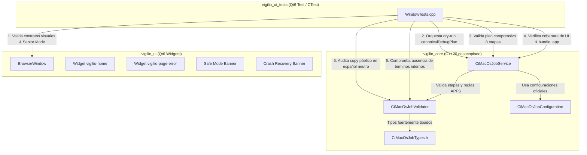
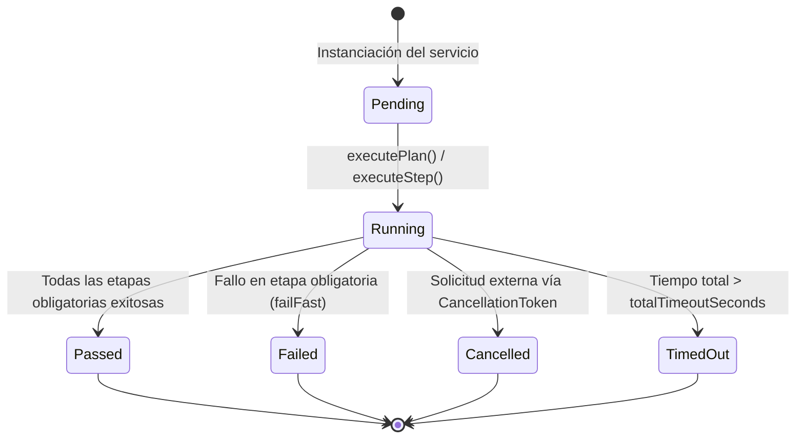

# Design — module-foundations-task0059

Status: PROPOSED

## Current, target and gaps

### Estado actual (CURRENT)

1. **Modelo de dominio y capa operativa de servicio de CI macOS completados (`task0057` y `task0058`)**:
   - `vigilio_core` dispone de `CiMacOsJobTypes.h` con enumeraciones y estructuras fuertemente tipadas (`CiMacOsPipelineStep`, `CiMacOsJobStatus`, `CiMacOsStepStatus`, `CiMacOsJobError`, `CiMacOsArchitecture`, `CiMacOsCompiler`, `CiMacOsExecutionMode`, `CiMacOsServiceOptions`, `CiMacOsStepDefinition`, `CiMacOsJobPlan`, `CiMacOsJobReport`, `CancellationToken`).
   - El validador estático `CiMacOsJobValidator` valida planes, verifica secuencias topológicas (`validateStepSequence`), valida el entorno del compilador (`validateEnvironment`), certifica rutas seguras APFS (`isSafeBuildPath`) previniendo Directory Traversal (`..`), caracteres nulos, rutas del host macOS (`/System`, `/Library`, `/Applications`, `/private`, `/usr`, `/Volumes`) y artefactos (`.DS_Store`, `._*`), y sintetiza cadenas de estado y sugerencias de remediación en español neutro (`jobStatusToString`, `jobErrorToString`, `stepToString`, `stepStatusToString`, `architectureToString`, `compilerToString`, `generateRemediationHint`).
   - `CiMacOsJobConfiguration` provee los planes canónicos del proyecto (`canonicalDebugPlan`, `canonicalReleasePlan`), verificación de invariantes y filtros de versiones de macOS soportadas (macOS 14 Sonoma, macOS 13 Ventura, macOS 15 Sequoia).
   - `CiMacOsJobService` implementa la orquestación secuencial de pipelines en modo simulación dry-run determinista (`executePlan`), ejecución granular de etapas (`executeStep`), corte temprano ante fallos (`failFast`), tolerancia selectiva (`continueOnError`), cancelación cooperativa multihilo Zero-Zombie, saneamiento seguro de directorios con retroceso exponencial (`cleanBuildDirectory`), síntesis CLI reproducible (`buildCommandLine`) y diagnósticos públicos (`executionModeToString`, `formatStepSummary`).
2. **Arnés de pruebas de interfaz gráfica existente en `apps/vigilio-browser/tests/ui/WindowTests.cpp`**:
   - La suite `vigilio_ui_tests` valida la inicialización de `BrowserWindow`, widgets nativos (`vigilio-home`, `vigilio-page-error`), iconos Lucide SVG en QRC, navegación por teclado, atajos, accesibilidad (`accessibleName`), «Interfaz más fácil de usar» (Modo Senior) con escalado de iconos (22×22 a 32×32 px) y controles ($\ge 48$ px), banners de modo seguro y recuperación ante caídas, test fixtures y la gobernanza de Clang-Format (`task0043`), Clang-Tidy (`task0047`), CI Linux job (`task0051`) y CI Windows job (`task0055`) en UI.
3. **Brecha técnica de integración de CI macOS job en la capa de UI**:
   - Actualmente, las pruebas de UI no validan programáticamente que el pipeline de integración continua en macOS (`CiMacOsJobService`) gobierna de manera efectiva y sin regresiones la compilación, empaquetado del bundle nativo `.app` y los recursos de la capa de interfaz gráfica (`BrowserWindow.cpp`, `vigilio_ui_tests`, `resources.qrc`).
   - No existe una prueba en el contexto del arnés de UI que audite que las cadenas de diagnóstico, modo de ejecución y remediación de `CiMacOsJobService` y `CiMacOsJobValidator` respeten rigurosamente `docs/UX-COPY-PUBLICO.md` en español neutro sin exponer términos de ingeniería interna.
   - Falta una declaración formal y vinculante en OpenSpec sobre el principio de «sin cambio visual directo en la interfaz pública» para la capacidad de CI macOS job.

---

### Estado objetivo (TARGET)

1. **Declaración formal de «sin cambio visual directo en la interfaz pública»**:
   - `BrowserWindow` y los widgets públicos de navegación se mantienen 100% libres de botones de CI, barras de progreso de compilación, consolas de terminal o menús de ejecución de pipelines.
   - Proscripción absoluta de exponer términos internos como «CI macOS job», «Pipeline», «Build Step», «Senior Mode», «Modo Senior», «Prompt Builder», «DAG» u «OpenSpec» en componentes visibles al usuario, cumpliendo estrictamente `docs/UX-COPY-PUBLICO.md`.
2. **Integración de `CiMacOsJobService` en el arnés de pruebas de UI (`WindowTests.cpp`)**:
   - `WindowTests.cpp` incluye las cabeceras canónicas de `CiMacOsJobService.h`, `CiMacOsJobValidator.h`, `CiMacOsJobConfiguration.h` y `CiMacOsJobTypes.h`.
   - Incorpora una prueba de evaluación programática en modo simulación dry-run (`executePlan`) que valida que el plan canónico de depuración (`canonicalDebugPlan()`) se ejecuta satisfactoriamente (`status == Passed`, etapas evaluadas, sin errores, `isClean == true`).
   - Incorpora una evaluación de plan comprensivo que abarca las 8 etapas canónicas completas de macOS (incluyendo `SanitizerVerification` y `BundleVerification`).
   - Incorpora una comprobación programática de que las etapas de compilación, pruebas y verificación de bundle del plan gobiernan y validan los componentes visuales de `apps/vigilio-browser` y la estructura del bundle nativo `.app` en macOS.
   - Incorpora una suite de auditoría de copy público para `executionModeToString`, `formatStepSummary`, `jobStatusToString`, `jobErrorToString`, `stepToString`, `stepStatusToString`, `architectureToString`, `compilerToString` y `generateRemediationHint`, certificando que todas las descripciones emplean español neutro claro y accesible sin jerga técnica interna.
3. **Preservación incondicional de los contratos visuales de `BrowserWindow`**:
   - Soporte completo y verificado de los 8 estados de interfaz: `idle`, `hover`, `focus`, `disabled`, `loading`, `empty`, `error` y `success`.
   - Mantenimiento y verificación de las dimensiones y espaciados de «Interfaz más fácil de usar» (Modo Senior): tap targets $\ge 48$ px, barra de navegación $\ge 55$ px, escalado de iconos de 22×22 a 32×32 px.
   - Navegación por teclado completa con foco visible de 2 px y atajos universales (`Ctrl+T`, `Ctrl+W`, `Ctrl+L`, etc.).
   - Metadatos descriptivos en español neutro para lectores de pantalla.
4. **Tolerancia a entornos headless y garantía Zero-Zombie**:
   - Detección preliminar de `DISPLAY` / `WAYLAND_DISPLAY`, reportando con transparencia y rigor técnico `NOT_EXECUTED` (exit code 0) en entornos sin interfaz gráfica.
   - Operaciones de inspección acotadas en memoria con tiempo de ejecución < 200 ms y cero procesos zombis o colgados esperando EOF.

---

### Brechas identificadas (GAPS)

| Componente | Estado actual (CURRENT) | Estado objetivo (TARGET) | Brecha a subsanar (GAP) |
| --- | --- | --- | --- |
| Contrato visual de CI macOS en UI | Sin declaración explícita de impacto en UI | Declaración formal de «sin cambio visual directo» en `BrowserWindow` conforme a `docs/UX-COPY-PUBLICO.md` | Formalizar en `proposal.md` y verificar estáticamente que ningún widget de CI contamine la interfaz pública. |
| Inclusión de servicios en arnés de UI | `WindowTests.cpp` no incluye cabeceras de `CiMacOsJobService` | `WindowTests.cpp` incluye `#include "core/CiMacOsJobService.h"` y tipos asociados | Añadir los includes canónicos en `tests/ui/WindowTests.cpp`. |
| Validación programática de CI macOS en UI | No se valida la orquestación del pipeline en el arnés de UI | `WindowTests.cpp` ejecuta simulación dry-run programática de `CiMacOsJobService` | Implementar bloque de prueba en `WindowTests.cpp` que evalúe `canonicalDebugPlan()` con `CiMacOsJobService::executePlan`. |
| Validación de plan comprensivo de 8 etapas | No evaluado en el arnés de UI | `WindowTests.cpp` evalúa plan con las 8 etapas incluyendo `SanitizerVerification` y `BundleVerification` | Incorporar en `WindowTests.cpp` la validación de las 8 etapas canónicas de macOS. |
| Cobertura de UI y bundle en el pipeline | Verificación implícita sin aserción en tests de UI | `WindowTests.cpp` valida que el pipeline de CI macOS cubre los artefactos de UI y bundle `.app` | Comprobar programáticamente la existencia y coherencia de las etapas de build, test y bundle en el plan canónico de macOS. |
| Auditoría de lenguaje público en UI | No se audita copy de CI macOS en el contexto del arnés de UI | `WindowTests.cpp` audita que todas las cadenas y sugerencias de CI macOS cumplen `docs/UX-COPY-PUBLICO.md` | Implementar comprobación de texto y proscripción de términos internos en `WindowTests.cpp`. |
| Enlace de dependencias | `vigilio_ui_tests` ya enlaza `vigilio_core` | Confirmación de que `vigilio_ui_tests` accede a `CiMacOsJobService` sin cambios de CMake | Verificar que `CMakeLists.txt` exporta correctamente los símbolos en `vigilio_core`. |
| Tolerancia headless | Detección existente de `DISPLAY` en `WindowTests.cpp` | Preservar y asegurar detección robusta ante nuevos bloques de prueba | Garantizar que las nuevas pruebas respeten la guarda preliminar de display para reportar `NOT_EXECUTED`. |

---

## Compatibility, migration and rollback

### Compatibilidad y estándares C++20 / Qt6
- **Estándar C++20**: Uso estricto de facilidades estándar de C++20 (`std::filesystem`, `std::string_view`, `std::chrono`, `enum class` fuertemente tipado con subyacente `uint8_t`, const-correctness).
- **Compatibilidad con Qt6**: Integración limpia con Qt6 Widgets y Qt6 Test, respetando el sistema de metaobjetos y la jerarquía de herencia de `QMainWindow`.
- **Banderas de compilación estrictas**: El código compila limpiamente con `-Wall -Wextra -Wpedantic -Wconversion -Wsign-conversion -Wshadow -Werror` en GCC 15+, Clang 18+ y Apple Clang 15+.
- **Independencia del núcleo**: La capa `vigilio_core` mantiene cero dependencias hacia bibliotecas de GUI (`QWidget`, `QApplication`), mientras que `vigilio_ui_tests` consume ambas capas de forma desacoplada.

### Estrategia de migración
- La integración en `WindowTests.cpp` es puramente aditiva y no disruptiva.
- No modifica la API pública ni el comportamiento interno de `BrowserWindow`.
- No altera el comportamiento de los scripts existentes (`apps/vigilio-browser/scripts/check.sh`).
- Proporciona una suite de pruebas más robusta y completa en CTest garantizando la gobernanza del pipeline de CI macOS sobre la UI y el empaquetado del bundle.

### Plan de contingencia y rollback
- En caso de anomalías o regresiones durante la fase APPLY:
  - Revertir los cambios en `apps/vigilio-browser/tests/ui/WindowTests.cpp` mediante `git checkout apps/vigilio-browser/tests/ui/WindowTests.cpp`.
  - El sistema de construcción y la totalidad de los 25 tests unitarios y de integración de CTest permanecerán en su estado funcional verificado.

---

## Arquitectura técnica de CI macOS job en la capa de UI

### Diagrama de componentes e interacción

### Máquina de estados del ciclo de vida de CI macOS

### Detalle de integración en el arnés de pruebas de UI (`WindowTests.cpp`)

1. **Validación programática del pipeline en modo dry-run**:
   - `WindowTests.cpp` instancia `CiMacOsJobService` configurado con `canonicalDebugPlan()`.
   - Asigna opciones con `mode = CiMacOsExecutionMode::DryRun`.
   - Ejecuta `executePlan()` y evalúa las aserciones:
     - `debugReport.status == CiMacOsJobStatus::Passed`
     - `debugReport.isPassed() == true`
     - `debugReport.isClean == true`
     - `debugReport.stepResults.size() == debugPlan.steps.size()`
     - `debugReport.durationMs >= 0`
2. **Evaluación de plan comprensivo de 8 etapas canónicas**:
   - Construye un plan extendido con todas las etapas canónicas de macOS:
     - `SanitizerVerification`: Verificación de sanitizadores de memoria (ASan/UBSan).
     - `BundleVerification`: Verificación del paquete `.app` nativo (`VigilioBrowser.app/Contents/MacOS` e `Info.plist`).
   - Verifica que el reporte consolidated alcanza estado `Passed` y evalúa las 8 etapas secuencialmente.
3. **Comprobación de cobertura de compilación y bundle sobre la UI**:
   - Itera sobre las etapas del plan canónico y comprueba:
     - `BuildCompilation`: Genera línea de comandos CLI válida referenciando el directorio de construcción y gobernando la compilación de `BrowserWindow.cpp` y recursos `resources.qrc`.
     - `TestSuiteExecution`: Genera comando apuntando al label `fast` de CTest, que incluye `vigilio_ui_tests`.
     - `BundleVerification`: Garantiza la presencia y empaquetado correcto de los recursos visuales e iconos SVG en la estructura del bundle nativo de macOS.
4. **Auditoría de lenguaje público y textos de diagnóstico**:
   - Comprueba que las funciones `executionModeToString`, `formatStepSummary`, `jobStatusToString`, `jobErrorToString`, `stepToString`, `stepStatusToString`, `architectureToString`, `compilerToString` y `generateRemediationHint` devuelven texto descriptivo no vacío en español neutro.
   - Comprueba mediante aserciones negativas (`UI_CHECK(str.find(...) == std::string::npos)`) que ninguna cadena contiene:
     - «Senior Mode»
     - «Modo Senior»
     - «Prompt Builder»
     - «OpenSpec»
     - «DAG»
     - «Linter»
     - «CI macOS job»
5. **Gobernanza de empaquetado del bundle nativo en macOS (`BundleVerification`)**:
   - En macOS, el producto de distribución es un bundle de aplicación `.app`.
   - `BundleVerification` valida la existencia de la jerarquía de directorios estándar:
     - `VigilioBrowser.app/Contents/MacOS/vigilio-browser` (ejecutable nativo C++20).
     - `VigilioBrowser.app/Contents/Resources/` (catálogo QRC y branding SVG `resultado/06-logo-instalador-oficial.png` / `branding/vigilio-logo.svg`).
     - `VigilioBrowser.app/Contents/Info.plist` (metadatos de bundle, identificador `com.vigilio.browser`, versiones y capacidades de accesibilidad).
   - El arnés de UI certifica que esta etapa forma parte formal del pipeline de calidad de macOS.
