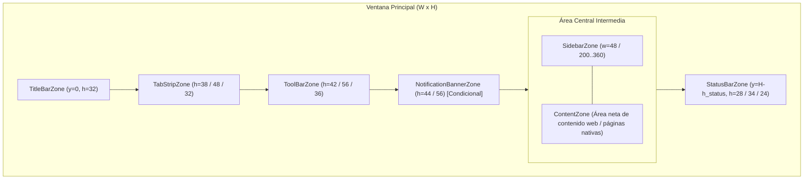
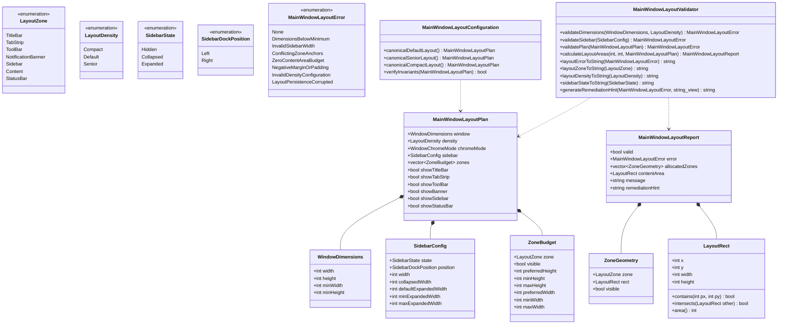

# Design — module-ux-shell-task0060

Status: PROPOSED

## Current, target and gaps

### Estado actual (CURRENT)

1. **Estado del árbol de código y modularización**:
   - Se completó formalmente el módulo `foundations` a lo largo de las microtareas `0001` a `0059`, dejando `apps/vigilio-browser` con 25 pruebas en CTest pasando al 100% y un sistema de construcción CMake modularizado en `vigilio_core`, `vigilio_storage`, `vigilio_compiler_warnings` y `vigilio_ui_tests`.
   - La ventana principal de la aplicación (`src/ui/BrowserWindow.h` y `src/ui/BrowserWindow.cpp`) fue estructurada inicialmente durante las fases de prototipo y bootstrap para soportar pestañas diferidas (lazy loading), barra de navegación, atajos de teclado y banners condicionales de modo seguro y recuperación ante caídas.
2. **Limitaciones estructurales del layout actual**:
   - `BrowserWindow::setupUi()` construye la jerarquía de interfaz de forma estática y monolítica:
     - Crea un widget central con un `QVBoxLayout` directo (`centralLayout->addWidget(tabs_)`), donde la barra de pestañas (`QTabWidget`) absorbe todo el espacio vertical.
     - La barra de navegación se añade mediante `addToolBar("Navegación")`, delegando a los mecanismos predeterminados de `QMainWindow` el empaquetado de barras.
     - No existe una representación abstracta ni declarativa de las zonas de la ventana (`TitleBar`, `TabStrip`, `ToolBar`, `Banner`, `Sidebar`, `Content`, `StatusBar`).
     - No se calculan de manera analítica las coordenadas ni los presupuestos dimensionales de las barras antes de su inserción.
     - No existe una abstracción desacoplada para la barra lateral (`Sidebar`), elemento clave del diseño objetivo del producto.
     - El redimensionamiento y los mínimos de ventana ($1200\times 780$ px inicial, sin mínimos explícitos en el modelo de dominio) no están gobernados por reglas formales de suficiencia para el contenido web.
     - El cambio a «Interfaz más fácil de usar» (Modo Senior) modifica de manera dispersa el tamaño de los iconos (`QSize(22, 22)` vs `QSize(32, 32)`) y ciertas alturas mínimas, sin recalcular un presupuesto global de pantalla.
3. **Ausencia de tipos y validación de dominio**:
   - No existen tipos C++20 fuertemente tipados que modelen las densidades visuales (`LayoutDensity`), los estados de la barra lateral (`SidebarState`), el modo de decoración de ventana (`WindowChromeMode`) ni los posibles fallos geométricos (`MainWindowLayoutError`).
   - No existe un validador que certifique que una combinación arbitraria de visibilidad de barras no reduzca a cero el espacio disponible para la navegación web (`ZeroContentAreaBudget`).

---

### Estado objetivo (TARGET)

1. **Modelo de dominio de layout fuertemente tipado en `vigilio_core` (`MainWindowLayoutTypes.h`)**:
   - Enumeraciones tipadas `enum class : uint8_t`:
     - `LayoutZone`: `TitleBar`, `TabStrip`, `ToolBar`, `NotificationBanner`, `Sidebar`, `Content`, `StatusBar`.
     - `LayoutDensity`: `Compact`, `Default`, `Senior`.
     - `SidebarState`: `Hidden`, `Collapsed`, `Expanded`.
     - `SidebarDockPosition`: `Left`, `Right`.
     - `WindowChromeMode`: `Standard`, `Integrated`, `Fullscreen`.
     - `MainWindowLayoutError`: `None`, `DimensionsBelowMinimum`, `InvalidSidebarWidth`, `ConflictingZoneAnchors`, `ZeroContentAreaBudget`, `NegativeMarginOrPadding`, `InvalidDensityConfiguration`, `LayoutPersistenceCorrupted`.
   - Estructuras inmutables con semántica de valor:
     - `WindowDimensions`: Representa el tamaño de la ventana y sus límites mínimos de contención.
     - `LayoutMargins` y `LayoutRect`: Geometría cartesiana con métodos de contención, intersección y área neta.
     - `ZoneBudget`: Alturas y anchuras preferidas, mínimas y máximas por zona.
     - `SidebarConfig`: Estado, acople (izquierda/derecha), ancho actual y rango permitido de expansión ($200..360$ px).
     - `MainWindowLayoutPlan`: Plan declarativo que consolida el estado global de la disposición espacial.
     - `ZoneGeometry`: Asignación geométrica resultante por zona ($x, y, w, h$).
     - `MainWindowLayoutReport`: Reporte inmutable con resultado booleano, error tipado, rectángulos calculados, área neta de contenido y sugerencia de remediación en español neutro.
2. **Configuración canónica e invariantes geométricas (`MainWindowLayoutConfiguration`)**:
   - Constantes canónicas que codifican los estándares visuales de Vigilio Browser:
     - Dimensiones por defecto: $1200\times 780$ px.
     - Mínimos estándar: $640\times 480$ px.
     - Mínimos Senior («Interfaz más fácil de usar»): $720\times 520$ px.
     - Mínimos Compact: $500\times 380$ px.
     - Ancho barra lateral colapsada: 48 px (espacio optimizado para iconos Lucide SVG).
     - Ancho barra lateral expandida: rango $200..360$ px (valor canónico: 240 px).
     - Altura barra de herramientas: 42 px estándar / 56 px Senior (garantizando tap targets $\ge 48$ px).
     - Altura tira de pestañas: 38 px estándar / 48 px Senior.
     - Altura barra de estado: 28 px estándar / 34 px Senior.
     - Presupuesto mínimo de área central: $400\times 250$ px.
   - Factorías canónicas: `canonicalDefaultLayout()`, `canonicalSeniorLayout()`, `canonicalCompactLayout()`.
   - Método `verifyInvariants(const MainWindowLayoutPlan&)` que certifica el cumplimiento de todas las reglas del sistema.
3. **Validador estático desacoplado y algoritmo espacial puro (`MainWindowLayoutValidator`)**:
   - `validateDimensions()`: Comprobación estricta de umbrales dimensionales.
   - `validateSidebar()`: Comprobación de límites y anchos de la barra lateral.
   - `validatePlan()`: Validación integral de coherencia del plan.
   - `calculateLayoutAreas()`: Algoritmo determinista que descompone la ventana en rectángulos disjuntos, asigna las barras visibles y determina el área neta para el contenido web, certificando ausencia de solapamientos ($\forall i \ne j, Z_i \cap Z_j = \emptyset$).
   - Funciones puras de UX copy público en español neutro cumpliendo `docs/UX-COPY-PUBLICO.md`.
4. **Batería de pruebas unitarias trazables en CTest (`MainWindowLayoutTests.cpp`)**:
   - 12 pruebas unitarias de especificación ejecutables en < 50 ms en modo headless, sin dependencias gráficas.

---

### Brechas identificadas (GAPS)

| Componente | Estado actual (CURRENT) | Estado objetivo (TARGET) | Brecha a subsanar (GAP) |
| --- | --- | --- | --- |
| **Modelo de datos de layout** | Inexistente; layout implícito en `BrowserWindow.cpp` | `MainWindowLayoutTypes.h` en `vigilio_core` con tipos inmutables | Crear cabecera formal con tipos, enums y estructuras de valor. |
| **Configuración canónica** | Alturas y anchos dispersos en código de widgets | `MainWindowLayoutConfiguration` con planes canónicos e invariantes | Centralizar constantes y proveer factorías para Standard, Senior y Compact. |
| **Validador y cálculo espacial** | No existe cálculo analítico; asignación ciega de widgets | `MainWindowLayoutValidator::calculateLayoutAreas` determinista | Implementar cálculo analítico que garantice disyunción de áreas y área de contenido neta. |
| **Reglas de Modo Senior** | Ajustes visuales manuales en `BrowserWindow::setSeniorMode` | Invariantes formales en el modelo de dominio ($\ge 48$ px tap targets, toolbar $\ge 56$ px, ventana $\ge 720\times 520$ px) | Codificar y validar programáticamente las reglas de «Interfaz más fácil de usar». |
| **Barra lateral (Sidebar)** | No soportada en el layout actual | Zona formal `SidebarZone` con estados Hidden, Collapsed (48 px) y Expanded (200..360 px) | Modelar parámetros, acople lateral y espacio reservado en el dominio. |
| **Copy público y textos** | Cadenas dispersas | Funciones puras con copy en español neutro cumpliendo `docs/UX-COPY-PUBLICO.md` | Implementar `layoutErrorToString`, `layoutZoneToString`, etc. |
| **Pruebas de especificación** | 0 pruebas unitarias para layout de ventana en CTest | 12 pruebas unitarias en `MainWindowLayoutTests.cpp` | Crear suite de pruebas exhaustiva para verificar invariantes y cálculos de área. |

---

## Compatibility, migration and rollback

### Compatibilidad y estándares C++20 / Qt6
- **Estándar C++20**:
  - Utilización exclusiva de características estándar de C++20: `<cstdint>`, `<string>`, `<string_view>`, `<vector>`, `<algorithm>`, semántica de valor inmutable y enumeraciones fuertemente tipadas (`enum class LayoutZone : uint8_t`).
  - Cero dependencias hacia bibliotecas gráficas de Qt (`QWidget`, `QApplication`, `QMainWindow`) en los archivos de dominio (`MainWindowLayoutTypes.h`, `MainWindowLayoutConfiguration`, `MainWindowLayoutValidator`), permitiendo su ejecución transparente en cualquier entorno de pruebas o herramientas CLI.
- **Banderas de compilación estrictas**:
  - El código compila limpiamente bajo GCC 15+, Clang 18+ y Apple Clang con `-Wall -Wextra -Wpedantic -Wconversion -Wsign-conversion -Wshadow -Werror`.
- **Integrabilidad futura con Qt6 Widgets (`task0062`)**:
  - Las estructuras de rectángulos (`LayoutRect`) proveen conversiones triviales hacia primitivas de Qt (`QRect(rect.x, rect.y, rect.width, rect.height)`) cuando la capa de UI requiera sincronizar la geometría de los widgets.

### Estrategia de migración
- La introducción de las abstracciones de dominio en `vigilio_core` es 100% aditiva y no disruptiva.
- No altera la API pública existente de `BrowserWindow` ni degrada la funcionalidad actual de la aplicación.
- En las microtareas subsiguientes (`task0061` y `task0062`), `BrowserWindow` adoptará `MainWindowLayoutService` para gobernar su jerarquía de widgets basándose en los cálculos del validador de dominio.

### Plan de contingencia y rollback
- Dado que este pack en la etapa `domain` únicamente añade archivos de especificación, configuración, validación y pruebas unitarias sin modificar la lógica interna de `BrowserWindow`, cualquier anomalía detectada puede revertirse de forma atómica:
  - Eliminar los archivos creados (`MainWindowLayout*`) y revertir `apps/vigilio-browser/CMakeLists.txt` mediante `git checkout apps/vigilio-browser/CMakeLists.txt`.
  - El sistema de construcción y las 25 pruebas preexistentes de CTest permanecerán en su estado verificado original.

---

## Arquitectura técnica y modelo de dominio de main window layout

### Diagrama de topología y distribución de zonas

### Relaciones entre entidades del dominio

---

## Formulación analítica y algoritmos de asignación

### 1. Cálculo de alturas de barras superiores ($y_{\text{top}}$)
El offset vertical superior acumulado $y_{\text{top}}$ se obtiene como la suma de las alturas de todas las zonas superiores visibles:
$$y_{\text{top}} = (h_{\text{title}} \cdot \mathbb{I}_{\text{title}}) + (h_{\text{tab}} \cdot \mathbb{I}_{\text{tab}}) + (h_{\text{tool}} \cdot \mathbb{I}_{\text{tool}}) + (h_{\text{banner}} \cdot \mathbb{I}_{\text{banner}})$$
donde $\mathbb{I}_z \in \{0, 1\}$ indica la visibilidad de la zona $z$.

### 2. Cálculo de altura de barra inferior y espacio vertical útil
La coordenada vertical de la barra de estado es:
$$y_{\text{status}} = H - (h_{\text{status}} \cdot \mathbb{I}_{\text{status}})$$
La altura neta disponible para la sección central es:
$$H_{\text{center}} = y_{\text{status}} - y_{\text{top}}$$
Si $H_{\text{center}} < kMinContentHeight$ ($250$ px), el cálculo aborta emitiendo `MainWindowLayoutError::ZeroContentAreaBudget`.

### 3. Asignación horizontal de la barra lateral y área de contenido
El ancho efectivo de la barra lateral es:
$$W_{\text{side}} = \begin{cases}
0 & \text{si } \neg \mathbb{I}_{\text{sidebar}} \lor \text{state} = \text{Hidden} \\
48 & \text{si } \mathbb{I}_{\text{sidebar}} \land \text{state} = \text{Collapsed} \\
w \in [200, 360] & \text{si } \mathbb{I}_{\text{sidebar}} \land \text{state} = \text{Expanded}
\end{cases}$$

El ancho neto disponible para el contenido web es:
$$W_{\text{content}} = W - W_{\text{side}}$$
Si $W_{\text{content}} < kMinContentWidth$ ($400$ px), el cálculo aborta emitiendo `MainWindowLayoutError::ZeroContentAreaBudget`.

Las coordenadas según el acople lateral son:
- **Acople izquierdo (`SidebarDockPosition::Left`)**:
  - $\text{Rect}_{\text{sidebar}} = [0, y_{\text{top}}, W_{\text{side}}, H_{\text{center}}]$
  - $\text{Rect}_{\text{content}} = [W_{\text{side}}, y_{\text{top}}, W_{\text{content}}, H_{\text{center}}]$
- **Acople derecho (`SidebarDockPosition::Right`)**:
  - $\text{Rect}_{\text{content}} = [0, y_{\text{top}}, W_{\text{content}}, H_{\text{center}}]$
  - $\text{Rect}_{\text{sidebar}} = [W_{\text{content}}, y_{\text{top}}, W_{\text{side}}, H_{\text{center}}]$

### 4. Demostración formal de no solapamiento
Para dos zonas rectangulares $A = [x_A, y_A, w_A, h_A]$ y $B = [x_B, y_B, w_B, h_B]$, la condición de no solapamiento se define como:
$$A \cap B = \emptyset \iff (x_A + w_A \le x_B) \lor (x_B + w_B \le x_A) \lor (y_A + h_A \le y_B) \lor (y_B + h_B \le y_A)$$
En la formulación propuesta:
- Las zonas superiores se apilan estrictamente de forma vertical con $y_{i+1} = y_i + h_i$, satisfaciendo $y_A + h_A \le y_B$.
- La sección central queda delimitada entre $y_{\text{top}}$ y $y_{\text{status}}$, sin intersección con las barras superior ni inferior.
- Dentro de la sección central, la barra lateral y el área de contenido se particionan horizontalmente con $x_{\text{content}} = x_{\text{sidebar}} + w_{\text{sidebar}}$ (o viceversa), garantizando $x_A + w_A \le x_B$.
- La barra de estado se sitúa a partir de $y_{\text{status}}$, sin intersección con la sección central.
Por consiguiente, el diseño garantiza matemáticamente la ausencia de solapamientos para cualquier combinación de zonas visibles.
