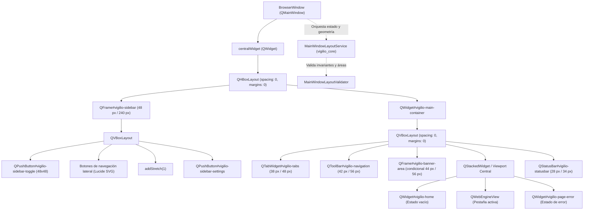

# Change Proposal — module-ux-shell-task0062

Pack: `module.ux-shell.task0062`

Status: PROPOSED

## Outcome and scope

Este cambio define la propuesta técnica integral para la etapa **ui** de la capacidad **main window layout** en el módulo propietario `ux-shell` de Vigilio Browser (microtarea canónica `0062 — Implementar la interacción y estados visuales en Qt: main window layout`).

Habiéndose completado y certificado formalmente en las microtareas previas la definición del modelo de dominio de layout (`module.ux-shell.task0060`, commit `4cb5d8f`) y la capa de servicio operativo desacoplada en C++20 puro (`module.ux-shell.task0061`, commit `c4d75c0`), este pack formaliza la **integración física de la interacción Qt Widgets, la jerarquía visual de la ventana principal (`BrowserWindow`), la sincronización bidireccional con `MainWindowLayoutService`, la incorporación del panel lateral (`vigilio-sidebar`), la gestión de estados visuales (vacío, cargando, error), la navegación accesible por teclado, soporte para lectores de pantalla y la adaptación reactiva a la «Interfaz más fácil de usar» (Modo Senior)**, en rigurosa fidelidad a los diseños canónicos de `/resultado/01-vigilio-home.png`, `/resultado/03-vigilio-settings-senior-mode.png` y las directrices públicas de `docs/UX-COPY-PUBLICO.md`.

El objetivo central de esta propuesta es transformar la ventana principal de Vigilio Browser (`apps/vigilio-browser/src/ui/BrowserWindow.h` y `BrowserWindow.cpp`) en un shell de escritorio nativo de alto rendimiento, modular y accesible. La ventana delega la orquestación de geometría y restricciones al servicio desacoplado `MainWindowLayoutService`, materializando visualmente las zonas estructurales (`TitleBar`, `TabStrip`, `ToolBar`, `NotificationBanner`, `Sidebar`, `Content`, `StatusBar`) sin solapamientos, con controles táctiles y de ratón ampliados ($\ge 48$ px) en el modo accesible, gestión fluida del colapso/expansión de la barra lateral (48 px / 240 px), estados de foco de alto contraste y aislamiento estricto de sesiones de navegación privada (Local-First / ADR-001 / Decisión Q-001).

El alcance concreto comprende:
- **Integración del servicio de layout en `BrowserWindow`**:
  - Incorporación de `std::unique_ptr<vigilio::MainWindowLayoutService> layoutService_` en `BrowserWindow`.
  - Inicialización del servicio con el plan canónico correspondiente (`canonicalDefaultLayout()` o `canonicalSeniorLayout()`) según la configuración de accesibilidad persistida.
  - Sincronización reactiva mediante `setLayoutChangedCallback`, actualizando la geometría de los widgets hijos ante mutaciones de layout.
  - Vinculación del evento nativo de redimensionamiento (`resizeEvent(QResizeEvent*)`) con `layoutService_->resizeWindow(width, height)`.
  - Aplicación de restricciones de dimensiones mínimas de ventana (`setMinimumSize`): $640\times 480$ px en densidad estándar y $720\times 520$ px en «Interfaz más fácil de usar».
- **Estructura jerárquica de widgets y contenedor principal**:
  - Rediseño del contenedor central (`centralWidget`) estructurando horizontalmente la barra lateral (`vigilio-sidebar`) y el contenedor vertical de navegación y contenido (`vigilio-main-container`).
  - Disposición vertical en el contenedor principal:
    1. Tira de pestañas superior (`vigilio-tabs`) integrada armónicamente con botones de cierre y apertura rápida.
    2. Barra de herramientas y navegación (`vigilio-navigation`) con omnibox (`vigilio-address`), botones de navegación, marcadores, alternador de interfaz accesible y menú contextual.
    3. Área de avisos y notificaciones (`vigilio-banner-area`) para avisos de modo seguro (`vigilio-safe-mode-banner`) y recuperación de caídas (`vigilio-crash-recovery-banner`).
    4. Contenedor de contenido web/vistas (`vigilio-content-area` / `vigilio-content-stack`), albergando la pestaña activa (`newHomePage()`, `QWebEngineView` o `vigilio-page-error`).
    5. Barra de estado inferior (`vigilio-statusbar`) con indicadores de privacidad, zoom y mensajes contextuales sin jerga técnica.
- **Implementación visual del panel lateral (`vigilio-sidebar`)**:
  - Creación del widget de barra lateral (`QFrame#vigilio-sidebar`) en el lateral izquierdo (con capacidad de anclaje derecho según `SidebarDockPosition`).
  - Máquina de estados visuales:
    - Estado colapsado: anchura fija de 48 px mostrando únicamente iconos vectoriales SVG Lucide (20 px en estándar, 28 px en «Interfaz más fácil de usar»).
    - Estado expandido: anchura canónica de 240 px (rango $200..360$ px) mostrando iconos acompañados de etiquetas textuales legibles.
    - Estado oculto: visibilidad desactivada con liberación de espacio para el área de contenido.
  - Botón de alternancia rápida (`QPushButton#vigilio-sidebar-toggle`) con icono SVG de menú lateral (`icons/navigation/menu.svg` o `icons/navigation/sidebar.svg`), tooltip y atajo de teclado (`Ctrl+Alt+S` / `Alt+S`).
  - Botones de navegación lateral con identidad propia conforme a `/resultado/01-vigilio-home.png`:
    - Espacios de trabajo (`vigilio-sidebar-workspaces`).
    - Herramientas y productividad (`vigilio-sidebar-tools`).
    - Descargas (`vigilio-sidebar-downloads`).
    - Historial local (`vigilio-sidebar-history`).
    - Marcadores favoritos (`vigilio-sidebar-bookmarks`).
    - Configuración y accesibilidad (`vigilio-sidebar-settings`).
- **Estados visuales completos de la vista principal**:
  - **Estado vacío (Home / Nueva pestaña)**:
    - Página inicial (`vigilio-home`) con logotipo oficial de Vigilio (`resultado/06-logo-instalador-oficial.png` / `branding/vigilio-logo.svg`), título tipográfico sobrio, omnibox de búsqueda centrada con atajo de teclado y tarjetas de accesos rápidos locales.
  - **Estado de carga (Loading)**:
    - Indicador de progreso no bloqueante en la barra de direcciones / pestaña («Cargando…») y texto informativo accesible en la barra de estado.
  - **Estado de error (Error / Recuperación)**:
    - Vista dedicada `vigilio-page-error` con icono de advertencia, encabezado legible («No se pudo cargar la página»), explicación en lenguaje claro y botones de acción primaria («Reintentar») y secundaria («Ir al inicio»), con foco automático en la acción principal.
- **Adaptación integral a la «Interfaz más fácil de usar» (Modo Senior)**:
  - Rediseño de `setSeniorMode(bool)` para conmutar la densidad en `MainWindowLayoutService` (`LayoutDensity::Senior` vs `LayoutDensity::Default`).
  - Escala tipográfica accesible: fuente base incrementada de 10 pt a 14 pt, títulos a 24 pt.
  - Tap targets mínimos $\ge 48$ px para todos los botones (`QPushButton`), campos de texto (`QLineEdit`) y acciones de barra lateral.
  - Altura de barra de herramientas incrementada a 56 px y tira de pestañas a 48 px.
  - Iconos escalados a $32\times 32$ px (28 px en sidebar).
  - Espaciado ampliado (padding y márgenes aumentados de 8/12 px a 16/24 px).
- **Accesibilidad, navegación por teclado y lectores de pantalla**:
  - Definición explícita de `accessibleName` y `accessibleDescription` en todos los controles visuales.
  - Secuencia de tabulación lógica y predecible: Omnibox (`Ctrl+L`) $\to$ Botones de navegación $\to$ Barra lateral (`Ctrl+Alt+S`) $\to$ Tira de pestañas $\to$ Contenido.
  - Indicadores visuales de foco de alto contraste con borde de 2 px (`#2563EB` en tema claro, `#3B82F6` en tema oscuro) sin desenfoques de neón.
  - Anuncios accesibles de cambio de estado en la barra de estado («Interfaz fácil activada», «Panel lateral desplegado», «Panel lateral plegado»).
- **Privacidad y aislamiento Local-First (ADR-001 / Decisión Q-001)**:
  - Notificación de modo incógnito al servicio (`layoutService_->setIncognitoMode(isIncognito_)`).
  - Prohibición estricta de persistir coordenadas, dimensiones o configuraciones en disco durante sesiones privadas.
  - Indicador visible `vigilio-incognito-badge` sin telemetría ni sincronización externa.
- **Pruebas de interacción UI en `tests/ui/WindowTests.cpp`**:
  - Ampliación de la suite de pruebas Qt UI verificando:
    - Creación y jerarquía de widgets del layout principal (`vigilio-sidebar`, `vigilio-navigation`, `vigilio-tabs`, `vigilio-address`).
    - Conmutación de la «Interfaz más fácil de usar» y validación de dimensiones mínimas de tap targets $\ge 48$ px.
    - Alternancia de la barra lateral (plegado a 48 px y despliegue a 240 px).
    - Navegación por teclado y verificación de accesibilidad (nombres accesibles y descripciones en español neutro).
    - Ausencia absoluta de términos de ingeniería interna proscritos («Senior Mode», «Modo Senior», «Prompt Builder», «OpenSpec», «DAG», «Linter») en todas las cadenas visibles de UI.

---

## Out of scope

- Implementación del motor de renderizado web interno de Chromium WebEngine o procesos multiproceso de red (la vista web utiliza la interfaz Qt existente `QWebEngineView`).
- Persistencia remota en la nube, sincronización de pestañas entre dispositivos o inicio de sesión en servicios externos (estrictamente prohibido por la constitución Local-First del proyecto, ADR-001 / Decisión Q-001).
- Módulos avanzados de paneles específicos de herramientas (visor Markdown, explorador JSON o panel de extensiones MCP), los cuales corresponden a sus microtareas propietarias subsiguientes.
- Modificación directa del código de producción durante esta fase PROPOSE (todas las modificaciones a `apps/**` y `CMakeLists.txt` se ejecutarán en APPLY tras aprobación humana).
- Creación de assets de mapa de bits decorativos pesados o animaciones complejas que degraden el rendimiento o consumo de RAM de la aplicación.

---

## Contexto y evidencia

### Archivos y contratos existentes inspeccionados

1. **`apps/vigilio-browser/src/core/MainWindowLayoutTypes.h`**:
   - Define las enumeraciones canónicas `LayoutZone`, `LayoutDensity`, `SidebarState`, `SidebarDockPosition`, `WindowChromeMode` y `MainWindowLayoutError`.
   - Provee las estructuras inmutables `WindowDimensions`, `LayoutMargins`, `LayoutRect`, `ZoneBudget`, `SidebarConfig`, `MainWindowLayoutPlan`, `ZoneGeometry` y `MainWindowLayoutReport`.
2. **`apps/vigilio-browser/src/core/MainWindowLayoutConfiguration.h/.cpp`**:
   - Define las dimensiones canónicas de ventana ($1200\times 780$ por defecto, mínimos $640\times 480$ estándar, $720\times 520$ Senior, $500\times 380$ Compact).
   - Establece las alturas canónicas de barras de herramientas ($42$ px estándar, $56$ px Senior, $36$ px Compact), tiras de pestañas ($38$ px estándar, $48$ px Senior), banners ($44/56$ px) y barra de estado ($28/34$ px).
   - Fija las dimensiones canónicas de la barra lateral: 48 px colapsada y $200..360$ px expandida (canónico 240 px).
   - Define `kSeniorMinTapTargetSize = 48` px como requisito estricto de accesibilidad.
3. **`apps/vigilio-browser/src/core/MainWindowLayoutValidator.h/.cpp`**:
   - Métodos de validación pura: `validateDimensions`, `validateSidebar`, `validatePlan`.
   - Cálculo determinista de rectángulos espaciales sin solapamiento: `calculateLayoutAreas`.
   - Cadenas descriptivas en español neutro conforme a `docs/UX-COPY-PUBLICO.md`.
4. **`apps/vigilio-browser/src/core/MainWindowLayoutService.h/.cpp`**:
   - Servicio thread-safe con `plan()`, `setDensity()`, `resizeWindow()`, `toggleSidebar()`, `setSidebarWidth()`, `setSidebarDockPosition()`, `showNotificationBanner()`, `showStatusBar()`, `saveLayoutStateToFile()`, `loadLayoutStateFromFile()`, `setIncognitoMode()` y `setLayoutChangedCallback()`.
5. **`apps/vigilio-browser/src/ui/BrowserWindow.h` y `BrowserWindow.cpp`**:
   - Ventana principal Qt Widgets que actualmente crea layouts directos sin servicio desacoplado, sin barra lateral (`vigilio-sidebar`) y con mutaciones dispersas en `setSeniorMode`.
6. **`apps/vigilio-browser/tests/ui/WindowTests.cpp`**:
   - Batería de pruebas de UI en Qt que valida el comportamiento gráfico de `BrowserWindow` cuando hay un display disponible, y ejecuta auditorías estáticas con servicios de Clang-Format y Clang-Tidy en modo headless.
7. **Referencias visuales y directrices públicas**:
   - `/resultado/01-vigilio-home.png`: Muestra el layout objetivo con barra lateral a la izquierda, barra de navegación superior, buscador centrado y tarjetas informativas.
   - `/resultado/03-vigilio-settings-senior-mode.png`: Muestra la apariencia sobria, ampliada y de alto contraste de la «Interfaz más fácil de usar».
   - `/resultado/06-logo-instalador-oficial.png`: Referencia oficial del isotipo y logotipo de Vigilio Browser.
   - `docs/UX-COPY-PUBLICO.md`: Prohíbe expresamente exponer nombres de ingeniería interna («Senior Mode», «Modo Senior», «Prompt Builder», «DAG», «OpenSpec», «Linter») en textos visibles, exigiendo el término **«Interfaz más fácil de usar»**.

### Estado CURRENT, TARGET y GAPS

- **CURRENT**:
  - `BrowserWindow` posiciona widgets directamente sin consultar un plan de layout estructurado.
  - La ventana no cuenta con una barra lateral (`vigilio-sidebar`) para acceso rápido a herramientas y espacios.
  - `setSeniorMode` altera estilos mediante selectores QSS dispersos pero no sincroniza el recálculo analítico de geometrías ni impone restricciones de tamaño mínimo de ventana.
  - No existe un enlace formal entre el ciclo de vida de la ventana Qt y `MainWindowLayoutService`.
- **TARGET**:
  - `BrowserWindow` aloja `MainWindowLayoutService`, delegando el cálculo de restricciones y densidades.
  - Se integra un widget lateral `vigilio-sidebar` colapsable (48 px) y expandible (240 px) con iconos Lucide SVG y navegación accesible.
  - `setSeniorMode` sincroniza la densidad con el servicio, adaptando todos los controles a tap targets $\ge 48$ px, iconos de 32 px y texto de 14 pt.
  - La jerarquía de widgets está desacoplada, organizada y validada para evitar solapamientos visuales.
  - La suite de pruebas de UI en `WindowTests.cpp` verifica formalmente la jerarquía, accesibilidad, estados y ausencia de términos proscritos.
- **GAPS a subsanar en APPLY**:
  1. Incorporar `MainWindowLayoutService` y su inicialización/destrucción segura en `BrowserWindow`.
  2. Implementar los widgets de la barra lateral (`vigilio-sidebar`, `vigilio-sidebar-toggle`, botones de navegación lateral) y su contenedor horizontal principal.
  3. Vincular `resizeEvent` y `setSeniorMode` con las operaciones del servicio de layout.
  4. Actualizar la hoja de estilos QSS para soportar la barra lateral, estados de foco visible y la densidad accesible.
  5. Extender `WindowTests.cpp` con aserciones programáticas de la interacción visual de layout.

---

## Alcance exacto

El alcance de este pack se circunscribe estrictamente a la integración de interfaz Qt Widgets para la capacidad **main window layout**:

1. **En `apps/vigilio-browser/src/ui/BrowserWindow.h`**:
   - Añadir inclusión de `core/MainWindowLayoutService.h`, `core/MainWindowLayoutTypes.h` y `core/MainWindowLayoutConfiguration.h`.
   - Añadir miembros de servicio y widgets de layout:
     - `std::unique_ptr<vigilio::MainWindowLayoutService> layoutService_;`
     - `QFrame* sidebar_{nullptr};`
     - `QPushButton* sidebarToggleBtn_{nullptr};`
     - `QWidget* mainContainer_{nullptr};`
     - `QAction* toggleSidebarAction_{nullptr};`
   - Declarar métodos privados de configuración e interacción de layout:
     - `void setupLayoutService();`
     - `void setupSidebar();`
     - `void handleSidebarToggle();`
     - `void applyLayoutPlan(const vigilio::MainWindowLayoutPlan& plan);`
   - Sobrescribir `void resizeEvent(QResizeEvent* event) override;`.
   - Métodos públicos de consulta para inspección y pruebas:
     - `[[nodiscard]] vigilio::MainWindowLayoutService* layoutService() const noexcept;`
     - `[[nodiscard]] QFrame* sidebar() const noexcept;`
     - `[[nodiscard]] QPushButton* sidebarToggleButton() const noexcept;`
     - `[[nodiscard]] bool isSidebarExpanded() const noexcept;`

2. **En `apps/vigilio-browser/src/ui/BrowserWindow.cpp`**:
   - Instanciar `layoutService_` en el constructor, asociando `setIncognitoMode(isIncognito_)` y cargando preferencias persistidas.
   - En `setupUi()`:
     - Configurar el layout horizontal raíz dividiendo el espacio entre `sidebar_` y `mainContainer_`.
     - Construir `sidebar_` con ancho inicial de 48 px (colapsado) o 240 px (expandido), incluyendo botones etiquetados para accesibilidad.
     - Añadir acción y atajo de teclado (`Ctrl+Alt+S` / `Alt+S`) para plegar/desplegar la barra lateral.
   - En `resizeEvent(QResizeEvent* event)`:
     - Notificar a `layoutService_->resizeWindow(width(), height())`.
     - Respetar los límites mínimos de ventana establecidos por `MainWindowLayoutConfiguration`.
   - En `setSeniorMode(bool enabled)`:
     - Invocar `layoutService_->setDensity(enabled ? vigilio::LayoutDensity::Senior : vigilio::LayoutDensity::Default)`.
     - Ajustar dimensiones mínimas de ventana (`setMinimumSize` a $720\times 520$ px en modo Senior, $640\times 480$ px en estándar).
     - Escalar botones de la barra lateral ($\ge 48$ px de alto), toolbar ($\ge 56$ px) e iconos ($32\times 32$ px).
   - En `setDarkTheme(bool enabled)`:
     - Añadir selectores QSS para `QFrame#vigilio-sidebar`, `QPushButton#vigilio-sidebar-toggle`, botones laterales y estados `:hover`, `:focus`, `:pressed`.
     - Asegurar contraste accesible con borde de foco visible de 2 px.

3. **En `apps/vigilio-browser/tests/ui/WindowTests.cpp`**:
   - Integrar batería de comprobaciones específicas para el layout de la ventana principal:
     - Verificación de existencia y jerarquía de `sidebar_`, `mainContainer_`, `toolbar_` y `tabs_`.
     - Comprobación de que el ancho inicial del sidebar corresponde al estado colapsado canónico (48 px).
     - Simulación de alternancia de barra lateral (`handleSidebarToggle()`) verificando expansión a 240 px y retorno a 48 px.
     - Conmutación a la «Interfaz más fácil de usar» y verificación de que todos los botones de navegación y sidebar cumplen `minimumHeight() >= 48`.
     - Verificación de nombres accesibles en español neutro sin términos proscritos.

---

## Diseño completo de la capacidad

### Jerarquía de widgets y flujo de datos

### Especificación dimensional y tokens de diseño

| Zona de Layout | ID Semántico Qt | Altura Estándar | Altura Modo Accesible | Ancho Estándar | Ancho Modo Accesible | Iconos SVG |
| --- | --- | --- | --- | --- | --- | --- |
| **Barra lateral (Colapsada)** | `vigilio-sidebar` | 100% ventana | 100% ventana | 48 px | 56 px | $20\times 20$ / $28\times 28$ |
| **Barra lateral (Expandida)** | `vigilio-sidebar` | 100% ventana | 100% ventana | 240 px | 280 px | $20\times 20$ / $28\times 28$ |
| **Tira de pestañas** | `vigilio-tabs` | 38 px | 48 px | Ancho residual | Ancho residual | $16\times 16$ / $22\times 22$ |
| **Barra de navegación** | `vigilio-navigation` | 42 px | 56 px | Ancho residual | Ancho residual | $22\times 22$ / $32\times 32$ |
| **Omnibox (Direcciones)** | `vigilio-address` | 32 px | 48 px | Flexible ($\ge 280$) | Flexible ($\ge 340$) | N/A |
| **Avisos / Banners** | `vigilio-safe-mode-banner` | 42 px | 56 px | Ancho residual | Ancho residual | $20\times 20$ / $28\times 28$ |
| **Área de contenido** | `vigilio-content-area` | Residual ($\ge 250$) | Residual ($\ge 250$) | Residual ($\ge 400$) | Residual ($\ge 400$) | Variable |
| **Barra de estado** | `vigilio-statusbar` | 28 px | 34 px | Ancho total | Ancho total | N/A |

### Estilos QSS y tokens cromáticos

- **Tema Claro**:
  - Superficie ventana y sidebar: `#F7F9FC`
  - Superficie toolbar y pestañas inactivas: `#F3F6FB`
  - Pestaña seleccionada y campos de entrada: `#FFFFFF`
  - Borde separador sutil: `#D9E0EA`
  - Texto principal: `#192538`
  - Texto secundario / descripciones: `#5A6A80`
  - Acento e interacción activa: `#2563EB`
  - Borde de foco visible: `2px solid #2563EB` con `outline-offset: 2px`
- **Tema Oscuro**:
  - Superficie ventana y sidebar: `#141D2B`
  - Superficie toolbar y pestañas inactivas: `#182334`
  - Pestaña seleccionada y campos de entrada: `#222D3E`
  - Borde separador sutil: `#394557`
  - Texto principal: `#E9EDF5`
  - Texto secundario / descripciones: `#94A3B8`
  - Acento e interacción activa: `#3B82F6`
  - Borde de foco visible: `2px solid #3B82F6` con `outline-offset: 2px`

---

## Archivos afectados

| Archivo | Tipo de cambio | Justificación técnica |
| --- | --- | --- |
| `apps/vigilio-browser/src/ui/BrowserWindow.h` | Modificación | Integración del puntero `layoutService_`, widgets de sidebar (`sidebar_`, `sidebarToggleBtn_`, `mainContainer_`), manejadores de redimensionamiento y métodos de acceso para pruebas. |
| `apps/vigilio-browser/src/ui/BrowserWindow.cpp` | Modificación | Implementación del layout horizontal con sidebar, orquestación con `MainWindowLayoutService`, adaptación de `setSeniorMode`, soporte de atajos y estilos QSS de layout. |
| `apps/vigilio-browser/tests/ui/WindowTests.cpp` | Modificación | Batería de pruebas de verificación de la jerarquía de layout, alternancia de barra lateral, restricciones de modo accesible y cumplimiento estricto de textos públicos. |
| `openspec/changes/module-ux-shell-task0062/proposal.md` | Creación/Refinamiento | Propuesta técnica exhaustiva de la etapa UI para `main window layout`. |
| `openspec/changes/module-ux-shell-task0062/design.md` | Creación/Refinamiento | Diseño arquitectónico, modelo de interacción Qt y análisis de compatibilidad. |
| `openspec/changes/module-ux-shell-task0062/tasks.md` | Creación/Refinamiento | Plan de tareas ordenadas y comandos de verificación independientes para APPLY. |
| `openspec/changes/module-ux-shell-task0062/execution-memory.md` | Creación/Refinamiento | Memoria de ejecución, registro de autoridad canónica, invariantes y riesgos. |

---

## Contrato UX/UI

### Estados visuales de controles e interacción

1. **Barra lateral (`vigilio-sidebar`)**:
   - `idle`: Fondo `#F7F9FC` (claro) / `#141D2B` (oscuro), borde derecho 1 px sólido `#D9E0EA` / `#394557`.
   - `hover` sobre botones: Fondo `#E9EEF6` / `#1C2839`, borde redondeado 6 px.
   - `focus`: Borde de foco visible de 2 px `#2563EB` / `#3B82F6`.
   - `pressed`: Fondo `#DCE9FA` / `#294F89`.
   - `expanded`: Ancho 240 px, texto visible al lado del icono con tipografía Inter 13 pt (14 pt en modo accesible).
   - `collapsed`: Ancho 48 px, texto oculto, icono centrado.

2. **Botón de alternancia (`vigilio-sidebar-toggle`)**:
   - Posición: Esquina superior izquierda de la barra lateral.
   - Etiqueta accesible: «Plegar barra lateral» cuando está expandida; «Desplegar barra lateral» cuando está colapsada.
   - Tooltip: «Plegar o desplegar la barra lateral (Ctrl+Alt+S)».
   - Atajo: `Ctrl+Alt+S` y `Alt+S`.

3. **Acciones de navegación lateral**:
   - Espacios: Icono `icons/navigation/workspaces.svg` o fallback, etiqueta «Espacios de trabajo».
   - Herramientas: Icono `icons/tools/tools.svg` o fallback, etiqueta «Herramientas».
   - Descargas: Icono `icons/navigation/downloads.svg` o fallback, etiqueta «Descargas».
   - Historial: Icono `icons/navigation/history.svg` o fallback, etiqueta «Historial».
   - Marcadores: Icono `icons/navigation/bookmarks.svg`, etiqueta «Marcadores».
   - Configuración: Icono `icons/navigation/settings.svg`, etiqueta «Ajustes».

4. **Navegación por teclado**:
   - `Ctrl+Alt+S`: Alterna el estado colapsado/expandido de la barra lateral.
   - `Ctrl+L`: Foco inmediato en la barra de direcciones con selección total del texto.
   - `Ctrl+T`: Abre una nueva pestaña y sitúa el foco en el buscador de la página de inicio.
   - `Ctrl+W`: Cierra la pestaña actual.
   - `Tab` / `Shift+Tab`: Navegación cíclica ordenada entre controles interactivos visibles sin trampas de foco.
   - `Escape`: Cierra menús contextuales desplegados y devuelve el foco al botón disparador.

5. **Lector de pantalla y tecnologías asistivas**:
   - Todos los botones cuentan con `setAccessibleName()` y `setAccessibleDescription()` descriptivos en español neutro.
   - La barra lateral se identifica como «Panel de navegación lateral».
   - La tira de pestañas se identifica como «Lista de pestañas abiertas».
   - El omnibox se identifica como «Barra de direcciones y búsqueda web».
   - Los cambios de estado anuncian mensajes breves en la barra de estado («Panel lateral desplegado», «Panel lateral plegado», «Interfaz fácil activada»).

---

## Reglas y fallos

1. **Invariante de área neta de contenido**:
   - El cálculo y aplicación del layout debe garantizar en todo momento un área de contenido web útil de al menos $400\times 250$ px. Si el usuario intenta redimensionar la ventana por debajo de los límites canónicos ($640\times 480$ px en estándar, $720\times 520$ px en modo Senior), Qt debe bloquear el redimensionamiento mediante `setMinimumSize`.
2. **Invariante de no colisión espacial**:
   - Ninguna zona de layout (`Sidebar`, `ToolBar`, `TabStrip`, `Banner`, `Content`, `StatusBar`) puede solaparse físicamente con otra. La suma de anchos y altos en la jerarquía Qt debe coincidir exactamente con las dimensiones netas de la ventana.
3. **Manejo de entrada malformada o redimensionamiento extremo**:
   - Ante eventos de redimensionamiento de pantalla inesperados (por ejemplo, cambio de resolución de monitor o desconexión de pantalla secundaria), `BrowserWindow` captura el evento, invoca `layoutService_->resizeWindow()` y ajusta dinámicamente los tamaños sin bloquear el hilo de interfaz.
4. **Resiliencia ante fallos de carga**:
   - Si una página web falla al cargar o el proceso de renderizado termina abruptamente, la ventana no colapsa el layout; sustituye la vista fallida por `vigilio-page-error` preservando intacta la barra lateral, la barra de herramientas y la tira de pestañas.
5. **Aislamiento en modo incógnito**:
   - Si la ventana se inicializa con `isIncognito_ = true`, el servicio opera con `setIncognitoMode(true)` y queda terminantemente prohibida cualquier persistencia a disco del estado de la ventana o historial de navegación.

---

## Seguridad y privacidad

1. **Principio Constitucional Local-First (ADR-001 / Decisión Q-001)**:
   - Todo cálculo de layout, persistencia de preferencias de ventana y procesamiento visual se realiza 100% de forma local en el dispositivo del usuario.
   - Cero llamadas a servicios en la nube, cero telemetría remota obligatoria y cero dependencia de servidores de Vigilio.
2. **Aislamiento de sesiones privadas**:
   - En ventanas de navegación privada (Modo Incógnito), las dimensiones, el estado de la barra lateral y las pestañas abiertas residen exclusivamente en memoria volátil y se destruyen sin dejar rastro al cerrar la ventana.
3. **Límites de RAM y rendimiento (Zero-Zombie)**:
   - Los widgets de interfaz son ligeros y reutilizan la instancia de layout service. No se crean hilos ni temporizadores no acotados.
   - El renderizado vectorial de iconos Lucide SVG se realiza a través del sistema de recursos compilado (`resources.qrc`), evitando accesos a disco redundantes en el hilo principal de la interfaz.

---

## Matriz de pruebas

| ID Prueba | Tipo | Criterio de verificación | Fixture / Comando | Resultado esperado | Fallo negativo controlado |
| --- | --- | --- | --- | --- | --- |
| `TEST-UI-001` | Qt UI / Unit | Creación del servicio de layout en `BrowserWindow` e inicialización con plan canónico | `vigilio_ui_tests` / `WindowTests.cpp` | `window.layoutService() != nullptr` y plan válido | Puntero nulo o plan inconsistente |
| `TEST-UI-002` | Qt UI | Existencia física y jerarquía de widgets: `vigilio-sidebar`, `vigilio-navigation`, `vigilio-tabs` | `vigilio_ui_tests` / `WindowTests.cpp` | Punteros no nulos y visibles en jerarquía | Widget ausente o mal emparentado |
| `TEST-UI-003` | Qt UI | Anchura canónica de la barra lateral en estado colapsado (48 px) | `vigilio_ui_tests` / `WindowTests.cpp` | `sidebar->width() == 48` | Anchura diferente a 48 px |
| `TEST-UI-004` | Qt UI | Alternancia de barra lateral (toggle a expandido 240 px y retorno a colapsado 48 px) | `vigilio_ui_tests` / `WindowTests.cpp` | Ancho conmuta entre 240 px y 48 px | Bloqueo o dimensión errónea |
| `TEST-UI-005` | Qt UI | Conmutación de «Interfaz más fácil de usar» y escala de tap targets $\ge 48$ px | `vigilio_ui_tests` / `WindowTests.cpp` | Todos los botones cumplen `minimumHeight() >= 48` | Control con altura menor a 48 px |
| `TEST-UI-006` | Qt UI | Dimensiones mínimas de ventana respetadas según densidad ($640\times 480$ vs $720\times 520$) | `vigilio_ui_tests` / `WindowTests.cpp` | `minimumWidth() == 720` en modo Senior | Límites dimensionales incorrectos |
| `TEST-UI-007` | Qt UI / A11y | Accesibilidad de controles: nombres y descripciones accesibles en español neutro | `vigilio_ui_tests` / `WindowTests.cpp` | `!accessibleName().isEmpty()` en todos los controles | Control sin etiqueta accesible |
| `TEST-UI-008` | Compliance | Ausencia total de términos internos proscritos en strings de UI (`Senior Mode`, `Modo Senior`, etc.) | `vigilio_ui_tests` / `WindowTests.cpp` | 0 coincidencias de términos de ingeniería interna | Presencia de término proscrito |
| `TEST-UI-009` | Clang-Format | Conformidad de estilo canónico en archivos modificados | `ClangFormatService::inspectFile` | `isCompliant == true`, 0 discrepancias | Discrepancia de formato |
| `TEST-UI-010` | Clang-Tidy | Conformidad de análisis estático C++20 | `ClangTidyService::inspectFile` | `isClean == true`, 0 issues | Violación de regla de análisis estático |
| `TEST-UI-011` | CTest Suite | Ejecución de todas las pruebas unitarias y de servicio (27/27) | `ctest --test-dir apps/vigilio-browser/build-ci-debug` | 100% pruebas pasando, exit code 0 | Test fallido |

---

## Pasos APPLY

1. **Paso 1: Declaración de interfaces y miembros en `apps/vigilio-browser/src/ui/BrowserWindow.h`**:
   - Incluir `core/MainWindowLayoutConfiguration.h`, `core/MainWindowLayoutService.h` y `core/MainWindowLayoutTypes.h`.
   - Incorporar miembros privados `layoutService_`, `sidebar_`, `sidebarToggleBtn_`, `mainContainer_` y `toggleSidebarAction_`.
   - Declarar métodos auxiliares `setupLayoutService()`, `setupSidebar()`, `handleSidebarToggle()` y sobrescribir `resizeEvent(QResizeEvent*)`.
   - Declarar métodos de consulta pública `layoutService()`, `sidebar()`, `sidebarToggleButton()` e `isSidebarExpanded()`.
2. **Paso 2: Implementación de la jerarquía de layout y barra lateral en `apps/vigilio-browser/src/ui/BrowserWindow.cpp`**:
   - Inicializar `layoutService_` en el constructor de `BrowserWindow` y conectar el callback de actualización.
   - Reestructurar `setupUi()` creando `vigilio-sidebar` con ancho canónico de 48 px y botones de navegación lateral.
   - Implementar `handleSidebarToggle()` para conmutar entre 48 px y 240 px mediante `layoutService_->toggleSidebar()`.
   - Sobrescribir `resizeEvent()` para notificar al servicio y mantener invariantes de tamaño.
3. **Paso 3: Adaptación accesible y estilos QSS en `apps/vigilio-browser/src/ui/BrowserWindow.cpp`**:
   - Actualizar `setSeniorMode(bool)` para sincronizar la densidad en `layoutService_`, ajustar `setMinimumSize` ($720\times 520$) y garantizar tap targets $\ge 48$ px.
   - Enriquecer `setDarkTheme(bool)` con estilos para `QFrame#vigilio-sidebar`, botones laterales, bordes de separación y foco visible de 2 px.
4. **Paso 4: Implementación de pruebas de integración Qt UI en `apps/vigilio-browser/tests/ui/WindowTests.cpp`**:
   - Añadir casos de prueba verificando la inicialización del layout service, la alternancia de sidebar, el escalado de controles accesibles y el cumplimiento de textos públicos de `docs/UX-COPY-PUBLICO.md`.
5. **Paso 5: Formateo, análisis estático y verificación de calidad**:
   - Ejecutar Clang-Format sobre `BrowserWindow.h`, `BrowserWindow.cpp` y `WindowTests.cpp`.
   - Compilar el proyecto en modo Debug estricto (`-Werror`) y ejecutar CTest certificando 100% PASS.

---

## Definición de terminado

- [ ] `BrowserWindow` instancia y gestiona de manera segura `MainWindowLayoutService`, delegando el control de geometrías y densidades.
- [ ] La barra lateral `vigilio-sidebar` se visualiza a la izquierda con ancho colapsado de 48 px y expandido de 240 px, alternable mediante botón y atajo `Ctrl+Alt+S`.
- [ ] La «Interfaz más fácil de usar» adapta todos los controles interactivos a tap targets $\ge 48$ px, barra de herramientas a 56 px y texto legible de 14 pt.
- [ ] Todas las zonas de la ventana se distribuyen sin solapamientos visuales respetando las áreas mínimas de contenido ($400\times 250$ px).
- [ ] Todos los controles cuentan con nombres y descripciones accesibles en español neutro.
- [ ] Ninguna cadena de texto visible contiene términos de ingeniería interna proscritos.
- [ ] Las sesiones en modo incógnito aíslan el estado y prohíben la persistencia a disco.
- [ ] El código modificado cumple al 100% con Clang-Format y Clang-Tidy sin advertencias.
- [ ] El conjunto de pruebas en CTest compila limpiamente y pasa al 100%.

---

## Dependencias y riesgos

- **Dependencia de la etapa previa (`task0061`)**: `MainWindowLayoutService` completado y certificado en el commit `c4d75c0`. La etapa actual construye la interfaz gráfica consumiendo directamente sus APIs públicas.
- **Riesgo de entorno gráfico (Headless CI)**: En entornos de integración continua sin servidor gráfico (sin `DISPLAY` ni `WAYLAND_DISPLAY`), las pruebas gráficas interactivas se omiten de forma segura emitiendo `NOT_EXECUTED` conforme a la especificación, mientras que las inspecciones estáticas y pruebas de servicio continúan ejecutándose al 100%.
- **Riesgo de solapamiento de widgets**: Mitigado por el uso de `QBoxLayout` estructurados con márgenes y espaciados normalizados gobernados por los rectángulos canónicos calculados por `MainWindowLayoutValidator`.

---

## Commit propuesto

`feat(ux-shell): ui main-window-layout`
