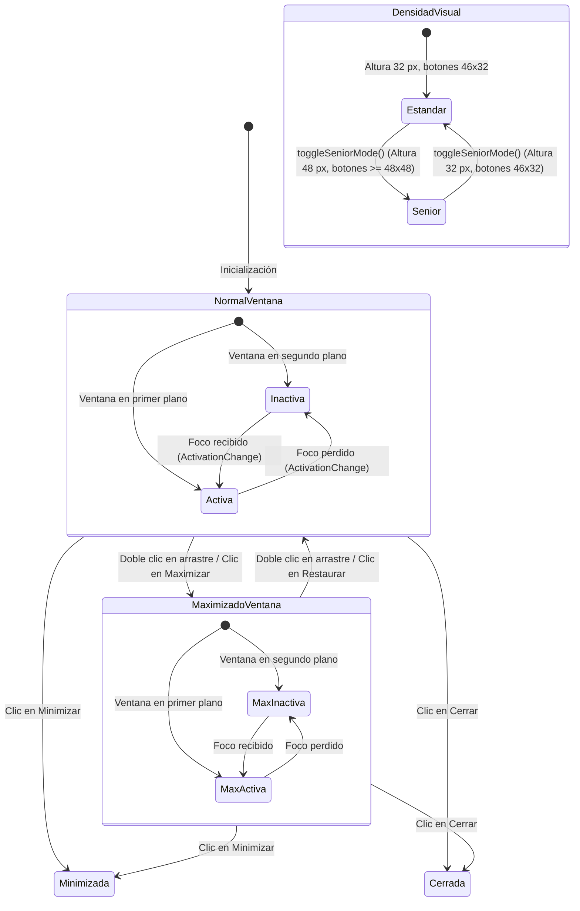

# Design — module-ux-shell-task0066

Status: PROPOSED

## Current, target and gaps

### Estado actual (CURRENT)

1. **Estado del árbol de código tras las etapas de dominio e implementación (`task0064` y `task0065`)**:
   - `module.ux-shell.task0064` (commit `ac3786a`) formalizó el modelo de dominio en `TitleBarTypes.h`, `TitleBarConfiguration.h/.cpp` y `TitleBarValidator.h/.cpp`, con 14 pruebas unitarias de cálculo analítico de distribución espacial en C++20 puro.
   - `module.ux-shell.task0065` (commit `5358b61`) implementó la capa de servicio operativo desacoplada en `TitleBarService.h/.cpp`, con gestión multihilo del plan (`std::mutex`), conmutación de densidades (`setDensity`), control de visibilidad de controles y botones (`setShowSeniorToggle`), persistencia local atómica (`saveStateToFile`, `loadStateFromFile`), tolerancia a archivos corruptos, aislamiento estricto de modo incógnito, cancelación cooperativa Zero-Zombie (`CancellationToken`) y 14 pruebas unitarias en CTest.
2. **Limitaciones de la interfaz Qt actual (`BrowserWindow`)**:
   - La ventana principal (`apps/vigilio-browser/src/ui/BrowserWindow.h` y `BrowserWindow.cpp`) dispone de layout con barra lateral (`vigilio-sidebar`), tira de pestañas y barra de herramientas:
     - No integra el servicio operativo `TitleBarService`, por lo que la barra de título no está gestionada ni sincronizada con el núcleo de dominio.
     - Delega la barra de título en las decoraciones nativas básicas del sistema operativo mediante `setWindowTitle()`, perdiendo la posibilidad de integrar controles unificados, optimizar el espacio vertical y dotar al usuario de botones accesibles $\ge 48$ px.
     - La alternancia de la «Interfaz más fácil de usar» (`setSeniorMode`) no afecta a la barra superior del navegador ni a los controles de ventana.
     - Los eventos nativos de cambio de estado de ventana (`WindowStateChange`, `ActivationChange`) no se capturan para sincronizar el estado visual de los botones de ventana (maximizar vs restaurar, foco activo vs inactivo).
3. **Brechas de accesibilidad y observabilidad en UI**:
   - Los controles nativos del sistema operativo en plataformas de escritorio convencionales suelen tener tamaños pequeños ($30\times 20$ px o $36\times 28$ px), lo cual dificulta la interacción para personas mayores o con destreza motriz reducida.
   - No existe un botón de alternancia rápida accesible integrado en la barra superior.

---

### Estado objetivo (TARGET)

1. **Integración nativa de `TitleBarService` en `BrowserWindow`**:
   - `BrowserWindow` aloja una instancia única `std::unique_ptr<vigilio::TitleBarService> titleBarService_`, inicializada de acuerdo con las preferencias del usuario (estándar o accesible) y con el modo de sesión (aislamiento estricto en incógnito).
   - El callback de observabilidad `setTitleBarChangedCallback` conecta el servicio desacoplado con la jerarquía de widgets de Qt, permitiendo que cualquier mutación del plan se refleje de inmediato en la interfaz.
2. **Jerarquía visual estructurada y widget superior (`vigilio-titlebar`)**:
   - Un widget dedicado `QFrame#vigilio-titlebar` situado en la parte superior de la ventana principal:
     - Icono de marca oficial (`branding/vigilio-logo.svg`) escalado a $16\times 16$ px (estándar) o $24\times 24$ px (accesible).
     - Etiqueta de título con tipografía sobria, sanitizada y legible.
     - Área de arrastre (*draggable area*) que soporta arrastre interactivo con el ratón y alternancia de maximizado mediante doble clic.
     - Caja de controles de ventana con botones de minimizar, maximizar/restaurar, cerrar y acceso rápido a la «Interfaz más fácil de usar».
3. **Adaptación integral a la «Interfaz más fácil de usar» (Modo Senior)**:
   - Sincronización bidireccional entre `setSeniorMode(bool)` y `titleBarService_->setDensity()`:
     - Altura de barra de título ampliada a 48 px.
     - Botones de control con tap target mínimo de $48\times 48$ px.
     - Área mínima de arrastre garantizada $\ge 160$ px.
     - Tipografía accesible a 13 pt.
4. **Respeto estricto de la política de lenguaje público (`docs/UX-COPY-PUBLICO.md`)**:
   - Proscripción absoluta de los términos «Senior Mode», «Modo Senior», «Prompt Builder», «DAG», «OpenSpec», «Linter» o jerga técnica interna en textos visibles, tooltips, descripciones accesibles o mensajes de estado.
   - Empleo sistemático de **«Interfaz más fácil de usar»**, **«Minimizar ventana»**, **«Maximizar ventana»**, **«Restaurar ventana»** y **«Cerrar ventana»**.
5. **Aislamiento Local-First y navegación privada**:
   - Modo incógnito notificado al servicio (`setIncognitoMode(true)`), impidiendo cualquier escritura o sincronización en disco y mostrando el título correspondiente («Vigilio Browser (Navegación privada)»).
6. **Batería de pruebas en Qt Test (`tests/ui/WindowTests.cpp`)**:
   - Verificación automatizada de la presencia de los widgets de barra de título, conmutación de densidad, sincronización de estado de ventana y auditoría de textos accesibles.

---

### Brechas identificadas (GAPS)

| Componente | Estado actual (CURRENT) | Estado objetivo (TARGET) | Brecha a subsanar (GAP) |
| --- | --- | --- | --- |
| **Capa de orquestación en UI** | Inexistente; ventana no instancia ni consulta `TitleBarService` | `BrowserWindow` delega el cálculo a `TitleBarService` | Integrar puntero a `TitleBarService`, conectar callback y sincronizar cambios. |
| **Widget de barra de título** | Ausente; ventana utiliza barra del SO | Widget `QFrame#vigilio-titlebar` integrado con icono, título, arrastre y controles | Construir la jerarquía Qt del título, área de arrastre y botones de control. |
| **Controles de ventana accesibles** | Solo controles nativos del sistema | Botones Qt (`vigilio-titlebar-*`) con dimensiones adaptables ($\ge 48$ px en modo Senior) | Implementar botones de minimizar, maximizar, cerrar y toggle accesible. |
| **Interacción de arrastre y doble clic** | Gestionada externamente por el SO | `mousePressEvent`/`mouseMoveEvent` en área de arrastre y doble clic para maximizar | Implementar manejadores de eventos de ratón para mover y alternar maximizado. |
| **Sincronización de eventos de ventana** | `changeEvent` no captura estados de ventana | Sincroniza `WindowStateChange` y `ActivationChange` con el servicio | Sobrescribir `changeEvent` y actualizar `TitleBarState` y tooltips de botones. |
| **Sincronización de tamaño** | `resizeEvent` solo notifica a layout service | `resizeEvent` notifica también a `titleBarService_->setWindowWidth()` | Invocar `titleBarService_->setWindowWidth()` en `resizeEvent`. |
| **Modo accesible en barra** | Inexistente en barra de título | Conmutación de altura (32 px $\to$ 48 px) y botones ($\ge 48\times 48$ px) | Sincronizar densidad en `setSeniorMode` y actualizar geometría de controles. |
| **Estilos QSS de barra** | No existen selectores para barra de título | Reglas CSS completas para `vigilio-titlebar`, estados hover/pressed y foco accesible | Enriquecer `setDarkTheme()` con estilos claros y oscuros para la barra de título. |
| **Pruebas de UI de barra de título** | `WindowTests.cpp` no valida la barra de título | Pruebas de widgets, dimensiones, estados y textos accesibles | Añadir aserciones específicas en `tests/ui/WindowTests.cpp`. |

---

## Compatibility, migration and rollback

### Compatibilidad arquitectónica

- **Compatibilidad con C++20 y Qt 6**:
  - Toda la interacción con Qt Widgets se implementa utilizando APIs canónicas de Qt 6 (`QWidget`, `QFrame`, `QHBoxLayout`, `QLabel`, `QPushButton`, `QResizeEvent`, `QMouseEvent`).
  - No se introducen macros no estándar ni dependencias externas adicionales; el enlace se mantiene contra `vigilio_core`, `vigilio_compiler_warnings` y las bibliotecas Qt ya presentes.
- **Conformidad con la arquitectura Local-First (ADR-001 / Decisión Q-001)**:
  - La barra no realiza ninguna petición de red para renderizar su interfaz ni depende de servicios en la nube.
  - La persistencia de preferencias de ventana utiliza `TitleBarService` para la gestión geométrica local en disco.
- **Sincronización desacoplada mediante Callbacks y Signals/Slots**:
  - `TitleBarService` reside en `src/core/` sin incluir ninguna cabecera de Qt.
  - La ventana `BrowserWindow` se suscribe a los cambios del servicio a través de `setTitleBarChangedCallback` con un lambda C++20, evitando acoplamiento circular.

### Modelo de interacción y máquina de estados de la barra de título integrada

### Plan de contingencia y rollback

- Si la integración en `BrowserWindow` presentara algún defecto:
  - Se puede revertir limpiamente el commit correspondiente (`feat(ux-shell): ui title-bar-integration`).
  - Las capas previas de dominio de `task0064`, servicio de `task0065` y el layout de ventana principal de `task0060`-`task0063` permanecen intactos e inalterados.

---

## Arquitectura técnica detallada de la capa de UI

### Jerarquía de widgets y orquestación con TitleBarService

1. **Instanciación y ciclo de vida**:
   - `BrowserWindow` posee el ciclo de vida de `titleBarService_`.
   - Al construir la ventana, `setupTitleBar()` configura el servicio con el plan canónico inicial y registra el callback de cambio.
2. **Construcción visual**:
   - `titleBarWidget_` se inserta en el contenedor principal `mainContainer_` encima de `tabs_`.
   - Los botones de control se configuran con `setObjectName` explícito:
     - `vigilio-titlebar-minimize`
     - `vigilio-titlebar-maximize`
     - `vigilio-titlebar-close`
     - `vigilio-titlebar-senior-toggle`
3. **Manejo de eventos nativos de ventana y arrastre**:
   - `titleBarDragArea_` captura:
     - `mousePressEvent`: registra la posición global inicial del cursor y de la ventana.
     - `mouseMoveEvent`: calcula el desplazamiento relativo y actualiza la posición de la ventana con `move()`.
     - `mouseDoubleClickEvent`: alterna entre maximizado y tamaño normal.
   - `changeEvent` captura:
     - `QEvent::WindowStateChange`: consulta `isMaximized()`, `isFullScreen()` y notifica a `titleBarService_->setWindowState()`.
     - `QEvent::ActivationChange`: consulta `isActiveWindow()` y notifica a `titleBarService_->setWindowState()`, actualizando el estilo de la barra (atenuación cuando está inactiva).
