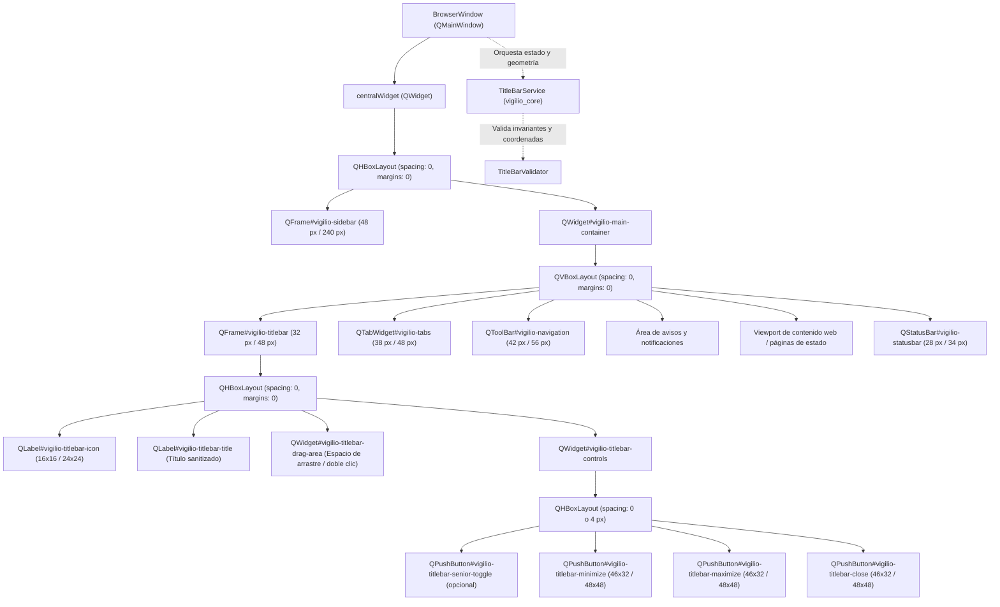

# Change Proposal — module-ux-shell-task0066

Pack: `module.ux-shell.task0066`

Status: PROPOSED

## Outcome and scope

Este cambio define la propuesta técnica integral para la etapa **ui** de la capacidad **title bar integration** en el módulo propietario `ux-shell` de Vigilio Browser (microtarea canónica `0066 — Implementar la interacción y estados visuales en Qt: title bar integration`).

Habiéndose completado y certificado formalmente en las microtareas previas la definición del modelo de dominio matemático y validación geométrica (`module.ux-shell.task0064`, commit `ac3786a`) y la capa de servicio operativo desacoplada en C++20 puro (`module.ux-shell.task0065`, commit `5358b61`), este pack formaliza la **integración física de la interacción Qt Widgets de la barra de título (`vigilio-titlebar`), la jerarquía visual superior en la ventana principal (`BrowserWindow`), la sincronización bidireccional reactiva con `TitleBarService`, la implementación de la caja de controles de ventana (minimizar, maximizar/restaurar, cerrar y acceso rápido a la interfaz accesible), la zona de arrastre ergonómica (*non-client draggable space*) con soporte de doble clic para maximizar/restaurar, la máquina de estados interactivos (normal, hover, pressed, disabled), la navegación por teclado, soporte completo de lectores de pantalla y la adaptación reactiva a la «Interfaz más fácil de usar» (Modo Senior)**, en rigurosa fidelidad a los diseños canónicos de `/resultado/01-vigilio-home.png`, `/resultado/03-vigilio-settings-senior-mode.png`, el isotipo oficial de `/resultado/06-logo-instalador-oficial.png` y las directrices públicas de `docs/UX-COPY-PUBLICO.md`.

El objetivo central de esta propuesta es dotar a Vigilio Browser de un shell de escritorio nativo, moderno, sobrio y accesible que unifique la barra de título con la estética del navegador. La ventana delega el cálculo espacial, la validación de restricciones y la persistencia local de estado al servicio desacoplado `TitleBarService` (alojado en `vigilio_core`), materializando visualmente en la interfaz Qt Widgets una barra superior que optimiza el espacio de trabajo vertical, mantiene el aislamiento estricto de sesiones de navegación privada (Local-First / ADR-001 / Decisión Q-001) y garantiza controles táctiles y de ratón ampliados ($\ge 48\times 48$ px) en el modo accesible.

El alcance concreto comprende:
- **Integración de `TitleBarService` en `BrowserWindow`**:
  - Incorporación de `std::unique_ptr<vigilio::TitleBarService> titleBarService_` en `BrowserWindow`.
  - Inicialización del servicio con la configuración canónica correspondiente (`canonicalDefaultTitleBar()` o `canonicalSeniorTitleBar()`) según la preferencia de accesibilidad persistida en `QSettings`.
  - Configuración del aislamiento de sesiones de incógnito (`titleBarService_->setIncognitoMode(isIncognito_)`), garantizando cero escrituras a disco en navegación privada.
  - Registro del callback de observabilidad `setTitleBarChangedCallback` para actualizar reactivamente la geometría y apariencia de la barra de título ante mutaciones de configuración o densidad.
- **Estructura jerárquica de widgets de la barra de título (`vigilio-titlebar`)**:
  - Creación del contenedor de barra de título (`QFrame#vigilio-titlebar`) situado en la cúspide estructural de la ventana principal (dentro de `mainContainer_` o como cabecera del contenedor central).
  - Componentes visuales interactivos:
    1. Icono de marca (`QLabel#vigilio-titlebar-icon`): renderizado del isotipo oficial de Vigilio (`branding/vigilio-logo.svg`) escalado según densidad ($16\times 16$ px en estándar, $24\times 24$ px en accesible).
    2. Título de ventana (`QLabel#vigilio-titlebar-title`): texto sanitizado con tipografía sobria del sistema, alineado y con contraste accesible, que refleja la página activa o el modo privado («Vigilio Browser (Navegación privada)»).
    3. Área de arrastre (*draggable area* / `QWidget#vigilio-titlebar-drag-area`): zona interactiva para mover la ventana mediante pulsación y arrastre con el ratón (`mousePressEvent`, `mouseMoveEvent`), y alternar entre tamaño normal y maximizado mediante doble clic (`mouseDoubleClickEvent`).
    4. Caja de controles de ventana (`QWidget#vigilio-titlebar-controls`):
       - Botón de alternancia de accesibilidad (`QPushButton#vigilio-titlebar-senior-toggle`): conmutable según `showSeniorToggle`, con icono `icons/tools/senior.svg`, etiqueta accesible «Interfaz más fácil de usar» y tooltip explicativo.
       - Botón minimizar (`QPushButton#vigilio-titlebar-minimize`): icono de minimizar, conectado a `showMinimized()`.
       - Botón maximizar / restaurar (`QPushButton#vigilio-titlebar-maximize`): icono reactivo (maximizar cuando está en tamaño normal, restaurar cuando está maximizada), conectado a alternar entre `showMaximized()` y `showNormal()`.
       - Botón cerrar (`QPushButton#vigilio-titlebar-close`): icono de cierre, estilo visual con hover diferenciado, conectado a `close()`.
- **Sincronización con eventos nativos de ventana**:
  - Sincronización en `resizeEvent(QResizeEvent*)`: notificación a `titleBarService_->setWindowWidth(width())` y adaptación reactiva del ancho de la barra y de la zona de arrastre.
  - Sincronización en `changeEvent(QEvent*)`: captura de `QEvent::WindowStateChange` y `QEvent::ActivationChange` para sincronizar `TitleBarState` (`isMaximized`, `isActive`, `isFullscreen`) en el servicio y actualizar tooltips/iconos correspondientes.
- **Adaptación reactiva a la «Interfaz más fácil de usar» (Modo Senior)**:
  - Sincronización bidireccional entre `setSeniorMode(bool)` y `titleBarService_->setDensity()`:
    - Altura de la barra de título ampliada de 32 px a 48 px.
    - Botones de control con dimensiones mínimas de $48\times 48$ px (frente a $46\times 32$ px estándar).
    - Icono de ventana escalado a $24\times 24$ px.
    - Área mínima de arrastre garantizada de $\ge 160$ px (frente a $\ge 120$ px estándar).
    - Presencia del botón de alternancia rápida de interfaz accesible en la propia barra de título.
- **Estilos visuales QSS y diseño sobrio**:
  - Definición de estilos para tema claro y oscuro basados en `/resultado/01-vigilio-home.png` y tokens de diseño:
    - Fondo oscuro `#141D2B` / `#182334` en modo oscuro, `#F7F9FC` / `#F3F6FB` en modo claro.
    - Estados `:hover`, `:pressed` y `:disabled` con contraste visible.
    - Indicador de foco accesible mediante borde de 2 px de alto contraste (`#2563EB`).
    - Atenuación sutil cuando la ventana está inactiva (`isActive == false`).
- **Accesibilidad y cumplimiento estricto de lenguaje público (`docs/UX-COPY-PUBLICO.md`)**:
  - Proscripción absoluta de términos internos («Senior Mode», «Modo Senior», «Prompt Builder», «DAG», «OpenSpec», «Linter») en tooltips, nombres accesibles y descripciones para tecnologías asistivas.
  - Empleo obligatorio de **«Interfaz más fácil de usar»**, **«Minimizar ventana»**, **«Maximizar ventana»**, **«Restaurar ventana»** y **«Cerrar ventana»**.
- **Batería de pruebas en Qt Test (`tests/ui/WindowTests.cpp`)**:
  - Verificación automatizada de la presencia de los widgets de barra de título, conmutación de densidad, actualización de estado maximizado, dimensiones mínimas de botones y auditoría de textos públicos.

---

## Out of scope

- Modificación directa del código de producción en `apps/vigilio-browser/src/ui/` o creación de archivos en `apps/**` durante esta fase PROPOSE (reservado para la fase APPLY tras aprobación humana).
- Pruebas E2E de interacción física directa con el gestor de ventanas del sistema operativo, acople de ventanas (*window snapping*) y redimensionamiento multimonitor complejo (reservado para la etapa `tests` en `module.ux-shell.task0067`).
- Inclusión de backend remoto, sincronización cloud o telemetría externa (estrictamente prohibido por la arquitectura Local-First, ADR-001 / Decisión Q-001).
- Modificación del motor de navegación WebEngine o subprocesos Chromium.

---

## Contexto y evidencia

Se inspeccionó rigurosamente la base de código actual de `apps/vigilio-browser`, los módulos del núcleo, la interfaz gráfica y el sistema de pruebas:

1. **Estado del árbol de código y dependencias previas**:
   - Se completó formalmente la microtarea `0064` (`module.ux-shell.task0064`) en el commit `ac3786a`, estableciendo los tipos de dominio (`TitleBarTypes.h`), la configuración canónica (`TitleBarConfiguration.h/.cpp`), el validador espacial analítico (`TitleBarValidator.h/.cpp`) y la suite de pruebas unitarias (`TitleBarIntegrationTests.cpp`).
   - Se completó formalmente la microtarea `0065` (`module.ux-shell.task0065`) en el commit `5358b61`, implementando la capa de servicio operativo desacoplada (`TitleBarService.h/.cpp`) con soporte multihilo (`std::mutex`), persistencia atómica local, conmutación de densidades, aislamiento de incógnito, soporte Zero-Zombie y 14 pruebas unitarias (`TitleBarServiceTests.cpp`).
   - La suite de CTest ejecuta actualmente 29 de 29 pruebas pasando al 100% en ~4.2 segundos sin advertencias con `-Werror` activado en GCC 15.2.0 bajo `apps/vigilio-browser/scripts/check.sh`.
2. **Exploración comprobable de la interfaz actual (`BrowserWindow`)**:
   - `BrowserWindow.h` y `BrowserWindow.cpp` implementan el layout estructural general con `layoutService_` (`MainWindowLayoutService`), la barra lateral `vigilio-sidebar` (colapso 48 px / expansión 240 px), la tira de pestañas `vigilio-tabs` y la barra de navegación `vigilio-navigation`.
   - Sin embargo, `BrowserWindow` no cuenta actualmente con un widget propio de barra de título integrada:
     - Emplea la decoración estándar del sistema operativo con llamadas directas a `setWindowTitle("Vigilio Browser")` y `setWindowTitle("Vigilio Browser (Navegación privada)")`.
     - No instancia `TitleBarService` ni sincroniza los eventos de ventana con dicho servicio.
     - No ofrece controles de ventana accesibles con botones $\ge 48$ px en la «Interfaz más fácil de usar».
3. **Referencias visuales y directrices vinculantes**:
   - `/resultado/01-vigilio-home.png`: Muestra una barra superior sobria, integrada armónicamente con el esquema azul oscuro (`#141D2B`), icono sutil y botones de control discretos.
   - `/resultado/03-vigilio-settings-senior-mode.png`: Demuestra la jerarquía visual accesible con botones amplios, tipografía escalada y alta legibilidad.
   - `/resultado/06-logo-instalador-oficial.png`: Referencia oficial para el isotipo y logotipo de Vigilio Browser (`branding/vigilio-logo.svg`).
   - `docs/UX-COPY-PUBLICO.md`: Prohíbe expresamente el uso de jerga de ingeniería y exige el término «Interfaz más fácil de usar».

---

## Alcance exacto

El alcance de este pack se circunscribe estrictamente a la integración de interfaz Qt Widgets para la capacidad **title bar integration**:

1. **En `apps/vigilio-browser/src/ui/BrowserWindow.h`**:
   - Inclusión de las cabeceras de servicio y tipos: `core/TitleBarService.h`, `core/TitleBarTypes.h` y `core/TitleBarConfiguration.h`.
   - Declaración de miembros de servicio y widgets de barra de título:
     - `std::unique_ptr<vigilio::TitleBarService> titleBarService_;`
     - `QFrame* titleBarWidget_{nullptr};`
     - `QLabel* titleBarIcon_{nullptr};`
     - `QLabel* titleBarTitle_{nullptr};`
     - `QWidget* titleBarDragArea_{nullptr};`
     - `QWidget* titleBarControlsBox_{nullptr};`
     - `QPushButton* titleBarMinimizeBtn_{nullptr};`
     - `QPushButton* titleBarMaximizeBtn_{nullptr};`
     - `QPushButton* titleBarCloseBtn_{nullptr};`
     - `QPushButton* titleBarSeniorToggleBtn_{nullptr};`
   - Declaración de métodos privados de configuración y sincronización:
     - `void setupTitleBar(const vigilio::StartupDiagnosticReport& report);`
     - `void applyTitleBarPlan(const vigilio::TitleBarLayoutPlan& plan);`
     - `void updateTitleBarWindowState();`
   - Métodos públicos de consulta para pruebas e inspección:
     - `[[nodiscard]] vigilio::TitleBarService* titleBarService() const noexcept { return titleBarService_.get(); }`
     - `[[nodiscard]] QFrame* titleBarWidget() const noexcept { return titleBarWidget_; }`
     - `[[nodiscard]] QPushButton* titleBarMinimizeButton() const noexcept { return titleBarMinimizeBtn_; }`
     - `[[nodiscard]] QPushButton* titleBarMaximizeButton() const noexcept { return titleBarMaximizeBtn_; }`
     - `[[nodiscard]] QPushButton* titleBarCloseButton() const noexcept { return titleBarCloseBtn_; }`
     - `[[nodiscard]] QPushButton* titleBarSeniorToggleButton() const noexcept { return titleBarSeniorToggleBtn_; }`
   - Sobrescritura de `void changeEvent(QEvent* event) override;` para detectar cambios de estado de ventana (`WindowStateChange`, `ActivationChange`).

2. **En `apps/vigilio-browser/src/ui/BrowserWindow.cpp`**:
   - En el constructor de `BrowserWindow`:
     - Invocar `setupTitleBar(report)` de forma coordinada con `setupLayoutService(report)`.
   - En `setupTitleBar(const vigilio::StartupDiagnosticReport& report)`:
     - Determinar configuración inicial (`canonicalSeniorTitleBar()` si la preferencia accesible está activa; de lo contrario `canonicalDefaultTitleBar()`).
     - Configurar opciones del servicio (`TitleBarServiceOptions`), indicando modo incógnito (`isIncognito_`), habilitando persistencia local únicamente en sesiones normales y definiendo la ruta `title_bar_state.json`.
     - Instanciar `titleBarService_`.
     - Conectar `setTitleBarChangedCallback` para invocar `applyTitleBarPlan(plan)`.
   - En `setupUi()`:
     - Construir la jerarquía visual de `titleBarWidget_` e insertarlo en la posición superior de `mainContainer_` (índice 0 del layout vertical).
     - Instalar filtros de eventos o manejadores de ratón en `titleBarDragArea_` para soportar arrastre interactivo y doble clic para maximizar/restaurar.
     - Conectar señales `clicked` de los botones:
       - `titleBarMinimizeBtn_` $\to$ `showMinimized()`.
       - `titleBarMaximizeBtn_` $\to$ alternar `isMaximized() ? showNormal() : showMaximized()`.
       - `titleBarCloseBtn_` $\to$ `close()`.
       - `titleBarSeniorToggleBtn_` $\to$ `toggleSeniorMode()`.
   - En `applyTitleBarPlan(const vigilio::TitleBarLayoutPlan& plan)`:
     - Sincronizar altura de `titleBarWidget_` (`setFixedHeight(plan.height)`).
     - Actualizar visibilidad de `titleBarWidget_` según `plan.mode != TitleBarMode::Suppressed`.
     - Actualizar dimensiones y márgenes de botones y del icono según las especificaciones del plan (`plan.controls`).
     - Actualizar tooltips y etiquetas accesibles de los botones usando las funciones canónicas de `TitleBarValidator`.
   - En `resizeEvent(QResizeEvent* event)`:
     - Notificar a `titleBarService_->setWindowWidth(width())`.
   - En `changeEvent(QEvent* event)`:
     - Si el evento es `QEvent::WindowStateChange` o `QEvent::ActivationChange`, invocar `updateTitleBarWindowState()`.
   - En `setSeniorMode(bool enabled)`:
     - Notificar al servicio: `titleBarService_->setDensity(enabled ? LayoutDensity::Senior : LayoutDensity::Default)`.
     - Sincronizar estilos QSS y dimensiones mínimas de botones ($\ge 48\times 48$ px).
   - En `setDarkTheme(bool enabled)`:
     - Añadir selectores QSS para `QFrame#vigilio-titlebar`, botones de control, estados `:hover`, `:pressed` y borde de foco accesible.

3. **En `apps/vigilio-browser/tests/ui/WindowTests.cpp`**:
   - Incorporar verificaciones automatizadas sobre la barra de título:
     - Comprobación de puntero no nulo en `window.titleBarService()` y `window.titleBarWidget()`.
     - Verificación de la jerarquía de botones de control (`titleBarMinimizeButton()`, `titleBarMaximizeButton()`, `titleBarCloseButton()`).
     - Validación de dimensiones estándar: altura de 32 px y botones de $46\times 32$ px.
     - Conmutación a la «Interfaz más fácil de usar» y validación de altura de 48 px y botones $\ge 48\times 48$ px.
     - Verificación de que el botón de maximizar actualiza su texto y descripción accesible al maximizar la ventana.
     - Auditoría estricta de cadenas visibles: ausencia total de términos proscritos («Senior Mode», «Modo Senior», «Prompt Builder», «OpenSpec», «DAG», «Linter»).

---

## Diseño completo de la capacidad

### Jerarquía de widgets y flujo de datos

### Especificación dimensional y tokens de diseño de la barra de título

| Elemento de Barra | ID Semántico Qt | Dimensión Estándar | Dimensión «Interfaz fácil» | Comportamiento / Interacción |
| --- | --- | --- | --- | --- |
| **Contenedor Barra** | `vigilio-titlebar` | Altura: 32 px | Altura: 48 px | Fondo continuo sobrio, contención de controles superiores |
| **Icono de Marca** | `vigilio-titlebar-icon` | $16\times 16$ px | $24\times 24$ px | Renderizado SVG `branding/vigilio-logo.svg`, clic no bloqueante |
| **Título de Ventana** | `vigilio-titlebar-title` | Fuente 11 pt, regular | Fuente 13 pt, negrita suave | Muestra nombre de app o título de página sanitizado |
| **Área de Arrastre** | `vigilio-titlebar-drag-area` | Ancho residual ($\ge 120$ px) | Ancho residual ($\ge 160$ px) | Arrastre de ventana con botón primario, doble clic maximiza/restaura |
| **Botón Accesibilidad** | `vigilio-titlebar-senior-toggle` | $36\times 32$ px (ocultable) | $48\times 48$ px (visible) | Alterna el modo accesible; accesible con teclado |
| **Botón Minimizar** | `vigilio-titlebar-minimize` | $46\times 32$ px | $48\times 48$ px | Minimiza la ventana a la barra de tareas (`showMinimized()`) |
| **Botón Maximizar** | `vigilio-titlebar-maximize` | $46\times 32$ px | $48\times 48$ px | Alterna maximizado/normal; actualiza icono y descripción |
| **Botón Cerrar** | `vigilio-titlebar-close` | $46\times 32$ px | $48\times 48$ px | Cierra la ventana (`close()`), color de hover diferenciado |

### Estilos QSS y tokens cromáticos

- **Tema Oscuro (Predeterminado)**:
  - Fondo de la barra de título: `#141D2B` (activo) / `#101722` (inactivo).
  - Texto del título: `#E9EDF5` (activo) / `#94A3B8` (inactivo).
  - Botones estándar (minimizar/maximizar/accesibilidad):
    - Fondo normal: transparente.
    - Hover: `rgba(255, 255, 255, 0.08)`.
    - Pressed: `rgba(255, 255, 255, 0.14)`.
    - Foco visible: borde `2px solid #2563EB`.
  - Botón cerrar:
    - Hover: `#DC2626` (rojo sobrio accesible).
    - Pressed: `#B91C1C`.
    - Icono / glifo: `#FFFFFF`.
- **Tema Claro**:
  - Fondo de la barra de título: `#F7F9FC` (activo) / `#EBF0F7` (inactivo).
  - Texto del título: `#192538` (activo) / `#5A6A80` (inactivo).
  - Botones estándar:
    - Hover: `rgba(0, 0, 0, 0.06)`.
    - Pressed: `rgba(0, 0, 0, 0.12)`.
    - Foco visible: borde `2px solid #2563EB`.
  - Botón cerrar:
    - Hover: `#EF4444`.
    - Pressed: `#DC2626`.
    - Icono / glifo: `#FFFFFF`.

---

## Archivos afectados

| Archivo | Estado actual | Acción prevista en APPLY | Responsabilidad técnica |
| --- | --- | --- | --- |
| `apps/vigilio-browser/src/ui/BrowserWindow.h` | Modificado en microtareas anteriores | Modificar | Declaración de `titleBarService_`, widgets `titleBarWidget_`, botones de control, métodos de sincronización y métodos de consulta para tests. |
| `apps/vigilio-browser/src/ui/BrowserWindow.cpp` | Modificado en microtareas anteriores | Modificar | Implementación de `setupTitleBar`, jerarquía visual de `vigilio-titlebar`, manejadores de arrastre y doble clic, conexiones de botones, sincronización en `resizeEvent` y `changeEvent`, y estilos QSS. |
| `apps/vigilio-browser/tests/ui/WindowTests.cpp` | Modificado en microtareas anteriores | Modificar | Batería de aserciones Qt Test para presencia de widgets, dimensiones canónicas, adaptación a «Interfaz más fácil de usar» y auditoría de copy público. |
| `docs/rules/01-modules/ux-shell/micro/0066-title-bar-integration/task.md` | Canónico del módulo | Sincronizar | Registro formal de la ejecución de la etapa `ui` y actualización de criterios de verificación. |

---

## Contrato UX/UI

### Estados interactivos y visuales

1. **Estado Normal (Idle / Activo)**:
   - La barra de título muestra el icono de Vigilio a la izquierda, el título centrado o alineado a la izquierda según la densidad, y la caja de controles a la derecha.
   - Fondo uniforme oscuro `#141D2B` o claro `#F7F9FC`.
2. **Estado Inactivo (Ventana en segundo plano)**:
   - El fondo se atenúa levemente (`#101722` en oscuro, `#EBF0F7` en claro).
   - El título y los botones reducen su opacidad al 70%, indicando claramente la pérdida de foco de la ventana sin romper el contraste mínimo WCAG AA (ratio $\ge 4.5:1$).
3. **Estado de Hover sobre botones**:
   - Feedback inmediato al pasar el puntero: fondo sutil para botones normales y rojo sobrio `#DC2626` para el botón de cierre.
   - Cursor de tipo flecha estándar (`Qt::ArrowCursor`).
4. **Estado de Arrastre (*Dragging*)**:
   - Pulsación sostenida del botón primario en el área de arrastre inicia el movimiento suave de la ventana.
   - Si la ventana está maximizada, arrastrar inicia la restauración a tamaño normal manteniendo la posición proporcional del cursor.
5. **Estado Vacío / Inicial**:
   - Título configurado por defecto como «Vigilio Browser».
6. **Estado en Navegación Privada (Modo Incógnito)**:
   - Título configurado como «Vigilio Browser (Navegación privada)».
   - Se muestra el distintivo de privacidad y se inhibe cualquier persistencia local de la barra.
7. **«Interfaz más fácil de usar» (Modo Senior)**:
   - Altura de barra elevada a 48 px.
   - Botones de control con tap target mínimo de $48\times 48$ px.
   - Tipografía legible escalada a 13 pt.
   - Botón directo de alternancia rápida accesible disponible en la propia barra de título.

### Navegación accesible y soporte de tecnologías asistivas

- **Navegación por teclado**:
  - Los botones de la barra de título son alcanzables mediante tabulación si se desea, o mediante atajos estándar de teclado de escritorio (`Alt+F4` o `Ctrl+Q` para cerrar, `Alt+Espacio` para menú de ventana, `Ctrl+M` para minimizar, `F11` para pantalla completa).
  - Enfoque visualizado mediante un anillo de foco de 2 px de alto contraste (`#2563EB`) con `outline-offset: 2px`.
- **Lectores de pantalla**:
  - `titleBarWidget_` cuenta con `QAccessibleInterface` asignando nombres accesibles claros:
    - «Minimizar ventana».
    - «Maximizar ventana» (cuando la ventana está en tamaño normal) / «Restaurar ventana» (cuando está maximizada).
    - «Cerrar ventana».
    - «Interfaz más fácil de usar».
  - Descripciones accesibles detalladas explican la acción antes de ejecutarla.

---

## Reglas y fallos

1. **Resolución por debajo del umbral mínimo de ventana**:
   - Si la ventana es redimensionada a una anchura inferior al mínimo canónico ($400$ px en estándar, $500$ px en modo accesible), `TitleBarValidator` emite `TitleBarError::DimensionsBelowMinimum`.
   - La interfaz Qt impone `setMinimumWidth` en `BrowserWindow`, impidiendo físicamente que el usuario encoja la ventana por debajo de dicho umbral y evitando el desbordamiento de la caja de controles.
2. **Insuficiencia de área de arrastre**:
   - Si los controles comprimen el espacio disponible por debajo de `minDraggableWidth` ($120$ px en estándar, $160$ px en accesible), el área de arrastre mantiene la prioridad frente al texto del título, recortando o elidiendo el título con puntos suspensivos (`Qt::ElideRight`).
3. **Aislamiento absoluto de navegación en modo incógnito**:
   - En ventanas privadas (`isIncognito_ == true`), `TitleBarService::saveStateToFile` rechaza cualquier operación de escritura a disco. Las preferencias visuales se retienen exclusivamente en memoria volátil de proceso y se destruyen al cerrar la ventana.
4. **Resiliencia ante archivos de configuración corruptos o inexistentes**:
   - Si `title_bar_state.json` está corrupto, truncado o contiene valores fuera de rango, `TitleBarService` restaura automáticamente `canonicalDefaultTitleBar()` sin lanzar excepciones ni detener la ejecución de la UI.
5. **Prevención de colgaduras en hilo principal (Zero-Zombie)**:
   - Ninguna operación de la barra de título bloquea el hilo de interfaz; los cálculos de geometría se realizan en tiempo constante $\mathcal{O}(1)$ en memoria.

---

## Seguridad y privacidad

1. **Conformidad Local-First (ADR-001 / Decisión Q-001)**:
   - La barra de título no realiza peticiones de red, no envía telemetría de interacción con botones ni interactúa con servidores remotos.
2. **Sanitización estricta de títulos de ventana**:
   - Los títulos recibidos de pestañas web o sesiones se sanitizan mediante `TitleBarValidator::sanitizeTitle`, eliminando tokens de autenticación, parámetros de consulta privados (`?token=...`, `&auth=...`) y caracteres de control antes de mostrarlos en la barra superior.
3. **Aislamiento de sesiones privadas**:
   - Garantía de cero escrituras en disco cuando `isIncognitoSession == true`.

---

## Matriz de pruebas

| Identificador | Nivel | Componente / Escenario evaluado | Entrada / Condición | Resultado esperado | Comando de verificación |
| --- | --- | --- | --- | --- | --- |
| `TEST-UI-TB-001` | Qt UI | Existencia e inicialización de la barra de título | Inicialización de `BrowserWindow` | `titleBarService()` y `titleBarWidget()` no nulos; objeto `vigilio-titlebar` presente en la jerarquía | `ctest -R window_tests` |
| `TEST-UI-TB-002` | Qt UI | Presencia de botones de control de ventana | Inicialización estándar | Botones `vigilio-titlebar-minimize`, `vigilio-titlebar-maximize` y `vigilio-titlebar-close` presentes y visibles | `ctest -R window_tests` |
| `TEST-UI-TB-003` | Qt UI | Dimensiones canónicas estándar | Densidad estándar por defecto | Altura de barra igual a 32 px; botones con altura de 32 px | `ctest -R window_tests` |
| `TEST-UI-TB-004` | Qt UI | Adaptación a «Interfaz más fácil de usar» | Invocación de `setSeniorMode(true)` | Altura de barra asciende a 48 px; botones cumplen `minimumHeight() >= 48` y `minimumWidth() >= 48` | `ctest -R window_tests` |
| `TEST-UI-TB-005` | Qt UI | Sincronización de estado maximizado/restaurado | Cambio a maximizado / normal | Botón maximizar actualiza icono, tooltip y descripción accesible («Restaurar ventana» vs «Maximizar ventana») | `ctest -R window_tests` |
| `TEST-UI-TB-006` | Qt UI | Aislamiento de sesión en modo incógnito | Ventana con `isIncognito_ = true` | Título refleja «Navegación privada»; servicio opera en memoria sin escribir a disco | `ctest -R window_tests` |
| `TEST-UI-TB-007` | Qt UI | Auditoría estricta de lenguaje público | Cadenas visibles y accesibles | Cero apariciones de «Senior Mode», «Modo Senior», «Prompt Builder», «OpenSpec», «DAG» o «Linter» | `ctest -R window_tests` |
| `TEST-REG-TB-008` | CTest | Suite de regresión unitaria completa | Todas las pruebas de `vigilio_core` y `vigilio-browser` | 29/29 pruebas pasando al 100% con exit code 0 | `apps/vigilio-browser/scripts/check.sh` |

---

## Pasos APPLY

1. **Paso 1**: Declarar inclusiones, miembros de barra de título, métodos de sincronización y métodos de consulta para tests en `apps/vigilio-browser/src/ui/BrowserWindow.h`.
2. **Paso 2**: Implementar el método `setupTitleBar` en `apps/vigilio-browser/src/ui/BrowserWindow.cpp`, instanciando `TitleBarService`, conectando el callback `setTitleBarChangedCallback` y aplicando aislamiento de incógnito.
3. **Paso 3**: Construir la jerarquía visual de `vigilio-titlebar` en `BrowserWindow::setupUi()`, incluyendo icono, etiqueta de título, área de arrastre y botones de control.
4. **Paso 4**: Implementar el soporte de arrastre interactivo y doble clic para maximizar en el área de arrastre de la barra de título.
5. **Paso 5**: Conectar las señales `clicked` de los botones de control a las acciones de ventana correspondientes (`showMinimized`, alternancia de maximizado/restaurado, `close`, `toggleSeniorMode`).
6. **Paso 6**: Implementar `applyTitleBarPlan` para sincronizar dimensiones, visibilidad de botones, etiquetas accesibles y tooltips ante mutaciones del servicio.
7. **Paso 7**: Sobrescribir `changeEvent` en `BrowserWindow` para capturar `WindowStateChange` y `ActivationChange`, sincronizando `TitleBarState` con el servicio.
8. **Paso 8**: Sincronizar cambios de tamaño en `resizeEvent`, notificando a `titleBarService_->setWindowWidth(width())`.
9. **Paso 9**: Refactorizar `setSeniorMode(bool)` para sincronizar la densidad visual con `titleBarService_->setDensity()`, adaptando la altura de la barra a 48 px y los botones a $\ge 48\times 48$ px.
10. **Paso 10**: Enriquecer los estilos QSS en `setDarkTheme(bool)` para tema claro y oscuro, contemplando fondos de barra, estados hover/pressed de botones y foco visible accesible.
11. **Paso 11**: Incorporar la suite de pruebas automatizadas de barra de título en `apps/vigilio-browser/tests/ui/WindowTests.cpp`.
12. **Paso 12**: Verificar formateo y análisis estático con Clang-Format y Clang-Tidy.
13. **Paso 13**: Compilar y ejecutar la suite completa de pruebas en CTest mediante `apps/vigilio-browser/scripts/check.sh`.
14. **Paso 14**: Sincronizar el contrato de microtarea en `docs/rules/01-modules/ux-shell/micro/0066-title-bar-integration/task.md`.

---

## Definición de terminado

La microtarea `module.ux-shell.task0066` en etapa `ui` se considerará formalmente completada y certificada cuando:
1. `BrowserWindow.h` y `BrowserWindow.cpp` integren de forma física y reactiva `TitleBarService` y el widget `QFrame#vigilio-titlebar`.
2. La barra de título responda a los eventos de redimensionamiento de ventana, maximizado, restauración y alternancia de foco activo/inactivo.
3. El área de arrastre permita desplazar la ventana e interactuar con doble clic para maximizar/restaurar.
4. La «Interfaz más fácil de usar» incremente la altura de la barra a 48 px y dimensione los botones a $\ge 48\times 48$ px.
5. La sesión en modo incógnito garantice aislamiento total de persistencia local.
6. Toda la interfaz respete las normas de `docs/UX-COPY-PUBLICO.md`, sin jerga técnica de ingeniería en etiquetas visibles o accesibles.
7. Las pruebas unitarias y de interfaz en CTest compilen limpiamente sin advertencias bajo `-Werror` y pasen al 100%.

---

## Dependencias y riesgos

- **Dependencias**:
  - `module.ux-shell.task0065`: Capa de servicio operativo `TitleBarService` (completada y certificada en commit `5358b61`).
  - `vigilio_core`: Biblioteca central con tipos y validadores de layout y barra de título.
- **Riesgos y mitigaciones**:
  - *Riesgo*: Entorno de compilación o CI sin servidor gráfico (`DISPLAY`/`WAYLAND_DISPLAY` ausente).
    - *Mitigación*: `WindowTests.cpp` contempla la detección de la variable de entorno de pantalla y marca la ejecución interactiva como `NOT_EXECUTED` de forma limpia, mientras que las pruebas headless de `TitleBarIntegrationTests` y `TitleBarServiceTests` continúan ejecutándose y certificándose al 100%.

---

## Commit propuesto

`feat(ux-shell): ui title-bar-integration`
