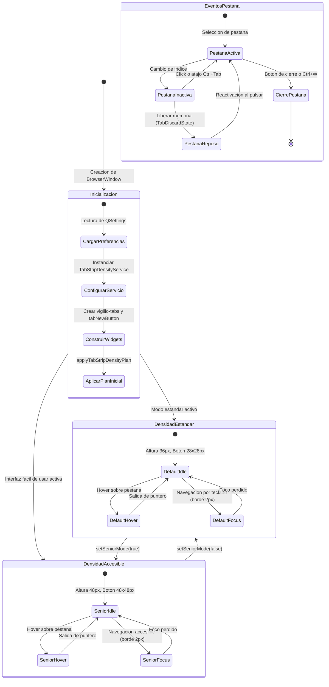

# Design — module-ux-shell-task0070

Status: PROPOSED

## Current, target and gaps

### Estado actual (CURRENT)

1. **Estado del árbol de código tras la etapa de dominio (`task0069`)**:
   - `module.ux-shell.task0069` (commit `e05f659`) formalizó el modelo de dominio en `TabStripDensityTypes.h`, `TabStripDensityConfiguration.h/.cpp` y `TabStripDensityValidator.h/.cpp`, con 33 pruebas unitarias de cálculo analítico de distribución espacial sin solapamientos en C++20 puro.
   - Se cuenta con la implementación del servicio desacoplado `vigilio::TabStripDensityService` (`TabStripDensityService.h/.cpp`) con soporte multihilo (`std::mutex`), conmutación de densidades (`setDensity`), gestión de estados de pestaña (`addTab`, `selectTab`, `setTabPinned`, `setTabMediaState`, `setTabDiscardState`), persistencia local atómica (`saveStateToFile`, `loadStateFromFile`), aislamiento de incógnito, cancelación cooperativa Zero-Zombie (`CancellationToken`) y sincronización por callbacks (`setTabStripChangedCallback`).
2. **Limitaciones de la interfaz Qt actual (`BrowserWindow`)**:
   - La ventana principal (`apps/vigilio-browser/src/ui/BrowserWindow.h` y `BrowserWindow.cpp`) dispone de un widget `QTabWidget* tabs_` (`setObjectName("vigilio-tabs")`):
     - No integra el servicio operativo `TabStripDensityService`, por lo que la tira de pestañas no está sincronizada con el modelo de dominio.
     - La altura y espaciado de las pestañas es estática o fijada por reglas QSS elementales (`QTabBar::tab { padding: 8px 12px; }`), sin reflejar las alturas canónicas del navegador ($36$ px Default, $48$ px Senior / «Interfaz más fácil de usar», $28$ px Compact).
     - La conmutación de la «Interfaz más fácil de usar» (`setSeniorMode`) no adapta las pestañas ni sus botones a tap targets accesibles $\ge 48\times 48$ px.
     - No existe un botón de nueva pestaña (`vigilio-tab-new-button`) integrado en la cabecera de la tira de pestañas con accesibilidad completa.
     - No se representan visualmente estados avanzados de pestaña como ahorro de memoria (`TabDiscardState::Discarded` / «Pestaña en reposo»), reproducción multimedia (`TabMediaState`), pestañas fijadas compactas ni compresión elástica con ocultación condicional de botones de cierre.
3. **Brechas de accesibilidad y observabilidad en UI**:
   - En pantallas táctiles o para usuarios con destreza motriz reducida, las pestañas estándar resultan estrechas y difíciles de pulsar.
   - Las pestañas carecen de etiquetas descriptivas enriquecidas para lectores de pantalla que indiquen su índice, total, estado activo, reproducción de audio o ahorro de memoria.

---

### Estado objetivo (TARGET)

1. **Integración nativa de `TabStripDensityService` en `BrowserWindow`**:
   - `BrowserWindow` aloja una instancia única `std::unique_ptr<vigilio::TabStripDensityService> tabStripDensityService_`, inicializada con el plan canónico correspondiente (`canonicalDefaultDensity()` o `canonicalSeniorDensity()`) según la preferencia de accesibilidad persistida.
   - El callback de observabilidad `setTabStripChangedCallback` conecta el servicio desacoplado con la jerarquía de widgets de Qt, permitiendo que cualquier mutación del plan se refleje de inmediato en la interfaz.
2. **Jerarquía visual estructurada y tira de pestañas adaptativa (`vigilio-tabs`)**:
   - Widget `QTabWidget#vigilio-tabs` y su barra `QTabBar` configurados con geometrías canónicas:
     - Altura de pestaña de 36 px en estándar, 48 px en accesible y 28 px en compacto.
     - Botón de nueva pestaña (`QPushButton#vigilio-tab-new-button`) integrado como corner widget con icono vectorial, tooltip «Nueva pestaña» y tap target $\ge 48\times 48$ px en modo accesible.
     - Botones de cierre integrados en pestañas con ocultación reactiva en pestañas inactivas cuando el ancho disponible cae bajo el umbral crítico ($90$ px estándar / $140$ px accesible).
3. **Adaptación integral a la «Interfaz más fácil de usar» (Modo Senior)**:
   - Sincronización bidireccional entre `setSeniorMode(bool)` y `tabStripDensityService_->setDensity()`:
     - Altura de tira de pestañas ampliada a 48 px.
     - Ancho mínimo de pestaña ampliado a 140 px (máximo 280 px).
     - Tap target mínimo $\ge 48\times 48$ px para el botón de nueva pestaña y controles interactivos.
     - Tipografía accesible a 12pt/13pt con espaciado inter-pestaña de 4 px.
4. **Respeto estricto de la política de lenguaje público (`docs/UX-COPY-PUBLICO.md`)**:
   - Proscripción absoluta de los términos «Senior Mode», «Modo Senior», «Prompt Builder», «DAG», «OpenSpec», «Linter» en textos visibles, tooltips, descripciones accesibles o mensajes de estado.
   - Empleo sistemático de **«Interfaz más fácil de usar»**, **«Nueva pestaña»**, **«Cerrar pestaña»**, **«Silenciar pestaña»**, **«Pestaña en reposo»**, **«Cargando…»** y **«No se pudo cargar»**.
5. **Aislamiento Local-First y navegación privada**:
   - Modo incógnito notificado al servicio (`setIncognitoMode(true)`), impidiendo cualquier escritura o sincronización en disco local (ADR-001 / Decisión Q-001).
6. **Batería de pruebas en Qt Test (`tests/ui/WindowTests.cpp`)**:
   - Verificación automatizada de la presencia de los widgets de tira de pestañas, conmutación de densidad, sincronización de redimensionamiento y auditoría de textos accesibles.

---

### Brechas identificadas (GAPS)

| Componente | Estado actual (CURRENT) | Estado objetivo (TARGET) | Brecha a subsanar (GAP) |
| --- | --- | --- | --- |
| **Capa de orquestación en UI** | Inexistente; ventana no instancia ni consulta `TabStripDensityService` | `BrowserWindow` delega el cálculo a `TabStripDensityService` | Integrar puntero a `TabStripDensityService`, conectar callback y sincronizar cambios. |
| **Widget de nueva pestaña** | Inexistente en la tira; solo acción en menú o atajo | Botón `QPushButton#vigilio-tab-new-button` en corner widget | Construir botón de nueva pestaña con tap target adaptativo y conectar a `openTab()`. |
| **Alturas canónicas de tira** | Altura implícita por padding fijo (~28-30 px) | Altura canónica gobernada por densidad (36 px / 48 px / 28 px) | Implementar `applyTabStripDensityPlan` y estilos QSS dinámicos según `plan.height`. |
| **Tap targets accesibles** | Controles sin tamaño mínimo garantizado en pestañas | Tap targets $\ge 48\times 48$ px en la «Interfaz más fácil de usar» | Dimensionar `tabNewButton_` y pestañas a `minimumHeight >= 48` en modo Senior. |
| **Sincronización de redimensionamiento** | `resizeEvent` no notifica ancho a servicio de pestañas | `resizeEvent` notifica a `tabStripDensityService_->setAvailableWidth()` | Invocar `tabStripDensityService_->setAvailableWidth(width())` en `resizeEvent`. |
| **Modo accesible en pestañas** | `setSeniorMode` solo afecta tamaño de fuente general | Sincroniza densidad en `tabStripDensityService_` y actualiza QSS | Sincronizar `setDensity` en `setSeniorMode` y actualizar geometrías de pestañas. |
| **Estilos QSS de tira de pestañas** | Reglas básicas incompletas en `setDarkTheme()` | Estilos completos para pestañas activas, hover, foco accesible y corner widget | Enriquecer `setDarkTheme()` con selectores específicos para `vigilio-tabs` y `vigilio-tab-new-button`. |
| **Pruebas de UI de pestañas** | `WindowTests.cpp` no valida la densidad de pestañas | Pruebas de widgets, alturas, tap targets y textos accesibles | Añadir aserciones específicas en `tests/ui/WindowTests.cpp`. |

---

## Compatibility, migration and rollback

### Compatibilidad arquitectónica

- **Compatibilidad con C++20 y Qt 6**:
  - Toda la interacción con Qt Widgets se implementa utilizando APIs canónicas de Qt 6 (`QTabWidget`, `QTabBar`, `QPushButton`, `QResizeEvent`, `QIcon`).
  - No se introducen dependencias externas adicionales; el enlace se mantiene contra `vigilio_core`, `vigilio_compiler_warnings` y las bibliotecas Qt presentes.
- **Conformidad con la arquitectura Local-First (ADR-001 / Decisión Q-001)**:
  - La tira de pestañas no realiza ninguna petición de red para renderizar su interfaz ni depende de servicios en la nube.
  - La persistencia de pestañas y sesión utiliza `TabStripDensityService` para la gestión geométrica local en disco, cancelándose en modo incógnito.
- **Sincronización desacoplada mediante Callbacks**:
  - `TabStripDensityService` reside en `src/core/` sin incluir ninguna cabecera de Qt.
  - La ventana `BrowserWindow` se suscribe a los cambios del servicio a través de `setTabStripChangedCallback` con un lambda C++20, evitando acoplamiento circular.

---

### Modelo de interacción y máquina de estados de la tira de pestañas

---

### Estrategia de migración y reversibilidad (Rollback)

- **Transición segura sin rotura de contratos**:
  - `BrowserWindow` preserva su interfaz pública existente (`openTab`, `tabCount`, `currentWebView`).
  - La incorporación de `tabStripDensityService_` es puramente acumulativa y no rompe la gestión de `tabs_` ni las llamadas existentes en `BrowserWindow.cpp`.
- **Procedimiento de Rollback**:
  - En caso de anomalía, la reversión del commit `feat(ux-shell): ui tab-strip-density` restablece la configuración previa sin dejar artefactos colgados ni migraciones de base de datos pendientes, ya que el estado se gestiona de forma atómica y aislada.
